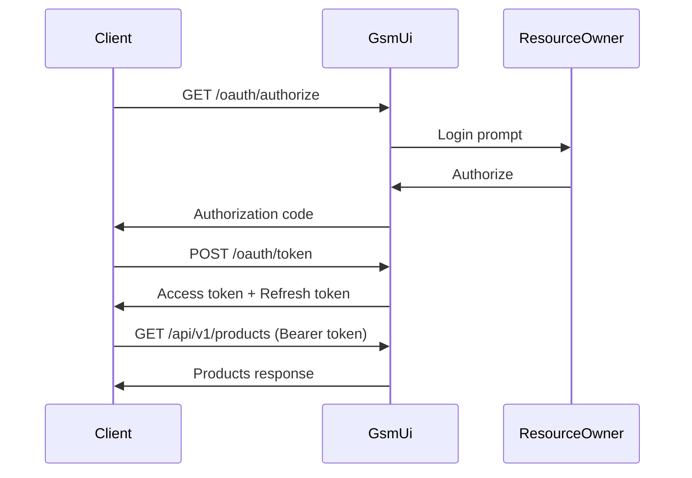

# API Design

## Overview

GsmUi provides a RESTful API for programmatic access to products, orders, licenses, and search. The API follows JSON:API conventions with consistent response formats, versioning, and authentication.

## API Versioning

| Version | Status | Base URL | Sunset Date |
|---------|--------|----------|-------------|
| v1 | Current | `/api/v1` | — |
| v2 | Planned | `/api/v2` | — |

### Version Strategy

- URL-based versioning: `/api/v1/products`
- Breaking changes require new version
- Non-breaking additions (new fields) in current version
- Deprecation headers on sunset candidates
- 12-month minimum deprecation notice

## Authentication

### Methods

| Method | Use Case | Token Type | Rate Limit |
|--------|----------|------------|------------|
| API Key | Server-to-server | `Authorization: Bearer {key}` | 1000 req/min |
| OAuth 2.0 | User-authorized apps | Bearer token | 600 req/min |
| Personal Access Token | Developer scripts | `Authorization: Bearer {pat}` | 300 req/min |

### OAuth 2.0 Flow



### OAuth Scopes

| Scope | Access Level |
|-------|--------------|
| `products:read` | View product catalog |
| `products:write` | Create/edit products (admin) |
| `orders:read` | View own orders |
| `orders:write` | Place orders |
| `licenses:read` | View own licenses |
| `search` | Access search API |
| `admin` | Full admin access |

## Rate Limiting

### Tiers

| Tier | Requests/Minute | Burst | Scope |
|------|-----------------|-------|-------|
| Anonymous | 30 | 10 | IP address |
| Authenticated | 60 | 20 | User ID |
| API Key | 1000 | 100 | Key ID |
| Premium | 3000 | 300 | Key ID |

### Rate Limit Headers

```http
X-RateLimit-Limit: 1000
X-RateLimit-Remaining: 995
X-RateLimit-Reset: 1640995200
Retry-After: 30
```

### Response

```json
{
    "error": "rate_limit_exceeded",
    "message": "Too many requests. Please retry after 30 seconds.",
    "retry_after": 30
}
```

## Response Format

### Success Response

```json
{
    "data": {
        "id": "01904f2a-1b3c-7d5e-9f8a-2c4d6e8f0a1b",
        "type": "product",
        "attributes": {
            "name": "GsmUi Pro Kit",
            "slug": "gsmui-pro-kit",
            "tagline": "Premium UI components for Livewire",
            "description_html": "<p>A comprehensive...</p>",
            "price": {
                "amount": 9900,
                "currency": "USD",
                "formatted": "$99.00"
            },
            "status": "published",
            "featured": true,
            "created_at": "2024-01-15T10:30:00Z",
            "updated_at": "2024-03-20T14:22:00Z"
        },
        "relationships": {
            "category": {
                "data": { "id": "cat-001", "type": "category" }
            },
            "components": {
                "data": [
                    { "id": "comp-001", "type": "component" },
                    { "id": "comp-002", "type": "component" }
                ]
            }
        },
        "links": {
            "self": "/api/v1/products/gsmui-pro-kit",
            "components": "/api/v1/products/gsmui-pro-kit/components"
        }
    }
}
```

### Collection Response

```json
{
    "data": [
        { "id": "...", "type": "product", "attributes": {} },
        { "id": "...", "type": "product", "attributes": {} }
    ],
    "meta": {
        "total": 142,
        "per_page": 15,
        "current_page": 1,
        "last_page": 10
    },
    "links": {
        "self": "/api/v1/products?page=1",
        "next": "/api/v1/products?page=2",
        "prev": null,
        "first": "/api/v1/products?page=1",
        "last": "/api/v1/products?page=10"
    }
}
```

### Error Response

```json
{
    "errors": [
        {
            "id": "err-001",
            "status": "422",
            "code": "validation_error",
            "title": "Validation Error",
            "detail": "The name field is required.",
            "source": {
                "pointer": "/data/attributes/name"
            }
        }
    ]
}
```

## Error Handling

### Error Codes

| HTTP Status | Code | Description |
|-------------|------|-------------|
| 400 | `bad_request` | Malformed request syntax |
| 401 | `unauthenticated` | Missing or invalid credentials |
| 403 | `forbidden` | Insufficient permissions |
| 404 | `not_found` | Resource does not exist |
| 409 | `conflict` | Resource state conflict |
| 422 | `validation_error` | Request validation failed |
| 429 | `rate_limit_exceeded` | Too many requests |
| 500 | `server_error` | Internal server error |
| 503 | `service_unavailable` | Temporary maintenance |

### Validation Errors

```json
{
    "errors": [
        {
            "status": "422",
            "code": "validation_error",
            "title": "Validation Error",
            "detail": "The name must be at least 3 characters.",
            "source": {
                "pointer": "/data/attributes/name"
            }
        },
        {
            "status": "422",
            "code": "validation_error",
            "title": "Validation Error",
            "detail": "The price must be a positive integer.",
            "source": {
                "pointer": "/data/attributes/price"
            }
        }
    ]
}
```

## Endpoints

### Products

| Method | Endpoint | Description | Auth |
|--------|----------|-------------|------|
| GET | `/api/v1/products` | List products | No |
| GET | `/api/v1/products/{slug}` | Get product | No |
| POST | `/api/v1/products` | Create product | Admin |
| PUT | `/api/v1/products/{id}` | Update product | Admin |
| DELETE | `/api/v1/products/{id}` | Delete product | Admin |
| GET | `/api/v1/products/{id}/components` | List components | No |
| GET | `/api/v1/products/{id}/reviews` | List reviews | No |

### Filtering & Sorting

```
GET /api/v1/products?filter[category]=ui-kits&filter[price_min]=50&sort=-created_at&include=category,components
```

| Parameter | Type | Example |
|-----------|------|---------|
| `filter[field]` | varies | `filter[status]=published` |
| `sort` | field | `sort=-created_at` (descending) |
| `include` | relation | `include=category,components` |
| `fields[type]` | fields | `fields[product]=name,slug,price` |
| `page[size]` | integer | `page[size]=25` |
| `page[number]` | integer | `page[number]=2` |

### Orders

| Method | Endpoint | Description | Auth |
|--------|----------|-------------|------|
| GET | `/api/v1/orders` | List own orders | User |
| POST | `/api/v1/orders` | Create order | User |
| GET | `/api/v1/orders/{id}` | Get order | User |
| POST | `/api/v1/orders/{id}/cancel` | Cancel order | User |
| GET | `/api/v1/orders/{id}/invoice` | Get invoice | User |

### Licenses

| Method | Endpoint | Description | Auth |
|--------|----------|-------------|------|
| GET | `/api/v1/licenses` | List own licenses | User |
| GET | `/api/v1/licenses/{key}` | Validate license | API Key |
| POST | `/api/v1/licenses/{key}/activate` | Activate license | API Key |
| POST | `/api/v1/licenses/{key}/deactivate` | Deactivate license | API Key |

### Search

| Method | Endpoint | Description | Auth |
|--------|----------|-------------|------|
| GET | `/api/v1/search` | Search products | No |
| GET | `/api/v1/search/suggest` | Autocomplete | No |

```
GET /api/v1/search?q=button+component&filter[category]=components&filter[price_max]=50&limit=10
```

### Users (Admin)

| Method | Endpoint | Description | Auth |
|--------|----------|-------------|------|
| GET | `/api/v1/users` | List users | Admin |
| GET | `/api/v1/users/{id}` | Get user | Admin |
| PUT | `/api/v1/users/{id}` | Update user | Admin |
| DELETE | `/api/v1/users/{id}` | Delete user | Admin |

## OpenAPI Specification

The API is documented using OpenAPI 3.1:

```yaml
openapi: 3.1.0
info:
  title: GsmUi API
  version: 1.0.0
  description: |
    RESTful API for the GsmUi component marketplace platform.
    Provides access to products, orders, licenses, and search.

servers:
  - url: https://api.gsmui.com/v1
    description: Production
  - url: https://staging-api.gsmui.com/v1
    description: Staging

security:
  - BearerAuth: []

paths:
  /products:
    get:
      summary: List products
      tags: [Products]
      parameters:
        - name: filter[category]
          in: query
          schema:
            type: string
        - name: sort
          in: query
          schema:
            type: string
            enum: [name, -name, price, -price, created_at, -created_at]
      responses:
        '200':
          description: Product list
          content:
            application/json:
              schema:
                $ref: '#/components/schemas/ProductCollection'
```

## API Key Management

### Key Format

```
gsmui_live_xxxxxxxxxxxxxxxxxxxxxxxxxxxxxxxx
gsmui_test_xxxxxxxxxxxxxxxxxxxxxxxxxxxxxxxx
```

### Key Rotation

```php
// API key lifecycle
POST /api/v1/api-keys          // Create new key
GET  /api/v1/api-keys          // List keys
DELETE /api/v1/api-keys/{id}   // Revoke key
POST /api/v1/api-keys/{id}/rotate  // Rotate key
```

## SDK Support

| Language | Package | Status |
|----------|---------|--------|
| PHP | `gsmui/sdk-php` | Stable |
| JavaScript | `@gsmui/sdk-js` | Stable |
| Python | `gsmui-sdk-python` | Beta |
| Ruby | `gsmui-sdk-ruby` | Planned |

## Related Documents

- [Backend Architecture](../Backend-Architecture/index.md)
- [Security Architecture](../Security/index.md)
- [Cache Strategy](../Cache/index.md)
- [Search Architecture](../Search/index.md)
