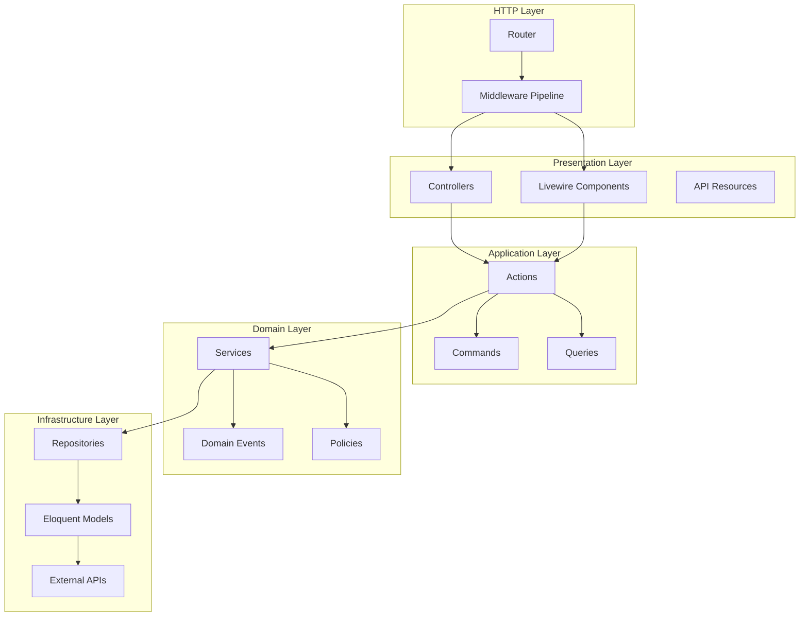
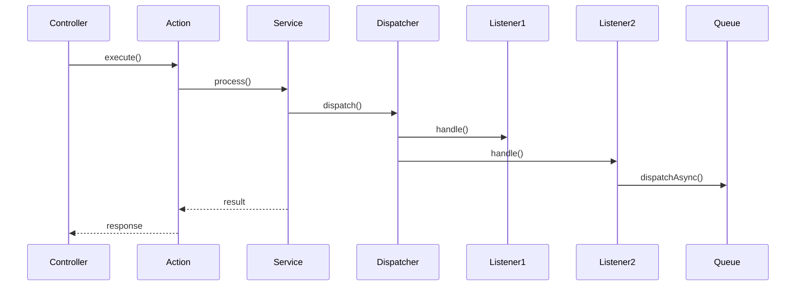
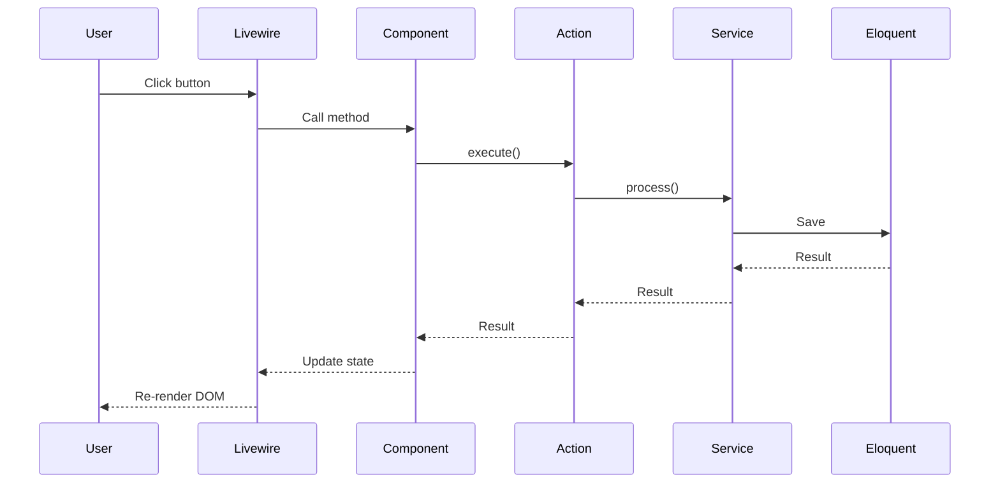

# Backend Architecture

## Overview

GsmUi follows a layered backend architecture within a Laravel monolith. The architecture separates concerns across HTTP handling, middleware, controllers, actions, services, repositories, and Eloquent models.

## Layer Architecture



## Layer Definitions

| Layer | Responsibility | Input | Output |
|-------|---------------|-------|--------|
| HTTP | Request routing, middleware pipeline | HTTP Request | HTTP Response |
| Presentation | Request validation, response formatting | Request DTO | Response/Resource |
| Application | Orchestrate single business operation | Command/Query | Result |
| Domain | Business rules, invariants | Entities | State changes |
| Infrastructure | Data access, external integrations | Domain objects | Persisted state |

## Routing

### Route Organization

```php
// routes/web.php — Blade/Livewire routes
Route::middleware(['auth', 'verified'])->group(function () {
    Route::get('/dashboard', DashboardController::class)->name('dashboard');
    Route::get('/settings', [SettingsController::class, 'index'])->name('settings');
});

// routes/api.php — RESTful API routes
Route::prefix('v1')->group(function () {
    Route::apiResource('products', ProductController::class);
    Route::apiResource('orders', OrderController::class)->only(['index', 'store', 'show']);
    Route::get('/search', SearchController::class)->name('api.search');
});
```

### Route Naming Convention

| Route Type | Pattern | Example |
|------------|---------|---------|
| Index | `{resource}` | `/products` |
| Show | `{resource}/{slug}` | `/products/ui-kit-pro` |
| Create | `{resource}/create` | `/products/create` |
| Store | POST `{resource}` | `POST /products` |
| Edit | `{resource}/{slug}/edit` | `/products/ui-kit-pro/edit` |
| Update | PUT `{resource}/{slug}` | `PUT /products/ui-kit-pro` |
| Delete | DELETE `{resource}/{slug}` | `DELETE /products/ui-kit-pro` |

## Middleware Pipeline

```mermaid
graph LR
    Request[HTTP Request] --> TrustProxies[TrustProxies]
    TrustProxies --> HandleCors[HandleCors]
    HandleCsrf[HandleCsrf] --> HandleCors
    HandleCors --> PreventRequestsDuringMaintenance[PreventRequestsDuringMaintenance]
    PreventRequestsDuringMaintenance --> ValidatePostSize[ValidatePostSize]
    ValidatePostSize --> TrimStrings[TrimStrings]
    TrimStrings --> ConvertEmptyStringsToNull[ConvertEmptyStringsToNull]
    ConvertEmptyStringsToNull --> Csp[CSP Headers]
    Csp --> AuthenticateSession[AuthenticateSession]
    AuthenticateSession --> VerifyCsrfToken[VerifyCsrfToken]
    VerifyCsrfToken --> SetLocale[SetLocale]
    SetLocale --> RateLimit[RateLimit]
    RateLimit --> HandleRequests[HandleRequests]
```



### Custom Middleware

| Middleware | Priority | Purpose |
|------------|----------|---------|
| `CspMiddleware` | 1 | Content Security Policy headers |
| `SetLocaleMiddleware` | 2 | Detect and set locale from URL/cookie |
| `ForceHttpsMiddleware` | 3 | Redirect HTTP to HTTPS |
| `ApiRateLimitMiddleware` | 4 | API-specific rate limiting |
| `EnsureEmailVerifiedMiddleware` | 5 | Redirect unverified users |
| `CheckSubscriptionMiddleware` | 6 | Enforce subscription status |

### CSP Middleware Configuration

```php
// app/Http/Middleware/CspMiddleware.php
class CspMiddleware
{
    public function handle(Request $request, Closure $next): Response
    {
        $nonce = base64_encode(random_bytes(32));

        $policy = [
            'default-src' => ["'self'"],
            'script-src' => ["'self'", "'nonce-{$nonce}'", "'strict-dynamic'"],
            'style-src' => ["'self'", "'unsafe-inline'"],
            'img-src' => ["'self'", 'data:', 'https:'],
            'font-src' => ["'self'"],
            'connect-src' => ["'self'"],
            'frame-ancestors' => ["'none'"],
            'base-uri' => ["'self'"],
            'form-action' => ["'self'"],
        ];

        $header = collect($policy)
            ->map(fn($sources, $key) => $key . ' ' . implode(' ', $sources))
            ->implode('; ');

        $response = $next($request);
        $response->headers->set('Content-Security-Policy', $header);
        $response->headers->set('X-Content-Type-Options', 'nosniff');
        $response->headers->set('X-Frame-Options', 'DENY');

        return $response;
    }
}
```

## Controllers

### Controller Structure

```php
class ProductController extends Controller
{
    public function __construct(
        private readonly CreateProductAction $createProduct,
        private readonly UpdateProductAction $updateProduct,
    ) {}

    public function index(ProductIndexRequest $request): JsonResponse
    {
        $products = $this->listProducts->execute(
            new ListProductsQuery(
                category: $request->category,
                status: $request->status,
                sort: $request->sort,
                perPage: $request->perPage,
            )
        );

        return ProductResource::collection($products);
    }

    public function store(StoreProductRequest $request): JsonResponse
    {
        $product = $this->createProduct->execute(
            new CreateProductCommand(
                name: $request->name,
                slug: $request->slug,
                description: $request->description,
                price: $request->price,
                categoryIds: $request->category_ids,
            )
        );

        return new ProductResource($product->refresh());
    }
}
```

### Form Request Validation

```php
class StoreProductRequest extends FormRequest
{
    public function rules(): array
    {
        return [
            'name' => ['required', 'string', 'max:255'],
            'slug' => ['required', 'string', 'max:255', 'unique:products,slug'],
            'description' => ['required', 'string'],
            'price' => ['required', 'integer', 'min:0'],
            'category_ids' => ['required', 'array', 'min:1'],
            'category_ids.*' => ['exists:categories,id'],
            'featured_image' => ['required', 'image', 'max:5120'],
        ];
    }
}
```

## Actions

Single-responsibility classes that orchestrate one business operation.

```php
class CreateProductAction
{
    public function __construct(
        private readonly ProductRepository $products,
        private readonly EventDispatcher $events,
    ) {}

    public function execute(CreateProductCommand $command): Product
    {
        $product = $this->products->create([
            'name' => $command->name,
            'slug' => $command->slug,
            'description' => $command->description,
            'base_price' => new Money($command->price, 'USD'),
            'status' => ProductStatus::Draft,
        ]);

        $product->categories()->sync($command->categoryIds);

        $this->events->dispatch(new ProductCreated($product));

        return $product;
    }
}
```

### Action Pattern

| Aspect | Convention |
|--------|-----------|
| Naming | `{Verb}{Noun}Action` (e.g., `CreateProductAction`) |
| Constructor | Inject repositories, services, event dispatcher |
| Method | Single `execute()` method |
| Input | Dedicated Command/Query DTO |
| Output | Domain model or collection |
| Side Effects | Fire events, dispatch jobs |

## Services

### Domain Services

```php
class PricingService
{
    public function calculateOrderTotal(Order $order): Money
    {
        $subtotal = $order->items->reduce(
            fn(Money $sum, OrderItem $item) => $sum->add($item->total),
            new Money(0, 'USD')
        );

        $tax = $this->calculateTax($subtotal, $order->user->taxRegion);
        $discount = $this->applyDiscounts($subtotal, $order->user);

        return $subtotal->add($tax)->subtract($discount);
    }

    private function calculateTax(Money $amount, string $region): Money
    {
        $rate = $this->taxRates->getRate($region);
        return $amount->multiply($rate);
    }
}
```

### Service Registration

```php
// AppServiceProvider.php
public function register(): void
{
    $this->app->bind(PricingService::class, fn($app) => new PricingService(
        taxRates: $app->make(TaxRateRepository::class),
        discountService: $app->make(DiscountService::class),
    ));

    $this->app->bind(ProductRepository::class, EloquentProductRepository::class);
    $this->app->bind(OrderRepository::class, EloquentOrderRepository::class);
}
```

## Repositories

```php
interface ProductRepository
{
    public function find(string $id): ?Product;
    public function findBySlug(string $slug): ?Product;
    public function create(array $data): Product;
    public function update(Product $product, array $data): Product;
    public function delete(Product $product): bool;
    public function query(): ProductQueryBuilder;
    public function getFeatured(int $limit = 6): Collection;
    public function getActive(): Collection;
}

class EloquentProductRepository implements ProductRepository
{
    public function __construct(
        private readonly Product $model,
    ) {}

    public function find(string $id): ?Product
    {
        return $this->model->newQuery()->find($id);
    }

    public function query(): ProductQueryBuilder
    {
        return new ProductQueryBuilder($this->model->newQuery());
    }
}
```

## Service Container Bindings

| Binding | Interface | Implementation | Scope |
|---------|-----------|----------------|-------|
| `ProductRepository` | Interface | `EloquentProductRepository` | Singleton |
| `OrderRepository` | Interface | `EloquentOrderRepository` | Singleton |
| `PricingService` | Class | `PricingService` | Transient |
| `SearchService` | Interface | `MeilisearchSearchService` | Singleton |
| `PaymentGateway` | Interface | `StripePaymentGateway` | Singleton |
| `MailFactory` | Class | `MailFactory` | Singleton |

## Event System

### Domain Events

```php
// Event Definition
class ProductPublished
{
    public function __construct(
        public readonly Product $product,
    ) {}
}

// Listener
class IndexProductInSearch
{
    public function handle(ProductPublished $event): void
    {
        $this->searchService->indexProduct($event->product);
    }
}

// EventServiceProvider
protected $listen = [
    ProductPublished::class => [
        IndexProductInSearch::class,
        NotifyFollowers::class,
        InvalidateProductCache::class,
    ],
    OrderFulfilled::class => [
        GenerateLicenseKey::class,
        SendFulfillmentEmail::class,
        UpdateDownloadCount::class,
    ],
];
```

### Event Flow



## Queue Architecture

### Job Types

| Job | Queue | Priority | Timeout | Retries |
|-----|-------|----------|---------|---------|
| `SendEmailJob` | `high` | 1 | 30s | 3 |
| `ProcessPaymentJob` | `high` | 1 | 60s | 3 |
| `GenerateDownloadJob` | `default` | 2 | 120s | 3 |
| `IndexSearchJob` | `default` | 2 | 30s | 3 |
| `SyncAnalyticsJob` | `low` | 3 | 60s | 5 |
| `CleanupExpiredJob` | `low` | 3 | 300s | 3 |
| `ExportDataJob` | `low` | 3 | 600s | 3 |

### Job Dispatch Pattern

```php
class OrderFulfilledListener
{
    public function handle(OrderFulfilled $event): void
    {
        // Immediate: high priority
        SendLicenseEmail::dispatch($event->order)
            ->onQueue('high');

        // Background: default priority
        GenerateDownloadArchive::dispatch($event->order)
            ->onQueue('default')
            ->delay(now()->addMinutes(5));

        // Scheduled: low priority
        SyncToAnalytics::dispatch($event->order)
            ->onQueue('low')
            ->delay(now()->addHours(1));
    }
}
```

## Livewire Integration

### Component Registration

```php
// routes/web.php
Route::middleware(['auth'])->group(function () {
    Livewire::component('dashboard', Dashboard::class);
    Livewire::component('settings.profile', Settings\Profile::class);
    Livewire::component('settings.billing', Settings\Billing::class);
});
```

### Livewire → Action Flow



## Related Documents

- [API Design](../API/index.md)
- [Cache Strategy](../Cache/index.md)
- [Queue Architecture](../Queue/index.md)
- [Domain-Driven Design](../Domain-Driven-Design/index.md)
