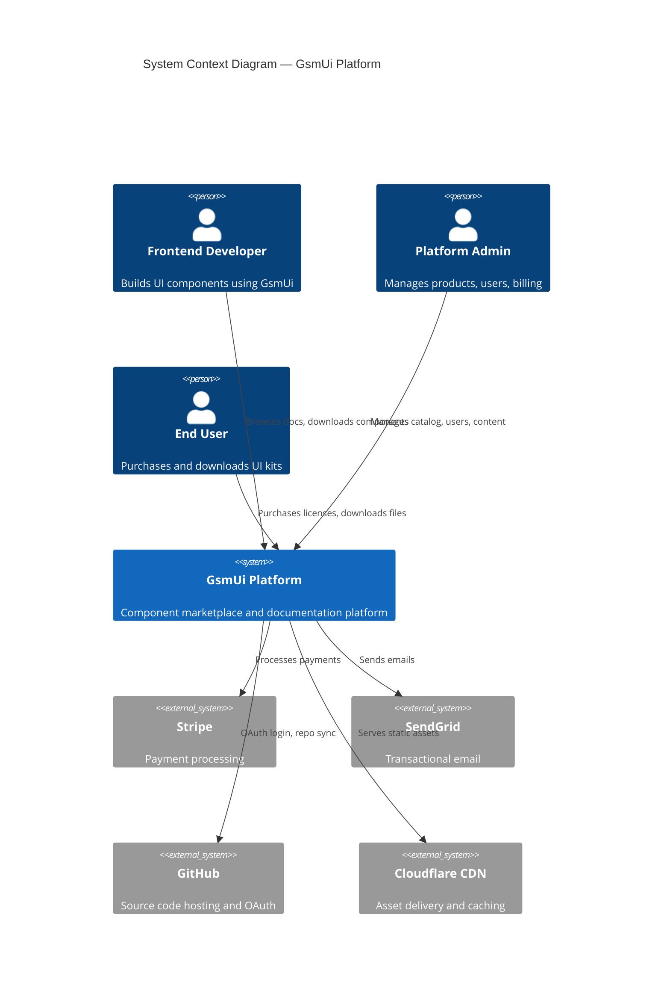
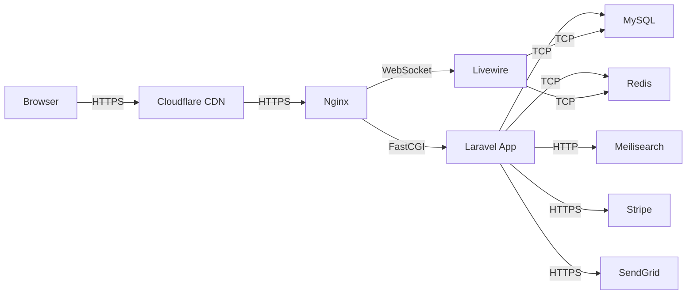
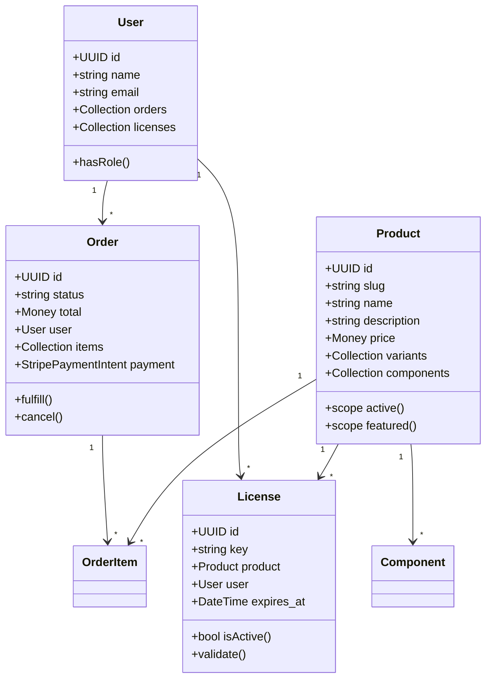

# C4 Architecture Model

## Overview

The GsmUi platform follows the C4 model for software architecture documentation, providing four levels of abstraction: Context, Container, Component, and Code. Each level serves a different audience and purpose.

## Level 1: System Context

The highest level view showing the GsmUi platform in its environment.



### Actors

| Actor | Role | Authentication | Key Interactions |
|-------|------|----------------|------------------|
| Frontend Developer | Component consumer | GitHub OAuth / Email | Browse docs, preview components, download |
| Platform Admin | Content & user manager | Email + 2FA | CRUD products, manage users, view analytics |
| End User | License purchaser | Email / Password | Purchase, download, manage licenses |
| API Consumer | Automated integrations | API key + OAuth | Programmatic access to catalog |

### External System Integrations

| System | Protocol | Purpose | SLA |
|--------|----------|---------|-----|
| Stripe | REST API v2024-12 | Payment processing, subscriptions | 99.99% |
| SendGrid v3 | REST API | Transactional emails, templates | 99.9% |
| GitHub | REST + GraphQL | OAuth, repository sync, webhooks | 99.9% |
| Cloudflare | HTTPS | CDN, DDoS protection, DNS | 99.99% |
| Meilisearch | REST | Full-text search, faceted filtering | Self-hosted |

## Level 2: Container Diagram

Shows the high-level technical building blocks.

```mermaid
C4Container
    title Container Diagram — GsmUi Platform

    Person(user, "User", "Developer or Admin")

    Container_Boundary(gsmui_boundary, "GsmUi Platform") {
        Container(nginx, "Nginx", "Reverse Proxy", "TLS termination, static files, load balancing")
        Container(laravel, "Laravel App", "PHP 8.4 / Laravel 11", "Core application logic, API, Blade rendering")
        Container(livewire, "Livewire Components", "Livewire v3", "Interactive UI components, real-time updates")
        Container(horizon, "Horizon", "Queue Worker", "Background job processing, scheduled tasks")
        Container(meadocs, "Meilisearch", "Search Engine", "Full-text search, typo tolerance, faceted search")
    }

    Database(mysql, "MySQL 8.4", "Primary data store")
    Database(redis, "Redis 7", "Cache, sessions, queues")
    System_Ext(stripe, "Stripe", "Payments")
    System_Ext(sendgrid, "SendGrid", "Email")
    System_Ext(cdn, "Cloudflare", "CDN + Edge")

    Rel(user, cdn, "HTTPS")
    Rel(cdn, nginx, "HTTPS")
    Rel(nginx, laravel, "FastCGI / :9000")
    Rel(nginx, livewire, "WebSocket / :6001")
    Rel(laravel, mysql, "TCP / :3306")
    Rel(laravel, redis, "TCP / :6379")
    Rel(laravel, meadocs, "HTTP / :7700")
    Rel(horizon, mysql, "TCP / :3306")
    Rel(horizon, redis, "TCP / :6379")
    Rel(laravel, stripe, "HTTPS")
    Rel(laravel, sendgrid, "HTTPS")
```

### Container Responsibilities

| Container | Technology | Port | Responsibility |
|-----------|-----------|------|----------------|
| Nginx | 1.25+ | 443/80 | TLS termination, static assets, reverse proxy, rate limiting |
| Laravel App | PHP 8.4 / Laravel 11 | 9000 | HTTP handling, business logic, API, Blade rendering |
| Livewire | Livewire v3 | — | Real-time UI interactions, Alpine.js integration |
| Horizon | Laravel Horizon | — | Queue processing, job scheduling, retry logic |
| MySQL | 8.4 InnoDB | 3306 | Primary persistent storage, ACID transactions |
| Redis | 7.2+ | 6379 | Cache, session store, queue backend, rate limiters |
| Meilisearch | 1.7+ | 7700 | Full-text search, typo tolerance, faceted filtering |

### Data Flow



## Level 3: Component Diagram

Detailed view of the Laravel application internals.

```mermaid
C4Component
    title Component Diagram — Laravel Application

    Container_Boundary(laravel, "Laravel Application") {
        Component(routing, "Router", "Laravel Router", "Route matching, middleware pipeline")
        Component(middleware, "Middleware", "HTTP Middleware", "CSP, CSRF, auth, rate limiting, locale")
        Component(controllers, "Controllers", "HTTP Controllers", "Request handling, validation, response")
        Component(actions, "Actions", "Action Classes", "Single-responsibility business logic")
        Component(services, "Services", "Service Classes", "Domain logic, orchestration")
        Component(repositories, "Repositories", "Repository Classes", "Data access abstraction")
        Component(models, "Eloquent Models", "ORM", "Domain entities, relationships, scopes")
        Component(events, "Event System", "Laravel Events", "Domain events, listeners, observers")
        Component(queue, "Queue System", "Laravel Queue", "Job dispatching, processing, retry")
        Component(cache, "Cache Layer", "Cache Manager", "Redis/file/APCu caching strategies")
    }

    Database(mysql, "MySQL")
    Database(redis, "Redis")

    Rel(routing, middleware, "Pipeline")
    Rel(middleware, controllers, "Dispatches")
    Rel(controllers, actions, "Delegates")
    Rel(actions, services, "Orchestrates")
    Rel(services, repositories, "Queries")
    Rel(repositories, models, "Uses")
    Rel(models, mysql, "SQL")
    Rel(services, events, "Fires")
    Rel(queue, services, "Processes")
    Rel(cache, redis, "Reads/Writes")
```

### Component Responsibilities

| Component | Pattern | Responsibility |
|-----------|---------|----------------|
| Router | Convention | Route definitions, parameter binding, name resolution |
| Middleware | Pipeline | Cross-cutting concerns: auth, CSP, rate limiting, localization |
| Controllers | Thin | Request validation, delegates to actions, returns responses |
| Actions | Single-use | One business operation per class (SRP) |
| Services | Coordinating | Domain logic that spans multiple models/repositories |
| Repositories | Abstract | Data access logic, query building, caching |
| Models | Active Record | Entity definitions, relationships, scopes, mutators |
| Event System | Observer | Decoupled side effects: emails, search indexing, cache invalidation |
| Queue | Async | Background processing: email sending, file generation, sync |
| Cache | Strategy | Read-through cache, tag-based invalidation, query caching |

## Level 4: Code Diagram

Key class structures and their relationships.



### Key Design Patterns

| Pattern | Usage | Example |
|---------|-------|---------|
| Repository | Data access | `ProductRepository`, `OrderRepository` |
| Action | Business operations | `CreateOrderAction`, `FulfillDownloadAction` |
| Observer | Model events | `ProductObserver`, `OrderObserver` |
| Policy | Authorization | `ProductPolicy`, `LicensePolicy` |
| Resource | API transformation | `ProductResource`, `OrderResource` |
| DTO | Data transfer | `Money`, `Address`, `SearchCriteria` |
| Strategy | Pluggable behavior | `PaymentStrategy`, `ExportStrategy` |

## Architecture Decision Records

### ADR-001: Monolith First

**Status:** Accepted  
**Context:** Need to ship quickly with small team.  
**Decision:** Start as a modular monolith with clear bounded context boundaries.  
**Consequences:** Simpler deployment, easier debugging, can extract services later.

### ADR-002: Livewire for Interactivity

**Status:** Accepted  
**Context:** Need rich UI without heavy JS framework.  
**Decision:** Use Livewire v3 with Alpine.js for client-side interactivity.  
**Consequences:** Reduced JS complexity, server-rendered HTML, WebSocket support.

### ADR-003: MySQL as Primary Store

**Status:** Accepted  
**Context:** Need ACID transactions, mature ecosystem, team expertise.  
**Decision:** MySQL 8.4 InnoDB with read replicas for scaling.  
**Consequences:** Strong consistency, JSON column support, full-text indexing.

## Related Documents

- [Container Specs](../Containers/index.md)
- [Backend Architecture](../Backend-Architecture/index.md)
- [Cache Strategy](../Cache/index.md)
- [Queue Architecture](../Queue/index.md)
