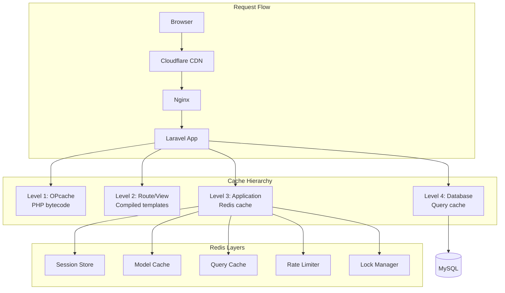

# Cache Strategy

## Overview

GsmUi uses a multi-layered caching strategy with Redis as the primary driver. Caching is applied at the query, model, view, route, and session levels to minimize database load and improve response times.

## Cache Layers



## Cache Configuration

### Driver Matrix

| Cache Type | Driver | TTL | Invalidation | Priority |
|------------|--------|-----|--------------|----------|
| OPcache | PHP | — | Restart | Critical |
| Route | file | — | `route:clear` | High |
| View | file | — | `view:clear` | High |
| Config | file | — | `config:clear` | High |
| Application | redis | varies | Manual/Tag | High |
| Query | redis | varies | Manual/Tag | Medium |
| Session | redis | 7200s | Expiry | Critical |
| Lock | redis | 30s | Expiry | High |
| Rate Limit | redis | 60s | Expiry | High |

### Redis Configuration

```php
// config/cache.php
'redis' => [
    'client' => env('REDIS_CLIENT', 'phpredis'),
    'default' => [
        'url' => env('REDIS_URL'),
        'host' => env('REDIS_HOST', '127.0.0.1'),
        'port' => env('REDIS_PORT', 6379),
        'database' => env('REDIS_DB', 0),
        'password' => env('REDIS_PASSWORD'),
        'prefix' => 'gsmui_cache:',
    ],
    'session' => [
        'host' => env('REDIS_HOST', '127.0.0.1'),
        'port' => env('REDIS_PORT', 6379),
        'database' => env('REDIS_SESSION_DB', 1),
        'password' => env('REDIS_PASSWORD'),
        'prefix' => 'gsmui_session:',
    ],
    'queue' => [
        'host' => env('REDIS_HOST', '127.0.0.1'),
        'port' => env('REDIS_PORT', 6379),
        'database' => env('REDIS_QUEUE_DB', 2),
        'password' => env('REDIS_PASSWORD'),
        'prefix' => 'gsmui_queue:',
    ],
],
```

## Cache Tags

### Tag Namespace

| Tag | Usage | TTL |
|-----|-------|-----|
| `products` | All product-related cache | 1 hour |
| `products:{id}` | Single product cache | 1 hour |
| `categories` | Category tree | 24 hours |
| `users:{id}` | User profile | 30 minutes |
| `orders:{id}` | Order data | 5 minutes |
| `search:results` | Search result cache | 5 minutes |
| `docs:pages` | Documentation pages | 1 hour |
| `homepage` | Homepage data | 15 minutes |

### Tag Implementation

```php
class ProductCache
{
    private const TTL = 3600; // 1 hour

    public function remember(Product $product, Closure $callback): mixed
    {
        return Cache::tags(['products', "products:{$product->id}"])
            ->remember("product:{$product->id}", self::TTL, $callback);
    }

    public function forget(Product $product): void
    {
        Cache::tags(["products:{$product->id}"])->flush();
    }

    public function flush(): void
    {
        Cache::tags(['products'])->flush();
    }
}
```

## Query Caching

### Eloquent Query Cache

```php
class CachedProductRepository implements ProductRepository
{
    public function __construct(
        private readonly EloquentProductRepository $repository,
        private readonly Cache $cache,
    ) {}

    public function find(string $id): ?Product
    {
        return $this->cache->tags(['products', "products:{$id}"])
            ->remember("product:{$id}", 3600, fn() =>
                $this->repository->find($id)
            );
    }

    public function getFeatured(int $limit = 6): Collection
    {
        return $this->cache->tags(['products'])
            ->remember("featured:{$limit}", 900, fn() =>
                $this->repository->getFeatured($limit)
            );
    }

    public function query(): ProductQueryBuilder
    {
        return new CachedProductQueryBuilder(
            $this->repository->query(),
            $this->cache
        );
    }
}
```

### Query Cache Key Strategy

```
Key format: {context}:{operation}:{params_hash}
Examples:
  products:featured:limit_6
  products:category_ui-kits:sort_price
  orders:user_{id}:status_pending
  search:query_button_components:page_1
```

## Cache Invalidation

### Invalidation Patterns

| Pattern | Trigger | Implementation |
|---------|---------|----------------|
| Time-based | TTL expiry | Automatic |
| Event-based | Domain event | Listener calls `forget()` |
| Tag-based | Related entity change | `Cache::tags([...])->flush()` |
| Manual | Admin action | `Cache::forget()` or flush |
| Version-based | Deploy | Prefix change |

### Event-Driven Invalidation

```php
class InvalidateProductCache
{
    public function handle(ProductUpdated $event): void
    {
        $product = $event->product;

        // Invalidate specific product
        Cache::tags(["products:{$product->id}"])->flush();

        // Invalidate lists containing this product
        Cache::tags(['products'])->flush();

        // Invalidate search results
        Cache::tags(['search:results'])->flush();

        // Invalidate homepage if product is featured
        if ($product->featured) {
            Cache::tags(['homepage'])->flush();
        }
    }
}
```

### Cache Stampede Prevention

```php
class StampedeAwareCache
{
    public function rememberWithLock(string $key, int $ttl, Closure $callback): mixed
    {
        // Try cache first
        $value = Cache::get($key);
        if ($value !== null) {
            return $value;
        }

        // Acquire lock
        $lock = Cache::lock("lock:{$key}", 10);

        try {
            // Double-check after acquiring lock
            $value = Cache::get($key);
            if ($value !== null) {
                return $value;
            }

            // Execute callback and cache
            $value = $callback();
            Cache::put($key, $value, $ttl);

            return $value;
        } finally {
            $lock->release();
        }
    }
}
```

## View Caching

### Blade Template Caching

```blade
{{-- Cache product cards for 15 minutes --}}
@php
    $cacheKey = 'product_cards:' . md5(serialize([$category, $sort, $page]));
@endphp

@cache($cacheKey, 900)
    @foreach($products as $product)
        <x-product-card :product="$product" />
    @endforeach
@endcache
```

### Route Caching

```php
// Cache specific routes
Route::get('/products', [ProductController::class, 'index'])
    ->middleware('cache.headers:public;max_age=900');

Route::get('/docs/{page}', [DocsController::class, 'show'])
    ->middleware('cache.headers:public;max_age=3600');
```

## Session Cache

### Redis Session Configuration

```php
// config/session.php
'driver' => env('SESSION_DRIVER', 'redis'),
'lifetime' => env('SESSION_LIFETIME', 7200),
'expire_on_close' => false,
'encrypt' => true,
'connection' => 'session',
'table' => 'sessions',
'lottery' => [2, 100],
'cookie' => env('SESSION_COOKIE', 'gsmui_session'),
'path' => '/',
'domain' => env('SESSION_DOMAIN'),
'secure' => env('SESSION_SECURE_COOKIE', true),
'http_only' => true,
'same_site' => 'lax',
```

### Session Data Structure

```
Session key: gsmui_session:{session_id}
Data format: Serialized PHP array
Fields:
  _token: CSRF token
  login_token: Remember me token
  cart: Shopping cart data
  locale: User locale preference
  theme: UI theme preference
  _flash: Flash data (auto-expired)
```

## Performance Monitoring

### Cache Hit Ratio

```php
// AppServiceProvider
$this->app->booted(function () {
    if (config('app.debug')) {
        Cache::macro('stats', function () {
            $redis = Cache::getStore()->getRedis();
            $stats = $redis->info('stats');
            return [
                'hits' => $stats['keyspace_hits'],
                'misses' => $stats['keyspace_misses'],
                'hit_ratio' => round(
                    $stats['keyspace_hits'] /
                    ($stats['keyspace_hits'] + $stats['keyspace_misses']) * 100,
                    2
                ) . '%',
            ];
        });
    }
});
```

### Monitoring Dashboard

| Metric | Threshold | Action |
|--------|-----------|--------|
| Hit ratio | < 80% | Review TTLs, warm cache |
| Memory usage | > 80% | Increase limit or evict |
| Eviction rate | > 100/min | Review key strategy |
| Connection count | > 100 | Pool tuning |

## Cache Warming

### Strategy

```php
class CacheWarmer
{
    public function warm(): void
    {
        // Warm product listings
        Product::where('status', 'published')
            ->with('category')
            ->get()
            ->each(fn($product) => $this->productCache->remember($product, fn() => $product));

        // Warm category tree
        Cache::tags(['categories'])->remember('tree', 86400, fn() =>
            Category::tree()
        );

        // Warm homepage
        Cache::tags(['homepage'])->remember('data', 900, fn() => [
            'featured' => Product::featured()->limit(6)->get(),
            'recent' => Product::latest()->limit(8)->get(),
        ]);
    }
}
```

### Warm Schedule

| Cache | Warm Time | Frequency |
|-------|-----------|-----------|
| Product listings | 00:00 UTC | Daily |
| Category tree | 00:00 UTC | Daily |
| Homepage | Every 15 minutes | Cron |
| Search indices | On save | Event-driven |

## Related Documents

- [Container Specs](../Containers/index.md)
- [Queue Architecture](../Queue/index.md)
- [Search Architecture](../Search/index.md)
- [Backend Architecture](../Backend-Architecture/index.md)
