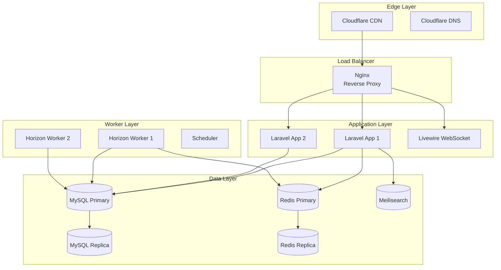

# Container Specifications

## Overview

GsmUi runs on a containerized infrastructure using Docker Compose for development and Kubernetes for production. This document specifies each container's configuration, resource requirements, and networking.

## Architecture Overview



## Container: Nginx Reverse Proxy

### Configuration

| Property | Value |
|----------|-------|
| Image | `nginx:1.25-alpine` |
| Port | 443 (HTTPS), 80 (HTTP redirect) |
| CPU | 0.5 cores (limit), 0.25 cores (request) |
| Memory | 256Mi (limit), 128Mi (request) |
| Replicas | 2 (production) |

### Key Configuration

```nginx
upstream php-fpm {
    least_conn;
    server app-1:9000 weight=5;
    server app-2:9000 weight=3;
    keepalive 32;
}

server {
    listen 443 ssl http2;
    server_name app.gsmui.com;

    # TLS Configuration
    ssl_certificate /etc/ssl/certs/app.pem;
    ssl_certificate_key /etc/ssl/private/app.key;
    ssl_protocols TLSv1.3 TLSv1.2;
    ssl_prefer_server_ciphers off;

    # Security Headers
    add_header Strict-Transport-Security "max-age=63072000" always;
    add_header X-Content-Type-Options nosniff always;
    add_header X-Frame-Options DENY always;

    # Static Assets
    location ~* \.(js|css|png|jpg|jpeg|gif|ico|svg|woff2)$ {
        root /var/www/public;
        expires 1y;
        add_header Cache-Control "public, immutable";
        access_log off;
    }

    # Application
    location / {
        try_files $uri $uri/ /index.php?$query_string;
    }

    location ~ \.php$ {
        fastcgi_pass php-fpm;
        fastcgi_param SCRIPT_FILENAME $document_root$fastcgi_script_name;
        include fastcgi_params;
    }

    # Rate Limiting
    limit_req zone=api burst=20 nodelay;
    limit_req_zone=login burst=5 nodelay;
}
```

### Rate Limiting Zones

| Zone | Rate | Burst | Purpose |
|------|------|-------|---------|
| `api` | 30 req/min | 20 | General API endpoints |
| `login` | 5 req/min | 5 | Authentication endpoints |
| `download` | 10 req/min | 5 | File download endpoints |
| `search` | 60 req/min | 30 | Search API |

## Container: Laravel Application

### Configuration

| Property | Value |
|----------|-------|
| Runtime | PHP 8.4 FPM |
| Extensions | pdo_mysql, mbstring, exif, bcmath, gd, redis, opcache |
| Workers | `pm.max_children = 10`, `pm.start_servers = 3` |
| CPU | 2 cores (limit), 1 core (request) |
| Memory | 1Gi (limit), 512Mi (request) |
| Replicas | 2-4 (auto-scaled) |

### PHP Configuration

```ini
; /etc/php/8.4/fpm/php.ini
memory_limit = 512M
upload_max_filesize = 64M
post_max_size = 64M
max_execution_time = 30
max_input_time = 60

; OPcache
opcache.enable=1
opcache.memory_consumption=256
opcache.interned_strings_buffer=16
opcache.max_accelerated_files=20000
opcache.revalidate_freq=0
opcache.validate_timestamps=0

; Session
session.gc_maxlifetime = 7200
session.cookie_httponly = 1
session.cookie_secure = 1
```

### Health Check

```php
// routes/health.php
Route::get('/health', function () {
    $checks = [
        'database' => fn() => DB::connection()->getPdo(),
        'redis' => fn() => Redis::ping(),
        'meilisearch' => fn() => Http::get('http://meilisearch:7700/health'),
        'storage' => fn() => Storage::disk('local')->put('health', 'ok'),
    ];

    $results = [];
    foreach ($checks as $name => $check) {
        try {
            $check();
            $results[$name] = 'healthy';
        } catch (\Throwable $e) {
            $results[$name] = 'unhealthy: ' . $e->getMessage();
        }
    }

    $healthy = !in_array('unhealthy', array_map(fn($r) => explode(':', $r)[0], $results));

    return response()->json([
        'status' => $healthy ? 'healthy' : 'unhealthy',
        'checks' => $results,
        'timestamp' => now()->toIso8601String(),
    ], $healthy ? 200 : 503);
});
```

### Environment Variables

| Variable | Source | Purpose |
|----------|--------|---------|
| `APP_KEY` | Vault | Encryption key |
| `DB_PASSWORD` | Vault | Database credentials |
| `REDIS_PASSWORD` | Vault | Redis authentication |
| `STRIPE_SECRET` | Vault | Stripe API key |
| `MAIL_PASSWORD` | Vault | SMTP credentials |
| `MEILISEARCH_KEY` | Vault | Search admin key |

## Container: MySQL 8.4

### Configuration

| Property | Value |
|----------|-------|
| Image | `mysql:8.4` |
| Port | 3306 |
| Storage | 100GB SSD (persistent volume) |
| CPU | 4 cores (limit), 2 cores (request) |
| Memory | 8Gi (limit), 4Gi (request) |
| Replicas | 1 primary + 1 replica |

### My.cnf Configuration

```ini
[mysqld]
# InnoDB
innodb_buffer_pool_size = 6G
innodb_log_file_size = 2G
innodb_flush_log_at_trx_commit = 1
innodb_flush_method = O_DIRECT
innodb_file_per_table = 1

# Connections
max_connections = 500
wait_timeout = 600
interactive_timeout = 600

# Binary Logging
server-id = 1
log-bin = mysql-bin
binlog_format = ROW
binlog_expire_logs_seconds = 604800
gtid_mode = ON
enforce_gtid_consistency = ON

# Replication
read_only = OFF
super_read_only = OFF

# Performance
tmp_table_size = 256M
max_heap_table_size = 256M
join_buffer_size = 4M
sort_buffer_size = 4M

# Slow Query Log
slow_query_log = 1
slow_query_log_file = /var/log/mysql/slow.log
long_query_time = 2
```

### Replication Setup

```sql
-- Primary (server-id = 1)
CREATE USER 'repl_user'@'%' IDENTIFIED BY 'repl_password';
GRANT REPLICATION SLAVE ON *.* TO 'repl_user'@'%';
SHOW MASTER STATUS;

-- Replica (server-id = 2)
CHANGE MASTER TO
    MASTER_HOST='mysql-primary',
    MASTER_USER='repl_user',
    MASTER_PASSWORD='repl_password',
    MASTER_AUTO_POSITION=1;
START REPLICA;
SHOW REPLICA STATUS\G
```

## Container: Redis 7

### Configuration

| Property | Value |
|----------|-------|
| Image | `redis:7.2-alpine` |
| Port | 6379 |
| Memory | 2Gi (limit), 1Gi (request) |
| Persistence | AOF + RDB snapshots |
| Replicas | 1 primary + 1 replica |

### Redis Configuration

```redis
# Memory
maxmemory 1gb
maxmemory-policy allkeys-lru

# Persistence
appendonly yes
appendfsync everysec
save 900 1
save 300 10
save 60 10000

# Replication
replica-read-only yes

# Security
requirepass ${REDIS_PASSWORD}
rename-command FLUSHDB ""
rename-command FLUSHALL ""

# Performance
tcp-backlog 511
tcp-keepalive 300
timeout 0
```

### Key Namespace Strategy

| Prefix | TTL | Purpose |
|--------|-----|---------|
| `session:` | 7200s | User sessions |
| `cache:` | varies | Query/model cache |
| `rate:` | 60s | Rate limiting |
| `lock:` | 30s | Distributed locks |
| `queue:` | none | Horizon queues |
| `search:` | 300s | Search results |

## Container: Meilisearch

### Configuration

| Property | Value |
|----------|-------|
| Image | `getmeili/meilisearch:v1.7` |
| Port | 7700 |
| Storage | 20GB SSD (persistent volume) |
| CPU | 2 cores (limit), 1 core (request) |
| Memory | 4Gi (limit), 2Gi (request) |

### Index Settings

```json
{
  "products": {
    "primaryKey": "id",
    "searchableAttributes": ["name", "tagline", "description", "tags"],
    "filterableAttributes": ["status", "category", "price", "tags", "featured"],
    "sortableAttributes": ["name", "price", "created_at", "popularity"],
    "rankingRules": [
      "sort",
      "words",
      "typo",
      "proximity",
      "attribute",
      "exactness"
    ],
    "typoTolerance": {
      "enabled": true,
      "minWordSizeForTypos": {
        "oneTypo": 5,
        "twoTypos": 9
      }
    },
    "synonyms": {
      "ui": ["user interface", "frontend"],
      "kit": ["bundle", "package", "collection"]
    }
  }
}
```

## Container: Horizon Queue Worker

### Configuration

| Property | Value |
|----------|-------|
| Runtime | PHP 8.4 CLI |
| Processes | 10 (supervised) |
| CPU | 2 cores (limit) |
| Memory | 2Gi (limit), 1Gi (request) |
| Replicas | 1-2 |

### Horizon Configuration

```php
// config/horizon.php
'environments' => [
    'production' => [
        'supervisor-1' => [
            'connection' => 'redis',
            'queue' => ['high', 'default', 'low'],
            'balance' => 'auto',
            'autoScalingStrategy' => 'time',
            'maxProcesses' => 10,
            'maxTime' => 3600,
            'maxJobs' => 1000,
            'memory' => 128,
            'tries' => 3,
            'timeout' => 90,
            'nice' => 0,
        ],
    ],
],
```

## Networking

### Docker Compose Network

```yaml
networks:
  gsmui-internal:
    driver: bridge
    ipam:
      config:
        - subnet: 172.20.0.0/16

services:
  nginx:
    networks:
      gsmui-internal:
        ipv4_address: 172.20.0.10
  app:
    networks:
      gsmui-internal:
        ipv4_address: 172.20.0.20
  mysql:
    networks:
      gsmui-internal:
        ipv4_address: 172.20.0.30
  redis:
    networks:
      gsmui-internal:
        ipv4_address: 172.20.0.40
  meilisearch:
    networks:
      gsmui-internal:
        ipv4_address: 172.20.0.50
```

### Port Mapping

| Service | Internal Port | External Port | Protocol |
|---------|--------------|---------------|----------|
| Nginx | 443 | 443 | HTTPS |
| Nginx | 80 | 80 | HTTP (redirect) |
| MySQL | 3306 | 3307 | TCP |
| Redis | 6379 | 6380 | TCP |
| Meilisearch | 7700 | 7700 | HTTP |
| Horizon | — | — | Internal |

## Resource Summary

| Container | CPU Request | CPU Limit | Memory Request | Memory Limit |
|-----------|------------|-----------|----------------|--------------|
| Nginx | 0.25 | 0.5 | 128Mi | 256Mi |
| Laravel | 1.0 | 2.0 | 512Mi | 1Gi |
| MySQL | 2.0 | 4.0 | 4Gi | 8Gi |
| Redis | 0.5 | 1.0 | 1Gi | 2Gi |
| Meilisearch | 1.0 | 2.0 | 2Gi | 4Gi |
| Horizon | 1.0 | 2.0 | 1Gi | 2Gi |
| **Total** | **4.75** | **11.5** | **8.625Gi** | **17.25Gi** |

## Related Documents

- [Deployment Strategy](../Deployment/index.md)
- [Cache Strategy](../Cache/index.md)
- [Queue Architecture](../Queue/index.md)
- [Security Architecture](../Security/index.md)
