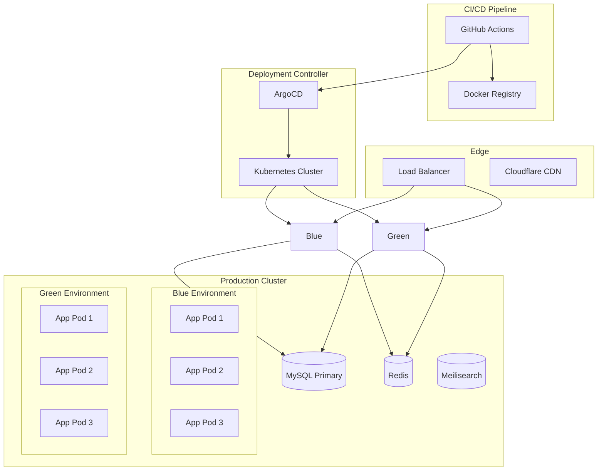
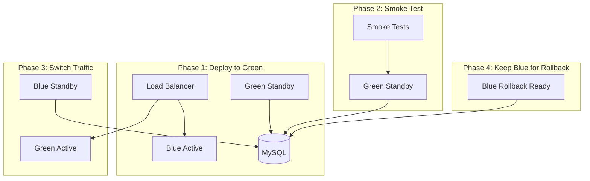
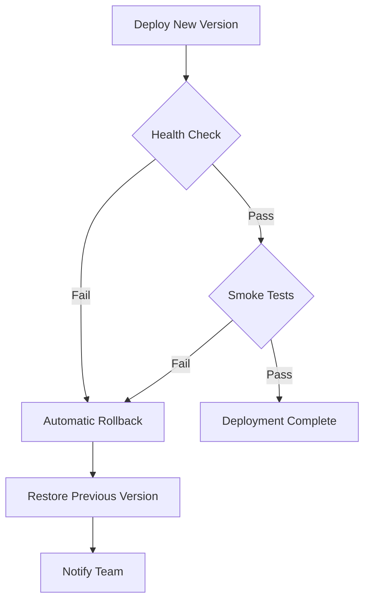

# Deployment Strategy

## Overview

GsmUi uses zero-downtime deployment with rolling updates, blue/green capability, and automated rollback. Deployments are orchestrated via GitHub Actions and deployed to a Kubernetes cluster.

## Deployment Architecture



## Deployment Strategies

### Rolling Deployment (Default)

Rolling deployment gradually replaces old pods with new ones.

```yaml
# k8s/deployment.yaml
apiVersion: apps/v1
kind: Deployment
metadata:
  name: gsmui-app
spec:
  replicas: 3
  strategy:
    type: RollingUpdate
    rollingUpdate:
      maxSurge: 1
      maxUnavailable: 0
  selector:
    matchLabels:
      app: gsmui-app
  template:
    metadata:
      labels:
        app: gsmui-app
    spec:
      containers:
        - name: app
          image: registry.gsmui.com/gsmui-app:latest
          readinessProbe:
            httpGet:
              path: /health
              port: 9000
            initialDelaySeconds: 10
            periodSeconds: 5
          livenessProbe:
            httpGet:
              path: /health
              port: 9000
            initialDelaySeconds: 30
            periodSeconds: 10
```

### Blue/Green Deployment



### Blue/Green Implementation

```bash
#!/bin/bash
# scripts/deploy-blue-green.sh

CURRENT_COLOR=$(kubectl get svc gsmui-app -o jsonpath='{.spec.selector.color}')
NEW_COLOR=$([ "$CURRENT_COLOR" = "blue" ] && echo "green" || echo "blue")

echo "Current: $CURRENT_COLOR, Deploying to: $NEW_COLOR"

# Deploy to standby environment
kubectl apply -f k8s/deployment-$NEW_COLOR.yaml

# Wait for rollout
kubectl rollout status deployment/gsmui-app-$NEW_COLOR --timeout=300s

# Run smoke tests against new environment
if ./scripts/smoke-test.sh $NEW_COLOR; then
    # Switch traffic
    kubectl patch svc gsmui-app -p '{"spec":{"selector":{"color":"'$NEW_COLOR'"}}}'
    echo "Traffic switched to $NEW_COLOR"
else
    echo "Smoke tests failed, rolling back"
    kubectl delete deployment gsmui-app-$NEW_COLOR
    exit 1
fi
```

## Zero-Downtime Checklist

| Step | Action | Verification |
|------|--------|--------------|
| 1 | Run migrations | `php artisan migrate --force` |
| 2 | Build new image | `docker build -t gsmui-app:$SHA` |
| 3 | Push to registry | `docker push registry.gsmui.com/gsmui-app:$SHA` |
| 4 | Deploy new pods | Kubernetes rollout |
| 5 | Health check passes | `/health` endpoint returns 200 |
| 6 | Smoke tests pass | Automated test suite |
| 7 | Old pods terminated | Graceful shutdown complete |

## Migration Strategy

### Pre-Deploy Migrations

```yaml
# k8s/job-migrate.yaml
apiVersion: batch/v1
kind: Job
metadata:
  name: gsmui-migrate-{{ .SHA }}
spec:
  template:
    spec:
      containers:
        - name: migrate
          image: registry.gsmui.com/gsmui-app:{{ .SHA }}
          command: ["php", "artisan", "migrate", "--force"]
      restartPolicy: Never
  backoffLimit: 3
```

### Migration Rules

| Rule | Description |
|------|-------------|
| Backward compatible | Old code must work with new schema |
| No destructive in deploy | Drop columns/tables in separate deploy |
| Additive first | Add columns, then migrate data, then remove |
| Indexes concurrent | Use `CONCURRENTLY` for large tables |
| Test rollback | Every migration must have a down method |

## Rollback Procedures

### Automatic Rollback



### Manual Rollback

```bash
# Kubernetes rollback
kubectl rollout undo deployment/gsmui-app

# Rollback to specific revision
kubectl rollout undo deployment/gsmui-app --to-revision=3

# Check rollout history
kubectl rollout history deployment/gsmui-app

# Database rollback (if needed)
php artisan migrate:rollback --step=5
```

### Rollback Triggers

| Trigger | Action | Notification |
|---------|--------|--------------|
| Health check fails | Auto-rollback | Slack alert |
| Error rate > 5% | Auto-rollback | PagerDuty |
| Response time > 2s | Manual review | Slack alert |
| Manual trigger | Manual rollback | None |

## Health Checks

### Endpoint

```php
Route::get('/health', function () {
    $checks = [
        'database' => fn() => DB::connection()->getPdo(),
        'redis' => fn() => Redis::ping(),
        'meilisearch' => fn() => Http::timeout(2)->get('http://meilisearch:7700/health'),
        'storage' => fn() => Storage::disk('local')->put('health', 'ok'),
        'queue' => fn() => Horizon::metrics(),
    ];

    $results = [];
    $healthy = true;

    foreach ($checks as $name => $check) {
        try {
            $check();
            $results[$name] = ['status' => 'healthy'];
        } catch (\Throwable $e) {
            $results[$name] = ['status' => 'unhealthy', 'error' => $e->getMessage()];
            $healthy = false;
        }
    }

    return response()->json([
        'status' => $healthy ? 'healthy' : 'unhealthy',
        'timestamp' => now()->toIso8601String(),
        'checks' => $results,
    ], $healthy ? 200 : 503);
});
```

### Health Check Configuration

| Check | Timeout | Interval | Threshold |
|-------|---------|----------|-----------|
| Database | 5s | 10s | 3 failures |
| Redis | 2s | 10s | 3 failures |
| Meilisearch | 2s | 30s | 3 failures |
| Storage | 5s | 60s | 3 failures |
| Queue | 5s | 30s | 3 failures |

## Deployment Environments

### Environment Matrix

| Environment | Purpose | Cluster | Database | Redis |
|-------------|---------|---------|----------|-------|
| Local | Development | Docker Compose | SQLite/MySQL | Redis |
| Staging | Pre-production | K8s (staging) | MySQL (staging) | Redis (staging) |
| Production | Live | K8s (production) | MySQL (primary) | Redis (primary) |

### Environment Variables

```yaml
# k8s/configmap.yaml
apiVersion: v1
kind: ConfigMap
metadata:
  name: gsmui-config
data:
  APP_ENV: production
  APP_DEBUG: "false"
  APP_URL: https://app.gsmui.com
  DB_HOST: mysql-primary
  DB_PORT: "3306"
  DB_DATABASE: gsmui_production
  REDIS_HOST: redis-primary
  MEILISEARCH_HOST: meilisearch
  QUEUE_CONNECTION: redis
  SESSION_DRIVER: redis
```

## CI/CD Pipeline

### GitHub Actions Workflow

```yaml
# .github/workflows/deploy.yml
name: Deploy

on:
  push:
    branches: [main]

jobs:
  test:
    runs-on: ubuntu-latest
    steps:
      - uses: actions/checkout@v4
      - name: Run Tests
        run: |
          php artisan test --parallel
          npm run test

  build:
    needs: test
    runs-on: ubuntu-latest
    steps:
      - uses: actions/checkout@v4
      - name: Build Docker Image
        run: |
          docker build -t registry.gsmui.com/gsmui-app:${{ github.sha }} .
          docker push registry.gsmui.com/gsmui-app:${{ github.sha }}

  deploy-staging:
    needs: build
    runs-on: ubuntu-latest
    steps:
      - name: Deploy to Staging
        run: |
          kubectl set image deployment/gsmui-app \
            app=registry.gsmui.com/gsmui-app:${{ github.sha }}
          kubectl rollout status deployment/gsmui-app

  deploy-production:
    needs: deploy-staging
    runs-on: ubuntu-latest
    environment: production
    steps:
      - name: Deploy to Production
        run: |
          kubectl set image deployment/gsmui-app \
            app=registry.gsmui.com/gsmui-app:${{ github.sha }}
          kubectl rollout status deployment/gsmui-app --timeout=600s
```

## Monitoring

### Deployment Metrics

| Metric | Target | Alert |
|--------|--------|-------|
| Deploy frequency | Daily | < 1/week |
| Lead time | < 30 min | > 1 hour |
| MTTR | < 15 min | > 30 min |
| Change failure rate | < 5% | > 10% |

### Post-Deploy Verification

```bash
#!/bin/bash
# scripts/post-deploy-verify.sh

# Check all pods are running
kubectl get pods -l app=gsmui-app -o wide

# Check health endpoint
curl -f https://app.gsmui.com/health || exit 1

# Run smoke tests
php artisan test --filter=SmokeTest

# Check error rate
curl -s "https://app.gsmui.com/api/v1/metrics/errors" | jq .count
```

## Related Documents

- [Container Specs](../Containers/index.md)
- [Security Architecture](../Security/index.md)
- [Cache Strategy](../Cache/index.md)
- [Queue Architecture](../Queue/index.md)
