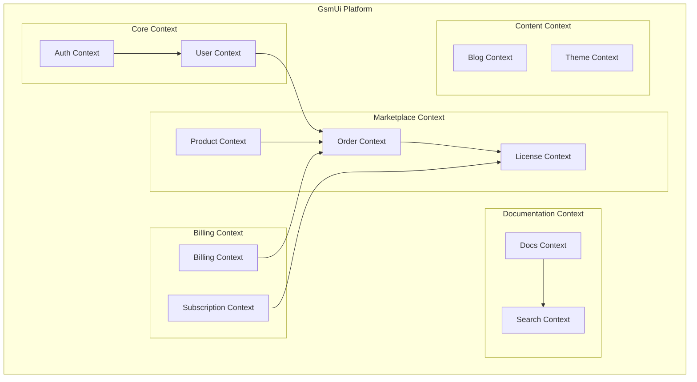
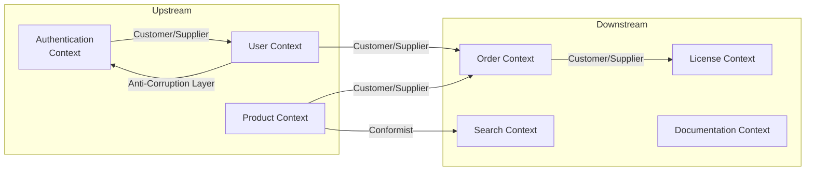
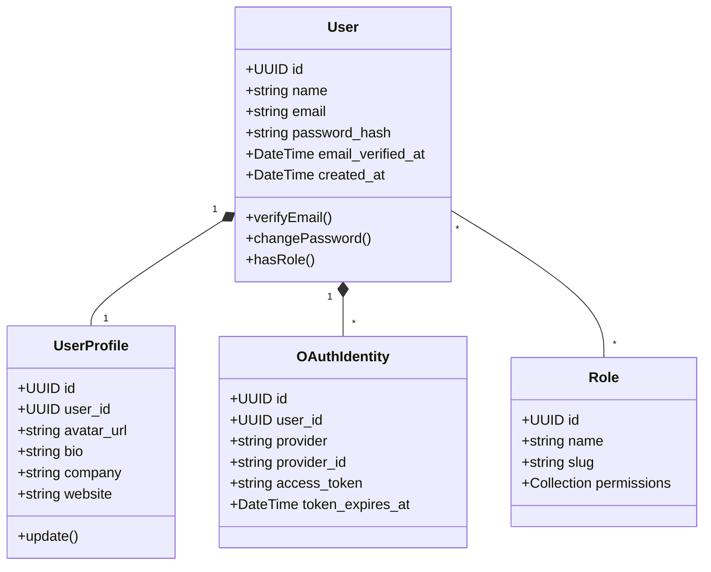
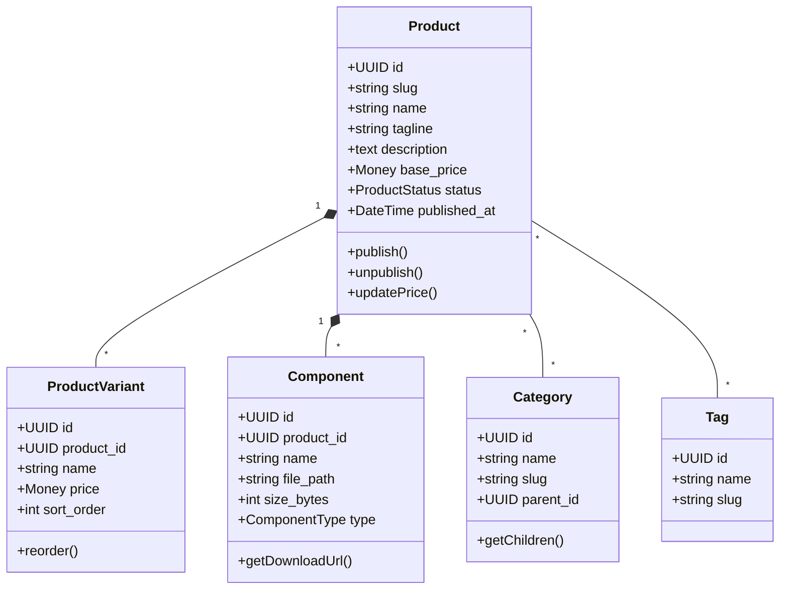
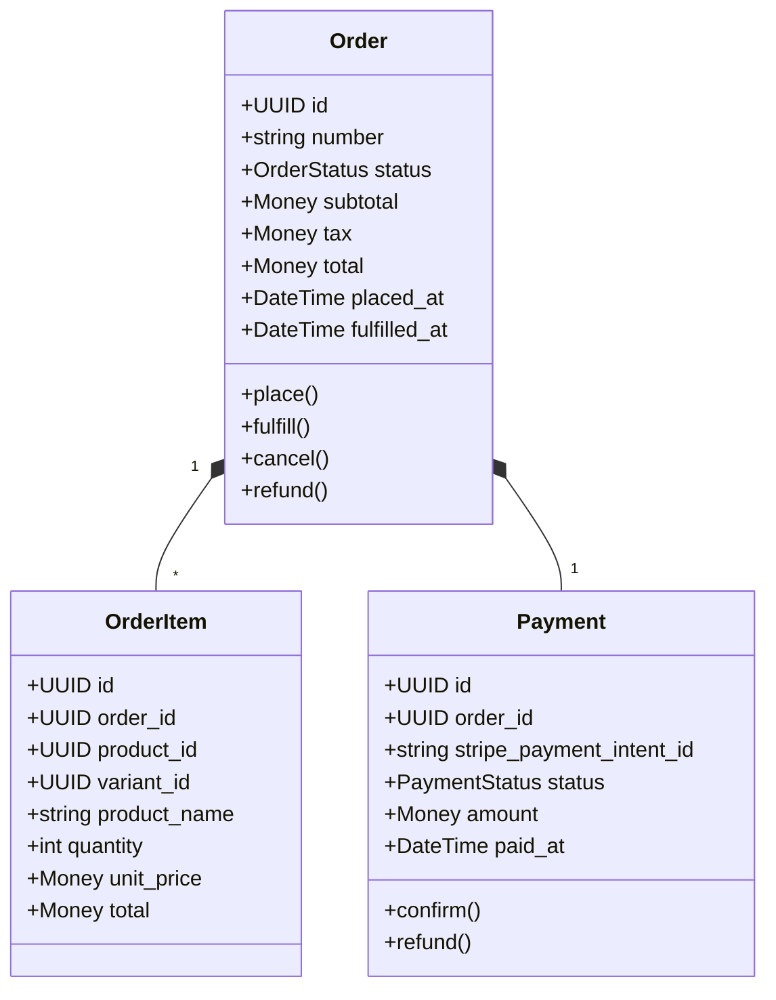
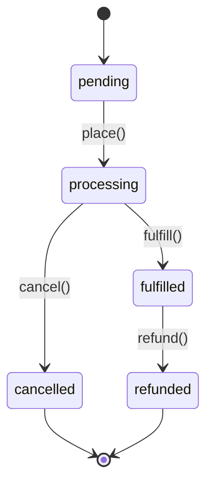
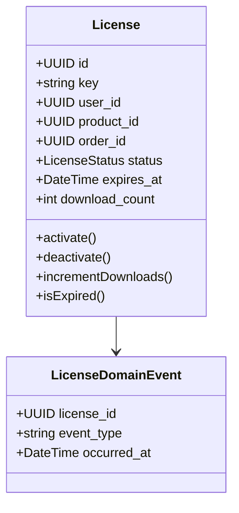
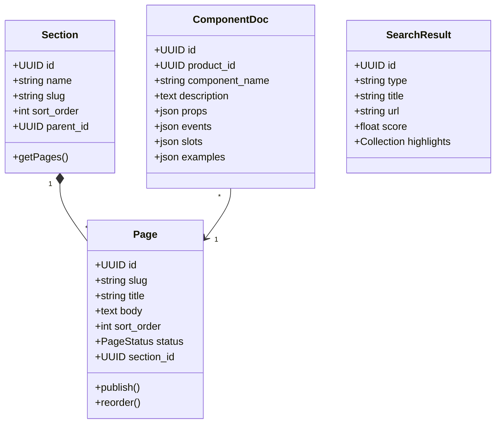
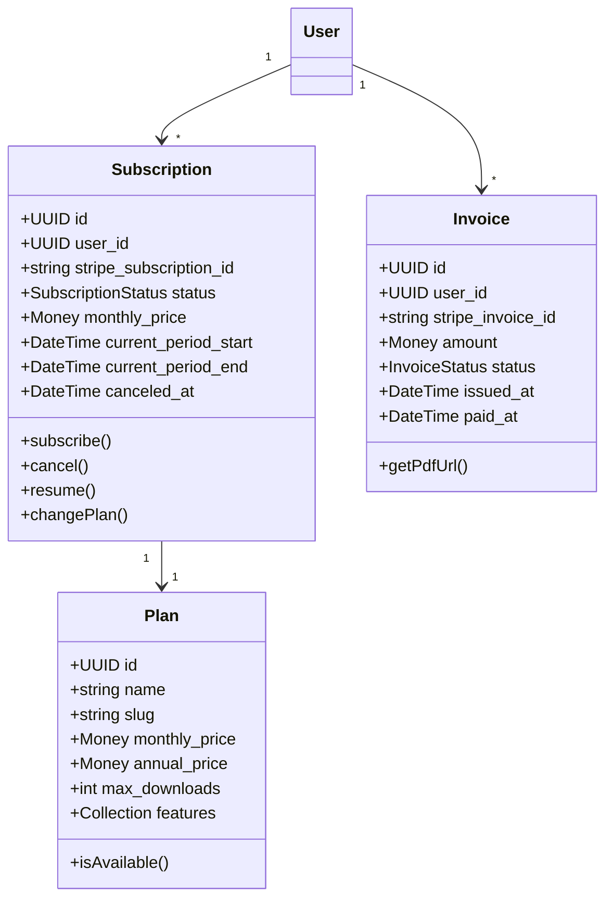

# Domain-Driven Design

## Overview

GsmUi follows Domain-Driven Design principles to organize business logic into bounded contexts, each with its own models, services, and invariants. This document defines the domain model, aggregates, entities, value objects, and context mapping.

## Strategic Design

### Bounded Contexts



### Context Map



| Consumer | Provider | Relationship | Protocol |
|----------|----------|--------------|----------|
| Order Context | Product Context | Customer/Supplier | Domain Events |
| Order Context | User Context | Customer/Supplier | Direct Repository Access |
| Search Context | Product Context | Conformist | Event Listener |
| License Context | Order Context | Customer/Supplier | Domain Events |
| Auth Context | User Context | Shared Kernel | Eloquent Model |
| Docs Context | Search Context | Published Language | API |

## Bounded Context: Core (Authentication & Users)

### Aggregates

#### User Aggregate



**Invariants:**
- Email must be unique and verified for order placement
- Password minimum 8 characters, bcrypt hashed
- OAuth identities must have valid provider + provider_id combination

#### Value Objects

| Value Object | Properties | Validation |
|--------------|------------|------------|
| `EmailAddress` | value: string | RFC 5322 format, unique |
| `Password` | value: string (hashed) | Min 8 chars, bcrypt |
| `Money` | amount: int, currency: string | Minor units, ISO 4217 |
| `Slug` | value: string | URL-safe, unique per context |
| `UUID` | value: string (v7) | Version 7, time-ordered |

### Domain Events

| Event | Aggregate | Trigger | Handler |
|-------|-----------|---------|---------|
| `UserRegistered` | User | Email registration | Send verification, create profile |
| `EmailVerified` | User | Click verify link | Enable account features |
| `OAuthConnected` | User | OAuth callback | Create/update identity |
| `PasswordChanged` | User | Password update | Invalidate other sessions |

## Bounded Context: Marketplace

### Aggregates

#### Product Aggregate



**Invariants:**
- Product must have at least one variant to be published
- Price cannot be negative
- Slug must be unique across all products
- Published products must have description and featured image

#### Order Aggregate



**State Machine:**



#### License Aggregate



## Bounded Context: Documentation

### Aggregates



## Bounded Context: Billing

### Aggregates



## Context Map Patterns

### Shared Kernel

The `User` model is shared between Authentication, Order, and License contexts. Changes require coordination.

```
Shared Kernel: User Model
├── Authentication: OAuth, password, roles
├── Order: user_id foreign key
├── License: user_id foreign key
└── Billing: subscription ownership
```

### Customer/Supplier

| Consumer | Supplier | Contract |
|----------|----------|----------|
| Order Context | Product Context | `ProductRepository::findAvailable()` |
| License Context | Order Context | `OrderFulfilled` event |
| Search Context | Product Context | `ProductIndexed` event |
| Billing Context | User Context | `User::currentSubscription()` |

### Anti-Corruption Layer

The Auth context uses an ACL when interacting with the User context to prevent external OAuth provider models from leaking into the domain.

```php
class OAuthUserProfileMapper
{
    public function mapFromGitHub(GitHubUser $github): array
    {
        return [
            'name' => $github->getName(),
            'email' => $github->getEmail(),
            'avatar_url' => $github->getAvatarUrl(),
        ];
    }
}
```

## Domain Services

| Service | Context | Responsibility |
|---------|---------|----------------|
| `PricingService` | Marketplace | Calculate totals, apply discounts, compute taxes |
| `FulfillmentService` | Order | Generate downloads, send licenses, deliver files |
| `SearchIndexerService` | Search | Index products, pages, components to Meilisearch |
| `SubscriptionService` | Billing | Manage plan changes, proration, renewals |
| `LicenseValidationService` | License | Validate keys, check expiration, rate limits |

## Invariant Summary

| Context | Invariant | Enforcement |
|---------|-----------|-------------|
| User | Email unique and verified | DB unique constraint + application check |
| Product | Published products need variants | `publish()` method validation |
| Order | Total = sum(items) + tax | `place()` calculation |
| License | Key format: GSMUI-XXXX-XXXX-XXXX | Regex + DB unique |
| Subscription | One active per user | Unique partial index |

## Related Documents

- [Backend Architecture](../Backend-Architecture/index.md)
- [ERD Diagrams](../../06-database/ERD/index.md)
- [Table Definitions](../../06-database/Tables/index.md)
- [Relationships](../../06-database/Relationships/index.md)
