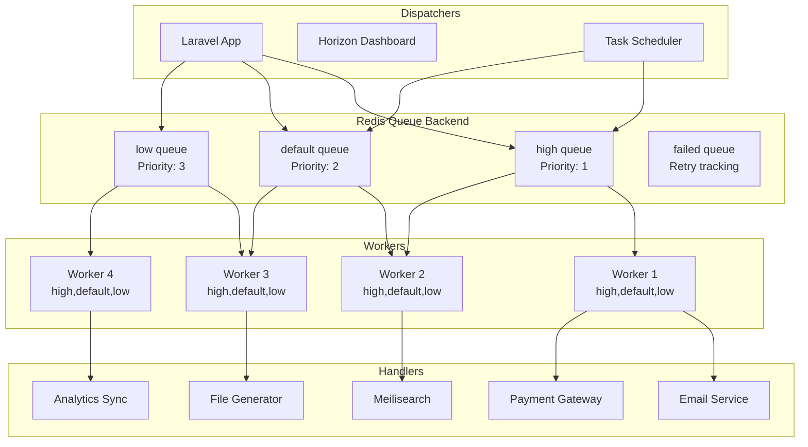

# Queue Architecture

## Overview

GsmUi uses Laravel Horizon with Redis as the queue backend for background job processing. The queue system handles email delivery, payment processing, search indexing, file generation, and scheduled maintenance tasks.

## Queue Topology



## Queue Configuration

### Horizon Config

```php
// config/horizon.php
'environments' => [
    'production' => [
        'supervisor-1' => [
            'connection' => 'redis',
            'queue' => ['high', 'default', 'low'],
            'balance' => 'auto',
            'autoScalingStrategy' => 'time',
            'maxProcesses' => 10,
            'maxTime' => 3600,
            'maxJobs' => 1000,
            'memory' => 128,
            'tries' => 3,
            'timeout' => 90,
            'nice' => 0,
            'restartAfter' => 1000,
        ],
    ],
    'staging' => [
        'supervisor-1' => [
            'connection' => 'redis',
            'queue' => ['high', 'default', 'low'],
            'balance' => 'simple',
            'maxProcesses' => 4,
            'maxTime' => 3600,
            'maxJobs' => 500,
            'memory' => 128,
            'tries' => 3,
            'timeout' => 90,
            'nice' => 0,
        ],
    ],
],
```

### Queue Names

| Queue | Purpose | Priority | Workers |
|-------|---------|----------|---------|
| `high` | Critical: payments, emails, license activation | 1 | 2-3 |
| `default` | Standard: search indexing, file generation | 2 | 2-4 |
| `low` | Background: analytics, cleanup, exports | 3 | 1-2 |

## Job Catalog

### High Priority Jobs

| Job | Purpose | Timeout | Retries | Failure Action |
|-----|---------|---------|---------|----------------|
| `ProcessPaymentJob` | Process Stripe payment | 60s | 3 | Notify admin |
| `SendLicenseEmailJob` | Send license key email | 30s | 3 | Queue to low |
| `ActivateLicenseJob` | Activate license on activation | 30s | 3 | Notify admin |
| `SendVerificationEmailJob` | Send email verification | 30s | 3 | Queue to low |
| `SendPasswordResetJob` | Send password reset | 30s | 3 | Log warning |

### Default Priority Jobs

| Job | Purpose | Timeout | Retries | Failure Action |
|-----|---------|---------|---------|----------------|
| `IndexProductJob` | Index product in Meilisearch | 30s | 3 | Retry with backoff |
| `IndexPageJob` | Index doc page in Meilisearch | 30s | 3 | Log warning |
| `GenerateDownloadJob` | Generate download archive | 120s | 3 | Notify user |
| `ProcessWebhookJob` | Process Stripe webhook | 60s | 3 | Dead letter |
| `SyncProductJob` | Sync product to external | 60s | 5 | Log warning |
| `SendInvoiceEmailJob` | Send invoice PDF email | 30s | 3 | Queue to low |

### Low Priority Jobs

| Job | Purpose | Timeout | Retries | Failure Action |
|-----|---------|---------|---------|----------------|
| `SyncAnalyticsJob` | Sync analytics data | 60s | 5 | Log warning |
| `CleanupExpiredLicensesJob` | Deactivate expired licenses | 300s | 3 | Notify admin |
| `CleanupExpiredCartsJob` | Remove abandoned carts | 300s | 3 | Log warning |
| `ExportUser数据Job` | Export user data (GDPR) | 600s | 3 | Notify admin |
| `WarmCacheJob` | Pre-warm application cache | 120s | 3 | Log warning |
| `RebuildSearchIndexJob` | Full search reindex | 600s | 3 | Log warning |

## Job Design Patterns

### Standard Job Structure

```php
class IndexProductJob implements ShouldQueue
{
    use Dispatchable, InteractsWithQueue, Queueable, SerializesModels;

    public function __construct(
        public readonly Product $product,
    ) {}

    public function handle(
        SearchService $searchService,
        ProductCache $cache,
    ): void {
        $searchService->indexProduct($this->product);
        $cache->forget($this->product);
    }

    public function failed(\Throwable $exception): void
    {
        Log::error('Failed to index product', [
            'product_id' => $this->product->id,
            'exception' => $exception->getMessage(),
        ]);
    }

    public function tags(): array
    {
        return ['product:index', "product:{$this->product->id}"];
    }

    public function backoff(): array|int
    {
        return [30, 60, 120]; // Exponential backoff
    }

    public function retryUntil(): Carbon
    {
        return now()->addHours(2);
    }
}
```

### Batch Processing

```php
class RebuildSearchIndexJob implements ShouldQueue
{
    use Dispatchable, InteractsWithQueue, Queueable;

    public function handle(SearchService $searchService): void
    {
        Product::where('status', 'published')
            ->chunkById(100, function ($products) use ($searchService) {
                $searchService->batchIndexProducts($products);
            });
    }

    public function middleware(): array
    {
        return [new WithoutOverlapping('search-index')];
    }
}
```

## Retry Logic

### Backoff Strategy

| Attempt | Delay | Action |
|---------|-------|--------|
| 1 | Immediate | First attempt |
| 2 | 30 seconds | Retry with backoff |
| 3 | 60 seconds | Final attempt |
| 4+ | Failed | Move to failed jobs |

### Backoff Configuration

```php
// Per-job backoff
public function backoff(): array|int
{
    return [30, 60, 120];
}

// Global backoff via Horizon
'maxTries' => 3,
'backoff' => [30, 60],
```

### Retry Conditions

| Condition | Retry | Max Attempts |
|-----------|-------|--------------|
| Connection timeout | Yes | 3 |
| Rate limit (429) | Yes | 5 |
| Validation error | No | 1 |
| Payment declined | No | 1 |
| File not found | No | 1 |
| Unknown error | Yes | 3 |

## Failed Jobs

### Failed Job Table

```sql
CREATE TABLE failed_jobs (
    id BIGINT UNSIGNED AUTO_INCREMENT PRIMARY KEY,
    uuid VARCHAR(255) NOT NULL UNIQUE,
    connection TEXT NOT NULL,
    queue TEXT NOT NULL,
    payload LONGTEXT NOT NULL,
    exception LONGTEXT NOT NULL,
    failed_at TIMESTAMP DEFAULT CURRENT_TIMESTAMP
);
```

### Failed Job Handling

```php
class FailedJobMonitor
{
    public function register(): void
    {
        Queue::failing(function (JobFailed $event) {
            $job = $event->job;
            $exception = $event->exception;

            // Log to monitoring service
            $this->monitoring->recordFailure([
                'job' => get_class($job->resolve()),
                'queue' => $job->getQueue(),
                'attempts' => $job->attempts(),
                'exception' => $exception->getMessage(),
                'trace' => $exception->getTraceAsString(),
            ]);

            // Alert on critical jobs
            if ($this->isCritical($job)) {
                $this->alertAdmin($job, $exception);
            }
        });
    }

    private function isCritical(Job $job): bool
    {
        return in_array(get_class($job->resolve()), [
            ProcessPaymentJob::class,
            ActivateLicenseJob::class,
        ]);
    }
}
```

### Retry Interface

```php
// Horizon dashboard: Retry button
// artisan queue:retry {id}
// artisan queue:retry all
// artisan queue:flush
```

## Monitoring

### Horizon Dashboard

| Metric | Description | Alert Threshold |
|--------|-------------|-----------------|
| Throughput | Jobs/minute | < 10 on production |
| Runtime | Avg job runtime | > 30s for default queue |
| Wait time | Time in queue | > 60s |
| Failures | Failed jobs/hour | > 5 |
| Restart count | Worker restarts | > 10/hour |

### Monitoring Commands

```bash
# Check queue status
php artisan queue:status

# View failed jobs
php artisan queue:failed

# Retry failed job
php artisan queue:retry {id}

# Restart workers
php artisan queue:restart

# Horizon status
php artisan horizon:status
```

### Alerting

```php
class HorizonAlerting
{
    public function register(): void
    {
        Horizon::whenScalingBack(function () {
            $this->slack->send('Horizon scaling back workers');
        });

        Horizon::whenWorkerIsTerminating(function ($event) {
            Log::warning('Worker terminated', ['event' => $event]);
        });
    }
}
```

## Scheduled Tasks

### Task Scheduler

```php
// routes/console.php
Schedule::command('cleanup:expired-licenses')
    ->daily()
    ->onQueue('low')
    ->withoutOverlapping();

Schedule::command('cleanup:expired-carts')
    ->daily()
    ->onQueue('low')
    ->withoutOverlapping();

Schedule::command('sync:analytics')
    ->hourly()
    ->onQueue('low');

Schedule::command('warm:cache')
    ->everyFifteenMinutes()
    ->onQueue('low')
    ->withoutOverlapping();

Schedule::command('rebuild:search-index')
    ->weekly()
    ->onQueue('low')
    ->withoutOverlapping()
    ->runInBackground();
```

## Performance Tuning

### Worker Configuration

| Setting | Production | Staging | Development |
|---------|------------|---------|-------------|
| `maxProcesses` | 10 | 4 | 1 |
| `maxTime` | 3600s | 3600s | 3600s |
| `maxJobs` | 1000 | 500 | Unlimited |
| `memory` | 128MB | 128MB | 128MB |
| `balance` | auto | simple | false |
| `timeout` | 90s | 90s | 60s |

### Queue Metrics

```php
class QueueMetrics
{
    public function getStats(): array
    {
        $redis = Redis::connection()->getClient();

        return [
            'high' => $redis->llen('queues:high'),
            'default' => $redis->llen('queues:default'),
            'low' => $redis->llen('queues:low'),
            'failed' => DB::table('failed_jobs')->count(),
            'processing' => $this->getProcessingCount(),
        ];
    }
}
```

## Related Documents

- [Container Specs](../Containers/index.md)
- [Cache Strategy](../Cache/index.md)
- [Backend Architecture](../Backend-Architecture/index.md)
- [Deployment Strategy](../Deployment/index.md)
