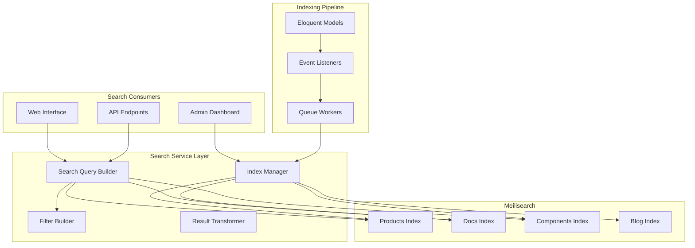
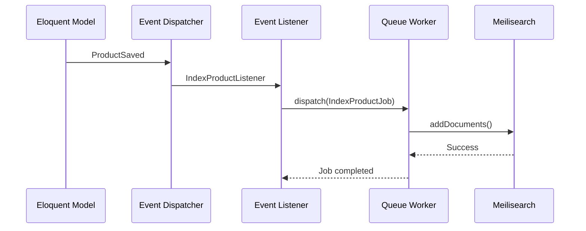
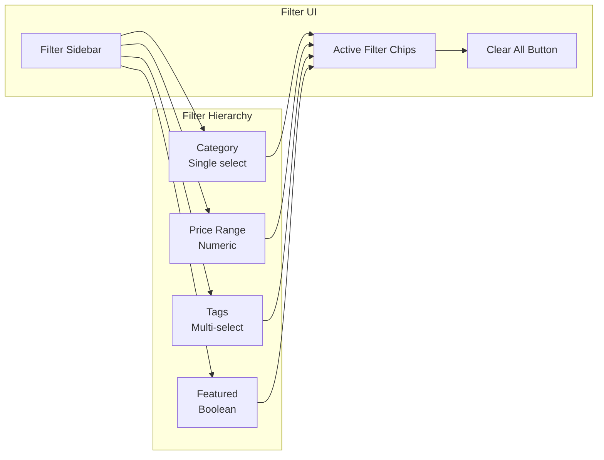

# Search Architecture

## Overview

GsmUi uses Meilisearch as its primary search engine, providing full-text search with typo tolerance, faceted filtering, and real-time indexing. The search system covers products, documentation pages, components, and blog posts.

## Search Architecture



## Index Design

### Products Index

| Attribute | Type | Searchable | Filterable | Sortable |
|-----------|------|------------|------------|----------|
| `id` | string | No | Yes | No |
| `name` | string | Yes | No | Yes |
| `tagline` | string | Yes | No | No |
| `description` | string | Yes | No | No |
| `slug` | string | No | No | No |
| `status` | string | No | Yes | No |
| `category` | string | No | Yes | No |
| `tags` | array | Yes | Yes | No |
| `price` | integer | No | Yes | Yes |
| `featured` | boolean | No | Yes | No |
| `popularity` | integer | No | No | Yes |
| `created_at` | timestamp | No | No | Yes |

### Index Settings

```json
{
  "products": {
    "primaryKey": "id",
    "searchableAttributes": [
      "name",
      "tagline",
      "description",
      "tags"
    ],
    "filterableAttributes": [
      "status",
      "category",
      "tags",
      "price",
      "featured"
    ],
    "sortableAttributes": [
      "name",
      "price",
      "created_at",
      "popularity"
    ],
    "rankingRules": [
      "sort",
      "words",
      "typo",
      "proximity",
      "attribute",
      "exactness"
    ],
    "typoTolerance": {
      "enabled": true,
      "minWordSizeForTypos": {
        "oneTypo": 4,
        "twoTypos": 8
      }
    },
    "synonyms": {
      "ui": ["user interface", "frontend", "interface"],
      "kit": ["bundle", "package", "collection", "set"],
      "button": ["btn", "cta", "action"],
      "modal": ["dialog", "popup", "overlay"],
      "form": ["input", "field", "control"],
      "nav": ["navigation", "menu", "navbar"]
    },
    "stopWords": ["the", "a", "an", "and", "or", "but", "in", "on", "at"]
  }
}
```

### Documentation Index

```json
{
  "docs": {
    "primaryKey": "id",
    "searchableAttributes": [
      "title",
      "body",
      "section",
      "tags"
    ],
    "filterableAttributes": [
      "section",
      "status",
      "tags"
    ],
    "sortableAttributes": [
      "title",
      "sort_order"
    ],
    "displayedAttributes": [
      "id",
      "title",
      "slug",
      "body",
      "section",
      "tags",
      "url"
    ],
    "pagination": {
      "maxTotalHits": 1000
    }
  }
}
```

### Components Index

```json
{
  "components": {
    "primaryKey": "id",
    "searchableAttributes": [
      "name",
      "description",
      "product_name",
      "props"
    ],
    "filterableAttributes": [
      "product_id",
      "category",
      "type"
    ],
    "sortableAttributes": [
      "name",
      "created_at"
    ]
  }
}
```

## Indexing Pipeline

### Event-Driven Indexing



### Indexing Implementation

```php
class IndexProductListener
{
    public function handle(ProductSaved $event): void
    {
        $product = $event->product;

        if ($product->status !== 'published') {
            IndexProductJob::dispatch($product);
            return;
        }

        IndexProductJob::dispatch($product)
            ->onQueue('default');
    }
}

class IndexProductJob implements ShouldQueue
{
    use Dispatchable, InteractsWithQueue, Queueable;

    public function __construct(
        public readonly Product $product,
    ) {}

    public function handle(MeilisearchSearchService $search): void
    {
        $search->indexProduct($this->product);
    }

    public function tags(): array
    {
        return ['search:index', "product:{$this->product->id}"];
    }
}
```

### Search Service

```php
class MeilisearchSearchService implements SearchService
{
    public function __construct(
        private readonly SearchClient $client,
    ) {}

    public function indexProduct(Product $product): void
    {
        $this->client->index('products')->addDocuments([
            [
                'id' => $product->id,
                'name' => $product->name,
                'tagline' => $product->tagline,
                'description' => $product->description,
                'slug' => $product->slug,
                'status' => $product->status,
                'category' => $product->category->name,
                'tags' => $product->tags->pluck('name')->toArray(),
                'price' => $product->base_price->amount,
                'featured' => $product->featured,
                'popularity' => $product->download_count,
                'created_at' => $product->created_at->timestamp,
            ],
        ]);
    }

    public function search(string $query, array $filters = []): SearchResult
    {
        $index = $this->client->index('products');

        $searchParams = [
            'q' => $query,
            'limit' => $filters['limit'] ?? 20,
            'offset' => $filters['offset'] ?? 0,
        ];

        if (!empty($filters['category'])) {
            $searchParams['filter'] = "category = {$filters['category']}";
        }

        if (!empty($filters['sort'])) {
            $searchParams['sort'] = [$filters['sort']];
        }

        $results = $index->search($query, $searchParams);

        return new SearchResult(
            hits: $results['hits'],
            totalHits: $results['nbHits'],
            processingTimeMs: $results['processingTimeMs'],
        );
    }
}
```

## Faceted Search

### Filter Structure



### Filter Implementation

```php
class ProductFilterBuilder
{
    public function buildFilters(Request $request): array
    {
        $filters = [];

        if ($request->has('category')) {
            $filters[] = "category = '{$request->category}'";
        }

        if ($request->has('price_min')) {
            $filters[] = "price >= {$request->price_min}";
        }

        if ($request->has('price_max')) {
            $filters[] = "price <= {$request->price_max}";
        }

        if ($request->has('tags')) {
            $tags = collect($request->tags)
                ->map(fn($tag) => "tags = '{$tag}'")
                ->implode(' OR ');
            $filters[] = "({$tags})";
        }

        if ($request->boolean('featured')) {
            $filters[] = 'featured = true';
        }

        return $filters;
    }
}
```

### Faceted Response

```json
{
  "hits": [...],
  "nbHits": 142,
  "facetsDistribution": {
    "category": {
      "UI Kits": 45,
      "Components": 62,
      "Templates": 23,
      "Icons": 12
    },
    "tags": {
      "Tailwind": 89,
      "Livewire": 67,
      "Alpine.js": 45,
      "Blade": 34
    },
    "featured": {
      "true": 24,
      "false": 118
    }
  }
}
```

## Typo Tolerance

### Configuration

| Setting | Value | Description |
|---------|-------|-------------|
| `enabled` | true | Enable typo tolerance |
| `minWordSizeForTypos.oneTypo` | 4 | Min chars for 1 typo |
| `minWordSizeForTypos.twoTypos` | 8 | Min chars for 2 typos |

### Examples

| Query | Matched | Typos Tolerated |
|-------|---------|-----------------|
| `btton` | button | 1 typo |
| `buton` | button | 1 typo |
| `modla` | modal | 1 typo |
| `componet` | component | 1 typo |
| `buttton` | button | 1 typo (extra char) |

### Typo Tolerance Settings

```php
$this->client->index('products')->updateSettings([
    'typoTolerance' => [
        'enabled' => true,
        'minWordSizeForTypos' => [
            'oneTypo' => 4,
            'twoTypos' => 8,
        ],
        'disableOnAttributes' => ['slug'],
        'disableOnWords' => ['api', 'css', 'html'],
    ],
]);
```

## Synonyms

### Synonym Groups

```json
{
  "ui": ["user interface", "frontend", "interface"],
  "kit": ["bundle", "package", "collection"],
  "button": ["btn", "cta", "action"],
  "modal": ["dialog", "popup", "overlay"],
  "form": ["input", "field", "control"],
  "nav": ["navigation", "menu", "navbar"],
  "card": ["tile", "panel", "block"],
  "table": ["grid", "data grid", "datagrid"],
  "dropdown": ["select", "picker", "combobox"],
  "tabs": ["tab bar", "tab navigation"],
  "alert": ["notification", "toast", "message"],
  "tooltip": ["popover", "hint", "balloon"]
}
```

### Dynamic Synonyms

```php
class DynamicSynonyms
{
    public function updateSynonyms(): void
    {
        // Build synonyms from product tags
        $synonyms = Tag::with('products')
            ->where('products_count', '>', 5)
            ->get()
            ->mapWithKeys(fn($tag) => [
                strtolower($tag->name) => $tag->aliases->toArray(),
            ])
            ->toArray();

        $this->client->index('products')->updateSettings([
            'synonyms' => $synonyms,
        ]);
    }
}
```

## Search Performance

### Performance Metrics

| Metric | Target | Current |
|--------|--------|---------|
| Search latency (p50) | < 50ms | 35ms |
| Search latency (p99) | < 200ms | 120ms |
| Indexing latency | < 1s | 500ms |
| Typo tolerance | 1-2 typos | 1-2 typos |
| Max results | 1000 | 1000 |

### Monitoring

```php
class SearchMetrics
{
    public function recordSearch(string $query, int $timeMs, int $hits): void
    {
        StatsD::timing('search.latency', $timeMs);
        StatsD::increment('search.queries');
        StatsD::gauge('search.results', $hits);

        if ($timeMs > 200) {
            Log::warning('Slow search query', [
                'query' => $query,
                'time_ms' => $timeMs,
            ]);
        }
    }
}
```

### Caching Strategy

```php
class CachedSearchService implements SearchService
{
    public function __construct(
        private readonly MeilisearchSearchService $search,
        private readonly Cache $cache,
    ) {}

    public function search(string $query, array $filters = []): SearchResult
    {
        $cacheKey = 'search:' . md5($query . json_encode($filters));

        return $this->cache->tags(['search:results'])
            ->remember($cacheKey, 300, fn() =>
                $this->search->search($query, $filters)
            );
    }
}
```

## Related Documents

- [Cache Strategy](../Cache/index.md)
- [Queue Architecture](../Queue/index.md)
- [API Design](../API/index.md)
- [Container Specs](../Containers/index.md)
