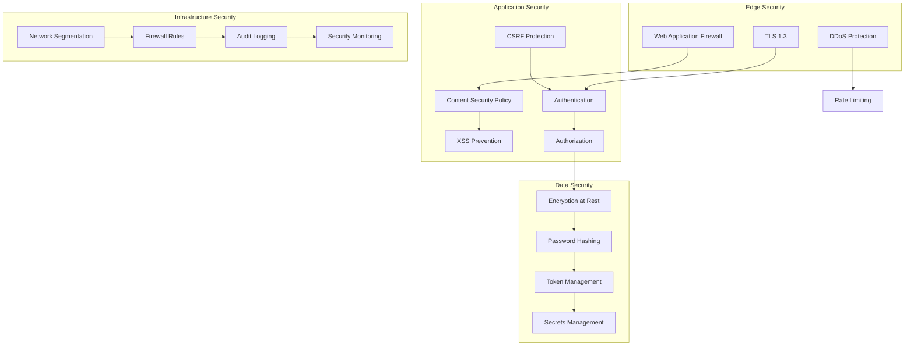

# Security Architecture

## Overview

GsmUi implements defense-in-depth security with multiple layers: CSP headers, CSRF protection, input validation, encryption, rate limiting, and secrets management. This document covers the security architecture and controls.

## Security Layers



## Content Security Policy

### CSP Header

```php
class CspMiddleware
{
    public function handle(Request $request, Closure $next): Response
    {
        $nonce = base64_encode(random_bytes(32));

        $policy = [
            'default-src' => ["'self'"],
            'script-src' => ["'self'", "'nonce-{$nonce}'", "'strict-dynamic'"],
            'style-src' => ["'self'", "'unsafe-inline'"],
            'img-src' => ["'self'", 'data:', 'https:'],
            'font-src' => ["'self'"],
            'connect-src' => ["'self'"],
            'frame-ancestors' => ["'none'"],
            'base-uri' => ["'self'"],
            'form-action' => ["'self'"],
            'upgrade-insecure-requests' => [],
        ];

        $header = collect($policy)
            ->map(fn($sources, $key) => $key . ' ' . implode(' ', $sources))
            ->implode('; ');

        $response = $next($request);
        $response->headers->set('Content-Security-Policy', $header);

        return $response;
    }
}
```

### CSP Directives

| Directive | Value | Purpose |
|-----------|-------|---------|
| `default-src` | `'self'` | Default fallback |
| `script-src` | `'self' 'nonce-{random}' 'strict-dynamic'` | Scripts with nonce |
| `style-src` | `'self' 'unsafe-inline'` | Styles (inline for Livewire) |
| `img-src` | `'self' data: https:` | Images from self, data URIs, HTTPS |
| `font-src` | `'self'` | System fonts only |
| `connect-src` | `'self'` | AJAX/fetch to same origin |
| `frame-ancestors` | `'none'` | No iframes |
| `base-uri` | `'self'` | Base URL restriction |
| `form-action` | `'self'` | Form submissions to same origin |

## CSRF Protection

### Token Verification

```php
class VerifyCsrfToken extends BaseVerifier
{
    protected $except = [
        'webhooks/*',
        'api/*/webhooks/*',
    ];
}
```

### CSRF Implementation

| Mechanism | Scope | Implementation |
|-----------|-------|----------------|
| Session token | Web forms | `_token` hidden field |
| Header token | AJAX | `X-CSRF-TOKEN` header |
| Double submit | API | Cookie + header match |
| SameSite cookies | Session | `SameSite=Lax` |

### Livewire CSRF

Livewire automatically handles CSRF via session tokens. No manual intervention required.

## XSS Prevention

### Output Encoding

| Context | Encoding | Example |
|---------|----------|---------|
| HTML | `htmlspecialchars()` | `<div>{{ $name }}</div>` |
| JavaScript | `json_encode()` | `<script>var data = {!! json_encode($data) !!}</script>` |
| URL | `urlencode()` | `<a href="/path?param={{ urlencode($value) }}">` |
| CSS | CSS escaping | `style="color: {{ CSS::escape($color) }}"` |

### Blade Escaping

```blade
{{-- Auto-escaped --}}
{{ $user->name }}

{{-- Raw HTML (use sparingly) --}}
{!! $trusted_html !!}

{{-- Attribute context --}}
<div data-value="{{ $value }}"></div>

{{-- JavaScript context --}}
<script>
    var config = @json($config);
</script>
```

### Input Validation

```php
class ProductRequest extends FormRequest
{
    public function rules(): array
    {
        return [
            'name' => ['required', 'string', 'max:255', 'regex:/^[a-zA-Z0-9\s\-\.]+$/'],
            'description' => ['required', 'string', 'max:50000'],
            'price' => ['required', 'integer', 'min:0', 'max:1000000],
            'url' => ['nullable', 'url', 'max:2048'],
            'email' => ['nullable', 'email', 'max:255'],
        ];
    }
}
```

## SQL Injection Prevention

### Parameterized Queries

```php
// Safe: Parameterized query
$products = DB::select('SELECT * FROM products WHERE category = ?', [$category]);

// Safe: Eloquent query
$products = Product::where('category', $category)->get();

// Safe: Query builder
$products = DB::table('products')
    ->where('category', '=', $category)
    ->get();

// Unsafe: Raw query (never do this)
$products = DB::select("SELECT * FROM products WHERE category = '$category'");
```

### ORM Protection

| Method | Protection | Usage |
|--------|------------|-------|
| Eloquent | Parameter binding | `->where('col', $val)` |
| Query Builder | Parameter binding | `->where('col', '=', $val)` |
| Raw Expressions | Whitelist only | `DB::raw('COUNT(*)')` |
| `DB::select()` | Parameterized | `DB::select('... WHERE id = ?', [$id])` |

## Rate Limiting

### Rate Limit Configuration

```php
// routes/api.php
Route::middleware('throttle:api')->group(function () {
    Route::get('/products', [ProductController::class, 'index']);
    Route::get('/search', [SearchController::class, 'index']);
});

// RateLimiter.php
RateLimiter::for('api', function (Request $request) {
    return Limit::perMinute(60)->by(
        $request->user()?->id ?: $request->ip()
    );
});

RateLimiter::for('login', function (Request $request) {
    return Limit::perMinute(5)->by($request->ip());
});

RateLimiter::for('download', function (Request $request) {
    return Limit::perMinute(10)->by($request->user()->id);
});
```

### Rate Limit Headers

```http
X-RateLimit-Limit: 60
X-RateLimit-Remaining: 45
X-RateLimit-Reset: 1640995200
```

## Encryption

### At Rest

| Data Type | Method | Key Source |
|-----------|--------|------------|
| Database | AES-256-CBC | `APP_KEY` |
| Sessions | Encrypted | `APP_KEY` |
| Cookies | Encrypted | `APP_KEY` |
| Files | AES-256-GCM | `FILE_ENCRYPTION_KEY` |

### In Transit

| Connection | Protocol | Cipher |
|------------|----------|--------|
| Browser → CDN | TLS 1.3 | TLS_AES_256_GCM_SHA384 |
| CDN → Nginx | TLS 1.3 | TLS_CHACHA20_POLY1305_SHA256 |
| App → MySQL | TLS 1.2+ | TLS_AES_256_GCM_SHA384 |
| App → Redis | TLS 1.2+ | TLS_AES_256_GCM_SHA384 |
| App → Meilisearch | TLS 1.2+ | TLS_AES_256_GCM_SHA384 |

### Password Hashing

```php
// Hashing (automatic via Hash facade)
$hashed = Hash::make($password);

// Verification
if (Hash::check($password, $hashed)) {
    // Valid
}
```

| Algorithm | Cost | Output |
|-----------|------|--------|
| bcrypt | 12 | 60-char hash |
| argon2id | 4 iterations | 95-char hash |

## Secrets Management

### Environment Variables

| Secret | Source | Rotation |
|--------|--------|----------|
| `APP_KEY` | Vault | Quarterly |
| `DB_PASSWORD` | Vault | Monthly |
| `REDIS_PASSWORD` | Vault | Monthly |
| `STRIPE_SECRET` | Vault | Quarterly |
| `MEILISEARCH_KEY` | Vault | Quarterly |
| `MAIL_PASSWORD` | Vault | Quarterly |

### Vault Integration

```php
// config/services.php
'stripe' => [
    'key' => env('STRIPE_KEY'),
    'secret' => Vault::get('secret/stripe/production'),
    'webhook_secret' => Vault::get('secret/stripe/webhook'),
],
```

### Key Rotation

```php
class KeyRotationService
{
    public function rotateAppKey(): void
    {
        $newKey = 'base64:' . base64_encode(random_bytes(32));

        // Update .env
        $this->updateEnv('APP_KEY', $newKey);

        // Re-encrypt existing data
        $this->reEncryptModels();

        // Clear config cache
        Artisan::call('config:clear');
    }
}
```

## Authentication Security

### OAuth 2.0 Security

| Measure | Implementation |
|---------|----------------|
| State parameter | CSRF protection |
| PKCE | Code verifier/challenge |
| Token expiry | 1 hour access, 30 days refresh |
| Scope limiting | Minimal required scopes |
| Redirect validation | Whitelist only |

### Session Security

| Setting | Value | Purpose |
|---------|-------|---------|
| `http_only` | true | No JS access |
| `secure` | true | HTTPS only |
| `same_site` | Lax | CSRF protection |
| `lifetime` | 7200s | 2 hours |
| `expire_on_close` | false | Persistent session |

### Two-Factor Authentication

```php
class TwoFactorController extends Controller
{
    public function enable(Request $request): JsonResponse
    {
        $secret = $this->google2fa->generateSecretKey();
        $qrCode = $this->google2fa->getQRCodeInline(
            config('app.name'),
            $request->user()->email,
            $secret
        );

        $request->user()->update([
            'two_factor_secret' => encrypt($secret),
        ]);

        return response()->json([
            'qr_code' => $qrCode,
            'secret' => $secret,
        ]);
    }
}
```

## Audit Logging

### Audit Events

| Event | User | IP | Details |
|-------|------|-----|---------|
| Login | ✓ | ✓ | Method, success/failure |
| Logout | ✓ | ✓ | Session ID |
| Password change | ✓ | ✓ | — |
| Payment | ✓ | ✓ | Amount, method |
| License activation | ✓ | ✓ | License key |
| Admin action | ✓ | ✓ | Action type, target |

### Audit Log Table

```sql
CREATE TABLE audit_logs (
    id BIGINT UNSIGNED AUTO_INCREMENT PRIMARY KEY,
    user_id BIGINT UNSIGNED NULL,
    event VARCHAR(255) NOT NULL,
    auditable_type VARCHAR(255) NOT NULL,
    auditable_id BIGINT UNSIGNED NOT NULL,
    old_values JSON NULL,
    new_values JSON NULL,
    ip_address VARCHAR(45) NULL,
    user_agent TEXT NULL,
    created_at TIMESTAMP DEFAULT CURRENT_TIMESTAMP,
    INDEX idx_auditable (auditable_type, auditable_id),
    INDEX idx_user (user_id),
    INDEX idx_created (created_at)
);
```

### Audit Implementation

```php
class Auditable
{
    public static function bootAuditable(): void
    {
        static::created(function ($model) {
            AuditLog::create([
                'user_id' => auth()->id(),
                'event' => 'created',
                'auditable_type' => get_class($model),
                'auditable_id' => $model->id,
                'new_values' => $model->toArray(),
                'ip_address' => request()->ip(),
                'user_agent' => request()->userAgent(),
            ]);
        });
    }
}
```

## Security Monitoring

### Metrics

| Metric | Threshold | Alert |
|--------|-----------|-------|
| Failed logins | > 10/min | PagerDuty |
| Rate limit hits | > 100/min | Slack |
| CSP violations | > 5/hour | Slack |
| SQL errors | > 10/hour | PagerDuty |
| 4xx errors | > 100/min | Slack |
| 5xx errors | > 10/min | PagerDuty |

### Security Headers

```php
// Full security header set
$response->headers->set('Strict-Transport-Security', 'max-age=63072000; includeSubDomains; preload');
$response->headers->set('X-Content-Type-Options', 'nosniff');
$response->headers->set('X-Frame-Options', 'DENY');
$response->headers->set('X-XSS-Protection', '0');
$response->headers->set('Referrer-Policy', 'strict-origin-when-cross-origin');
$response->headers->set('Permissions-Policy', 'camera=(), microphone=(), geolocation=()');
$response->headers->set('Content-Security-Policy', $csp);
```

## Incident Response

### Severity Levels

| Level | Description | Response Time | Examples |
|-------|-------------|---------------|----------|
| P1 | Critical | 15 min | Data breach, full outage |
| P2 | High | 1 hour | Partial outage, security vuln |
| P3 | Medium | 4 hours | Performance degradation |
| P4 | Low | 24 hours | Minor issues, improvements |

### Response Steps

1. **Identify** — Detect and classify the incident
2. **Contain** — Isolate affected systems
3. **Eradicate** — Remove the threat
4. **Recover** — Restore normal operations
5. **Learn** — Post-incident review

## Related Documents

- [Container Specs](../Containers/index.md)
- [Deployment Strategy](../Deployment/index.md)
- [API Design](../API/index.md)
- [Backend Architecture](../Backend-Architecture/index.md)
