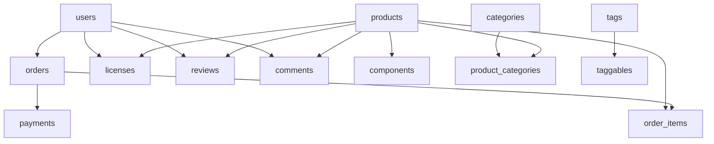

# Design Principles

## Overview

GsmUi follows established database design principles to ensure data integrity, performance, and maintainability. This document covers normalization, soft deletes, UUID strategies, audit trails, and polymorphic relations.

## Core Principles

| Principle | Description | Enforcement |
|-----------|-------------|-------------|
| Data Integrity | Never trust application layer alone | DB constraints, foreign keys |
| Normalization | 3NF minimum, denormalize only with justification | Schema review |
| Immutability | Prefer append-only where possible | Audit logs, versioning |
| Consistency | Same data structure across contexts | Naming standards, conventions |
| Performance | Design for read patterns first | Index strategy, query analysis |

## Normalization Strategy

### Normal Form Target

| Level | Description | GsmUi Target |
|-------|-------------|--------------|
| 1NF | Atomic values, no repeating groups | Always |
| 2NF | No partial dependencies | Always |
| 3NF | No transitive dependencies | Default |
| BCNF | Every determinant is a candidate key | Where practical |
| 4NF | No multi-valued dependencies | Where practical |

### Denormalization Rules

| Scenario | Acceptable? | Justification |
|----------|-------------|---------------|
| Cached counters | ✓ | `products_count` on categories |
| Search denormalization | ✓ | Flattened product data for Meilisearch |
| Audit denormalization | ✓ | `created_by` on every table |
| Read-heavy aggregates | ✓ | Materialized views for analytics |
| Performance-critical paths | ✓ | With explicit documentation |

## Soft Deletes

### Strategy

All entities that represent user-facing data use soft deletes to preserve referential integrity and enable recovery.

```php
class Product extends Model
{
    use SoftDeletes;

    protected $dates = ['deleted_at'];

    // Scope: only non-deleted
    public function scopeActive(Builder $query): Builder
    {
        return $query->whereNull('deleted_at');
    }

    // Force delete (admin only)
    public function forceDelete(): bool
    {
        $this->components()->each->forceDelete();
        return parent::forceDelete();
    }
}
```

### Soft Delete Policy

| Table | Soft Delete | Reason |
|-------|-------------|--------|
| `users` | ✓ | Preserve order history |
| `products` | ✓ | Preserve license references |
| `orders` | ✓ | Financial records |
| `licenses` | ✓ | Activation history |
| `pages` | ✓ | Documentation links |
| `blog_posts` | ✓ | SEO, external links |
| `categories` | ✓ | Product associations |
| `tags` | ✓ | Product associations |

## UUID vs ULID Strategy

### Decision Matrix

| Factor | UUID v7 | ULID | Auto-increment |
|--------|---------|------|----------------|
| Time-ordered | ✓ | ✓ | ✓ |
| Globally unique | ✓ | ✓ | ✗ |
| Sortable | ✓ | ✓ | ✓ |
| Compact | 36 chars | 26 chars | 10 digits |
| URL-safe | ✓ | ✓ | ✓ |
| No coordination | ✓ | ✓ | ✗ |
| External exposure | ✓ | ✓ | ✗ |

### GsmUi Convention

| Context | Type | Rationale |
|---------|------|-----------|
| Public API | UUID v7 | Time-ordered, globally unique |
| Internal IDs | UUID v7 | Consistent across services |
| Foreign keys | UUID v7 | Referential integrity |
| Sequential ops | Auto-increment | Better performance for joins |

### UUID v7 Implementation

```php
use Illuminate\Support\Str;

class UuidTrait
{
    public static function bootUuid(): void
    {
        static::creating(function ($model) {
            if (empty($model->id)) {
                $model->id = (string) Str::uuid7();
            }
        });
    }
}

// Usage
class Product extends Model
{
    use UuidTrait;

    protected $keyType = 'string';
    public $incrementing = false;
}
```

## Audit Trails

### Audit Log Schema

```sql
CREATE TABLE audit_logs (
    id BIGINT UNSIGNED AUTO_INCREMENT PRIMARY KEY,
    uuid CHAR(36) NOT NULL UNIQUE,
    user_id CHAR(36) NULL,
    event VARCHAR(255) NOT NULL,
    auditable_type VARCHAR(255) NOT NULL,
    auditable_id CHAR(36) NOT NULL,
    old_values JSON NULL,
    new_values JSON NULL,
    ip_address VARCHAR(45) NULL,
    user_agent TEXT NULL,
    tags JSON NULL,
    created_at TIMESTAMP(6) DEFAULT CURRENT_TIMESTAMP(6),
    INDEX idx_auditable (auditable_type, auditable_id),
    INDEX idx_user (user_id),
    INDEX idx_event (event),
    INDEX idx_created (created_at)
);
```

### Audit Events

| Event | old_values | new_values | Use Case |
|-------|------------|------------|----------|
| `created` | null | Full model | Track creation |
| `updated` | Changed fields | Changed fields | Track changes |
| `deleted` | Full model | null | Track deletion |
| `restored` | null | Full model | Track recovery |
| `attached` | null | Pivot data | Track relationships |
| `detached` | Pivot data | null | Track removal |

### Audit Implementation

```php
trait Auditable
{
    public static function bootAuditable(): void
    {
        static::created(function ($model) {
            static::log($model, 'created', null, $model->toArray());
        });

        static::updated(function ($model) {
            $changes = $model->getChanges();
            $original = $model->getOriginal();
            $old = collect($original)->only(array_keys($changes))->toArray();

            static::log($model, 'updated', $old, $changes);
        });

        static::deleted(function ($model) {
            static::log($model, 'deleted', $model->toArray(), null);
        });
    }

    protected static function log($model, $event, $old, $new): void
    {
        AuditLog::create([
            'user_id' => auth()->id(),
            'event' => $event,
            'auditable_type' => get_class($model),
            'auditable_id' => $model->getKey(),
            'old_values' => $old,
            'new_values' => $new,
            'ip_address' => request()->ip(),
            'user_agent' => request()->userAgent(),
        ]);
    }
}
```

## Polymorphic Relations

### Types Used

| Type | Table | Model | Usage |
|------|-------|-------|-------|
| MorphMany | `comments` | Comment | Comments on products, pages, posts |
| MorphMany | `reviews` | Review | Reviews on products |
| MorphMany | `media` | Media | Images, files on any model |
| MorphMany | `tags` | Tag | Tags on any model |
| MorphTo | `commentable` | — | Parent of comment |
| MorphTo | `reviewable` | — | Parent of review |

### Polymorphic Schema

```sql
CREATE TABLE comments (
    id CHAR(36) PRIMARY KEY,
    user_id CHAR(36) NOT NULL,
    commentable_type VARCHAR(255) NOT NULL,
    commentable_id CHAR(36) NOT NULL,
    body TEXT NOT NULL,
    status ENUM('pending', 'approved', 'rejected') DEFAULT 'pending',
    created_at TIMESTAMP DEFAULT CURRENT_TIMESTAMP,
    updated_at TIMESTAMP DEFAULT CURRENT_TIMESTAMP ON UPDATE CURRENT_TIMESTAMP,
    INDEX idx_commentable (commentable_type, commentable_id),
    INDEX idx_user (user_id),
    INDEX idx_status (status)
);
```

### Polymorphic Implementation

```php
class Product extends Model
{
    public function comments()
    {
        return $this->morphMany(Comment::class, 'commentable');
    }

    public function reviews()
    {
        return $this->morphMany(Review::class, 'commentable');
    }

    public function media()
    {
        return $this->morphMany(Media::class, 'mediable');
    }

    public function tags()
    {
        return $this->morphToMany(Tag::class, 'taggable');
    }
}
```

## Data Integrity

### Constraint Types

| Constraint | Usage | Example |
|------------|-------|---------|
| PRIMARY KEY | Unique row identifier | `id CHAR(36) PRIMARY KEY` |
| FOREIGN KEY | Referential integrity | `CONSTRAINT fk_product FOREIGN KEY ...` |
| UNIQUE | Unique values | `UNIQUE (email)` |
| NOT NULL | Required fields | `name VARCHAR(255) NOT NULL` |
| CHECK | Business rules | `CHECK (price >= 0)` |
| DEFAULT | Default values | `status ENUM(...) DEFAULT 'draft'` |

### Integrity Rules

| Rule | Implementation |
|------|----------------|
| No orphaned records | Foreign keys with CASCADE |
| No duplicate emails | UNIQUE constraint |
| Positive prices | CHECK constraint |
| Valid enums | ENUM or CHECK |
| Required fields | NOT NULL |
| Timestamps | DEFAULT CURRENT_TIMESTAMP |

## Migration Ordering

### Dependency Graph



### Migration Rules

| Rule | Description |
|------|-------------|
| Foreign keys after tables | Create parent tables first |
| Indexes after data | Bulk insert before indexing |
| Backward compatible | Old code works with new schema |
| Reversible | Every migration has down() |
| Test rollback | Verify down() works |

## Related Documents

- [Naming Standards](../Naming-Standards/index.md)
- [Relationships](../Relationships/index.md)
- [ERD Diagrams](../ERD/index.md)
- [Tables](../Tables/index.md)
