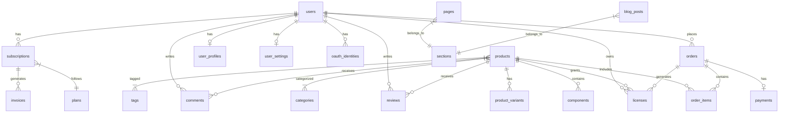
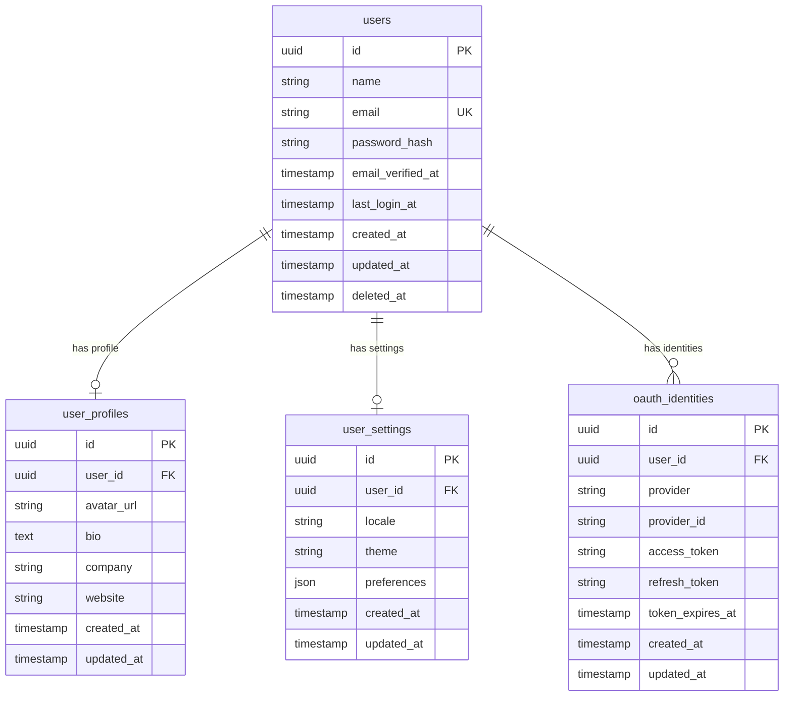
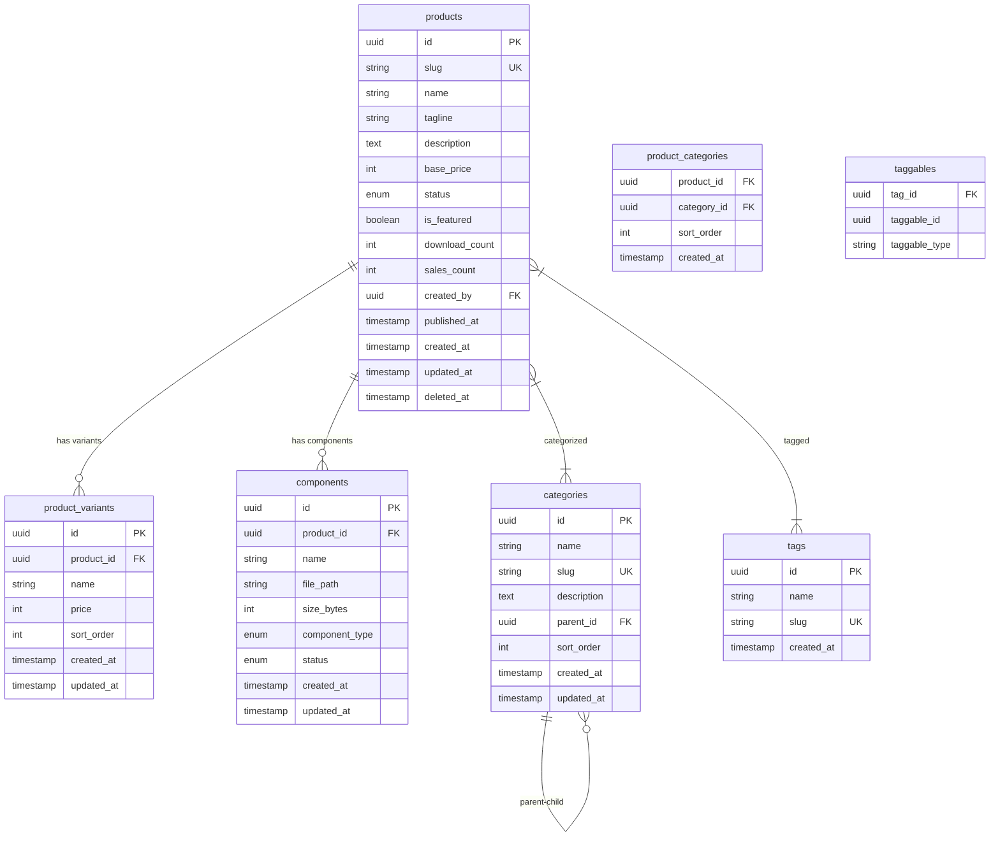
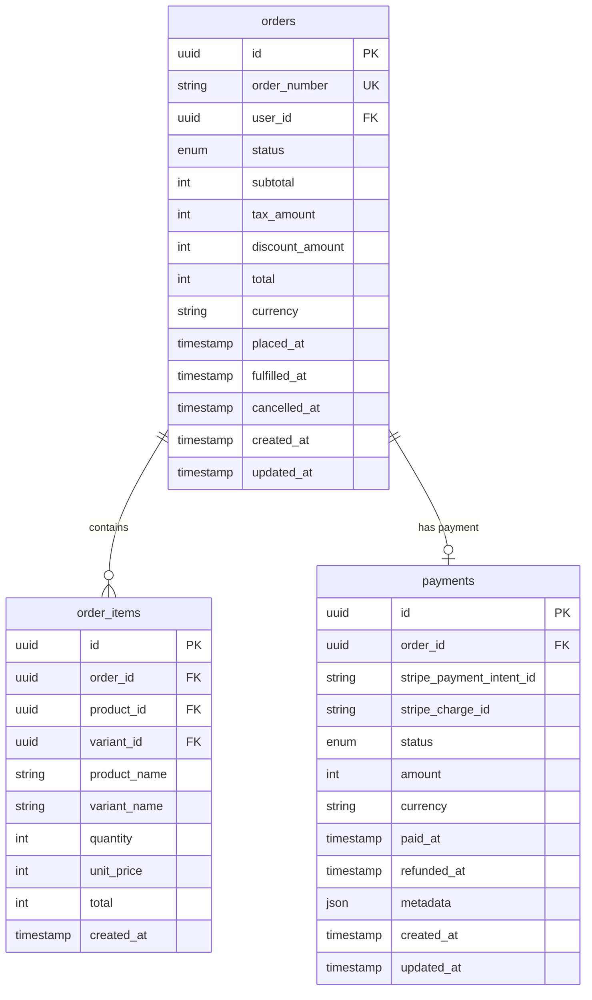
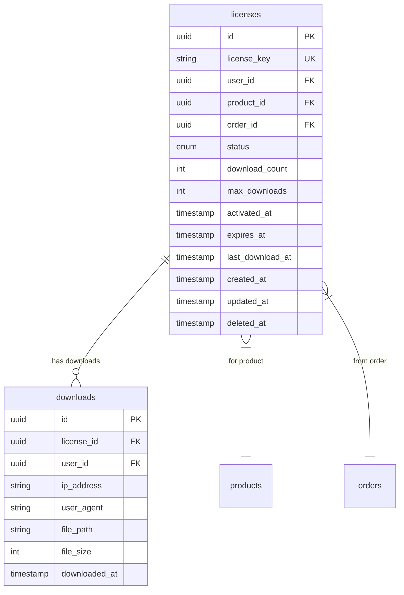
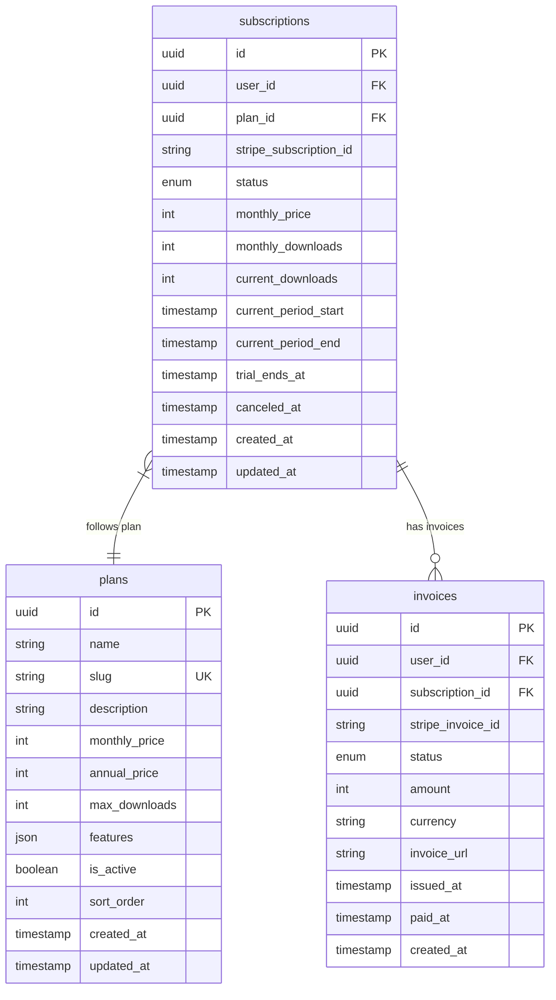
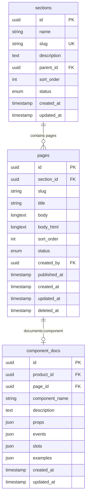
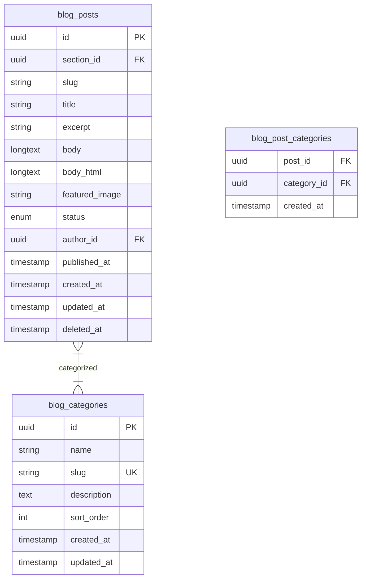
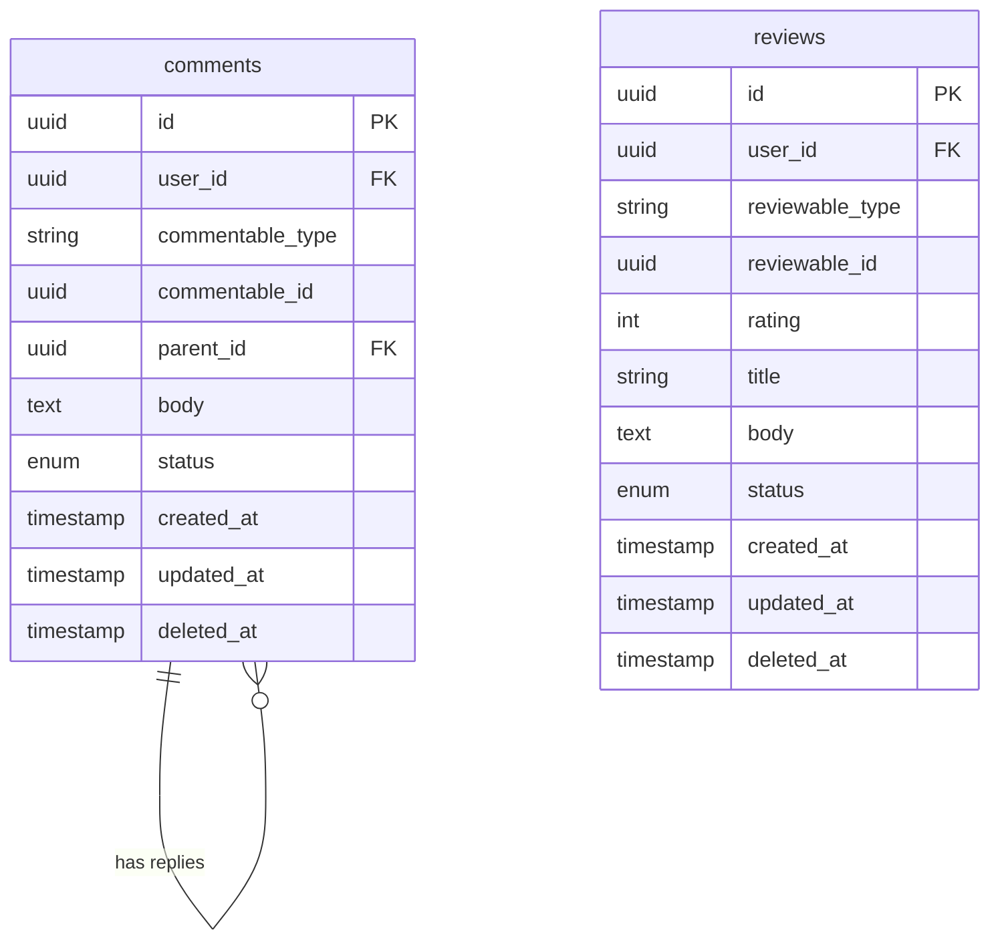
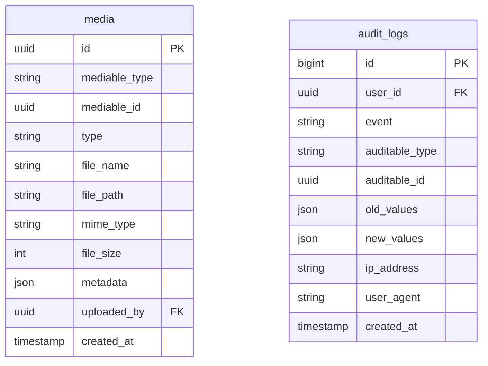

# Entity-Relationship Diagrams

## Overview

This document contains ERD diagrams for all major domains in the GsmUi platform. Each diagram shows entities, attributes, and relationships.

## System-Wide ERD

## Users Domain

## Products Domain

## Orders Domain

## Licenses Domain

## Subscriptions Domain

## Documentation Domain

## Blog Domain

## Comments & Reviews

## Media & Audit

## Index Overview

| Table | Primary Key | Unique Indexes | Regular Indexes |
|-------|-------------|----------------|-----------------|
| `users` | `id` | `email` | `created_at` |
| `products` | `id` | `slug` | `status+featured`, `created_at` |
| `orders` | `id` | `order_number` | `user_id+status`, `created_at` |
| `licenses` | `id` | `license_key` | `user_id+status`, `product_id` |
| `pages` | `id` | `slug` (per section) | `section_id+sort_order` |
| `blog_posts` | `id` | `slug` | `author_id+status`, `published_at` |

## Related Documents

- [Tables](../Tables/index.md)
- [Relationships](../Relationships/index.md)
- [Indexes](../Indexes/index.md)
- [Constraints](../Constraints/index.md)
