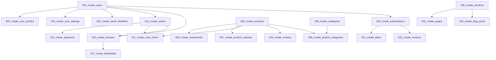

# Migrations

## Overview

GsmUi uses Laravel migrations for version-controlled database schema changes. This document covers migration conventions, rollback strategies, seeders, and test database setup.

## Migration Conventions

### File Naming

```
YYYY_MM_DD_HHMMSS_{action}_{table}.php
```

| Action | Pattern | Example |
|--------|---------|---------|
| Create table | `create_{table}` | `2024_01_15_000001_create_products_table.php` |
| Add column | `add_{column}_to_{table}` | `2024_01_15_000002_add_featured_to_products_table.php` |
| Modify column | `modify_{column}_in_{table}` | `2024_01_15_000003_modify_price_in_products_table.php` |
| Drop column | `drop_{column}_from_{table}` | `2024_01_15_000004_drop_legacy_from_products_table.php` |
| Create index | `index_{table}_{columns}` | `2024_01_15_000005_index_products_status.php` |
| Seed data | `seed_{table}` | `2024_01_15_000006_seed_plans_table.php` |

### Migration Structure

```php
<?php

use Illuminate\Database\Migrations\Migration;
use Illuminate\Database\Schema\Blueprint;
use Illuminate\Support\Facades\Schema;

return new class extends Migration
{
    public function up(): void
    {
        Schema::create('products', function (Blueprint $table) {
            $table->uuid('id')->primary();
            $table->string('slug')->unique();
            $table->string('name');
            $table->text('tagline')->nullable();
            $table->longText('description');
            $table->integer('base_price')->default(0);
            $table->string('currency', 3)->default('USD');
            $table->enum('status', ['draft', 'published', 'archived'])->default('draft');
            $table->boolean('is_featured')->default(false);
            $table->integer('download_count')->default(0);
            $table->integer('sales_count')->default(0);
            $table->string('featured_image')->nullable();
            $table->string('preview_url')->nullable();
            $table->string('github_repo')->nullable();
            $table->string('version')->nullable();
            $table->string('license_type')->default('single');
            $table->foreignUuid('created_by')->nullable()->constrained('users')->nullOnDelete();
            $table->timestamp('published_at')->nullable();
            $table->timestamps();
            $table->softDeletes();

            $table->index(['status', 'is_featured'], 'idx_products_status_featured');
            $table->index(['status', 'created_at'], 'idx_products_status_created');
            $table->fullText(['name', 'description', 'tagline'], 'ft_products_search');
        });
    }

    public function down(): void
    {
        Schema::dropIfExists('products');
    }
};
```

## Rollback Strategy

### Principles

| Principle | Description |
|-----------|-------------|
| Always reversible | Every migration must have a working `down()` method |
| Data preservation | Never delete data in `down()` without backup |
| Backward compatible | Old code must work with new schema |
| Test rollback | Verify `down()` works before deploying |

### Rollback Commands

```bash
# Rollback last migration
php artisan migrate:rollback

# Rollback last 5 migrations
php artisan migrate:rollback --step=5

# Rollback all migrations
php artisan migrate:rollback --pretend

# Reset and re-run all migrations
php artisan migrate:fresh --seed
```

### Rollback Patterns

```php
// Create table - simple drop
public function down(): void
{
    Schema::dropIfExists('products');
}

// Add column - drop column
public function down(): void
{
    Schema::table('products', function (Blueprint $table) {
        $table->dropColumn('is_featured');
    });
}

// Add index - drop index
public function down(): void
{
    Schema::table('products', function (Blueprint $table) {
        $table->dropIndex('idx_products_status_featured');
    });
}

// Modify column - restore original
public function down(): void
{
    Schema::table('products', function (Blueprint $table) {
        $table->integer('price')->change(); // Restore from base_price
    });
}
```

## Migration Ordering

### Dependency Graph



### Ordering Rules

| Rule | Description |
|------|-------------|
| Parent before child | Create parent tables first |
| Referenced before referencing | Foreign key targets must exist |
| Data before indexes | Insert data before adding indexes |
| Constraints last | Add constraints after data migration |

## Test Database Setup

### PHPUnit Configuration

```xml
<!-- phpunit.xml -->
<php>
    <env name="DB_CONNECTION" value="testing"/>
    <env name="DB_DATABASE" value="gsmui_testing"/>
    <env name="CACHE_DRIVER" value="array"/>
    <env name="QUEUE_CONNECTION" value="sync"/>
    <env name="SESSION_DRIVER" value="array"/>
    <env name="MAIL_MAILER" value="array"/>
    <env name="MEILISEARCH_HOST" value="http://localhost:7701"/>
</php>
```

### Test Database Strategy

```php
// TestCase.php
abstract class TestCase extends OrchestraTestCase
{
    protected function setUp(): void
    {
        parent::setUp();
        
        // Use in-memory SQLite for tests
        $this->app['config']->set('database.default', 'testing');
        $this->app['config']->set('database.connections.testing', [
            'driver' => 'sqlite',
            'database' => ':memory:',
            'prefix' => '',
        ]);
        
        // Run migrations
        $this->artisan('migrate');
    }
    
    protected function tearDown(): void
    {
        $this->artisan('migrate:rollback');
        parent::tearDown();
    }
}
```

### Migration Testing

```php
class MigrationTest extends TestCase
{
    public function test_products_table_creation(): void
    {
        $this->assertDatabaseHas('products', []);
        
        // Verify table structure
        $table = Schema::getColumnListing('products');
        $this->assertContains('id', $table);
        $this->assertContains('slug', $table);
        $this->assertContains('name', $table);
        $this->assertContains('status', $table);
    }
    
    public function test_products_rollback(): void
    {
        $this->artisan('migrate:rollback');
        
        $this->assertFalse(Schema::hasTable('products'));
    }
}
```

## Migration Patterns

### Add Column with Default

```php
public function up(): void
{
    Schema::table('products', function (Blueprint $table) {
        $table->boolean('is_featured')->default(false)->after('status');
    });
}

public function down(): void
{
    Schema::table('products', function (Blueprint $table) {
        $table->dropColumn('is_featured');
    });
}
```

### Add Column with Data Migration

```php
public function up(): void
{
    Schema::table('products', function (Blueprint $table) {
        $table->string('slug')->nullable()->after('name');
    });

    // Migrate existing data
    Product::each(function ($product) {
        $product->update([
            'slug' => Str::slug($product->name),
        ]);
    });

    // Make non-nullable after data migration
    Schema::table('products', function (Blueprint $table) {
        $table->string('slug')->nullable(false)->change();
    });
}
```

### Rename Column

```php
public function up(): void
{
    Schema::table('products', function (Blueprint $table) {
        $table->renameColumn('price', 'base_price');
    });
}

public function down(): void
{
    Schema::table('products', function (Blueprint $table) {
        $table->renameColumn('base_price', 'price');
    });
}
```

### Create Pivot Table

```php
public function up(): void
{
    Schema::create('product_categories', function (Blueprint $table) {
        $table->uuid('product_id');
        $table->uuid('category_id');
        $table->integer('sort_order')->default(0);
        $table->timestamps();

        $table->primary(['product_id', 'category_id']);
        $table->foreign('product_id')->references('id')->on('products')->onDelete('cascade');
        $table->foreign('category_id')->references('id')->on('categories')->onDelete('cascade');
    });
}
```

## Migration Performance

### Large Table Migrations

```php
// For tables with millions of rows
public function up(): void
{
    // Step 1: Add nullable column
    Schema::table('orders', function (Blueprint $table) {
        $table->string('new_field')->nullable();
    });

    // Step 2: Backfill in batches (run separately)
    // php artisan migrate --force
    // Then run: php artisan db:seed --class=OrderFieldSeeder

    // Step 3: Make non-nullable (after backfill)
    Schema::table('orders', function (Blueprint $table) {
        $table->string('new_field')->nullable(false)->change();
    });
}
```

### Batch Processing

```php
class OrderFieldSeeder extends Seeder
{
    public function run(): void
    {
        Order::whereNull('new_field')
            ->chunkById(1000, function ($orders) {
                foreach ($orders as $order) {
                    $order->update(['new_field' => 'default_value']);
                }
            });
    }
}
```

## Migration Safety

### Pre-Deploy Checklist

| Check | Description |
|-------|-------------|
| Backup database | Full backup before migration |
| Test rollback | Verify `down()` works |
| Check foreign keys | No broken references |
| Test in staging | Run on production-like data |
| Monitor performance | Check query times |
| Plan rollback time | Estimate downtime |

### Deployment Order

```bash
# 1. Backup
mysqldump -u root gsmui_production > backup_$(date +%Y%m%d).sql

# 2. Run migrations
php artisan migrate --force

# 3. Verify
php artisan migrate:status

# 4. Clear caches
php artisan config:clear
php artisan cache:clear
```

## Related Documents

- [Tables](../Tables/index.md)
- [Seeders](../Seeders/index.md)
- [Design Principles](../Design-Principles/index.md)
- [Constraints](../Constraints/index.md)
