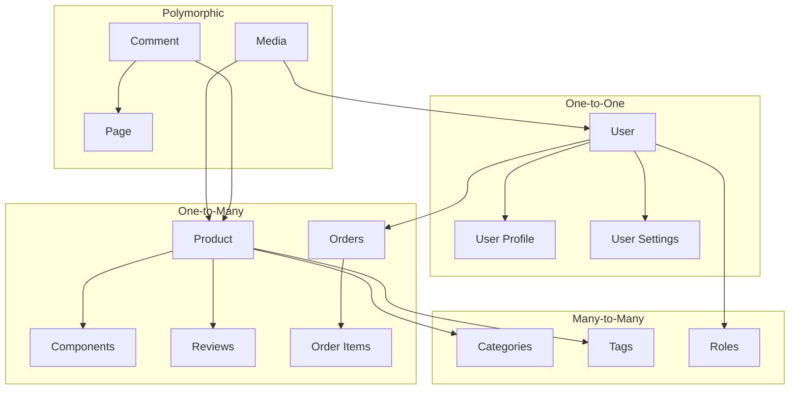

# Relationships

## Overview

GsmUi uses Eloquent ORM with well-defined relationships between entities. This document covers all relationship types, loading strategies, and performance considerations.

## Relationship Types



## One-to-One

### User → UserProfile

```php
class User extends Model
{
    public function profile(): HasOne
    {
        return $this->hasOne(UserProfile::class);
    }

    public function settings(): HasOne
    {
        return $this->hasOne(UserSetting::class);
    }
}

class UserProfile extends Model
{
    public function user(): BelongsTo
    {
        return $this->belongsTo(User::class);
    }
}
```

### Schema

```sql
CREATE TABLE user_profiles (
    id CHAR(36) PRIMARY KEY,
    user_id CHAR(36) NOT NULL UNIQUE,
    avatar_url VARCHAR(2048) NULL,
    bio TEXT NULL,
    company VARCHAR(255) NULL,
    website VARCHAR(2048) NULL,
    created_at TIMESTAMP DEFAULT CURRENT_TIMESTAMP,
    updated_at TIMESTAMP DEFAULT CURRENT_TIMESTAMP ON UPDATE CURRENT_TIMESTAMP,
    FOREIGN KEY fk_user (user_id) REFERENCES users(id) ON DELETE CASCADE
);
```

## One-to-Many

### User → Orders

```php
class User extends Model
{
    public function orders(): HasMany
    {
        return $this->hasMany(Order::class);
    }

    public function licenses(): HasMany
    {
        return $this->hasMany(License::class);
    }

    public function reviews(): HasMany
    {
        return $this->morphMany(Review::class, 'reviewable');
    }
}

class Order extends Model
{
    public function user(): BelongsTo
    {
        return $this->belongsTo(User::class);
    }

    public function items(): HasMany
    {
        return $this->hasMany(OrderItem::class);
    }

    public function payment(): HasOne
    {
        return $this->hasOne(Payment::class);
    }
}
```

### Product → Components

```php
class Product extends Model
{
    public function components(): HasMany
    {
        return $this->hasMany(Component::class);
    }

    public function activeComponents(): HasMany
    {
        return $this->hasMany(Component::class)->where('status', 'active');
    }

    public function variants(): HasMany
    {
        return $this->hasMany(ProductVariant::class);
    }
}
```

## Many-to-Many

### Product ↔ Category

```php
class Product extends Model
{
    public function categories(): BelongsToMany
    {
        return $this->belongsToMany(Category::class, 'product_categories')
            ->withPivot('sort_order')
            ->withTimestamps()
            ->orderByPivot('sort_order');
    }
}

class Category extends Model
{
    public function products(): BelongsToMany
    {
        return $this->belongsToMany(Product::class, 'product_categories')
            ->withPivot('sort_order')
            ->withTimestamps();
    }
}
```

### Pivot Table

```sql
CREATE TABLE product_categories (
    product_id CHAR(36) NOT NULL,
    category_id CHAR(36) NOT NULL,
    sort_order INT DEFAULT 0,
    created_at TIMESTAMP DEFAULT CURRENT_TIMESTAMP,
    updated_at TIMESTAMP DEFAULT CURRENT_TIMESTAMP ON UPDATE CURRENT_TIMESTAMP,
    PRIMARY KEY (product_id, category_id),
    FOREIGN KEY fk_product (product_id) REFERENCES products(id) ON DELETE CASCADE,
    FOREIGN KEY fk_category (category_id) REFERENCES categories(id) ON DELETE CASCADE,
    INDEX idx_category (category_id)
);
```

### User ↔ Role

```php
class User extends Model
{
    public function roles(): BelongsToMany
    {
        return $this->belongsToMany(Role::class, 'model_has_roles')
            ->withTimestamps();
    }

    public function hasRole(string $slug): bool
    {
        return $this->roles()->where('slug', $slug)->exists();
    }
}
```

## Polymorphic Relations

### Comment System

```php
class Comment extends Model
{
    public function commentable(): MorphTo
    {
        return $this->morphTo();
    }

    public function user(): BelongsTo
    {
        return $this->belongsTo(User::class);
    }

    public function replies(): HasMany
    {
        return $this->hasMany(Comment::class, 'parent_id');
    }
}

class Product extends Model
{
    public function comments(): MorphMany
    {
        return $this->morphMany(Comment::class, 'commentable');
    }
}

class Page extends Model
{
    public function comments(): MorphMany
    {
        return $this->morphMany(Comment::class, 'commentable');
    }
}
```

### Media Attachments

```php
class Media extends Model
{
    public function mediable(): MorphTo
    {
        return $this->morphTo();
    }
}

class Product extends Model
{
    public function media(): MorphMany
    {
        return $this->morphMany(Media::class, 'mediable');
    }

    public function featuredImage(): MorphOne
    {
        return $this->morphOne(Media::class, 'mediable')
            ->where('type', 'featured_image');
    }
}
```

### Tag System

```php
class Tag extends Model
{
    public function taggables(): MorphToMany
    {
        return $this->morphToMany(Product::class, 'taggable');
    }
}

class Product extends Model
{
    public function tags(): MorphToMany
    {
        return $this->morphToMany(Tag::class, 'taggable');
    }
}
```

## Has-Many-Through

### User → Downloads (through Licenses)

```php
class User extends Model
{
    public function licenses(): HasMany
    {
        return $this->hasMany(License::class);
    }

    public function downloads(): HasManyThrough
    {
        return $this->hasManyThrough(Download::class, License::class);
    }

    public function products(): HasManyThrough
    {
        return $this->hasManyThrough(Product::class, License::class);
    }
}
```

### Product → Reviews (through Variants)

```php
class Product extends Model
{
    public function variants(): HasMany
    {
        return $this->hasMany(ProductVariant::class);
    }

    public function reviews(): HasManyThrough
    {
        return $this->hasManyThrough(Review::class, ProductVariant::class);
    }
}
```

## Loading Strategies

### Eager Loading

```php
// N+1 prevention
$products = Product::with(['category', 'components', 'tags'])->get();

// Conditional eager loading
$products = Product::with([
    'category',
    'components' => fn($q) => $q->where('status', 'active'),
])->get();

// Nested eager loading
$orders = Order::with(['user', 'items.product', 'payment'])->get();
```

### Lazy Loading

```php
// Lazy load on access (causes N+1)
$product = Product::find($id);
$category = $product->category; // Triggers query
```

### Selective Columns

```php
$products = Product::with([
    'category:id,name,slug',
    'components:id,name,product_id',
])->select('id', 'name', 'slug', 'category_id')->get();
```

## Relationship Performance

### N+1 Query Detection

```php
// Enable query logging in development
DB::enableQueryLog();

$products = Product::all();
foreach ($products as $product) {
    echo $product->category->name; // N+1 problem!
}

// Debug queries
dd(DB::getQueryLog());
```

### Optimal Loading Patterns

| Pattern | Query Count | Use Case |
|---------|-------------|----------|
| Eager loading | 2-3 | List views, detail pages |
| Lazy loading | N+1 | Avoid in lists |
| Subselect | 2-3 | Count-based aggregations |
| Join | 1-2 | Search, filtering |

### Count Optimization

```php
// Instead of loading all relationships
$product->loadCount('components', 'reviews', 'downloads');

// Access counts without loading
$product->components_count;
$product->reviews_count;
```

## Cascade Behavior

| Parent | Child | Cascade | Rationale |
|--------|-------|---------|-----------|
| User | Orders | RESTRICT | Preserve financial records |
| User | Licenses | RESTRICT | Preserve license history |
| User | Reviews | CASCADE | User-owned content |
| User | Comments | CASCADE | User-owned content |
| Product | Components | CASCADE | Product-owned assets |
| Product | OrderItems | RESTRICT | Preserve order history |
| Product | Reviews | CASCADE | Product-owned content |
| Order | OrderItems | CASCADE | Order-owned items |
| Order | Payments | CASCADE | Order-owned payments |
| Category | ProductCategories | CASCADE | Category-owned pivots |

## Related Documents

- [ERD Diagrams](../ERD/index.md)
- [Tables](../Tables/index.md)
- [Design Principles](../Design-Principles/index.md)
- [Indexes](../Indexes/index.md)
