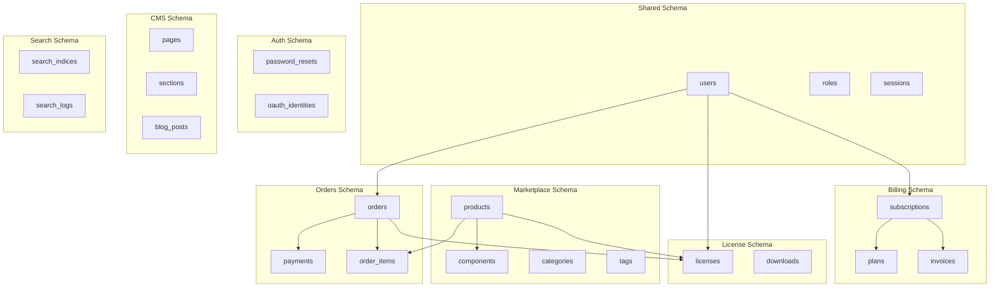

# Schema Designs

## Overview

GsmUi organizes database schemas by bounded context, with clear separation of concerns. Each schema serves a specific domain and has its own naming conventions and access patterns.

## Schema Organization



## Auth Schema

### Tables

| Table | Purpose | Rows (Est.) |
|-------|---------|-------------|
| `users` | User accounts | 10,000 |
| `password_resets` | Password reset tokens | 100 |
| `oauth_identities` | OAuth provider links | 5,000 |
| `sessions` | Active sessions | 500 |
| `failed_jobs` | Failed queue jobs | 10 |

### users Table

```sql
CREATE TABLE users (
    id CHAR(36) PRIMARY KEY,
    name VARCHAR(255) NOT NULL,
    email VARCHAR(255) NOT NULL UNIQUE,
    email_verified_at TIMESTAMP NULL,
    password_hash VARCHAR(255) NULL,
    remember_token VARCHAR(100) NULL,
    two_factor_secret VARCHAR(255) NULL,
    two_factor_recovery_codes JSON NULL,
    is_admin BOOLEAN DEFAULT FALSE,
    last_login_at TIMESTAMP NULL,
    last_login_ip VARCHAR(45) NULL,
    created_at TIMESTAMP DEFAULT CURRENT_TIMESTAMP,
    updated_at TIMESTAMP DEFAULT CURRENT_TIMESTAMP ON UPDATE CURRENT_TIMESTAMP,
    deleted_at TIMESTAMP NULL,

    INDEX idx_email (email),
    INDEX idx_created (created_at)
);
```

### oauth_identities Table

```sql
CREATE TABLE oauth_identities (
    id CHAR(36) PRIMARY KEY,
    user_id CHAR(36) NOT NULL,
    provider VARCHAR(255) NOT NULL,
    provider_id VARCHAR(255) NOT NULL,
    provider_nickname VARCHAR(255) NULL,
    access_token TEXT NULL,
    refresh_token TEXT NULL,
    token_expires_at TIMESTAMP NULL,
    created_at TIMESTAMP DEFAULT CURRENT_TIMESTAMP,
    updated_at TIMESTAMP DEFAULT CURRENT_TIMESTAMP ON UPDATE CURRENT_TIMESTAMP,

    UNIQUE INDEX uniq_provider_id (provider, provider_id),
    INDEX idx_user (user_id),
    FOREIGN KEY fk_user (user_id) REFERENCES users(id) ON DELETE CASCADE
);
```

## Marketplace Schema

### Tables

| Table | Purpose | Rows (Est.) |
|-------|---------|-------------|
| `products` | Product catalog | 500 |
| `product_variants` | Pricing tiers | 1,500 |
| `components` | Product files | 5,000 |
| `categories` | Product categories | 50 |
| `tags` | Content tags | 200 |
| `product_categories` | Product-category pivot | 1,000 |
| `taggables` | Tag polymorphic pivot | 2,000 |

### products Table

```sql
CREATE TABLE products (
    id CHAR(36) PRIMARY KEY,
    slug VARCHAR(255) NOT NULL UNIQUE,
    name VARCHAR(255) NOT NULL,
    tagline VARCHAR(500) NULL,
    description LONGTEXT NOT NULL,
    description_html LONGTEXT NULL,
    base_price INT NOT NULL DEFAULT 0,
    currency VARCHAR(3) DEFAULT 'USD',
    status ENUM('draft', 'published', 'archived') DEFAULT 'draft',
    is_featured BOOLEAN DEFAULT FALSE,
    download_count INT DEFAULT 0,
    sales_count INT DEFAULT 0,
    featured_image VARCHAR(2048) NULL,
    preview_url VARCHAR(2048) NULL,
    github_repo VARCHAR(255) NULL,
    version VARCHAR(50) NULL,
    license_type VARCHAR(50) DEFAULT 'single',
    created_by CHAR(36) NULL,
    published_at TIMESTAMP NULL,
    created_at TIMESTAMP DEFAULT CURRENT_TIMESTAMP,
    updated_at TIMESTAMP DEFAULT CURRENT_TIMESTAMP ON UPDATE CURRENT_TIMESTAMP,
    deleted_at TIMESTAMP NULL,

    INDEX idx_status_featured (status, is_featured),
    INDEX idx_status_created (status, created_at),
    INDEX idx_featured (is_featured),
    INDEX idx_published (published_at),
    FOREIGN KEY fk_created_by (created_by) REFERENCES users(id) ON DELETE SET NULL
);
```

### components Table

```sql
CREATE TABLE components (
    id CHAR(36) PRIMARY KEY,
    product_id CHAR(36) NOT NULL,
    name VARCHAR(255) NOT NULL,
    description TEXT NULL,
    file_path VARCHAR(500) NOT NULL,
    file_name VARCHAR(255) NOT NULL,
    file_size INT DEFAULT 0,
    mime_type VARCHAR(100) NULL,
    component_type ENUM('blade', 'livewire', 'alpine', 'css', 'js', 'other') DEFAULT 'blade',
    status ENUM('active', 'deprecated', 'removed') DEFAULT 'active',
    version VARCHAR(50) NULL,
    sort_order INT DEFAULT 0,
    created_at TIMESTAMP DEFAULT CURRENT_TIMESTAMP,
    updated_at TIMESTAMP DEFAULT CURRENT_TIMESTAMP ON UPDATE CURRENT_TIMESTAMP,

    INDEX idx_product (product_id),
    INDEX idx_type (component_type),
    FOREIGN KEY fk_product (product_id) REFERENCES products(id) ON DELETE CASCADE
);
```

## Orders Schema

### Tables

| Table | Purpose | Rows (Est.) |
|-------|---------|-------------|
| `orders` | Purchase orders | 50,000 |
| `order_items` | Order line items | 75,000 |
| `payments` | Payment records | 50,000 |

### orders Table

```sql
CREATE TABLE orders (
    id CHAR(36) PRIMARY KEY,
    order_number VARCHAR(50) NOT NULL UNIQUE,
    user_id CHAR(36) NOT NULL,
    status ENUM('pending', 'processing', 'fulfilled', 'cancelled', 'refunded') DEFAULT 'pending',
    subtotal INT NOT NULL DEFAULT 0,
    tax_amount INT DEFAULT 0,
    discount_amount INT DEFAULT 0,
    total INT NOT NULL DEFAULT 0,
    currency VARCHAR(3) DEFAULT 'USD',
    coupon_code VARCHAR(50) NULL,
    notes TEXT NULL,
    placed_at TIMESTAMP NULL,
    fulfilled_at TIMESTAMP NULL,
    cancelled_at TIMESTAMP NULL,
    refund_reason TEXT NULL,
    created_at TIMESTAMP DEFAULT CURRENT_TIMESTAMP,
    updated_at TIMESTAMP DEFAULT CURRENT_TIMESTAMP ON UPDATE CURRENT_TIMESTAMP,

    UNIQUE INDEX uniq_order_number (order_number),
    INDEX idx_user (user_id),
    INDEX idx_status (status),
    INDEX idx_status_created (status, created_at),
    INDEX idx_placed (placed_at),
    FOREIGN KEY fk_user (user_id) REFERENCES users(id) ON DELETE RESTRICT
);
```

### order_items Table

```sql
CREATE TABLE order_items (
    id CHAR(36) PRIMARY KEY,
    order_id CHAR(36) NOT NULL,
    product_id CHAR(36) NOT NULL,
    variant_id CHAR(36) NULL,
    product_name VARCHAR(255) NOT NULL,
    variant_name VARCHAR(255) NULL,
    quantity INT NOT NULL DEFAULT 1,
    unit_price INT NOT NULL,
    total INT NOT NULL,
    created_at TIMESTAMP DEFAULT CURRENT_TIMESTAMP,

    INDEX idx_order (order_id),
    INDEX idx_product (product_id),
    FOREIGN KEY fk_order (order_id) REFERENCES orders(id) ON DELETE CASCADE,
    FOREIGN KEY fk_product (product_id) REFERENCES products(id) ON DELETE RESTRICT
);
```

## License Schema

### Tables

| Table | Purpose | Rows (Est.) |
|-------|---------|-------------|
| `licenses` | License keys | 100,000 |
| `downloads` | Download tracking | 500,000 |

### licenses Table

```sql
CREATE TABLE licenses (
    id CHAR(36) PRIMARY KEY,
    license_key VARCHAR(50) NOT NULL UNIQUE,
    user_id CHAR(36) NOT NULL,
    product_id CHAR(36) NOT NULL,
    order_id CHAR(36) NOT NULL,
    status ENUM('active', 'expired', 'revoked') DEFAULT 'active',
    download_count INT DEFAULT 0,
    max_downloads INT DEFAULT 10,
    activated_at TIMESTAMP NULL,
    expires_at TIMESTAMP NULL,
    last_download_at TIMESTAMP NULL,
    last_download_ip VARCHAR(45) NULL,
    created_at TIMESTAMP DEFAULT CURRENT_TIMESTAMP,
    updated_at TIMESTAMP DEFAULT CURRENT_TIMESTAMP ON UPDATE CURRENT_TIMESTAMP,
    deleted_at TIMESTAMP NULL,

    UNIQUE INDEX uniq_license_key (license_key),
    INDEX idx_user (user_id),
    INDEX idx_product (product_id),
    INDEX idx_order (order_id),
    INDEX idx_status (status),
    INDEX idx_user_status (user_id, status),
    FOREIGN KEY fk_user (user_id) REFERENCES users(id) ON DELETE RESTRICT,
    FOREIGN KEY fk_product (product_id) REFERENCES products(id) ON DELETE RESTRICT,
    FOREIGN KEY fk_order (order_id) REFERENCES orders(id) ON DELETE RESTRICT
);
```

## Billing Schema

### Tables

| Table | Purpose | Rows (Est.) |
|-------|---------|-------------|
| `plans` | Subscription plans | 5 |
| `subscriptions` | User subscriptions | 2,000 |
| `invoices` | Billing invoices | 20,000 |

### subscriptions Table

```sql
CREATE TABLE subscriptions (
    id CHAR(36) PRIMARY KEY,
    user_id CHAR(36) NOT NULL,
    plan_id CHAR(36) NOT NULL,
    stripe_subscription_id VARCHAR(255) NOT NULL UNIQUE,
    stripe_customer_id VARCHAR(255) NOT NULL,
    status ENUM('active', 'trialing', 'past_due', 'canceled', 'unpaid') DEFAULT 'active',
    monthly_price INT NOT NULL,
    billing_cycle ENUM('monthly', 'annual') DEFAULT 'monthly',
    current_period_start TIMESTAMP NULL,
    current_period_end TIMESTAMP NULL,
    trial_ends_at TIMESTAMP NULL,
    canceled_at TIMESTAMP NULL,
    cancel_reason TEXT NULL,
    created_at TIMESTAMP DEFAULT CURRENT_TIMESTAMP,
    updated_at TIMESTAMP DEFAULT CURRENT_TIMESTAMP ON UPDATE CURRENT_TIMESTAMP,

    UNIQUE INDEX uniq_stripe (stripe_subscription_id),
    INDEX idx_user (user_id),
    INDEX idx_plan (plan_id),
    INDEX idx_status (status),
    FOREIGN KEY fk_user (user_id) REFERENCES users(id) ON DELETE RESTRICT,
    FOREIGN KEY fk_plan (plan_id) REFERENCES plans(id) ON DELETE RESTRICT
);
```

## CMS Schema

### Tables

| Table | Purpose | Rows (Est.) |
|-------|---------|-------------|
| `sections` | Documentation sections | 20 |
| `pages` | Documentation pages | 200 |
| `component_docs` | Component documentation | 500 |
| `blog_categories` | Blog categories | 10 |
| `blog_posts` | Blog articles | 100 |

### pages Table

```sql
CREATE TABLE pages (
    id CHAR(36) PRIMARY KEY,
    section_id CHAR(36) NOT NULL,
    slug VARCHAR(255) NOT NULL,
    title VARCHAR(255) NOT NULL,
    body LONGTEXT NOT NULL,
    body_html LONGTEXT NULL,
    excerpt TEXT NULL,
    sort_order INT DEFAULT 0,
    status ENUM('draft', 'published', 'archived') DEFAULT 'draft',
    created_by CHAR(36) NULL,
    published_at TIMESTAMP NULL,
    created_at TIMESTAMP DEFAULT CURRENT_TIMESTAMP,
    updated_at TIMESTAMP DEFAULT CURRENT_TIMESTAMP ON UPDATE CURRENT_TIMESTAMP,
    deleted_at TIMESTAMP NULL,

    INDEX idx_section (section_id),
    INDEX idx_section_sort (section_id, sort_order),
    INDEX idx_status (status),
    FOREIGN KEY fk_section (section_id) REFERENCES sections(id) ON DELETE CASCADE,
    FOREIGN KEY fk_created_by (created_by) REFERENCES users(id) ON DELETE SET NULL
);
```

## Schema Access Patterns

| Schema | Primary Access | Secondary Access | Hot Path |
|--------|----------------|------------------|----------|
| Auth | Login, register | Profile update | Session lookup |
| Marketplace | Product listing | Search | Product by slug |
| Orders | Order creation | Order history | Order by number |
| License | License validation | Download | License by key |
| Billing | Subscription check | Invoice list | Active subscription |
| CMS | Page view | Search | Page by slug |

## Related Documents

- [Tables](../Tables/index.md)
- [ERD Diagrams](../ERD/index.md)
- [Indexes](../Indexes/index.md)
- [Design Principles](../Design-Principles/index.md)
