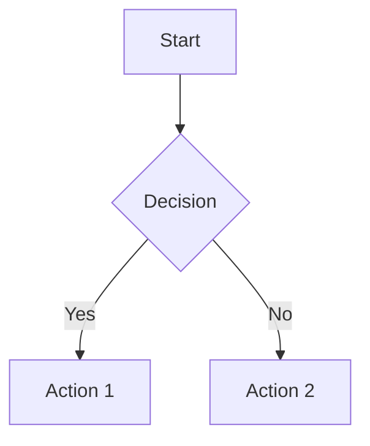

# Markdown Extensions

GsmUi extends CommonMark with custom syntax for documentation-specific needs: callouts, code groups, tabs, diagrams, and math rendering.

## Extension Catalog

| Extension | Syntax | Purpose |
|---|---|---|
| Callouts | `:::note` | Highlighted content blocks |
| Code Groups | `````` ```group `````` | Tabbed code blocks |
| Tabs | `<x-tab>` | Content tabs |
| Diagrams | `````` ```mermaid `````` | Mermaid diagrams |
| Math | `$$` | LaTeX math |
| Badges | `::badge` | Status badges |
| Anchors | `## Heading {#id}` | Custom heading IDs |
| Alerts | `::alert` | Alert boxes |

## Callouts

### Syntax

```markdown
:::note
This is a note callout.
:::

:::tip
This is a tip callout.
:::

:::warning
This is a warning callout.
:::

:::danger
This is a danger callout.
:::

:::info
This is an info callout.
:::
```

### Callout Types

| Type | Icon | Border | Background | Use Case |
|---|---|---|---|---|
| `note` | `info` | `blue` | `blue-50` | General notes |
| `tip` | `lightbulb` | `green` | `green-50` | Best practices |
| `warning` | `alert-triangle` | `amber` | `amber-50` | Cautions |
| `danger` | `alert-octagon` | `red` | `red-50` | Breaking changes |
| `info` | `info` | `blue` | `blue-50` | Additional info |

### Custom Title

```markdown
:::tip Custom Title
This callout has a custom title.
:::
```

### Callout Output

```html
<div class="callout callout--tip">
  <div class="callout-icon">
    <svg><!-- lightbulb icon --></svg>
  </div>
  <div class="callout-content">
    <div class="callout-title">Tip</div>
    <p>This callout has a custom title.</p>
  </div>
</div>
```

## Code Groups

### Syntax

````markdown
```php tab:PHP
echo "Hello from PHP";
```

```blade tab:Blade
{{ $message }}
```

```html tab:HTML
<p>Hello from HTML</p>
```
````

### Code Group Output

```
┌─────┬──────┬───────┐
│ PHP │ Blade │ HTML │
├─────┴──────┴───────┤
│                     │
│  echo "Hello";      │
│                     │
└─────────────────────┘
```

### Code Group Options

| Option | Syntax | Description |
|---|---|---|
| Tab label | `tab:Label` | Custom tab name |
| Active tab | `active:tab` | Default active tab |
| Shared code | `shared` | Show all tabs at once |

## Tabs

### Syntax

```html
<x-gsmui:doc-tabs>
    <x-gsmui:doc-tab name="preview" label="Preview">
        <gsmui:button>Click me</gsmui:button>
    </x-gsmui:doc-tab>

    <x-gsmui:doc-tab name="code" label="Code">
        ```blade
        <gsmui:button>Click me</gsmui:button>
        ```
    </x-gsmui:doc-tab>
</x-gsmui:doc-tabs>
```

### Tab Variants

| Variant | Description |
|---|---|
| `underline` | Bottom border active indicator |
| `pills` | Background fill active indicator |
| `boxed` | Bordered tabs |

## Diagrams

### Mermaid Support

````markdown

````

### Supported Diagrams

| Type | Directive | Description |
|---|---|---|
| Flowchart | `graph TD` | Process flows |
| Sequence | `sequenceDiagram` | API interactions |
| Class | `classDiagram` | OOP diagrams |
| Gantt | `gantt` | Project timelines |
| Pie | `pie` | Data visualization |

### Diagram Theme Integration

| Token | Maps To |
|---|---|
| `--gsmui-diagram-text` | Node text color |
| `--gsmui-diagram-line` | Connector color |
| `--gsmui-diagram-fill` | Node fill color |
| `--gsmui-diagram-bg` | Diagram background |

## Math

### Inline Math

```markdown
The quadratic formula is $x = \frac{-b \pm \sqrt{b^2-4ac}}{2a}$.
```

### Block Math

```markdown
$$
\int_{-\infty}^{\infty} e^{-x^2} dx = \sqrt{\pi}
$$
```

### Math Options

| Option | Description |
|---|---|
| Renderer | KaTeX (default) or MathJax |
| Macros | Custom LaTeX macros |
| Delimiters | Custom inline/block delimiters |

## Badges

### Syntax

```markdown
:::badge[Stable]{variant=success}
:::badge[Beta]{variant=warning}
:::badge[Deprecated]{variant=danger}
```

### Badge Variants

| Variant | Color | Use Case |
|---|---|---|
| `stable` | Green | Production ready |
| `beta` | Amber | In development |
| `deprecated` | Red | Removed/removed |
| `new` | Blue | New feature |

## Custom Anchors

```markdown
## Installation {#installation}
```

## Alerts

```markdown
:::alert[Breaking Change]{variant=danger}
This change requires migration.
:::
```

## Frontmatter Processing

### Supported Fields

| Field | Purpose | Output |
|---|---|---|
| `title` | Page title | `<h1>`, `<title>` |
| `description` | Meta description | `<meta>` |
| `order` | Sort order | Sidebar ordering |
| `group` | Group name | Sidebar grouping |
| `icon` | Icon name | Sidebar icon |
| `status` | Stability | Badge display |
| `since` | Version | Version badge |
| `tags` | Keywords | Search indexing |

### Custom Fields

```yaml
---
title: Custom Page
custom:
  author: "John Doe"
  reviewed: "2024-01-15"
---
```

## Extension Configuration

```php
// config/docs.php
return [
    'markdown' => [
        'extensions' => [
            'callouts' => true,
            'code_groups' => true,
            'tabs' => true,
            'mermaid' => true,
            'math' => false, // Opt-in
            'badges' => true,
        ],
        'mermaid' => [
            'theme' => 'default', // 'default', 'dark', 'forest'
        ],
        'math' => [
            'renderer' => 'katex', // 'katex', 'mathjax'
        ],
    ],
];
```
