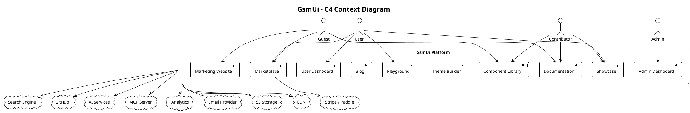

# 05.02 - C4 Context Diagram

**Project:** GsmUi
**Architecture:** C4 Model - Level 1 (System Context)
**Version:** 1.0.0

---

# Purpose

The C4 Context Diagram provides a high-level view of the GsmUi platform, showing how it interacts with users and external systems without exposing internal implementation details.

It answers:

* Who uses GsmUi?
* What external services does it integrate with?
* What responsibilities belong inside the platform?
* What systems remain outside the platform boundary?

---

# System Scope

GsmUi is a unified Laravel developer platform providing:

* UI Components
* Documentation
* Templates
* Theme Builder
* Playground
* Marketplace
* Blog
* Community Showcase
* Billing
* Swag Store
* AI & MCP Tools
* User Dashboard
* Admin Dashboard

---

# Primary Actors

## Guest Visitor

Can:

* Browse marketing pages
* View documentation
* Search components
* Read blogs
* View pricing
* Browse templates
* Explore showcase

Cannot:

* Download premium assets
* Save playgrounds
* Purchase products
* Access dashboard

---

## Registered User

Can:

* Manage profile
* Download assets
* Save playgrounds
* Bookmark components
* Submit showcase projects
* Comment
* Purchase products
* Manage subscription
* Generate themes

---

## Pro Subscriber

Includes all Registered User capabilities plus:

* Premium components
* Premium templates
* Premium themes
* Advanced playground
* MCP access
* AI tools
* Team workspaces
* Private projects

---

## Administrator

Responsible for:

* User management
* Billing
* Products
* Documentation
* Components
* Blog
* Marketplace
* Orders
* Analytics
* Moderation
* Settings

---

## Developer Contributor

Can:

* Submit components
* Submit themes
* Submit templates
* Improve documentation
* Publish plugins
* Participate in RFCs

---

# External Systems

## Payment Gateway

Responsibilities:

* Subscription billing
* One-time purchases
* Invoice generation
* Refunds
* Webhooks

Examples:

* Stripe
* Paddle
* Lemon Squeezy

---

## Email Service

Responsibilities:

* Verification emails
* Password resets
* Notifications
* Marketing campaigns
* Transactional emails

Examples:

* Resend
* Mailgun
* Amazon SES

---

## Object Storage

Stores:

* Images
* Documentation assets
* Downloads
* Videos
* Merchandise assets

Examples:

* Amazon S3
* Cloudflare R2
* DigitalOcean Spaces

---

## CDN

Serves:

* CSS
* JavaScript
* Images
* Fonts
* Downloads

Examples:

* Cloudflare
* BunnyCDN

---

## Search Engine

Indexes:

* Components
* Documentation
* Blog
* Templates
* Showcase

Possible providers:

* Meilisearch
* Typesense
* Algolia

---

## AI Services

Used for:

* Component generation
* Theme generation
* Code explanation
* Documentation assistant
* Playground suggestions

---

## GitHub

Used for:

* Authentication (optional)
* Open-source synchronization
* Releases
* Changelog
* Community contributions

---

## MCP Server

Provides:

* Component discovery
* Documentation lookup
* AI integration
* Code generation
* CLI support

---

## Analytics

Tracks:

* Traffic
* Conversions
* Downloads
* User behavior
* Feature usage

Examples:

* Plausible
* Google Analytics
* PostHog

---

# System Context



---

# System Boundary

Inside GsmUi:

* Business logic
* Authentication
* Components
* Documentation
* Themes
* Marketplace
* Billing management
* User management
* CMS
* Playground
* Search indexing
* Blog
* Community

Outside GsmUi:

* Payment processing
* Email delivery
* File storage
* CDN
* AI providers
* GitHub
* Analytics
* DNS

---

# Major User Flows

## Browse Documentation

Guest

↓

Documentation

↓

Search

↓

Component Examples

↓

Playground

---

## Purchase Template

User

↓

Marketplace

↓

Payment Gateway

↓

Webhook

↓

License Created

↓

Download Enabled

---

## Build Theme

User

↓

Theme Builder

↓

Generate Design Tokens

↓

Preview

↓

Export

↓

Download

---

## Publish Component

Contributor

↓

Submission

↓

Review

↓

Approval

↓

Documentation

↓

Release

---

## Admin Workflow

Admin

↓

Dashboard

↓

Manage Users

↓

Manage Products

↓

Manage Documentation

↓

Review Analytics

↓

Platform Settings

---

# Trust Boundaries

## Public Internet

Users access GsmUi over HTTPS.

---

## Application Boundary

Laravel handles:

* Authentication
* Authorization
* Validation
* Business logic

---

## External Services

All third-party integrations communicate via:

* HTTPS
* OAuth
* API Keys
* Signed Webhooks

---

# Security Considerations

External integrations must support:

* HTTPS
* API key rotation
* Signed webhook verification
* Least-privilege credentials
* Rate limiting
* Retry mechanisms
* Audit logging

---

# Context Relationships

| Actor / System  | Interaction                         |
| --------------- | ----------------------------------- |
| Guest           | Browse public content               |
| User            | Use platform features               |
| Pro Subscriber  | Access premium features             |
| Contributor     | Submit community content            |
| Admin           | Operate the platform                |
| Payment Gateway | Process subscriptions and purchases |
| Email Provider  | Deliver transactional emails        |
| Storage         | Store assets and downloads          |
| CDN             | Distribute static resources         |
| Search Engine   | Power unified search                |
| GitHub          | Community and release workflows     |
| AI Services     | Generate content and code           |
| MCP Server      | Developer tooling and integrations  |
| Analytics       | Collect usage metrics               |

---

# Design Decisions

* A single web application serves all user-facing features.
* Third-party responsibilities (payments, email, storage) are delegated to specialized providers.
* The platform remains modular internally while presenting a unified experience externally.
* All premium and community features share the same authentication and authorization model.
* Future services can be added without changing the public system boundary.

---

# Next Step

The next document, **05.03-c4-container.md**, decomposes the GsmUi platform into its major containers (Web Application, Admin Portal, API Layer, Queue Workers, Search, Cache, Database, Storage, and Background Services) and defines how they communicate within the system.

---

# Conclusion

The C4 Context Diagram establishes the system boundary for GsmUi by mapping every actor and external integration to the platform. This boundary ensures that responsibilities are clearly separated between what GsmUi owns (business logic, components, documentation, marketplace, community) and what external providers handle (payments, email, storage, CDN, AI services). The diagram serves as the authoritative reference for onboarding new developers, evaluating integration scope, and planning future system expansions.

---

# Timeline

| Phase | Duration | Context-Related Milestone |
|-------|----------|--------------------------|
| External Service Selection | Weeks 1–2 | Stripe/Paddle, email provider, S3, CDN, search engine chosen |
| Integration Prototypes | Weeks 3–4 | Payment webhook, email delivery, file upload proof-of-concepts |
| Auth & Identity Setup | Weeks 5–6 | Fortify, Sanctum, GitHub OAuth configured and tested |
| Search Integration | Weeks 7–8 | Meilisearch deployed, Scout indexed, search flow validated |
| AI & MCP Integration | Weeks 9–10 | AI service connected, MCP server endpoints functional |
| Analytics Setup | Week 11 | PostHog/Plausible integrated, tracking events instrumented |
| End-to-End Validation | Weeks 12–13 | Full user flows tested across all external system boundaries |

---

# Budget

| External Service | Monthly Cost | Usage Model |
|-----------------|-------------|-------------|
| Stripe / Paddle | 2.9% + $0.30/tx | Per transaction |
| Email (Resend) | $20–$100 | Per email volume |
| S3 Storage (R2) | $15–$50 | Per GB stored + transfer |
| CDN (Cloudflare) | $0–$200 | Bandwidth-based |
| Meilisearch Cloud | $30–$150 | Per index size and queries |
| AI Services (OpenAI) | $50–$300 | Per API call volume |
| GitHub API | Free–$4 | Per request (mostly free tier) |
| Analytics (PostHog) | $0–$450 | Per event volume |
| **Total Monthly** | **$115–$1,250+** | Scales with platform usage |

---

# Risk

| Risk | Impact | Mitigation |
|------|--------|------------|
| Payment provider outage | High | Queue webhook retries, manual reconciliation, multi-provider fallback |
| Email deliverability issues | Medium | Use reputable provider (Resend), monitor bounce rates, SPF/DKIM/DMARC |
| Search engine downtime | Medium | Fallback to MySQL LIKE queries, cache popular results |
| AI service cost overrun | Medium | Rate limiting per user, caching AI responses, usage alerts |
| GitHub API rate limiting | Low | Cache responses, use webhooks instead of polling |
| CDN cache poisoning | Low | Signed URLs, cache-control headers, purge on deployment |
| Third-party API breaking changes | Medium | Pin versions, abstract behind service contracts, monitor changelogs |

---

# Testing

| Test Type | Scope | Tool |
|-----------|-------|------|
| Integration Tests | Payment webhook handling | PHPUnit + HTTP client |
| Integration Tests | Email delivery | PHPUnit + fake driver |
| Integration Tests | File upload/download | PHPUnit + S3 fake |
| Integration Tests | Search indexing | PHPUnit + Meilisearch test instance |
| Integration Tests | AI service responses | PHPUnit + mocked responses |
| Contract Tests | External API schemas | Pact or custom contracts |
| Smoke Tests | End-to-end user flows | Playwright |
| Load Tests | External service under load | k6 or Artillery |

External service testing strategy:

* Use Laravel's fake drivers for unit and feature tests where available
* Maintain a dedicated staging environment with real external service connections
* Run integration tests against actual APIs in CI before deployment
* Mock external services in local development for speed

---

# Performance

| Metric | Target | Measurement |
|--------|--------|-------------|
| Page Load (first visit) | < 2s | Lighthouse |
| Page Load (cached) | < 1s | Lighthouse |
| Largest Contentful Paint | < 2.5s | Core Web Vitals |
| Time to Interactive | < 3s | Lighthouse |
| API Response (cached) | < 150ms | Telescope |
| API Response (uncached) | < 500ms | Telescope |
| Search Autocomplete | < 50ms | Meilisearch metrics |
| Payment Webhook Processing | < 5s | Job completion time |
| Email Delivery | < 10s | Queue completion time |

External system performance considerations:

* CDN edge caching reduces origin server load for static assets
* Meilisearch handles search queries independently of MySQL
* Redis offloads session, cache, and queue processing from the database
* S3/R2 handles file downloads without burdening application servers
* Queue workers process heavy operations asynchronously

---

# Competitors

| Competitor | Context-Level Architecture | GsmUi Advantage |
|-----------|--------------------------|-----------------|
| Tailwind UI | Static asset delivery, no backend | Full-stack platform with database, auth, billing, community |
| ShadCN/UI | CLI-based component copy, no platform | Live marketplace, search, docs, playground, AI tools |
| Laravel Breeze/Jetstarter | Auth scaffolding only | Complete business platform with commercial features |
| Cosmic JS | Headless CMS + marketplace | Laravel-native, developer-focused, component-specific |
| Stripe Apps | Payment-only integration | Unified developer platform with payments as one feature |
| Algolia DocSearch | Search-only solution | Search integrated with components, docs, marketplace, community |

---

# Resources

| Resource | Allocation | Context Responsibility |
|----------|-----------|----------------------|
| Integration Developer | 1 FTE | External API integrations, webhook handling, fallback logic |
| DevOps Engineer | 0.5 FTE | CDN configuration, DNS, SSL, infrastructure monitoring |
| Security Engineer | 0.25 FTE | API key rotation, webhook verification, penetration testing |
| QA Engineer | 0.5 FTE | Integration testing, end-to-end validation, load testing |

Infrastructure resources per external system:

* **Payment Gateway**: Stripe/Paddle dashboard access, webhook endpoint, API keys stored in vault
* **Email Service**: SMTP credentials, domain verification, DKIM keys
* **Object Storage**: Bucket with CORS configured, signed URL policy, lifecycle rules
* **CDN**: Zone configuration, cache rules, purge API access
* **Search Engine**: Cluster access, API key, index configuration
* **AI Services**: API key, usage dashboard, rate limit configuration
* **GitHub**: OAuth app credentials, personal access token for API
* **Analytics**: Tracking snippet, event API key, dashboard access

---

# Data Flow Diagrams

## User Registration Flow

```text
Guest
    │
    ▼
Registration Form
    │
    ▼
GsmUi Platform
    │
    ├──→ Validate Input
    │
    ├──→ Create User Record
    │
    ├──→ Send Verification Email ──→ Email Provider (Resend/Mailgun)
    │
    ├──→ Create Welcome Notification
    │
    └──→ Track Analytics Event ──→ PostHog/Plausible
```

## Subscription Purchase Flow

```text
Pro Subscriber
    │
    ▼
Pricing Page
    │
    ▼
Checkout Form
    │
    ▼
GsmUi Platform
    │
    ├──→ Validate Subscription Eligibility
    │
    ├──→ Create Order Record
    │
    ├──→ Redirect to Payment Gateway ──→ Stripe/Paddle
    │
    │         │
    │         ▼
    │    Payment Processed
    │         │
    │         ▼
    │    Webhook Sent ──→ GsmUi Platform
    │
    ├──→ Update Subscription Status
    │
    ├──→ Generate Invoice ──→ S3 Storage
    │
    ├──→ Send Receipt Email ──→ Email Provider
    │
    ├──→ Activate Premium Access
    │
    └──→ Track Conversion Event ──→ Analytics
```

## Theme Generation Flow

```text
User
    │
    ▼
Theme Builder Interface
    │
    ▼
GsmUi Platform
    │
    ├──→ Capture Design Parameters
    │
    ├──→ Send to AI Service ──→ OpenAI/Anthropic
    │
    │         │
    │         ▼
    │    AI-Generated Tokens
    │
    ├──→ Generate CSS Variables
    │
    ├──→ Create Preview Images
    │
    ├──→ Store Theme Data ──→ Database
    │
    ├──→ Generate Export Package ──→ Queue Job
    │
    ├──→ Notify User ──→ In-App Notification
    │
    └──→ Track Usage ──→ Analytics
```

## Component Download Flow

```text
User / Pro Subscriber
    │
    ▼
Component Library
    │
    ▼
Select Component
    │
    ▼
GsmUi Platform
    │
    ├──→ Check License / Subscription
    │
    ├──→ Verify Download Eligibility
    │
    ├──→ Log Download Event ──→ Database
    │
    ├──→ Serve File ──→ CDN/S3 Storage
    │
    ├──→ Update Download Metrics ──→ Analytics
    │
    └──→ Send Download Confirmation ──→ Email (optional)
```

## Search Flow

```text
Guest / User
    │
    ▼
Search Bar
    │
    ├──→ Autocomplete Request ──→ Meilisearch (< 50ms)
    │
    │         │
    │         ▼
    │    Suggestion Results
    │
    ▼
Full Search Query
    │
    ├──→ Meilisearch Query
    │
    ├──→ Filter by Type (Components / Docs / Themes / Blog)
    │
    ├──→ Apply Facets (Category, Rating, Price)
    │
    └──→ Display Results
```

## Admin Moderation Flow

```text
Admin
    │
    ▼
Admin Dashboard
    │
    ├──→ Review Pending Submissions
    │
    │         │
    │         ├──→ Approve ──→ Publish Content
    │         │                   │
    │         │                   ├──→ Update Search Index
    │         │                   ├──→ Notify Author
    │         │                   └──→ Track Event
    │         │
    │         └──→ Reject ──→ Notify Author with Reason
    │
    ├──→ Review User Reports
    │
    ├──→ Manage Featured Content
    │
    └──→ Platform Settings
```

## API Request Flow (MCP Server)

```text
External Tool / AI Agent
    │
    ▼
MCP Server Endpoint
    │
    ├──→ Authenticate API Key
    │
    ├──→ Validate Request Schema
    │
    ├──→ Check Rate Limits
    │
    ├──→ Route to Domain Service
    │
    │         │
    │         ├──→ ComponentService → Component Data
    │         ├──→ DocumentationService → Doc Content
    │         ├──→ ThemeService → Theme Tokens
    │         └──→ SearchService → Search Results
    │
    ├──→ Format Response
    │
    └──→ Log API Usage ──→ Analytics
```

---

# Integration Architecture Details

## Payment Gateway Integration

### Stripe Integration

```text
┌─────────────────────────────────────────────────────────┐
│                    GsmUi Platform                        │
│                                                          │
│  ┌──────────────┐    ┌──────────────┐    ┌───────────┐  │
│  │  Billing      │    │  Order       │    │  License  │  │
│  │  Service      │───→│  Service     │───→│  Service  │  │
│  └──────┬───────┘    └──────┬───────┘    └───────────┘  │
│         │                   │                            │
│         ▼                   ▼                            │
│  ┌──────────────────────────────────┐                   │
│  │       StripeService              │                   │
│  │  - createCheckoutSession()       │                   │
│  │  - handleWebhook()              │                   │
│  │  - createCustomerPortal()       │                   │
│  │  - createInvoice()              │                   │
│  └──────────────┬───────────────────┘                   │
│                 │                                        │
└─────────────────┼────────────────────────────────────────┘
                  │
                  ▼
         ┌────────────────┐
         │    Stripe API   │
         │                 │
         │  - Subscriptions│
         │  - Invoices     │
         │  - Customers    │
         │  - Webhooks     │
         └────────────────┘
```

### Webhook Processing

```text
Stripe Webhook
    │
    ▼
Route: /webhooks/stripe
    │
    ├──→ Verify Signature
    │
    ├──→ Parse Event Payload
    │
    ├──→ Identify Event Type
    │
    │    ├── checkout.session.completed
    │    ├── invoice.paid
    │    ├── invoice.payment_failed
    │    ├── customer.subscription.updated
    │    ├── customer.subscription.deleted
    │    └── charge.refunded
    │
    ├──→ Dispatch to Handler
    │
    ├──→ Process Business Logic
    │
    ├──→ Update Records
    │
    └──→ Log Activity
```

### Subscription Lifecycle

```text
User Subscribes
    │
    ▼
Create Checkout Session
    │
    ▼
Stripe Hosted Checkout
    │
    ▼
Payment Successful
    │
    ├──→ checkout.session.completed
    │
    ▼
Create Subscription Record
    │
    ├──→ Activate Pro Features
    │
    ├──→ Send Welcome Email
    │
    ├──→ Generate Invoice
    │
    └──→ Track Conversion

Monthly Renewal
    │
    ▼
invoice.paid webhook
    │
    ├──→ Extend Subscription
    │
    ├──→ Generate Invoice
    │
    └──→ Send Receipt

Payment Failed
    │
    ▼
invoice.payment_failed webhook
    │
    ├──→ Mark Subscription Past Due
    │
    ├──→ Notify User
    │
    ├──→ Retry Payment (Stripe Smart Retries)
    │
    └──→ After 3 Failures: Suspend Subscription
```

## Email Service Integration

### Email Types and Providers

| Email Type | Provider | Priority | Template |
|-----------|----------|----------|----------|
| Verification | Resend | High | email.verify |
| Password Reset | Resend | High | email.reset |
| Welcome | Resend | Medium | email.welcome |
| Purchase Receipt | Resend | High | email.receipt |
| Subscription Renewal | Resend | Medium | email.renewal |
| Subscription Expiry | Resend | High | email.expiry |
| Component Release | Resend | Low | email.release |
| Newsletter | Resend | Low | email.newsletter |
| Admin Alert | Resend | High | email.alert |

### Email Delivery Pipeline

```text
Email Triggered
    │
    ├──→ Create Mailable
    │
    ├──→ Apply Template
    │
    ├──→ Generate HTML
    │
    ├──→ Queue for Delivery
    │
    ▼
Queue Worker
    │
    ├──→ Connect to SMTP
    │
    ├──→ Send Email
    │
    ├──→ Log Delivery Status
    │
    └──→ Update Analytics

Delivery Status Webhook
    │
    ├──→ delivered → Log Success
    ├──→ bounced → Mark Email Invalid
    ├──→ complained → Unsubscribe User
    └──→ failed → Retry or Alert
```

### Domain Verification

```text
DNS Records Required:
    │
    ├──→ SPF Record: v=spf1 include:resend.com ~all
    │
    ├──→ DKIM Record: resend._domainkey.gsmui.com
    │
    ├──→ DMARC Record: v=DMARC1; p=quarantine; rua=mailto:dmarc@gsmui.com
    │
    └──→ MX Record: (for reply tracking)
```

## Object Storage Integration

### Storage Architecture

```text
┌──────────────────────────────────────────────────┐
│                 GsmUi Platform                    │
│                                                   │
│  ┌────────────┐  ┌────────────┐  ┌────────────┐  │
│  │ Components │  │  Themes    │  │  Templates │  │
│  └─────┬──────┘  └─────┬──────┘  └─────┬──────┘  │
│        │               │               │          │
│        ▼               ▼               ▼          │
│  ┌─────────────────────────────────────────────┐  │
│  │           StorageService                    │  │
│  │  - upload($file, $path)                    │  │
│  │  - download($path)                         │  │
│  │  - delete($path)                           │  │
│  │  - getSignedUrl($path, $expiry)            │  │
│  │  - getTemporaryUrl($path)                  │  │
│  └──────────────────┬──────────────────────────┘  │
│                     │                              │
└─────────────────────┼──────────────────────────────┘
                      │
                      ▼
            ┌──────────────────┐
            │  Cloudflare R2   │
            │  / Amazon S3     │
            │                  │
            │  Buckets:        │
            │  - gsmui-assets  │
            │  - gsmui-themes  │
            │  - gsmui-downloads│
            │  - gsmui-backups │
            └──────────────────┘
```

### File Organization

```text
gsmui-assets/
    │
    ├── components/
    │   ├── {component-slug}/
    │   │   ├── screenshots/
    │   │   ├── preview/
    │   │   └── source/
    │
    ├── themes/
    │   ├── {theme-slug}/
    │   │   ├── preview.png
    │   │   ├── tokens.json
    │   │   └── export/
    │
    ├── templates/
    │   ├── {template-slug}/
    │   │   ├── preview/
    │   │   └── package/
    │
    ├── documentation/
    │   ├── images/
    │   └── assets/
    │
    └── user-uploads/
        ├── avatars/
        └── showcase/
```

### Signed URL Strategy

```text
Download Request
    │
    ├──→ Validate User Permissions
    │
    ├──→ Check Download Quota
    │
    ├──→ Generate Signed URL (15 min expiry)
    │
    ├──→ Log Download Event
    │
    └──→ Return URL to User

CDN Edge Cache
    │
    ├──→ Cache-Control: private, max-age=0
    │
    ├──→ No public caching for user assets
    │
    └──→ Origin pull on first request
```

## CDN Integration

### CDN Architecture

```text
User Request
    │
    ▼
DNS Resolution (Cloudflare)
    │
    ├──→ Static Assets → Edge Cache
    │
    │    ├──→ CSS Files → Cache-Control: public, max-age=31536000
    │    ├──→ JavaScript → Cache-Control: public, max-age=31536000
    │    ├──→ Images → Cache-Control: public, max-age=86400
    │    └──→ Fonts → Cache-Control: public, max-age=31536000
    │
    ├──→ Dynamic Pages → Origin Server
    │
    │    ├──→ HTML Pages → Cache-Control: no-cache
    │    ├──→ API Responses → Cache-Control: private, no-store
    │    └──→ Live Data → No Cache
    │
    └──→ Edge Functions
         │
         ├──→ A/B Testing
         ├──→ Geo-Redirection
         └──→ Bot Detection
```

### Cache Invalidation Strategy

```text
Asset Updated
    │
    ├──→ Generate New Filename (content hash)
    │
    ├──→ Upload to S3/R2
    │
    ├──→ Update References in Code
    │
    ├──→ Purge CDN Cache (if needed)
    │
    └──→ Verify Deployment

Cache Headers:
    │
    ├──→ Immutable Assets: Cache-Control: public, max-age=31536000, immutable
    ├──→ Versioned Assets: Cache-Control: public, max-age=31536000
    ├──→ Dynamic Content: Cache-Control: no-cache, must-revalidate
    └──→ API Responses: Cache-Control: private, no-store
```

### CDN Provider Comparison

| Feature | Cloudflare | BunnyCDN | CloudFront |
|---------|-----------|----------|------------|
| Global PoPs | 300+ | 114 | 400+ |
| Free Tier | Yes (generous) | No | 1TB/month |
| Edge Functions | Workers | Edge Scripting | Lambda@Edge |
| Image Optimization | Polish | Bunny Optimizer | CloudFront Functions |
| DDoS Protection | Yes (included) | Yes (basic) | Yes (Shield) |
| Starting Price | $0/month | $1/month | $0.085/GB |
| API Caching | Yes | Yes | Yes |

## Search Engine Integration

### Search Architecture

```text
┌──────────────────────────────────────────────────┐
│                 GsmUi Platform                    │
│                                                   │
│  ┌────────────┐  ┌────────────┐  ┌────────────┐  │
│  │ Components │  │  Themes    │  │  Docs      │  │
│  │  Model     │  │  Model     │  │  Model     │  │
│  └─────┬──────┘  └─────┬──────┘  └─────┬──────┘  │
│        │               │               │          │
│        ▼               ▼               ▼          │
│  ┌─────────────────────────────────────────────┐  │
│  │           SearchService                     │  │
│  │  - index($model)                           │  │
│  │  - search($query, $filters)                │  │
│  │  - suggest($partial)                       │  │
│  │  - remove($model)                          │  │
│  │  - rebuild()                               │  │
│  └──────────────────┬──────────────────────────┘  │
│                     │                              │
│  ┌──────────────────┴──────────────────────────┐  │
│  │        Laravel Scout (Adapter)              │  │
│  └──────────────────┬──────────────────────────┘  │
│                     │                              │
└─────────────────────┼──────────────────────────────┘
                      │
                      ▼
            ┌──────────────────┐
            │  Meilisearch     │
            │                  │
            │  Indexes:        │
            │  - components    │
            │  - themes        │
            │  - templates     │
            │  - documentation │
            │  - blog_posts    │
            │  - showcase      │
            │                  │
            │  Features:       │
            │  - Typo tolerance│
            │  - Faceting      │
            │  - Sorting       │
            │  - Filtering     │
            │  - Multi-index   │
            └──────────────────┘
```

### Search Index Schema

```text
components index:
    │
    ├──→ id (filterable, sortable)
    ├──→ name (searchable, sortable)
    ├──→ slug (searchable)
    ├──→ description (searchable)
    ├──→ category (filterable, faceted)
    ├──→ tags (filterable, faceted)
    ├──→ downloads (sortable)
    ├──→ rating (sortable, faceted)
    ├──→ created_at (sortable)
    ├──→ is_premium (filterable)
    └──→ author_name (searchable)

themes index:
    │
    ├──→ id (filterable, sortable)
    ├──→ name (searchable, sortable)
    ├──→ slug (searchable)
    ├──→ description (searchable)
    ├──→ colors (faceted)
    ├──→ style (filterable, faceted)
    ├──→ downloads (sortable)
    ├──→ price (sortable, faceted)
    ├──→ created_at (sortable)
    └──→ author_name (searchable)

documentation index:
    │
    ├──→ id (filterable)
    ├──→ title (searchable)
    ├──→ content (searchable)
    ├──→ category (filterable, faceted)
    ├──→ version (filterable, faceted)
    ├──→ updated_at (sortable)
    └──→ type (filterable: guide, api, example)
```

### Search Query Pipeline

```text
User Query
    │
    ├──→ Sanitize Input
    │
    ├──→ Detect Language
    │
    ├──→ Build Search Query
    │
    ├──→ Apply Filters
    │
    ├──→ Apply Sorting
    │
    ├──→ Execute Search
    │
    ├──→ Rank Results
    │
    ├──→ Apply Facets
    │
    ├──→ Format Results
    │
    └──→ Cache Results (5 min)

Autocomplete:
    │
    ├──→ Partial Query
    │
    ├──→ Multi-Index Search
    │
    ├──→ Limit to 10 Results
    │
    └──→ Return in < 50ms
```

## AI Service Integration

### AI Capabilities

```text
┌──────────────────────────────────────────────────┐
│                 GsmUi Platform                    │
│                                                   │
│  ┌─────────────────────────────────────────────┐  │
│  │              AIService                      │  │
│  │  - generateTheme($parameters)              │  │
│  │  - generateComponent($specification)       │  │
│  │  - explainCode($code)                      │  │
│  │  - suggestImprovements($component)         │  │
│  │  - generateDocumentation($content)         │  │
│  └──────────────────┬──────────────────────────┘  │
│                     │                              │
└─────────────────────┼──────────────────────────────┘
                      │
                      ▼
            ┌──────────────────┐
            │  AI Provider     │
            │  (OpenAI/Anthropic)│
            │                  │
            │  Models:         │
            │  - GPT-4o        │
            │  - Claude 3.5    │
            │  - DALL-E 3      │
            │                  │
            │  Use Cases:      │
            │  - Theme gen     │
            │  - Code explain  │
            │  - Doc assist    │
            │  - Suggestions   │
            └──────────────────┘
```

### AI Cost Management

| Feature | Model | Cost per 1K tokens | Monthly Est. |
|---------|-------|-------------------|--------------|
| Theme Generation | GPT-4o | $0.005 | $50–$150 |
| Code Explanation | GPT-4o-mini | $0.00015 | $5–$20 |
| Documentation Assist | Claude 3.5 | $0.003 | $30–$100 |
| Image Generation | DALL-E 3 | $0.04/image | $40–$200 |
| Total | — | — | $125–$470 |

### AI Rate Limiting

```text
Per User Limits:
    │
    ├──→ Free Tier: 10 AI requests/day
    ├──→ Pro Tier: 100 AI requests/day
    └──→ Team Tier: 500 AI requests/day

Per Endpoint Limits:
    │
    ├──→ Theme Generation: 5 requests/minute
    ├──→ Code Explanation: 20 requests/minute
    └──→ Documentation: 10 requests/minute

Global Limits:
    │
    ├──→ Total API calls: 10,000/hour
    ├──→ Total tokens: 10M/hour
    └──→ Image generation: 100/hour
```

### AI Response Caching

```text
Theme Generation Results:
    │
    ├──→ Cache Key: ai:theme:{parameters_hash}
    ├──→ TTL: 7 days
    ├──→ Strategy: Cache similar parameters
    └──→ Invalidated: On model update

Code Explanation Results:
    │
    ├──→ Cache Key: ai:explain:{code_hash}
    ├──→ TTL: 30 days
    ├──→ Strategy: Cache exact code matches
    └──→ Invalidated: On code change

Documentation Suggestions:
    │
    ├──→ Cache Key: ai:doc:{content_hash}
    ├──→ TTL: 7 days
    ├──→ Strategy: Cache content-based suggestions
    └──→ Invalidated: On content update
```

## GitHub Integration

### GitHub Features Used

| Feature | Purpose | Frequency |
|---------|---------|-----------|
| OAuth Login | User authentication | On login |
| OAuth App | Third-party integrations | On install |
| Repositories | Open-source component storage | Continuous |
| Releases | Versioned component releases | On publish |
| Webhooks | Push notifications | On push |
| API | Repository data retrieval | On demand |
| Actions | CI/CD workflows | On push/PR |
| GraphQL | Efficient data queries | On demand |

### GitHub OAuth Flow

```text
User Clicks "Sign in with GitHub"
    │
    ▼
Redirect to GitHub OAuth
    │
    ▼
User Authorizes
    │
    ▼
Callback to GsmUi
    │
    ├──→ Exchange Code for Token
    │
    ├──→ Fetch User Profile
    │
    │    ├──→ Email
    │    ├──→ Name
    │    ├──→ Avatar
    │    └──→ GitHub Username
    │
    ├──→ Find or Create User
    │
    ├──→ Link GitHub Account
    │
    └──→ Redirect to Dashboard
```

### GitHub Sync for Components

```text
Component Repository
    │
    ├──→ Push to GitHub
    │
    │    ├──→ Create Tag
    │    │
    │    └──→ Create GitHub Release
    │
    ├──→ GitHub Webhook
    │
    │    ▼
    │    GsmUi receives push event
    │
    │    ├──→ Verify Signature
    │    │
    │    ├──→ Update Component Version
    │    │
    │    ├──→ Sync Documentation
    │    │
    │    └──→ Update Search Index
    │
    └──→ Export Changes
         │
         ├──→ Update Marketplace Listing
         └──→ Notify Subscribers
```

## MCP Server Integration

### MCP Protocol Architecture

```text
┌──────────────────────────────────────────────────────┐
│                    MCP Server                         │
│                                                       │
│  ┌─────────────────────────────────────────────────┐  │
│  │              MCP Protocol Handler               │  │
│  │  - Initialize                                   │  │
│  │  - List Tools                                   │  │
│  │  - Call Tool                                    │  │
│  │  - List Resources                               │  │
│  │  - Read Resource                                │  │
│  │  - List Prompts                                 │  │
│  │  - Get Prompt                                   │  │
│  └──────────────────────┬──────────────────────────┘  │
│                         │                              │
│  ┌──────────────────────┴──────────────────────────┐  │
│  │              Tool Implementations               │  │
│  │                                                 │  │
│  │  Component Tools:                               │  │
│  │  - gsmui_list_components                       │  │
│  │  - gsmui_get_component                         │  │
│  │  - gsmui_search_components                     │  │
│  │                                                 │  │
│  │  Documentation Tools:                           │  │
│  │  - gsmui_get_documentation                     │  │
│  │  - gsmui_search_docs                           │  │
│  │  - gsmui_list_guides                           │  │
│  │                                                 │  │
│  │  Theme Tools:                                   │  │
│  │  - gsmui_get_theme                             │  │
│  │  - gsmui_generate_theme                        │  │
│  │  - gsmui_list_themes                           │  │
│  │                                                 │  │
│  │  Code Generation Tools:                         │  │
│  │  - gsmui_generate_component                    │  │
│  │  - gsmui_explain_code                          │  │
│  │  - gsmui_suggest_improvements                  │  │
│  └─────────────────────────────────────────────────┘  │
│                                                       │
└───────────────────────────────────────────────────────┘
```

### MCP Resource Model

```text
Resources:
    │
    ├──→ gsmui://components/{slug}
    │    - Component definition
    │    - Examples
    │    - Variants
    │
    ├──→ gsmui://themes/{slug}
    │    - Design tokens
    │    - Color palette
    │    - CSS variables
    │
    ├──→ gsmui://docs/{path}
    │    - Documentation content
    │    - Code examples
    │    - API references
    │
    └──→ gsmui://playground/{id}
         - Saved playground state
         - Code and preview
```

## Analytics Integration

### Analytics Architecture

```text
┌──────────────────────────────────────────────────┐
│                 GsmUi Platform                    │
│                                                   │
│  ┌────────────┐  ┌────────────┐  ┌────────────┐  │
│  │ Page Views │  │  Events    │  │  User      │  │
│  │ Tracking   │  │  Tracking  │  │  Behavior  │  │
│  └─────┬──────┘  └─────┬──────┘  └─────┬──────┘  │
│        │               │               │          │
│        ▼               ▼               ▼          │
│  ┌─────────────────────────────────────────────┐  │
│  │           AnalyticsService                  │  │
│  │  - trackEvent($name, $properties)          │  │
│  │  - identify($userId, $traits)              │  │
│  │  - page($name, $properties)               │  │
│  │  - group($groupId, $traits)               │  │
│  └──────────────────┬──────────────────────────┘  │
│                     │                              │
└─────────────────────┼──────────────────────────────┘
                      │
                      ▼
            ┌──────────────────┐
            │  PostHog          │
            │  / Plausible      │
            │                  │
            │  Features:       │
            │  - Event tracking│
            │  - User tracking │
            │  - Funnels       │
            │  - Cohorts       │
            │  - Retention     │
            │  - Session replay│
            └──────────────────┘
```

### Tracked Events

| Event | Properties | Category |
|-------|-----------|----------|
| page_viewed | page, referrer, user_type | Navigation |
| component_viewed | component_id, category, source | Components |
| component_downloaded | component_id, license_type | Components |
| theme_generated | theme_id, parameters, ai_model | Themes |
| theme_exported | theme_id, format, size | Themes |
| documentation_viewed | doc_id, category, version | Documentation |
| search_performed | query, results_count, filters | Search |
| playground_saved | playground_id, components_used | Playground |
| purchase_completed | order_id, amount, product | Billing |
| subscription_activated | plan_id, interval | Billing |
| showcase_submitted | project_id, category | Community |
| api_call_made | endpoint, status_code, duration | API |

---

# Appendix A: External System Configuration Checklist

## Payment Gateway (Stripe)

- [ ] Stripe account created and verified
- [ ] API keys obtained (test + live)
- [ ] Webhook endpoint configured
- [ ] Webhook events subscribed:
  - [ ] checkout.session.completed
  - [ ] invoice.paid
  - [ ] invoice.payment_failed
  - [ ] customer.subscription.updated
  - [ ] customer.subscription.deleted
  - [ ] charge.refunded
- [ ] Customer portal configured
- [ ] Products and prices created
- [ ] Test mode integration tests passing
- [ ] Live mode integration tests passing
- [ ] Error handling implemented
- [ ] Retry logic implemented
- [ ] Idempotency keys configured

## Email Service (Resend)

- [ ] Resend account created
- [ ] API key obtained
- [ ] Domain verified
- [ ] SPF record configured
- [ ] DKIM record configured
- [ ] DMARC record configured
- [ ] Email templates created:
  - [ ] Verification email
  - [ ] Password reset email
  - [ ] Welcome email
  - [ ] Purchase receipt
  - [ ] Subscription renewal
  - [ ] Subscription expiry
  - [ ] Component release notification
  - [ ] Newsletter
- [ ] Bounce handling configured
- [ ] Complaint handling configured
- [ ] Rate limits configured

## Object Storage (Cloudflare R2)

- [ ] R2 account created
- [ ] Buckets created:
  - [ ] gsmui-assets
  - [ ] gsmui-themes
  - [ ] gsmui-downloads
  - [ ] gsmui-backups
- [ ] CORS configured for web access
- [ ] Signed URL policy configured
- [ ] Lifecycle rules configured
- [ ] Access keys generated
- [ ] CDN integration tested
- [ ] Upload limits configured
- [ ] Download limits configured

## CDN (Cloudflare)

- [ ] Cloudflare account created
- [ ] Domain added to Cloudflare
- [ ] DNS configured
- [ ] SSL/TLS configured (Full Strict)
- [ ] Page Rules configured:
  - [ ] Static assets caching
  - [ ] API bypass cache
  - [ ] HTML no-cache
- [ ] Cache rules configured
- [ ] Purge API access configured
- [ ] Security rules configured:
  - [ ] Bot protection
  - [ ] DDoS protection
  - [ ] WAF rules

## Search Engine (Meilisearch)

- [ ] Meilisearch instance deployed
- [ ] API key generated
- [ ] Indexes created:
  - [ ] components
  - [ ] themes
  - [ ] templates
  - [ ] documentation
  - [ ] blog_posts
  - [ ] showcase
- [ ] Index settings configured:
  - [ ] Searchable attributes
  - [ ] Filterable attributes
  - [ ] Faceted attributes
  - [ ] Sortable attributes
  - [ ] Typo tolerance
  - [ ] Ranking rules
- [ ] Laravel Scout configured
- [ ] Index sync jobs created
- [ ] Search tests passing

## AI Services (OpenAI)

- [ ] OpenAI account created
- [ ] API key obtained
- [ ] Usage limits configured
- [ ] Models selected:
  - [ ] GPT-4o (theme generation, code explanation)
  - [ ] GPT-4o-mini (cost-effective tasks)
  - [ ] DALL-E 3 (image generation)
- [ ] Rate limits configured per user tier
- [ ] Cost alerts configured
- [ ] Response caching implemented
- [ ] Error handling implemented
- [ ] Fallback model configured

## GitHub Integration

- [ ] GitHub OAuth App created
- [ ] Client ID and secret obtained
- [ ] OAuth scopes configured:
  - [ ] read:user
  - [ ] user:email
  - [ ] repo (for component sync)
- [ ] Webhook configured for:
  - [ ] push events
  - [ ] release events
  - [ ] pull request events
- [ ] GitHub Actions workflows created:
  - [ ] Component validation
  - [ ] Documentation generation
  - [ ] Release publishing

## Analytics (PostHog)

- [ ] PostHog account created
- [ ] Project created
- [ ] API key obtained
- [ ] Events tracked:
  - [ ] page_viewed
  - [ ] component_viewed
  - [ ] component_downloaded
  - [ ] theme_generated
  - [ ] purchase_completed
  - [ ] subscription_activated
- [ ] User identification implemented
- [ ] Cohorts configured
- [ ] Dashboards created:
  - [ ] User acquisition
  - [ ] Feature usage
  - [ ] Conversion funnel
  - [ ] Retention
- [ ] Privacy settings configured (GDPR)

## MCP Server

- [ ] MCP server deployed
- [ ] API authentication configured
- [ ] Rate limits configured
- [ ] Tools implemented:
  - [ ] gsmui_list_components
  - [ ] gsmui_get_component
  - [ ] gsmui_search_components
  - [ ] gsmui_get_documentation
  - [ ] gsmui_generate_theme
- [ ] Resources implemented:
  - [ ] Component resources
  - [ ] Theme resources
  - [ ] Documentation resources
- [ ] Prompts implemented:
  - [ ] Component usage guide
  - [ ] Theme creation guide
  - [ ] Migration guide
- [ ] Integration tests passing
- [ ] API documentation generated

---

# Appendix B: Integration Testing Matrix

| System | Test Type | Environment | Frequency | Owner |
|--------|-----------|-------------|-----------|-------|
| Stripe | Webhook | Staging | Daily | Billing Dev |
| Stripe | Payment Flow | Staging | Weekly | QA |
| Resend | Email Delivery | Staging | Daily | QA |
| R2 | Upload/Download | Staging | Daily | DevOps |
| Cloudflare | CDN Cache | Production | Weekly | DevOps |
| Meilisearch | Index/Search | Staging | Daily | Search Dev |
| OpenAI | Theme Generation | Staging | Weekly | AI Dev |
| GitHub | OAuth | Staging | Daily | Auth Dev |
| PostHog | Event Tracking | Production | Daily | Analytics |
| MCP | API Calls | Staging | Daily | API Dev |

---

# Appendix C: Incident Response Procedures

## Payment System Incident

```text
Payment Failure Detected
    │
    ├──→ Alert: "Payment system degradation"
    │
    ├──→ Check: Stripe Status Page
    │
    ├──→ Check: Webhook delivery logs
    │
    ├──→ Check: Subscription status consistency
    │
    └──→ Actions:
         │
         ├──→ Enable payment retry queue
         ├──→ Notify affected users
         ├──→ Manual reconciliation if needed
         └──→ Post-incident review
```

## Email Delivery Incident

```text
Email Delivery Failure
    │
    ├──→ Alert: "Email bounce rate spike"
    │
    ├──→ Check: Resend dashboard
    │
    ├──→ Check: DNS records (SPF/DKIM/DMARC)
    │
    ├──→ Check: Email content for spam triggers
    │
    └──→ Actions:
         │
         ├──→ Switch to backup provider (if configured)
         ├──→ Queue critical emails for retry
         ├──→ Notify affected users via in-app
         └──→ Post-incident review
```

## Search Service Incident

```text
Search Unavailable
    │
    ├──→ Alert: "Search service timeout"
    │
    ├──→ Check: Meilisearch health endpoint
    │
    ├──→ Check: Index sizes and query load
    │
    └──→ Actions:
         │
         ├──→ Enable fallback to MySQL LIKE queries
         ├──→ Cache popular search results
         ├──→ Reduce search functionality
         └──→ Post-incident review
```

## AI Service Incident

```text
AI Service Unavailable
    │
    ├──→ Alert: "AI generation failure rate > 10%"
    │
    ├──→ Check: OpenAI status page
    │
    ├──→ Check: API key validity
    │
    ├──→ Check: Rate limit status
    │
    └──→ Actions:
         │
         ├──→ Switch to fallback AI model
         ├──→ Enable AI response caching
         ├──→ Queue generation requests
         └──→ Notify users of degraded service
```

---

# Appendix D: Cost Optimization Strategies

## Payment Processing

- Negotiate volume discounts with Stripe at $10K+ monthly
- Use Stripe Billing for subscription management (reduces custom code)
- Implement smart retry logic to reduce failed payments
- Monitor chargeback rates and implement fraud prevention

## Email Delivery

- Use Resend's free tier for low-volume emails (3K/month free)
- Implement email queuing to batch sends
- Monitor bounce rates to maintain sender reputation
- Use transactional vs. marketing email separation

## Object Storage

- Implement lifecycle rules to move old files to cheaper storage
- Use R2 (no egress fees) over S3 for public assets
- Compress files before upload
- Implement content-addressable storage for deduplication

## CDN

- Use Cloudflare's free tier for small sites
- Implement aggressive caching for static assets
- Use edge functions for A/B testing (reduces origin load)
- Monitor bandwidth usage to right-size plan

## Search

- Use Meilisearch Cloud's pay-as-you-go for small deployments
- Implement search result caching to reduce queries
- Optimize index size by removing unnecessary attributes
- Use faceted search to reduce result set sizes

## AI Services

- Cache AI responses aggressively (7-30 day TTL)
- Use cheaper models (GPT-4o-mini) for simple tasks
- Implement user-tier-based rate limiting
- Batch similar requests to reduce API calls

## Analytics

- Use PostHog's free tier (1M events/month)
- Implement event sampling for high-volume events
- Aggregate metrics in real-time to reduce query load
- Use self-hosted PostHog for cost control at scale
