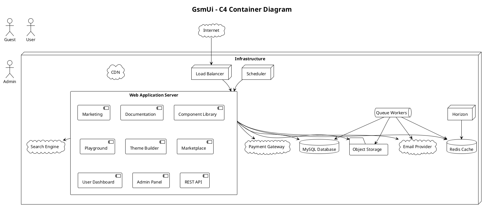

# 05.03 - C4 Container Diagram

**Project:** GsmUi
**Architecture:** C4 Model – Level 2 (Container)
**Version:** 1.0.0

---

# Purpose

This document decomposes the GsmUi platform into its major runtime containers and defines how they communicate within the system.

Containers are the deployable units of the system - independently deployable or executable applications, as well as data stores.

---

# Container Diagram



---

# Container Responsibilities

## Web Application Server

The primary Laravel application serving all user-facing features.

**Responsibilities:**

- HTTP request handling
- Authentication & authorization
- Livewire rendering
- Blade rendering
- Business logic orchestration
- API endpoints
- Documentation delivery
- Component rendering
- Theme management
- Marketplace operations
- Billing workflows
- User dashboards
- Admin interface
- Notifications
- Search integration
- Audit logging

---

## Admin Panel

Dedicated administrative interface for platform management.

**Responsibilities:**

- User management
- Role & permission administration
- Content management (components, docs, themes, templates)
- Marketplace operations
- Order & billing management
- Analytics & reporting
- System monitoring
- Feature flag management
- Audit log review
- Security settings

---

## Queue Workers

Background job processors for asynchronous operations.

**Responsibilities:**

- Email delivery
- Image optimization
- Documentation indexing
- Theme generation
- Search synchronization
- Activity aggregation
- Backup creation
- Notification dispatch
- Marketplace fulfillment

---

## Scheduler

Cron-based task execution.

**Responsibilities:**

- Queue monitoring
- Cleanup tasks
- Search synchronization
- Health checks
- Backups
- Reports generation
- Cache cleanup
- Analytics aggregation
- License verification
- Billing reconciliation

---

## MySQL Database

Relational database for persistent business data.

**Stores:**

- Users & profiles
- Components & versions
- Templates & themes
- Orders & payments
- Subscriptions & billing
- Blog posts & comments
- Documentation pages
- Activity logs
- Permissions & roles

---

## Redis Cache

In-memory cache and session store.

**Used for:**

- Application cache
- User sessions
- Queues
- Rate limiting
- Temporary data
- Distributed locks

---

## Object Storage

Binary asset storage.

**Stores:**

- Component screenshots
- Theme previews
- Downloadable assets
- Merchandise images
- User avatars
- Blog images
- Documentation assets

---

## CDN

Content delivery network for static assets.

**Serves:**

- CSS & JavaScript
- Fonts
- Images
- Downloads
- Icons

---

## Payment Gateway

External payment processing integration.

**Responsibilities:**

- Subscription billing
- One-time purchases
- Invoice generation
- Refunds
- Webhooks

---

## Email Provider

External email delivery service.

**Responsibilities:**

- Verification emails
- Password resets
- Notifications
- Marketing campaigns
- Transactional emails

---

## Search Engine

External search service integration.

**Indexes:**

- Components
- Documentation
- Blog posts
- Templates
- Showcase projects

---

# Communication Patterns

## Synchronous

- Web requests -> Database (direct)
- Web requests -> Cache (direct)
- Web requests -> External services (API calls)

## Asynchronous

- Web -> Queue (job dispatch)
- Queue Workers -> All services (background processing)
- Events -> Listeners (domain events)

---

# Security Boundaries

| Boundary | Protection |
|----------|------------|
| Public Internet | HTTPS, WAF |
| Application | Authentication, Authorization |
| Database | Encrypted connections, credentials |
| External Services | API keys, signed webhooks, OAuth |

---

# Scalability Strategy

| Container | Scaling Approach |
|-----------|-----------------|
| Web Application | Horizontal (stateless) |
| Queue Workers | Horizontal (multiple instances) |
| Scheduler | Single instance with multiple tasks |
| MySQL | Vertical -> Read replicas |
| Redis | Vertical -> Cluster mode |
| Object Storage | Managed service (auto-scaling) |
| CDN | Global edge network |

---

# Design Decisions

1. **Single web application container** for rapid development and simplified operations.
2. **Clear domain boundaries** within the monolith for future extraction.
3. **Asynchronous processing** for long-running operations.
4. **External services** for specialized functionality (payments, email, search).
5. **Redis as unified cache/queue/session store** for operational simplicity.

---

# Detailed Container Specifications

## Web Application Container

### Technology Stack

| Component | Technology | Version | Purpose |
|-----------|-----------|---------|---------|
| Runtime | PHP | 8.4+ | Server-side logic |
| Framework | Laravel | 13 | Application framework |
| UI Framework | Livewire | 4 | Reactive components |
| CSS | Tailwind CSS | 3.4+ | Utility-first styling |
| JavaScript | Alpine.js | 3 | Client-side interactivity |
| Build Tool | Vite | 5+ | Asset bundling |
| Server | nginx | 1.25+ | HTTP server |
| PHP-FPM | PHP-FPM | 8.4+ | PHP process manager |

### Container Configuration

```text
Web Application Container
├── PHP-FPM Process Manager
│   ├── Static process management
│   ├── Max children: 50
│   ├── Start servers: 5
│   ├── Min spare: 5
│   ├── Max spare: 35
│   └── Max requests: 500
│
├── nginx
│   ├── Listen on port 80/443
│   ├── Serve static files directly
│   ├── Proxy PHP to FPM
│   ├── Gzip compression
│   ├── Cache static assets
│   └── Security headers
│
├── Laravel Application
│   ├── Routes
│   ├── Controllers
│   ├── Livewire Components
│   ├── Services
│   ├── Repositories
│   └── Models
│
└── Shared Volumes
    ├── storage/app
    ├── storage/framework
    ├── storage/logs
    └── bootstrap/cache
```

### Resource Requirements

| Resource | Minimum | Recommended | Maximum |
|----------|---------|-------------|---------|
| CPU | 0.5 vCPU | 2 vCPU | 4 vCPU |
| Memory | 512 MB | 2 GB | 4 GB |
| Disk | 10 GB | 50 GB | 100 GB |
| Network | 100 Mbps | 1 Gbps | 10 Gbps |

### Health Check Configuration

```php
// Health check endpoint
Route::get('/health', function () {
    $checks = [
        'database' => fn() => DB::select('SELECT 1'),
        'redis' => fn() => Redis::ping(),
        'storage' => fn() => Storage::exists('health-check'),
    ];

    $healthy = true;
    $services = [];

    foreach ($checks as $name => $check) {
        try {
            $check();
            $services[$name] = 'ok';
        } catch (\Exception $e) {
            $services[$name] = 'error';
            $healthy = false;
        }
    }

    return response()->json([
        'status' => $healthy ? 'healthy' : 'unhealthy',
        'services' => $services,
        'timestamp' => now()->toIso8601String(),
    ], $healthy ? 200 : 503);
});
```

## Queue Worker Container

### Technology Stack

| Component | Technology | Version | Purpose |
|-----------|-----------|---------|---------|
| Runtime | PHP | 8.4+ | Job processing |
| Framework | Laravel | 13 | Queue worker |
| Queue Driver | Redis | 7+ | Queue backend |
| Supervisor | supervisord | 4+ | Process management |

### Container Configuration

```text
Queue Worker Container
├── Supervisor
│   ├── Worker 1 (high queue)
│   ├── Worker 2 (default queue)
│   ├── Worker 3 (mail queue)
│   ├── Worker 4 (media queue)
│   └── Worker 5 (search queue)
│
├── PHP-FPM
│   ├── Max children: 5 per worker
│   └── Max requests: 500
│
└── Shared Volumes
    ├── storage/app
    ├── storage/framework
    └── storage/logs
```

### Worker Configuration

```php
// config/horizon.php
'worker-1' => [
    'connection' => 'redis',
    'queue' => ['high'],
    'balance' => 'simple',
    'maxProcesses' => 5,
    'maxTime' => 3600,
    'maxJobs' => 1000,
    'memory' => 256,
    'tries' => 3,
    'timeout' => 120,
],
'worker-2' => [
    'connection' => 'redis',
    'queue' => ['default'],
    'balance' => 'auto',
    'maxProcesses' => 4,
    'maxTime' => 3600,
    'maxJobs' => 1000,
    'memory' => 128,
    'tries' => 3,
    'timeout' => 60,
],
```

### Resource Requirements

| Resource | Minimum | Recommended | Maximum |
|----------|---------|-------------|---------|
| CPU | 0.5 vCPU | 2 vCPU | 4 vCPU |
| Memory | 512 MB | 2 GB | 4 GB |
| Disk | 10 GB | 20 GB | 50 GB |
| Network | 100 Mbps | 1 Gbps | 10 Gbps |

## Scheduler Container

### Technology Stack

| Component | Technology | Version | Purpose |
|-----------|-----------|---------|---------|
| Runtime | PHP | 8.4+ | Command execution |
| Framework | Laravel | 13 | Scheduler |
| Cron | cron | Latest | Task scheduling |
| Supervisor | supervisord | 4+ | Process management |

### Container Configuration

```text
Scheduler Container
├── Cron Daemon
│   └── Runs schedule:run every minute
│
├── Laravel Scheduler
│   ├── Executes scheduled commands
│   ├── Manages distributed locks
│   └── Logs execution
│
└── Shared Volumes
    ├── storage/app
    ├── storage/framework
    └── storage/logs
```

### Cron Configuration

```bash
# /etc/cron.d/gsmui-scheduler
* * * * * www-data cd /var/www/html && php artisan schedule:run >> /dev/null 2>&1
```

### Resource Requirements

| Resource | Minimum | Recommended | Maximum |
|----------|---------|-------------|---------|
| CPU | 0.25 vCPU | 1 vCPU | 2 vCPU |
| Memory | 256 MB | 1 GB | 2 GB |
| Disk | 5 GB | 10 GB | 20 GB |
| Network | 10 Mbps | 100 Mbps | 1 Gbps |

## MySQL Container

### Technology Stack

| Component | Technology | Version | Purpose |
|-----------|-----------|---------|---------|
| Database | MySQL | 8.0+ | Primary data store |
| Engine | InnoDB | — | ACID transactions |
| Character Set | utf8mb4 | — | Unicode support |
| Collation | utf8mb4_unicode_ci | — | Case-insensitive |

### Container Configuration

```text
MySQL Container
├── Primary Instance
│   ├── Read/Write operations
│   ├── Binary logging enabled
│   ├── InnoDB buffer pool: 12 GB
│   ├── Max connections: 200
│   └── Query cache: disabled (MySQL 8)
│
├── Replica Instance (optional)
│   ├── Read-only operations
│   ├── Relay log processing
│   └── Delayed replication: 10 seconds
│
└── Storage
    ├── Data volume: 100 GB SSD
    ├── Log volume: 20 GB SSD
    └── Backup volume: 200 GB
```

### MySQL Configuration

```ini
# /etc/mysql/conf.d/gsmui.cnf
[mysqld]
# Performance
innodb_buffer_pool_size = 12G
innodb_log_file_size = 1G
innodb_flush_log_at_trx_commit = 1
innodb_flush_method = O_DIRECT

# Connections
max_connections = 200
max_allowed_packet = 64M
wait_timeout = 60
interactive_timeout = 60

# Query Cache (MySQL 8.0+ uses other mechanisms)
# query_cache_type = 0

# Binary Logging
log_bin = mysql-bin
binlog_format = ROW
expire_logs_days = 7
server-id = 1

# Character Set
character-set-server = utf8mb4
collation-server = utf8mb4_unicode_ci

# Slow Query Log
slow_query_log = 1
slow_query_log_file = /var/log/mysql/slow.log
long_query_time = 2
```

### Resource Requirements

| Resource | Minimum | Recommended | Maximum |
|----------|---------|-------------|---------|
| CPU | 1 vCPU | 4 vCPU | 16 vCPU |
| Memory | 2 GB | 16 GB | 64 GB |
| Disk | 50 GB SSD | 200 GB SSD | 1 TB SSD |
| Network | 1 Gbps | 10 Gbps | 25 Gbps |

## Redis Container

### Technology Stack

| Component | Technology | Version | Purpose |
|-----------|-----------|---------|---------|
| Cache | Redis | 7+ | In-memory cache |
| Queue | Redis | 7+ | Queue backend |
| Session | Redis | 7+ | Session store |

### Container Configuration

```text
Redis Container
├── Primary Instance
│   ├── Max memory: 8 GB
│   ├── Eviction policy: allkeys-lru
│   ├── Persistence: RDB snapshots
│   ├── Max clients: 10000
│   └── Timeout: 300 seconds
│
├── Replica Instance (optional)
│   ├── Read-only operations
│   └── Replication offset tracking
│
└── Storage
    ├── Data volume: 20 GB
    └── Log volume: 5 GB
```

### Redis Configuration

```conf
# /etc/redis/redis.conf
maxmemory 8gb
maxmemory-policy allkeys-lru

# Persistence
save 900 1
save 300 10
save 60 10000

# Security
requirepass your-redis-password
rename-command FLUSHALL ""
rename-command FLUSHDB ""
rename-command DEBUG ""

# Connections
maxclients 10000
timeout 300

# Logging
loglevel notice
logfile /var/log/redis/redis.log
```

### Resource Requirements

| Resource | Minimum | Recommended | Maximum |
|----------|---------|-------------|---------|
| CPU | 0.5 vCPU | 2 vCPU | 8 vCPU |
| Memory | 1 GB | 8 GB | 64 GB |
| Disk | 10 GB | 20 GB | 100 GB |
| Network | 1 Gbps | 10 Gbps | 25 Gbps |

## Object Storage Container

### Technology Stack

| Component | Technology | Version | Purpose |
|-----------|-----------|---------|---------|
| Storage | S3-compatible | — | Binary assets |
| Protocol | HTTPS | 1.2+ | Secure transfer |
| Encryption | AES-256 | — | At-rest encryption |

### Bucket Configuration

```text
S3 Buckets
├── gsmui-production
│   ├── Versioning: enabled
│   ├── Encryption: AES-256
│   ├── Lifecycle: 90-day retention
│   └── Access: CloudFront OAI
│
├── gsmui-staging
│   ├── Versioning: enabled
│   ├── Encryption: AES-256
│   ├── Lifecycle: 30-day retention
│   └── Access: Direct
│
└── gsmui-backups
    ├── Versioning: enabled
    ├── Encryption: AES-256
    ├── Lifecycle: 365-day retention
    └── Access: IAM only
```

### Storage Classes

| Class | Use Case | Cost | Retrieval |
|-------|----------|------|-----------|
| Standard | Frequently accessed | Highest | Instant |
| IA | Infrequently accessed | Medium | Minutes |
| Glacier | Archive | Lowest | Hours |

### Resource Requirements

| Resource | Minimum | Recommended | Maximum |
|----------|---------|-------------|---------|
| Storage | 100 GB | 1 TB | 10 TB |
| Bandwidth | 100 GB/month | 1 TB/month | 10 TB/month |
| Requests | 10K/month | 100K/month | 1M/month |

## CDN Container

### Technology Stack

| Component | Technology | Version | Purpose |
|-----------|-----------|---------|---------|
| CDN | CloudFront | — | Content delivery |
| SSL | ACM | — | Certificate management |
| WAF | AWS WAF | — | Security |

### Distribution Configuration

```text
CloudFront Distribution
├── Origins
│   ├── ALB (dynamic content)
│   └── S3 (static assets)
│
├── Cache Behaviors
│   ├── /build/* → S3 (1 year cache)
│   ├── /images/* → S3 (1 month cache)
│   ├── /api/* → ALB (no cache)
│   └── Default → ALB (5 min cache)
│
├── Security
│   ├── SSL: TLS 1.2 minimum
│   ├── WAF: AWS managed rules
│   └── Origin shield: enabled
│
└── Performance
    ├── Compression: enabled
    ├── HTTP/2: enabled
    └── IPv6: enabled
```

### Cache Policies

| Resource | Cache Duration | Invalidation |
|----------|---------------|------------- |
| CSS/JS | 1 year | Version-based |
| Images | 1 month | Manual |
| API responses | 5 minutes | Time-based |
| HTML pages | 5 minutes | Event-based |

### Resource Requirements

| Resource | Minimum | Recommended | Maximum |
|----------|---------|-------------|---------|
| Bandwidth | 100 GB/month | 1 TB/month | 10 TB/month |
| Requests | 100K/month | 1M/month | 100M/month |
| Edge locations | 50 | 100 | 200+ |

---

# Container Communication Matrix

## Synchronous Communication

| Source | Target | Protocol | Purpose | Timeout |
|--------|--------|----------|---------|---------|
| Web | MySQL | TCP/3306 | Read/write data | 30s |
| Web | Redis | TCP/6379 | Cache/sessions | 5s |
| Web | S3 | HTTPS | File operations | 30s |
| Web | Stripe | HTTPS | Payments | 30s |
| Web | Resend | HTTPS | Email | 10s |
| Web | Meilisearch | HTTP | Search | 5s |
| Worker | MySQL | TCP/3306 | Process data | 60s |
| Worker | Redis | TCP/6379 | Queue/cache | 5s |
| Worker | S3 | HTTPS | File processing | 120s |
| Worker | Stripe | HTTPS | Async payments | 30s |
| Worker | Resend | HTTPS | Async email | 10s |

## Asynchronous Communication

| Source | Target | Queue | Purpose | Retries |
|--------|--------|-------|---------|---------|
| Web | Worker | high | Payment processing | 3 |
| Web | Worker | default | Email sending | 3 |
| Web | Worker | media | Image processing | 3 |
| Web | Worker | search | Index updates | 5 |
| Scheduler | Worker | default | Scheduled tasks | 3 |
| Scheduler | Worker | analytics | Analytics aggregation | 1 |

---

# Container Security Matrix

## Security Controls

| Container | Control | Implementation | Owner |
|-----------|---------|---------------|-------|
| Web | Authentication | Laravel Fortify + Sanctum | Platform |
| Web | Authorization | Spatie Permission | Platform |
| Web | CSRF Protection | Laravel middleware | Platform |
| Web | XSS Prevention | Blade escaping | Platform |
| Web | Rate Limiting | Laravel throttle | Platform |
| Web | Input Validation | Form requests | Platform |
| Worker | Job Validation | Signed payloads | Platform |
| Worker | Execution Limits | Timeout + memory | Platform |
| Scheduler | Lock Prevention | Redis locks | Platform |
| MySQL | Encryption | TLS in transit | DevOps |
| MySQL | Access Control | User permissions | DevOps |
| MySQL | Audit Logging | General log | DevOps |
| Redis | Authentication | Redis AUTH | DevOps |
| Redis | Command Restriction | Rename dangerous commands | DevOps |
| S3 | Bucket Policy | IAM policies | DevOps |
| S3 | Encryption | AES-256 | DevOps |
| CDN | SSL/TLS | ACM certificates | DevOps |
| CDN | WAF | AWS managed rules | DevOps |

## Network Security

```text
Internet
    │
    ├── WAF (AWS WAF)
    │   └── Block common attacks
    │
    ├── CDN (CloudFront)
    │   └── DDoS protection
    │
    ├── ALB
    │   ├── TLS termination
    │   ├── Health checks
    │   └── Rate limiting
    │
    ├── Web Instances (Private Subnet)
    │   ├── nginx
    │   ├── PHP-FPM
    │   └── Laravel
    │
    ├── Data Subnet (Private)
    │   ├── MySQL
    │   └── Redis
    │
    └── NAT Gateway (Public Subnet)
        └── Outbound internet access
```

---

# Container Monitoring Matrix

## Monitoring Stack

| Container | Metrics | Logs | Alerts | Tool |
|-----------|---------|------|--------|------|
| Web | Request latency, errors | Application logs | Error spike | CloudWatch + Sentry |
| Worker | Job throughput, failures | Laravel logs | Queue backup | Horizon + Sentry |
| Scheduler | Execution time | Laravel logs | Missed schedule | CloudWatch |
| MySQL | QPS, connections | Slow query log | Connection limit | CloudWatch RDS |
| Redis | Hit rate, memory | Redis logs | Memory pressure | CloudWatch ElastiCache |
| S3 | Request rate | S3 access logs | 4xx spike | CloudWatch S3 |
| CDN | Cache hit rate | CloudFront logs | Origin errors | CloudWatch CloudFront |

## Monitoring Queries

```sql
-- Slow queries in last hour
SELECT query_time, lock_time, rows_sent, sql_text
FROM mysql.slow_log
WHERE start_time >= DATE_SUB(NOW(), INTERVAL 1 HOUR)
ORDER BY query_time DESC
LIMIT 10;

-- Connection count
SHOW STATUS LIKE 'Threads_connected';

-- Cache hit rate
SELECT
    (1 - (Key_reads / Key_read_requests)) * 100 AS hit_rate
FROM (
    SELECT
        VARIABLE_VALUE AS Key_reads
    FROM performance_schema.global_status
    WHERE VARIABLE_NAME = 'Key_reads'
) AS reads,
(
    SELECT
        VARIABLE_VALUE AS Key_read_requests
    FROM performance_schema.global_status
    WHERE VARIABLE_NAME = 'Key_read_requests'
) AS requests;
```

---

# Container Backup Matrix

## Backup Strategy

| Container | Method | Frequency | Retention | RPO | RTO |
|-----------|--------|-----------|-----------|-----|-----|
| MySQL | Automated snapshot | Daily | 30 days | 24h | 1h |
| MySQL | Binary log backup | Continuous | 7 days | 1min | 15min |
| Redis | RDB snapshot | Hourly | 7 days | 1h | 30min |
| S3 | Versioning | Continuous | 90 days | 0 | 0 |
| Application | Git | Continuous | Unlimited | 0 | 30min |
| Configuration | Git + S3 | On change | Unlimited | 0 | 15min |

## Backup Verification

| Component | Verification | Frequency | Method |
|-----------|-------------|-----------|--------|
| MySQL | Restore test | Weekly | Restore to isolated instance |
| Redis | Snapshot test | Monthly | Restore and verify data |
| S3 | Version check | Weekly | Verify versioning enabled |
| Application | Deploy test | Per release | Deploy to staging |

---

# Container Scaling Matrix

## Scaling Strategy

| Container | Scaling Method | Trigger | Min | Max |
|-----------|---------------|---------|-----|-----|
| Web | Horizontal | CPU > 70% | 2 | 20 |
| Worker | Horizontal | Queue depth > 200 | 2 | 15 |
| Scheduler | Single instance | N/A | 1 | 1 |
| MySQL | Vertical + Read replicas | IOPS > 80% | 1 primary | 15 replicas |
| Redis | Vertical → Cluster | Memory > 70% | 1 | 5 |
| S3 | Managed | Unlimited | — | — |
| CDN | Global edge | Unlimited | — | — |

## Scaling Costs

| Container | Instance | Monthly Cost | Scale Cost |
|-----------|----------|-------------|------------|
| Web | t3.medium | $30/instance | +$30/instance |
| Worker | t3.medium | $30/instance | +$30/instance |
| MySQL | db.r6g.large | $187 | +$187/replica |
| Redis | cache.r6g.large | $159 | +$159/node |

---

# Container Deployment Matrix

## Deployment Strategy

| Container | Strategy | Downtime | Rollback |
|-----------|----------|----------|----------|
| Web | Blue-Green | 0 | Instant |
| Worker | Rolling restart | 0 | Redeploy |
| Scheduler | Single instance | Brief | Redeploy |
| MySQL | Primary-Replica | 0 | Promote replica |
| Redis | Single instance | Brief | Restart |
| S3 | Managed | 0 | Version restore |
| CDN | Managed | 0 | Invalidation |

## Deployment Pipeline

```text
Code Push
    │
    ├── Build
    │   ├── Composer install
    │   ├── npm build
    │   └── Docker build
    │
    ├── Test
    │   ├── Unit tests
    │   ├── Feature tests
    │   └── Static analysis
    │
    ├── Deploy to Staging
    │   ├── Database migration
    │   ├── Cache warming
    │   └── Health check
    │
    ├── Integration Tests
    │   └── Playwright tests
    │
    └── Deploy to Production
        ├── Blue-Green deployment
        ├── Smoke tests
        └── Rollback on failure
```

---

# Container Disaster Recovery Matrix

## Recovery Procedures

| Component | Recovery Method | RTO | RPO | Steps |
|-----------|----------------|-----|-----|-------|
| Web | Redeploy | 5 min | 0 | Deploy from latest image |
| Worker | Restart | 2 min | 0 | Supervisor restarts |
| Scheduler | Restart | 1 min | 0 | Cron restarts |
| MySQL | Failover | 15 min | 1 min | Promote replica |
| Redis | Failover | 10 min | 5 min | Promote replica |
| S3 | Restore | 30 min | 0 | Version restore |
| CDN | Origin fallback | 5 min | 0 | Serve from origin |

## Recovery Checklist

```text
1. Detection
   └── Monitoring alert or user report

2. Assessment
   ├── Identify affected containers
   ├── Assess data loss risk
   └── Determine recovery priority

3. Recovery
   ├── Recover data layer first
   ├── Recover application layer
   ├── Recover worker layer
   └── Recover CDN layer

4. Verification
   ├── Health checks pass
   ├── User-facing features work
   ├── Background jobs processing
   └── No data loss

5. Post-Recovery
   ├── Incident report
   ├── Root cause analysis
   └── Prevention measures
```

---

# Container Cost Analysis

## Monthly Cost Breakdown

| Container | Instance | Hours | Cost/Hour | Monthly |
|-----------|----------|-------|-----------|---------|
| Web (2x) | t3.medium | 1,460 | $0.0416 | $60.74 |
| Worker (2x) | t3.medium | 1,460 | $0.0416 | $60.74 |
| Scheduler (1x) | t3.small | 730 | $0.0208 | $15.18 |
| MySQL | db.r6g.large | 730 | $0.256 | $186.88 |
| Redis | cache.r6g.large | 730 | $0.218 | $159.14 |
| S3 | 100 GB | — | — | $2.30 |
| CDN | 1 TB transfer | — | — | $85.00 |
| ALB | — | — | — | $22.00 |
| NAT | — | — | — | $32.00 |
| **Total** | | | | **$624.98** |

## Cost Optimization Opportunities

| Opportunity | Current | Optimized | Savings |
|-------------|---------|-----------|---------|
| Reserved instances (MySQL) | $186.88 | $121.47 | $65.41/mo |
| Reserved instances (Redis) | $159.14 | $103.44 | $55.70/mo |
| Spot instances (workers) | $60.74 | $18.22 | $42.52/mo |
| Right-size scheduler | $15.18 | $7.59 | $7.59/mo |
| **Total Savings** | | | **$171.22/mo** |

---

# Container Performance Optimization

## PHP Optimization

### OPcache Configuration

| Setting | Value | Purpose |
|---------|-------|---------|
| opcache.enable | 1 | Enable OPcache |
| opcache.memory_consumption | 256 | 256 MB for cache |
| opcache.interned_strings_buffer | 16 | 16 MB for strings |
| opcache.max_accelerated_files | 20000 | Max cached files |
| opcache.revalidate_freq | 2 | Check every 2 seconds |
| opcache.save_comments | 1 | Keep annotations |
| opcache.enable_file_override | 1 | Override file checks |

### PHP-FPM Tuning

| Setting | Value | Purpose |
|---------|-------|---------|
| pm.max_children | 50 | Max processes |
| pm.start_servers | 5 | Initial processes |
| pm.min_spare_servers | 5 | Min idle processes |
| pm.max_spare_servers | 35 | Max idle processes |
| pm.max_requests | 500 | Restart after N requests |
| request_terminate_timeout | 300 | Force kill after 5 min |
| pm.process_idle_timeout | 10s | Kill idle after 10s |

### PHP Memory Optimization

```ini
; /etc/php/8.4/fpm/conf.d/99-gsmui.ini
memory_limit = 256M
max_execution_time = 60
max_input_vars = 3000
post_max_size = 64M
upload_max_filesize = 32M
max_file_uploads = 10
```

## nginx Optimization

### Performance Configuration

```nginx
# /etc/nginx/conf.d/gsmui.conf
worker_processes auto;
worker_rlimit_nofile 65535;

events {
    worker_connections 4096;
    multi_accept on;
    use epoll;
}

http {
    # Gzip compression
    gzip on;
    gzip_vary on;
    gzip_proxied any;
    gzip_comp_level 6;
    gzip_types text/plain text/css text/xml application/json application/javascript application/xml+rss application/atom+xml image/svg+xml;

    # Proxy buffering
    proxy_buffering on;
    proxy_buffer_size 16k;
    proxy_buffers 8 16k;
    proxy_busy_buffers_size 32k;

    # FastCGI caching
    fastcgi_cache_path /tmp/nginx-cache levels=1:2
        keys_zone=GSMUI:100m
        inactive=60m
        max_size=1g;
    fastcgi_cache_key "$scheme$request_method$host$request_uri";

    # Rate limiting
    limit_req_zone $binary_remote_addr zone=api:10m rate=10r/s;
    limit_req_zone $binary_remote_addr zone=login:10m rate=1r/m;

    # Connection limiting
    limit_conn_zone $binary_remote_addr zone=conn_limit:10m;
}
```

### Server Block

```nginx
server {
    listen 443 ssl http2;
    server_name api.gsmui.com;

    # SSL configuration
    ssl_certificate /etc/ssl/certs/gsmui.crt;
    ssl_certificate_key /etc/ssl/private/gsmui.key;
    ssl_protocols TLSv1.2 TLSv1.3;
    ssl_ciphers HIGH:!aNULL:!MD5;
    ssl_prefer_server_ciphers on;
    ssl_session_cache shared:SSL:10m;

    # Security headers
    add_header Strict-Transport-Security "max-age=31536000; includeSubDomains" always;
    add_header X-Content-Type-Options nosniff always;
    add_header X-Frame-Options DENY always;
    add_header X-XSS-Protection "1; mode=block" always;

    # Static assets
    location ~* \.(css|js|ico|gif|jpeg|jpg|png|woff|woff2|ttf|svg|eot)$ {
        expires 1y;
        add_header Cache-Control "public, immutable";
        access_log off;
    }

    # API rate limiting
    location /api/ {
        limit_req zone=api burst=20 nodelay;
        limit_conn conn_limit 10;

        try_files $uri $uri/ /index.php?$query_string;
    }

    # Login rate limiting
    location /login {
        limit_req zone=login burst=3 nodelay;

        try_files $uri $uri/ /index.php?$query_string;
    }

    # Application
    location / {
        try_files $uri $uri/ /index.php?$query_string;
    }

    # PHP-FPM
    location ~ \.php$ {
        fastcgi_pass unix:/var/run/php/php8.4-fpm.sock;
        fastcgi_param SCRIPT_FILENAME $realpath_root$fastcgi_script_name;
        include fastcgi_params;

        # FastCGI caching
        fastcgi_cache GSMUI;
        fastcgi_cache_valid 200 60m;
        fastcgi_cache_valid 404 1m;
        fastcgi_cache_bypass $http_authorization $cookie_session;
        add_header X-FastCGI-Cache $upstream_cache_status;
    }
}
```

## Database Optimization

### Query Optimization

| Technique | Implementation | Impact |
|-----------|---------------|--------|
| Eager loading | `with()` method | Reduce N+1 queries |
| Indexing | Composite indexes | Speed up WHERE clauses |
| Query caching | Redis cache | Reduce DB load |
| Connection pooling | Persistent connections | Reduce connection overhead |
| Read replicas | Distribution | Spread read load |

### Indexing Strategy

```sql
-- Users table
CREATE INDEX idx_users_email ON users(email);
CREATE INDEX idx_users_status ON users(status);
CREATE INDEX idx_users_created ON users(created_at);

-- Orders table
CREATE INDEX idx_orders_user_id ON orders(user_id);
CREATE INDEX idx_orders_status ON orders(status);
CREATE INDEX idx_orders_created ON orders(created_at);
CREATE INDEX idx_orders_user_status ON orders(user_id, status);

-- Order items
CREATE INDEX idx_order_items_order_id ON order_items(order_id);
CREATE INDEX idx_order_items_product_id ON order_items(product_id);

-- Products
CREATE INDEX idx_products_category_id ON products(category_id);
CREATE INDEX idx_products_status ON products(status);
CREATE INDEX idx_products_price ON products(price);
```

### Query Monitoring

```sql
-- Enable slow query log
SET GLOBAL slow_query_log = 1;
SET GLOBAL long_query_time = 2;
SET GLOBAL slow_query_log_file = '/var/log/mysql/slow.log';

-- Monitor queries
SELECT
    digest_text,
    count_star,
    avg_timer_wait / 1000000000 AS avg_sec,
    sum_rows_examined / count_star AS avg_rows_examined
FROM performance_schema.events_statements_summary_by_digest
ORDER BY count_star DESC
LIMIT 20;
```

## Redis Optimization

### Memory Optimization

| Setting | Value | Purpose |
|---------|-------|---------|
| maxmemory | 8gb | Memory limit |
| maxmemory-policy | allkeys-lru | Eviction policy |
| hash-max-ziplist-entries | 128 | Optimize small hashes |
| hash-max-ziplist-value | 64 | Optimize small values |
| list-max-ziplist-size | -2 | Optimize small lists |

### Key Pattern Optimization

```text
# Good patterns (compact)
g:session:{session_id}
g:user:{user_id}
g:cache:{cache_key}

# Bad patterns (verbose)
gsmui:session:abc123
gsmui:user:123:profile
gsmui:product:123:details
```

### Pipeline Optimization

```php
// Before: 100 round trips
foreach ($items as $item) {
    Redis::set($item['key'], $item['value']);
}

// After: 1 round trip
Redis::pipeline(function ($pipe) use ($items) {
    foreach ($items as $item) {
        $pipe->set($item['key'], $item['value']);
    }
});
```

## Queue Optimization

### Job Batching

```php
// Process in batches of 100
Order::where('status', 'pending')
    ->chunkById(100, function ($orders) {
        ProcessOrderBatch::dispatch($orders->pluck('id'));
    });
```

### Worker Optimization

| Setting | Value | Purpose |
|---------|-------|---------|
| maxProcesses | 10 | Limit workers |
| balance | auto | Auto-scale |
| maxTime | 3600 | 1 hour max |
| maxJobs | 1000 | Restart after N jobs |
| memory | 256 | 256 MB limit |

### Queue Configuration

```php
// config/queue.php
'connections' => [
    'redis' => [
        'driver' => 'redis',
        'connection' => 'default',
        'queue' => env('REDIS_QUEUE', 'gsmui'),
        'retry_after' => 120,
        'block_for' => null,
    ],
],

'batching' => [
    'database' => env('DB_CONNECTION', 'mysql'),
    'table' => 'job_batches',
],
```

## CDN Optimization

### Cache Headers

| Resource | Cache Duration | Cache Key | Validation |
|----------|---------------|-----------|------------|
| CSS/JS | 1 year | Version hash | None needed |
| Images | 30 days | Filename | ETag |
| Fonts | 1 year | Filename | None needed |
| API responses | 5 min | URL + params | ETag |
| HTML pages | 5 min | URL | Last-Modified |

### Compression

| Format | Compression | Savings | When |
|--------|------------|---------|------|
| HTML | gzip | 70% | Always |
| CSS | gzip | 80% | Always |
| JavaScript | gzip | 75% | Always |
| JSON | gzip | 60% | Always |
| Images | WebP | 30% | Auto-convert |

### CDN Purging

```bash
# Purge specific path
aws cloudfront create-invalidation \
  --distribution-id E1234567890 \
  --paths "/build/*"

# Purge all
aws cloudfront create-invalidation \
  --distribution-id E1234567890 \
  --paths "/*"
```

---

# Container Architecture Patterns

## Microservices Within Monolith

### Domain Boundaries

```text
Application
├── User Domain
│   ├── Registration
│   ├── Authentication
│   ├── Profile Management
│   └── Preferences
│
├── Product Domain
│   ├── Catalog
│   ├── Inventory
│   ├── Pricing
│   └── Search
│
├── Order Domain
│   ├── Cart
│   ├── Checkout
│   ├── Payment
│   └── Fulfillment
│
├── Content Domain
│   ├── Pages
│   ├── Blog
│   ├── Media
│   └── Search
│
└── Admin Domain
    ├── Dashboard
    ├── Analytics
    ├── Configuration
    └── User Management
```

### Communication Patterns

| Pattern | Use Case | Implementation |
|---------|----------|---------------|
| Direct call | Synchronous | Method calls |
| Event | Asynchronous | Event dispatcher |
| Queue | Background | Job dispatch |
| Shared DB | Cross-domain | Read-only access |

## Service Layer Pattern

```php
// Service container
app()->singleton(UserService::class);
app()->singleton(OrderService::class);
app()->singleton(PaymentService::class);

// Usage
class OrderController
{
    public function store(
        StoreOrderRequest $request,
        OrderService $orderService,
        PaymentService $paymentService
    ) {
        $order = $orderService->create($request->validated());
        $paymentService->process($order);

        return redirect()->route('orders.show', $order);
    }
}
```

## Repository Pattern

```php
// Interface
interface OrderRepositoryInterface
{
    public function find(int $id): ?Order;
    public function findByUser(int $userId): Collection;
    public function store(array $data): Order;
    public function update(int $id, array $data): Order;
    public function delete(int $id): bool;
}

// Implementation
class OrderRepository implements OrderRepositoryInterface
{
    public function __construct(
        private Order $model
    ) {}

    public function find(int $id): ?Order
    {
        return $this->model->with(['items', 'user'])->find($id);
    }

    public function findByUser(int $userId): Collection
    {
        return $this->model
            ->where('user_id', $userId)
            ->with(['items'])
            ->latest()
            ->get();
    }
}

// Binding
$this->app->bind(
    OrderRepositoryInterface::class,
    OrderRepository::class
);
```

## Event Sourcing Pattern

```php
// Event class
class OrderCreated
{
    public function __construct(
        public int $orderId,
        public int $userId,
        public array $items,
        public Money $total,
        public Carbon $createdAt
    ) {}
}

// Event handler
class OrderCreatedHandler
{
    public function handle(OrderCreated $event): void
    {
        // Update inventory
        Inventory::decrementStock($event->items);

        // Send confirmation email
        OrderConfirmationMail::to($event->userId)
            ->queue($event->orderId);

        // Update analytics
        Analytics::recordOrder($event);
    }
}
```

## CQRS Pattern

```php
// Command
class CreateOrderCommand
{
    public function __construct(
        public int $userId,
        public array $items,
        public string $paymentMethod
    ) {}
}

// Query
class GetOrderQuery
{
    public function __construct(
        public int $orderId
    ) {}
}

// Command handler
class CreateOrderHandler
{
    public function handle(CreateOrderCommand $command): Order
    {
        $order = Order::create([
            'user_id' => $command->userId,
            'status' => 'pending',
        ]);

        foreach ($command->items as $item) {
            $order->items()->create($item);
        }

        return $order;
    }
}

// Query handler
class GetOrderHandler
{
    public function handle(GetOrderQuery $query): Order
    {
        return Order::with(['items', 'user'])
            ->findOrFail($query->orderId);
    }
}
```

## Anti-Corruption Layer

```php
// External service adapter
class StripePaymentGateway implements PaymentGatewayInterface
{
    public function __construct(
        private StripeClient $stripe
    ) {}

    public function charge(Money $amount, string $token): PaymentResult
    {
        try {
            $charge = $this->stripe->charges->create([
                'amount' => $amount->getAmount(),
                'currency' => $amount->getCurrency(),
                'source' => $token,
            ]);

            return new PaymentResult(
                success: true,
                transactionId: $charge->id,
                message: 'Payment successful'
            );
        } catch (\Exception $e) {
            return new PaymentResult(
                success: false,
                transactionId: null,
                message: $e->getMessage()
            );
        }
    }
}
```

---

# Container Observability Stack

## Metrics Collection

### Prometheus Configuration

```yaml
# prometheus.yml
global:
  scrape_interval: 15s
  evaluation_interval: 15s

scrape_configs:
  - job_name: 'gsmui-web'
    static_configs:
      - targets: ['web:8080']
    metrics_path: '/metrics'

  - job_name: 'gsmui-worker'
    static_configs:
      - targets: ['worker:8080']
    metrics_path: '/metrics'

  - job_name: 'mysql'
    static_configs:
      - targets: ['mysql:9104']
    metrics_path: '/metrics'

  - job_name: 'redis'
    static_configs:
      - targets: ['redis:9121']
    metrics_path: '/metrics'
```

### Custom Metrics

```php
// Custom metric
use Prometheus\CollectorRegistry;

class OrderMetrics
{
    public function __construct(
        private CollectorRegistry $registry
    ) {}

    public function recordOrderCreated(float $total): void
    {
        $this->registry->registerCounter(
            'gsmui_orders_created_total',
            'Total orders created',
            ['status']
        )->inc(['created']);
    }

    public function recordOrderValue(float $total): void
    {
        $this->registry->registerHistogram(
            'gsmui_order_value',
            'Order value distribution',
            ['currency'],
            [10, 50, 100, 500, 1000]
        )->observe($total, ['USD']);
    }
}
```

## Logging Strategy

### Structured Logging

```php
// Contextual logging
Log::info('Order created', [
    'order_id' => $order->id,
    'user_id' => $order->user_id,
    'total' => $order->total->getAmount(),
    'currency' => $order->total->getCurrency(),
    'items_count' => $order->items->count(),
    'duration_ms' => $order->creation_duration,
]);
```

### Log Levels

| Level | Usage | Example |
|-------|-------|---------|
| Emergency | System unusable | Database connection lost |
| Alert | Immediate action | Payment processing failed |
| Critical | Critical conditions | Order total mismatch |
| Error | Error conditions | API request failed |
| Warning | Warning conditions | Rate limit exceeded |
| Notice | Normal but significant | User verified email |
| Info | Informational | Order created |
| Debug | Debug-level | SQL query executed |

### Log Aggregation

```yaml
# filebeat.yml
filebeat.inputs:
  - type: container
    paths:
      - '/var/log/containers/*.log'
    processors:
      - add_kubernetes_metadata:
          host: ${NODE_NAME}

output.elasticsearch:
  hosts: ["elasticsearch:9200"]
  index: "gsmui-%{+yyyy.MM.dd}"

setup.template.name: "gsmui"
setup.template.pattern: "gsmui-*"
```

## Tracing

### Distributed Tracing

```php
// Trace span
$span = $tracer->startSpan('order.process');
try {
    // Process order
    $order = $this->processOrder($data);

    $span->setTag('order.id', $order->id);
    $span->setTag('order.total', $order->total->getAmount());
    $span->setTag('order.items_count', $order->items->count());

    return $order;
} catch (\Exception $e) {
    $span->setTag('error', true);
    $span->log([
        'message' => $e->getMessage(),
        'stack' => $e->getTraceAsString(),
    ]);
    throw $e;
} finally {
    $span->finish();
}
```

## Alerting

### Alert Rules

```yaml
# alerts.yml
groups:
  - name: gsmui
    rules:
      - alert: HighErrorRate
        expr: rate(http_requests_total{status=~"5.."}[5m]) > 0.1
        for: 5m
        labels:
          severity: critical
        annotations:
          summary: High error rate detected

      - alert: HighLatency
        expr: histogram_quantile(0.95, rate(http_request_duration_seconds_bucket[5m])) > 1
        for: 5m
        labels:
          severity: warning
        annotations:
          summary: High latency detected

      - alert: QueueBacklog
        expr: redis_queue_length > 1000
        for: 10m
        labels:
          severity: warning
        annotations:
          summary: Queue backlog detected

      - alert: DatabaseConnections
        expr: mysql_connections_active > 150
        for: 5m
        labels:
          severity: critical
        annotations:
          summary: Database connection limit approaching
```

### Alert Routing

```yaml
# route.yml
route:
  group_by: ['alertname', 'severity']
  group_wait: 30s
  group_interval: 5m
  repeat_interval: 4h
  receiver: 'default'

  routes:
    - match:
        severity: critical
      receiver: 'pager'
      repeat_interval: 1h

    - match:
        severity: warning
      receiver: 'slack'
      repeat_interval: 4h
```

---

# Container Compliance Matrix

## Security Compliance

| Requirement | Implementation | Audit |
|-------------|---------------|-------|
| Data encryption at rest | AES-256 (S3, RDS) | Quarterly review |
| Data encryption in transit | TLS 1.2+ | Continuous |
| Access control | IAM + RBAC | Monthly review |
| Audit logging | CloudTrail + Laravel | Continuous |
| Vulnerability scanning | Trivy + Dependabot | Weekly |
| Patch management | Automated updates | Monthly |
| Incident response | Runbook + PagerDuty | Per incident |

## Operational Compliance

| Requirement | Implementation | Audit |
|-------------|---------------|-------|
| Backup verification | Weekly restore test | Monthly |
| DR testing | Quarterly drill | Quarterly |
| Performance SLA | 99.9% uptime | Monthly |
| Response time SLA | < 200ms p95 | Continuous |
| Deployment process | CI/CD pipeline | Per deploy |
| Change management | PR review + approval | Per change |

## Regulatory Compliance

| Requirement | Implementation | Audit |
|-------------|---------------|-------|
| GDPR | Data retention + deletion | Annual |
| PCI DSS | Stripe integration | Annual |
| SOC 2 | Access controls | Annual |
| HIPAA | N/A (not healthcare) | N/A |

---

# Container Migration Strategy

## Phase 1: Assessment

| Component | Current | Target | Complexity |
|-----------|---------|--------|------------|
| Web | Monolith | Same | Low |
| Workers | Same | Same | Low |
| Database | RDS | RDS | Low |
| Cache | ElastiCache | ElastiCache | Low |
| Storage | S3 | S3 | Low |

## Phase 2: Preparation

| Task | Owner | Timeline | Dependencies |
|------|-------|----------|-------------|
| Containerize web | DevOps | 2 weeks | None |
| Containerize workers | DevOps | 1 week | Web |
| Update CI/CD | DevOps | 1 week | Containers |
| Update monitoring | DevOps | 1 week | Containers |
| Update runbooks | DevOps | 1 week | All above |

## Phase 3: Migration

| Step | Action | Risk | Rollback |
|------|--------|------|----------|
| 1 | Deploy containerized web to staging | Low | Revert to VM |
| 2 | Run integration tests | Low | Fix issues |
| 3 | Deploy to production (canary) | Medium | Scale down |
| 4 | Monitor for issues | Low | Rollback |
| 5 | Complete rollout | Low | Rollback |

## Phase 4: Validation

| Metric | Current | Target | Acceptable |
|--------|---------|--------|------------|
| Deployment time | 30 min | 5 min | < 10 min |
| Rollback time | 15 min | 2 min | < 5 min |
| Resource usage | 80% | 60% | < 70% |
| Error rate | 0.1% | 0.05% | < 0.1% |

---

# Container Cost Monitoring

## Cost Allocation

| Resource | Tag | Owner | Budget |
|----------|-----|-------|--------|
| EC2 (Web) | Environment: production | Platform | $100/mo |
| EC2 (Workers) | Environment: production | Platform | $100/mo |
| RDS | Environment: production | Platform | $200/mo |
| ElastiCache | Environment: production | Platform | $150/mo |
| S3 | Environment: production | Platform | $10/mo |
| CloudFront | Environment: production | Platform | $50/mo |

## Cost Optimization Rules

| Rule | Threshold | Action |
|------|-----------|--------|
| Unused instances | > 7 days idle | Terminate |
| Over-provisioned | > 70% unused | Downsize |
| Reserved coverage | < 80% | Purchase RI |
| Spot coverage | < 50% | Increase spot |

## Cost Alerts

| Alert | Threshold | Notification |
|-------|-----------|-------------|
| Daily spend | > $30 | Slack |
| Weekly spend | > $200 | Email |
| Monthly spend | > $800 | Email + Slack |
| Anomaly | > 20% increase | PagerDuty |

---

# Container Security Hardening

## OS Hardening

| Control | Implementation | Purpose |
|---------|---------------|---------|
| Minimal base image | Alpine Linux | Reduce attack surface |
| Non-root user | www-data | Limit privileges |
| Read-only filesystem | Docker readOnly | Prevent tampering |
| No new privileges | security-opt | Prevent escalation |
| Resource limits | CPU + memory | Prevent DoS |

## Application Hardening

| Control | Implementation | Purpose |
|---------|---------------|---------|
| Dependency scanning | Dependabot | Find vulnerabilities |
| SAST scanning | PHPStan | Find code issues |
| DAST scanning | OWASP ZAP | Find runtime issues |
| Secret scanning | GitGuardian | Prevent leaks |
| License scanning | License-checker | Compliance |

## Container Image Security

```dockerfile
# Secure Dockerfile
FROM php:8.4-fpm-alpine AS base

# Add security updates
RUN apk upgrade --no-cache

# Create non-root user
RUN addgroup -g 1000 -S gsmui && \
    adduser -u 1000 -S gsmui -G gsmui

# Set working directory
WORKDIR /var/www/html

# Copy application
COPY --chown=gsmui:gsmui . .

# Switch to non-root user
USER gsmui

# Health check
HEALTHCHECK --interval=30s --timeout=3s \
  CMD curl -f http://localhost/health || exit 1
```

## Runtime Security

| Control | Implementation | Purpose |
|---------|---------------|---------|
| seccomp | Default profile | Limit syscalls |
| AppArmor | Custom profile | Limit file access |
| Capability drop | All capabilities | Limit privileges |
| Network policy | Kubernetes policy | Limit network access |
| Resource quota | CPU + memory | Limit resources |

---

# Container Testing Strategy

## Unit Testing

| Component | Framework | Coverage | Execution |
|-----------|-----------|----------|-----------|
| PHP | PHPUnit | 80% | Per commit |
| JavaScript | Vitest | 70% | Per commit |
| CSS | Visual regression | — | Per commit |

## Integration Testing

| Component | Framework | Coverage | Execution |
|-----------|-----------|----------|-----------|
| API | PHPUnit | 90% | Per PR |
| Queue | PHPUnit | 85% | Per PR |
| Database | PHPUnit | 80% | Per PR |

## End-to-End Testing

| Component | Framework | Coverage | Execution |
|-----------|-----------|----------|-----------|
| User flows | Playwright | Critical paths | Nightly |
| Performance | k6 | Key endpoints | Weekly |
| Security | OWASP ZAP | Full app | Weekly |

## Load Testing

```javascript
// k6 load test
import http from 'k6/http';
import { check, sleep } from 'k6';

export let options = {
  stages: [
    { duration: '1m', target: 100 },
    { duration: '5m', target: 100 },
    { duration: '1m', target: 0 },
  ],
  thresholds: {
    http_req_duration: ['p(95)<200'],
    http_req_failed: ['rate<0.01'],
  },
};

export default function () {
  let res = http.get('https://api.gsmui.com/health');
  check(res, { 'status was 200': (r) => r.status === 200 });
  sleep(1);
}
```

---

# Container Documentation Matrix

## Documentation Types

| Document | Audience | Update Frequency | Owner |
|----------|----------|-----------------|-------|
| Architecture overview | Engineers | Per major change | Platform Lead |
| Runbook | DevOps | Per incident | DevOps |
| API documentation | Developers | Per API change | Platform |
| Deployment guide | DevOps | Per deployment change | DevOps |
| Security guide | Security | Quarterly | Security |
| Cost report | Management | Monthly | Finance |

## Documentation Standards

| Requirement | Standard | Enforcement |
|-------------|----------|-------------|
| Architecture diagrams | Mermaid | PR review |
| Code examples | Runnable | PR review |
| API docs | OpenAPI 3.0 | Automated |
| Runbooks | Step-by-step | PR review |
| Screenshots | Updated quarterly | Manual review |

---

# Next Document

**05.03.02 - Laravel Web Application Container** provides a deep dive into the primary application container, including internal modules, request lifecycle, Livewire integration, routing, service layer, and business domain boundaries.
