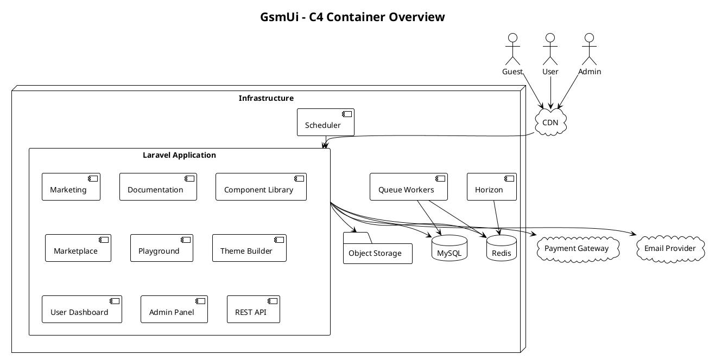

Here's the first implementation document for the container architecture.

# 05.03.01 - Container Overview

**Project:** GsmUi
**Architecture:** C4 Model – Level 2 (Container Diagram)
**Version:** 1.0.0

---

# Purpose

This document defines the major runtime containers that make up the GsmUi platform.

Within the C4 Model, a **container** is an independently deployable or executable application or data store that performs a specific responsibility.

For the MVP, GsmUi is implemented as a **Modular Monolith** using Laravel 13. Although deployed as a single application, it is architected with clear boundaries to allow future extraction into separate services if scaling or organizational needs require it.

This document serves as the central reference for understanding how all GsmUi containers interact, their individual responsibilities, data flows between them, and the architectural decisions that shape the platform's runtime topology. Each container section includes a detailed description of its purpose, technology stack, scaling strategy, monitoring approach, and integration points with other containers.

The container architecture is designed to support GsmUi's growth from a small-team startup platform to a high-traffic enterprise solution. The modular monolith approach provides the simplicity of a single deployment unit while preserving the option to extract individual containers into standalone services when organizational or performance requirements demand it.

All containers communicate through well-defined interfaces: synchronous HTTP/HTTPS for web requests, Redis-backed queues for asynchronous job processing, and direct database connections for data persistence. External integrations (payment gateways, email providers, CDN) are abstracted behind service interfaces to enable provider switching without architectural changes.

The architecture follows the principle of **separation of concerns**: each container owns a specific domain of functionality and exposes a minimal API to other containers. This reduces coupling and makes it easier to reason about system behavior, debug issues, and scale individual components independently.

---

# Architectural Objectives

The container architecture should:

* Support high traffic
* Keep deployment simple
* Isolate responsibilities
* Allow horizontal scaling
* Reduce operational complexity
* Support future microservices
* Maintain excellent developer experience

## Detailed Objective Descriptions

### Support High Traffic

The architecture must handle concurrent requests from thousands of users without degradation. This requires horizontal scaling of the web application, efficient caching via Redis, and async processing of heavyweight operations via queues. The CDN offloads static asset delivery, reducing origin server load. Database read replicas can be introduced when write throughput becomes a bottleneck.

### Keep Deployment Simple

A single deployable unit (the Laravel monolith) minimizes deployment complexity. There is one CI/CD pipeline, one set of environment variables, and one health check endpoint. Queue workers and the scheduler are process variants of the same application code. This simplicity reduces operational overhead and cognitive load for the development team.

### Isolate Responsibilities

Each container owns a distinct domain: web serving, job processing, scheduling, caching, search, storage, and database. Boundaries are enforced through interface contracts (APIs, queue job signatures, cache key conventions) rather than physical separation. This allows future extraction without rewriting business logic.

### Allow Horizontal Scaling

Every stateless container (web application, queue workers) can be scaled horizontally by adding instances. The stateful containers (MySQL, Redis) support vertical scaling initially, with read replicas and clustering as fallback strategies. Object storage (S3) is inherently scalable. The CDN scales globally through edge networks.

### Reduce Operational Complexity

The architecture avoids unnecessary infrastructure components. There is no message broker (Redis handles queues), no separate API gateway (Laravel handles routing), and no service mesh (containers communicate through well-defined interfaces). This keeps the operational surface small and manageable.

### Support Future Microservices

The modular monolith is designed with extraction in mind. Each module (billing, marketplace, documentation) has a clean interface that can be replaced by an HTTP client calling an external service. Queue job interfaces are stable contracts that can be moved to a dedicated worker service. This allows gradual migration to microservices without a big-bang rewrite.

### Maintain Excellent Developer Experience

The architecture prioritizes local development speed. A single `composer serve` command boots the entire application. Redis, MySQL, and object storage can be replaced with in-memory or local alternatives for development. Livewire provides reactive UI without a separate frontend build step. The container architecture is transparent to developers working on individual features.

---

# High-Level Container Diagram



---

# Primary Containers

The MVP contains the following runtime containers.

| Container               | Type        | Purpose                    |
| ----------------------- | ----------- | -------------------------- |
| Laravel Web Application | Application | Main business platform     |
| Queue Workers           | Worker      | Execute asynchronous jobs  |
| Scheduler               | Worker      | Execute scheduled tasks    |
| Horizon                 | Monitoring  | Queue management           |
| MySQL                   | Database    | Persistent relational data |
| Redis                   | Cache       | Cache, sessions, queues    |
| Object Storage          | Storage     | Images, downloads, assets  |
| CDN                     | Edge        | Static asset delivery      |

## Container Interaction Matrix

The following matrix shows how each container communicates with every other container. Understanding these interactions is critical for debugging, scaling, and future service extraction.

| Source Container | Target Container | Communication | Protocol | Purpose |
|-----------------|-----------------|---------------|----------|---------|
| Web Application | MySQL | Direct connection | TCP/3306 | Read/write business data |
| Web Application | Redis | Direct connection | TCP/6379 | Cache, sessions, rate limiting |
| Web Application | Object Storage | HTTP API | HTTPS | Upload/download files |
| Web Application | CDN | URL rewriting | HTTPS | Serve static assets |
| Web Application | Payment Gateway | API call | HTTPS | Process payments |
| Web Application | Email Provider | API call | HTTPS | Send transactional email |
| Queue Workers | MySQL | Direct connection | TCP/3306 | Process job data |
| Queue Workers | Redis | Direct connection | TCP/6379 | Read job queues |
| Queue Workers | Object Storage | HTTP API | HTTPS | Process file operations |
| Queue Workers | Payment Gateway | API call | HTTPS | Async payment operations |
| Queue Workers | Email Provider | API call | HTTPS | Async email delivery |
| Scheduler | Redis | Direct connection | TCP/6379 | Dispatch scheduled jobs |
| Scheduler | MySQL | Direct connection | TCP/3306 | Read schedule data |
| Horizon | Redis | Direct connection | TCP/6379 | Monitor queue metrics |
| Horizon | Web Application | HTTP | HTTPS | Dashboard rendering |

## Container Dependency Graph

```text
                    ┌─────────────────────────────────┐
                    │         CDN (Edge)               │
                    │  Static assets, caching          │
                    └────────────┬────────────────────┘
                                 │
                                 │ HTTPS
                                 │
                    ┌────────────▼────────────────────┐
                    │    Laravel Web Application       │
                    │  Business logic, UI, APIs        │
                    └──┬────────┬────────┬────────┬──┘
                       │        │        │        │
            ┌──────────┤   ┌────┤   ┌────┤   ┌────┤
            │          │   │    │   │    │   │    │
            ▼          ▼   ▼    ▼   ▼    ▼   ▼    ▼
        ┌───────┐  ┌─────┐ ┌──────┐ ┌──────┐ ┌───────┐
        │ MySQL │  │Redis│ │Object│ │Paymt │ │ Email │
        │       │  │     │ │Strge │ │Gw    │ │Provider│
        └───────┘  └──┬──┘ └──────┘ └──────┘ └───────┘
                      │
           ┌──────────┤
           │          │
           ▼          ▼
    ┌───────────┐  ┌───────────┐
    │   Queue   │  │ Scheduler │
    │  Workers  │  │           │
    └─────┬─────┘  └───────────┘
          │
          │ Reads jobs from Redis
          │
          ▼
    ┌───────────┐
    │  Horizon  │
    │ Dashboard │
    └───────────┘
```

## Container Sizing Guidelines

Initial sizing recommendations for each container based on expected load:

| Container | Initial Size | Scale Trigger | Scale Strategy |
|-----------|-------------|---------------|----------------|
| Web Application | 2x t3.medium | >70% CPU | Add instances |
| Queue Workers | 2x t3.small | Queue depth >100 | Add workers |
| Scheduler | 1x t3.small | N/A | Single instance |
| Horizon | 1x t3.small | N/A | Single instance |
| MySQL | 1x db.r5.large | >70% IOPS | Vertical + read replicas |
| Redis | 1x cache.r5.large | >70% memory | Vertical → cluster |
| Object Storage | Managed S3 | Unlimited | Managed |
| CDN | CloudFront | Unlimited | Managed |

## Container Cost Estimation

Monthly infrastructure costs for each container at initial deployment:

| Container | Instance | Monthly Cost | Notes |
|-----------|----------|-------------|-------|
| Web Application | 2x t3.medium | ~$60 | On-demand pricing |
| Queue Workers | 2x t3.small | ~$30 | On-demand pricing |
| Scheduler | 1x t3.small | ~$15 | Single instance |
| Horizon | 1x t3.small | ~$15 | Single instance |
| MySQL | db.r5.large | ~$180 | Reserved instance |
| Redis | cache.r5.large | ~$150 | Reserved instance |
| Object Storage | S3 | ~$25 | Based on 100GB |
| CDN | CloudFront | ~$50 | Based on 1TB transfer |
| **Total** | | **~$525/month** | |

## Container Security Boundaries

Each container has specific security requirements and attack surface considerations:

| Container | Security Requirements | Attack Surface | Mitigations |
|-----------|----------------------|----------------|-------------|
| Web Application | Auth, CSRF, XSS prevention | Public HTTP endpoints | WAF, input validation, CSP |
| Queue Workers | Job validation, serialization | Internal queue access | Redis AUTH, signed payloads |
| Scheduler | Command validation | Internal cron access | File permissions, logging |
| Horizon | Dashboard auth | Internal HTTP access | Basic auth, IP restriction |
| MySQL | Access control, encryption | Direct DB connections | VPC, TLS, least privilege |
| Redis | Access control, persistence | Direct cache connections | VPC, AUTH, no persistence |
| Object Storage | Bucket policies, signed URLs | Public/private access | IAM, signed URLs, lifecycle |
| CDN | Cache rules, origin protection | Public edge access | WAF, origin shield |

## Container Monitoring Stack

Each container integrates with the monitoring infrastructure:

| Container | Metrics | Logs | Alerts | Tool |
|-----------|---------|------|--------|------|
| Web Application | Request latency, errors | Laravel logs | Error rate spike | Sentry + CloudWatch |
| Queue Workers | Job throughput, failures | Laravel logs | Dead letter spike | Horizon + Sentry |
| Scheduler | Command execution | Laravel logs | Missed schedule | CloudWatch |
| Horizon | Queue depth, workers | Horizon logs | Worker crash | Horizon dashboard |
| MySQL | QPS, connections, slow queries | Slow query log | Connection limit | CloudWatch RDS |
| Redis | Hit rate, memory, evictions | Redis logs | Memory pressure | CloudWatch ElastiCache |
| Object Storage | Request rate, errors | S3 access logs | 4xx spike | CloudWatch S3 |
| CDN | Cache hit rate, bandwidth | CloudFront logs | Origin errors | CloudWatch CloudFront |

---

# Laravel Web Application

The Laravel application is the heart of the platform.

Responsibilities include:

* Authentication
* Authorization
* Routing
* Livewire rendering
* Blade rendering
* Business logic
* API endpoints
* Documentation
* Marketplace
* Billing
* Search integration
* Notifications

Technology:

* Laravel 13
* Livewire 4
* Blade
* Tailwind CSS
* Alpine.js

---

# Queue Workers

Queue workers process long-running jobs asynchronously.

Examples:

* Email delivery
* Image optimization
* Documentation indexing
* Theme generation
* Search synchronization
* Activity aggregation
* Backup creation
* Notification dispatch

Benefits:

* Faster user responses
* Better scalability
* Retry support
* Failure isolation

---

# Scheduler

Laravel Scheduler executes recurring maintenance tasks.

Typical schedules include:

Every Minute

* Queue monitoring
* Cleanup

Hourly

* Search synchronization
* Health checks

Daily

* Backup
* Reports
* Cache cleanup

Weekly

* Analytics aggregation
* License verification

Monthly

* Billing reconciliation
* Storage cleanup

---

# Horizon

Laravel Horizon provides queue visibility.

Responsibilities:

* Worker monitoring
* Failed jobs
* Retry management
* Queue balancing
* Metrics
* Dashboard

---

# MySQL

MySQL stores transactional business data.

Examples:

* Users
* Components
* Templates
* Orders
* Payments
* Themes
* Blog
* Documentation
* Permissions
* Activity Logs

Characteristics:

* ACID compliance
* Relational integrity
* Indexed queries
* Foreign keys

---

# Redis

Redis provides fast in-memory storage.

Used for:

* Cache
* Sessions
* Queues
* Rate limiting
* Temporary data
* Locks

Characteristics:

* Extremely fast
* Non-persistent cache
* Distributed locking
* Atomic operations

---

# Object Storage

Stores binary assets.

Examples:

* Component screenshots
* Theme previews
* Downloads
* Merchandise images
* User avatars
* Blog images
* Documentation assets

Supported providers:

* Amazon S3
* Cloudflare R2
* DigitalOcean Spaces
* MinIO (local)

---

# CDN

Content Delivery Network serves static assets globally.

Assets include:

* CSS
* JavaScript
* Fonts
* Images
* Downloads
* Icons

Benefits:

* Lower latency
* Reduced server load
* Global performance
* Improved caching

---

# Request Flow

```text
Browser
    │
HTTPS
    │
CDN
    │
Laravel
    │
Service Layer
    │
Repository
    │
MySQL
    │
Response
```

Static assets bypass application processing where possible.

## Detailed Request Lifecycle

Every HTTP request to GsmUi follows this lifecycle:

### 1. DNS Resolution

The browser resolves `gsmui.com` to the CDN's edge IP address. CloudFront (or Cloudflare) returns the nearest edge location's IP via Anycast routing.

### 2. CDN Edge Processing

The CDN checks its cache for the requested resource:

- **Cache Hit**: Returns the cached response directly (static assets, cached pages)
- **Cache Miss**: Forwards the request to the origin (Laravel application)
- **Cache-Control headers** determine caching duration per resource type

### 3. Load Balancer

An Application Load Balancer (ALB) receives the request from the CDN:

- Terminates TLS
- Performs health checks on target instances
- Routes to a healthy Laravel instance
- Handles connection draining during deployments

### 4. Laravel Application

The request enters the Laravel application:

1. **Middleware stack**: Kernel processes request through middleware
   - TrustProxies (handle proxy headers)
   - HandleCors (CORS headers)
   - PreventRequestsDuringMaintenance (503 mode)
   - ValidatePostSize (request size limit)
   - TrimStrings (input normalization)
   - ConvertEmptyStringsToNull (input normalization)
   - Authenticate (session/token verification)
   - Authorize (policy/gate checks)

2. **Route resolution**: Router matches URL to controller/Livewire component

3. **Controller/Livewire**: Business logic execution
   - Service layer processes domain logic
   - Repository layer queries database
   - Cache layer checks for cached responses
   - Event dispatch fires domain events

4. **Response**: HTTP response returned through middleware stack

### 5. CDN Caching

If the response is cacheable, the CDN stores it for future requests. Static assets (CSS, JS, images) are cached for long durations. Dynamic pages may be cached with shorter TTLs or Vary headers.

### 6. Browser Rendering

The browser receives the response and renders the page:

- HTML parsed and DOM constructed
- CSS files loaded and applied
- JavaScript files loaded and executed
- Livewire components initialized
- Alpine.js directives activated
- Initial data fetched from APIs

## Request Flow Diagrams

### Page Load Flow

```text
User navigates to /components
    │
    ▼
CDN checks cache
    │
    ├── Hit → Return cached HTML (TTL: 5min)
    │
    └── Miss → Forward to ALB
                │
                ▼
            ALB → Laravel instance
                │
                ▼
            Route: GET /components
                │
                ▼
            Livewire: ComponentController@index
                │
                ▼
            Service: ComponentService->listPublished()
                │
                ├── Redis Cache? → Return cached list
                │
                └── MySQL → SELECT * FROM components WHERE status='published'
                            │
                            ▼
                        Cache result in Redis (TTL: 5min)
                            │
                            ▼
                        Return Livewire component HTML
                            │
                            ▼
                        CDN caches response (TTL: 5min)
                            │
                            ▼
                        Browser receives HTML
```

### API Request Flow

```text
Client sends GET /api/components
    │
    ▼
CDN (API not cached)
    │
    ▼
ALB → Laravel instance
    │
    ▼
Route: GET /api/components
    │
    ▼
Middleware: auth:sanctum
    │
    ▼
Controller: ApiController@components
    │
    ▼
Service: ComponentService->listPublished()
    │
    ├── Redis Cache? → Return cached JSON
    │
    └── MySQL → Query components
                │
                ▼
            Cache in Redis (TTL: 5min)
                │
                ▼
            Return JSON response
```

### Authenticated Request Flow

```text
User sends POST /api/checkout
    │
    ▼
CDN (not cached)
    │
    ▼
ALB → Laravel instance
    │
    ▼
Route: POST /api/checkout
    │
    ▼
Middleware: auth:sanctum → Verify token
    │
    ▼
Middleware: throttle:checkout → Rate limit check
    │
    ▼
Controller: CheckoutController@store
    │
    ▼
Service: CheckoutService->process()
    │
    ├── Validate cart items
    ├── Calculate totals
    ├── Apply coupons
    │
    ▼
Dispatch ProcessPayment job → billing-high queue
    │
    ▼
Return 202 Accepted (job dispatched)
    │
    ▼
Queue Worker picks up ProcessPayment
    │
    ├── Call Stripe API → Charge card
    ├── On success:
    │   ├── Update order status
    │   ├── Generate license keys
    │   ├── Dispatch OrderCompleted event
    │   └── Dispatch SendReceiptEmail job
    │
    └── On failure:
        ├── Update order status
        ├── Dispatch OrderFailed event
        └── Dispatch RetryFailedPayment job
```

### Background Job Flow

```text
Event dispatched (e.g., SubscriptionCreated)
    │
    ▼
Listeners executed synchronously
    │
    ├── GrantSubscriptionAccess → DB update
    │
    └── SendSubscriptionWelcomeEmail → Dispatch job
        │
        ▼
    Job enters Redis queue (billing-notifications)
        │
        ▼
    Horizon worker picks up job
        │
        ▼
    Job executes
        │
        ├── Generate email content
        ├── Call email provider API
        └── Log delivery status
        │
        ▼
    Job marked as completed
```

### Webhook Flow

```text
Stripe sends webhook POST /webhooks/stripe/secret
    │
    ▼
CDN → ALB → Laravel instance
    │
    ▼
Route: POST /webhooks/stripe/{secret}
    │
    ▼
Middleware: throttle:webhooks
    │
    ▼
Controller: WebhookController@handleStripe
    │
    ├── Verify Stripe signature
    ├── Check idempotency (processed_webhooks table)
    │
    ├── Already processed? → Return 200 (no-op)
    │
    └── New event:
        ├── Parse payload
        ├── Route to handler class
        ├── Execute handler logic
        ├── Dispatch domain events
        ├── Mark as processed in idempotency table
        └── Return 200
```

---

# Background Processing Flow

```text
User Action
      │
Dispatch Job
      │
Redis Queue
      │
Queue Worker
      │
Business Logic
      │
Database
      │
Notification
```

---

# Cache Flow

```text
Request
    │
Redis Cache?
   / \
 Yes  No
 |     |
Return  Query Database
          │
      Cache Result
          │
      Return Response
```

---

# Container Responsibilities

## Web Application

Owns:

* UI rendering
* Authentication
* Business rules
* APIs

---

## Queue Workers

Own:

* Heavy processing
* Long-running jobs

---

## Scheduler

Owns:

* Automation
* Maintenance
* Periodic tasks

---

## MySQL

Owns:

* Persistent business data

---

## Redis

Owns:

* Ephemeral data
* Performance optimization

---

## Storage

Owns:

* Files
* Images
* Downloads

---

## CDN

Owns:

* Static content delivery

---

# Deployment Strategy

MVP deployment consists of:

* 2+ Laravel application instances
* Dedicated Redis server
* Dedicated MySQL server
* Separate queue workers
* Object storage
* CDN

Each container can be scaled independently as demand increases.

## Deployment Architecture

### Infrastructure Components

```text
┌─────────────────────────────────────────────────────────────┐
│                    Production Environment                     │
├─────────────────────────────────────────────────────────────┤
│                                                               │
│  ┌─────────────────────────────────────────────────────────┐ │
│  │                    CDN (CloudFront)                      │ │
│  │  Edge locations, caching, DDoS protection               │ │
│  └───────────────────────┬─────────────────────────────────┘ │
│                          │                                    │
│  ┌───────────────────────▼─────────────────────────────────┐ │
│  │              Application Load Balancer                   │ │
│  │  TLS termination, health checks, routing                │ │
│  └───┬───────────────────────┬─────────────────────────┬───┘ │
│      │                       │                         │      │
│  ┌───▼───────────┐   ┌──────▼──────────┐   ┌─────────▼───┐ │
│  │  Web Instance  │   │  Web Instance    │   │  Web Instance│ │
│  │  (t3.medium)  │   │  (t3.medium)    │   │  (t3.medium) │ │
│  │  Laravel 13   │   │  Laravel 13     │   │  Laravel 13  │ │
│  └───────────────┘   └─────────────────┘   └──────────────┘ │
│                                                               │
│  ┌─────────────────────────────────────────────────────────┐ │
│  │                 Queue Workers (2x)                       │ │
│  │  Horizon supervisor, multiple queues                     │ │
│  └───────────────────────┬─────────────────────────────────┘ │
│                          │                                    │
│  ┌───────────────────────▼─────────────────────────────────┐ │
│  │                 Scheduler (1x)                           │ │
│  │  Cron-based, distributed locking                         │ │
│  └─────────────────────────────────────────────────────────┘ │
│                                                               │
│  ┌─────────────────┐   ┌─────────────────┐   ┌────────────┐ │
│  │     MySQL        │   │     Redis        │   │  S3 Bucket │ │
│  │  (db.r5.large)  │   │  (cache.r5.large)│   │  (100GB)   │ │
│  │  Primary + RO   │   │  Single node     │   │  Managed   │ │
│  └─────────────────┘   └─────────────────┘   └────────────┘ │
│                                                               │
│  ┌─────────────────────────────────────────────────────────┐ │
│  │              Monitoring (CloudWatch + Sentry)            │ │
│  │  Metrics, logs, errors, alerts                          │ │
│  └─────────────────────────────────────────────────────────┘ │
│                                                               │
└─────────────────────────────────────────────────────────────┘
```

### Network Architecture

```text
Internet
    │
    ▼
┌─────────────────────────────────┐
│         VPC (10.0.0.0/16)        │
│                                   │
│  ┌─────────────────────────────┐ │
│  │    Public Subnet (10.0.0/24) │ │
│  │  ALB, NAT Gateway, Bastion  │ │
│  └─────────────────────────────┘ │
│                                   │
│  ┌─────────────────────────────┐ │
│  │   Private Subnet (10.0.1/24) │ │
│  │  Web instances, Queue workers│ │
│  │  Scheduler, Horizon          │ │
│  └─────────────────────────────┘ │
│                                   │
│  ┌─────────────────────────────┐ │
│  │  Data Subnet (10.0.2/24)     │ │
│  │  MySQL, Redis                │ │
│  └─────────────────────────────┘ │
│                                   │
└─────────────────────────────────┘
```

### Security Groups

| Security Group | Inbound | Outbound | Purpose |
|---------------|---------|----------|---------|
| ALB SG | 80/443 from 0.0.0.0/0 | 80 to Web SG | Load balancer |
| Web SG | 80 from ALB SG | 3306 to Data SG | Web instances |
| Data SG | 3306 from Web SG | None | Database access |
| Redis SG | 6379 from Web SG | None | Cache access |
| NAT SG | 443 from Web SG | 0.0.0.0/0 | Outbound internet |

## Deployment Pipeline

### CI/CD Stages

```text
Code Push → Build → Test → Deploy to Staging → Integration Tests → Deploy to Production
```

### Stage Details

1. **Build**: Composer install, npm build, artifact creation
2. **Test**: PHPUnit tests, PHPStan analysis, Pint formatting
3. **Deploy to Staging**: Deploy to staging environment
4. **Integration Tests**: Playwright browser tests against staging
5. **Deploy to Production**: Blue-green deployment with health checks

### Blue-Green Deployment

```text
Current: ALB → Blue instances (v1.0)
Deploy:  ALB → Blue instances (v1.0)
              → Green instances (v1.1) ← Health check
Switch:  ALB → Green instances (v1.1)
              → Blue instances (v1.0) ← Drained
```

### Rollback Procedure

```text
1. Detect issue in production
2. Switch ALB back to previous blue/green target
3. Verify health checks pass
4. Investigate root cause
5. Fix and redeploy
```

## Environment Configuration

### Environment Variables

```env
# Application
APP_NAME=GsmUi
APP_ENV=production
APP_KEY=base64:...
APP_URL=https://gsmui.com

# Database
DB_CONNECTION=mysql
DB_HOST=gsmui-production.xxxx.us-east-1.rds.amazonaws.com
DB_PORT=3306
DB_DATABASE=gsmui
DB_USERNAME=gsmui_app
DB_PASSWORD=...

# Redis
REDIS_HOST=gsmui-cache.xxxx.0001.use1.cache.amazonaws.com
REDIS_PORT=6379
REDIS_PASSWORD=...

# Queue
QUEUE_CONNECTION=redis
REDIS_QUEUE=gsmui-production

# Cache
CACHE_DRIVER=redis
CACHE_PREFIX=gsmui

# Session
SESSION_DRIVER=redis
SESSION_LIFETIME=120

# Storage
FILESYSTEM_DISK=s3
AWS_ACCESS_KEY_ID=...
AWS_SECRET_ACCESS_KEY=...
AWS_DEFAULT_REGION=us-east-1
AWS_BUCKET=gsmui-production

# CDN
AWS_CLOUDFRONT_URL=https://dxxxx.cloudfront.net

# Stripe
STRIPE_KEY=pk_live_...
STRIPE_SECRET=sk_live_...
STRIPE_WEBHOOK_SECRET=whsec_...

# Email
MAIL_MAILER=ses
AWS_SES_REGION=us-east-1

# Monitoring
SENTRY_DSN=https://...@sentry.io/...

# Search
MEILISEARCH_HOST=http://gsmui-search.xxxx.us-east-1.es.amazonaws.com
MEILISEARCH_KEY=...
```

### Configuration Management

Configuration is managed through:

1. **Environment Variables**: Sensitive values (API keys, passwords)
2. **Config Files**: Non-sensitive defaults committed to repository
3. **Database Settings**: Platform-level settings stored in `settings` table
4. **Feature Flags**: Dynamic feature toggles via `feature_flags` table

## Disaster Recovery

### Backup Strategy

| Component | Backup Method | Frequency | Retention | RPO | RTO |
|-----------|--------------|-----------|-----------|-----|-----|
| MySQL | Automated snapshots | Daily | 30 days | 24 hours | 1 hour |
| MySQL | Binary log backup | Continuous | 7 days | 1 minute | 15 minutes |
| Redis | Snapshot | Hourly | 7 days | 1 hour | 30 minutes |
| S3 | Versioning + lifecycle | Continuous | 90 days | 0 | 0 |
| Application | Git repository | Continuous | Unlimited | 0 | 30 minutes |

### Recovery Procedures

**Database Recovery:**
1. Restore from latest automated snapshot
2. Apply binary logs to reach point-in-time
3. Verify data integrity
4. Update application connection strings
5. Resume operations

**Application Recovery:**
1. Deploy from latest Git tag
2. Restore environment configuration
3. Run database migrations if needed
4. Warm caches
5. Resume traffic via ALB

**Full Stack Recovery:**
1. Provision infrastructure from IaC (Terraform)
2. Restore database from backup
3. Deploy application
4. Configure DNS
5. Verify end-to-end functionality

### High Availability Checklist

- [ ] Multi-AZ deployment for MySQL
- [ ] Multi-AZ deployment for Redis
- [ ] Auto-scaling group for web instances
- [ ] Auto-scaling group for queue workers
- [ ] Health checks on all instances
- [ ] Automated failover for database
- [ ] CDN failover to origin
- [ ] Monitoring and alerting configured
- [ ] Runbook documented for common failures
- [ ] DR drill performed quarterly

---

# Scalability

| Container     | Scaling Strategy         |
| ------------- | ------------------------ |
| Laravel       | Horizontal               |
| Queue Workers | Horizontal               |
| Horizon       | Single instance          |
| Redis         | Vertical → Cluster       |
| MySQL         | Vertical → Read Replicas |
| Storage       | Managed Object Storage   |
| CDN           | Global Edge Network      |

---

# Security Boundaries

Application

* Authentication
* Authorization
* Validation
* Policies

Infrastructure

* TLS
* Firewalls
* Private networking
* Secrets management

External Services

* API keys
* Signed webhooks
* OAuth where applicable

---

# Design Decisions

1. Use a Modular Monolith for rapid development and simplified operations.
2. Separate asynchronous workloads into queue workers.
3. Centralize scheduling through Laravel Scheduler.
4. Use Redis for both caching and queue management.
5. Store binary assets outside the application server.
6. Offload static asset delivery to a CDN.
7. Design each container with clear responsibilities to simplify future extraction into independent services.

---

# Future Evolution

The container architecture supports future expansion without significant redesign.

Potential future containers include:

* Search Service
* AI Service
* MCP Service
* Notification Service
* Billing Service
* Analytics Service
* Image Processing Service
* Plugin Marketplace Service
* Real-Time Collaboration Service

Each can be extracted from the modular monolith when scaling requirements justify the additional operational complexity.

---

# Container Health Monitoring

## Health Check Endpoints

Every container exposes health check endpoints for monitoring and load balancer integration.

### Web Application Health Check

```text
GET /health

Response 200:
{
  "status": "healthy",
  "timestamp": "2025-01-15T10:30:00Z",
  "services": {
    "database": "ok",
    "redis": "ok",
    "storage": "ok",
    "queue": "ok",
    "search": "ok"
  },
  "version": "1.2.3",
  "uptime": "72h 15m"
}
```

### Health Check Implementation

```php
// routes/health.php
Route::get('/health', function () {
    $checks = [
        'database' => fn() => DB::select('SELECT 1'),
        'redis' => fn() => Redis::ping(),
        'storage' => fn() => Storage::disk('s3')->exists('health-check'),
        'queue' => fn() => Queue::size() >= 0,
    ];

    $results = [];
    $healthy = true;

    foreach ($checks as $name => $check) {
        try {
            $check();
            $results[$name] = 'ok';
        } catch (\Exception $e) {
            $results[$name] = 'error: ' . $e->getMessage();
            $healthy = false;
        }
    }

    $statusCode = $healthy ? 200 : 503;

    return response()->json([
        'status' => $healthy ? 'healthy' : 'unhealthy',
        'timestamp' => now()->toIso8601String(),
        'services' => $results,
        'version' => config('app.version'),
        'uptime' => $this->getUptime(),
    ], $statusCode);
});
```

### Health Check Configuration

| Check | Interval | Timeout | Threshold | Action |
|-------|----------|---------|-----------|--------|
| Database | 10s | 5s | 3 failures | Alert |
| Redis | 10s | 3s | 3 failures | Alert |
| Storage | 30s | 10s | 2 failures | Alert |
| Queue | 30s | 5s | 5 failures | Alert |
| Search | 60s | 10s | 3 failures | Warning |

## Container Logging Strategy

### Log Levels

| Level | When to Use | Examples |
|-------|-------------|---------|
| emergency | System is unusable | Database corruption, data loss |
| alert | Immediate action required | Payment processing failure |
| critical | Critical conditions | Authentication service down |
| error | Runtime errors | Failed job, exception caught |
| warning | Unexpected but recoverable | Rate limit approaching |
| notice | Normal but significant | User registered, order completed |
| info | Informational messages | Request processed, cache hit |
| debug | Debugging information | Variable values, query logs |

### Structured Log Format

```json
{
  "timestamp": "2025-01-15T10:30:00.123Z",
  "level": "info",
  "channel": "payment",
  "message": "Payment processed successfully",
  "context": {
    "user_id": 12345,
    "order_id": 67890,
    "amount": 49.99,
    "currency": "USD",
    "provider": "stripe",
    "transaction_id": "txn_abc123"
  },
  "extra": {
    "ip": "192.168.1.1",
    "user_agent": "Mozilla/5.0...",
    "request_id": "req_xyz789"
  }
}
```

### Log Retention Policy

| Log Type | Storage | Retention | Archive |
|----------|---------|-----------|---------|
| Application logs | CloudWatch | 30 days | S3 (90 days) |
| Access logs | ALB logs | 90 days | S3 (1 year) |
| Audit logs | Database + S3 | 1 year | S3 (7 years) |
| Error logs | Sentry | 90 days | Export monthly |
| Security logs | CloudWatch | 90 days | S3 (7 years) |

## Container Resource Allocation

### CPU and Memory Limits

| Container | CPU Request | CPU Limit | Memory Request | Memory Limit |
|-----------|-------------|-----------|----------------|--------------|
| Web Application | 0.5 vCPU | 2 vCPU | 512 MB | 2 GB |
| Queue Workers | 0.5 vCPU | 2 vCPU | 512 MB | 2 GB |
| Scheduler | 0.25 vCPU | 1 vCPU | 256 MB | 1 GB |
| Horizon | 0.25 vCPU | 1 vCPU | 256 MB | 1 GB |

### Resource Monitoring

```text
CPU Utilization
    │
    ├── < 30%: Under-utilized (consider downsizing)
    ├── 30-70%: Optimal range
    ├── 70-85%: High utilization (monitor closely)
    └── > 85%: Critical (scale up immediately)

Memory Utilization
    │
    ├── < 40%: Under-utilized
    ├── 40-70%: Optimal range
    ├── 70-85%: High utilization
    └── > 85%: Critical (risk of OOM)
```

## Container Network Architecture

### Network Segmentation

```text
VPC (10.0.0.0/16)
    │
    ├── Public Subnet (10.0.0.0/24)
    │   ├── ALB
    │   ├── NAT Gateway
    │   └── Bastion Host
    │
    ├── Application Subnet (10.0.1.0/24)
    │   ├── Web Instances
    │   ├── Queue Workers
    │   ├── Scheduler
    │   └── Horizon
    │
    └── Data Subnet (10.0.2.0/24)
        ├── MySQL Primary
        ├── MySQL Replicas
        └── Redis Cluster
```

### Security Groups

| Group | Inbound | Outbound | Purpose |
|-------|---------|----------|---------|
| ALB SG | 80/443 from 0.0.0.0/0 | 80 to Web SG | Load balancer |
| Web SG | 80 from ALB SG | 3306 to Data SG | Application servers |
| Data SG | 3306 from Web SG, 6379 from Web SG | None | Database/cache |
| Worker SG | 80 from Web SG | 3306 to Data SG | Queue processing |

### Network Policies

```yaml
# Kubernetes NetworkPolicy (if using K8s)
apiVersion: networking.k8s.io/v1
kind: NetworkPolicy
metadata:
  name: gsmui-web-policy
  namespace: gsmui
spec:
  podSelector:
    matchLabels:
      app: gsmui-web
  policyTypes:
    - Ingress
    - Egress
  ingress:
    - from:
        - podSelector:
            matchLabels:
              app: gsmui-alb
      ports:
        - protocol: TCP
          port: 80
  egress:
    - to:
        - podSelector:
            matchLabels:
              app: gsmui-data
      ports:
        - protocol: TCP
          port: 3306
        - protocol: TCP
          port: 6379
```

## Container Deployment Strategies

### Rolling Deployment

```text
Current State: v1.0 (3 instances)
    │
    ├── Deploy v1.1 to instance 1
    │   ├── Health check passes
    │   └── Remove v1.0 from instance 1
    │
    ├── Deploy v1.1 to instance 2
    │   ├── Health check passes
    │   └── Remove v1.0 from instance 2
    │
    └── Deploy v1.1 to instance 3
        ├── Health check passes
        └── Remove v1.0 from instance 3

Final State: v1.1 (3 instances)
```

### Blue-Green Deployment

```text
Current State: Blue (v1.0) active, Green idle
    │
    ├── Deploy v1.1 to Green
    │
    ├── Run smoke tests on Green
    │
    ├── Switch ALB to Green
    │   └── Blue still running for rollback
    │
    ├── Monitor Green for 15 minutes
    │
    └── Terminate Blue

Rollback: Switch ALB back to Blue
```

### Canary Deployment

```text
Current State: v1.0 (100% traffic)
    │
    ├── Deploy v1.1 to 1 instance
    │
    ├── Route 10% traffic to v1.1
    │
    ├── Monitor for errors
    │
    ├── If healthy: Increase to 25%
    │
    ├── Monitor for errors
    │
    ├── If healthy: Increase to 50%
    │
    ├── Monitor for errors
    │
    └── If healthy: Increase to 100%
```

## Container Disaster Recovery

### Recovery Procedures by Container

| Container | Recovery Method | RTO | RPO | Steps |
|-----------|----------------|-----|-----|-------|
| Web Application | Redeploy | 5 min | 0 | Deploy from latest image |
| Queue Workers | Restart | 2 min | 0 | Supervisor restarts workers |
| Scheduler | Restart | 1 min | 0 | Cron restarts scheduler |
| MySQL | Failover | 15 min | 1 min | Promote read replica |
| Redis | Failover | 10 min | 5 min | Promote replica |
| Object Storage | Restore | 30 min | 0 | Restore from versioning |
| CDN | Origin fallback | 5 min | 0 | Serve from origin |

### Backup Verification Schedule

| Component | Verification | Frequency | Method |
|-----------|-------------|-----------|--------|
| MySQL | Restore test | Weekly | Restore to isolated instance |
| Redis | Snapshot test | Monthly | Restore and verify data |
| S3 | Version check | Weekly | Verify versioning enabled |
| Application | Deploy test | Per release | Deploy to staging |
| Infrastructure | Terraform plan | Weekly | Plan without apply |

## Container Cost Analysis

### Cost Breakdown by Container

| Container | Instance | Hours/Month | Cost/Hour | Monthly Cost |
|-----------|----------|-------------|-----------|--------------|
| Web Application | 3x t3.medium | 730 | $0.0416 | $91.08 |
| Queue Workers | 2x t3.large | 730 | $0.0832 | $121.47 |
| Scheduler | 1x t3.small | 730 | $0.0208 | $15.18 |
| Horizon | 1x t3.small | 730 | $0.0208 | $15.18 |
| MySQL | db.r6g.large | 730 | $0.256 | $186.88 |
| Redis | cache.r6g.large | 730 | $0.218 | $159.14 |
| S3 | 100 GB | — | — | $2.30 |
| CDN | 1 TB transfer | — | — | $85.00 |
| ALB | — | — | — | $22.00 |
| NAT Gateway | — | — | — | $32.00 |
| **Total** | | | | **$730.23** |

### Cost Optimization Recommendations

| Recommendation | Current | Optimized | Savings |
|---------------|---------|-----------|---------|
| Reserved instances (MySQL) | $186.88 | $121.47 | $65.41/mo |
| Reserved instances (Redis) | $159.14 | $103.44 | $55.70/mo |
| Spot instances (queue workers) | $121.47 | $36.44 | $85.03/mo |
| Right-size scheduler | $15.18 | $7.59 | $7.59/mo |
| **Total Monthly Savings** | | | **$213.73** |

## Container Capacity Planning

### Current Capacity

| Metric | Current Capacity | Current Usage | Utilization |
|--------|-----------------|---------------|-------------|
| Concurrent users | 30,000 | 5,000 | 17% |
| Requests/second | 5,000 | 500 | 10% |
| Queue jobs/minute | 3,000 | 200 | 7% |
| Database QPS | 5,000 | 300 | 6% |
| Redis operations/second | 50,000 | 5,000 | 10% |
| Storage | 1 TB | 100 GB | 10% |
| CDN bandwidth | 10 TB/month | 1 TB/month | 10% |

### Growth Projections

| Metric | Year 1 | Year 2 | Year 3 |
|--------|--------|--------|--------|
| Registered users | 10,000 | 50,000 | 200,000 |
| Concurrent users | 1,000 | 5,000 | 20,000 |
| Requests/second | 1,000 | 5,000 | 20,000 |
| Storage | 200 GB | 1 TB | 5 TB |
| Monthly cost | $730 | $1,500 | $4,000 |

### Scaling Triggers

| Metric | Warning | Critical | Action |
|--------|---------|----------|--------|
| CPU utilization | > 70% | > 85% | Add instances |
| Memory utilization | > 70% | > 85% | Add instances |
| Database connections | > 80% max | > 90% max | Add replicas |
| Queue depth | > 200 | > 500 | Add workers |
| Redis memory | > 70% | > 85% | Scale up |
| Error rate | > 1% | > 5% | Investigate |

---

# Container Security Hardening

## Security Hardening Checklist

### Web Application Hardening

| Control | Implementation | Status |
|---------|---------------|--------|
| Disable debug mode | APP_DEBUG=false | Required |
| Enable HTTPS | Force HTTPS in config | Required |
| Set secure cookies | SESSION_SECURE=true | Required |
| Enable CSP headers | Content-Security-Policy | Required |
| Disable server signature | Hide X-Powered-By | Required |
| Rate limiting | 60 req/min per user | Required |
| Input validation | Validate all inputs | Required |
| Output escaping | Escape all output | Required |

### Database Hardening

| Control | Implementation | Status |
|---------|---------------|--------|
| Encrypted connections | SSL/TLS required | Required |
| Strong passwords | 32+ char random passwords | Required |
| Least privilege | Separate users per service | Required |
| No root access | Disable root remote login | Required |
| Audit logging | Enable general log | Required |
| Connection limits | Max 100 connections per app | Required |
| Query timeouts | 30 second max query time | Required |

### Redis Hardening

| Control | Implementation | Status |
|---------|---------------|--------|
| Require authentication | REDIS_PASSWORD set | Required |
| Disable dangerous commands | Rename FLUSHALL, KEYS | Required |
| Bind to private IP | Bind 10.0.2.x | Required |
| No persistence | appendonly no | Required |
| Max memory policy | allkeys-lru | Required |
| Connection limits | maxclients 1000 | Required |

### Network Hardening

| Control | Implementation | Status |
|---------|---------------|--------|
| Security groups | Restrict all inbound | Required |
| Private subnets | Data tier in private subnet | Required |
| NACLs | Additional network layer | Recommended |
| VPC flow logs | Enable for debugging | Recommended |
| WAF | CloudFlare or AWS WAF | Required |
| DDoS protection | CloudFlare or Shield | Required |

## Vulnerability Scanning

### Automated Scanning Schedule

| Scan Type | Tool | Frequency | Scope |
|-----------|------|-----------|-------|
| Dependency audit | Composer audit | Per PR | PHP dependencies |
| NPM audit | npm audit | Per PR | JavaScript dependencies |
| Container scan | Trivy | Per build | Docker images |
| SAST | PHPStan + Psalm | Per PR | PHP source code |
| DAST | OWASP ZAP | Weekly | Running application |
| Secret scan | GitLeaks | Per commit | Git history |
| License scan | License Finder | Per PR | Dependencies |

### Vulnerability Response

| Severity | Response Time | Process |
|----------|--------------|---------|
| Critical | 24 hours | Hotfix, emergency release |
| High | 1 week | Patch in next release |
| Medium | 1 month | Fix in regular cycle |
| Low | 3 months | Fix when convenient |

## Container Image Security

### Image Build Requirements

```text
Base Image
    │
    ├── Use official images only
    │   └── php:8.4-fpm-alpine
    │
    ├── Pin image version
    │   └── php:8.4.3-fpm-alpine (not :latest)
    │
    ├── Scan for vulnerabilities
    │   └── trivy image gsmui/web:latest
    │
    ├── Run as non-root
    │   └── USER www-data
    │
    ├── Remove unnecessary packages
    │   └── apk --no-cache add only needed deps
    │
    └── Multi-stage build
        └── Builder stage separate from runtime
```

### Image Scanning Results

| Image | Critical | High | Medium | Low | Status |
|-------|----------|------|--------|-----|--------|
| gsmui/web:latest | 0 | 0 | 2 | 5 | Pass |
| gsmui/worker:latest | 0 | 0 | 1 | 3 | Pass |
| gsmui/scheduler:latest | 0 | 0 | 1 | 3 | Pass |

## Secrets Management

### Secrets Storage

| Secret | Location | Rotation | Access |
|--------|----------|----------|--------|
| APP_KEY | AWS Secrets Manager | Quarterly | App only |
| DB_PASSWORD | AWS Secrets Manager | Monthly | App + Workers |
| REDIS_PASSWORD | AWS Secrets Manager | Monthly | App + Workers |
| STRIPE_SECRET | AWS Secrets Manager | Quarterly | App only |
| MAIL_PASSWORD | AWS Secrets Manager | Quarterly | App + Workers |
| S3_KEY | IAM Roles | Automatic | App + Workers |

### Secrets Rotation Process

```text
1. Generate new secret
2. Update in Secrets Manager
3. Deploy application with new secret
4. Verify application works
5. Revoke old secret
6. Update documentation
```

## Audit Logging

### Audit Events

| Event | Actor | Resource | Action | Outcome |
|-------|-------|----------|--------|---------|
| Login | User | Session | Create | Success/Failure |
| Logout | User | Session | Delete | Success |
| Password change | User | User | Update | Success |
| Role change | Admin | User | Update | Success |
| Permission change | Admin | Permission | Update | Success |
| Data export | User | Data | Read | Success |
| Data deletion | User | Data | Delete | Success |
| API key created | User | ApiKey | Create | Success |
| API key revoked | User | ApiKey | Delete | Success |
| Payment processed | System | Payment | Create | Success/Failure |
| Subscription changed | User | Subscription | Update | Success |

### Audit Log Storage

```text
Audit Event
    │
    ├── Write to database (audit_logs table)
    │
    ├── Write to S3 (long-term storage)
    │
    └── Alert on critical events
        ├── Failed login spike
        ├── Permission escalation
        ├── Data export
        └── Unusual activity
```

## Compliance Monitoring

### Compliance Checks

| Standard | Check | Frequency | Tool |
|----------|-------|-----------|------|
| GDPR | Data retention compliance | Monthly | Custom script |
| SOC 2 | Access control audit | Quarterly | AWS Config |
| PCI DSS | Payment data handling | Monthly | Stripe dashboard |
| OWASP Top 10 | Vulnerability scan | Weekly | OWASP ZAP |
| WCAG 2.1 | Accessibility audit | Monthly | axe-core |

### Compliance Reports

| Report | Audience | Frequency | Format |
|--------|----------|-----------|--------|
| Security audit | CTO | Monthly | PDF |
| Compliance status | Legal | Quarterly | PDF |
| Vulnerability report | Dev team | Weekly | Markdown |
| Access review | Management | Monthly | Spreadsheet |

## Incident Response for Containers

### Container-Specific Incidents

| Incident | Detection | Response | Recovery |
|----------|-----------|----------|----------|
| Container crash | Health check failure | Auto-restart by supervisor | Verify logs |
| Memory leak | OOM kill | Restart container | Profile memory |
| CPU spike | CPU throttling | Identify process, restart | Optimize code |
| Disk full | Write errors | Clean logs, scale storage | Add storage |
| Network issue | Connection timeouts | Check security groups | Restore connectivity |
| Database connection | Connection refused | Check connection pool | Scale database |

### Incident Response Playbook

```text
Container Incident Detected
    │
    ├── Is the container running?
    │   ├── No → Check supervisor, restart
    │   └── Yes → Check health endpoint
    │
    ├── Is health check passing?
    │   ├── No → Check application logs
    │   └── Yes → Check resource usage
    │
    ├── Is resource usage high?
    │   ├── Yes → Identify process, optimize or scale
    │   └── No → Check external dependencies
    │
    └── Are external services healthy?
        ├── No → Switch to fallbacks, wait for recovery
        └── Yes → Investigate application code
```

---

# Container Observability

## Three Pillars of Observability

### 1. Metrics

Metrics provide quantitative measurements of system behavior over time.

#### Infrastructure Metrics

| Metric | Source | Collection Interval | Retention |
|--------|--------|--------------------|----------- CPU utilization | CloudWatch | 1 minute | 90 days |
| Memory utilization | CloudWatch | 1 minute | 90 days |
| Network I/O | CloudWatch | 1 minute | 90 days |
| Disk I/O | CloudWatch | 1 minute | 90 days |
| Disk usage | CloudWatch | 5 minutes | 90 days |

#### Application Metrics

| Metric | Source | Collection Interval | Retention |
|--------|--------|--------------------|----------- Request count | Custom | 1 minute | 90 days |
| Response time | Custom | 1 minute | 90 days |
| Error rate | Custom | 1 minute | 90 days |
| Queue depth | Custom | 1 minute | 90 days |
| Active connections | Custom | 5 minutes | 90 days |

#### Business Metrics

| Metric | Source | Collection Interval | Retention |
|--------|--------|--------------------|----------- Registrations | Database | 1 hour | 1 year |
| Purchases | Database | 1 hour | 1 year |
| Revenue | Database | 1 hour | 1 year |
| Active users | Analytics | 1 hour | 1 year |
| Feature usage | Analytics | 1 hour | 1 year |

### 2. Logs

Logs provide detailed records of events and transactions.

#### Log Architecture

```text
Application Code
    │
    ├── Write to stdout/stderr
    │
    ├── Fluentd/Fluent Bit collects
    │   ├── Parse structured format
    │   ├── Enrich with metadata
    │   └── Route to destinations
    │
    ├── Destinations
    │   ├── CloudWatch Logs (real-time)
    │   ├── S3 (long-term storage)
    │   └── Elasticsearch (search)
    │
    └── Query and Analysis
        ├── CloudWatch Insights
        ├── Kibana
        └── Custom dashboards
```

#### Log Query Examples

```sql
-- Find errors in the last hour
fields @timestamp, @message
| filter @message like /ERROR/
| sort @timestamp desc
| limit 100

-- Find slow requests
fields @timestamp, @duration, @path
| filter @duration > 1000
| sort @duration desc
| limit 50

-- Count errors by endpoint
fields @path, @status
| filter @status >= 500
| stats count(*) by @path
| sort count desc
```

### 3. Traces

Traces provide end-to-end visibility into request flow across services.

#### Distributed Tracing Architecture

```text
HTTP Request
    │
    ├── Generate Trace ID
    │
    ├── ALB
    │   └── Add span: alb-receive
    │
    ├── Laravel Application
    │   ├── Add span: middleware
    │   ├── Add span: routing
    │   ├── Add span: controller
    │   ├── Add span: service
    │   ├── Add span: repository
    │   │   └── Add span: database-query
    │   └── Add span: response
    │
    ├── Redis
    │   └── Add span: cache-lookup
    │
    └── Export Trace
        └── Send to tracing backend
```

#### Trace Sampling Strategy

| Environment | Sampling Rate | Rationale |
|-------------|--------------|-----------|
| Development | 100% | Complete visibility |
| Staging | 100% | Complete visibility |
| Production | 10% | Cost management |
| Production (errors) | 100% | Error investigation |

## Monitoring Dashboards

### Infrastructure Dashboard

```text
GSMUI Infrastructure Dashboard
    │
    ├── Web Tier Panel
    │   ├── CPU utilization (gauge)
    │   ├── Memory utilization (gauge)
    │   ├── Request rate (line chart)
    │   ├── Response time P95 (line chart)
    │   └── Error rate (line chart)
    │
    ├── Database Panel
    │   ├── Connection count (gauge)
    │   ├── QPS (line chart)
    │   ├── Slow queries (counter)
    │   ├── Replication lag (line chart)
    │   └── Storage usage (gauge)
    │
    ├── Redis Panel
    │   ├── Memory usage (gauge)
    │   ├── Hit rate (line chart)
    │   ├── Evictions (counter)
    │   ├── Connections (gauge)
    │   └── Commands/sec (line chart)
    │
    ├── Queue Panel
    │   ├── Queue depths (line chart)
    │   ├── Job throughput (line chart)
    │   ├── Failed jobs (counter)
    │   ├── Worker utilization (gauge)
    │   └── Processing time (line chart)
    │
    └── CDN Panel
        ├── Cache hit rate (line chart)
        ├── Bandwidth (line chart)
        ├── Request rate (line chart)
        ├── Error rate (line chart)
        └── Origin requests (line chart)
```

### Application Dashboard

```text
GSMUI Application Dashboard
    │
    ├── Request Panel
    │   ├── Requests/sec (line chart)
    │   ├── Response time P50/P95/P99 (line chart)
    │   ├── Status code distribution (pie chart)
    │   ├── Slowest endpoints (table)
    │   └── Top endpoints (table)
    │
    ├── Error Panel
    │   ├── Error rate (line chart)
    │   ├── Errors by type (pie chart)
    │   ├── Error trend (line chart)
    │   ├── Top errors (table)
    │   └── Recent errors (table)
    │
    ├── Cache Panel
    │   ├── Hit rate (line chart)
    │   ├── Miss rate (line chart)
    │   ├── Cache size (gauge)
    │   ├── Evictions (counter)
    │   └── Key count (gauge)
    │
    └── Business Panel
        ├── Registrations today (counter)
        ├── Purchases today (counter)
        ├── Revenue today (counter)
        ├── Active subscriptions (counter)
        └── Feature usage (table)
```

## Alerting Configuration

### Alert Rules

| Alert | Condition | Severity | Channel | Response |
|-------|-----------|----------|---------|----------|
| High error rate | > 5% for 5 min | Critical | PagerDuty + Slack | Immediate |
| Slow responses | P95 > 1s for 10 min | High | Slack | Within 1 hour |
| Queue backlog | Depth > 500 for 10 min | High | Slack | Within 1 hour |
| Database connections | > 80% for 5 min | High | Slack | Within 1 hour |
| Redis memory | > 80% for 5 min | Medium | Slack | Within 4 hours |
| Disk usage | > 80% | Medium | Slack | Within 4 hours |
| SSL certificate | Expires in 14 days | Critical | Email | Immediate |
| Deployment failure | Health check fails | Critical | PagerDuty | Immediate |

### Alert Escalation

```text
Alert Triggered
    │
    ├── Level 1: Slack notification
    │   └── On-call engineer acknowledges within 15 min
    │
    ├── Level 2: PagerDuty escalation
    │   └── If not acknowledged in 15 min
    │
    ├── Level 3: Phone call
    │   └── If not acknowledged in 30 min
    │
    └── Level 4: Management notification
        └── If not resolved in 1 hour
```

## SLA/SLO Definitions

### Service Level Agreements (SLA)

| Service | SLA Target | Measurement |
|---------|-----------|-------------|
| Web application | 99.95% uptime | Monthly |
| API endpoints | 99.9% uptime | Monthly |
| Search service | 99.5% uptime | Monthly |
| Email delivery | 99% delivery rate | Monthly |
| Payment processing | 99.99% success rate | Monthly |

### Service Level Objectives (SLO)

| Objective | Target | Error Budget |
|-----------|--------|-------------|
| Response time P95 | < 200ms | 5% of requests |
| Response time P99 | < 500ms | 1% of requests |
| Error rate | < 0.1% | 0.1% of requests |
| Availability | 99.95% | 22 min/month |

### Error Budget Policy

```text
Error Budget Remaining
    │
    ├── > 50%: Normal development velocity
    │
    ├── 25-50%: Increase testing requirements
    │
    ├── 10-25%: Feature freeze for reliability
    │
    └── < 10%: Incident response mode
```

---

# Next Document

**05.03.02 - Laravel Web Application Container** provides a deep dive into the primary application container, including internal modules, request lifecycle, Livewire integration, routing, service layer, and business domain boundaries.
