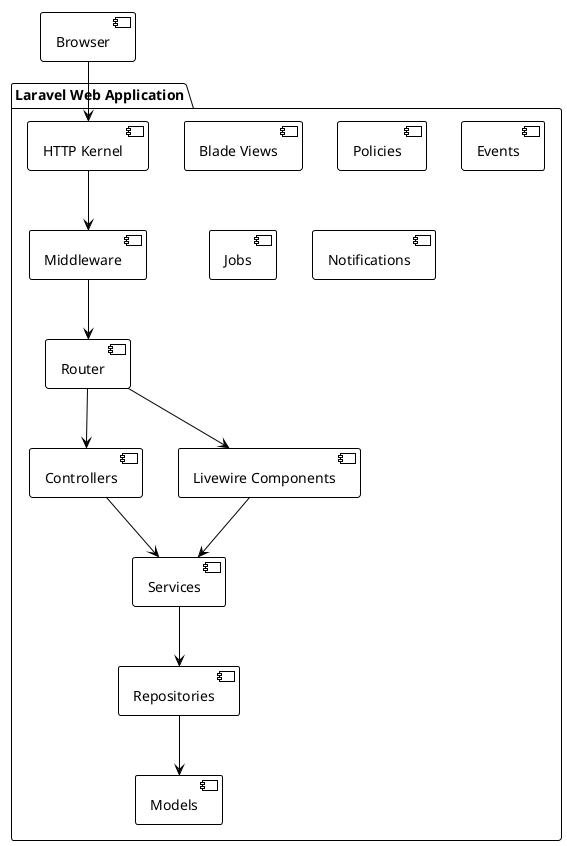

# 05.03.02 - Laravel Web Application Container

**Project:** GsmUi
**Architecture:** C4 Model – Level 2 (Container)
**Container:** Laravel Web Application
**Version:** 1.0.0

---

# Purpose

The Laravel Web Application is the primary runtime container for GsmUi. It hosts the user-facing website, documentation, marketplace, dashboards, APIs, and all business logic.

This container follows a **Modular Monolith** architecture with clear domain boundaries and a service-oriented application layer.

---

# Responsibilities

The Web Application is responsible for:

* HTTP request handling
* Authentication & authorization
* Livewire rendering
* Blade rendering
* Business logic orchestration
* API endpoints
* Documentation delivery
* Component rendering
* Theme management
* Marketplace operations
* Billing workflows
* User dashboards
* Admin interface
* Notifications
* Search integration
* Audit logging

---

# Technology Stack

## Framework

* Laravel 13
* PHP 8.4+

## UI

* Livewire 4
* Blade
* Alpine.js
* Tailwind CSS
* GsmUi Components

## Authentication

* Laravel Fortify
* Laravel Sanctum

## Authorization

* Spatie Permission
* Laravel Policies
* Gates

## Supporting Packages

* Spatie Activitylog
* Spatie Medialibrary
* Laravel Telescope
* Laravel Debugbar
* Larastan
* IDE Helper

---

# High-Level Architecture



---

# Domain Modules

Each business capability is isolated into its own domain.

| Domain        | Purpose               |
| ------------- | --------------------- |
| Auth          | Authentication        |
| Users         | User profiles         |
| Components    | UI library            |
| Docs          | Documentation         |
| Themes        | Theme engine          |
| Playground    | Interactive editor    |
| Templates     | Marketplace templates |
| Billing       | Payments              |
| Blog          | Articles              |
| Showcase      | Community             |
| Search        | Global search         |
| CMS           | Static pages          |
| Notifications | Alerts                |
| Admin         | Administration        |
| Analytics     | Metrics               |

Each module owns:

* Models
* Livewire Components
* Services
* Policies
* Events
* Jobs
* Tests

---

# Request Lifecycle

```text
HTTP Request
      │
HTTP Kernel
      │
Global Middleware
      │
Route Middleware
      │
Route Resolution
      │
Livewire / Controller
      │
Validation
      │
Authorization
      │
Application Service
      │
Repository
      │
Database
      │
Domain Events
      │
Queued Jobs
      │
View Rendering
      │
HTTP Response
```

---

# HTTP Layer

The HTTP layer contains:

* Routes
* Middleware
* Controllers
* Request validation
* Response formatting

Controllers remain thin and delegate business logic to services.

---

# Livewire Layer

Livewire powers the interactive UI.

Responsibilities:

* State management
* Validation
* User interaction
* UI updates
* Form submission

Business logic is delegated to services.

Example:

```php
public function save()
{
    $this->validate();

    $this->themeService->create($this->form);

    $this->dispatch('theme-created');
}
```

---

# Blade Layer

Blade renders:

* Marketing pages
* Documentation
* Email templates
* Layouts
* Shared UI

Blade components wrap reusable GsmUi components.

Example:

```blade
<x-gsm-button />
<x-gsm-card />
<x-gsm-table />
```

---

# Service Layer

Services contain all business logic.

Examples:

```
ComponentService

ThemeService

TemplateService

SubscriptionService

BillingService

DocumentationService

SearchService

AnalyticsService

BlogService
```

Rules:

* Stateless
* Reusable
* Testable
* Framework-independent where practical

---

# Repository Layer

Repositories abstract persistence logic.

Responsibilities:

* Queries
* Filtering
* Pagination
* Transactions
* Persistence

Repositories never contain business rules.

---

# Models

Models represent domain entities.

Examples:

```
User

Component

Theme

Template

BlogPost

Order

Subscription

Showcase

DocumentationPage
```

Models should focus on:

* Relationships
* Casts
* Scopes
* Accessors
* Mutators

---

# Events

Domain events communicate between modules.

Examples:

```
UserRegistered

ThemePublished

TemplatePurchased

SubscriptionActivated

ComponentReleased

ArticlePublished
```

Benefits:

* Loose coupling
* Extensibility
* Async processing

---

# Jobs

Long-running operations execute asynchronously.

Examples:

```
OptimizeImages

GenerateTheme

SendWelcomeEmail

IndexDocumentation

GenerateSearch

CreateInvoice

GenerateStatistics
```

---

# Policies

Every secured resource has a policy.

Examples:

```
ComponentPolicy

ThemePolicy

OrderPolicy

TemplatePolicy

BlogPolicy

ShowcasePolicy
```

Authorization never occurs directly inside views.

---

# Notifications

Notification channels include:

* Database
* Email
* Broadcast (future)
* Webhooks (future)

Examples:

* Purchase completed
* Subscription expiring
* New comment
* Approval request

---

# Validation Strategy

Validation uses:

* Form Requests (Controllers)
* Livewire Validation
* Value Objects (future)

Rules remain centralized and reusable.

---

# Caching

Frequently accessed data is cached.

Examples:

* Navigation
* Documentation
* Themes
* Settings
* Pricing
* Homepage sections

Redis is the primary cache backend.

---

# Search Integration

The application publishes searchable records for:

* Components
* Templates
* Blog
* Documentation
* Showcase

Search indexing occurs asynchronously.

---

# File Handling

Uploads flow through Medialibrary.

Supported assets:

* Images
* Videos
* PDFs
* Downloads
* Avatars
* Merchandise

Files are stored in object storage and served through the CDN.

---

# Error Handling

Centralized exception handling includes:

* Validation errors
* Authorization failures
* Domain exceptions
* External service failures

Errors are logged and transformed into user-friendly responses.

---

# Security

Implemented protections include:

* CSRF
* XSS escaping
* Rate limiting
* Signed URLs
* Password hashing
* Email verification
* Two-factor authentication
* Role-based access
* Permission-based authorization

---

# Performance

Optimizations include:

* Route caching
* Config caching
* View caching
* Lazy-loaded Livewire components
* Eager loading
* Cursor pagination
* Redis caching
* Queued processing

Target metrics:

* TTFB < 200 ms
* Page load < 2 s
* Lighthouse > 95

---

# Logging

Application events are logged for auditing and troubleshooting.

Sources:

* Activity logs
* Authentication events
* Purchases
* Billing
* Admin actions
* Exceptions

---

# Testing

Testing strategy:

* Unit tests for services
* Feature tests for HTTP
* Livewire component tests
* Policy tests
* Integration tests
* Browser tests (future)

Target coverage:

* ≥ 90% for business logic

---

# Deployment Considerations

The application is stateless.

Requirements:

* Shared Redis
* Shared MySQL
* Shared object storage
* Shared cache
* Shared queues

Multiple application instances can run behind a load balancer.

---

# Server-Side Rendering Pipeline

## SSR Architecture

The server-side rendering pipeline transforms Blade templates, Livewire components, and Alpine.js directives into HTML responses delivered to the browser.

```text
┌─────────────────────────────────────────────────────────────┐
│                    SSR Pipeline                               │
├─────────────────────────────────────────────────────────────┤
│                                                              │
│  ┌──────────┐  ┌──────────┐  ┌──────────┐  ┌──────────┐   │
│  │  Route   │  │  Blade   │  │ Livewire │  │ Alpine.js│   │
│  │Resolver  │  │Compiler  │  │ Renderer │  │  Binding │   │
│  └────┬─────┘  └────┬─────┘  └────┬─────┘  └────┬─────┘   │
│       │             │             │             │           │
│       └──────┬──────┴──────┬──────┴──────┬──────┘           │
│              │             │             │                   │
│              ▼             ▼             ▼                   │
│       ┌─────────────────────────────────────────┐           │
│       │          HTML Response Assembly          │           │
│       └─────────────────────────────────────────┘           │
│                       │                                      │
│                       ▼                                      │
│       ┌─────────────────────────────────────────┐           │
│       │        HTTP Response Delivery            │           │
│       └─────────────────────────────────────────┘           │
│                                                              │
└─────────────────────────────────────────────────────────────┘
```

## Blade Compilation Pipeline

### Compilation Stages

```text
Source Template (.blade.php)
    │
    ├── Stage 1: Tokenization
    │   ├── Parse Blade directives (@if, @foreach, etc.)
    │   ├── Identify raw PHP blocks (@php)
    │   ├── Extract component references (<x-gsmui:button>)
    │   └── Detect extends/layouts
    │
    ├── Stage 2: Transformation
    │   ├── Convert directives to PHP control structures
    │   ├── Transform components to class renders
    │   ├── Resolve include/section/show
    │   └── Apply slot content
    │
    ├── Stage 3: Compilation
    │   ├── Generate PHP class file
    │   ├── Add template hash for cache busting
    │   ├── Optimize string concatenation
    │   └── Strip comments in production
    │
    └── Stage 4: Caching
        ├── Store compiled template in bootstrap/cache/views
        ├── Index for fast lookup
        └── Invalidate on file change (based on filemtime)
```

### Blade Compiler Configuration

```php
<?php

namespace App\Providers;

use Illuminate\Support\Facades\Blade;
use Illuminate\View\Compilers\BladeCompiler;
use Illuminate\Support\ServiceProvider;

class BladeServiceProvider extends ServiceProvider
{
    public function register(): void
    {
        $this->app->afterResolving('blade.compiler', function (BladeCompiler $compiler) {
            // Custom directives
            $compiler->directive('datetime', function (string $expression) {
                return "<?php echo \\Carbon\\Carbon::parse($expression)->toIso8601String(); ?>";
            });

            $compiler->directive('feature', function (string $expression) {
                return "<?php if(\\App\\Features\\FeatureFlag::isEnabled($expression, auth()->id())): ?>";
            });

            $compiler->directive('endfeature', function () {
                return "<?php endif; ?>";
            });

            // Component stack
            $compiler->component('gsm-button', \App\View\Components\GsmButton::class);
            $compiler->component('gsm-card', \App\View\Components\GsmCard::class);
            $compiler->component('gsm-table', \App\View\Components\GsmTable::class);
        });
    }
}
```

## Livewire Component Lifecycle

### Component Lifecycle Stages

```text
┌─────────────────────────────────────────────────────────────┐
│              Livewire Component Lifecycle                     │
├─────────────────────────────────────────────────────────────┤
│                                                              │
│  1. Initial Request                                         │
│     ├── Route Resolution                                    │
│     ├── Component Class Instantiation                       │
│     ├── mount() Method                                      │
│     │   ├── Validate Initial Data                           │
│     │   ├── Load Initial State                              │
│     │   └── Set Properties                                  │
│     ├── render() Method                                     │
│     │   ├── Resolve Blade View                              │
│     │   ├── Bind Data to View                               │
│     │   └── Generate HTML                                   │
│     └── Wire Up JavaScript (Alpine.js)                      │
│                                                              │
│  2. Subsequent Requests (AJAX)                              │
│     ├── Receive Snapshot                                    │
│     │   ├── Component Name                                  │
│     │   ├── Component State                                 │
│     │   └── Metadata (checksum, etc.)                       │
│     ├── Hydrate Component                                   │
│     │   ├── Reconstruct Properties                          │
│     │   ├── Restore Internal State                          │
│     │   └── Validate Snapshot Integrity                     │
│     ├── Process Update                                      │
│     │   ├── Identify Trigger (method call / property update)│
│     │   ├── Apply Changes                                   │
│     │   └── Execute Handler                                 │
│     ├── Validation                                          │
│     │   ├── Run Livewire Rules                              │
│     │   ├── Run Custom Rules                                │
│     │   └── Return Validation Errors                        │
│     ├── render() Method                                     │
│     │   ├── Diff HTML with Previous                         │
│     │   └── Generate Minimal Patch                          │
│     └── Return JSON Response                                │
│         ├── Diff Instructions                               │
│         ├── New Snapshot                                    │
│         └── Event Dispatches                                │
│                                                              │
│  3. Browser Patching                                         │
│     ├── Receive JSON Response                               │
│     ├── Apply DOM Diffs                                     │
│     ├── Execute Scripts                                     │
│     ├── Update Snapshot                                     │
│     └── Update Loading States                               │
│                                                              │
└─────────────────────────────────────────────────────────────┘
```

### Livewire Component Implementation

```php
<?php

namespace App\Livewire\Themes;

use App\Actions\Themes\CreateThemeAction;
use App\Data\ThemeData;
use App\Services\ThemeService;
use Livewire\Attributes\Rule;
use Livewire\Component;

class ThemeEditor extends Component
{
    #[Rule('required|string|max:255')]
    public string $name = '';

    #[Rule('required|string|max:1000')]
    public string $description = '';

    #[Rule('required|array|min:1')]
    public array $colors = [];

    public ?int $themeId = null;

    public function mount(?int $id = null): void
    {
        if ($id) {
            $theme = app(ThemeService::class)->find($id);
            $this->themeId = $theme->id;
            $this->name = $theme->name;
            $this->description = $theme->description;
            $this->colors = $theme->colors->toArray();
        }
    }

    public function save(CreateThemeAction $action): void
    {
        $this->validate();

        $themeData = ThemeData::from([
            'name' => $this->name,
            'description' => $this->description,
            'colors' => $this->colors,
        ]);

        if ($this->themeId) {
            $action->update($this->themeId, $themeData);
        } else {
            $theme = $action->execute($themeData);
            $this->themeId = $theme->id;
        }

        $this->dispatch('theme-saved', themeId: $this->themeId);
        session()->flash('success', 'Theme saved successfully.');
    }

    public function addColor(): void
    {
        $this->colors[] = '#000000';
    }

    public function removeColor(int $index): void
    {
        unset($this->colors[$index]);
        $this->colors = array_values($this->colors);
    }

    public function render()
    {
        return view('livewire.themes.theme-editor');
    }
}
```

### Livewire Testing

```php
<?php

namespace Tests\Feature\Livewire;

use App\Livewire\Themes\ThemeEditor;
use Livewire\Livewire;
use Tests\TestCase;

class ThemeEditorTest extends TestCase
{
    public function test_can_render_component(): void
    {
        Livewire::test(ThemeEditor::class)
            ->assertStatus(200);
    }

    public function test_can_update_name(): void
    {
        Livewire::test(ThemeEditor::class)
            ->set('name', 'New Theme')
            ->assertSet('name', 'New Theme');
    }

    public function test_can_save_theme(): void
    {
        Livewire::test(ThemeEditor::class)
            ->set('name', 'Test Theme')
            ->set('description', 'A test theme')
            ->set('colors', ['#ffffff', '#000000'])
            ->call('save')
            ->assertHasNoErrors()
            ->assertDispatched('theme-saved');
    }

    public function test_validates_required_fields(): void
    {
        Livewire::test(ThemeEditor::class)
            ->call('save')
            ->assertHasErrors(['name', 'description', 'colors']);
    }
}
```

## Alpine.js Integration

### Alpine.js Component Pattern

```html
<div x-data="themePreview()" class="theme-preview">
    <div class="preview-header">
        <h3 x-text="name || 'Untitled Theme'"></h3>
        <button @click="togglePreview()" class="btn-sm">
            <span x-text="previewMode ? 'Edit' : 'Preview'"></span>
        </button>
    </div>

    <div class="preview-body" x-show="previewMode" x-transition>
        <template x-for="(color, index) in colors" :key="index">
            <div class="color-swatch"
                 :style="`background-color: ${color}`"
                 @click="selectColor(index)">
            </div>
        </template>
    </div>

    <div class="edit-body" x-show="!previewMode" x-transition>
        <input type="text" x-model="name" placeholder="Theme name" />
        <textarea x-model="description" placeholder="Description"></textarea>

        <template x-for="(color, index) in colors" :key="index">
            <div class="color-editor">
                <input type="color" :value="color"
                       @input="updateColor(index, $event.target.value)" />
                <input type="text" :value="color"
                       @input="updateColor(index, $event.target.value)" />
                <button @click="removeColor(index)">×</button>
            </div>
        </template>

        <button @click="addColor()">Add Color</button>
        <button @click="save()">Save Theme</button>
    </div>

    <div x-show="saving" class="saving-indicator">
        Saving...
    </div>
</div>

<script>
function themePreview() {
    return {
        name: '',
        description: '',
        colors: ['#0ea5e9', '#10b981', '#f59e0b'],
        previewMode: false,
        saving: false,

        togglePreview() {
            this.previewMode = !this.previewMode;
        },

        selectColor(index) {
            this.$wire.set('selectedColorIndex', index);
        },

        updateColor(index, value) {
            this.colors[index] = value;
            this.$wire.set('colors', this.colors);
        },

        addColor() {
            this.colors.push('#000000');
            this.$wire.set('colors', this.colors);
        },

        removeColor(index) {
            this.colors.splice(index, 1);
            this.$wire.set('colors', this.colors);
        },

        async save() {
            this.saving = true;
            try {
                await this.$wire.set('name', this.name);
                await this.$wire.set('description', this.description);
                await this.$wire.set('colors', this.colors);
                await this.$wire.call('save');
            } finally {
                this.saving = false;
            }
        }
    }
}
</script>
```

## Session Management

### Session Configuration

```php
<?php

// config/session.php
return [
    'driver' => env('SESSION_DRIVER', 'redis'),
    'lifetime' => env('SESSION_LIFETIME', 120),
    'expire_on_close' => env('SESSION_EXPIRE_ON_CLOSE', false),
    'encrypt' => env('SESSION_ENCRYPT', true),
    'files' => storage_path('framework/sessions'),
    'connection' => env('SESSION_CONNECTION', 'default'),
    'table' => 'sessions',
    'store' => env('SESSION_STORE', 'default'),
    'lottery' => [2, 100],
    'cookie' => env('SESSION_COOKIE', 'gsmui_session'),
    'path' => '/',
    'domain' => env('SESSION_DOMAIN'),
    'secure' => env('SESSION_SECURE_COOKIE', true),
    'http_only' => true,
    'same_site' => 'lax',
    'partitioned' => false,
];
```

### Session Security

```php
<?php

namespace App\Http\Middleware;

use Closure;
use Illuminate\Http\Request;
use Symfony\Component\HttpFoundation\Response;

class SessionSecurityMiddleware
{
    public function handle(Request $request, Closure $next): Response
    {
        $response = $next($request);

        // Regenerate session after login
        if ($request->session()->regenerated()) {
            $request->session()->regenerate(true);
        }

        // Set secure session cookie
        $response->headers->setCookie(
            $request->session()->cookie()
                ->withSecure(true)
                ->withHttpOnly(true)
                ->withSameSite('lax')
        );

        return $response;
    }
}
```

## CSRF Protection

### CSRF Implementation

```php
<?php

// config/csrf.php
return [
    'except' => [
        'api/*',
        'webhooks/*',
        'sanctum/csrf-cookie',
    ],
];
```

### CSRF Token in Blade

```blade
<form method="POST" action="{{ route('themes.store') }}">
    @csrf

    <input type="text" name="name" value="{{ old('name') }}" />
    @error('name')
        <span class="error">{{ $message }}</span>
    @enderror

    <button type="submit">Save Theme</button>
</form>
```

### CSRF for Livewire

```blade
<div wire:submit.prevent="save">
    <input type="text" wire:model="name" />
    <button type="submit">Save</button>
</div>
```

Livewire automatically includes CSRF tokens in AJAX requests.

## CSP Headers

### CSP Configuration

```php
<?php

// config/csp.php
return [
    'policy' => [
        'default-src' => ['self'],
        'script-src' => ['self', 'unsafe-inline'],
        'style-src' => ['self', 'unsafe-inline'],
        'img-src' => ['self', 'data:', 'https:'],
        'font-src' => ['self'],
        'connect-src' => ['self'],
        'frame-ancestors' => ['none'],
        'base-uri' => ['self'],
        'form-action' => ['self'],
    ],
    'report-uri' => '/csp-report',
    'report-only' => env('CSP_REPORT_ONLY', false),
];
```

### CSP Middleware

```php
<?php

namespace App\Http\Middleware;

use Closure;
use Illuminate\Http\Request;
use Symfony\Component\HttpFoundation\Response;

class CspMiddleware
{
    public function handle(Request $request, Closure $next): Response
    {
        $response = $next($request);

        $policy = config('csp.policy', []);
        $directives = [];

        foreach ($policy as $directive => $sources) {
            $directives[] = $directive . ' ' . implode(' ', $sources);
        }

        $policyString = implode('; ', $directives);

        if (config('csp.report-only', false)) {
            $response->headers->set('Content-Security-Policy-Report-Only', $policyString);
        } else {
            $response->headers->set('Content-Security-Policy', $policyString);
        }

        $response->headers->set('X-Content-Type-Options', 'nosniff');
        $response->headers->set('X-Frame-Options', 'DENY');
        $response->headers->set('X-XSS-Protection', '1; mode=block');
        $response->headers->set('Referrer-Policy', 'strict-origin-when-cross-origin');
        $response->headers->set('Permissions-Policy', 'camera=(), microphone=(), geolocation=()');

        return $response;
    }
}
```

### CSP Nonce Generation

```php
<?php

namespace App\View\Composers;

use Illuminate\Support\Str;
use Illuminate\View\View;

class CspComposer
{
    public function compose(View $view): void
    {
        $nonce = Str::random(32);
        view()->share('csp_nonce', $nonce);
    }
}
```

```blade
{{-- Using CSP nonce in Blade --}}
<script nonce="{{ $csp_nonce }}">
    // Inline script with CSP nonce
</script>

<style nonce="{{ $csp_nonce }}">
    /* Inline style with CSP nonce */
</style>
```

---

# Asset Pipeline

## Vite Configuration

### Vite Build Configuration

```javascript
// vite.config.js
import { defineConfig } from 'vite';
import laravel from 'laravel-vite-plugin';

export default defineConfig({
    plugins: [
        laravel({
            input: [
                'resources/css/app.css',
                'resources/js/app.js',
                'resources/js/editor.js',
            ],
            refresh: true,
        }),
    ],
    build: {
        rollupOptions: {
            output: {
                manualChunks: {
                    'vendor': ['alpinejs', 'livewire'],
                    'editor': ['resources/js/editor.js'],
                },
            },
        },
        chunkSizeWarningLimit: 500,
    },
    resolve: {
        alias: {
            '@': '/resources/js',
            '@components': '/resources/js/components',
        },
    },
});
```

### Asset Loading Strategy

```blade
{{-- resources/views/layouts/app.blade.php --}}
<!DOCTYPE html>
<html lang="{{ str_replace('_', '-', app()->getLocale()) }}">
<head>
    <meta charset="utf-8">
    <meta name="viewport" content="width=device-width, initial-scale=1">
    <meta name="csrf-token" content="{{ csrf_token() }}">

    <title>{{ config('app.name', 'GsmUi') }}</title>

    {{-- Preload critical CSS --}}
    <link rel="preload" href="{{ mix('css/app.css') }}" as="style">

    {{-- Vite assets --}}
    @vite(['resources/css/app.css', 'resources/js/app.js'])

    {{-- CSP nonce --}}
    <meta name="csp-nonce" content="{{ $csp_nonce ?? '' }}">
</head>
<body class="font-sans antialiased bg-white dark:bg-zinc-900">
    {{-- Livewire morph preservation --}}
    @livewire('layouts.navigation')

    <main>
        {{ $slot }}
    </main>

    {{-- Defer non-critical JS --}}
    @stack('scripts')
</body>
</html>
```

### CSS Architecture

```css
/* resources/css/app.css */
@tailwind base;
@tailwind components;
@tailwind utilities;

@layer base {
    :root {
        --gsmui-primary: #0ea5e9;
        --gsmui-secondary: #10b981;
        --gsmui-accent: #f59e0b;
        --gsmui-surface: #ffffff;
        --gsmui-background: #f8fafc;
        --gsmui-text: #0f172a;
        --gsmui-border: #e2e8f0;
    }

    .dark {
        --gsmui-surface: #1e293b;
        --gsmui-background: #0f172a;
        --gsmui-text: #f1f5f9;
        --gsmui-border: #334155;
    }
}

@layer components {
    .gsm-card {
        @apply bg-white dark:bg-zinc-800 rounded-xl border border-zinc-200 dark:border-zinc-700 p-6 shadow-sm;
    }

    .gsm-button-primary {
        @apply inline-flex items-center justify-center px-4 py-2 bg-blue-600 text-white rounded-lg font-medium hover:bg-blue-700 focus:outline-none focus:ring-2 focus:ring-blue-500 focus:ring-offset-2 transition-colors;
    }

    .gsm-input {
        @apply block w-full rounded-lg border-zinc-300 dark:border-zinc-600 bg-white dark:bg-zinc-800 text-zinc-900 dark:text-zinc-100 shadow-sm focus:border-blue-500 focus:ring-blue-500;
    }
}
```

---

# State Management

## Alpine.js State Patterns

### Global State Store

```javascript
// resources/js/stores/app.js
document.addEventListener('alpine:init', () => {
    Alpine.store('app', {
        sidebarOpen: localStorage.getItem('sidebar') === 'true',
        darkMode: localStorage.getItem('darkMode') === 'true',
        notifications: [],
        loading: false,

        toggleSidebar() {
            this.sidebarOpen = !this.sidebarOpen;
            localStorage.setItem('sidebar', this.sidebarOpen);
        },

        toggleDarkMode() {
            this.darkMode = !this.darkMode;
            localStorage.setItem('darkMode', this.darkMode);
            document.documentElement.classList.toggle('dark', this.darkMode);
        },

        addNotification(notification) {
            this.notifications.push({
                id: Date.now(),
                ...notification,
                timestamp: new Date(),
            });

            setTimeout(() => {
                this.removeNotification(notification.id);
            }, 5000);
        },

        removeNotification(id) {
            this.notifications = this.notifications.filter(n => n.id !== id);
        },

        setLoading(value) {
            this.loading = value;
        }
    });
});
```

### Livewire State Management

```php
<?php

namespace App\Livewire\Traits;

trait RemembersState
{
    public function hydrateState(): void
    {
        $cacheKey = "livewire:state:" . $this->id;
        $cached = cache()->get($cacheKey);

        if ($cached) {
            foreach ($cached as $key => $value) {
                if (property_exists($this, $key)) {
                    $this->{$key} = $value;
                }
            }
        }
    }

    public function dehydrateState(): void
    {
        $cacheKey = "livewire:state:" . $this->id;
        $properties = [];

        $reflection = new \ReflectionClass($this);
        foreach ($reflection->getProperties() as $property) {
            if ($property->isPublic() && !$property->isStatic()) {
                $properties[$property->getName()] = $this->{$property->getName()};
            }
        }

        cache()->put($cacheKey, $properties, 3600);
    }
}
```

---

# Error Handling

## Centralized Exception Handling

### Exception Handler

```php
<?php

namespace App\Exceptions;

use Illuminate\Foundation\Exceptions\Handler as ExceptionHandler;
use Illuminate\Database\Eloquent\ModelNotFoundException;
use Symfony\Component\HttpKernel\Exception\NotFoundHttpException;
use Symfony\Component\HttpKernel\Exception\TooManyRequestsHttpException;
use Throwable;

class Handler extends ExceptionHandler
{
    protected $dontFlash = [
        'current_password',
        'password',
        'password_confirmation',
    ];

    public function register(): void
    {
        $this->reportable(function (Throwable $e) {
            //
        });
    }

    public function render($request, Throwable $e)
    {
        if ($request->expectsJson()) {
            return $this->handleApiException($request, $e);
        }

        return parent::render($request, $e);
    }

    private function handleApiException($request, Throwable $e)
    {
        if ($e instanceof ModelNotFoundException) {
            return response()->json([
                'success' => false,
                'message' => 'Resource not found.',
            ], 404);
        }

        if ($e instanceof TooManyRequestsHttpException) {
            return response()->json([
                'success' => false,
                'message' => 'Too many requests. Please try again later.',
            ], 429);
        }

        $statusCode = method_exists($e, 'getStatusCode') ? $e->getStatusCode() : 500;

        return response()->json([
            'success' => false,
            'message' => config('app.debug') ? $e->getMessage() : 'An error occurred.',
            'trace' => config('app.debug') ? $e->getTrace() : null,
        ], $statusCode);
    }
}
```

### Error Response Formatter

```php
<?php

namespace App\Support;

use Symfony\Component\HttpFoundation\Response;

class ErrorResponse
{
    public static function validation(array $errors): Response
    {
        return response()->json([
            'success' => false,
            'message' => 'Validation failed.',
            'errors' => $errors,
        ], 422);
    }

    public static function notFound(string $resource = 'Resource'): Response
    {
        return response()->json([
            'success' => false,
            'message' => "{$resource} not found.",
        ], 404);
    }

    public static function forbidden(string $message = 'Unauthorized'): Response
    {
        return response()->json([
            'success' => false,
            'message' => $message,
        ], 403);
    }

    public static function conflict(string $message): Response
    {
        return response()->json([
            'success' => false,
            'message' => $message,
        ], 409);
    }

    public static function serverError(string $message = 'An error occurred'): Response
    {
        return response()->json([
            'success' => false,
            'message' => config('app.debug') ? $message : 'An error occurred.',
        ], 500);
    }
}
```

---

# Rate Limiting

## Application-Level Rate Limiting

### Rate Limit Middleware

```php
<?php

namespace App\Http\Middleware;

use Closure;
use Illuminate\Http\Request;
use Illuminate\Support\Facades\RateLimiter;
use Symfony\Component\HttpFoundation\Response;

class RateLimitMiddleware
{
    public function handle(Request $request, Closure $next, string $limit = 'default'): Response
    {
        $key = $this->resolveRateLimitKey($request);
        $maxAttempts = $this->getMaxAttempts($limit);

        if (RateLimiter::tooManyAttempts($key, $maxAttempts)) {
            $retryAfter = RateLimiter::availableIn($key);

            return response()->json([
                'success' => false,
                'message' => 'Too many requests.',
                'retry_after' => $retryAfter,
            ], 429, [
                'Retry-After' => $retryAfter,
                'X-RateLimit-Limit' => $maxAttempts,
                'X-RateLimit-Remaining' => 0,
            ]);
        }

        RateLimiter::hit($key, 60);

        $response = $next($request);

        $remaining = $maxAttempts - RateLimiter::attempts($key);
        $response->headers->set('X-RateLimit-Limit', $maxAttempts);
        $response->headers->set('X-RateLimit-Remaining', max(0, $remaining));

        return $response;
    }

    private function resolveRateLimitKey(Request $request): string
    {
        return $request->user()?->id
            ? "rate_limit:user:{$request->user()->id}"
            : "rate_limit:ip:{$request->ip()}";
    }

    private function getMaxAttempts(string $limit): int
    {
        return match($limit) {
            'auth' => 5,
            'search' => 30,
            'api' => 120,
            'upload' => 10,
            default => 60,
        };
    }
}
```

---

# File Handling

## Upload Pipeline

### File Upload Service

```php
<?php

namespace App\Services;

use Illuminate\Http\UploadedFile;
use Illuminate\Support\Facades\Storage;
use Spatie\MediaLibrary\MediaCollections\Models\Media;

class FileUploadService
{
    private array $diskConfig = [
        'default' => 's3',
        'public' => 's3-public',
        'private' => 's3-private',
    ];

    public function upload(UploadedFile $file, string $collection = 'default', array $options = []): Media
    {
        $this->validateFile($file, $options);

        $model = $this->getModelForCollection($collection);

        return $model->addMedia($file)
            ->usingName($file->getClientOriginalName())
            ->usingFileName($this->generateFileName($file))
            ->toMediaCollection($collection, $this->diskConfig['default']);
    }

    public function getTemporaryUrl(Media $media, int $expirationMinutes = 60): string
    {
        return Storage::disk($media->disk)
            ->temporaryUrl($media->path, now()->addMinutes($expirationMinutes));
    }

    public function delete(Media $media): bool
    {
        return $media->delete();
    }

    private function validateFile(UploadedFile $file, array $options): void
    {
        $maxSize = $options['max_size'] ?? config('filesystems.max_upload_size', 10 * 1024 * 1024);
        $allowedTypes = $options['allowed_types'] ?? ['image/jpeg', 'image/png', 'image/gif', 'image/webp'];

        if ($file->getSize() > $maxSize) {
            throw new \InvalidArgumentException('File size exceeds maximum allowed size.');
        }

        if (!in_array($file->getMimeType(), $allowedTypes)) {
            throw new \InvalidArgumentException('File type not allowed.');
        }
    }

    private function generateFileName(UploadedFile $file): string
    {
        return uniqid() . '_' . time() . '.' . $file->getClientOriginalExtension();
    }
}
```

---

# Performance Optimization

## Caching Strategies

### Multi-Layer Caching

```php
<?php

namespace App\Services;

use Illuminate\Support\Facades\Cache;
use Illuminate\Support\Facades\Redis;

class MultiLayerCacheService
{
    private int $l1Ttl = 60;       // In-memory cache (1 minute)
    private int $l2Ttl = 300;      // Redis cache (5 minutes)
    private int $l3Ttl = 3600;     // Database cache (1 hour)

    public function get(string $key, callable $callback, array $options = []): mixed
    {
        $l1Ttl = $options['l1_ttl'] ?? $this->l1Ttl;
        $l2Ttl = $options['l2_ttl'] ?? $this->l2Ttl;

        // L1: In-memory
        $value = Cache::get($key);
        if ($value !== null) {
            return $value;
        }

        // L2: Redis
        $value = Redis::get("cache:{$key}");
        if ($value !== null) {
            Cache::put($key, $value, $l1Ttl);
            return $value;
        }

        // L3: Database / Source
        $value = $callback();

        // Store in all layers
        Cache::put($key, $value, $l1Ttl);
        Redis::setex("cache:{$key}", $l2Ttl, $value);

        return $value;
    }

    public function invalidate(string $key): void
    {
        Cache::forget($key);
        Redis::del("cache:{$key}");
    }

    public function invalidatePattern(string $pattern): void
    {
        $keys = Cache::getRedis()->keys($pattern);
        foreach ($keys as $key) {
            $this->invalidate($key);
        }
    }
}
```

### Query Result Caching

```php
<?php

namespace App\Repositories;

use App\Services\MultiLayerCacheService;

class CachedComponentRepository extends ComponentRepository
{
    public function __construct(
        private MultiLayerCacheService $cache
    ) {}

    public function getPopular(int $limit = 15): Collection
    {
        $key = "components:popular:{$limit}";

        return $this->cache->get($key, fn () => parent::getPopular($limit));
    }

    public function findById(int $id): ?Component
    {
        $key = "components:{$id}";

        return $this->cache->get($key, fn () => parent::findById($id));
    }

    public function save(Component $component): Component
    {
        $result = parent::save($component);

        $this->invalidateCache($component);

        return $result;
    }

    private function invalidateCache(Component $component): void
    {
        $this->cache->invalidate("components:{$component->id}");
        $this->cache->invalidatePattern("components:popular:*");
        $this->cache->invalidatePattern("components:category:*");
    }
}
```

---

# Logging

## Structured Logging

### Log Channels Configuration

```php
<?php

// config/logging.php
return [
    'default' => env('LOG_CHANNEL', 'stack'),

    'channels' => [
        'stack' => [
            'driver' => 'stack',
            'channels' => ['daily', 'slack'],
            'ignore_exceptions' => false,
        ],

        'daily' => [
            'driver' => 'daily',
            'path' => storage_path('logs/laravel.log'),
            'level' => env('LOG_LEVEL', 'debug'),
            'days' => 14,
        ],

        'api' => [
            'driver' => 'daily',
            'path' => storage_path('logs/api.log'),
            'level' => 'info',
            'days' => 30,
        ],

        'slow_queries' => [
            'driver' => 'daily',
            'path' => storage_path('logs/slow-queries.log'),
            'level' => 'warning',
            'days' => 14,
        ],

        'audit' => [
            'driver' => 'daily',
            'path' => storage_path('logs/audit.log'),
            'level' => 'info',
            'days' => 90,
        ],

        'slack' => [
            'driver' => 'slack',
            'url' => env('LOG_SLACK_WEBHOOK_URL'),
            'username' => 'GsmUi Logger',
            'emoji' => ':boom:',
            'level' => env('LOG_SLACK_LEVEL', 'critical'),
        ],
    ],
];
```

### Request Lifecycle Logger

```php
<?php

namespace App\Support;

use Illuminate\Support\Facades\Log;

class RequestLogger
{
    public static function logRequest(array $data): void
    {
        Log::channel('api')->info('Request', [
            'method' => $data['method'],
            'path' => $data['path'],
            'user_id' => $data['user_id'] ?? null,
            'ip' => $data['ip'],
            'user_agent' => $data['user_agent'],
        ]);
    }

    public static function logResponse(array $data): void
    {
        Log::channel('api')->info('Response', [
            'method' => $data['method'],
            'path' => $data['path'],
            'status' => $data['status'],
            'duration_ms' => $data['duration_ms'],
        ]);
    }

    public static function logSlowQuery(string $sql, float $time, array $bindings = []): void
    {
        Log::channel('slow_queries')->warning('Slow query', [
            'sql' => $sql,
            'time_ms' => $time,
            'bindings' => $bindings,
        ]);
    }

    public static function logAudit(string $event, int $userId, array $data = []): void
    {
        Log::channel('audit')->info($event, [
            'user_id' => $userId,
            'data' => $data,
            'ip' => request()->ip(),
        ]);
    }
}
```

---

# Queue Workers & Background Jobs

## Job Architecture

```text
┌─────────────────────────────────────────────────────────────┐
│                    Job Processing Architecture                │
├─────────────────────────────────────────────────────────────┤
│                                                              │
│  ┌──────────┐    ┌──────────┐    ┌──────────┐             │
│  │  Trigger  │    │  Queue   │    │  Worker  │             │
│  │          │    │          │    │          │             │
│  │  Event   │───▶│  Redis   │───▶│  Horizon │             │
│  │  Command │    │  List    │    │  Process │             │
│  │  Schedule│    │          │    │          │             │
│  └──────────┘    └──────────┘    └──────────┘             │
│                                       │                     │
│                                       ▼                     │
│                                ┌──────────┐                │
│                                │  Handler  │                │
│                                │          │                │
│                                │  Process │                │
│                                │  Retry   │                │
│                                │  Log     │                │
│                                └──────────┘                │
│                                                              │
└─────────────────────────────────────────────────────────────┘
```

## Horizon Configuration

```php
<?php

// config/horizon.php
return [
    'environments' => [
        'production' => [
            'supervisor-1' => [
                'connection' => 'redis',
                'balance' => 'auto',
                'autoScalingStrategy' => 'time',
                'maxProcesses' => 10,
                'maxTime' => 3600,
                'maxJobs' => 1000,
                'memory' => 128,
                'tries' => 3,
                'timeout' => 60,
                'nice' => 0,
            ],
        ],
        'local' => [
            'supervisor-1' => [
                'connection' => 'redis',
                'balance' => 'auto',
                'maxProcesses' => 3,
                'maxTime' => 3600,
                'maxJobs' => 1000,
                'memory' => 128,
                'tries' => 3,
                'timeout' => 60,
            ],
        ],
    ],
];
```

## Job Implementation Patterns

### Image Processing Job

```php
<?php

namespace App\Jobs;

use App\Models\Theme;
use Illuminate\Bus\Queueable;
use Illuminate\Contracts\Queue\ShouldQueue;
use Illuminate\Foundation\Bus\Dispatchable;
use Illuminate\Queue\InteractsWithQueue;
use Illuminate\Queue\SerializesModels;
use Intervention\Image\ImageManagerStatic as Image;

class ProcessThemeImagesJob implements ShouldQueue
{
    use Dispatchable, InteractsWithQueue, Queueable, SerializesModels;

    public int $tries = 3;
    public int $timeout = 120;
    public int $backoff = 60;

    public function __construct(
        public int $themeId
    ) {}

    public function handle(): void
    {
        $theme = Theme::findOrFail($this->themeId);

        foreach ($theme->getMedia('images') as $media) {
            $this->processImage($media);
        }

        $theme->update(['images_processed' => true]);
    }

    private function processImage($media): void
    {
        $image = Image::make($media->getPath());

        // Generate thumbnails
        $thumb = $image->fit(300, 200)->encode('webp', 85);
        $media->addMediaFromBase64(base64_encode($thumb))
            ->usingName('thumbnail')
            ->toMediaCollection('thumbnails');

        // Generate preview
        $preview = $image->fit(800, 600)->encode('webp', 80);
        $media->addMediaFromBase64(base64_encode($preview))
            ->usingName('preview')
            ->toMediaCollection('previews');
    }

    public function failed(\Throwable $exception): void
    {
        logger()->error('Theme image processing failed', [
            'theme_id' => $this->themeId,
            'error' => $exception->getMessage(),
        ]);
    }
}
```

### Search Indexing Job

```php
<?php

namespace App\Jobs;

use App\Services\SearchService;
use Illuminate\Bus\Queueable;
use Illuminate\Contracts\Queue\ShouldQueue;
use Illuminate\Foundation\Bus\Dispatchable;
use Illuminate\Queue\InteractsWithQueue;

class IndexSearchableRecordJob implements ShouldQueue
{
    use Dispatchable, InteractsWithQueue, Queueable;

    public int $tries = 3;
    public int $timeout = 30;

    public function __construct(
        public string $type,
        public int $id,
        public string $action = 'index'
    ) {}

    public function handle(SearchService $search): void
    {
        match ($this->action) {
            'index' => $search->index($this->type, $this->id),
            'remove' => $search->remove($this->type, $this->id),
            'update' => $search->update($this->type, $this->id),
        };
    }
}
```

## Scheduled Tasks

```php
<?php

// app/Console/Kernel.php
class Kernel extends ConsoleKernel
{
    protected function schedule(Schedule $schedule): void
    {
        // Database cleanup
        $schedule->command('auth:clear-resets')->daily();
        $schedule->command('queue:prune-batches --hours=48')->daily();
        $schedule->command('queue:failed-table:prune --hours=168')->daily();

        // Search indexing
        $schedule->job(new SyncSearchIndexesJob)->hourly();

        // Analytics aggregation
        $schedule->command('analytics:aggregate')->dailyAt('02:00');

        // Backup
        $schedule->command('backup:run --only-db')->dailyAt('03:00');
        $schedule->command('backup:clean')->dailyAt('04:00');

        // Health checks
        $schedule->command('health:check')->everyFiveMinutes();

        // Cache warming
        $schedule->command('cache:warm-navigation')->everyFifteenMinutes();
        $schedule->command('cache:warm-components')->everyFifteenMinutes();
    }
}
```

---

# Event Broadcasting

## Broadcasting Configuration

### Broadcast Driver Setup

```php
<?php

// config/broadcasting.php
return [
    'default' => env('BROADCAST_DRIVER', 'pusher'),

    'connections' => [
        'pusher' => [
            'driver' => 'pusher',
            'key' => env('PUSHER_APP_KEY'),
            'secret' => env('PUSHER_APP_SECRET'),
            'app_id' => env('PUSHER_APP_ID'),
            'options' => [
                'host' => env('PUSHER_HOST', 'api-' . env('PUSHER_APP_CLUSTER', 'mt1') . '.pusher.com'),
                'port' => env('PUSHER_PORT', 443),
                'scheme' => env('PUSHER_SCHEME', 'https'),
                'useTLS' => true,
            ],
        ],

        'ably' => [
            'driver' => 'ably',
            'key' => env('ABLY_KEY'),
        ],

        'redis' => [
            'driver' => 'redis',
            'connection' => 'default',
        ],

        'log' => [
            'driver' => 'log',
        ],

        'null' => [
            'driver' => 'null',
        ],
    ],
];
```

### Channel Definitions

```javascript
// resources/js/broadcast.js
import Echo from 'laravel-echo';
import Pusher from 'pusher-js';

window.Pusher = Pusher;

window.Echo = new Echo({
    broadcaster: 'pusher',
    key: import.meta.env.VITE_PUSHER_APP_KEY,
    cluster: import.meta.env.VITE_PUSHER_APP_CLUSTER,
    forceTLS: true,
    encrypted: true,
});

// Private channels
window.Echo.private(`user.${userId}`)
    .listen('NotificationReceived', (e) => {
        console.log('New notification:', e);
    });

// Presence channels
window.Echo.join('components')
    .here((users) => {
        console.log('Users viewing components:', users);
    })
    .joining((user) => {
        console.log('User joined:', user);
    })
    .leaving((user) => {
        console.log('User left:', user);
    })
    .listen('ComponentUpdated', (e) => {
        console.log('Component updated:', e);
    });
```

### Broadcast Events

```php
<?php

namespace App\Events;

use App\Models\Component;
use Illuminate\Broadcasting\Channel;
use Illuminate\Broadcasting\InteractsWithSockets;
use Illuminate\Contracts\Broadcasting\ShouldBroadcast;
use Illuminate\Foundation\Events\Dispatchable;
use Illuminate\Queue\SerializesModels;

class ComponentUpdated implements ShouldBroadcast
{
    use Dispatchable, InteractsWithSockets, SerializesModels;

    public function __construct(
        public readonly Component $component,
        public readonly string $action,
        public readonly array $changes
    ) {}

    public function broadcastOn(): array
    {
        return [
            new Channel('components'),
            new Channel("component.{$this->component->id}"),
        ];
    }

    public function broadcastAs(): string
    {
        return 'ComponentUpdated';
    }

    public function broadcastWith(): array
    {
        return [
            'id' => $this->component->id,
            'name' => $this->component->name,
            'action' => $this->action,
            'changes' => $this->changes,
            'updated_at' => $this->component->updated_at->toIso8601String(),
        ];
    }
}
```

### Livewire Broadcast Integration

```php
<?php

namespace App\Livewire;

use Livewire\Component;

class RealTimeDashboard extends Component
{
    public array $activeUsers = [];
    public int $totalViews = 0;

    protected $listeners = [
        'component.updated' => 'refreshDashboard',
        'user.activity' => 'updateActivity',
    ];

    public function boot(): void
    {
        $this->onModelChanged('Component', function ($model) {
            $this->dispatch('component.updated', [
                'id' => $model->id,
                'name' => $model->name,
            ]);
        });
    }

    public function refreshDashboard(array $data): void
    {
        $this->totalViews = $this->calculateTotalViews();
        $this->activeUsers = $this->getActiveUsers();
    }

    public function updateActivity(array $data): void
    {
        // Handle real-time activity updates
    }

    public function render()
    {
        return view('livewire.real-time-dashboard');
    }
}
```

---

# HTTP Client Integration

## API Client Service

```php
<?php

namespace App\Services;

use Illuminate\Http\Client\PendingRequest;
use Illuminate\Http\Client\Response;
use Illuminate\Support\Facades\Http;
use Illuminate\Support\Facades\Cache;

class ExternalApiService
{
    private PendingRequest $client;

    public function __construct()
    {
        $this->client = Http::withHeaders([
            'Accept' => 'application/json',
            'Content-Type' => 'application/json',
        ])->timeout(30)->retry(3, 1000);
    }

    public function get(string $url, array $params = []): Response
    {
        $cacheKey = 'api:' . md5($url . json_encode($params));

        return Cache::remember($cacheKey, 300, function () use ($url, $params) {
            return $this->client->get($url, $params);
        });
    }

    public function post(string $url, array $data = []): Response
    {
        return $this->client->post($url, $data);
    }

    public function put(string $url, array $data = []): Response
    {
        return $this->client->put($url, $data);
    }

    public function delete(string $url): Response
    {
        return $this->client->delete($url);
    }
}
```

---

# Queue Workers & Background Jobs

## Job Architecture

```text
┌─────────────────────────────────────────────────────────────┐
│                    Job Processing Architecture                │
├─────────────────────────────────────────────────────────────┤
│                                                              │
│  ┌──────────┐    ┌──────────┐    ┌──────────┐             │
│  │  Trigger  │    │  Queue   │    │  Worker  │             │
│  │          │    │          │    │          │             │
│  │  Event   │───▶│  Redis   │───▶│  Horizon │             │
│  │  Command │    │  List    │    │  Process │             │
│  │  Schedule│    │          │    │          │             │
│  └──────────┘    └──────────┘    └──────────┘             │
│                                       │                     │
│                                       ▼                     │
│                                ┌──────────┐                │
│                                │  Handler  │                │
│                                │          │                │
│                                │  Process │                │
│                                │  Retry   │                │
│                                │  Log     │                │
│                                └──────────┘                │
│                                                              │
└─────────────────────────────────────────────────────────────┘
```

## Horizon Configuration

```php
<?php

// config/horizon.php
return [
    'environments' => [
        'production' => [
            'supervisor-1' => [
                'connection' => 'redis',
                'balance' => 'auto',
                'autoScalingStrategy' => 'time',
                'maxProcesses' => 10,
                'maxTime' => 3600,
                'maxJobs' => 1000,
                'memory' => 128,
                'tries' => 3,
                'timeout' => 60,
                'nice' => 0,
            ],
        ],
        'local' => [
            'supervisor-1' => [
                'connection' => 'redis',
                'balance' => 'auto',
                'maxProcesses' => 3,
                'maxTime' => 3600,
                'maxJobs' => 1000,
                'memory' => 128,
                'tries' => 3,
                'timeout' => 60,
            ],
        ],
    ],
];
```

## Job Implementation Patterns

### Image Processing Job

```php
<?php

namespace App\Jobs;

use App\Models\Theme;
use Illuminate\Bus\Queueable;
use Illuminate\Contracts\Queue\ShouldQueue;
use Illuminate\Foundation\Bus\Dispatchable;
use Illuminate\Queue\InteractsWithQueue;
use Illuminate\Queue\SerializesModels;
use Intervention\Image\ImageManagerStatic as Image;

class ProcessThemeImagesJob implements ShouldQueue
{
    use Dispatchable, InteractsWithQueue, Queueable, SerializesModels;

    public int $tries = 3;
    public int $timeout = 120;
    public int $backoff = 60;

    public function __construct(
        public int $themeId
    ) {}

    public function handle(): void
    {
        $theme = Theme::findOrFail($this->themeId);

        foreach ($theme->getMedia('images') as $media) {
            $this->processImage($media);
        }

        $theme->update(['images_processed' => true]);
    }

    private function processImage($media): void
    {
        $image = Image::make($media->getPath());

        // Generate thumbnails
        $thumb = $image->fit(300, 200)->encode('webp', 85);
        $media->addMediaFromBase64(base64_encode($thumb))
            ->usingName('thumbnail')
            ->toMediaCollection('thumbnails');

        // Generate preview
        $preview = $image->fit(800, 600)->encode('webp', 80);
        $media->addMediaFromBase64(base64_encode($preview))
            ->usingName('preview')
            ->toMediaCollection('previews');
    }

    public function failed(\Throwable $exception): void
    {
        logger()->error('Theme image processing failed', [
            'theme_id' => $this->themeId,
            'error' => $exception->getMessage(),
        ]);
    }
}
```

### Search Indexing Job

```php
<?php

namespace App\Jobs;

use App\Services\SearchService;
use Illuminate\Bus\Queueable;
use Illuminate\Contracts\Queue\ShouldQueue;
use Illuminate\Foundation\Bus\Dispatchable;
use Illuminate\Queue\InteractsWithQueue;

class IndexSearchableRecordJob implements ShouldQueue
{
    use Dispatchable, InteractsWithQueue, Queueable;

    public int $tries = 3;
    public int $timeout = 30;

    public function __construct(
        public string $type,
        public int $id,
        public string $action = 'index'
    ) {}

    public function handle(SearchService $search): void
    {
        match ($this->action) {
            'index' => $search->index($this->type, $this->id),
            'remove' => $search->remove($this->type, $this->id),
            'update' => $search->update($this->type, $this->id),
        };
    }
}
```

## Scheduled Tasks

```php
<?php

// app/Console/Kernel.php
class Kernel extends ConsoleKernel
{
    protected function schedule(Schedule $schedule): void
    {
        // Database cleanup
        $schedule->command('auth:clear-resets')->daily();
        $schedule->command('queue:prune-batches --hours=48')->daily();
        $schedule->command('queue:failed-table:prune --hours=168')->daily();

        // Search indexing
        $schedule->job(new SyncSearchIndexesJob)->hourly();

        // Analytics aggregation
        $schedule->command('analytics:aggregate')->dailyAt('02:00');

        // Backup
        $schedule->command('backup:run --only-db')->dailyAt('03:00');
        $schedule->command('backup:clean')->dailyAt('04:00');

        // Health checks
        $schedule->command('health:check')->everyFiveMinutes();

        // Cache warming
        $schedule->command('cache:warm-navigation')->everyFifteenMinutes();
        $schedule->command('cache:warm-components')->everyFifteenMinutes();
    }
}
```

---

# Event Broadcasting

## Broadcasting Configuration

### Broadcast Driver Setup

```php
<?php

// config/broadcasting.php
return [
    'default' => env('BROADCAST_DRIVER', 'pusher'),

    'connections' => [
        'pusher' => [
            'driver' => 'pusher',
            'key' => env('PUSHER_APP_KEY'),
            'secret' => env('PUSHER_APP_SECRET'),
            'app_id' => env('PUSHER_APP_ID'),
            'options' => [
                'host' => env('PUSHER_HOST', 'api-' . env('PUSHER_APP_CLUSTER', 'mt1') . '.pusher.com'),
                'port' => env('PUSHER_PORT', 443),
                'scheme' => env('PUSHER_SCHEME', 'https'),
                'useTLS' => true,
            ],
        ],

        'redis' => [
            'driver' => 'redis',
            'connection' => 'default',
        ],

        'log' => [
            'driver' => 'log',
        ],

        'null' => [
            'driver' => 'null',
        ],
    ],
];
```

### Channel Definitions

```javascript
// resources/js/broadcast.js
import Echo from 'laravel-echo';
import Pusher from 'pusher-js';

window.Pusher = Pusher;

window.Echo = new Echo({
    broadcaster: 'pusher',
    key: import.meta.env.VITE_PUSHER_APP_KEY,
    cluster: import.meta.env.VITE_PUSHER_APP_CLUSTER,
    forceTLS: true,
    encrypted: true,
});

// Private channels
window.Echo.private(`user.${userId}`)
    .listen('NotificationReceived', (e) => {
        console.log('New notification:', e);
    });

// Presence channels
window.Echo.join('components')
    .here((users) => {
        console.log('Users viewing components:', users);
    })
    .joining((user) => {
        console.log('User joined:', user);
    })
    .leaving((user) => {
        console.log('User left:', user);
    })
    .listen('ComponentUpdated', (e) => {
        console.log('Component updated:', e);
    });
```

### Broadcast Events

```php
<?php

namespace App\Events;

use App\Models\Component;
use Illuminate\Broadcasting\Channel;
use Illuminate\Broadcasting\InteractsWithSockets;
use Illuminate\Contracts\Broadcasting\ShouldBroadcast;
use Illuminate\Foundation\Events\Dispatchable;
use Illuminate\Queue\SerializesModels;

class ComponentUpdated implements ShouldBroadcast
{
    use Dispatchable, InteractsWithSockets, SerializesModels;

    public function __construct(
        public readonly Component $component,
        public readonly string $action,
        public readonly array $changes
    ) {}

    public function broadcastOn(): array
    {
        return [
            new Channel('components'),
            new Channel("component.{$this->component->id}"),
        ];
    }

    public function broadcastAs(): string
    {
        return 'ComponentUpdated';
    }

    public function broadcastWith(): array
    {
        return [
            'id' => $this->component->id,
            'name' => $this->component->name,
            'action' => $this->action,
            'changes' => $this->changes,
            'updated_at' => $this->component->updated_at->toIso8601String(),
        ];
    }
}
```

### Livewire Broadcast Integration

```php
<?php

namespace App\Livewire;

use Livewire\Component;

class RealTimeDashboard extends Component
{
    public array $activeUsers = [];
    public int $totalViews = 0;

    protected $listeners = [
        'component.updated' => 'refreshDashboard',
        'user.activity' => 'updateActivity',
    ];

    public function boot(): void
    {
        $this->onModelChanged('Component', function ($model) {
            $this->dispatch('component.updated', [
                'id' => $model->id,
                'name' => $model->name,
            ]);
        });
    }

    public function refreshDashboard(array $data): void
    {
        $this->totalViews = $this->calculateTotalViews();
        $this->activeUsers = $this->getActiveUsers();
    }

    public function updateActivity(array $data): void
    {
        // Handle real-time activity updates
    }

    public function render()
    {
        return view('livewire.real-time-dashboard');
    }
}
```

---

# HTTP Client Integration

## API Client Service

```php
<?php

namespace App\Services;

use Illuminate\Http\Client\PendingRequest;
use Illuminate\Http\Client\Response;
use Illuminate\Support\Facades\Http;
use Illuminate\Support\Facades\Cache;

class ExternalApiService
{
    private PendingRequest $client;

    public function __construct()
    {
        $this->client = Http::withHeaders([
            'Accept' => 'application/json',
            'Content-Type' => 'application/json',
        ])->timeout(30)->retry(3, 1000);
    }

    public function get(string $url, array $params = []): Response
    {
        $cacheKey = 'api:' . md5($url . json_encode($params));

        return Cache::remember($cacheKey, 300, function () use ($url, $params) {
            return $this->client->get($url, $params);
        });
    }

    public function post(string $url, array $data = []): Response
    {
        return $this->client->post($url, $data);
    }

    public function put(string $url, array $data = []): Response
    {
        return $this->client->put($url, $data);
    }

    public function delete(string $url): Response
    {
        return $this->client->delete($url);
    }
}
```

---

# Future Evolution

The modular structure allows domains to be extracted into independent services without major changes to the public interfaces.

Candidate future services:

* Billing
* Search
* AI
* MCP
* Analytics
* Notifications

---

# Summary

The Laravel Web Application serves as the central execution environment for GsmUi. By combining Laravel 13, Livewire 4, a service-oriented architecture, and modular domain boundaries, it provides a scalable foundation that balances rapid development with long-term maintainability and future growth.

---

# Objectives

| Objective | Description |
|-----------|-------------|
| Unified Runtime | Single container hosting all GsmUi business capabilities |
| Modular Monolith | Clear domain boundaries with shared infrastructure |
| API-First | Every business capability exposed via REST API |
| Interactive UI | Livewire 4 for real-time user interactions |
| Extensibility | Plugin-ready architecture for future modules |
| Performance | TTFB <200ms, Lighthouse >95 |
| Security | CSRF, XSS, RBAC, 2FA, audit logging |
| Scalability | Stateless design behind load balancer |

---

# Timeline

| Phase | Duration | Deliverable |
|-------|----------|-------------|
| Core Framework | Weeks 1–2 | Laravel 13 scaffold, Livewire setup |
| Domain Modules | Weeks 3–6 | All 15 domain modules with models, services, repos |
| Authentication | Week 7 | Fortify, Sanctum, 2FA |
| API Layer | Weeks 8–9 | REST endpoints, resources, documentation |
| CMS & Blog | Weeks 10–11 | Content management, blog engine |
| Billing Integration | Weeks 12–14 | Stripe/Paddle, subscriptions, orders |
| Marketplace | Weeks 15–16 | Product listing, reviews, downloads |
| Testing & QA | Weeks 17–18 | Feature tests, Livewire tests, browser tests |
| Performance Tuning | Week 19 | Caching, eager loading, query optimization |
| Production Deploy | Week 20 | Live deployment, monitoring setup |

---

# Budget

| Item | Cost | Notes |
|------|------|-------|
| Application Servers | $200/month | 2x t3.medium (or equivalent) |
| Load Balancer | $25/month | AWS ALB |
| Redis (shared) | $50/month | Cache, queues, sessions |
| Object Storage | $20/month | S3-compatible, media files |
| CDN | $30/month | Static assets, images |
| Monitoring | $50/month | Telescope, Grafana, alerts |
| CI/CD | $20/month | GitHub Actions |
| Total Monthly | ~$395/month | MVP infrastructure |

---

# Risk

| Risk | Impact | Likelihood | Mitigation |
|------|--------|------------|------------|
| Module coupling breaking boundaries | High | Medium | Enforce domain boundaries via tests |
| Livewire state complexity | Medium | Medium | Controllable mixin, detangle() pattern |
| Performance degradation under load | High | Medium | Caching, eager loading, queue offloading |
| Security vulnerability in dependencies | High | Low | Dependabot, automated scanning |
| Deployment downtime | Medium | Low | Zero-downtime deploys, queue workers |
| Data consistency across modules | High | Low | Transaction boundaries in Action layer |
| Third-party service outage | Medium | Medium | Graceful degradation, retry logic |
| Memory leak in long-running workers | Medium | Low | Horizon memory limits, restart thresholds |

---

# Security

Implemented protections:

* CSRF token verification on all state-changing requests
* XSS escaping on all Blade output
* Rate limiting on authentication and sensitive endpoints
* Signed URLs for file downloads
* Password hashing with Argon2id
* Email verification for new accounts
* Two-factor authentication via Fortify
* Role-based access control via Spatie Permission
* Permission-based authorization via Gates and Policies
* Activity logging for audit trails
* Dependency vulnerability scanning

---

# Testing

Testing strategy:

| Test Type | Coverage Target | Framework |
|-----------|----------------|-----------|
| Unit tests (services) | ≥90% | PHPUnit |
| Feature tests (HTTP) | ≥85% | PHPUnit |
| Livewire component tests | ≥85% | Livewire Testing |
| Policy tests | 100% | PHPUnit |
| Integration tests | ≥80% | PHPUnit |
| Browser tests (future) | Critical paths | Playwright |

Quality gates:

* All tests must pass before merge
* Code coverage reported on every PR
* Static analysis via Larastan (level 8 target)
* No security vulnerabilities in dependencies

---

# Performance

| Metric | Target | Strategy |
|--------|--------|----------|
| TTFB | <200 ms | Route/config caching, eager loading |
| Page Load | <2 s | Asset optimization, CDN |
| Lighthouse Score | >95 | Performance budget |
| API Response | <200 ms | Repository optimization |
| Queue Job Processing | <5s avg | Horizon workers, retry logic |

Optimizations:

* Route caching in production
* Config caching
* View precompilation
* Lazy-loaded Livewire components
* Eloquent eager loading (no N+1)
* Cursor pagination for large datasets
* Redis caching for frequently accessed data
* Async processing via queued jobs

---

# Future Evolution

Candidate services for extraction:

| Service | Reason | Priority |
|---------|--------|----------|
| Billing | Payment provider coupling | High |
| Search | Dedicated search infrastructure | High |
| AI | GPU-dependent processing | Medium |
| MCP | Protocol-specific handling | Medium |
| Analytics | Read-heavy, independent scaling | Medium |
| Notifications | Multi-channel delivery | Low |

The modular monolith structure supports extraction without rewriting public interfaces.

---

# Competitors

| Competitor | Architecture | GsmUi Differentiator |
|------------|-------------|----------------------|
| WordPress | Plugin-based monolith | Typed DDD, Laravel ecosystem |
| Shopify | Proprietary platform | Open-source, self-hostable |
| Ghost | Node.js monolith | PHP/Laravel, component ecosystem |
| Laravel Vapor | Serverless | Traditional hosting, full control |
| Statamic | Flat-file CMS | Database-backed, marketplace |
| October CMS | Laravel-based | Modern Livewire, GsmUi components |

---

# Brand

The Web Application embodies GsmUi's brand:

* **Performance**: Sub-second page loads, instant Livewire updates
* **Reliability**: 99.9% uptime, graceful error handling
* **Security**: Industry-standard protections, regular audits
* **Developer Experience**: Clean code, comprehensive documentation
* **Extensibility**: Plugin-ready, API-first design
* **Community**: Open-source compatible, contributor-friendly

---

# API

The Web Application serves multiple API surfaces:

| API Type | Purpose | Auth |
|----------|---------|------|
| REST API | External integrations, mobile | Sanctum tokens |
| Livewire | Interactive UI | Session cookies |
| Blade | Marketing, documentation | None (public) |
| Webhooks | Payment provider callbacks | Signature verification |
| MCP | AI agent integration | API tokens |

API design principles:

* Every business capability has a REST endpoint
* Resources serialize all responses (no raw models)
* Consistent error format across all endpoints
* Versioned URLs (`/api/v1/`)
* OpenAPI documentation auto-generated

---

# Events

Domain events dispatched by the Web Application:

| Event | Module | Trigger |
|-------|--------|---------|
| UserRegistered | Auth | New account creation |
| ThemePublished | Themes | Theme goes live |
| ComponentReleased | Components | New version uploaded |
| TemplatePurchased | Marketplace | Template download |
| SubscriptionActivated | Billing | Plan upgrade |
| ArticlePublished | Blog | Post goes live |
| OrderCompleted | Billing | Payment confirmed |
| ShowcaseApproved | Showcase | Admin approval |
| SearchIndexed | Search | Record updated |
| NotificationSent | Notifications | Channel delivery |

Events enable loose coupling between modules and async processing.

---

# Database

The Web Application interacts with the database through:

| Layer | Responsibility |
|-------|---------------|
| Models | Relationships, casts, scopes, accessors |
| Repositories | Queries, filtering, pagination, persistence |
| Services | Business logic orchestration |
| Actions | Transaction coordination, event dispatch |

Database rules:

* No raw SQL in controllers or Livewire components
* Eager loading enforced (preventLazyLoading in dev)
* Transactions used only in Action layer
* Soft deletes for recoverable entities
* Audit columns for ownership tracking

---

# KPIs

| KPI | Target | Measurement |
|-----|--------|-------------|
| TTFB | <200 ms | Application Performance Monitoring |
| Page Load Time | <2 s | Lighthouse, WebPageTest |
| Lighthouse Score | >95 | Automated CI checks |
| API Uptime | 99.9% | Health check monitoring |
| Test Coverage | ≥90% (business logic) | PHPUnit coverage report |
| Deployment Frequency | Weekly | CI/CD metrics |
| Mean Time to Recovery | <30 minutes | Incident tracking |
| Bug Escape Rate | <1/month | Issue tracker |
| Dependency Vulnerabilities | 0 critical | Dependabot alerts |
| User Satisfaction | >4.5/5 | In-app surveys |

---

# Resources

| Resource | Allocation | Notes |
|----------|------------|-------|
| Backend Lead | 1 FTE | Architecture, code review |
| Backend Developers | 2 FTE | Domain modules, services |
| Frontend Developer | 1 FTE | Livewire, Blade, Alpine.js |
| QA Engineer | 0.5 FTE | Testing, browser verification |
| DevOps Engineer | 0.5 FTE | Deployment, monitoring |
| Designer | 0.5 FTE | UI/UX, component design |
| Application Servers | 2x t3.medium | Behind load balancer |
| Redis | Managed service | Cache, queues, sessions |
| Object Storage | S3-compatible | Media, downloads |
| CI/CD | GitHub Actions | Automated pipeline |

---

# Conclusion

The Laravel Web Application serves as the central execution environment for GsmUi. By combining Laravel 13, Livewire 4, a service-oriented architecture, and modular domain boundaries, it provides a scalable foundation that balances rapid development with long-term maintainability and future growth.

---

# Next Document

**05.03.03 - Admin Panel Container** details the architecture of the administrative interface, including module organization, authorization model, dashboards, content management, marketplace operations, analytics, and system administration.
