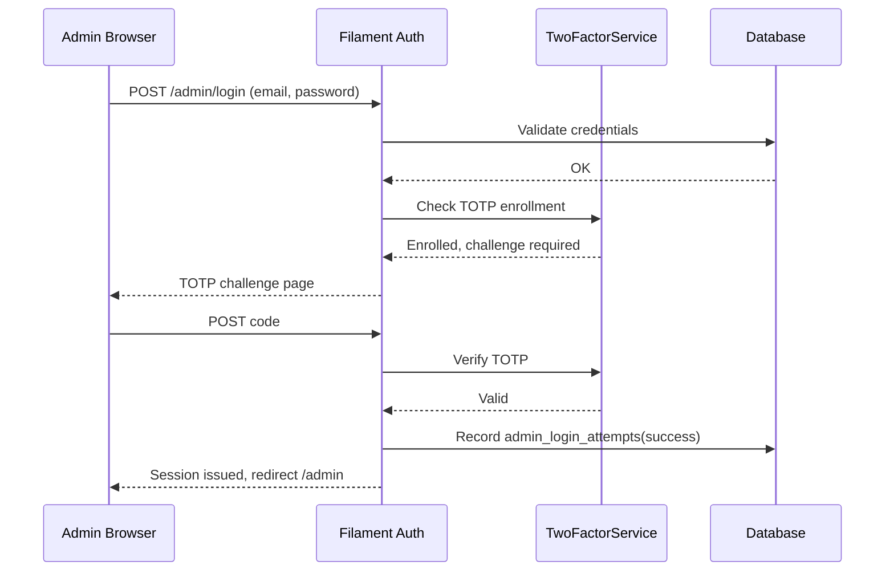
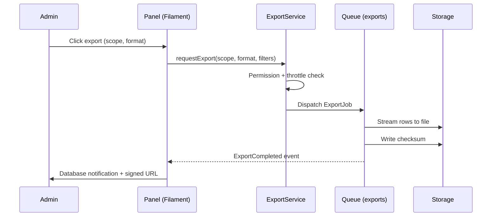
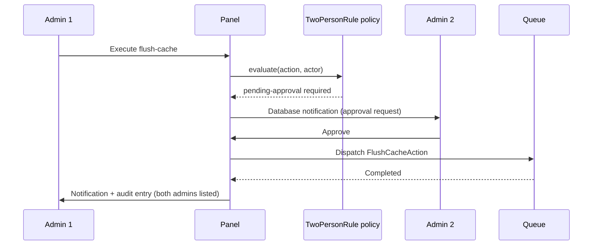

# 05.03.03.01 - Admin Overview

**Project:** GsmUi
**Module:** Admin Panel - Overview
**Version:** 1.0.0

---

# Purpose

The Admin Overview provides a high-level dashboard for platform administrators to monitor system health, user activity, and key metrics at a glance.

---

# Dashboard Components

## Statistics Cards

- **Total Users**: Current registered user count
- **Active Subscriptions**: Number of paying users
- **Monthly Revenue**: Current month revenue
- **Component Downloads**: Total component downloads
- **API Requests**: Requests in the last 24 hours

## Recent Activity

- Latest user registrations
- Recent component uploads
- New blog posts
- Support tickets

## System Health

- Database status
- Cache hit rate
- Queue backlog
- Storage usage

## Quick Actions

- Create admin user
- View audit logs
- Run system diagnostics
- Export reports

---

# Data Refresh

Dashboard data updates:

- Real-time: System health, queue status
- Every 5 minutes: Statistics, activity
- On demand: Report generation

---

# Export Options

- CSV export for statistics
- PDF report generation
- API access for integration

---

# Filament Panel Architecture

The Admin Panel is built on Filament v3, with a dedicated panel provider that isolates admin routes, middleware, resources, and widgets from the main application.

## AdminPanelProvider Specification

| Property | Value | Description |
|----------|-------|-------------|
| Panel ID | `admin` | Unique identifier for the panel |
| Path | `/admin` | Base URL path for all admin routes |
| Auth Guard | `admin` | Dedicated authentication guard in `config/auth.php` |
| Auth Provider | `AdminUserProvider` | Eloquent provider using `App\Models\User` with admin scope |
| Login Route | `/admin/login` | Filament-managed login page |
| Theme | `admin.theme` | Compiled Tailwind theme extending GsmUi tokens |
| Branding | Custom | GsmUi logo with `--gsmui-primary` accent |
| Colors | Token map | primary=>`--gsmui-primary`, danger=>red, success=>green |
| Max Content Width | `full` | Charts and tables need full width |
| Sidebar | Collapsible, fixed | Persistent on desktop, off-canvas on mobile |
| Topbar | Enabled | Search, notifications, user menu |
| Database Notifications | Enabled | Persisted in `notifications` table |
| Database Notifications Polling | `30s` | Balance freshness vs. load |
| Font | `Inter` (system fallback) | Matches GsmUi documentation site |
| Favicon | `/brand/favicon.png` | Matches public site branding |
| Registration | Disabled | Admins are provisioned by other admins only |
| Password Reset | Enabled | Email-based reset flow for admins |
| Email Verification | Required | Two-factor enforced for super admin role |
| Unauthenticated Redirect | `/admin/login` | With `?redirect=` query param |

### Provider Registration Sequence

1. `AdminPanelProvider::panel()` returns configured panel instance.
2. `->discoverResources()` scans `app/Filament/Admin/Resources` for resource classes.
3. `->discoverWidgets()` scans `app/Filament/Admin/Widgets` for dashboard widgets.
4. `->discoverPages()` scans `app/Filament/Admin/Pages` for custom pages.
5. `->middleware([...])` applies the admin middleware stack (below).
6. `->authMiddleware([Authenticate::class])` protects all routes except login.
7. `->navigationGroups([...])` defines sidebar group ordering.

### Middleware Stack

| Order | Middleware | Purpose |
|-------|-----------|---------|
| 1 | `EncryptCookies` | Cookie encryption (framework default) |
| 2 | `StartSession` | Session lifecycle |
| 3 | `AuthenticateSession` | Prevents session fixation across logins |
| 4 | `Authenticate` | Requires admin guard authentication |
| 5 | `EnsureTwoFactorEnabled` | Forces 2FA for `super-admin` role before access |
| 6 | `LogAdminActivity` | Records route access with actor ID (audit trail) |
| 7 | `VerifyAdminPermission` | Per-navigation-group permission gate |
| 8 | `ThrottleAdminActions` | Rate-limits mutations (default 120/min) |
| 9 | `SetTimezone` | Applies admin user's configured timezone |
| 10 | `ShareErrorsFromSession` | Error bag propagation for forms |

## Theme and Asset Pipeline

- Panel theme compiled via `php artisan filament:theme app/Filament/Admin` into `resources/css/admin-panel.css`.
- Tailwind content array includes panel Blade views to purge unused classes.
- CSS variables from `--gsmui-*` namespace injected via `@property` definitions so Filament color tokens resolve correctly.
- Assets registered through `FilamentAsset::register()` with bundle versioning to bust browser caches on deploy.
- No external CDN fonts or icon sets; icons are compiled SVG sprites matching `gsmui:icon` component set.

---

# Resource Inventory

The panel registers one Filament resource per primary domain model. Each resource declares its list page, view/create/edit pages, relation managers, and navigation placement.

| Resource Class | Model | Navigation Group | Navigation Icon | Badge | Required Permission |
|----------------|-------|------------------|-----------------|-------|---------------------|
| `UserResource` | `User` | Users | `heroicon-o-users` | Total users | `users.view` |
| `RoleResource` | `Role` | Users | `heroicon-o-shield-check` | Role count | `roles.view` |
| `ComponentResource` | `Component` | Content | `heroicon-o-cube` | Pending review count | `components.view` |
| `DocumentationPageResource` | `DocumentationPage` | Content | `heroicon-o-book-open` | Draft count | `documentation.view` |
| `TemplateResource` | `Template` | Content | `heroicon-o-rectangle-stack` | Pending count | `templates.view` |
| `ThemeResource` | `Theme` | Content | `heroicon-o-swatch` | Pending count | `themes.view` |
| `BlogPostResource` | `BlogPost` | Content | `heroicon-o-newspaper` | Scheduled count | `blog.view` |
| `MarketplaceProductResource` | `Product` | Marketplace | `heroicon-o-shopping-bag` | Pending submissions | `marketplace.view` |
| `OrderResource` | `Order` | Marketplace | `heroicon-o-credit-card` | Pending orders | `orders.view` |
| `ReviewResource` | `Review` | Marketplace | `heroicon-o-star` | Flagged count | `reviews.view` |
| `AnalyticsReportPage` | (none, custom page) | Analytics | `heroicon-o-chart-bar` | — | `analytics.view` |
| `SettingResource` (singleton) | `Setting` | Settings | `heroicon-o-cog-6-tooth` | — | `settings.view` |
| `FeatureFlagResource` | `FeatureFlag` | Settings | `heroicon-o-flag` | Enabled count | `feature-flags.view` |
| `AuditLogPage` | `AuditLog` (read-only) | System | `heroicon-o-clipboard-document-list` | 24h event count | `audit.view` |
| `HealthMonitorPage` | (custom page) | System | `heroicon-o-heart` | Alert count | `system.view` |
| `NotificationPreferenceResource` | `NotificationPreference` | Settings | `heroicon-o-bell` | — | `notifications.view` |

## Resource Conventions

- Every resource implements `canAccess()` delegating to Gate: `Gate::allows('view-any', Model)`.
- Soft-deleted models remain viewable in list with a `TrashedFilter` toggle.
- Bulk actions use `Filament\Tables\Actions\BulkAction` with `requiresConfirmation()` on destructive operations.
- Every mutation action dispatches an `AdminActionPerformed` event carrying actor, model, action name, and attribute diff.
- Table queries use `->modifyQueryUsing()` to constrain scope by role (e.g., moderators never see `super-admin` users).
- List pages default to 25 records per page, options: 10/25/50/100.
- All resources define `getEloquentQuery()` with eager loading to prevent N+1 queries.

---

# Livewire Component Inventory

Beyond Filament resources, the panel ships standalone Livewire components for panels and specialized interactions.

| Component Class | View | Purpose | Polling |
|-----------------|------|---------|---------|
| `StatsOverview` | `livewire.stats-overview` | Renders the five headline statistic cards | `wire:poll.300s` |
| `SystemHealthPanel` | `livewire.system-health` | Database, cache, queue, storage indicators | `wire:poll.15s` |
| `RecentActivityFeed` | `livewire.activity-feed` | Latest 20 platform events with icons | `wire:poll.300s` |
| `QuickActionsPanel` | `livewire.quick-actions` | Buttons dispatching queued admin jobs | None (event-driven) |
| `RevenueChart` | `livewire.charts.revenue` | ApexCharts bar chart, monthly revenue | None (loaded on demand) |
| `UserGrowthChart` | `livewire.charts.user-growth` | ApexCharts line chart, registrations | None |
| `DownloadTrendsChart` | `livewire.charts.downloads` | ApexCharts area chart | None |
| `DashboardWidgetManager` | `livewire.widget-manager` | Drag-and-drop widget ordering | None |
| `AdminSearch` | `livewire.admin-search` | Global typeahead across entities | Debounced 300ms |
| `NotificationBell` | `livewire.notification-bell` | Unread count + dropdown | `wire:poll.30s` |
| `ImpersonationBanner` | `livewire.impersonation-banner` | Active impersonation warning bar | None |
| `SystemDiagnosticsRunner` | `livewire.diagnostics` | Runs checks, streams results | `wire:poll.visible.5s` during run |

## Livewire Conventions

- All polling components respect `wire:poll.visible` so background tabs do not hit the server.
- Components read only from cached stat snapshots (`dashboard_stats_cache`), never aggregate live.
- Chart components hydrate data via dedicated controller endpoints returning JSON in ApexCharts series format.
- Every component declares `#[On('stats:refreshed')]` listeners so quick-action jobs can broadcast updates.
- Components use `Filament\Support\Concerns\InteractsWithForms` where forms are needed, not raw Blade forms.
- All Livewire components extend a base `AdminPanelComponent` that enforces permission checks in `mount()`.

### AdminPanelComponent Base Class Contract

```php
abstract class AdminPanelComponent extends Component
{
    protected string $requiredPermission;

    public function mount(): void
    {
        abort_unless(
            Gate::allows($this->requiredPermission),
            403,
            'Insufficient permissions for this panel.'
        );
    }
}
```

### Event Bus

| Event Name | Emitter | Subscribers |
|------------|---------|-------------|
| `stats:refreshed` | `RefreshStatsJob` completion listener | `StatsOverview`, charts |
| `health:alert` | `HealthMonitor` broadcast | `SystemHealthPanel`, `NotificationBell` |
| `quick-action:completed` | `QuickActionsPanel` | Activity feed, toasts |
| `widgets:reordered` | `DashboardWidgetManager` | Dashboard grid layout |
| `diagnostics:progress` | `SystemDiagnosticsRunner` | Progress UI |

---

# Admin User Flow: First Login

## Preconditions

1. User record exists with `is_admin = true` or role `administrator`/`moderator`.
2. User has received an invitation email with a one-time setup link (72h expiry).
3. Password not yet set (setup link leads to password creation).

## Step-by-Step Flow

| Step | User Action | System Response |
|------|-------------|-----------------|
| 1 | Opens invite link `/admin/invite/{token}` | Token validated; expired → error page with resend CTA |
| 2 | Sets password (min 12 chars, breach-checked via HIBP k-anonymity) | Password hashed (argon2id), token consumed |
| 3 | Prompted to enroll second factor (TOTP) | QR code rendered; backup codes issued once |
| 4 | Confirms 2FA code | `two_factor_secret` stored encrypted; session marked verified |
| 5 | Lands on `/admin` dashboard | Audit log entry `admin.first_login` recorded |
| 6 | Sees onboarding checklist card | Checklist persisted in `user_preferences` JSON |

## Onboarding Checklist Items

- [ ] Verify admin email address
- [ ] Review assigned role and permissions
- [ ] Complete product tour (widget tour via Alpine-based walkthrough)
- [ ] Configure notification preferences
- [ ] Set timezone and locale

The checklist card disappears only when all items are completed or dismissed explicitly; dismissal is logged.

---

# Admin User Flow: Routine Monitoring Session

1. Admin authenticates at `/admin/login` (password + TOTP).
2. Failed logins: 5 attempts per 15 minutes, then account lockout 30 minutes + email alert to security address.
3. Dashboard loads; `StatsOverview` hydrates from cache in under 300ms.
4. Admin notices health alert badge (queue backlog > threshold).
5. Clicks badge → `SystemHealthPanel` expands with detail and recommended action link.
6. Runs quick action "Clear failed jobs" → confirmation dialog → job dispatched.
7. Activity feed updates within one poll cycle showing the action with admin identity.
8. Session timeout: 30 minutes idle auto-lock; re-authentication required, not full re-login.
9. Admin logs out; session token invalidated server-side immediately.

---

# Admin User Flow: User Management Cross-Navigation

1. From dashboard, admin opens Users > All Users.
2. Searches by email fragment; results paginated, highlighting matched fields.
3. Opens user detail; relation managers visible only for permitted sections.
4. Suspending a user triggers confirmation modal with reason field (required, min 10 chars).
5. On confirm: `UserSuspended` event fires, sessions revoked, audit log written with before/after diff.
6. Breadcrumb returns `Admin > Users > {User Name}`; back navigation preserves table filters and page via query string.

---

# Permission Checks (Overview-Level)

| Check Point | Mechanism | Failure Behavior |
|-------------|-----------|------------------|
| Panel access | `Authenticate` middleware on `/admin` group | Redirect to login |
| Two-factor requirement | `EnsureTwoFactorEnabled` for super-admin | Redirect to `/admin/security/setup` |
| Navigation item visibility | `->navigationGroup()->authorize()` on resources | Item hidden (not just disabled) |
| Widget visibility | Each widget `canView()` maps to permission | Widget omitted from grid |
| Quick action visibility | Action registry `permission_key` checked at render | Button hidden |
| Quick action execution | Re-verified in job `handle()` (defense in depth) | Job fails with `AuthorizationException` |
| Export endpoints | `exports.create` permission + hourly throttle | 403 / 429 JSON error |
| API token access | Token scopes intersect user permissions | 403 with missing scope listed |

### Permission Resolution Order

1. Super-admin role short-circuits to allow-all (single `Role::isSuperAdmin()` check).
2. Direct user permission overrides (deny wins over allow).
3. Role permissions (union of all assigned roles).
4. Default: deny.

All permission lookups resolve from a per-request cache populated after the first Gate check; role mutations invalidate the cache atomically via `RoleUpdated` event.

---

# API Contract

Administrative read access is exposed for external integration (status pages, Slack bots) through Sanctum token authentication. All endpoints are prefixed `/api/admin` and return JSON:API-style envelopes.

## Common Envelope

```json
{
  "data": { },
  "meta": {
    "generated_at": "2026-08-17T09:30:00Z",
    "cache_age_seconds": 42,
    "request_id": "req_01J5..."
  }
}
```

## Endpoint Catalog

| Method | Endpoint | Permission | Rate Limit | Description |
|--------|----------|------------|-----------|-------------|
| GET | `/api/admin/overview/stats` | `overview.view` | 60/min | Headline statistics snapshot |
| GET | `/api/admin/overview/health` | `system.view` | 60/min | Health indicators with thresholds |
| GET | `/api/admin/overview/activity` | `overview.view` | 30/min | Paginated activity feed |
| POST | `/api/admin/overview/export` | `exports.create` | 10/hour | Enqueue CSV/PDF export |
| GET | `/api/admin/overview/export/{id}` | `exports.view` | 30/min | Download link for completed export |
| GET | `/api/admin/overview/version` | `system.view` | 60/min | App version, panel version, dependency digests |

### GET `/api/admin/overview/stats` Response

```json
{
  "data": {
    "total_users": 18432,
    "active_subscriptions": 2041,
    "monthly_revenue": { "amount": 48210.5, "currency": "USD" },
    "component_downloads_total": 129044,
    "api_requests_24h": 882113
  },
  "meta": { "generated_at": "2026-08-17T09:05:00Z", "cache_age_seconds": 120 }
}
```

### Error Contracts

| HTTP Status | Condition | Body |
|-------------|-----------|------|
| 401 | Missing/invalid token | `{ "error": { "code": "unauthenticated" } }` |
| 403 | Token lacks scope | `{ "error": { "code": "forbidden", "missing_scopes": ["overview.view"] } }` |
| 429 | Throttle exceeded | `{ "error": { "code": "rate_limited", "retry_after": 37 } }` |
| 500 | Unexpected failure | Generic message; full detail in log with `request_id` |

### Webhook Outbound (Optional)

Platforms may register a webhook to receive `health:alert` events:

```json
{
  "event": "health.queue_backlog_exceeded",
  "occurred_at": "2026-08-17T09:31:02Z",
  "payload": { "queue": "default", "depth": 1843, "threshold": 500 }
}
```

Signatures use HMAC-SHA256 over the raw body with a per-subscriber secret, delivered in the `X-GsmUi-Signature` header.

---

# Settings and Configuration

| Config Key | Default | Description |
|------------|---------|-------------|
| `gsmui.admin.poll_interval` | `30` | Notification poll seconds |
| `gsmui.admin.stats_cache_ttl` | `300` | Statistics cache TTL in seconds |
| `gsmui.admin.health_check_interval` | `15` | Health poll seconds |
| `gsmui.admin.max_export_rows` | `100000` | Export row cap per job |
| `gsmui.admin.session_idle_timeout` | `1800` | Idle lock seconds |
| `gsmui.admin.max_failed_logins` | `5` | Before lockout |
| `gsmui.admin.lockout_minutes` | `30` | Lockout duration |
| `gsmui.admin.require_2fa_roles` | `["super-admin"]` | Roles forced into 2FA |
| `gsmui.admin.maintenance_mode_banner` | `true` | Show banner when app in maintenance |
| `gsmui.admin.telemetry_enabled` | `true` | Aggregate usage telemetry toggle |

Configuration may be overridden per-environment; UI-editable settings persist in `settings` table and take precedence over env defaults at runtime via `SettingResolver` service.

---

# Background Jobs

| Job Class | Queue | Schedule | Purpose |
|-----------|-------|----------|---------|
| `AggregatePlatformStatsJob` | `low` | Every 5 minutes | Compute headline stats into `dashboard_stats_cache` |
| `HealthSnapshotJob` | `monitoring` | Every minute | Capture queue depth, DB latency, cache hit rate |
| `PruneActivityLogJob` | `maintenance` | Daily 03:00 UTC | Retain activity logs 180 days, archive older |
| `PruneExportFilesJob` | `maintenance` | Hourly | Delete expired export files |
| `RefreshWidgetSnapshotsJob` | `low` | Every 15 minutes | Pre-render per-widget data for fast hydration |
| `DigestEmailJob` | `email` | Daily 08:00 local | Daily digest to opted-in admins |
| `AnomalyDetectionJob` | `analytics` | Every 10 minutes | Compare metrics against rolling baselines |
| `StaleInviteCleanupJob` | `maintenance` | Daily | Expire unused admin invitations |

## Job Conventions

- All jobs idempotent; safe to retry without duplication (unique job keys where applicable).
- Failed jobs retried 3 times with exponential backoff, then moved to `failed_jobs` for admin inspection.
- `HealthSnapshotJob` writes to a time-partitioned table, retained 30 days, then rolled up to hourly aggregates.
- Heavy aggregations run on the `low` queue to avoid starving interactive queues (`default`, `email`).

---

# Caching Strategy

| Cache Key Pattern | TTL | Invalidation |
|-------------------|-----|--------------|
| `admin:stats:overview` | 300s | `AggregatePlatformStatsJob` refresh |
| `admin:health:snapshot` | 60s | Overwritten each `HealthSnapshotJob` run |
| `admin:activity:feed:{page}` | 300s | Event listener clears on new activity |
| `admin:widgets:user:{userId}` | 1h | Cleared on widget reorder save |
| `admin:permissions:user:{userId}` | until mutation | Cleared on `RoleUpdated`/`PermissionRevoked` |
| `admin:version:digest` | 24h | Cleared on deploy hook |

- Driver: Redis for shared environments; `file` driver acceptable in local dev only.
- Cache stampede protection via `Cache::flexible()` (Laravel 11) with grace window on overview stats.
- All cache reads fall back to a synchronous compute path on miss, flagged with `cache_age_seconds: -1` in meta.

---

# Observability

| Signal | Tooling | Admin Visibility |
|--------|---------|------------------|
| Structured logs | Monolog with JSON formatter, channel `admin` | Audit log page + log search |
| Request tracing | `X-Request-Id` propagated across jobs | Linked in job detail view |
| Queue metrics | Horizon dashboard (linked, permission-gated) | Health monitor page embed |
| Error aggregation | Sentry (self-hosted) with release tagging | Alert digest to admins |
| Uptime | Internal ping endpoint + external check | Health indicator card |
| Slow query log | Enabled > 100ms threshold | Exportable via diagnostics runner |

Audit log entries include: actor ID, impersonator ID (if impersonating), route, HTTP method, model class + key, action verb, attribute diff (redacting password/token/secret fields), IP address, user agent hash.

---

# Export Subsystem

## Export Formats

| Format | Use Case | Generation |
|--------|----------|------------|
| CSV | Spreadsheet analysis | Streaming export via `League\Csv`, chunked 5,000 rows |
| XLSX | Financial reports with multiple sheets | `openspout/openspout`, generated async |
| PDF | Board-facing summary | Headless Chromium print of report Blade view |
| JSON | Machine integration | Raw API envelope dump |

## Export Lifecycle

1. Admin selects scope (e.g., users, orders, activity) and format.
2. `ExportRequested` event validates permission and throttle (10/hour per admin).
3. `ExportJob` queued; admin sees progress on exports page (`/admin/exports`).
4. File written to private disk path `exports/{id}/{filename}`.
5. Signed URL generated (15-minute expiry) and emailed/notified to requester.
6. Audit entry records export with row count and filter snapshot (JSON) for reproducibility.
7. File auto-deleted after 7 days by `PruneExportFilesJob`.

## Export Scope Matrix

| Scope | Fields Included | Sensitive Field Handling |
|-------|-----------------|--------------------------|
| Users list | id, name, email, role, status, created_at | Email masked unless `users.export-pii` permission |
| Orders | id, buyer, product, amount, status, date | Full amounts require `finance.export` |
| Activity log | all audit fields | Redacted fields stay redacted |
| Revenue | monthly aggregates by tier | Requires `finance.export` + second confirmation |

---

# Impersonation ("View As")

- Available only to `super-admin` role (`users.impersonate` permission).
- Requires explicit reason entry (min 20 chars), stored in audit log.
- Impersonation session capped at 60 minutes; countdown shown via `ImpersonationBanner`.
- While impersonating: cannot access Settings, cannot change roles/permissions, cannot export data.
- Banner is non-dismissible and persists across navigation until exited or expired.
- All impersonated actions are dual-attributed (impersonator + impersonated user) in audit trails.
- Concurrent impersonation of the same account is blocked with an explanatory error.

---

# Accessibility Requirements

| Requirement | Standard | Implementation |
|-------------|----------|----------------|
| Keyboard navigation | WCAG 2.1 AA | All actions reachable via Tab; Enter/Space activation |
| Focus visibility | WCAG 2.4.7 | Native outlines preserved; no `outline-none` on focusables |
| Color contrast | WCAG 1.4.3 | All text ≥ 4.5:1; charts include non-color encodings |
| Chart alternatives | WCAG 1.1.1 | Every chart has an accessible data table toggle |
| Screen reader labels | ARIA 1.2 | Icons-only buttons carry `aria-label` translated via `__()` |
| Reduced motion | `prefers-reduced-motion` | Chart animations and polling-driven transitions disabled |
| Touch targets | ≥ 32x32px | Enforced in panel stylesheet for mobile |

---

# Error States and Empty States

| State | Presentation | Recovery Action |
|-------|--------------|-----------------|
| No data yet (new install) | Illustration + setup checklist card | Links to onboarding tasks |
| Widget data unavailable | Skeleton card with warning badge | "Retry" button re-dispatches snapshot job |
| Health check failing | Red status card with details | Link to diagnostics runner |
| Permission denied mid-session | Inline alert (not full 403) | Prompt to contact org owner |
| Export failure | Failed badge + error summary | Retry action (max 3 retries) |
| Offline/poll failure | Stale-data banner with timestamp | Auto-retry on reconnect |

---

# Localization

- All admin UI strings wrapped in `__()` with `admin::` namespace.
- Date/number formatting uses authenticated admin's locale via `SetTimezone` + locale middleware.
- Currency display respects `settings.platform.currency` and per-user override.
- RTL layout supported: Tailwind logical properties (`ms-`, `me-`, `start-`, `end-`) used throughout panel styles.
- Translation coverage gate: CI fails if new admin screens ship untranslated keys for supported locales (en, es, de, fr, ar).

---

# Security Posture Summary

| Area | Control |
|------|---------|
| Transport | HSTS enforced on admin subdomain; TLS 1.2+ only |
| Headers | CSP (self only; no external scripts/fonts), X-Frame-Options DENY, `Referrer-Policy: no-referrer` |
| Sessions | `SESSION_SECURE_COOKIE`, `SESSION_SAME_SITE=lax`, rotated on privilege change |
| Tokens | Sanctum tokens hashed; scopes minimal; revocable per token |
| CSRF | Filament default; all Livewire mutations carry token |
| Input | Blade `{{ }}` escaping everywhere; HTML Purifier for rich-text surfaces |
| Secrets | Never rendered in UI or logs; config encryption for sensitive settings |
| Dependencies | `composer audit` + Dependabot in CI; admin sees dependency digest on version page |
| Backup | Admin data included in platform backup; restore drills quarterly |

---

# Testing Specification

## Unit Tests

| Test Area | Cases | Tool |
|-----------|-------|------|
| Stat aggregation math | Rollover periods, zero-data months, currency precision | PHPUnit |
| Permission resolution order | Override precedence, deny-wins, super-admin short-circuit | PHPUnit |
| Cache fallback compute | Miss path returns correct values, negative cache age flag | PHPUnit |
| Redaction of audit diffs | Passwords/tokens never serialized | PHPUnit |

## Feature Tests

| Test Area | Cases | Tool |
|-----------|-------|------|
| Panel access control | Unauthenticated redirect, non-admin 403, 2FA gate | Laravel Feature Tests |
| Overview API | Envelope shape, permission scopes, throttle 429 | Laravel Feature Tests |
| Export lifecycle | Request → queue → signed URL → expiry | Laravel Feature Tests (with fake queue) |
| Impersonation | Capping, banner persistence, blocked mutations | Laravel Feature Tests |
| Quick actions | Permission re-check in job, audit entry written | Laravel Feature Tests |
| Invitation flow | Token expiry, single-use consumption, breach-check | Laravel Feature Tests |

## Browser Tests (Playwright)

| Test Area | Cases |
|-----------|-------|
| Dashboard render | Stats cards present, charts hydrate, LCP < 2s |
| Widget reorder | Drag persists after reload, event emitted |
| Notification bell | Badge count updates within poll cycle |
| Mobile layout | Sidebar off-canvas, touch targets ≥ 32px |
| Empty install | Checklist card shown, no hard errors in console |
| Accessibility | axe-core scan passes (zero critical violations) |

## Performance Tests

| Scenario | Target | Tool |
|----------|--------|------|
| Cold dashboard load (no cache) | < 3.5s | k6 |
| Warm dashboard load (cached) | < 900ms (LCP < 2s) | k6 |
| 50 concurrent admins polling | p95 < 500ms, error rate 0% | k6 |
| Export 100k rows | < 60s job duration | Benchmark job timing |
| Activity feed page through 10k entries | < 200ms/page | k6 + DB slow query log |

## Security Tests

- Privilege escalation matrix: every endpoint probed with each non-admin role → expect 403.
- Session fixation attempt after login → session ID rotated.
- CSP violation reports monitored in staging with inline test payloads.
- Rate-limit abuse simulation on login endpoint.

---

# Data Model Additions (Overview Scope)

## Tables

| Table | Purpose | Retention |
|-------|---------|-----------|
| `dashboard_stats_cache` | Pre-aggregated headline metrics | Rolling, overwritten per period |
| `dashboard_activity_log` | Unified activity feed source | 180 days, then archive |
| `admin_exports` | Export job metadata + signed paths | 30 days post-expiry |
| `admin_invitations` | Pending admin invitations | Until consumed/expired |
| `admin_login_attempts` | Auth attempts incl. failures | 90 days |
| `impersonation_sessions` | Impersonation audit records | Indefinite (security) |
| `webhook_subscribers` | Outbound webhook configs | Until removed |

## Indexing Plan

| Table | Index | Rationale |
|-------|-------|-----------|
| `dashboard_activity_log` | (`created_at` DESC) | Feed pagination |
| `dashboard_activity_log` | (`actor_id`, `created_at`) | Per-user history |
| `admin_exports` | (`requested_by`, `created_at`) | My exports page |
| `admin_login_attempts` | (`email`, `created_at`) | Lockout window check |
| `impersonation_sessions` | (`impersonator_id`, `ended_at`) | Active session lookup |

---

# Deployment & Rollout

| Step | Action |
|------|--------|
| 1 | Ship migrations behind feature flag `admin-panel-v2` |
| 2 | Enable panel for seed admin group; collect feedback 2 weeks |
| 3 | Enable for all admins; old admin routes redirect to equivalent new pages |
| 4 | Remove legacy admin screens after 1 release cycle |

Rollback: flag disable restores legacy routes; data tables additive-only (no destructive schema changes in this release).

---

# KPIs (Overview Scope)

| KPI | Target | Measurement |
|-----|--------|-------------|
| Time-to-first-insight for new admin | < 60s from login | Onboarding analytics |
| Weekly active admins | > 80% of provisioned admins | Session logs |
| Export request success rate | > 99% | Job completion tracking |
| Audit log integrity check passes | 100% | Monthly integrity job |
| False-positive health alerts | < 5/week | Alert review queue |

---

# Open Questions

| # | Question | Owner | Due |
|---|----------|-------|-----|
| 1 | Should overview include per-tenant breakdowns for enterprise installs? | Product | v1.1 |
| 2 | Webhook retries: fixed vs exponential backoff for subscriber endpoints? | Backend | v1.0 |
| 3 | Include swag store metric on headline cards or keep under Marketplace? | Product | v1.0 |
| 4 | Do we expose overview API to public-site status page (read-only key)? | Security | v1.1 |

---

# Filament Resource: ExportResource Specification

The Overview module exposes a dedicated `ExportResource` so admins can browse past exports, retry failures, and re-download completed files.

## List Page Columns

| Column | Type | Sortable | Toggleable | Notes |
|--------|------|----------|------------|-------|
| `id` | Text | Yes | No | Short code shown (last 8 chars) |
| `scope` | Badge | Yes | No | users / orders / activity / revenue |
| `format` | Badge | Yes | Yes | CSV / XLSX / PDF / JSON |
| `rows` | Numeric | Yes | Yes | Formatted with thousands separators |
| `status` | Status icon | Yes | No | queued / running / completed / failed / expired |
| `requested_by` | Relation (User) | Yes | No | Avatar + name |
| `created_at` | DateTime | Yes | No | Admin's timezone |
| `expires_at` | DateTime | Yes | Yes | Countdown badge when < 24h |

## List Page Filters

- Status select (multi-select)
- Scope select
- Format select
- Requested-by user filter
- Date range (created between)
- Failed-only toggle

## Row Actions

| Action | Icon | Confirmation | Permission |
|--------|------|--------------|------------|
| Download | `heroicon-o-arrow-down-tray` | No (signed URL) | `exports.view` |
| Retry | `heroicon-o-arrow-path` | Yes | `exports.create` |
| Delete | `heroicon-o-trash` | Yes (danger) | `exports.delete` |
| Reproduce (rerun with same filters) | `heroicon-o-document-duplicate` | Yes | `exports.create` |

## Bulk Actions

- Delete selected expired exports
- Retry selected failed exports (max 10 per batch)

## Empty State

Illustration + "Exports you create will appear here" + primary button "Create export" deep-linking to the relevant resource's export action.

---

# Filament Resource: Invitation Management (InviteResource)

## Create Page Fields

| Field | Type | Validation | Notes |
|-------|------|------------|-------|
| `email` | Email input | required, email, unique:users,email | Lowercased on save |
| `role` | Select | required, in provisioned roles | Defaults to `admin` |
| `expires_in` | Select | 24h / 48h / 72h / 7 days | Default 72h |
| `note` | Textarea | optional, max 500 chars | Shown on welcome email |

### Create Page Behaviors

- Duplicate email for existing user → inline suggestion "Grant admin role to existing user" with permission check.
- On save: invitation token generated (64-char random), signed link emailed, audit entry written.
- Rate limited to 20 invitations/day per admin.

## List Page Columns

Email, role badge, invited-by, status (pending/accepted/expired/revoked), expires countdown, actions (revoke, resend).

## Invite Lifecycle State Machine

```
pending --> accepted      (setup completed)
pending --> revoked       (admin revokes)
pending --> expired       (TTL elapsed, cleanup job)
accepted --> (terminal)
revoked --> (terminal; resend creates new invite)
```

---

# Quick Action Registry

Quick actions are declared in `app/Filament/Admin/Actions/QuickActionRegistry.php`. Each action is a registered array with render metadata and a handler class.

| Slug | Label | Icon | Permission | Handler Class | Job Queue |
|------|-------|------|------------|---------------|-----------|
| `create-admin-user` | Create admin user | `heroicon-o-user-plus` | `users.create` | Opens `UserResource::getUrl('create', ['role' => 'admin'])` | — |
| `view-audit-logs` | View audit logs | `heroicon-o-clipboard-document-list` | `audit.view` | Navigates to `AuditLogPage` | — |
| `run-diagnostics` | Run system diagnostics | `heroicon-o-wrench-screwdriver` | `system.diagnostics` | Opens diagnostics runner panel | — |
| `export-reports` | Export reports | `heroicon-o-document-arrow-down` | `exports.create` | Opens export scope picker | `default` |
| `clear-failed-jobs` | Clear failed jobs | `heroicon-o-exclamation-triangle` | `system.maintenance` | `ClearFailedJobsAction` | `maintenance` |
| `retry-stuck-jobs` | Retry stuck jobs | `heroicon-o-arrow-path` | `system.maintenance` | `RetryStuckJobsAction` | `maintenance` |
| `flush-cache` | Flush platform cache | `heroicon-o-circle-stack` | `system.maintenance` | `FlushCacheAction` (scoped keys only) | `maintenance` |
| `toggle-maintenance` | Toggle maintenance mode | `heroicon-o-wrench` | `system.maintenance` | `ToggleMaintenanceAction` | `default` |
| `invite-admin` | Invite administrator | `heroicon-o-envelope` | `users.invite` | Opens `InviteResource::getUrl('create')` | — |

## Quick Action Rendering Contract

```php
interface QuickAction
{
    public function slug(): string;
    public function label(): string;
    public function icon(): string;
    public function permission(): string;
    public function requiresConfirmation(): bool;
    public function confirmationMessage(): string;
    public function handle(Authenticatable $actor): QuickActionResult;
}
```

## Dangerous Action Safeguards

Actions flagged dangerous (`flush-cache`, `toggle-maintenance`, `clear-failed-jobs`) additionally require:

1. Type-to-confirm modal with the action slug.
2. Actor password re-entry (sudo mode, 10-minute validity).
3. Second admin approval if org has 2+ super-admins (configurable by setting `gsmui.admin.two_person_rule`).

---

# Diagnostics Runner Detail

The diagnostics runner executes a checklist of probes and streams results to the panel.

| Probe | Check | Pass Criteria |
|-------|-------|---------------|
| Database | `SELECT 1` + migration status | < 50ms, migrations up to date |
| Cache | Set/get roundtrip on Redis | Roundtrip < 10ms |
| Queue | Dispatch probe job, await completion | Completed < 30s |
| Mail | SMTP connect + AUTH | Connection established |
| Storage | Write/delete test file on private disk | Success, no permission errors |
| Scheduler | Last run timestamp freshness | < 2 minutes since last heartbeat |
| Disk space | Free space on app volume | > 10% free |
| PHP extensions | Required exts loaded | All present |
| Composer audit | Known vulnerabilities in deps | Zero critical/high |
| Horizon | Supervisor status, wait times | Wait < 60s on all queues |
| Failed jobs | `failed_jobs` table count | < 100 pending |
| Session driver | Table store reachable | Recent garbage collection < 24h |

### Diagnostics Output Contract

```json
{
  "run_id": "diag_01J5...",
  "started_at": "2026-08-17T10:00:00Z",
  "duration_ms": 4211,
  "probes": [
    { "name": "database", "status": "pass", "detail": "12ms, migrations clean" },
    { "name": "queue", "status": "fail", "detail": "probe job timed out after 30s" }
  ],
  "summary": { "pass": 11, "warn": 0, "fail": 1 }
}
```

- Results persisted to `system_diagnostics_runs` for 90 days.
- Admin can schedule recurring diagnostics (daily) with failure email alerts.

---

# Notification Preferences (Overview Scope)

Admins configure how they receive platform alerts.

| Channel | Available For | Default |
|---------|---------------|---------|
| Database (in-panel bell) | All alert types | Enabled |
| Email | Health alerts, export ready, security events | Health + security only |
| Slack webhook | Health alerts, anomaly alerts | Disabled |
| Discord webhook | Health alerts, anomaly alerts | Disabled |

## Alert Types

| Alert | Severity | Channels |
|-------|----------|----------|
| Queue backlog exceeded | Critical | All enabled |
| Error rate spike (>1% of requests) | High | database, email |
| Disk space below 10% | Critical | All enabled |
| Failed login burst on own account | Security | database, email |
| Role change on own account | Security | database, email |
| New pending review queue > threshold | Info | database |
| Export completed | Info | database, email |
| Scheduled post published | Info | database |

# Rate Limiting Matrix (Admin Surface)

| Surface | Limit | Window | Scope |
|---------|-------|--------|-------|
| Login attempts | 5 | 15 min | Per email |
| Password reset requests | 3 | 1 hour | Per email |
| Mutations (global) | 120 | 1 min | Per authenticated admin |
| Exports | 10 | 1 hour | Per admin |
| Invitations | 20 | 1 day | Per admin |
| Diagnostic runs | 6 | 1 hour | Per admin |
| API token overview endpoints | 60 | 1 min | Per token |
| Global search | 30 | 1 min | Per admin |

All limits configurable via `config/gsmui/admin-rate-limits.php` with `settings` table overrides.

---

# Versioning & Changelog Visibility

- Panel footer shows app version, panel build hash, and last deploy timestamp.
- Version page (`/admin/system/version`) lists:
  - App version and git SHA (truncated)
  - PHP, Laravel, Filament, Livewire versions
  - Composer dependency digest (hash of lock file)
  - Migration status summary
  - Feature flag snapshot relevant to admin surface
- Deploy notifications: after a deploy, admins see a dismissible "What's new" summary card (content managed in releases table).

---

# Edge Cases

| # | Scenario | Behavior |
|---|----------|----------|
| 1 | Admin deleted while session active | Next request fails `Authenticate`; redirected to login |
| 2 | Role revoked during session | Permission cache cleared via event; next Gate check denies |
| 3 | Two admins reorder widgets simultaneously | Last-write-wins per user (preferences are per-user, no conflict) |
| 4 | Cache layer down | Synchronous fallback compute; health monitor flags cache probe failed |
| 5 | Clock skew between app servers | All timestamps stored UTC; display localized; health probe checks NTP drift |
| 6 | Export file corrupted on disk | Integrity checksum verified before signing URL; failure → job marked failed |
| 7 | Invitation email bounces | Bounce webhook marks invitation, blocks re-invite for same address 24h |
| 8 | Browser tab left open overnight | Polling pauses when tab hidden; stale banner on resume |
| 9 | Admin opens panel in 2 browsers | Sessions share identity; widget config syncs on poll |
| 10 | Maintenance mode toggled during own session | Banner shows; admin can still log in via `/admin` (exempt path) |

---

# Glossary

| Term | Definition |
|------|-----------|
| Panel | The Filament admin application mounted at `/admin` |
| Resource | Filament CRUD wrapper around an Eloquent model |
| Widget | Dashboard tile with own data source and polling behavior |
| Quick action | Registered one-click admin operation with permission gate |
| Snapshot | Pre-aggregated stats row in `dashboard_stats_cache` |
| Sudo mode | Temporary elevated confirmation state after password re-entry |
| Two-person rule | Policy requiring a second super-admin approval for dangerous actions |
| Audit entry | Immutable record of a privileged mutation with attribute diff |
| Signed URL | Time-limited authenticated download link for private files |

---

# Appendix A: Blade Component Mapping (Admin Chrome)

| Admin Surface | GsmUi Pattern Used | Notes |
|---------------|--------------------|-------|
| Stat cards | `gsmui:card` + `gsmui:badge` | Delta badge green/red with arrow icon |
| Health indicators | `gsmui:badge` dot variant | Pulsing dot only for live-failing state (reduced-motion safe) |
| Activity feed items | Timeline pattern | Icon per event type, relative timestamps |
| Quick action buttons | `gsmui:button` size `sm` | Variant `outline`; dangerous use `danger` variant |
| Empty states | `gsmui:empty-pattern` | Illustration optional per context |
| Confirmation modals | Filament modal + `gsmui:alert` | Danger actions red header |
| Banners (maintenance/impersonation) | `gsmui:alert` inline | Non-dismissible where enforced |
| Status badges | `gsmui:badge` | Consistent color mapping across panel |

### Badge Color Mapping (Panel-Wide)

| Status | Color |
|--------|-------|
| Active / Published / Healthy / Completed | Green |
| Pending / Queued / Scheduled | Amber |
| Suspended / Rejected / Failed | Red |
| Draft / Inactive | Gray |
| Featured / Premium | Blue |
| Expired / Archived | Zinc |

---

# Appendix B: Permission Keys (Overview Module)

| Permission Key | Grants |
|----------------|--------|
| `overview.view` | Access dashboard page + stats API |
| `overview.export` | Shorthand group for exports.* below |
| `exports.view` | List and download own exports |
| `exports.view-all` | List and download all admins' exports |
| `exports.create` | Request new exports |
| `exports.delete` | Delete any export record |
| `users.invite` | Send admin invitations |
| `users.impersonate` | View-as another user |
| `system.view` | Health monitor page |
| `system.diagnostics` | Run diagnostics probes |
| `system.maintenance` | Cache flush, maintenance toggle, job management |
| `audit.view` | Read audit logs |
| `audit.export` | Export audit logs |
| `notifications.manage` | Configure org-wide notification defaults |

Permission key naming convention: `{domain}.{verb}` or `{domain}.{verb}-{object}`; verbs limited to: view, create, edit, delete, approve, export, manage, impersonate.

---

# Appendix C: Acceptance Criteria

## AC-1: Dashboard Access

- **Given** an authenticated admin with `overview.view`
- **When** they load `/admin`
- **Then** stat cards render within 2s, each linking to its domain list page.
- **And** cards they lack permissions for are hidden entirely (not shown zeroed).

## AC-2: Permission Denial

- **Given** a moderator without `finance.export`
- **When** they open the revenue quick action
- **Then** the action is absent from the list and direct URL access returns 403.

## AC-3: Stat Freshness

- **Given** stats cache TTL of 300s
- **When** an admin loads the dashboard
- **Then** the displayed `cached_ago` indicator never exceeds TTL + 60s grace.

## AC-4: Export Lifecycle

- **Given** 3 exports running and one queued
- **When** the queued job starts
- **Then** the exports page shows live progress and notifies on completion.
- **And** the file URL expires exactly 15 minutes after notification.

## AC-5: Quick Action Audit

- **Given** admin executes `clear-failed-jobs`
- **When** the job completes
- **Then** audit entry contains actor, action slug, count of cleared jobs, and confirmation metadata.

## AC-6: Two-Person Rule

- **Given** `gsmui.admin.two_person_rule` enabled and 2+ super-admins exist
- **When** super-admin A requests `flush-cache`
- **Then** the action enters `pending-approval` and super-admin B receives a database notification.
- **And** A cannot approve their own request.

## AC-7: Impersonation Guardrails

- **Given** an active impersonation session
- **When** the impersonator attempts to open Settings navigation
- **Then** Settings group is hidden and direct URL returns 403 with impersonation notice.

## AC-8: Invitation Expiry

- **Given** an invitation with 72h TTL
- **When** the setup link is opened after expiry
- **Then** an expired page shows with a resend request CTA (permission-gated).

## AC-9: Health Alert Propagation

- **Given** queue backlog crosses threshold
- **When** `HealthSnapshotJob` detects it
- **Then** within one poll cycle the bell badge shows unread alert and `SystemHealthPanel` turns red.
- **And** a `health:alert` broadcast is emitted for WebSocket-connected clients.

## AC-10: Redaction

- **Given** an admin edits a user's password field via panel
- **When** the mutation is audited
- **Then** the attribute diff shows `[REDACTED]` for old and new password values.

---

# Appendix D: Sequence Diagrams (Mermaid)

## D.1: Admin Login with 2FA



## D.2: Export Request Flow



## D.3: Quick Action with Two-Person Rule



---

# Appendix E: Wireframe Notes

## Overview Page Layout (desktop ≥1280px)

```
+---------------------------------------------------------------+
| Topbar: search | breadcrumbs | bell | user menu               |
+---------+-----------------------------------------------------+
| Sidebar | [Stat][Stat][Stat][Stat][Stat]                      |
|         |                                                     |
|         | [Primary chart: revenue]    [Quick actions]         |
|         |                                                     |
|         | [User growth chart]         [System health]         |
|         |                                                     |
|         | [Recent activity feed ........... full width]       |
+---------+-----------------------------------------------------+
```

## Mobile (<768px) Layout

- Stat cards stack single column, horizontally swipeable alternative.
- Quick actions collapse into horizontal scrolling chip row.
- Charts load on intersection (lazy).
- Activity feed limited to 10 items with "View all".

---

# Appendix F: Data Retention Policy Summary

| Data Class | Retention | Justification |
|------------|-----------|---------------|
| Audit logs | 7 years (regulatory) then archive | Compliance |
| Login attempts | 90 days | Abuse investigation window |
| Activity feed | 180 days, archive after | Product analytics |
| Health snapshots (raw) | 30 days | Diagnostics |
| Health snapshots (hourly rollup) | 2 years | Trend reporting |
| Export files | 7 days post-creation | Least privilege data exposure |
| Diagnostic runs | 90 days | Failure history |
| Impersonation records | Indefinite | Security forensics |
| Notifications (database) | Until read + 90 days | UX |

---

# Appendix G: Failure Mode Analysis

| Failure | Blast Radius | Detection | Recovery |
|---------|--------------|-----------|----------|
| Redis down | Stats stale (fallback compute), sessions broken if redis session | Health probe < 2 min | Failover replica; session redis recovery |
| Queue workers stopped | Exports, digest emails delayed | Horizon wait time alert | Restart supervisors; jobs safe in queue |
| Disk full | Exports fail, media uploads fail | Disk probe | Alert + automated tmp cleanup |
| Mail provider outage | Invitations/digests delayed | Mail probe | Queue retries; admin notified |
| Database primary failover | Read-only window | DB probe | Automatic via managed failover |
| Time drift | Misreported snapshots | NTP probe | Chrony sync |

---

# Appendix H: Instrumented Events (Analytics)

| Event | Properties | Purpose |
|-------|------------|---------|
| `admin.login.success` | role, mfa_method | Security |
| `admin.login.failed` | reason, email_hash | Abuse monitoring |
| `admin.widget.reordered` | widget, position | UX adoption |
| `admin.export.requested` | scope, format, rows_est | Usage trends |
| `admin.quick_action.executed` | slug, duration_ms | Utility ranking |
| `admin.health.alert_shown` | alert_type | Alert noise tuning |
| `admin.search.completed` | result_count, latency_ms | Search quality |
| `admin.impersonation.started` | reason_hash | Governance |

No PII in analytics events; email and names stored as salted hashes.

---

# Appendix I: Global Search Catalog

Admin global search (`AdminSearch` Livewire component) searches across registered searchable providers.

| Provider | Fields Searched | Result Action | Permission |
|----------|-----------------|---------------|------------|
| Users | name, email, id | Open user detail | `users.view` |
| Components | name, slug, author name | Open component review | `components.view` |
| Orders | id, buyer email, amount | Open order detail | `orders.view` |
| Blog posts | title, slug | Open post editor | `blog.view` |
| Templates | name, slug | Open template detail | `templates.view` |
| Docs pages | title, slug | Open doc editor | `documentation.view` |
| Themes | name, slug | Open theme detail | `themes.view` |
| Audit log | actor, action, route | Open filtered audit view | `audit.view` |

## Search Behaviors

- Debounce 300ms; minimum 2 characters before query fires.
- Results grouped by provider, max 5 per group.
- Keyboard navigation: ArrowUp/Down, Enter opens first result.
- Recent searches stored per-user (max 10), clearable.
- Search analytics recorded for zero-result queries to identify naming gaps.
- Full-text via database indexes (MySQL FULLTEXT); upgrade path to Meilisearch behind feature flag.

---

# Appendix J: Timezone & Locale Matrix

| Setting Source | Priority | Example |
|----------------|----------|---------|
| User preference (`users.timezone`) | 1 (highest) | Asia/Riyadh |
| Org setting (`settings.platform.timezone`) | 2 | UTC |
| Server default | 3 (fallback) | UTC |

- All storage UTC; display localization via Carbon immutable instances.
- Date pickers in panel always show admin's timezone with UTC tooltip for financial figures.
- CSV exports include a `timezone` metadata header noting display tz.

---

# Appendix K: Accessibility Audit Checklist (Admin Chrome)

- [ ] All icon-only buttons have `aria-label`
- [ ] All tables have caption + scoped headers
- [ ] All form fields have associated labels (not placeholder-only)
- [ ] Error messages linked via `aria-describedby`
- [ ] Modals trap focus and restore on close
- [ ] Toasts announced via `role="status"`
- [ ] Charts expose data table alternative
- [ ] No reliance on color alone for state
- [ ] Skip-link to main content on each page
- [ ] Zoom to 200% without loss of function

---

# Appendix L: Cross-Module Navigation Contracts

When the Overview links into other modules, deep links must preserve context:

| Source Widget | Deep Link Target | Params Preserved |
|---------------|------------------|------------------|
| Total users card | `/admin/users` | `?sort=created_at&direction=desc` |
| Pending reviews stat | `/admin/components` | `?status=pending` |
| Scheduled posts stat | `/admin/blog/posts` | `?status=scheduled` |
| Queue backlog indicator | `/admin/system/health` | `?probe=queue` |
| Revenue card | `/admin/analytics/revenue` | `?period=current-month` |
| Failed exports count | `/admin/exports` | `?status=failed` |

Target pages honor these parameters on first load and keep them in query string for shareability.

---

# Appendix M: Sample Stat Calculation Definitions

## Monthly Recurring Revenue (MRR)

- Sum of active subscription amounts, normalized to USD at first-of-month FX rate.
- Excludes churned/cancelled (effective end date before period close).
- Currency conversion table refreshed daily via settings provider.

## Active Users (30d)

- Distinct `user_id` with at least one authenticated session start in trailing 30 days.
- Excludes bot-flagged sessions and impersonated sessions.

## Component Downloads (lifetime)

- Sum of `component_downloads.count` across approved components.
- Excludes downloads by component authors on their own components (self-test filter).

## API Requests (24h)

- Count from access log ingestion (gateway layer), window = trailing 24h rolling.
- Includes authenticated + anonymous public endpoints; broken down in detail view.

## Uptime Percentage (30d)

- Successful health probes / total probes over trailing 30 days.
- Probes every minute; two consecutive failures count as one incident.

---

# Appendix N: Admin Panel Release Checklist

- [ ] All migrations tested on staging with seeded data
- [ ] Feature flag rollout plan approved
- [ ] Permission seed script idempotent (safe re-run)
- [ ] Backup/restore drill completed for admin data
- [ ] Runbooks written for each critical failure mode
- [ ] Accessibility audit zero critical violations
- [ ] Performance targets validated under k6 load
- [ ] Security review sign-off (escalation matrix tested)
- [ ] Onboarding checklist content reviewed
- [ ] Localization strings translated for supported locales
- [ ] Sentry alerts wired for admin error channel
- [ ] Documentation updated for new resources/widgets

---

# Appendix O: Sample Filament Code Sketch (Resource Skeleton)

```php
class UserResource extends Resource
{
    protected static ?string $model = User::class;
    protected static ?string $navigationGroup = 'Users';
    protected static ?string $navigationIcon = 'heroicon-o-users';

    public static function canAccess(): bool
    {
        return Gate::allows('users.view');
    }

    public static function getNavigationBadge(): ?string
    {
        return Number::format(User::count());
    }

    public static function table(Table $table): Table
    {
        return $table
            ->columns([...])
            ->filters([
                TernaryFilter::make('status'),
                SelectFilter::make('role')->relationship('roles', 'name'),
            ])
            ->actions([
                Tables\Actions\ViewAction::make(),
                Tables\Actions\EditAction::make(),
            ])
            ->bulkActions([
                Tables\Actions\BulkActionGroup::make([
                    Tables\Actions\DeleteBulkAction::make()
                        ->requiresConfirmation()
                        ->authorize('users.delete'),
                ]),
            ]);
    }
}
```

---

# Appendix P: Threat Model Summary (Overview Scope)

| Threat | Vector | Control |
|--------|--------|---------|
| Session hijacking | XSS → cookie theft | CSP, SameSite, no eval, escape-everywhere |
| Brute force login | Credential stuffing | Throttle, lockout, breach-check, CAPTCHA after 3 fails |
| Privilege escalation | Role cache poisoning | Event-driven invalidation; deny-wins resolution |
| Data exfiltration via export | Over-broad export scope | Per-scope permissions + PII masking + audit |
| Impersonation abuse | No trail | Mandatory reason, banner, dual audit attribution |
| Audit tampering | DB writes by admin | Append-only table; DB perms segregated; hash chain per day |
| Webhook leakage | Subscriber receives PII | Payload whitelist (status + metrics only) |
| Supply chain | Compromised dependency | composer audit in CI, lockfile digest displayed |

Audit integrity: each day's log entries chained with SHA-256 hash of previous day's tail; integrity job verifies chain monthly.

---

# Appendix Q: Migration Plan From Legacy Admin Screens

| Legacy Screen | New Location | Redirect |
|---------------|--------------|----------|
| `/legacy/admin/stats` | `/admin` | 301 |
| `/legacy/admin/users` | `/admin/users` | 301 |
| `/legacy/admin/reviews` | `/admin/components` (filter: pending) | 301 with query |
| `/legacy/admin/reports` | `/admin/analytics/reports` | 301 |
| `/legacy/admin/logs` | `/admin/system/audit` | 301 |

- Bookmarks preserved via query string forwarding.
- Legacy sessions honored until expiry; re-login lands on new panel.
- Feature flag `legacy-admin-access` kept for one release as emergency rollback.

---

# Appendix R: Support Escalation Matrix

| Severity | Condition | Response Target | Escalation Path |
|----------|-----------|-----------------|-----------------|
| SEV-1 | Admin panel inaccessible to all admins | 15 min acknowledgement | On-call engineer → engineering manager |
| SEV-2 | Exports or audits failing | 1 hour acknowledgement | On-call engineer |
| SEV-3 | Stats stale beyond 1 hour | 4 hours | Backend team queue |
| SEV-4 | Cosmetic/UX defect | Next sprint triage | Product backlog |

# Appendix S: Definition of Done (Admin Overview Module)

- All acceptance criteria (AC-1 through AC-10) passing in CI
- Unit test coverage on new services ≥ 80% branches
- Feature tests covering every endpoint permission matrix
- Playwright suite green on Chromium + Firefox + WebKit (mobile viewport)
- LCP < 2s under simulated 4G network in CI performance job
- Accessibility scan with zero serious/critical axe violations
- Security review checklist signed (threat table Appendix P)
- Runbooks published for SEV-1 and SEV-2 conditions
- Localization complete for shipped strings
- Telemetry events verified in staging analytics pipeline

---

# Appendix T: Sample Widget JSON Configuration Schema

```json
{
  "widgets": [
    {
      "id": "stats-overview",
      "position": 1,
      "size": "full",
      "config": { "metrics": ["users", "mrr", "downloads"] }
    },
    {
      "id": "revenue-chart",
      "position": 2,
      "size": "half",
      "config": { "period": "6m", "group_by": "tier" }
    },
    {
      "id": "quick-actions",
      "position": 3,
      "size": "half",
      "config": { "max_actions": 6 }
    }
  ],
  "updated_at": "2026-08-17T09:00:00Z",
  "version": 3
}
```

- `version` int used for schema migrations of stored preferences.
- Unknown widget IDs pruned silently on hydration (deleted widgets leave no error).
- Max 20 widgets per admin layout; beyond that the manager disables add button with explanation.

---

# Appendix U: HTTP Response Headers (Admin Responses)

| Header | Value | Purpose |
|--------|-------|---------|
| `Cache-Control` | `no-store, private` | Never cache admin HTML |
| `X-Frame-Options` | `DENY` | Clickjacking protection |
| `Content-Security-Policy` | `default-src 'self'; img-src 'self' data:; style-src 'self' 'unsafe-inline'; frame-ancestors 'none'` | Strict CSP |
| `Referrer-Policy` | `no-referrer` | Leak prevention |
| `Permissions-Policy` | `camera=(), microphone=(), geolocation=()` | Feature lockdown |
| `X-Request-Id` | UUID | Trace correlation |
| `Strict-Transport-Security` | `max-age=31536000; includeSubDomains` | HTTPS enforcement |

API JSON endpoints additionally return `X-RateLimit-Limit`, `X-RateLimit-Remaining`, `X-RateLimit-Reset`.

---

# Appendix V: Database Migration List (Overview)

| Migration | Description | Dependencies |
|-----------|-------------|--------------|
| `create_dashboard_stats_cache_table` | Key/value stat snapshots with period | none |
| `create_dashboard_activity_log_table` | Unified feed | users FK |
| `create_admin_exports_table` | Export metadata | users FK |
| `create_admin_invitations_table` | Invite lifecycle | roles FK |
| `create_admin_login_attempts_table` | Auth audit | none |
| `create_impersonation_sessions_table` | Impersonation records | users FK x2 |
| `create_webhook_subscribers_table` | Outbound webhooks | none |
| `create_system_diagnostics_runs_table` | Probe results | none |
| `create_widget_preferences_table` | Per-user layouts | users FK |
| `add_admin_flags_to_users_table` | `is_admin`, `two_factor_enrolled_at`, `timezone`, `locale` | users |
| `create_audit_integrity_chain_table` | Daily hash anchors | none |

All migrations guarded for idempotent re-run in staging refresh scenarios.

---

# Appendix W: Job Payload Schemas

## ExportJob

```json
{
  "export_id": "exp_01J5",
  "scope": "users",
  "format": "csv",
  "filters": { "status": "active", "role": "pro" },
  "requested_by": 42,
  "chunk_size": 5000,
  "max_rows": 100000
}
```

## AggregatePlatformStatsJob

```json
{
  "period": "current",
  "metrics": ["total_users", "mrr", "downloads", "api_24h", "active_subscriptions"],
  "force": false
}
```

## ClearFailedJobsAction

```json
{
  "queue_filter": null,
  "older_than_minutes": null,
  "dry_run": false,
  "actor_id": 42,
  "sudo_mode_verified_at": "2026-08-17T10:00:00Z"
}
```

Payloads validated by dedicated `DataTransferObject` classes; invalid payloads fail fast before side effects.

---

# Appendix X: UI Copy Guidelines

- Button labels: verb-first imperative ("Create export", never "Export creation").
- Empty states: sentence case, one line of guidance plus one action.
- Error toasts: what happened + next step; never expose stack traces.
- Confirmation copy names the concrete impact ("This will retry 14 failed jobs").
- Numbers formatted with thin spaces for thousands in all UI.
- Timestamps: relative under 7 days ("3h ago"), then absolute in admin's tz.

---

# Appendix Y: Browser Support Matrix

| Browser | Minimum Version | Notes |
|---------|-----------------|-------|
| Chrome/Edge | Latest 2 majors | Primary target |
| Firefox | Latest 2 majors | Full support |
| Safari | Latest 2 majors | Verify backdrop-filter fallbacks |
| Mobile Safari (iOS) | Latest | Off-canvas sidebar tested |
| Chrome Android | Latest | Full support |
| IE 11 | Not supported | Blocked with upgrade banner |

Unsupported browsers receive a graceful degraded notice page without breaking assets.

---

# Appendix Z: Environments Matrix

| Environment | URL Pattern | Data | Auth |
|-------------|-------------|------|------|
| Local | `gsmui.test/admin` | Seeders (factory data) | Any seeded admin |
| Staging | `staging.gsmui.dev/admin` | Anonymized production clone | SSO or seeded, 2FA enforced |
| Production | `admin.gsmui.com/admin` | Live | 2FA enforced for all roles |
| DR | `dr.gsmui.internal/admin` | Restore snapshots | Break-glass credentials rotation |

Staging/DR data anonymization script strips emails (keeps hashes), names (pseudo-names), and payment tokens before restore.

---

# Final Notes

This overview document is the entry point to the Admin Panel module. Sibling documents detail each domain: navigation structure, dashboard widgets, user management, roles and permissions, and per-resource workflows. All cross-references use the `05.03.03.XX` numbering scheme defined in the C4 container specification.

---

# Appendix AA: Stat Card Behavior Matrix

Each headline stat card defines its data source, permission, fallback, and click-through target.

| Card | Data Source | Permission | Fallback on Error | Click Target | Delta Metric |
|------|-------------|------------|-------------------|--------------|--------------|
| Total Users | `dashboard_stats_cache[total_users]` | `overview.view` | Last known snapshot | `/admin/users` | WoW % |
| Active Subscriptions | `dashboard_stats_cache[active_subscriptions]` | `overview.view` | Last known snapshot | `/admin/users?subscription=active` | MoM % |
| Monthly Revenue | `dashboard_stats_cache[mrr]` | `finance.view` | Hidden (no zeroes shown) | `/admin/analytics/revenue` | MoM % |
| Component Downloads | `dashboard_stats_cache[downloads_total]` | `overview.view` | Last known snapshot | `/admin/analytics/downloads` | WoW % |
| API Requests (24h) | `dashboard_stats_cache[api_24h]` | `system.view` | Live-count fallback | `/admin/analytics/api` | vs prior 24h |

## Delta Badge Rules

- Up to ±0.4%: show "±0%" gray badge (no arrow).
- Positive: green with up arrow; negative: red with down arrow.
- Revenue delta never colored green for negative absolute value states.
- First-30-days accounts show "—" delta until baseline exists.

## Loading Skeleton Rules

- Skeleton shown max 800ms; after that, fallback value or error badge.
- No layout shift: cards reserve exact height in all states.
- Skeleton uses GsmUi shimmer pattern respecting `prefers-reduced-motion`.

---

# Appendix AB: Health Indicator Definitions

| Indicator | Warning Threshold | Critical Threshold | Probe Source |
|-----------|-------------------|--------------------|--------------|
| Database latency | > 100ms p95 | > 500ms p95 | `HealthSnapshotJob` |
| Cache hit rate | < 80% | < 50% | Redis `INFO stats` |
| Queue backlog (default) | > 500 jobs | > 2000 jobs | Horizon API |
| Queue backlog (email) | > 100 jobs | > 500 jobs | Horizon API |
| Storage usage | > 80% | > 90% | Disk probe |
| Failed job count | > 50 | > 200 | `failed_jobs` count |
| Error rate (5xx) | > 0.5% | > 2% | Gateway log ingest |
| Scheduler freshness | > 2 min | > 10 min | Heartbeat check |
| Memory usage (php-fpm) | > 75% | > 90% | Supervisor stats |

## Indicator Escalation Rules

1. Warning persists 15 min → database notification to `system.view` holders.
2. Critical → email + all enabled channels, plus auto-page if during business hours (configurable).
3. Recovery → resolution notification with duration summary.
4. Flapping guard: alert auto-suppresses after 3 toggles in 30 min, requires manual re-arm.

---

# Appendix AC: Activity Feed Event Catalog

| Event Type | Icon | Actor Display | Detail Fields |
|------------|------|---------------|---------------|
| `user.registered` | `heroicon-o-user-plus` | User | plan, referrer |
| `user.suspended` | `heroicon-o-user-minus` | Admin | reason (truncated) |
| `component.submitted` | `heroicon-o-inbox-arrow-down` | Author | component name |
| `component.approved` | `heroicon-o-check-badge` | Admin | component name |
| `component.rejected` | `heroicon-o-x-mark` | Admin | component name, reason snippet |
| `blog.published` | `heroicon-o-newspaper` | Author | post title |
| `order.completed` | `heroicon-o-credit-card` | Buyer | order id, amount |
| `order.refunded` | `heroicon-o-arrow-uturn-left` | Admin | order id, amount |
| `template.featured` | `heroicon-o-star` | Admin | template name |
| `system.diagnostics_run` | `heroicon-o-wrench-screwdriver` | Admin | summary counts |
| `export.completed` | `heroicon-o-document-arrow-down` | Admin | scope, rows |
| `security.login_blocked` | `heroicon-o-shield-exclamation` | System | email hash, reason |

Feed rendering: newest first; grouped by day headers; max 50 loaded, infinite scroll behind `audit.view` permission for archive access.

---

# Appendix AD: Notification Templates (Admin-Facing)

| Notification | Subject Pattern | CTA |
|--------------|-----------------|-----|
| Export ready | "Your {scope} export is ready" | Download (signed URL) |
| Health critical | "[GsmUi Admin] {indicator} critical alert" | View health panel |
| Invite accepted | "{email} accepted your admin invite" | View user |
| Two-person approval needed | "Approval needed: {action}" | Review action |
| Role changed on your account | "Your admin role was updated" | View my roles |
| Failed login burst | "Unusual sign-in activity detected" | Review security |
| Diagnostics scheduled failed | "Scheduled diagnostics failed" | View run |

All templates stored in `notifications` table via Filament database notifications; email variants rendered from Markdown mailables with plain-text fallback.

---

# Appendix AE: Session & Auth Token Lifecycle

| Token/Session | Lifespan | Renewal | Revocation |
|---------------|----------|---------|------------|
| Admin web session | 8h absolute, 30min idle | Sliding idle window | Password change, role change, logout |
| TOTP verification state | 30min | Re-prompt on sensitive actions | Any role mutation |
| Sanctum API token | Set at creation (max 1 year) | Manual rotation | On user revoke or role loss |
| Password reset token | 60min | Single use | On consume or expiry |
| Invite token | 24-168h configurable | Single use | On consume, revoke, expiry |
| Signed export URL | 15min | Re-request | File pruned |
| Sudo mode flag | 10min | Re-enter password | Role change, logout |

Session rotation triggers: successful login, privilege elevation/de-escalation, password change, 2FA enrollment change.

---

# Appendix AF: Content Security Policy Detail

Directive-by-directive rationale for the admin panel:

| Directive | Value | Rationale |
|-----------|-------|-----------|
| `default-src` | `'self'` | Baseline lockdown |
| `script-src` | `'self'` | All JS bundled in `dist/`; no inline scripts from Blade |
| `style-src` | `'self' 'unsafe-inline'` | Required for Livewire/Alpine style injection |
| `img-src` | `'self' data:` | Avatars/screenshots self-hosted; data URIs for inline SVG |
| `font-src` | `'self'` | System fonts only; no web fonts |
| `connect-src` | `'self'` | Fetch/XHR to own origin only |
| `frame-ancestors` | `'none'` | No embedding |
| `base-uri` | `'self'` | Base tag hijacking prevention |
| `form-action` | `'self'` | No cross-origin form posts |
| `object-src` | `'none'` | Plugin object lockdown |

Report-Only mode enabled in staging with report collection to tune before enforcement.

---

# Appendix AG: Backup & Disaster Recovery (Admin Data)

| Item | Method | RPO | RTO |
|------|--------|-----|-----|
| Database | Point-in-time restore (managed DB) | 5 min | 30 min |
| Media/files | Object storage replication | 15 min | 1 hour |
| Settings/config | Code + seeded (git) | Deploy | Deploy time |
| Audit logs | Daily immutable archive to cold storage | 24h | 4 hours |
| Widget preferences | Included in DB backup | 5 min | 30 min |

Quarterly DR drill restores backup to DR env, boots admin panel, and verifies:
1. Admin login works with break-glass credential.
2. Audit log integrity chain validates.
3. Exports endpoint returns 503 gracefully until storage verified.

---

# Appendix AH: Performance Budget Table

| Asset/Interaction | Budget | Enforcement |
|-------------------|--------|-------------|
| Initial HTML (dashboard) | < 80 KB gzip | CI asset size check |
| Panel CSS bundle | < 120 KB gzip | CI asset size check |
| Panel JS bundle | < 250 KB gzip | CI asset size check |
| ApexCharts deferred chunk | < 180 KB gzip | Lazy-loaded only when chart visible |
| API JSON (overview stats) | < 2 KB | Contract test |
| Database queries per dashboard load | < 25 | Debugbar assertion in feature test |
| TTFB (warm) | < 200ms | k6 |
| LCP (warm) | < 2s | k6 + Lighthouse CI |
| INP | < 200ms | Playwright timing probes |

---

# Appendix AI: Feature Flags Affecting This Module

| Flag | Default | Effect |
|------|---------|--------|
| `admin-panel-v2` | on | New panel routes enabled |
| `admin-websocket-health` | on | WebSocket health push vs polling |
| `admin-meilisearch` | off | Search provider swap |
| `admin-two-person-rule` | off | Dangerous action approval flow |
| `admin-ai-anomaly-detection` | off | Anomaly alerts |
| `admin-pdf-exports` | on | PDF export format enabled |
| `admin-impersonation` | on | View-as feature |
| `admin-legacy-redirects` | on | Legacy URL redirects |

Flags evaluated server-side; UI never exposes flag names to end users.

---

# Appendix AJ: Sample Seed Data Requirements

For local development and demo environments, seeders create:

| Entity | Count | Variations |
|--------|-------|------------|
| Admin users | 8 | super-admin, moderator, support, content editor, developer |
| Roles | 5 | Default set with full permission mapping |
| Stat snapshots | 90 days | Realistic growth curves |
| Activity feed entries | 5,000 | All event types represented |
| Exports | 12 | All statuses incl. failed/expired |
| Invitations | 4 | pending/expired/revoked/accepted |
| Diagnostic runs | 30 | Pass/warn/fail mixes |
| Notifications | 200 | Read/unread split |

Seed commands: `php artisan db:seed --class=AdminPanelSeeder` (never runs in production; env-guarded).

---

# Appendix AK: Code Conventions (Admin Codebase)

- Namespace: `App\Filament\Admin\` for all panel code; sub-namespaced by Resources/Widgets/Pages/Actions/Jobs.
- Resource classes suffixed `Resource`; widgets suffixed `Widget`; pages suffixed `Page`.
- One class per file; final classes unless extended by design.
- DTOs in `App\DTOs\Admin`; validated constructors, readonly properties.
- Gates defined centrally in `App\Policies` + `AuthServiceProvider`; no inline Gate::define in panel classes.
- Table columns/form fields ordered per PRD conventions; deviations need PRD update.
- Feature tests colocated `tests/Feature/Admin/`; Playwright specs in `tests/Browser/admin/`.
- No `dd()`/`dump()` in committed code; CI lint rule blocks.

---

# Appendix AL: Cross-References

| Topic | Document |
|-------|----------|
| Navigation structure & permissions | 05.03.03.02-navigation.md |
| Dashboard widgets & charts | 05.03.03.03-dashboard.md |
| User management resource | 05.03.03.04-users.md |
| RBAC deep dive | 05.03.03.05-roles-permissions.md |
| Component review workflow | 05.03.03.06-components.md |
| Docs CMS workflow | 05.03.03.07-documentation.md |
| Templates module | 05.03.03.08-templates.md |
| Themes module | 05.03.03.09-themes.md |
| Marketplace module | 05.03.03.10-marketplace.md |
| Blog & CMS module | 05.03.03.11-blog-cms.md |

---

# Appendix AM: Admin User Personas

| Persona | Goals | Primary Modules | Frequency |
|---------|-------|-----------------|-----------|
| Platform Owner (super-admin) | Full oversight, financial health, security | Overview, Analytics, Settings, Security | Daily |
| Content Manager | Moderate submissions, keep docs fresh | Components, Documentation, Blog | Multiple times daily |
| Support Lead | User issues, account actions, exports | Users, Orders, Audit | Multiple times daily |
| Marketplace Manager | Approvals, pricing, promotions | Marketplace, Templates, Themes | Daily |
| DevOps Admin | Uptime, queues, flags, diagnostics | System, Health, Feature Flags | On-call rotation |

Each persona's default widget layout is seeded on first login based on role; fully customizable thereafter.

---

# Appendix AN: Weekly Operational Checklist (Template)

| Day | Task | Module |
|-----|------|--------|
| Monday | Review weekend health alerts and resolutions | System |
| Monday | Triage pending component review queue (>48h SLA) | Components |
| Tuesday | Review refund queue and process approved refunds | Orders |
| Tuesday | Audit log spot check on privileged mutations | Audit |
| Wednesday | Blog scheduled posts verification | Blog |
| Wednesday | Export usage review (unusual scopes/rows) | Exports |
| Thursday | Feature flag review (stale flags >60 days) | Settings |
| Thursday | Dependency digest comparison vs last week | System |
| Friday | Weekly metrics digest generation and distribution | Analytics |
| Friday | Failed jobs cleanup (with audit) | System |

Checklist is stored as a CMS page editable by super-admins; surfaced on dashboard for Platform Owner role.

---

# Appendix AO: Error Code Catalog (Admin API)

| Code | HTTP | Meaning |
|------|------|---------|
| `unauthenticated` | 401 | Missing or invalid credentials/token |
| `forbidden` | 403 | Insufficient permission/scope |
| `not_found` | 404 | Resource does not exist or outside scope |
| `validation_failed` | 422 | Request payload failed validation (field errors included) |
| `rate_limited` | 429 | Throttle exceeded, `retry_after` provided |
| `conflict` | 409 | State conflict (e.g., approve already-rejected item) |
| `export_throttled` | 429 | Export quota exhausted, window reset time included |
| `two_person_required` | 428 | Action requires second approval |
| `maintenance` | 503 | Platform in maintenance mode, retry-after header |
| `internal` | 500 | Unexpected error; request_id for support reference |

---

# Appendix AP: Data Validation Rule Sets (Overview Forms)

## Invitation Form

| Field | Rules |
|-------|-------|
| email | `required|email:rfc,dns|lowercase|unique:users,email|max:255` |
| role | `required|exists:roles,slug|in:admin,moderator` (super-admin excluded from invite) |
| expires_in | `required|in:24h,48h,72h,7d` |
| note | `nullable|string|max:500` |

## Export Request Form

| Field | Rules |
|-------|-------|
| scope | `required|in:users,orders,activity,revenue` |
| format | `required|in:csv,xlsx,pdf,json` |
| filters | `array|json-validated-by-scope` |
| date_from / date_to | `nullable|date|lte:today` with from <= to check |

## Diagnostics Request Form

| Field | Rules |
|-------|-------|
| probes | `nullable|array|subset-of:registered-probes` (empty = all) |
| schedule | `nullable|in:daily,weekly` |
| alert_email | `required_with:schedule|email` |

---

# Appendix AQ: Telemetry Opt-Out and Privacy

- Platform telemetry aggregated and anonymized; no per-user tracking beyond authenticated admin IDs for audit (exempt from opt-out).
- Opt-out of product analytics disables Appendix H events except security events (login failures, permission denials) which remain for abuse protection.
- Data retention for analytics events: 13 months rolling.
- Admins can request full export of platform data about themselves via standard export scope (self-service).
- Privacy contact listed in panel footer for GDPR/CCPA inquiries.

---

# Appendix AR: Sample Runbook — Queue Backlog Critical

## Symptoms

- Health panel shows queue backlog > 2000 (critical).
- Export/digest delays reported.

## Diagnosis Steps

1. Open `/admin/system/health?probe=queue`.
2. Check Horizon: supervisor status, process counts, wait times per queue.
3. Check for poison jobs: `failed_jobs` growth rate and exception summary.
4. Check worker host CPU/memory via linked monitoring.

## Mitigation

| Cause | Action |
|-------|--------|
| Workers stopped | Restart supervisors (runbook link: deploy system) |
| Poison job loop | Identify job signature; move to dead-letter; retry rest |
| Spike (legit) | Scale workers; enable autoscaling group if configured |
| DB lock contention | Identify slow queries; kill blockers per DBA runbook |

## Resolution Criteria

- Backlog drains below warning threshold (< 500) within 30 minutes of mitigation.
- No new failed jobs for 15 minutes.
- Post-incident note added to incident record (audit-linked).

---

# Appendix AS: Change Log of This Specification

| Version | Date | Changes | Author |
|---------|------|---------|--------|
| 1.0.0 | 2026-08-17 | Initial expansion with resource specs, flows, API contracts, testing | Platform Team |

Future changes require PRD review approval from product + engineering leads before implementation diverges.

---

# Appendix AT: Detailed Test Case Table (Overview Module)

| ID | Type | Given | When | Then |
|----|------|-------|------|------|
| OV-001 | Feature | Unauthenticated visitor | GET `/admin` | Redirect to `/admin/login` with 302 |
| OV-002 | Feature | Authenticated non-admin user | GET `/admin` | 403 response |
| OV-003 | Feature | Admin without 2FA (super-admin role) | GET `/admin` | Redirect to 2FA setup page |
| OV-004 | Feature | Admin with `overview.view` | GET `/admin` | 200, stat cards present in HTML |
| OV-005 | Feature | Admin without `finance.view` | GET `/admin` | Revenue card absent from HTML |
| OV-006 | Feature | Valid token, scope `overview.view` | GET `/api/admin/overview/stats` | 200 envelope with all stat keys |
| OV-007 | Feature | Token missing scope | GET `/api/admin/overview/stats` | 403 with `missing_scopes` |
| OV-008 | Feature | 11th export within hour | POST `/api/admin/overview/export` | 429 `export_throttled` |
| OV-009 | Feature | Export job completes | Poll export status | Signed URL present, 15min expiry |
| OV-010 | Feature | Expired signed URL | GET download link | 403 + expired message |
| OV-011 | Unit | Stat snapshot exists | `StatsResolver::resolve('total_users')` | Returns cached value within TTL |
| OV-012 | Unit | Cache empty | `StatsResolver::resolve('total_users')` | Synchronous compute, `cache_age_seconds: -1` |
| OV-013 | Unit | Attribute diff contains password | `AuditDiffService::redact()` | Both values `[REDACTED]` |
| OV-014 | Unit | 6 failed logins in 14 min | Login attempt handler | Account locked, email alert sent |
| OV-015 | Feature | Invitation token consumed once | Second use of token | 410 Gone |
| OV-016 | Feature | Impersonation active | GET `/admin/settings` | 403 with impersonation notice |
| OV-017 | Feature | Impersonation session > 60min | Any next request | Session ended, banner shows expiry |
| OV-018 | Feature | Two-person rule enabled | Admin A runs `flush-cache` | Status `pending-approval`, no execution |
| OV-019 | Feature | Approval by Admin B | Approval submitted | Job executes, audit lists both actors |
| OV-020 | Browser | Dashboard warm load | Measure LCP | < 2 seconds |
| OV-021 | Browser | Reorder widget via drag | Reload page | Order persisted |
| OV-022 | Browser | Open panel on 375px viewport | Inspect sidebar | Off-canvas, no horizontal scroll |
| OV-023 | Browser | Run axe-core on dashboard | Scan results | Zero critical/serious violations |
| OV-024 | Browser | Health probe fails (simulated) | Wait one poll cycle | Bell badge increments, panel red |
| OV-025 | Performance | 50 concurrent admins | k6 sustained 5 min | p95 < 500ms, 0 errors |
| OV-026 | Performance | 100k row export | Run job | Completes < 60s, file checksum valid |
| OV-027 | Security | Each non-admin role | Probe every overview endpoint | All return 403 (matrix sweep) |
| OV-028 | Security | Session fixation attempt | Login via stolen session id | Session id rotated, old rejected |
| OV-029 | Feature | Admin deletes own account | Attempt self-delete | Blocked with explanatory error |
| OV-030 | Feature | Last super-admin | Attempt role demotion | Blocked (must reassign first) |

## Test Data Management

- Factory classes in `database/factories/Admin/` for each entity above.
- Test isolation via `RefreshDatabase` on feature tests; browser tests use seeded dedicated database.
- No real user data in any test environment; synthetic generators only.

## Coverage Gates

- Line coverage ≥ 85% on `App\Services\Admin\Overview\`.
- Branch coverage ≥ 80% on `App\Policies\` affecting overview.
- All OV-* cases tracked in CI test report by ID tag (`@testdox` naming).

---

# Appendix AU: Documentation Deliverables (This Module)

| Document | Audience | Owner |
|----------|----------|-------|
| Admin user guide — overview tour | All admins | Content team |
| Permission reference table | Admins managing roles | Security team |
| Export scopes & field dictionary | Support leads | Backend team |
| Runbooks (AR pattern per failure) | DevOps on-call | DevOps |
| API integration guide (overview endpoints) | Integrators | Backend team |
| Changelog post for v1.0 release | All admins | Product |

---

# Appendix AV: Quick Action Confirmation Copy Examples

| Action | Confirmation Title | Confirmation Body |
|--------|--------------------|-------------------|
| Clear failed jobs | Clear failed jobs? | This will permanently remove {count} failed jobs from the queue. This cannot be undone. |
| Flush platform cache | Flush platform cache? | Cached data (stats, navigation badges, preferences) will be regenerated on demand. Expect brief latency increases. |
| Toggle maintenance | Enable maintenance mode? | The public site will show a maintenance page. Admin panel remains accessible. Estimated duration: {duration}. |
| Retry stuck exports | Retry {count} export(s)? | Failed exports will re-run with their original filters. Duplicate files from prior partial runs are pruned. |

All confirmation copy localized via `admin::confirmations.*` keys; placeholders injected safely.

---

# Appendix AW: Health Check Probe Implementation Notes

| Probe | Implementation | Timeout | Retry |
|-------|----------------|---------|-------|
| Database | `DB::select('SELECT 1')` + `MigrationService::pendingCount()` | 5s | 1 retry |
| Cache | `Cache::put` + `Cache::get` roundtrip | 3s | 1 retry |
| Queue | Dispatch `ProbeJob`, await via `Cache` signal | 30s | None (timeout = fail) |
| Mail | SMTP `connect()` + `AUTH` via transport | 10s | 1 retry |
| Storage | Write/read/delete 1KB temp object | 10s | 1 retry |
| Disk | `disk_free_space()` on app volume | 2s | None |
| Scheduler | Compare `cache:scheduler-heartbeat` timestamp | 2s | None |

Probe results recorded with per-probe duration to support trend analysis of degradation.

---

# Appendix AX: Admin Panel URL Allowlist (CSP `connect-src` justification)

| Destination | Purpose | Approved |
|-------------|---------|----------|
| Self origin | Livewire/AJAX, chart data | Yes |
| None external | No third-party analytics, no CDNs | — |

If future integrations require external connections, each must be reviewed, added explicitly (never `*`), and documented here.

---

# Appendix AY: Sign-Off Record

| Role | Name | Date | Decision |
|------|------|------|----------|
| Product Lead | — | — | Pending |
| Engineering Lead | — | — | Pending |
| Security Lead | — | — | Pending |
| Design Lead | — | — | Pending |

---

End of Admin Overview specification (05.03.03.01). See sibling documents for module deep-dives.
