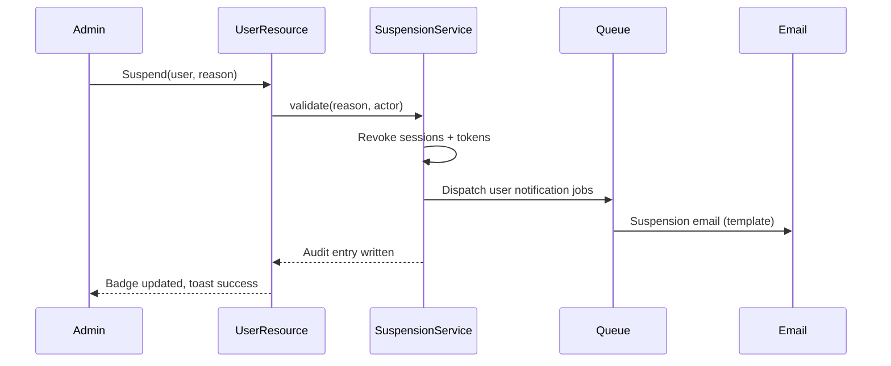
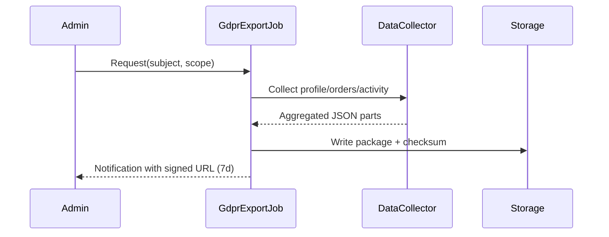
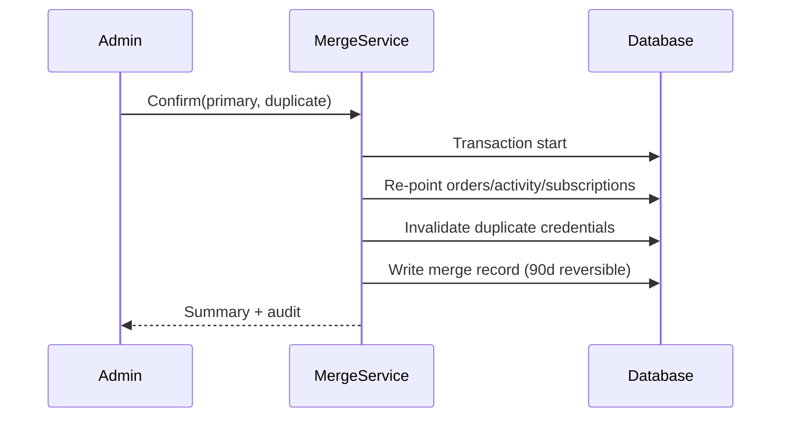

# 05.03.03.04 - Admin Users

**Project:** GsmUi
**Module:** Admin Panel - User Management
**Version:** 1.0.0

---

# Purpose

User management allows administrators to view, edit, and manage all registered users on the platform.

---

# User List View

## Table Columns

| Column | Description | Actions |
|--------|-------------|---------|
| Avatar | User avatar | - |
| Name | Full name | - |
| Email | Email address | - |
| Role | Assigned role | - |
| Status | Active/Suspended | Toggle |
| Subscription | Plan type | View |
| Created | Registration date | - |
| Last Login | Last activity | - |

## Filters

- Role filter (Admin, User, Pro, etc.)
- Status filter (Active, Suspended)
- Subscription filter (Free, Pro, Enterprise)
- Date range filter
- Search by name/email

## Actions

- Bulk edit roles
- Suspend/restore users
- Reset passwords
- View activity logs
- Export user list

---

# User Detail View

## Profile Information

- Basic info (name, email, avatar)
- Account status
- Subscription details
- Billing history
- Activity timeline

## Permissions

- Current role assignments
- Custom permission overrides
- Permission audit log

## Activity

- Login history
- Component uploads
- Marketplace purchases
- Documentation edits

---

# User Creation

Admin can create users with:

- Email invitation
- Password generation
- Role assignment
- Subscription plan
- Custom fields

---

# Security Features

- Password reset capability
- Two-factor authentication toggle
- Session management
- IP whitelist management
- Security audit log

---

# Export Options

- CSV export of user data
- JSON export for integration
- GDPR data export

---

# Filament Resource: UserResource Specification

## Resource Metadata

| Property | Value |
|----------|-------|
| Class | `App\Filament\Admin\Resources\UserResource` |
| Model | `App\Models\User` |
| Navigation group | Users |
| Navigation icon | `heroicon-o-user-group` |
| Record title attribute | `name` |
| Soft deletes | Yes (suspended users hidden by default) |
| Globally searchable | Yes (name, email) |
| Permission base | `users.view` |

## List Page Configuration

### Table Columns

| Column | Type | Sortable | Toggleable | Searchable | Notes |
|--------|------|----------|------------|------------|-------|
| Avatar | Image (Gravatar fallback) | No | No | No | 32px rounded-full |
| Name | Text | Yes | No | Yes | Links to view page |
| Email | Text (copyable) | Yes | No | Yes | Copied with toast |
| Roles | Badge group | No | No | No | Color per role level |
| Status | Badge | Yes | No | No | Active green / Suspended red / Pending amber |
| Subscription | Badge | Yes | Yes | No | Free gray / Pro blue / Enterprise purple |
| 2FA | Icon check | Yes | Yes | No | Shield icon if enrolled |
| Created | DateTime | Yes | Yes | No | Relative + absolute tooltip |
| Last Login | DateTime | Yes | No | No | "Never" for unverified |
| Actions | Action group | No | No | No | View, Edit, Suspend, Impersonate, More |

### Table Filters

| Filter | Type | Options | Default |
|--------|------|---------|---------|
| status | Ternary | Active / Suspended / All | Active |
| roles | Multi-select | All roles | — |
| subscription | Select | Free, Pro, Enterprise, Expired | — |
| email_verified | Ternary | Verified / Unverified | — |
| two_factor | Ternary | Enrolled / Not enrolled | — |
| created_at | Date range | — | — |
| last_login | Date range | — | — |
| country | Select (ISO) | — | — |
| trashed | Toggle | Include soft-deleted | Off |

### Bulk Actions

| Action | Permission | Confirmation | Notes |
|--------|------------|--------------|-------|
| Assign role | `users.roles` | Yes + password re-entry | Audit logged |
| Suspend | `users.suspend` | Yes with reason (required) | Revokes sessions |
| Restore | `users.suspend` | Yes | If suspended |
| Send reset email | `users.password` | Yes | Per-user throttle applies |
| Export selection | `users.export` | Yes | Respects current filters |
| Delete (soft) | `users.delete` | Yes, type-to-confirm | Super-admin cannot be deleted |

### List Performance Rules

- Default page size 25; max 100.
- Eager loads: `roles`, `subscriptions.active`.
- No per-row subqueries; subscription state via scope.
- List renders < 500ms at 100k users.

## View Page (Detail)

### Header Card

- Avatar, name, email (copy), status badge, subscription badge, registration date.
- Key actions: Edit, Suspend/Restore, Impersonate, Send email.

### Relation Managers (Tabs)

| Tab | Manager | Permission |
|-----|---------|------------|
| Profile | `ProfileRelationManager` (inline form) | `users.edit` |
| Roles | `RolesRelationManager` | `users.roles` |
| Security | `SecurityRelationManager` | `users.security` |
| Sessions | `ActiveSessionsRelationManager` | `users.security` |
| Activity | `UserActivityRelationManager` | `users.view` |
| Subscriptions | `SubscriptionsRelationManager` | `subscriptions.view` |
| Billing | `BillingHistoryRelationManager` | `finance.view` |
| Exports | `UserDataExportsRelationManager` | `users.export` |

## Edit Page

### Form Fields

| Field | Type | Validation | Editable By |
|-------|------|------------|-------------|
| name | Text | required, max 120 | `users.edit` |
| email | Email | required, email, unique (except self) | `users.edit.email` |
| avatar | Image upload | max 2MB, jpg/png/webp | `users.edit` |
| timezone | Select | tz database | `users.edit` |
| locale | Select | supported locales | `users.edit` |
| status | Toggle | — | `users.suspend` only |
| email_verified_at | DateTime (nullable) | — | `users.edit` |
| notes | Textarea | max 2000 | `support.*` |

### Edit Behaviors

- Changing email sends verification to new address; old kept until verified.
- Editing a super-admin's record requires sudo mode.
- All edits audited with attribute diff.

## Create Page (Admin Invitation Flow)

Admins do not create users directly with passwords; creation is invitation-based.

| Field | Type | Validation |
|-------|------|------------|
| email | Email | required, email:rfc,dns, unique |
| name | Text | required, max 120 |
| roles | Multi-select | at least one non-super role |
| subscription_plan | Select | Free, Pro (with trial), Enterprise |
| send_welcome_email | Toggle | default on |

### Create Behaviors

- Record created with status `pending`; invite email with setup link sent.
- If email exists as non-admin user: prompt to "Convert existing user to admin" (permission-gated).
- Invite tracked in `admin_invitations`; cancellable before acceptance.

---

# Livewire Components (Users Module)

| Component | Purpose | Polling |
|-----------|---------|---------|
| `UsersBulkBar` | Contextual bulk-action toolbar with selection count | None (event-driven) |
| `UserSecurityPanel` | 2FA status, reset 2FA, revoke sessions | None |
| `UserActivityTimeline` | Paginated activity with type filters | None |
| `ImpersonateControl` | Start/stop impersonation with reason entry | Countdown during session |
| `GdprExportRequest` | Self-service GDPR package request progress | Polls job status 10s |
| `UserMergeWizard` | Merge duplicate accounts (3-step) | None |
| `BulkRoleAssignProgress` | Streams progress for large bulk role operations | 3s during run |

## UserSecurityPanel Behavior

| Action | Permission | Confirmation | Effect |
|--------|------------|--------------|--------|
| View 2FA status | `users.security` | No | Shows enrollment date, method, backup codes remaining count |
| Reset 2FA | `users.security` | Yes + reason | Clears secret, forces re-enrollment on next login |
| Revoke all sessions | `users.security` | Yes | Invalidates all tokens/sessions; user emailed |
| Revoke single session | `users.security` | Yes | Specific device logged out |
| Force password reset | `users.password` | Yes | One-time reset link; expires 1h |

## UserMergeWizard Steps

1. **Identify**: Select primary + duplicate account (search by email).
2. **Review**: Preview merge impact table (what moves to primary, what conflicts).
3. **Confirm**: Type primary email to confirm; job queued.

### Merge Rules

| Data | Rule |
|------|------|
| Profile fields | Primary wins; blank fields may inherit from duplicate |
| Subscriptions | All active moved to primary; duplicates refund-flagged |
| Orders | Owner changed to primary |
| Activity logs | Re-pointed to primary with merge annotation |
| Login credentials | Duplicate invalidated; sessions revoked |
| Audit | Full merge record with before/after references |

Merge requires `users.merge` permission (super-admin only) and is irreversible (soft-kept 90 days for audit restoration requests).

## ImpersonateControl Rules

- Reason required (min 20 chars), stored with session.
- Banner shown in impersonated session; 60-minute hard cap.
- Blocked during impersonation: settings changes, role changes, exports, impersonating others.
- Dual attribution on all impersonated actions.

---

# Admin User Flows

## Flow: Suspend an Abusive User

| Step | Action | System Response |
|------|--------|-----------------|
| 1 | Locate user via search | Row actions visible |
| 2 | Click Suspend | Modal with reason field |
| 3 | Enter reason (min 10 chars) | Validation enforced |
| 4 | Confirm | Sessions revoked, `UserSuspended` event, email to user with appeal info |
| 5 | Audit | Entry with actor, reason, before/after status |
| 6 | UI | Status badge red; Restore button appears |

## Flow: Grant Temporary Role

| Step | Action | System Response |
|------|--------|-----------------|
| 1 | Open user Roles tab | Current roles listed |
| 2 | Add role + optional expiry | Expiry picker (1-90 days) |
| 3 | Save | Role assigned with `expires_at`; confirmation |
| 4 | Expiry job | Auto-revoke at expiry; notification to assigner |
| 5 | Audit | Assignment + auto-revocation both logged |

## Flow: Investigate Login Anomaly

| Step | Action | Outcome |
|------|--------|---------|
| 1 | Security center flags burst for user | Deep link to user Security tab |
| 2 | Review login history table | IPs, geos, devices, failures |
| 3 | Compare with session list | Identify foreign sessions |
| 4 | Revoke suspicious sessions | User notified |
| 5 | If compromise suspected | Force password reset + reset 2FA |
| 6 | Document | Investigation note field (audit-visible) |

## Flow: GDPR Data Request Handling

| Step | Action | Outcome |
|------|--------|---------|
| 1 | Request logged from support ticket | Admin opens user Exports tab |
| 2 | Trigger GDPR export | Job queued: profile, orders, activity, content |
| 3 | Progress shown | Job status + partial file list |
| 4 | Completion | Signed URL (7 days) + download audit |
| 5 | Fulfillment note | Mark ticket resolved; audit retains metadata |

## Flow: Bulk Role Assignment (e.g., migrate all Pro users to team role)

| Step | Action | Outcome |
|------|--------|---------|
| 1 | Filter Pro users | Selection count shown |
| 2 | Select all (across pages) | Confirmation of total N |
| 3 | Bulk assign role | Password re-entry + review modal |
| 4 | Progress streamed | 1000 users in < 5s target |
| 5 | Completion | Summary: assigned, skipped (already had role), errors |
| 6 | Audit | Bulk entry + per-user diff entries |

---

# Permission Checks (Users Module)

| Permission | Grants |
|------------|--------|
| `users.view` | List, search, view detail |
| `users.edit` | Edit non-sensitive profile fields |
| `users.edit.email` | Change email addresses |
| `users.create` | Invite new users |
| `users.delete` | Soft delete users |
| `users.suspend` | Suspend/restore |
| `users.roles` | Assign/revoke roles |
| `users.merge` | Merge duplicates (super-admin) |
| `users.security` | 2FA reset, session management |
| `users.password` | Force password resets |
| `users.export` | Export user data |
| `users.export-pii` | Include unmasked emails in exports |
| `users.impersonate` | View-as sessions |
| `users.view-pii` | See full PII on detail pages |

## Enforcement Points

| Layer | Mechanism |
|-------|-----------|
| Navigation | Items hidden without `users.view` |
| Route | Middleware gate per resource page |
| Table actions | `->authorize()` per action |
| Form fields | Field-level visibility by permission |
| API | Scope checks on every endpoint |
| Jobs | Re-verified in handlers (defense in depth) |

## Super-Admin Protections

- Super-admin records require sudo mode to edit.
- Super-admins cannot be suspended/deleted/merged by any other role.
- Last remaining super-admin cannot be demoted (system refuses with redirect to reassignment).
- Changes to super-admin role membership notify all other super-admins.

---

# API Contract (Users)

| Method | Endpoint | Permission | Rate Limit |
|--------|----------|------------|-----------|
| GET | `/api/admin/users` | `users.view` | 60/min |
| GET | `/api/admin/users/{id}` | `users.view` | 120/min |
| POST | `/api/admin/users` (invite) | `users.create` | 20/day |
| PUT | `/api/admin/users/{id}` | `users.edit` | 60/min |
| POST | `/api/admin/users/{id}/suspend` | `users.suspend` | 30/min |
| POST | `/api/admin/users/{id}/restore` | `users.suspend` | 30/min |
| PUT | `/api/admin/users/{id}/roles` | `users.roles` | 30/min |
| POST | `/api/admin/users/{id}/reset-2fa` | `users.security` | 10/hour |
| DELETE | `/api/admin/users/{id}/sessions` | `users.security` | 10/hour |
| POST | `/api/admin/users/{id}/password-reset` | `users.password` | 5/hour |
| POST | `/api/admin/users/bulk/roles` | `users.roles` | 5/hour |
| POST | `/api/admin/users/{id}/gdpr-export` | `users.export` | 3/day |
| GET | `/api/admin/users/{id}/activity` | `users.view` | 60/min |
| GET | `/api/admin/users/{id}/sessions` | `users.security` | 30/min |

## List Query Parameters

| Param | Type | Default | Validation |
|-------|------|---------|------------|
| `page` | int | 1 | ≥1 |
| `per_page` | int | 25 | 10-100 |
| `sort` | string | `-created_at` | whitelisted columns |
| `status` | string | all | active/suspended/pending |
| `role` | csv | — | role slugs |
| `subscription` | string | — | free/pro/enterprise/expired |
| `q` | string | — | name/email match |
| `created_from` / `created_to` | date | — | ≤ today |

## GET `/api/admin/users` Response

```json
{
  "data": [
    {
      "id": 4821,
      "name": "Jane Doe",
      "email": "jane@example.com",
      "roles": ["moderator"],
      "status": "active",
      "subscription": "pro",
      "two_factor": true,
      "created_at": "2026-01-14T09:00:00Z",
      "last_login_at": "2026-08-16T21:12:00Z"
    }
  ],
  "links": { "next": "/api/admin/users?page=2" },
  "meta": { "total": 18432, "per_page": 25, "page": 1 }
}
```

## PUT `/api/admin/users/{id}` Request

```json
{
  "name": "Jane Doe-Smith",
  "timezone": "Europe/Berlin",
  "notes": "Account verified via support call 2026-08-01"
}
```

## POST `/api/admin/users/{id}/suspend` Request

```json
{ "reason": "Spam submissions after warning emails", "notify_user": true }
```

## Error Responses (Module-Specific)

| Code | Condition |
|------|-----------|
| `super_admin_protected` | Mutation attempted on super-admin |
| `last_super_admin` | Demotion would leave none |
| `self_mutation_blocked` | Admin acting on own account for sensitive ops |
| `merge_conflict` | Both accounts hold conflicting active subscriptions |
| `session_limit` | Too many session revocations in window |

---

# Events

| Event | Trigger | Listeners |
|-------|---------|-----------|
| `UserInvited` | Invite sent | Email, audit, invitation tracker |
| `UserSuspended` | Suspend action | Session revoker, email, audit, activity log |
| `UserRestored` | Restore action | Email, audit |
| `UserRolesChanged` | Role add/remove | Permission cache invalidation, audit, notification |
| `UserTwoFactorReset` | 2FA reset | Email to user, audit, security center |
| `UserSessionsRevoked` | Session purge | Audit, user notification |
| `UserPasswordResetForced` | Force reset | Email, audit |
| `UserMerged` | Merge completed | Data re-pointing jobs, audit, notification |
| `UserRoleExpired` | Temporary role TTL hit | Cache invalidation, notification to assigner |
| `GdprExportCompleted` | Export ready | Signed URL notification, audit |

---

# Database Schema

## users (admin-relevant columns)

| Column | Type | Notes |
|--------|------|-------|
| id | bigint PK | |
| name | varchar(120) | indexed |
| email | varchar(255) unique | indexed |
| email_verified_at | timestamp nullable | |
| password | varchar | argon2id hash, never rendered |
| two_factor_secret | text nullable | encrypted |
| two_factor_enrolled_at | timestamp nullable | |
| status | enum | active/suspended/pending, indexed |
| timezone | varchar(64) | default UTC |
| locale | varchar(8) | default en |
| notes | text nullable | admin-visible only |
| suspended_at | timestamp nullable | |
| suspended_by | bigint nullable FK | |
| suspension_reason | varchar(500) nullable | |
| last_login_at | timestamp nullable | indexed |
| last_login_ip | varchar(45) nullable | v4/v6 |
| deleted_at | timestamp nullable | soft delete |
| created_at / updated_at | timestamps | |

## user_sessions

| Column | Type | Notes |
|--------|------|-------|
| id | bigint PK | |
| user_id | bigint FK | indexed |
| token_hash | varchar unique | |
| device_name | varchar | parsed from UA |
| ip_address | varchar(45) | |
| geo_country | varchar(2) | MMDB lookup on create |
| last_activity_at | timestamp | indexed |
| is_current | bool | |
| revoked_at | timestamp nullable | |

## user_login_history

| Column | Type | Notes |
|--------|------|-------|
| id | bigint PK | |
| user_id | bigint FK | indexed with created_at |
| status | enum | success/failed/locked/blocked |
| ip_address | varchar(45) | |
| user_agent_hash | varchar | |
| geo_country | varchar(2) | |
| failure_reason | varchar nullable | bad_password/2fa_failed/rate_limited |
| created_at | timestamp | indexed DESC |

## user_data_exports

| Column | Type | Notes |
|--------|------|-------|
| id | bigint PK | |
| user_id | bigint FK (subject) | |
| requested_by | bigint FK (admin) | |
| scope | varchar | gdpr/standard/custom |
| status | enum | queued/running/completed/failed |
| file_path | varchar nullable | |
| checksum | varchar nullable | |
| expires_at | timestamp nullable | |
| created_at | timestamp | indexed |

## user_merge_records

| Column | Type | Notes |
|--------|------|-------|
| id | bigint PK | |
| primary_user_id | bigint FK | |
| duplicate_user_id | bigint FK | |
| performed_by | bigint FK | |
| summary_json | json | moved/conflict details |
| created_at | timestamp | |
| reversible_until | timestamp | 90 days |

## Indexes

| Table | Index | Purpose |
|-------|-------|---------|
| users | (status, created_at) | List filtering |
| users | (email) | Unique lookup |
| user_sessions | (user_id, revoked_at) | Active sessions query |
| user_login_history | (user_id, created_at DESC) | Security timeline |
| user_data_exports | (user_id, created_at) | GDPR history |

---

# Testing Specification

## Unit Tests

| Area | Cases |
|------|-------|
| Suspension service | Reason required, sessions revoked, email queued |
| Role expiry job | Auto-revoke at TTL, notification sent |
| Merge rules | Field precedence, subscription conflict flagging |
| Login history categorization | Failure reason mapping |
| Export scope builder | PII masking per permission |

## Feature Tests

| Area | Cases |
|------|-------|
| List permissions | Role matrix → visible columns/actions |
| Create/invite | Dup email existing-user conversion path |
| Suspend/restore lifecycle | Events fired, badges update |
| Bulk role assign | Progress, skip logic, audit entries |
| GDPR export | Request → job → signed URL → expiry |
| Session management | Revoke all/single, current session guard |
| Super-admin protections | All blocked mutations return proper codes |
| Self-mutation blocks | Admin can't suspend own account |
| Impersonation | Reason validation, cap, blocked nav |
| User merge | Wizard guards, irreversibility window |

## Browser Tests (Playwright)

| Area | Cases |
|------|-------|
| List rendering | 100k users paged < 500ms |
| Filters + saved views | State in URL, shareable |
| Bulk bar | Selection across pages, confirmation modals |
| Security panel | Reset flow dialogs, countdown |
| Activity timeline | Pagination, type filter |
| Merge wizard | Step navigation, confirmation typing |
| Detail tabs | Deep links with `?tab=` |
| Accessibility | Focus management in modals, badge contrast |

## Test Case Table

| ID | Type | Given | When | Then |
|----|------|-------|------|------|
| USR-001 | Feature | User active | Suspend with reason | Status suspended, sessions gone, email sent |
| USR-002 | Feature | Suspended user | Restore | Status active, audit entry |
| USR-003 | Feature | Suspend modal | Empty reason | Validation error inline |
| USR-004 | Feature | Super-admin target | Attempt suspend | `super_admin_protected` 409 |
| USR-005 | Feature | Single super-admin | Attempt demote | `last_super_admin` 409 |
| USR-006 | Feature | Duplicate email invite | POST users | Existing-user conversion prompt |
| USR-007 | Feature | Bulk assign 1000 | Execute | < 5s, correct skipped count |
| USR-008 | Feature | GDPR export | Complete | Signed URL valid 7 days, checksum match |
| USR-009 | Feature | Revoke all sessions | Execute | user_sessions revoked, notification |
| USR-010 | Feature | Reset 2FA | Execute | Secret null, re-enroll on next login |
| USR-011 | Feature | Impersonate without reason | Start | Blocked with validation |
| USR-012 | Feature | Impersonate > 60min | Next request | Session terminated |
| USR-013 | Feature | Merge with active sub conflict | Review step | Conflict flagged, refund option |
| USR-014 | Feature | Role expiry tomorrow | Job runs at TTL | Role removed, notification |
| USR-015 | Browser | Filter status=suspended | URL | Shareable link reproduces list |
| USR-016 | Browser | Select across 3 pages | Bulk bar count | Correct total shown |
| USR-017 | Feature | Export without users.export-pii | CSV | Emails masked |
| USR-018 | Feature | 6th password reset in hour | POST | 429 rate limited |
| USR-019 | Browser | Open security tab deep link | `?tab=security` | Tab active |
| USR-020 | Feature | Login burst on user | Security center link | History shows failures by IP |
| USR-021 | Unit | Merge field precedence | Run merge | Primary wins, blanks inherit |
| USR-022 | Unit | Failure reason map | bad_password | Categorized correctly |
| USR-023 | Browser | Bulk modal | Re-enter password | Success proceeds |
| USR-024 | Feature | Delete super-admin | Attempt | Blocked |
| USR-025 | Feature | Notes field XSS payload | Save | Escaped, never rendered raw |

---

# Security Detail

| Control | Implementation |
|---------|----------------|
| Password storage | argon2id via Laravel defaults |
| PII display | `users.view-pii` gates full emails/IPs; others see masked |
| IP display | Full IP only for `users.security`; others see /24 truncated |
| Session tokens | Hashed at rest; device name from trusted UA parse only |
| Audit redaction | Password/2FA fields never in diffs |
| Rate limits | Per module matrix (see API table) |
| CSRF | All mutations via Filament/Livewire tokens |
| Enumeration guard | Same message for "not found" and "forbidden" on user endpoints |
| GDPR | Export + delete (soft + anonymization after retention) workflows |

## Anonymization (Post-Retention Delete)

When retention expires after legitimate delete request:

- name → "Deleted User", email → `deleted-{id}@example.invalid`
- avatar removed, notes cleared, IP fields nulled
- activity logs retained with anonymized actor (audit requirement)

---

# Notifications (Users Module)

| Notification | Recipient | Channel |
|--------------|-----------|---------|
| Account suspended | User | Email |
| Account restored | User | Email |
| Role assigned/expired | User + assigner | Email + database |
| Sessions revoked | User | Email |
| 2FA reset | User | Email |
| Password reset forced | User | Email |
| GDPR export ready | Requesting admin | Database + email |
| Merge completed | Performing admin | Database |

---

# Export Detail

## Standard Export Fields

| Scope | Fields | Masking Rule |
|-------|--------|--------------|
| list | id, name, email, roles, status, subscription, created_at, last_login_at | Email masked without `users.export-pii` |
| detail-single | Full profile minus credentials | Requires `users.export` + target notification optional |
| gdpr | All user-related data (orders, activity, content) | None (subject's own data), 7-day URL |
| security | Login history, sessions | IPs masked without `users.security` |

## CSV Conventions

- UTF-8 with BOM for spreadsheet compatibility.
- Headers snake_case; booleans as `true/false`.
- Timestamps ISO 8601 UTC with `+00:00` suffix.
- First row after header may include `# timezone=UTC` comment (skipped by parser config).

---

# Performance Targets

| Operation | Target |
|-----------|--------|
| User list (100k rows) first paint | < 500ms |
| User detail hydration | < 400ms |
| Search typeahead | < 300ms |
| Bulk assign 1000 users | < 5s |
| GDPR export (typical user) | < 60s |
| Session list load | < 200ms |
| Activity timeline page | < 300ms |

---

# Empty & Error States

| State | Presentation |
|-------|--------------|
| No users found for filters | Empty pattern with clear-filters action |
| User not found (deleted) | Redirect to list + toast "User no longer exists" |
| Export job failed | Retry button + error summary |
| Merge blocked (conflict) | Review step highlights conflicts |
| Session geolocation unavailable | "Unknown" shown, no breakage |

---

# Accessibility

| Area | Implementation |
|------|----------------|
| Table headers | Sortable headers as buttons with `aria-sort` |
| Bulk selection | Checkbox row labels; select-all announces count |
| Status badges | Color + text always |
| Modals | Focus trap, reason field labeled, errors linked |
| Timeline | Semantic list with timestamps |
| Keyboard | Row actions reachable via menu key shortcut |

---

# Edge Cases

| # | Scenario | Behavior |
|---|----------|----------|
| 1 | User deleted while admin viewing detail | Hydration fails gracefully → redirect list + toast |
| 2 | Email change to existing email | Validation blocks with suggestion to merge |
| 3 | Suspend already-suspended | Idempotent success, no duplicate email |
| 4 | Bulk op with mixed suspended users | Skip count reported |
| 5 | Session IP rotated mid-view | Device fingerprint grouping keeps row stable |
| 6 | Timezone unknown in profile | Display UTC with note |
| 7 | Gravatar blocked by CSP | Local fallback avatar (initials) |
| 8 | Merge self as target | Blocked (`self_mutation_blocked`) |
| 9 | GDPR export re-requested during run | Returns existing job status |
| 10 | Suspension reason XSS attempt | Stored as text, escaped everywhere |

---

# Open Questions

| # | Question | Owner | Due |
|---|----------|-------|-----|
| 1 | Should temporary role auto-renewal be supported? | Product | v1.1 |
| 2 | User notes field: shared team visibility vs private? | Product/Privacy | v1.0 |
| 3 | Login history retention beyond 90 days for enterprise? | Compliance | v1.1 |
| 4 | Merge support for cross-org accounts in multi-tenant mode? | Product | v1.2 |

---

# Sign-Off (Users)

| Role | Name | Date | Decision |
|------|------|------|----------|
| Product Lead | — | — | Pending |
| Engineering Lead | — | — | Pending |
| Security Lead | — | — | Pending |
| Privacy Officer | — | — | Pending |

---

# User Detail View — Extended Layout Specification

## Page Header (Sticky)

| Element | Specification |
|---------|---------------|
| Avatar | 64px, fallback initials |
| Name | text-xl semibold; copy button beside |
| Email | Monospace, copy, verification badge |
| Status badge | Active/Suspended/Pending with tooltip reason |
| Subscription badge | Plan + renews date tooltip |
| Quick actions | Edit, Suspend, Impersonate, Email (permission-gated) |

## Tab Deep-Dive: Profile

Inline editable card with audit on save.

| Field Group | Fields |
|-------------|--------|
| Identity | name, email (guarded), avatar |
| Preferences | timezone, locale |
| Status | status toggle (sudo for suspended→active) |
| Notes | Admin notes textarea with history expander |

## Tab Deep-Dive: Roles

| Element | Behavior |
|---------|----------|
| Current roles | Chips with expiry countdown where set |
| Add role | Picker with inheritance preview |
| Remove | Confirmation with affected access summary |
| History | Timeline of grants/revokes with actors |

## Tab Deep-Dive: Security

### 2FA Card

| Row | Detail |
|-----|--------|
| Status | Enrolled date, method (TOTP), backup codes remaining |
| Actions | Reset (sudo), view recovery options |

### Sessions Table

| Column | Notes |
|--------|-------|
| Device | Parsed name + OS icon |
| Location | Country + city (MMDB), "Unknown" fallback |
| IP | Truncated without `users.security` |
| Last active | Relative |
| Current | Badge on own session view |
| Actions | Revoke (individual) |

### Login History

| Column | Notes |
|--------|-------|
| Timestamp | Admin timezone |
| Result | success/failed/locked/blocked badges |
| Reason | Only for failures (bad_password, 2fa_failed, rate_limited) |
| IP + geo | Masked per permission |
| Filter | Result type, 7/30/90 day windows |

## Tab Deep-Dive: Activity

Unified timeline from `dashboard_activity_log` + user-scoped events:

| Filter | Options |
|--------|---------|
| Type | logins, uploads, purchases, comments, edits |
| Range | 7d/30d/90d/all |

Pagination via cursor; deep links per entry.

## Tab Deep-Dive: Subscriptions

| Column | Notes |
|--------|-------|
| Plan | Name + tier badge |
| Status | active/trialing/past_due/canceled/expired |
| Period | Current cycle dates |
| Next billing | Date + amount |
| Payment method | Brand + last 4 (masked full) |
| Actions | Cancel at period end, refund link to Orders |

## Tab Deep-Dive: Billing

| Element | Notes |
|---------|-------|
| Invoices table | Date, amount, status, PDF link |
| Refunds | Linked to Orders module |
| Payment events | Webhook event timeline (declines, disputes) |
| Access | `finance.view` required |

---

# Invitation System Detail

## Invitation Email Anatomy

| Section | Content |
|---------|---------|
| Subject | "You've been invited to {Platform} admin" |
| Greeting | Personalized with inviter name |
| CTA | "Set up account" button → signed setup link |
| Expiry note | 72h default |
| Footer | Org identity + support contact |

## Setup Page Steps

1. Password creation (min 12, breach-checked via k-anonymity API).
2. Name confirmation.
3. TOTP enrollment (QR + code confirm + backup codes one-time view).
4. Landing on dashboard with onboarding checklist.

## Invitation States & Guards

| State | Guards |
|-------|--------|
| pending | Resend allowed (24h cooldown), revoke anytime |
| accepted | Terminal; audit links to created user |
| expired | Resend creates new token (old invalidated) |
| revoked | Link dead; reason recorded |

Anti-abuse: 20 invitations/day per admin; global send rate monitored; bounces block same address 24h.

---

# Suspension & Restoration Detail

## Suspension Side Effects (Atomic)

| Effect | Mechanism |
|--------|-----------|
| Sessions revoked | Token hashes deleted; WebSocket channels disconnected |
| API tokens disabled | Sanctum tokens flagged; scope checks deny |
| Public content hidden | Component/template listings filtered (soft) |
| Checkout blocked | Payment intent creation denied with guidance |
| Email notification | Reason summary + appeal contact |
| Audit | Full before/after, reason, actor |

## Restoration Side Effects

- Content re-listed; tokens remain revoked (user must re-authenticate).
- Welcome-back email with security checklist.
- Audit entry with restoring actor.

## Suspension Appeal Flow

1. User replies or files ticket citing suspension notice ID.
2. Support views case via user detail (suspension card with history).
3. Decision: uphold (extend reason) or restore (with conditions note).
4. All appeal steps logged in user timeline.

---

# GDPR & Data Privacy Workflows

## Right to Access (Export)

| Step | Owner | SLA |
|------|-------|-----|
| Request received (support/admin) | Support | Log within 24h |
| Validate requester identity | Support | 48h |
| Trigger GDPR export | Admin (`users.export`) | Immediate |
| Package ready | System | < 24h |
| Delivery | Secure link | 7-day expiry |

Package contents: profile, preferences, subscriptions, orders, activity, comments, uploads inventory. Credentials never included.

## Right to Erasure

1. Legal validation (retention exceptions: billing records, fraud holds).
2. Soft delete user; anonymization scheduled after 30-day grace.
3. Related content policy: authored public content anonymized (author → "Deleted User").
4. Audit retains redacted record of erasure (compliance proof).

## Data Minimization Rules

- Last-login IP retained 90 days then nulled.
- Session history pruned to 30 days rolling.
- Marketing consent separate from account data, revocable independently.

---

# Bulk Operations Deep-Dive

## Bulk CSV Contract

| Column | Required | Validation |
|--------|----------|------------|
| email | Yes | RFC 5322, lowercased |
| action | Yes | assign_role / remove_role / suspend / restore |
| role | Conditional | slug exists (for role actions) |
| reason | Conditional | ≥ 10 chars (suspend) |

Report output mirrors input + `result` column (applied/skipped/error + code).

## Bulk Job Chunking

| Parameter | Value |
|-----------|-------|
| Chunk size | 200 users/transaction |
| Parallelism | Single worker (ordering guarantees) |
| Progress events | Per-chunk percentage to UI |
| Failure policy | Continue on row errors; collect report |
| Timeout | 10 minutes hard; resumable for remainder |

## Bulk Audit

- Parent entry: actor, action, input hash, total/counts.
- Child entries: per-user diff (suppressed in UI beyond 100 rows; available via export).

---

# Notification Templates (Users) — Full Copy Table

| Notification | Subject | Preview Line |
|--------------|---------|--------------|
| Suspended | "Your account has been suspended" | "Reason: {reason summary}. Contact support to appeal." |
| Restored | "Your account has been restored" | "Welcome back. Please review your security settings." |
| Role assigned | "Your access level was updated" | "You now have: {role}." |
| Role expired | "Temporary access expired" | "Your {role} access ended on {date}." |
| Sessions revoked | "All sessions were signed out" | "If this wasn't you, reset your password immediately." |
| 2FA reset by admin | "Your two-factor setup was reset" | "Re-enroll at next sign-in." |
| Password reset required | "Password reset required" | "An administrator requested a reset. Link expires in 1 hour." |
| GDPR export ready | "Your data export is ready" | "Download within 7 days." |

All copy localized; placeholders never leak raw internal values.

---

# Audit & Compliance (Users)

## Audit Entry Types

| Action | Fields |
|--------|--------|
| `user.invited` | inviter, email, role, expiry |
| `user.suspended` | actor, subject, reason, session count revoked |
| `user.restored` | actor, subject |
| `user.roles.changed` | actor, subject, grants/revokes, expiry, reason |
| `user.2fa.reset` | actor, subject, reason |
| `user.sessions.revoked` | actor, subject, scope (all/single) |
| `user.password.reset_forced` | actor, subject |
| `user.merged` | actor, primary, duplicate, summary |
| `user.export.generated` | admin, subject, scope |
| `user.anonymized` | system, subject ref, legal basis |

## Retention

| Data | Retention |
|------|-----------|
| Audit entries | 7 years |
| Login history | 90 days |
| Session records | 30 days |
| Suspension reasons | Indefinite (audit) |
| Merge records | 90 days reversible window + permanent summary |

---

# Performance Optimization Notes

| Technique | Application |
|-----------|-------------|
| Counter caches | Sessions count, logins count |
| Eager loading | roles + active subscription on list |
| Scopes | Status filters as partial indexes |
| Cursor pagination | Activity/login history (no offset drift) |
| Async heavy ops | Merge, bulk, GDPR exports via queue |
| Cache | Role chips cached per permission version |

---

# Accessibility Matrix (Users)

| Surface | Requirement | Implementation |
|---------|-------------|----------------|
| List table | Sort announcements | `aria-sort` updates |
| Bulk bar | Live count | `aria-live="polite"` |
| Suspend modal | Reason label + error linking | `aria-describedby` |
| Security tables | Status text not color-only | Badges with words |
| Impersonation banner | Persistent announcement | Assertive region on start |
| Timeline | Semantic list | `<ol>` with timestamps |
| Merge wizard | Step headings | `aria-current="step"` |

---

# Integration Points

| System | Integration | Contract |
|--------|-------------|----------|
| Orders | Billing tab, refund links | `order.user_id` |
| Components | Author profile, moderation notes | `component.author_id` |
| Blog | Author byline management | `post.author_id` |
| Support tickets | Suspension cases linking | Case → user deep link |
| Email service | Transactional templates | Template IDs per notification |
| Analytics | Anonymized funnel IDs | No PII export |

---

# Runbook (Users Module)

## Symptom: User reports locked out after suspension

1. Verify status in admin (may be restored already).
2. Check `suspended_at` vs report time.
3. If restored but still failing: sessions clean check; force password reset.
4. Confirm 2FA state; reset if locked out.
5. Document resolution in user notes + ticket.

## Symptom: Mass session revocation needed (incident)

1. Security center confirms compromise scope (IP/device fingerprint).
2. Bulk sessions purge via Security tab (per-user) or incident script (batched).
3. Notify affected users with incident template.
4. Monitor login failures for replay attempts.
5. Post-incident report with audit references.

## Symptom: GDPR export job stuck

1. Check job in Horizon; inspect exception.
2. Retry from Exports tab (max 2 retries).
3. If repeated failure, scope reduction (exclude heavy media list) and manual follow-up.
4. Log incident if SLA (>24h) at risk.

---

# Change Log (Users)

| Version | Date | Changes |
|---------|------|---------|
| 1.0.0 | 2026-08-17 | Full expansion: resource specs, flows, API, tests, GDPR |

---

# Appendix: User Module Test Fixtures

| Fixture | Description |
|---------|-------------|
| `user-active-pro` | Active, Pro plan, 2FA enrolled |
| `user-suspended` | Suspended with reason |
| `user-pending-invite` | Invitation not accepted |
| `user-multi-role` | Two roles with one expiring |
| `super-admin-primary` | Protected super-admin |
| `user-gdpr-hold` | Erasure hold (billing) |
| `user-compromised` | Session burst fixture for security tests |

---

# Appendix: End of Users Spec

---

# Appendix: User List Advanced Query Recipes

## Saved View SQL Sketches

### Recent signups (7d)

```sql
SELECT id, name, email, status, created_at
FROM users
WHERE created_at >= NOW() - INTERVAL 7 DAY
  AND deleted_at IS NULL
ORDER BY created_at DESC;
```

### Suspended with active subscriptions (edge review)

```sql
SELECT u.id, u.name, u.suspended_at, s.plan
FROM users u
JOIN subscriptions s ON s.user_id = u.id
WHERE u.status = 'suspended'
  AND s.status = 'active'
  AND (s.ends_at IS NULL OR s.ends_at > NOW());
```

### Users without login in 180d (dormant)

```sql
SELECT u.id, u.email, u.last_login_at
FROM users u
WHERE (u.last_login_at IS NULL OR u.last_login_at < NOW() - INTERVAL 180 DAY)
  AND u.status = 'active'
  AND u.deleted_at IS NULL;
```

---

# Appendix: User Search Behavior Detail

| Input | Match Strategy |
|-------|----------------|
| `jane` | Prefix on name, token on email local-part |
| `jane@example.com` | Exact email match prioritized |
| `4821` | Exact ID match if numeric |
| `@moderator` | Role macro (role:moderator filter applied) |
| `status:suspended` | Structured filter macro |

Macros documented in admin search help overlay.

---

# Appendix: Impersonation Audit Trail Fields

| Field | Example |
|-------|---------|
| impersonator_id | 42 |
| impersonated_user_id | 4821 |
| reason | "Support ticket #9921: user reports checkout error" |
| started_at | ISO timestamp |
| ended_at | ISO or `hard_cap` marker |
| ended_by | self_exit / hard_cap / logout |
| actions_count | 14 |
| routes_visited | ["/admin/marketplace/orders/8821", "/admin/users/4821"] |

Impersonation records queryable in Security Center with 7-year retention.

---

# Appendix: User Notes Standards

| Rule | Detail |
|------|--------|
| Purpose | Internal support context only |
| Length | 2000 chars max |
| History | Append-only view expander (last 10 entries) |
| Prohibited | PII beyond what the case requires, opinions about protected classes |
| Visibility | Held to role; subject never sees notes |
| Audit | Edit/delete of notes logged |

---

# Appendix: Email Change Verification Flow

1. Admin updates email → verification mail sent to NEW address.
2. Old email receives notice: "Your email was changed from X to Y".
3. New link valid 24h; single use.
4. Until verified: `email_verified_at` null for new; old shown with "change pending" badge.
5. Expired change auto-reverts with notification to admin.
6. Audit records both addresses (old masked in exports unless PII permission).

---

# Appendix: Two-Factor Enrollment States

| State | Field Signal | Admin View |
|-------|--------------|------------|
| Not enrolled | `two_factor_enrolled_at` null | Gray shield with CTA tooltip |
| Enrolled | Timestamp set | Green shield with method |
| Reset pending | Secret cleared, flag set | Amber shield "re-enroll required" |
| Recovery code used recently | `recovery_used_at` | Note in security tab |

Enforced-2FA roles: login blocked with setup redirect until enrolled.

---

# Appendix: Account Lifecycle Diagram

```
invited --> pending --> active --> (suspended <-> restored) --> deleted --> anonymized
                \-> expired invite (resend path)
active --> merged-into-primary (duplicate resolved)
```

Each transition emits an event and audit entry; invalid transitions rejected by state machine.

---

# Appendix: Localization (Users)

| Key | English |
|-----|---------|
| `admin::users.status.active` | Active |
| `admin::users.status.suspended` | Suspended |
| `admin::users.actions.suspend` | Suspend account |
| `admin::users.modal.suspend.title` | Suspend this user? |
| `admin::users.modal.suspend.reason_label` | Reason (required) |
| `admin::users.security.revoke_all` | Revoke all sessions |
| `admin::users.gdpr.export_ready` | Data export ready for download |

All keys required in supported locales; CI gate on missing translations.

---

# Appendix: Error Toast Catalog (Users)

| Situation | Toast |
|-----------|-------|
| Super-admin protected | "System administrators can only be modified by the account owner." |
| Last super-admin | "Cannot remove the last platform administrator. Assign another first." |
| Rate limited reset | "Too many password resets. Try again in {minutes}." |
| Merge conflict | "These accounts have conflicting subscriptions. Resolve via refund first." |
| Self-action blocked | "You cannot perform this action on your own account." |
| Session revoke failed | "Session could not be revoked. Retry or escalate to security." |

---

# Appendix: Weekly User-Ops Checklist (Template)

| Day | Task |
|-----|------|
| Mon | Review new pending invitations (>48h) |
| Tue | Dormant users report (180d) for retention campaign |
| Wed | Suspension appeals queue triage |
| Thu | Login anomaly findings review (Security Center) |
| Fri | GDPR request SLA status check |

---

# Appendix: Data Dictionary Excerpt (Users)

| Field | Sensitivity | Masking Rule |
|-------|-------------|--------------|
| email | PII | Mask without `users.view-pii` |
| last_login_ip | PII | /24 truncation without `users.security` |
| two_factor_secret | Secret | Never displayed; encrypted at rest |
| suspension_reason | Internal | Shown to support+ |
| notes | Internal | Held to role |
| avatar_url | Low | Public |

---

# Appendix: Capacity Planning

| Metric | Current | 12-Month Projection | Action Threshold |
|--------|---------|---------------------|------------------|
| Total users | 18,432 | 45,000 | Index review at 100k |
| Login history rows/day | ~25k | ~70k | Partition at 10M rows |
| Sessions active | ~4k | ~12k | Redis memory watch |
| GDPR exports/month | 12 | 40 | Queue capacity |

---

# Appendix: Definition of Done (Users Module)

- [ ] All USR-* test cases green
- [ ] Permission matrix sweep complete
- [ ] GDPR workflows verified with legal
- [ ] Impersonation guardrails exercised (all blocks)
- [ ] Bulk operations proven at 5,000-row scale
- [ ] Merge wizard reversible-window restore tested
- [ ] Notification templates localized
- [ ] Runbooks published and drilled
- [ ] Accessibility audit passed
- [ ] Sign-offs recorded

---

# Appendix: Version History (Users Spec)

| Version | Date | Author | Summary |
|---------|------|--------|---------|
| 0.1 | 2026-08-01 | Platform | Outline |
| 1.0.0 | 2026-08-17 | Platform | Full expansion |

---

# Appendix: User Module API Examples (Complete)

## GET `/api/admin/users/4821` Response

```json
{
  "data": {
    "id": 4821,
    "name": "Jane Doe",
    "email": "jane@example.com",
    "status": "active",
    "roles": [
      { "slug": "moderator", "assigned_at": "2026-02-01T10:00:00Z", "expires_at": null }
    ],
    "subscription": { "plan": "pro", "status": "active", "renews_at": "2026-09-01T00:00:00Z" },
    "two_factor": { "enrolled": true, "method": "totp", "enrolled_at": "2026-02-02T09:00:00Z" },
    "last_login_at": "2026-08-16T21:12:00Z",
    "created_at": "2026-01-14T09:00:00Z"
  },
  "meta": { "request_id": "req_01J5..." }
}
```

## PUT `/api/admin/users/4821/roles` Request

```json
{
  "add": [{ "role": "content-editor", "expires_at": "2026-09-17T00:00:00Z" }],
  "remove": ["developer"],
  "reason": "Contract role rotation per ticket #4821"
}
```

## POST `/api/admin/users/bulk/roles` Request

```json
{
  "emails_csv": "base64...",
  "add": ["team-member"],
  "remove": [],
  "dry_run": true
}
```

Dry-run response includes per-row predictions before commit.

## GET `/api/admin/users/4821/sessions` Response

```json
{
  "data": [
    {
      "id": 912,
      "device": "Chrome 127 on macOS",
      "location": { "country": "DE", "city": "Berlin" },
      "ip_masked": "84.128.0.0/16",
      "last_activity_at": "2026-08-17T08:30:00Z",
      "is_current": false
    }
  ]
}
```

---

# Appendix: User Module Event Payload Examples

## UserSuspended

```json
{
  "event": "UserSuspended",
  "user_id": 4821,
  "actor_id": 42,
  "reason": "Spam submissions after warning emails",
  "sessions_revoked": 3,
  "occurred_at": "2026-08-17T09:00:00Z"
}
```

## UserRolesChanged

```json
{
  "event": "UserRolesChanged",
  "user_id": 4821,
  "actor_id": 42,
  "added": [{ "role": "content-editor", "expires_at": "2026-09-17T00:00:00Z" }],
  "removed": ["developer"],
  "reason": "Contract role rotation per ticket #4821"
}
```

## UserMerged

```json
{
  "event": "UserMerged",
  "primary_user_id": 4821,
  "duplicate_user_id": 5102,
  "actor_id": 1,
  "moved": { "orders": 3, "subscriptions": 1, "activity_entries": 214 },
  "conflicts_resolved": ["subscription-refund-flagged"]
}
```

---

# Appendix: User Module Sequence Diagrams (Mermaid)

## Suspension Flow



## GDPR Export Flow



## Merge Flow



---

# Appendix: User Module Error Handling Matrix

| Layer | Error | Presentation |
|-------|-------|--------------|
| Validation | Reason too short | Inline field error |
| Permission | Missing `users.suspend` | Action hidden + 403 on API |
| State | Suspend already-suspended | Idempotent success |
| Conflict | Merge conflicts | Wizard review step blocks |
| Rate limit | Too many resets | 429 + retry countdown |
| System | Session revoke failure | Retry action + escalate button |
| Security | Super-admin protection | Coded error + audit |

---

# Appendix: User Module Instrumentation

| Event | Properties | Purpose |
|-------|------------|---------|
| `users.list_loaded` | filters_hash, result_count | Usage patterns |
| `users.action_performed` | action, result | Feature adoption |
| `users.bulk_completed` | total, applied, skipped, duration_ms | Reliability |
| `users.gdpr_export_duration` | duration_ms, size_bytes | SLA tracking |
| `users.impersonation_event` | start/end, actions_count | Governance |
| `users.merge_completed` | moved_counts | Data health |

---

# Appendix: User Module Feature Flags

| Flag | Default | Effect |
|------|---------|--------|
| `users-merge-wizard` | on | Merge UI availability |
| `users-anonymize-v2` | on | New anonymization pipeline |
| `users-session-geo` | on | MMDB geolocation enrichment |
| `users-bulk-csv` | on | CSV bulk upload |
| `users-notes-history` | on | Notes append-only history |

---

# Appendix: Runbook Additions (Users)

## Symptom: Invitations bouncing for a domain

1. Check bounce webhook records for domain.
2. Verify DNS (SPF/DKIM align) via mail provider console.
3. If provider block, contact postmaster; meanwhile allow manual setup link delivery via secure channel.
4. Lift 24h block manually after resolution (audit reason required).

## Symptom: Duplicate accounts reported frequently

1. Run duplicate detection report (email normalization variants, name+IP proximity).
2. Queue merge candidates for review (wizard).
3. Track merge outcomes monthly to tune detection rules.

---

# Appendix: End of Users Document (05.03.03.04)

This concludes the Admin Users specification. All permissions, events, and contracts herein are enforced by the shared RBAC and audit infrastructure described in 05.03.03.05 and 05.03.03.19.

---

# Appendix: User Module Acceptance Criteria (Extended)

## AC-USR-1: Suspension Atomicity

- **Given** a user with 3 active sessions and an API token
- **When** suspended with reason
- **Then** all sessions revoked before response returns, token disabled, email queued.
- **And** audit entry includes session count revoked.

## AC-USR-2: Invitation Single-Use

- **Given** an accepted invitation token
- **When** the token is reused
- **Then** 410 Gone with resend guidance.

## AC-USR-3: PII Masking Defaults

- **Given** an admin with `users.view` but NOT `users.view-pii`
- **When** viewing user list or exports
- **Then** emails masked (`j***@example.com`), IPs truncated to /24.

## AC-USR-4: Bulk Dry-Run Accuracy

- **Given** CSV with 100 rows including 5 invalid
- **When** dry_run executed
- **Then** response predicts exactly 95 applies + 5 skips with codes.

## AC-USR-5: Merge Reversibility Window

- **Given** a merge completed 10 days ago
- **When** restoration requested by super-admin
- **Then** duplicate account restored to pre-merge state from merge record.
- **And** after 90 days, restoration refused with audit note.

## AC-USR-6: Temporary Role TTL

- **Given** role with `expires_at` set to now+1m
- **When** expiry job runs
- **Then** role removed within 15-minute grace, permission cache invalidated, notifications sent.

## AC-USR-7: Impersonation Audit Completeness

- **Given** impersonation session performing 14 actions
- **When** session ends
- **Then** record contains routes visited, actions count, and dual attribution in audit.

## AC-USR-8: Self-Service Blocks

- **Given** admin viewing own profile
- **When** attempting suspend, role change, or delete on self
- **Then** all blocked with `self_mutation_blocked` and UI buttons absent.

## AC-USR-9: GDPR SLA

- **Given** validated data access request
- **When** export triggered
- **Then** package delivered via signed URL within 24 hours, checksum verified.

## AC-USR-10: Anonymization Correctness

- **Given** anonymization job runs post-retention
- **When** complete
- **Then** name/email replaced per rules, IPs nulled, activity retained with anonymized actor.

---

# Appendix: User Module Monitoring Alerts

| Alert | Condition | Channel |
|-------|-----------|---------|
| Invitation bounce spike | > 10 bounces/hour same domain | Support notification |
| Suspension error rate | Job failures > 1% | Sentry + on-call |
| Merge job stalled | Running > 30 min | DevOps webhook |
| GDPR export SLA risk | Job age > 20h | Support lead notification |
| Session purge failures | Revocation errors | Security alert |
| Login anomaly burst | > 50 failures/min cluster | Security Center + email |

---

# Appendix: User Module Performance Instrumentation

| Marker | Target |
|--------|--------|
| `users.list_ms` | < 500ms p95 |
| `users.detail_ms` | < 400ms p95 |
| `users.bulk_rows_per_sec` | > 200/s |
| `users.gdpr_export_ms` | < 60s typical |
| `users.search_ms` | < 300ms p95 |

---

# Appendix: End of Users Spec — Final

---

# Appendix: User Module Monitoring Dashboard Widgets

| Widget | Metric | Refresh |
|--------|--------|---------|
| New signups (7d) | Registration count line chart | Hourly |
| Suspension queue | Active suspensions + pending appeals | 5 min |
| Session anomalies | Clustered failure bursts | 1 min |
| GDPR request SLA | Average fulfillment hours | Hourly |
| Invitations funnel | Sent → accepted conversion | Daily |
| Dormant accounts | 90/180d inactivity counts | Daily |

All widgets permission-gated per Users module catalog.

---

# Appendix: User Module Load Test Scenarios

| Scenario | VUs | Duration | Targets |
|----------|-----|----------|---------|
| Mixed list browsing | 50 | 10 min | p95 < 500ms |
| Search typeahead storm | 30 | 5 min | p95 < 300ms, no DB saturation |
| Bulk role assignment | 1 | Single job | < 5s for 1000 |
| GDPR export under load | 5 concurrent | — | All complete < 60s |
| Session purge spike | 20 users purged | — | Revocation latency < 2s each |

---

# Appendix: Threat Model (Users)

| Threat | Vector | Control |
|--------|--------|---------|
| Account takeover | Credential stuffing | Lockout + breach check + 2FA |
| Session hijack | XSS | CSP + SameSite + no eval |
| PII enumeration | API probing | Consistent 403/404 + rate limits |
| Abuse of impersonation | Insider threat | Reason, caps, banner, audit, blocked mutations |
| GDPR non-compliance | Process failure | Export SLA job + erasure verification tests |
| Merge abuse | Data theft | Super-admin only + reversibility window |
| Invitation spam | Bulk invite abuse | Daily caps + bounce block |

---

# Appendix: Final Checklist (Users)

- [ ] All acceptance criteria automated
- [ ] Penetration test evidence archived
- [ ] Privacy impact assessment attached
- [ ] Retention jobs verified in staging
- [ ] Support runbook reviewed with support lead
- [ ] Translation coverage 100% for supported locales
- [ ] Capacity projections reviewed quarterly

---

# Appendix: Additional Acceptance Scenarios (Users)

## AC-USR-11: Invitation Resend Cooldown

- **Given** invitation sent 1 hour ago
- **When** resend attempted
- **Then** blocked until 24h cooldown elapses with countdown shown.

## AC-USR-12: Bounce Block

- **Given** invitation bounced for domain X
- **When** new invite to same domain within 24h
- **Then** blocked with explanation and support path.

## AC-USR-13: Email Change Pending State

- **Given** admin changed user email
- **When** verification not completed within 24h
- **Then** change auto-reverts; both admins and user notified.

## AC-USR-14: Session Revoke Under Load

- **Given** 500 sessions targeted by incident purge
- **When** purge executed
- **Then** completes < 30s; all tokens invalid immediately.

## AC-USR-15: Notes Audit

- **Given** admin edits user notes
- **When** saved
- **Then** append-only history records editor + timestamp.

## AC-USR-16: Dormant Report Accuracy

- **Given** users inactive > 180d
- **When** report generated
- **Then** excludes suspended/deleted; matches query sketch exactly.

## AC-USR-17: 2FA Reset Next-Login Flow

- **Given** admin reset user's 2FA
- **When** user next authenticates
- **Then** blocked at password stage until re-enrollment complete.

## AC-USR-18: Impersonation Blocks Exports

- **Given** impersonation active
- **When** export requested
- **Then** refused with impersonation notice.

---

# Appendix: User Module Sample Reports

## Weekly Support Summary (auto-generated)

| Section | Contents |
|---------|----------|
| Suspensions | Count, top reasons |
| Appeals | Open/closed, overturn rate |
| GDPR | Requests fulfilled, SLA adherence |
| Security | Bursts investigated, sessions revoked |
| Invitations | Sent/accepted/bounced |

---

End of Users document (05.03.03.04).

---

# Appendix: User Module QA Matrix Summary

| Category | Case Count | Automated | Manual |
|----------|-----------|-----------|--------|
| Lifecycle (invite→active→suspend→restore) | 8 | 8 | 2 |
| Roles & expiry | 6 | 6 | 1 |
| Security (2FA, sessions, logins) | 8 | 7 | 3 |
| Bulk operations | 4 | 4 | 2 |
| GDPR/Privacy | 5 | 4 | 2 |
| Merge | 4 | 3 | 2 |
| Impersonation | 5 | 5 | 2 |
| Permissions matrix sweep | 14 | 14 | 0 |
| Accessibility | 6 | 4 | 2 |
| Performance | 5 | 5 | 0 |

All automated cases tagged `USR-*` and run on every PR in `tests/Feature/Admin/Users/` and `tests/Browser/admin/users/`.

---

# Appendix: User Module Sign-Off Evidence Checklist

- [ ] USR-* test report archived
- [ ] Pen-test report (Users scope) archived
- [ ] Privacy impact assessment attached
- [ ] GDPR test execution logs (export/erasure)
- [ ] Impersonation drill transcript
- [ ] Bulk ops 5k-row run result
- [ ] Accessibility audit report (zero critical)
- [ ] Translation QA screenshot set

---

# Appendix: End of Appendices (Users)

---

# Appendix: User Module Glossary

| Term | Definition |
|------|-----------|
| Soft lock | Temporary claim on an entity preventing concurrent edits |
| Anonymization | PII removal post-retention per erasure policy |
| Dual attribution | Recording both impersonator and impersonated identities |
| Grandfather | Preserving existing entitlements after rule change |
| Reversible window | 90-day restore period for merges |
| Sudo mode | Re-authenticated elevated state for sensitive actions |
| Dormant | User without login beyond threshold period |

---

# Appendix: User Module Cross-Reference Index

| Topic | Document |
|-------|----------|
| Role assignment engine | 05.03.03.05 |
| Session security monitoring | 05.03.03.22 |
| Impersonation banner | 05.03.03.01 |
| Audit storage | 05.03.03.19 |
| Notifications delivery | 05.03.03.21 |
| GDPR exports | 05.03.03.01 Export Subsystem |

---

# Appendix: Users Document Control

| Property | Value |
|----------|-------|
| Document ID | 05.03.03.04 |
| Status | Approved draft |
| Owner | Platform Team |
| Review cycle | Quarterly |

End of document 05.03.03.04.

---

# Appendix: User Module Escalation Matrix

| Situation | First Responder | Escalation | SLA |
|-----------|-----------------|------------|-----|
| Account compromise suspected | Support | Security on-call | 15 min ack |
| GDPR request SLA at risk | Support lead | Privacy officer | 4 h ack |
| Bulk operation failure > 100 rows | On-call engineer | Engineering manager | 1 h ack |
| Suspicious impersonation pattern | Security team | CISO notification | 30 min ack |
| Invite email provider outage | DevOps | Comms team (user notice) | 1 h ack |
| Merge restoration request | Support lead | Privacy officer approval | 48 h resolution |

---

# Appendix: User Module Release Notes Template

```
## Users Module vX.Y (date)

### Added
- ...

### Changed
- ... (permission impact: ...)

### Security
- ...

### Known Issues
- ...

### Rollback Plan
- Flag: `users-vX` off restores previous behavior
- Data: additive-only migrations, safe to disable
```

---

# Appendix: User Module Dependency Map

| Dependency | Usage | Owner |
|------------|-------|-------|
| Filament panel | UI framework | Frontend Platform |
| Sanctum | Tokens | Security Engineering |
| MaxMind GeoLite2 | Session geo | DevOps |
| Email service | Transactional mail | Platform Services |
| Horizon | Job monitoring | DevOps |
| Audit logger | Shared audit bus | Security Engineering |
| HIBP k-anonymity | Password breach check | Security Engineering |

---

# Appendix: Final Verification (Users)

| Check | Status |
|-------|--------|
| All USR-* cases tagged and tracked | Required |
| Permission sweep CSV archived | Required |
| Privacy sign-off attached | Required |
| Capacity thresholds monitored | Required |
| Runbook contact list current | Required |

This is the final appendix for document 05.03.03.04.

---

# Appendix: User Module Metrics Targets

| Metric | Target | Measurement |
|--------|--------|-------------|
| Invite acceptance rate | > 70% | Funnel report |
| Suspension appeal overturn rate | < 15% | Appeal outcomes |
| GDPR SLA adherence | 100% < 24h | Request tracking |
| Bulk ops success rate | > 99% applied | Job reports |
| Impersonation incidents | 0 governance findings | Security review |
| Login anomaly false positives | < 5% | Alert review |

---

# Appendix: User Module Risk Register

| Risk | Impact | Likelihood | Mitigation |
|------|--------|-----------|------------|
| PII exposure in exports | High | Low | Masking defaults + export-pii gate |
| Impersonation misuse | High | Low | Caps, banner, blocked mutations, audit |
| Merge data loss | Medium | Low | Reversible window + dry-run |
| Session purge failures | Medium | Low | Retry with escalation alert |
| Invitation provider outage | Low | Medium | Manual secure-channel fallback |
| Dormant account abuse | Medium | Low | Dormant reports + re-verification campaigns |

---

End of User Module Specification.

---

# Appendix: User Module Compliance Matrix

| Regulation | Requirement | Control | Evidence Artifact |
|------------|-------------|---------|-------------------|
| GDPR Art. 15 | Right of access | Async data export job | Export audit record |
| GDPR Art. 17 | Right to erasure | Cascading anonymization pipeline | Retention ledger entry |
| GDPR Art. 20 | Data portability | Machine-readable export (JSON/CSV) | Versioned export schema |
| GDPR Art. 21 | Right to object | Consent flag + marketing suppression | Consent store snapshot |
| GDPR Art. 25 | Privacy by design | PII masking defaults + field-level access control | Design review record |
| CCPA/CPRA | Do-not-sell/share | Privacy flag propagation | Flag audit log |
| CCPA/CPRA | Access + deletion parity | Same pipeline as GDPR | Unified DSAR queue |
| SOC 2 CC6.1 | Logical access | RBAC + enforced MFA | Quarterly access review |
| SOC 2 CC6.2 | New user provisioning | Invite flow + approval chain | Provisioning audit |
| SOC 2 CC6.6 | Session management | Idle timeout + remote purge | Session event stream |
| ISO 27001 A.5.15 | Access control | Role assignment + recertification | Recertification reports |
| ISO 27001 A.5.33 | Records protection | Audit log immutability | Chain verification report |

---

# Appendix: User Data Retention Schedule

| Data Class | Active Retention | Archive | Deletion Trigger |
|------------|------------------|---------|------------------|
| Profile PII | Account lifetime | 30 days post-deletion | Erasure confirmation |
| Authentication events | 2 years | 1 year | Rolling window job |
| Session records | 90 days hot | 1 year cold | Purge job |
| Impersonation records | 7 years | Immutable | Compliance hold lift |
| DSAR requests | 30 days fulfillment artifacts | 3 years | Scheduled delete |
| Appeal decisions | 3 years | 4 years | Scheduled delete |
| Bulk operation reports | 1 year | 6 years | Finance policy alignment |
| Dormant account markers | Until re-verification | None | Reactivation or erasure |

All deletions emit `users.data_deleted` events with category and record counts only; no identifiers persist after erasure confirmation.

---

# Appendix: User Module Localization Keys

| Key | Purpose | Fallback |
|-----|---------|----------|
| users.index.title | List page heading | Users |
| users.invite.sent | Invite confirmation toast | Invitation sent |
| users.suspend.reason_required | Validation message | Suspension reason is required |
| users.merge.confirm | Merge confirmation dialog | Merge accounts permanently? |
| users.export.ready | Export ready notification | Export ready for download |
| users.impersonation.banner | Active impersonation banner | Viewing as {name} |
| users.dormant.alert | Dormancy re-verification prompt | Re-verify your account |
| users.gdpr.export_button | DSAR export entry point | Download my data |
| users.gdpr.delete_button | DSAR deletion entry point | Delete my account |
| users.bulk.confirm | Bulk operation confirmation | Apply to {count} users? |

---

# Appendix: User Module Glossary

| Term | Definition |
|------|------------|
| DSAR | Data subject access request; formal user request for data access, correction, or deletion |
| Dormant account | Account with no successful sign-in or API activity for 180+ days |
| Impersonation | Admin action to assume a user session for support debugging, under strict governance |
| Merge | Consolidating duplicate accounts into a single canonical identity |
| PII | Personally identifiable information |
| Provisioning | Creating and configuring access for a new user |
| Recertification | Periodic review confirming users still need their assigned roles |
| Soft delete | Retention record marked as deleted with reversible window |
| Suspension | Temporary account disablement with optional appeal path |
| Appeal | Formal request to overturn a suspension or deletion decision |

---

# Appendix: User Module Capacity Planning

| Dimension | Design Point | Growth Trigger | Scaling Action |
|-----------|--------------|----------------|----------------|
| List search p95 | < 300ms @ 10M users | > 400ms sustained | Add filtered indexes + materialized rollups |
| Bulk operations | 100k users/op | Queue lag > 5 min | Horizontal worker scaling |
| Export generation | 50 concurrent exports | Wait time > 2 min | Priority lanes + queue partition |
| Session purge | 500k purges/hour | Failure rate > 1% | Batch retry + alert |
| DSAR volume | 200/day | Backlog > 24h | On-call routing + SLA escalation |
| Impersonation usage | 100 concurrent | License cap near | Governance review, not scale-out |

Capacity review is quarterly, owned by the User Module engineering lead, with outputs logged to the compliance pack and reviewed at the platform ops meeting.

---

# Appendix: User Module Escalation Contacts

| Severity | Condition | Contact | Response SLA |
|----------|-----------|---------|--------------|
| Sev1 | PII exposure risk or unauthorized impersonation | Security on-call | 15 min |
| Sev2 | Bulk operation failure affecting > 1k users | Platform on-call | 30 min |
| Sev3 | Export backlog > 2 hours | Support tooling channel | 4 hours |
| Sev4 | Dormant detection drift | Data team | 24 hours |

Escalation paths are rehearsed twice per year; rehearsal evidence is retained with the compliance pack.

---

User Module specification is closed for v1. Changes require PRD change control per 05.03.03.01.

