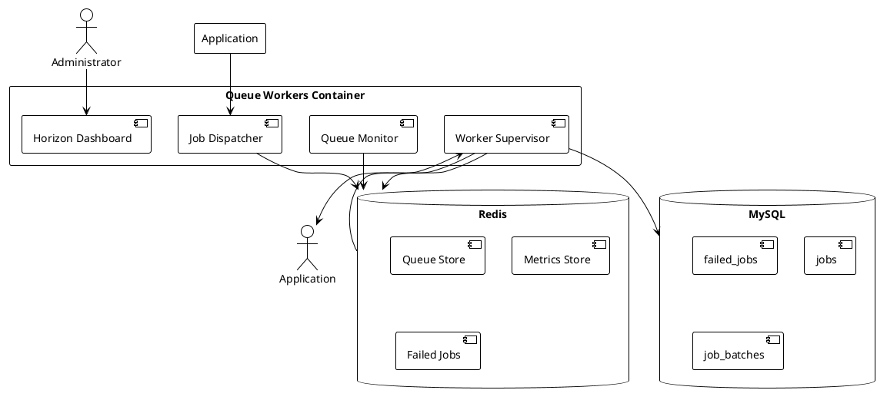

# 05.03.06.01 - Queue Workers Container Overview

**Project:** GsmUi
**Architecture:** C4 Model – Level 2 (Container)
**Container:** Queue Workers
**Framework:** Laravel 13 + Horizon + Redis
**Version:** 1.0.0

---

# Purpose

The Queue Workers Container is responsible for processing asynchronous background jobs within the GsmUi platform. It provides a scalable, observable, and resilient execution environment for all deferred processing including notifications, media processing, search indexing, billing operations, and maintenance tasks.

The container integrates Laravel's queue system with Laravel Horizon for worker supervision, load balancing, and operational visibility.

---

# Responsibilities

The Queue Workers Container is responsible for:

* Executing queued background jobs
* Managing worker process pools
* Balancing workloads across queues
* Retrying transient failures
* Tracking failed jobs for recovery
* Exposing runtime metrics
* Providing operational dashboards
* Enforcing queue priorities
* Managing job concurrency
* Processing batch operations
* Coordinating job chains and chunks
* Supporting rate-limited and delayed jobs

The container is **not responsible** for:

* Defining job payloads
* Persisting business state
* Rendering user interfaces
* Serving HTTP requests directly
* Storing queue data long-term

---

# Container Diagram



---

# Runtime Position

The Queue Workers Container sits between the Laravel Application and the data stores that back the queue system.

```text
┌─────────────────────────────────────────┐
│          Laravel Application            │
│  ┌─────────────────────────────────┐    │
│  │     Queue Workers Container     │    │
│  │  ┌───────────────────────────┐  │    │
│  │  │   Horizon Dashboard       │  │    │
│  │  │   Worker Supervisor       │  │    │
│  │  │   Queue Monitor           │  │    │
│  │  └───────────┬───────────────┘  │    │
│  │              │                  │    │
│  │  ┌───────────▼───────────────┐  │    │
│  │  │     Redis (Queue Store)   │  │    │
│  │  └───────────────────────────┘  │    │
│  └─────────────────────────────────┘    │
└─────────────────────────────────────────┘
```

---

# Key Components

## Job Dispatcher

Accepts queued jobs from application code and pushes them to Redis-backed queues. Supports:

* Delayed dispatch
* Queue selection
* Priority tagging
* Batch dispatch
* Rate limiting

---

## Worker Supervisor

Manages the lifecycle of queue worker processes. Responsibilities include:

* Starting and stopping workers
* Monitoring worker health
* Restarting crashed workers
* Balancing workers across queues
* Enforcing concurrency limits
* Collecting runtime metrics

---

## Queue Monitor

Tracks queue health and performance metrics in real time. Provides data to:

* Horizon dashboard
* Alerting systems
* Autoscaling logic
* Operational reporting

---

## Horizon Dashboard

A web interface for operators and administrators to inspect:

* Worker status
* Queue lengths
* Job throughput
* Failed jobs
* Runtime metrics
* Configuration

---

# Data Flow

```text
Application
    │
    │ dispatch()
    ▼
Job Dispatcher
    │
    │ push
    ▼
Redis Queue
    │
    │ pop
    ▼
Worker Process
    │
    │ handle()
    ▼
Job Class
    │
    │ success / failure
    ▼
Redis (metrics) / MySQL (failed_jobs)
```

---

# Interaction with Other Containers

| Container | Interaction |
|-----------|-------------|
| Laravel Application | Dispatches jobs to this container |
| Redis | Primary queue and metrics backend |
| MySQL | Persists failed jobs and batch metadata |
| Database Container | Reads/writes business entities during job execution |
| Storage Container | Handles media processing jobs |
| Search Container | Handles indexing and sync jobs |

---

# Technology Choices

| Technology | Role |
|------------|------|
| Laravel Queue | Job dispatch and worker interface |
| Laravel Horizon | Worker supervision and dashboard |
| Redis | Queue storage, metrics, and locks |
| MySQL | Failed job persistence |

---

# Reliability Considerations

* Workers are stateless and restartable
* Redis persists queue state across worker restarts
* Failed jobs are retained for manual recovery
* Horizon monitors for worker crashes and auto-restarts
* Graceful shutdown allows in-flight jobs to complete

---

# Observability

The container exposes metrics through Horizon including:

* Jobs processed per minute
* Average job runtime
* Queue depth over time
* Worker utilization
* Failed job count
* Throughput by queue

---

# Security

* Horizon dashboard is protected by authentication and authorization middleware
* Queue configuration and credentials are stored in environment configuration
* Failed job payloads may contain sensitive data and should be reviewed carefully
* Worker processes run with minimal required privileges

---

# Deployment Model

Typical deployment:

```text
┌───────────────────────────────────────────────┐
│              Production Environment            │
│                                               │
│  ┌─────────────┐  ┌────────────────────────┐ │
│  │ Web Server  │  │    Queue Workers       │ │
│  │  (nginx)    │  │  ┌──────────────────┐  │ │
│  │             │  │  │  horizon:supervise│  │ │
│  │             │  │  │  queue:work       │  │ │
│  └─────────────┘  │  │  queue:work       │  │ │
│                   │  └──────────────────┘  │ │
│                   └────────────────────────┘ │
│                                               │
│  ┌──────────────────────────────────────────┐ │
│  │              Redis Cluster               │ │
│  └──────────────────────────────────────────┘ │
└───────────────────────────────────────────────┘
```

---

# Testing Strategy

* Unit tests for job classes
* Integration tests for queue dispatch and processing
* Horizon monitoring tests
* Failed job recovery tests
* Worker pool configuration tests
* Load testing for throughput validation

---

# Performance Targets

| Metric | Target |
|--------|--------|
| Job Dispatch Latency | <50 ms |
| Job Throughput | 1000+ jobs/minute |
| Worker Startup | <5 seconds |
| Queue Visibility | <1 second |
| Failed Job Recovery | <5 minutes |
| Horizon Dashboard | 99.9% availability |

---

# Summary

The Queue Workers Container provides the asynchronous processing backbone for GsmUi. By leveraging Laravel Queue, Horizon, and Redis, the platform achieves reliable, scalable, and observable background job execution while maintaining clear separation from the web-serving and persistence layers.

---

# Next Document

**05.03.06.02 - Worker Topology** describes worker pool configuration, process topology, concurrency settings, and resource allocation strategies for the GsmUi queue infrastructure.
