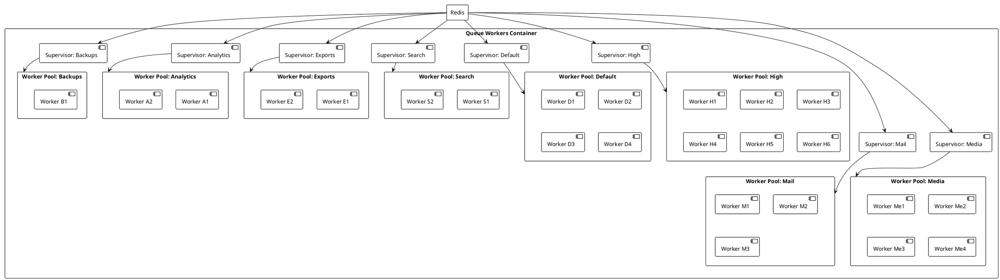

# 05.03.06.02 - Worker Topology

**Project:** GsmUi
**Architecture:** C4 Model – Level 2 (Container)
**Container:** Queue Workers
**Framework:** Laravel 13 + Horizon + Redis
**Version:** 1.0.0

---

# Purpose

This document defines the worker process topology for the GsmUi queue infrastructure. It specifies how worker processes are organized, how concurrency is managed, how resources are allocated, and how different queue types are served.

Worker topology is one of the most operationally significant configuration decisions for a Laravel queue system. Poor topology leads to resource contention, uneven latency, or wasted capacity.

---

# Responsibilities

Worker topology is responsible for:

* Defining worker process pools
* Assigning workers to queue priorities
* Setting concurrency limits per worker
* Configuring process restarts and timeouts
* Managing memory and CPU allocation
* Defining supervisor relationships
* Supporting zero-downtime deployments

---

# Topology Principles

1. **Queue isolation** — High-priority queues should not be blocked by slow background jobs.
2. **Right-sizing** — Worker counts should match actual workload, not theoretical maximums.
3. **Graceful degradation** — Workers should handle Redis unavailability without crashing the host.
4. **Observability** — Each supervisor and worker should be individually identifiable in logs and dashboards.
5. **Zero-downtime deploys** — Worker restarts should not interrupt job processing.

---

# Topology Diagram



---

# Queue Definitions

GsmUi defines the following logical queues:

| Queue | Purpose | Priority |
|-------|---------|----------|
| `high` | Critical user-facing operations (emails, webhooks) | Highest |
| `default` | General application jobs | Normal |
| `mail` | Email notifications and campaigns | Normal |
| `media` | Image/video processing, conversions | Low |
| `search` | Index updates and sync | Low |
| `exports` | Data exports and reports | Low |
| `analytics` | Aggregation and reporting | Lowest |
| `backups` | Database and storage backups | Lowest |

---

# Supervisor Configuration

Supervisors define how workers are started and monitored. Each supervisor manages one or more workers for a specific queue.

```php
return [
    'environments' => [
        'production' => [
            'high' => [
                'connection' => 'redis',
                'queue' => ['high'],
                'balance' => 'simple',
                'maxProcesses' => 6,
                'maxTime' => 0,
                'maxJobs' => 0,
                'memory' => 128,
                'tries' => 3,
                'timeout' => 120,
                'nice' => 0,
            ],
            'default' => [
                'connection' => 'redis',
                'queue' => ['default'],
                'balance' => 'simple',
                'maxProcesses' => 4,
                'maxTime' => 0,
                'maxJobs' => 0,
                'memory' => 128,
                'tries' => 3,
                'timeout' => 120,
                'nice' => 0,
            ],
            'mail' => [
                'connection' => 'redis',
                'queue' => ['mail'],
                'balance' => 'simple',
                'maxProcesses' => 3,
                'maxTime' => 0,
                'maxJobs' => 0,
                'memory' => 128,
                'tries' => 3,
                'timeout' => 120,
                'nice' => 0,
            ],
            'media' => [
                'connection' => 'redis',
                'queue' => ['media'],
                'balance' => 'simple',
                'maxProcesses' => 4,
                'maxTime' => 0,
                'maxJobs' => 0,
                'memory' => 256,
                'tries' => 3,
                'timeout' => 300,
                'nice' => 10,
            ],
            'search' => [
                'connection' => 'redis',
                'queue' => ['search'],
                'balance' => 'simple',
                'maxProcesses' => 2,
                'maxTime' => 0,
                'maxJobs' => 0,
                'memory' => 256,
                'tries' => 3,
                'timeout' => 300,
                'nice' => 10,
            ],
            'exports' => [
                'connection' => 'redis',
                'queue' => ['exports'],
                'balance' => 'simple',
                'maxProcesses' => 2,
                'maxTime' => 0,
                'maxJobs' => 0,
                'memory' => 512,
                'tries' => 2,
                'timeout' => 600,
                'nice' => 10,
            ],
            'analytics' => [
                'connection' => 'redis',
                'queue' => ['analytics'],
                'balance' => 'simple',
                'maxProcesses' => 2,
                'maxTime' => 0,
                'maxJobs' => 0,
                'memory' => 256,
                'tries' => 2,
                'timeout' => 600,
                'nice' => 10,
            ],
            'backups' => [
                'connection' => 'redis',
                'queue' => ['backups'],
                'balance' => 'simple',
                'maxProcesses' => 1,
                'maxTime' => 0,
                'maxJobs' => 0,
                'memory' => 512,
                'tries' => 2,
                'timeout' => 1800,
                'nice' => 10,
            ],
        ],
    ],
];
```

---

# Worker Process Management

Each worker process:

* Runs a single job at a time
* Is monitored by its supervisor for memory and runtime
* Is automatically restarted if it exceeds memory or time limits
* Can be gracefully terminated during deployments
* Logs job outcomes to structured logs

Horizon manages worker processes using PHP's Process Control (PCNTL) extension where available.

---

# Concurrency Control

Laravel provides built-in concurrency controls:

* `--max-jobs` — Maximum jobs per worker before restart (prevents memory leaks)
* `--max-time` — Maximum lifetime per worker process in seconds
* `--memory` — Maximum memory per worker before restart
* `--timeout` — Maximum seconds a job may run

Additionally, job classes can implement `ShouldQueue` and use Laravel's `withoutOverlapping()` method to prevent concurrent execution of non-idempotent jobs.

---

# Memory Management

Long-running workers accumulate memory over time. Horizon mitigates this by:

* Restarting workers after a configurable job count
* Restarting workers when memory exceeds a threshold
* Releasing database connections between jobs
* Clearing internal caches between jobs

Memory limits by worker type:

| Worker Type | Memory Limit |
|-------------|-------------|
| High / Default / Mail | 128 MB |
| Media / Search | 256 MB |
| Exports / Analytics | 512 MB |
| Backups | 512 MB |

---

# Runtime Timeouts

Job timeouts vary by job type to accommodate different processing requirements:

| Job Type | Timeout |
|----------|---------|
| Email | 120 seconds |
| Media processing | 300 seconds |
| Search indexing | 300 seconds |
| Exports | 600 seconds |
| Analytics | 600 seconds |
| Backups | 1800 seconds |

Timeouts are enforced at the worker level. Jobs exceeding the timeout are marked as failed.

---

# Process Topology Patterns

```text
Simple Balance (default)
┌──────────────────────────────────────┐
│          Supervisor                   │
│  ┌──────┐ ┌──────┐ ┌──────┐         │
│  │Work 1│ │Work 2│ │Work 3│ ...      │
│  └──────┘ └──────┘ └──────┘         │
│         All consume same queue        │
└──────────────────────────────────────┘

Auto Balance
┌──────────────────────────────────────┐
│          Supervisor                   │
│  ┌──────┐ ┌──────┐ ┌──────┐         │
│  │Work 1│ │Work 2│ │Work 3│ ...      │
│  └──┬───┘ └──┬───┘ └──┬───┘         │
│     │        │        │              │
│  Redistributes based on queue depth   │
└──────────────────────────────────────┘
```

---

# Supervisor Naming Convention

Supervisors follow a naming convention that aids identification in logs and dashboards:

```text
{environment}:{queue-name}
```

Examples:

* `production:high`
* `production:default`
* `production:mail`
* `production:media`

This convention allows operators to quickly identify which supervisor manages which workload.

---

# Deployment Considerations

During deployments, Horizon supports:

* **Quieting** — Workers finish current jobs before accepting new ones
* **Terminating** — Workers are stopped immediately (jobs are requeued)
* **Graceful** — Workers finish current jobs and then exit

Recommended deployment sequence:

1. Quiet workers: `php artisan horizon:quiet`
2. Deploy code
3. Terminate workers: `php artisan horizon:terminate [id]`

Workers are automatically restarted by Horizon after termination.

---

# Resource Allocation

Workers should be sized according to host capacity:

```text
Host: 4 vCPU, 8 GB RAM

Recommended allocation:
- high:      6 workers × 128 MB = 768 MB
- default:   4 workers × 128 MB = 512 MB
- mail:      3 workers × 128 MB = 384 MB
- media:     4 workers × 256 MB = 1 GB
- search:    2 workers × 256 MB = 512 MB
- exports:   2 workers × 512 MB = 1 GB
- analytics: 2 workers × 256 MB = 512 MB
- backups:   1 worker  × 512 MB = 512 MB

Total memory: ~5.2 GB (leaves 2.8 GB for OS and app)
```

Scale worker counts horizontally by adding more hosts rather than exceeding host memory.

---

# Process Isolation

Each worker process:

* Runs in its own PHP process
* Has isolated memory space
* Is independently monitored
* Can be restarted without affecting other workers
* Logs to its own log stream

---

# Connection Management

Workers release database connections between jobs to prevent connection exhaustion:

```php
$this->app->make('db')->purge();
```

This is handled automatically by Laravel's queue worker when the `--daemon` mode is used.

---

# Horizontal Scaling

Worker pools are scaled horizontally across multiple hosts:

```text
Host A: horizon:supervise
Host B: horizon:supervise
Host C: horizon:supervise

All share the same Redis instance(s)
```

Horizon's `balance = auto` mode redistributes workers dynamically across available supervisors based on queue depth.

---

# Health Monitoring

Each supervisor reports:

* Worker count
* Active workers
* Process status
* Memory usage
* Job throughput

Horizon uses this data to:

* Restart unhealthy workers
* Balance load across supervisors
* Alert on worker count deviations

---

# Logging

Workers log:

* Job start (with job class and ID)
* Job completion (with duration)
* Job failure (with exception)
* Worker restarts (with reason)
* Supervisor status changes

Logs should be aggregated and searchable for troubleshooting.

---

# Security Considerations

* Worker processes should not run as root
* Redis credentials should be stored in environment variables
* Failed job payloads may contain sensitive data and should be stored securely
* Horizon dashboard should be protected by IP allowlist or authentication in production

---

# Testing

Verify:

* Workers process jobs from all defined queues
* Supervisors restart workers exceeding memory limits
* Jobs are retried on transient failures
* Failed jobs are recorded correctly
* Graceful shutdown completes in-flight jobs
* Supervisor counts match configuration

Load test worker pools at expected peak throughput to validate sizing.

---

# Performance Targets

| Metric | Target |
|--------|--------|
| Worker Startup | <5 seconds |
| Job Dispatch to Pickup | <1 second |
| Memory per Worker | Within configured limit |
| Supervisor Restart | <10 seconds |
| Graceful Shutdown | <30 seconds |
| Worker Utilization | 60-80% under normal load |

---

# Summary

Worker topology defines how GsmUi processes background jobs efficiently and reliably. By isolating queues into dedicated supervisor pools, controlling concurrency and memory, and supporting zero-downtime deployments, the platform maintains predictable performance and operational control over its asynchronous processing layer.

---

# Advanced Topology Patterns

## Dedicated Worker Pools

Dedicated worker pools assign a fixed number of workers to each queue. This pattern provides the strongest isolation guarantees and is the default for GsmUi.

Benefits:

* Predictable resource allocation per queue
* No cross-queue contention
* Simple capacity planning
* Clear failure isolation

Drawbacks:

* Workers may sit idle if their queue is empty
* Requires more total workers than a shared pool
* Resource waste during off-peak hours

---

## Shared Worker Pools

Shared worker pools allow workers to consume from multiple queues. This pattern is more resource-efficient but introduces contention risks.

```text
Shared Pool
┌──────────────────────────────────────┐
│  Worker 1: reads high → default → mail │
│  Worker 2: reads high → default → mail │
│  Worker 3: reads high → default → mail │
└──────────────────────────────────────┘
```

Configuration:

```php
'pool' => [
    'connection' => 'redis',
    'queue' => ['high', 'default', 'mail'],
    'balance' => 'auto',
    'maxProcesses' => 8,
    'memory' => 128,
    'tries' => 3,
    'timeout' => 120,
],
```

Shared pools are suitable for development environments or low-traffic deployments where resource efficiency is more important than isolation.

---

## Hybrid Topology

GsmUi can combine dedicated and shared pools:

```text
Dedicated:
  high (6 workers)     — user-facing, latency-critical
  media (4 workers)    — resource-intensive, isolated

Shared:
  default + mail (4 workers) — both are moderate priority
  search + analytics (2 workers) — both are low priority
```

This hybrid approach balances isolation for critical workloads with efficiency for lower-priority queues.

---

## Weighted Round-Robin

When workers serve multiple queues, weighted round-robin scheduling ensures fair distribution:

```php
'pool' => [
    'connection' => 'redis',
    'queue' => ['high', 'default', 'mail'],
    'balance' => 'auto',
    'maxProcesses' => 8,
],
```

Horizon's `auto` balance mode dynamically redistributes workers based on queue depth, implementing a weighted strategy automatically.

---

# Worker Lifecycle States

Each worker process transitions through well-defined states:

```text
Starting → Running → Working → Idle → Restarting → Stopped
    │          │         │        │          │          │
    │          │         │        │          │          └── Terminal
    │          │         │        │          └── graceful shutdown
    │          │         │        └── waiting for next job
    │          │         └── processing a job
    │          └── accepting jobs
    └── process boot
```

State transitions are logged and monitored by the supervisor.

---

## State: Starting

The worker process is booting:

* PHP interpreter starts
* Application bootstraps
* Autoloader initializes
* Service container resolves
* Database connections established
* Redis connections established
* Worker enters the running state

Duration: typically 2-5 seconds depending on application size.

---

## State: Running

The worker is accepting jobs from its assigned queue:

* Worker calls `BRPOP` on the queue
* Blocks waiting for new jobs
* Supervisor monitors memory and runtime
* Worker is healthy and operational

---

## State: Working

The worker has reserved a job and is executing `handle()`:

* Job timeout timer is active
* Memory usage is tracked
* Database connections are held
* External calls may be made
* Progress events may be fired

---

## State: Idle

The worker has completed its current job and is waiting for the next one:

* Job was completed or failed
* Worker releases database connections
* Worker returns to the running state
* Supervisor continues monitoring

---

## State: Restarting

The worker is being restarted by the supervisor:

* Current job is released back to the queue
* Worker process exits
* Supervisor spawns a new worker
* New worker enters the starting state

Restart reasons:

* Memory limit exceeded
* Job count limit exceeded
* Time limit exceeded
* Graceful shutdown during deployment
* Manual restart command

---

## State: Stopped

The worker process has exited and is not being restarted:

* Graceful shutdown completed
* Supervisor removed the worker
* Worker is no longer consuming jobs

---

# Worker Configuration Reference

Complete configuration options for each worker pool:

```php
'production' => [
    'high' => [
        'connection' => 'redis',        // Queue connection driver
        'queue' => ['high'],            // Queues to consume
        'balance' => 'simple',          // Balancing strategy
        'maxProcesses' => 6,            // Maximum worker processes
        'minProcesses' => 0,            // Minimum worker processes (auto balance)
        'maxTime' => 0,                 // Max seconds before restart (0 = never)
        'maxJobs' => 0,                 // Max jobs before restart (0 = never)
        'memory' => 128,                // Max memory in MB
        'tries' => 3,                   // Max retry attempts
        'timeout' => 120,               // Job timeout in seconds
        'nice' => 0,                    // Process priority (-20 to 20)
        'backoff' => [10, 30, 60],      // Retry backoff in seconds
        'retry_after' => 120,           // Seconds before retrying a reserved job
        'trim/release' => true,         // Release long-running reserved jobs
        'trim/release_timeout' => 120,  // Timeout for trim/release
    ],
],
```

| Option | Default | Description |
|--------|---------|-------------|
| `connection` | `redis` | Queue connection driver |
| `queue` | `['default']` | Array of queues to consume |
| `balance` | `simple` | `simple` or `auto` balancing |
| `maxProcesses` | `1` | Maximum worker processes per supervisor |
| `minProcesses` | `0` | Minimum worker processes (auto mode) |
| `maxTime` | `0` | Seconds before worker restart (0 = disabled) |
| `maxJobs` | `0` | Jobs before worker restart (0 = disabled) |
| `memory` | `128` | Memory limit in MB |
| `tries` | `3` | Maximum retry attempts per job |
| `timeout` | `60` | Maximum seconds a job may run |
| `nice` | `0` | Process niceness (higher = lower priority) |
| `backoff` | `[10, 30, 60]` | Retry delay in seconds |
| `retry_after` | `120` | Seconds before a reserved job is considered lost |
| `trim/release` | `true` | Release long-running reserved jobs |

---

# Supervisor Lifecycle

Supervisors are the parent processes that manage workers.

## Supervisor Startup

```bash
php artisan horizon:supervise
```

Startup sequence:

1. Master supervisor process starts
2. Reads `config/horizon.php`
3. Creates child supervisor for each queue
4. Each child supervisor spawns worker processes
5. Workers begin consuming from assigned queues
6. Supervisor reports state to Redis

---

## Supervisor Monitoring

Each supervisor monitors its workers:

* Polls worker process status every 5 seconds
* Checks memory usage of each worker
* Checks runtime of each worker
* Checks job count of each worker
* Restarts workers exceeding limits

---

## Supervisor Shutdown

Graceful shutdown sequence:

1. `php artisan horizon:quiet` — stop accepting new jobs
2. In-flight jobs complete
3. `php artisan horizon:terminate` — exit all processes
4. Workers exit cleanly
5. Child supervisors exit
6. Master supervisor exits

---

# Worker Process Isolation

Each worker runs in a separate PHP process with isolated resources:

## Memory Isolation

Each worker has its own memory space. Memory leaks in one worker do not affect others.

```text
Worker 1: 45 MB / 128 MB limit
Worker 2: 67 MB / 128 MB limit
Worker 3: 38 MB / 128 MB limit
```

If a worker exceeds its memory limit, the supervisor kills and restarts it.

---

## Connection Isolation

Each worker maintains its own database and Redis connections:

```php
// Worker 1: connection ID = 12
// Worker 2: connection ID = 13
// Worker 3: connection ID = 14
```

Connections are purged between jobs to prevent exhaustion:

```php
$this->app->make('db')->purge();
$this->app->make('redis')->disconnect();
```

---

## File System Isolation

Workers share the same file system but should not write to shared locations. Each worker's log output is interleaved in the same log file unless configured otherwise.

---

# Process Priority (Nice Values)

Workers can be assigned different process priorities using the `nice` value:

| Nice Value | Priority | Use Case |
|------------|----------|----------|
| -20 | Highest | Critical user-facing jobs |
| -10 | High | Default queue jobs |
| 0 | Normal | Standard processing |
| 10 | Low | Media, search, exports |
| 20 | Lowest | Analytics, backups |

```php
'media' => [
    'nice' => 10,  // Lower priority than high/default
],
'backups' => [
    'nice' => 20,  // Lowest priority
],
```

Nice values allow the OS scheduler to prefer high-priority workers when CPU is contested.

---

# Worker Restart Policies

Workers are restarted for several reasons:

| Reason | Config | Default |
|--------|--------|---------|
| Memory limit exceeded | `memory` | 128 MB |
| Job count limit exceeded | `maxJobs` | 0 (disabled) |
| Time limit exceeded | `maxTime` | 0 (disabled) |
| Job timeout exceeded | `timeout` | 60 seconds |
| Graceful shutdown | `horizon:terminate` | — |
| Manual restart | `horizon:restart` | — |

Restart behavior:

* Worker finishes current job (unless terminated)
* New worker is spawned immediately
* No jobs are lost during restart
* Metrics are preserved across restarts

---

# Worker Health Checks

Each worker reports health metrics to the supervisor:

```json
{
  "worker_id": "worker-high-1",
  "queue": "high",
  "pid": 12345,
  "memory_mb": 45,
  "runtime_seconds": 120,
  "jobs_processed": 15,
  "status": "working",
  "current_job": "App\\Jobs\\SendEmail",
  "started_at": "2024-01-15T10:00:00Z"
}
```

Health metrics are aggregated by the supervisor and stored in Redis for dashboard consumption.

---

# Worker Communication

Workers communicate with the supervisor through:

1. **Process signals** — SIGTERM for graceful stop, SIGKILL for forced stop
2. **Redis state** — Workers report status to Redis keys
3. **Exit codes** — Workers signal success/failure through exit codes
4. **Log output** — Workers log to shared or separate log streams

---

# Multi-Host Topology

In production, workers run across multiple hosts:

```text
┌─────────────────────┐  ┌─────────────────────┐  ┌─────────────────────┐
│      Host A          │  │      Host B          │  │      Host C          │
│                      │  │                      │  │                      │
│  Supervisor:high     │  │  Supervisor:high     │  │  Supervisor:media    │
│  ├─ Worker H1        │  │  ├─ Worker H4        │  │  ├─ Worker Me1       │
│  ├─ Worker H2        │  │  ├─ Worker H5        │  │  ├─ Worker Me2       │
│  └─ Worker H3        │  │  └─ Worker H6        │  │  ├─ Worker Me3       │
│                      │  │                      │  │  └─ Worker Me4       │
│  Supervisor:default  │  │  Supervisor:default  │  │                      │
│  ├─ Worker D1        │  │  ├─ Worker D3        │  │  Supervisor:search   │
│  └─ Worker D2        │  │  └─ Worker D4        │  │  ├─ Worker S1        │
│                      │  │                      │  │  └─ Worker S2        │
│  Supervisor:mail     │  │  Supervisor:exports  │  │                      │
│  ├─ Worker M1        │  │  ├─ Worker E1        │  │  Supervisor:analytics│
│  └─ Worker M2        │  │  └─ Worker E2        │  │  ├─ Worker A1        │
│                      │  │                      │  │  └─ Worker A2        │
└─────────────────────┘  └─────────────────────┘  └─────────────────────┘
```

All hosts connect to the same Redis cluster. Workers on different hosts consume from the same queues without conflicts.

---

# Worker Pool Sizing Guidelines

Sizing workers depends on workload characteristics:

## I/O-Bound Jobs (Email, API Calls)

* Workers are mostly waiting on network I/O
* Can run more workers per CPU core
* Ratio: 1 vCPU per 4-8 workers

```text
4 vCPU → 16-32 I/O-bound workers
```

## CPU-Bound Jobs (Image Processing, Transcoding)

* Workers consume significant CPU during execution
* Fewer workers per CPU core
* Ratio: 1 vCPU per 1-2 workers

```text
4 vCPU → 4-8 CPU-bound workers
```

## Mixed Workloads

* Most real-world jobs are a mix of I/O and CPU
* Start with conservative worker counts
* Scale up based on observed utilization

```text
4 vCPU → 8-16 mixed workers
```

---

# Worker Pool Auto-Scaling

When using Horizon's `auto` balance mode:

```text
High queue: 200 pending jobs → Scale up to 8 workers
High queue: 10 pending jobs → Scale down to 2 workers
Media queue: 50 pending jobs → Scale up to 6 workers
Media queue: 2 pending jobs → Scale down to 1 worker
```

Auto-scaling rules:

1. Check queue depth every 30 seconds
2. If depth > threshold, add workers
3. If depth < threshold, remove workers
4. Never exceed `maxProcesses`
5. Never go below `minProcesses`

---

# Worker Pool Monitoring Dashboard

The worker topology should be visualized in the monitoring dashboard:

```text
Queue: high
├─ Workers: 6/6 active
├─ Utilization: 72%
├─ Memory: avg 45 MB / 128 MB limit
├─ Jobs/min: 120
├─ P95 latency: 8s
└─ Status: ✅ Healthy

Queue: default
├─ Workers: 4/4 active
├─ Utilization: 45%
├─ Memory: avg 38 MB / 128 MB limit
├─ Jobs/min: 80
├─ P95 latency: 15s
└─ Status: ✅ Healthy

Queue: media
├─ Workers: 4/4 active
├─ Utilization: 85%
├─ Memory: avg 180 MB / 256 MB limit
├─ Jobs/min: 25
├─ P95 latency: 120s
└─ Status: ⚠️ High utilization
```

---

# Worker Topology Testing

Verify topology through these tests:

```php
public function test_worker_count_matches_configuration(): void
{
    $config = config('horizon.environments.production');
    $totalWorkers = array_sum(array_column($config, 'maxProcesses'));
    $this->assertEquals(24, $totalWorkers);
}

public function test_high_queue_has_dedicated_workers(): void
{
    $highConfig = config('horizon.environments.production.high');
    $this->assertEquals(['high'], $highConfig['queue']);
    $this->assertGreaterThanOrEqual(4, $highConfig['maxProcesses']);
}

public function test_media_workers_have_increased_memory(): void
{
    $mediaConfig = config('horizon.environments.production.media');
    $this->assertGreaterThanOrEqual(256, $mediaConfig['memory']);
}

public function test_backup_worker_has_long_timeout(): void
{
    $backupConfig = config('horizon.environments.production.backups');
    $this->assertGreaterThanOrEqual(1800, $backupConfig['timeout']);
}

public function test_all_workers_use_redis_connection(): void
{
    $config = config('horizon.environments.production');
    foreach ($config as $queue => $settings) {
        $this->assertEquals('redis', $settings['connection'], "Queue {$queue} must use Redis");
    }
}
```

---

# Worker Topology Runbook

## Adding a New Queue

1. Define queue in `config/queue.php`
2. Add supervisor configuration in `config/horizon.php`
3. Assign worker count and memory limits
4. Update resource allocation calculations
5. Deploy configuration
6. Restart Horizon: `php artisan horizon:terminate`
7. Verify workers are consuming from the new queue

## Scaling a Queue

1. Check current queue depth and latency
2. Determine new worker count
3. Update `maxProcesses` in Horizon config
4. Restart Horizon
5. Monitor queue depth for improvement
6. Adjust if needed

## Changing Worker Memory Limits

1. Check current memory usage patterns
2. Determine new memory limit
3. Update `memory` in Horizon config
4. Restart Horizon
5. Monitor for memory-related restarts

## Adding a New Host

1. Provision host with PHP and dependencies
2. Copy application code
3. Configure environment variables
4. Start Horizon: `php artisan horizon:supervise`
5. Verify host appears in Horizon dashboard
6. Distribute queues across hosts as needed

---

# Common Topology Mistakes

| Mistake | Impact | Fix |
|---------|--------|-----|
| Too many workers per host | Memory exhaustion | Reduce worker count or add hosts |
| Too few high-priority workers | User-facing latency | Increase high queue worker count |
| Shared pool for all queues | Priority inversion | Use dedicated pools |
| No memory limits | OOM kills | Set memory limits per worker |
| No timeout limits | Zombie jobs | Set timeout per queue |
| Running as root | Security risk | Use unprivileged user |

---

# Topology Decision Tree

```text
Do you need queue isolation?
├─ Yes → Dedicated pools per queue
│        ├─ How many queues? → Assign workers proportional to load
│        └─ Memory requirements? → Set per-queue memory limits
└─ No → Shared pool
         ├─ Variable load? → Use auto balance
         └─ Stable load? → Use simple balance
```

---

# Worker Process Management

## Signal Handling

Workers must handle Unix signals properly:

| Signal | Action | Default |
|--------|--------|---------|
| SIGTERM | Graceful stop | Finish current job, exit |
| SIGINT | Force stop | Exit immediately |
| SIGUSR1 | Restart | Restart worker |
| SIGUSR2 | Pause | Stop accepting new jobs |
| SIGHUP | Reload config | Reload configuration |

```php
// Worker signal handling
pcntl_signal(SIGTERM, function () {
    $this->shouldStop = true;
});

pcntl_signal(SIGINT, function () {
    $this->shouldForceStop = true;
});

pcntl_signal(SIGUSR1, function () {
    $this->shouldRestart = true;
});
```

---

## Worker Environment Variables

Each worker inherits environment variables but can override them:

```bash
# Worker-specific environment
APP_ENV=production
REDIS_HOST=redis-cluster
REDIS_PORT=6379
QUEUE_CONNECTION=redis
HORIZON_PREFIX=horizon:

# Worker resource limits
PHP_MEMORY_LIMIT=128M
PHP_MAX_EXECUTION_TIME=120
```

---

## Worker Bootstrap

Each worker process bootstraps the application:

1. Load autoloader
2. Load environment configuration
3. Boot service providers
4. Resolve dependencies
5. Establish connections
6. Enter processing loop

Bootstrap time: typically 2-5 seconds depending on application complexity.

---

# Worker Process Communication

## Inter-Process Communication (IPC)

Workers communicate through Redis:

```text
Worker 1 ──┐
Worker 2 ──┤
Worker 3 ──┼──▶ Redis ──▶ Supervisor
Worker 4 ──┤
Worker 5 ──┘
```

Communication channels:

* **State reporting** — Workers write status to Redis keys
* **Job reservation** — Workers read from Redis queues
* **Lock acquisition** — Workers use Redis locks for coordination
* **Metrics emission** — Workers write metrics to Redis sorted sets

---

## Worker Status Reporting

```php
class WorkerStatus
{
    public function report(string $workerId, array $status): void
    {
        $key = "horizon:worker:{$workerId}";
        
        Redis::hmset($key, [
            'status' => $status['status'],
            'queue' => $status['queue'],
            'job' => $status['current_job'] ?? null,
            'memory_mb' => $status['memory'],
            'runtime_seconds' => $status['runtime'],
            'jobs_processed' => $status['jobs_count'],
            'updated_at' => now()->timestamp,
        ]);

        // Set TTL for stale worker detection
        Redis::expire($key, 30);
    }
}
```

---

# Worker Process Resources

## File Descriptors

Each worker opens file descriptors for:

* Standard input/output/error
* Database connections
* Redis connections
* Log files
* Temporary files

Typical file descriptor usage: 20-50 per worker.

---

## Network Connections

Each worker maintains network connections to:

| Service | Connections | Purpose |
|---------|-------------|---------|
| Redis | 1-2 | Queue operations, metrics |
| MySQL | 1-2 | Database queries |
| External APIs | 0-N | Job-specific |
| SMTP | 0-1 | Email delivery |

---

## Thread Safety

PHP workers are single-threaded. No thread safety concerns for:

* Database queries
* Redis operations
* File system operations
* HTTP requests

However, shared resources (database, Redis) must handle concurrent access from multiple worker processes.

---

# Worker Process Security

## User Permissions

Workers should run as an unprivileged user:

```bash
# Create worker user
useradd -r -s /bin/false horizon-worker

# Set file permissions
chown -R horizon-worker:horizon-worker /app
chmod -R 750 /app
chmod -R 770 /app/storage /app/bootstrap/cache
```

---

## Environment Security

Sensitive environment variables:

| Variable | Sensitivity | Storage |
|----------|-------------|---------|
| APP_KEY | Critical | Environment variable |
| DB_PASSWORD | Critical | Environment variable |
| REDIS_PASSWORD | Critical | Environment variable |
| MAIL_PASSWORD | High | Environment variable |
| API_TOKENS | High | Environment variable |

Never log environment variables or include them in error reports.

---

## Job Payload Security

Job payloads may contain sensitive data:

* User PII (email, name, address)
* Payment information (card last 4, transaction ID)
* API tokens (OAuth tokens, API keys)
* Internal system details (server IPs, paths)

Security measures:

1. Encrypt job payloads in Redis
2. Restrict access to failed job payloads
3. Sanitize logs to remove sensitive data
4. Implement data retention policies for job payloads
5. Use reference IDs instead of embedding sensitive data

---

# Worker Process Monitoring

## Process Monitoring Tools

| Tool | Purpose | Usage |
|------|---------|-------|
| `top` / `htop` | Real-time process monitoring | Manual inspection |
| `ps` | Process listing | Scripting |
| `pidstat` | Per-process statistics | Performance analysis |
| `strace` | System call tracing | Debugging |
| `lsof` | Open file inspection | Connection debugging |

---

## Worker Health Metrics

Each worker exposes health metrics:

```json
{
  "worker_id": "worker-high-1",
  "pid": 12345,
  "status": "working",
  "queue": "high",
  "current_job": "App\\Jobs\\SendEmail",
  "job_id": "a1b2c3d4-e5f6-7890-abcd-ef1234567890",
  "started_at": "2024-01-15T10:30:00Z",
  "memory_mb": 45,
  "runtime_seconds": 12,
  "jobs_processed": 15,
  "uptime_seconds": 3600
}
```

---

## Worker Log Analysis

Analyze worker logs for patterns:

```bash
# Find slow jobs
grep "job.completed" storage/logs/laravel.log | jq 'select(.duration_ms > 30000)'

# Count failures by job type
grep "job.failed" storage/logs/laravel.log | jq -r '.job' | sort | uniq -c | sort -rn

# Find memory-intensive jobs
grep "job.completed" storage/logs/laravel.log | jq 'select(.memory_mb > 200)'

# Calculate average processing time
grep "job.completed" storage/logs/laravel.log | jq -s 'map(.duration_ms) | add / length'
```

---

# Worker Process Debugging

## Debug Mode

Enable debug mode for specific workers:

```php
// config/horizon.php
'production' => [
    'high' => [
        'debug' => env('HORIZON_DEBUG_HIGH', false),
    ],
],
```

Debug mode enables:

* Verbose logging
* Stack trace capture
* Timing information
* Memory tracking

---

## Profiling Workers

Profile worker performance:

```php
// Enable profiling
if (config('horizon.profile')) {
    $start = microtime(true);
    $startMemory = memory_get_usage();

    $job->handle();

    $duration = microtime(true) - $start;
    $memoryUsed = memory_get_usage() - $startMemory;

    Log::info('Job profiled', [
        'job' => get_class($job),
        'duration_ms' => round($duration * 1000, 2),
        'memory_bytes' => $memoryUsed,
    ]);
}
```

---

## Debugging Stuck Workers

When a worker appears stuck:

```bash
# Find stuck worker
ps aux | grep "php artisan queue:work" | grep -v grep

# Check worker status
php artisan horizon:workers --json | jq '.[] | select(.status == "working")'

# Inspect worker process
strace -p <PID> -e trace=network

# Force restart stuck worker
kill -9 <PID>
# Horizon will automatically restart the worker
```

---

# Worker Process Lifecycle Events

## Lifecycle Event Sequence

```text
1. Worker Start
   ├─ Bootstrap application
   ├─ Connect to Redis
   ├─ Connect to database
   └─ Enter processing loop

2. Job Pickup
   ├─ BRPOP from queue
   ├─ Deserialize payload
   ├─ Reserve job
   └─ Start timeout timer

3. Job Processing
   ├─ Execute handle()
   ├─ Monitor memory
   ├─ Monitor runtime
   └─ Report status

4. Job Completion
   ├─ Delete from reserved list
   ├─ Record metrics
   ├─ Release connections
   └─ Return to processing loop

5. Worker Restart
   ├─ Finish current job (if graceful)
   ├─ Release connections
   ├─ Exit process
   └─ Supervisor spawns replacement

6. Worker Stop
   ├─ Finish current job (if graceful)
   ├─ Release connections
   └─ Exit process
```

---

# Worker Process Performance Tuning

## PHP Configuration

Optimize PHP settings for queue workers:

```ini
; php.ini for queue workers
memory_limit = 128M
max_execution_time = 120
realpath_cache_size = 4096K
realpath_cache_ttl = 600
opcache.enable = 1
opcache.memory_consumption = 128
opcache.interned_strings_buffer = 16
opcache.max_accelerated_files = 4000
opcache.revalidate_freq = 0
opcache.save_comments = 1
```

---

## Connection Pooling

Use connection pooling to reduce connection overhead:

```php
// config/database.php
'mysql' => [
    'driver' => 'mysql',
    'host' => env('DB_HOST'),
    'database' => env('DB_DATABASE'),
    'username' => env('DB_USERNAME'),
    'password' => env('DB_PASSWORD'),
    'options' => [
        PDO::ATTR_PERSISTENT => true, // Enable persistent connections
    ],
],
```

---

## Redis Optimization

Optimize Redis for queue operations:

```php
// config/database.php
'redis' => [
    'client' => env('REDIS_CLIENT', 'phpredis'),
    'options' => [
        'cluster' => env('REDIS_CLUSTER', 'redis'),
        'prefix' => env('REDIS_PREFIX', 'gsmui_'),
    ],
    'default' => [
        'url' => env('REDIS_URL'),
        'host' => env('REDIS_HOST', '127.0.0.1'),
        'username' => env('REDIS_USERNAME'),
        'password' => env('REDIS_PASSWORD'),
        'port' => env('REDIS_PORT', '6379'),
        'database' => env('REDIS_DB', '0'),
        'read_timeout' => 60,
    ],
],
```

---

# Worker Process Optimization

## Job Payload Optimization

Keep job payloads small:

```php
// BAD: Large payload
class ProcessMedia implements ShouldQueue
{
    public function __construct(
        public Media $file, // Eloquent model serialized
        public array $metadata, // Large metadata array
    ) {}
}

// GOOD: Minimal payload
class ProcessMedia implements ShouldQueue
{
    public function __construct(
        public int $fileId, // Reference only
    ) {}
}
```

---

## Connection Release

Release connections between jobs:

```php
// Worker releases connections
$this->app->make('db')->purge();
$this->app->make('redis')->connections()->each->disconnect();
```

This prevents connection exhaustion and reduces memory usage.

---

## Memory Optimization

Optimize memory usage in workers:

```php
class ProcessMedia implements ShouldQueue
{
    public function handle(): void
    {
        // Process in chunks to limit memory
        $cursor = null;
        
        do {
            $records = DB::table('media')
                ->orderBy('id')
                ->where('id', '>', $cursor ?? 0)
                ->limit(100)
                ->get();

            foreach ($records as $record) {
                $this->processRecord($record);
            }

            $cursor = $records->last()->id ?? null;
            
            // Force garbage collection
            gc_collect_cycles();
            
        } while ($records->isNotEmpty());
    }
}
```

---

# Worker Process Testing

## Unit Testing Workers

```php
class ProcessMediaTest extends TestCase
{
    public function test_worker_processes_job(): void
    {
        $file = Media::factory()->create();
        $job = new ProcessMedia($file->id);
        
        $job->handle();
        
        $file->refresh();
        $this->assertTrue($file->isProcessed());
    }
}
```

---

## Integration Testing

```php
class WorkerIntegrationTest extends TestCase
{
    public function test_worker_processes_queue(): void
    {
        // Dispatch job
        ProcessMedia::dispatch($file->id);
        
        // Process queue
        $this->artisan('queue:work --once');
        
        // Verify
        $file->refresh();
        $this->assertTrue($file->isProcessed());
    }
}
```

---

## Load Testing

```php
class WorkerLoadTest extends TestCase
{
    public function test_workers_handle_load(): void
    {
        // Dispatch 1000 jobs
        foreach (range(1, 1000) as $i) {
            ProcessMedia::dispatch($files[$i]->id);
        }
        
        // Process for 60 seconds
        $start = microtime(true);
        while (microtime(true) - $start < 60) {
            $this->artisan('queue:work --once');
        }
        
        // Verify all jobs processed
        $processed = Media::where('processed', true)->count();
        $this->assertGreaterThanOrEqual(1000, $processed);
    }
}
```

---

# Worker Process Documentation

## Code Documentation

Document worker behavior in code:

```php
/**
 * Process uploaded media files.
 *
 * This worker handles image resizing, thumbnail generation, and format
 * conversion. It is dispatched to the media queue because it is
 * resource-intensive and does not require immediate processing.
 *
 * Worker Requirements:
 * - Memory: 256 MB
 * - Timeout: 300 seconds
 * - Retries: 3
 * - Queue: media
 *
 * Failure Scenarios:
 * - File not found: Log warning, skip
 * - Invalid format: Log warning, skip
 * - Disk full: Throw exception, retry
 * - Timeout: Kill process, retry
 *
 * @see docs/queue-workers.md
 */
class ProcessMedia implements ShouldQueue
{
    // ...
}
```

---

## Operational Documentation

Maintain operational documentation:

```markdown
# Worker Operations Guide

## Starting Workers
```bash
php artisan horizon:supervise
```

## Stopping Workers
```bash
php artisan horizon:terminate
```

## Scaling Workers
```bash
php artisan horizon:scale high 12
```

## Monitoring Workers
```bash
php artisan horizon:workers --json
```

## Troubleshooting

### Worker Not Starting
1. Check Redis connection
2. Check configuration
3. Check PHP extensions
4. Check logs

### Worker Consuming Too Much Memory
1. Check job payload size
2. Check for memory leaks
3. Reduce memory limit
4. Restart worker

### Worker Timing Out Jobs
1. Check job complexity
2. Increase timeout
3. Optimize job code
```

---

# Worker Process Reference

## Worker Commands

| Command | Description |
|---------|-------------|
| `php artisan horizon` | Start Horizon |
| `php artisan horizon:supervise` | Start supervisor |
| `php artisan horizon:terminate` | Terminate workers |
| `php artisan horizon:restart` | Restart workers |
| `php artisan horizon:pause` | Pause Horizon |
| `php artisan horizon:continue` | Resume Horizon |
| `php artisan horizon:workers` | List workers |
| `php artisan horizon:supervisors` | List supervisors |
| `php artisan horizon:scale {name} {count}` | Scale workers |
| `php artisan horizon:status` | Check Horizon status |

---

## Worker Configuration Reference

| Setting | Type | Default | Description |
|---------|------|---------|-------------|
| `connection` | string | `redis` | Queue connection driver |
| `queue` | array | `['default']` | Queues to consume |
| `balance` | string | `simple` | Balancing strategy |
| `maxProcesses` | int | `1` | Maximum worker processes |
| `minProcesses` | int | `0` | Minimum worker processes |
| `maxTime` | int | `0` | Max worker lifetime (seconds) |
| `maxJobs` | int | `0` | Max jobs per worker |
| `memory` | int | `128` | Memory limit (MB) |
| `tries` | int | `3` | Retry attempts |
| `timeout` | int | `60` | Job timeout (seconds) |
| `nice` | int | `0` | Process priority |
| `backoff` | array | `[10, 30, 60]` | Retry delays |

---

# Worker Process Disaster Recovery

## Worker Failure Scenarios

| Scenario | Impact | Recovery |
|----------|--------|----------|
| Single worker crash | One worker stops | Supervisor restarts worker |
| Multiple worker crashes | Queue processing slows | Supervisor restarts all workers |
| Supervisor crash | All workers for queue stop | Master restarts supervisor |
| Master crash | All workers stop | Systemd restarts master |
| Redis outage | All workers blocked | Workers wait, retry on reconnect |
| Host failure | All workers on host lost | Other hosts take over |

---

## Worker Recovery Procedures

### Single Worker Recovery

When a single worker crashes:

1. Supervisor detects worker exit
2. Supervisor logs the failure
3. Supervisor spawns replacement worker
4. New worker bootstraps application
5. New worker begins consuming jobs

Recovery time: typically 2-5 seconds.

---

### Supervisor Recovery

When a supervisor crashes:

1. Master supervisor detects child exit
2. Master logs the failure
3. Master spawns replacement supervisor
4. New supervisor reads configuration
5. New supervisor spawns workers
6. Workers begin consuming jobs

Recovery time: typically 5-10 seconds.

---

### Master Recovery

When the master supervisor crashes:

1. Systemd detects process exit
2. Systemd restarts master process
3. Master reads configuration
4. Master spawns all supervisors
5. Supervisors spawn workers
6. Workers begin consuming jobs

Recovery time: typically 10-20 seconds.

---

## Worker Health Check Implementation

```php
class WorkerHealthCheck
{
    public function check(): array
    {
        $workers = $this->getWorkerStatus();
        
        $healthy = collect($workers)->filter(function ($worker) {
            return $worker['status'] === 'running' &&
                   $worker['memory_mb'] < 128 &&
                   $worker['runtime_seconds'] < 3600;
        });

        return [
            'total' => count($workers),
            'healthy' => $healthy->count(),
            'unhealthy' => count($workers) - $healthy->count(),
            'details' => $workers,
        ];
    }
}
```

---

## Worker Restart Policies

### Automatic Restart

Workers are automatically restarted when:

* Memory limit exceeded
* Job count limit exceeded
* Time limit exceeded
* Job timeout exceeded
* Process receives SIGTERM
* Process crashes

### Manual Restart

```bash
# Restart all workers
php artisan horizon:restart

# Restart specific queue workers
php artisan horizon:terminate
php artisan horizon:supervise

# Restart specific supervisor
php artisan horizon:terminate-supervisor production:high
php artisan horizon:supervisor production:high
```

---

# Worker Process Optimization

## PHP OPcache Optimization

```ini
; php.ini for queue workers
opcache.enable=1
opcache.memory_consumption=128
opcache.interned_strings_buffer=16
opcache.max_accelerated_files=4000
opcache.revalidate_freq=0
opcache.save_comments=1
opcache.enable_file_override=1
opcache.validate_timestamps=0
```

---

## Autoloader Optimization

```php
// composer.json
{
    "config": {
        "optimize-autoloader": true,
        "classmap-authoritative": true
    }
}
```

---

## Connection Optimization

```php
// config/database.php
'mysql' => [
    'options' => [
        PDO::ATTR_PERSISTENT => true,
        PDO::ATTR_EMULATE_PREPARES => false,
    ],
],
```

---

# Worker Process Documentation

## Operations Manual

```markdown
# Worker Operations Manual

## Daily Operations

### Morning Health Check
1. Check Horizon status: `php artisan horizon:status`
2. Check queue depths: `redis-cli LLEN queues:high`
3. Check failed jobs: `php artisan queue:failed`
4. Review overnight alerts

### During Business Hours
1. Monitor queue depths
2. Watch for failure spikes
3. Scale workers if needed

### Evening Review
1. Check daily metrics
2. Review scaling events
3. Plan for overnight maintenance

## Weekly Operations

### Monday
- Review weekly metrics
- Adjust worker counts if needed
- Update capacity planning

### Friday
- Deploy code changes
- Verify workers restart correctly
- Monitor for issues

## Monthly Operations

### First Monday
- Review monthly SLO report
- Adjust autoscaling thresholds
- Update runbooks

### Last Friday
- Prune old metrics
- Archive failed jobs
- Review cost optimization
```

---

# Worker Process Security Hardening

## Security Checklist

- [ ] Workers run as unprivileged user
- [ ] File permissions are restrictive
- [ ] Environment variables are encrypted
- [ ] Redis requires authentication
- [ ] Database uses SSL connections
- [ ] Horizon dashboard requires authentication
- [ ] Failed job payloads are encrypted
- [ ] Logs do not contain sensitive data
- [ ] Network access is restricted
- [ ] Regular security audits

---

## Security Configuration

```php
// config/horizon.php
'auth' => [
    'guard' => 'web',
    'middleware' => ['auth', 'verified', 'can:view-horizon'],
],

'dashboard' => [
    'allowed_ips' => ['10.0.0.0/8', '192.168.1.0/24'],
    'rate_limit' => 60, // requests per minute
],
```

---

# Worker Process Reference

## Worker Configuration Reference

| Setting | Type | Default | Description |
|---------|------|---------|-------------|
| `connection` | string | `redis` | Queue connection driver |
| `queue` | array | `['default']` | Queues to consume |
| `balance` | string | `simple` | Balancing strategy |
| `maxProcesses` | int | `1` | Maximum worker processes |
| `minProcesses` | int | `0` | Minimum worker processes |
| `maxTime` | int | `0` | Max worker lifetime (seconds) |
| `maxJobs` | int | `0` | Max jobs per worker |
| `memory` | int | `128` | Memory limit (MB) |
| `tries` | int | `3` | Retry attempts |
| `timeout` | int | `60` | Job timeout (seconds) |
| `nice` | int | `0` | Process priority |
| `backoff` | array | `[10, 30, 60]` | Retry delays |

---

## Worker Commands Reference

| Command | Description |
|---------|-------------|
| `php artisan horizon` | Start Horizon |
| `php artisan horizon:supervise` | Start supervisor |
| `php artisan horizon:terminate` | Terminate workers |
| `php artisan horizon:restart` | Restart workers |
| `php artisan horizon:pause` | Pause Horizon |
| `php artisan horizon:continue` | Resume Horizon |
| `php artisan horizon:workers` | List workers |
| `php artisan horizon:supervisors` | List supervisors |
| `php artisan horizon:scale {name} {count}` | Scale workers |
| `php artisan horizon:status` | Check Horizon status |
| `php artisan horizon:metrics` | Show metrics |
| `php artisan horizon:metrics:reset` | Reset metrics |
| `php artisan horizon:retry {id}` | Retry failed job |
| `php artisan horizon:retry-all` | Retry all failed jobs |
| `php artisan horizon:purge {hours}` | Purge old metrics |

---

## Worker Metrics Reference

| Metric | Description | Target |
|--------|-------------|--------|
| Worker startup time | Time to start worker | <5 seconds |
| Job dispatch to pickup | Time from dispatch to processing | <1 second |
| Worker utilization | Percentage of time workers are busy | 60-80% |
| Worker restart rate | Workers restarted per hour | <5 |
| Memory usage | RSS per worker | <configured limit |
| Supervisor restart time | Time to restart supervisor | <10 seconds |
| Graceful shutdown time | Time to finish current job | <30 seconds |

---

# Next Document

**05.03.06.03 - Redis Architecture** describes how Redis is used for queue storage, metrics, failed jobs, and locks within the GsmUi queue infrastructure.
