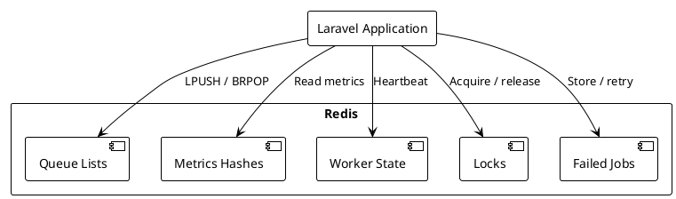

# 05.03.06.03 - Redis Architecture

**Project:** GsmUi
**Architecture:** C4 Model – Level 2 (Container)
**Container:** Queue Workers
**Framework:** Laravel 13 + Horizon + Redis
**Redis Version:** 7.2+
**Version:** 1.0.0

---

# Purpose

Redis is the primary backing store for the GsmUi queue infrastructure. It stores queued jobs, worker metrics, failed jobs, and coordination primitives. This document describes the Redis data structures used, key naming conventions, memory management strategies, and operational considerations.

Redis performance directly affects queue throughput and worker responsiveness.

---

# Responsibilities

Redis in the queue context is responsible for:

* Storing pending queue jobs
* Tracking worker metrics
* Managing job locks and timeouts
* Storing failed job payloads
* Coordinating Horizon supervisor state
* Providing real-time queue length data

---

# Data Structures

Laravel and Horizon use several Redis data structures:

| Structure | Use |
|-----------|-----|
| List | Queue job storage (LPUSH/BRPOP) |
| Hash | Worker metrics and statistics |
| Sorted Set | Job measurements and timings |
| String | Configuration and locks |
| Set | Unique job tracking |

---

# Key Naming Convention

All keys follow a consistent prefix pattern:

```text
redis:queues:{queue-name}           — List: pending jobs
redis:failed:jobs                   — List: failed job payloads
redis:queues:{queue-name}:reserved  — List: currently processing jobs
redis:horizon:metrics               — Hash: worker metrics
redis:horizon:measurements          — Sorted Set: job timings
redis:horizon:supervisors           — Hash: supervisor state
redis:horizon:locks                 — String: deployment and maintenance locks
redis:horizon:master                — String: master supervisor identity
redis:horizon:recent-jobs           — Sorted Set: recently processed jobs
redis:horizon:status                — String: Horizon status
```

---

# Queue Storage

Each logical queue maps to a Redis list:

```text
Key: redis:queues:high
Type: List
Usage: LPUSH job payload, BRPOP job payload

Key: redis:queues:default
Type: List
Usage: LPUSH job payload, BRPOP job payload

Key: redis:queues:mail
Type: List
Usage: LPUSH job payload, BRPOP job payload
```

Jobs are serialized payloads pushed onto the list and atomically popped by workers.

---

# Failed Jobs

Failed jobs are stored in a Redis list:

```text
Key: redis:failed:jobs
Type: List
Elements: Serialized job payloads with exception and timestamp
```

When failed jobs are retried or deleted, entries are removed from the list. Failed jobs may also be persisted to MySQL for permanent storage and admin review.

---

# Metrics Storage

Horizon stores metrics in Redis hashes and sorted sets:

```text
Key: redis:horizon:metrics:{worker-id}
Type: Hash
Fields: memory, jobs, runtime, timestamp

Key: redis:horizon:measurements:{queue-name}
Type: Sorted Set
Score: Unix timestamp
Value: Serialized measurement data
```

Metrics are aggregated and displayed in the Horizon dashboard.

---

# Worker State

Worker state is tracked in Redis hashes:

```text
Key: redis:horizon:supervisors:{supervisor-name}
Type: Hash
Fields: workers, active_workers, memory, status

Key: redis:horizon:master
Type: String
Value: Supervisor name of the active master
```

Horizon uses this state to coordinate supervisors and detect failures.

---

# Locks

Horizon uses Redis strings as distributed locks:

```text
Key: redis:horizon:locks:{lock-name}
Type: String
Value: Timestamp
TTL: Lock duration in seconds
```

Locks are used for:

* Deployment quiescence (quiet mode)
* Maintenance mode
* Single-supervisor coordination

---

# Memory Management

Redis memory must be managed carefully in production.

### Memory Estimation

```text
Queue job payload: ~1-5 KB per job
Metrics hash entry: ~200 bytes per worker per minute
Measurement entry: ~300 bytes per measurement

Example: 100,000 pending jobs × 3 KB = 300 MB
Example: 20 workers × 60 minutes × 200 bytes = 240 KB per hour
```

### eviction-policy

For queue storage, use:

```text
noeviction — Queue jobs must not be silently dropped
```

Instead, implement application-level eviction:

* Monitor queue depth
* Alert on thresholds
* Scale workers to drain queues
* Use TTL on measurement data

### Memory Alerts

Alert when Redis memory usage exceeds:

* 70% of maxmemory — Warning
* 85% of maxmemory — Critical
* 90% of maxmemory — Emergency

---

# Persistence Configuration

Redis persistence should be configured based on durability requirements:

```text
# AOF + RDB hybrid
appendonly yes
appendfsync everysec
save 900 1
save 300 10
save 60 10000
```

Queue jobs can tolerate some data loss on Redis restart if the application can re-dispatch. Critical jobs should be idempotent.

---

# Key Expiration

Keys that should expire:

```text
redis:horizon:measurements — TTL: 24 hours
redis:horizon:recent-jobs   — TTL: 1 hour
redis:horizon:locks         — TTL: Varies by lock type
```

Queue job keys (`redis:queues:*`) should NOT expire automatically. Jobs must remain available for processing until consumed.

---

# Redis Cluster vs Standalone

For production deployments, Redis can be deployed as:

| Mode | Use Case | Notes |
|------|----------|-------|
| Standalone | Development, small production | Simple, single point of failure |
| Sentinel | Production, HA | Automatic failover |
| Cluster | Large scale, sharding | Horizontal scaling |

GsmUi supports all modes through Laravel's Redis configuration abstraction.

---

# Redis Container Diagram



---

# Data Flow: Job Lifecycle in Redis

```text
1. Job Dispatched
   LPUSH redis:queues:{queue} {payload}

2. Worker Reserves Job
   BRPOP redis:queues:{queue} 0
   LPUSH redis:queues:{queue}:reserved {payload}

3. Job Completes
   LREM redis:queues:{queue}:reserved {payload}

4. Job Fails
   LPUSH redis:failed:jobs {payload}
   LPUSH redis:queues:{queue} {payload}  // requeue

5. Metrics Recorded
   HSET redis:horizon:metrics:{id} {fields}
   ZADD redis:horizon:measurements:{queue} {timestamp} {data}
```

---

# Monitoring Redis

Monitor these Redis metrics:

| Metric | Threshold | Action |
|--------|-----------|--------|
| Memory usage | >70% | Scale or evict old measurements |
| Connected clients | >1000 | Check for connection leaks |
| Commands/sec | Degrading | Scale Redis or optimize queries |
| Keyspace hits | <90% | Review caching strategy |
| Evicted keys | >0 | Increase maxmemory or add nodes |
| Blocked clients | >10 | Check for long-running commands |

---

# Redis Configuration

Recommended `redis.conf` settings:

```text
maxmemory 4gb
maxmemory-policy noeviction

save 900 1
save 300 10
save 60 10000

appendonly yes
appendfsync everysec

lazyfree-lazy-eviction no
lazyfree-lazy-expire no
lazyfree-lazy-server-del no
```

Queue jobs should never be silently evicted. Use monitoring and scaling instead.

---

# Security

Redis access should be restricted:

* Require authentication in production (`requirepass`)
* Use TLS for network connections
* Restrict network access to application servers only
* Disable dangerous commands (`FLUSHALL`, `CONFIG`, etc.)
* Use separate Redis instances or databases for different environments

---

# Backup and Recovery

Redis data loss scenarios:

| Scenario | Impact | Recovery |
|----------|--------|----------|
| Redis restart | In-flight jobs lost | Jobs requeued by application |
| Redis crash | Queue data loss | AOF replay or job re-dispatch |
| Redis failover | Brief unavailability | Sentinel promotes replica |

Queue jobs should be designed to be re-dispatchable from application state.

---

# Scaling Redis

As queue volume grows:

1. Increase Redis memory
2. Add read replicas for metrics queries
3. Use Redis Cluster for sharding
4. Separate queue Redis from cache Redis

Monitor queue depth and worker utilization to determine when to scale Redis capacity.

---

# Performance Targets

| Metric | Target |
|--------|--------|
| Queue Push (LPUSH) | <1 ms |
| Queue Pop (BRPOP) | <5 ms |
| Metrics Write | <5 ms |
| Failed Job Store | <10 ms |
| Redis P99 Latency | <10 ms |
| Redis Availability | 99.99% |

---

# Summary

Redis is the critical backing store for the GsmUi queue infrastructure. Proper key organization, memory management, and monitoring ensure that queue operations remain fast and reliable as the platform scales. Redis configuration should be treated as production infrastructure with appropriate redundancy, monitoring, and alerting.

---

# Next Document

**05.03.06.04 - Horizon** describes the Laravel Horizon configuration, dashboard, supervisor management, and operational tooling for the GsmUi queue workers.
