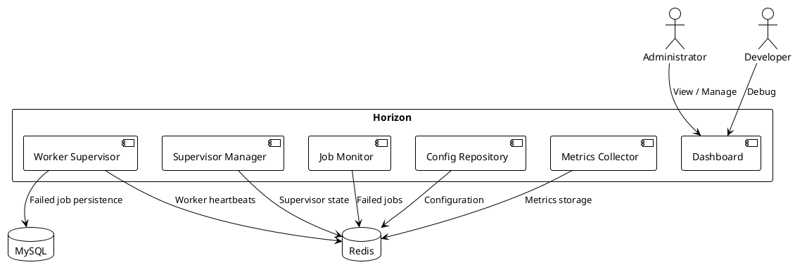

# 05.03.06.04 - Horizon

**Project:** GsmUi
**Architecture:** C4 Model – Level 2 (Container)
**Container:** Queue Workers
**Framework:** Laravel 13 + Horizon
**Version:** 1.0.0

---

# Purpose

Laravel Horizon provides the operational control plane for the GsmUi queue workers. It supervises worker processes, balances queue workloads, tracks runtime metrics, and exposes a web dashboard for operators and administrators.

Horizon is the single authoritative source for queue worker configuration and health.

---

# Responsibilities

Horizon is responsible for:

* Supervisor process management
* Worker health monitoring
* Queue load balancing
* Failed job tracking
* Runtime metrics collection
* Web dashboard
* Configuration management
* Deployment coordination
* Alerting integration

---

# Horizon Architecture



---

# Horizon Configuration

Horizon is configured in `config/horizon.php`:

```php
return [
    'environments' => [
        'production' => [
            'high' => [
                'connection' => 'redis',
                'queue' => ['high'],
                'balance' => 'simple',
                'maxProcesses' => 6,
                'maxTime' => 0,
                'maxJobs' => 0,
                'memory' => 128,
                'tries' => 3,
                'timeout' => 120,
                'nice' => 0,
            ],
            'default' => [
                'connection' => 'redis',
                'queue' => ['default'],
                'balance' => 'simple',
                'maxProcesses' => 4,
                'maxTime' => 0,
                'maxJobs' => 0,
                'memory' => 128,
                'tries' => 3,
                'timeout' => 120,
                'nice' => 0,
            ],
            'mail' => [
                'connection' => 'redis',
                'queue' => ['mail'],
                'balance' => 'simple',
                'maxProcesses' => 3,
                'maxTime' => 0,
                'maxJobs' => 0,
                'memory' => 128,
                'tries' => 3,
                'timeout' => 120,
                'nice' => 0,
            ],
            'media' => [
                'connection' => 'redis',
                'queue' => ['media'],
                'balance' => 'simple',
                'maxProcesses' => 4,
                'maxTime' => 0,
                'maxJobs' => 0,
                'memory' => 256,
                'tries' => 3,
                'timeout' => 300,
                'nice' => 10,
            ],
            'search' => [
                'connection' => 'redis',
                'queue' => ['search'],
                'balance' => 'simple',
                'maxProcesses' => 2,
                'maxTime' => 0,
                'maxJobs' => 0,
                'memory' => 256,
                'tries' => 3,
                'timeout' => 300,
                'nice' => 10,
            ],
            'exports' => [
                'connection' => 'redis',
                'queue' => ['exports'],
                'balance' => 'simple',
                'maxProcesses' => 2,
                'maxTime' => 0,
                'maxJobs' => 0,
                'memory' => 512,
                'tries' => 2,
                'timeout' => 600,
                'nice' => 10,
            ],
            'analytics' => [
                'connection' => 'redis',
                'queue' => ['analytics'],
                'balance' => 'simple',
                'maxProcesses' => 2,
                'maxTime' => 0,
                'maxJobs' => 0,
                'memory' => 256,
                'tries' => 2,
                'timeout' => 600,
                'nice' => 10,
            ],
            'backups' => [
                'connection' => 'redis',
                'queue' => ['backups'],
                'balance' => 'simple',
                'maxProcesses' => 1,
                'maxTime' => 0,
                'maxJobs' => 0,
                'memory' => 512,
                'tries' => 2,
                'timeout' => 1800,
                'nice' => 10,
            ],
        ],
    ],

    'defaults' => [
        'supervisor-1' => [
            'connection' => 'redis',
            'queue' => ['default'],
            'balance' => 'simple',
            'maxProcesses' => 1,
            'maxTime' => 0,
            'maxJobs' => 0,
            'memory' => 128,
            'tries' => 3,
            'timeout' => 60,
            'nice' => 0,
        ],
    ],

    'fast_termination' => false,

    'memory_limit' => 128,

    'home' => '/horizon',

    'use' => 'default',

    'prefix' => 'horizon:',
];
```

---

# Supervisor Management

Supervisors are the top-level process groups managed by Horizon.

Each supervisor:

* Is defined in the Horizon configuration
* Manages one or more worker processes
* Reports state to Redis
* Is monitored for health

Supervisor commands:

```bash
php artisan horizon:supervisors
php artisan horizon:supervisor {name}
php artisan horizon:pause-supervisor {name}
php artisan horizon:continue-supervisor {name}
php artisan horizon:terminate-supervisor {name}
```

---

# Dashboard

The Horizon dashboard provides:

* Queue length monitoring
* Worker status and utilization
* Job throughput over time
* Failed job inspection
* Job retry and deletion
* Configuration editor
* Real-time logs

The dashboard route is protected by authentication middleware in production.

---

# Dashboard Authentication

Horizon integrates with Laravel's authentication:

```php
// AppServiceProvider or HorizonServiceProvider
Horizon::auth(function ($request) {
    return $request->user()?->can('view horizon');
});
```

Only users with the `view horizon` permission may access the dashboard.

---

# Metrics

Horizon tracks the following metrics per queue and worker:

| Metric | Description |
|--------|-------------|
| Jobs/min | Throughput per minute |
| Average runtime | Mean job processing time |
| P50 / P95 / P99 runtime | Percentile latencies |
| Queue depth | Current pending jobs |
| Failed jobs | Total failed job count |
| Worker utilization | Percentage of time workers are busy |

Metrics are stored in Redis sorted sets with timestamps for historical charts.

---

# Job Monitoring

The dashboard shows:

* Recently processed jobs
* Currently processing jobs
* Failed jobs with exception details
* Job payload inspection
* Retry and delete actions

Failed jobs can be:

* Retried individually
* Retried in bulk
* Deleted permanently
* Exported for analysis

---

# Configuration Management

Horizon configuration is version-controlled in `config/horizon.php`. Environment-specific overrides can be applied through:

* Environment variables
* Configuration caching (`php artisan config:cache`)
* Runtime configuration via dashboard (non-production only)

Configuration changes in the dashboard are ephemeral and lost on restart. Production changes should always be made through code.

---

# Deployment Integration

Horizon supports deployment workflows:

```bash
# Quiet workers (finish current jobs before stopping)
php artisan horizon:quiet

# Deploy code...

# Terminate workers (restart after deploy)
php artisan horizon:terminate $(php artisan horizon:supervisors | jq -r '.[] | .name')
```

Workers are automatically restarted by Horizon after termination.

---

# Load Balancing Strategies

Horizon supports two balancing strategies:

**Simple**

* Fixed worker count per supervisor
* Workers consume from assigned queue only
* Predictable resource usage
* Recommended for most cases

**Auto**

* Dynamic worker redistribution
* Workers move to busiest queues
* Better throughput for variable workloads
* Higher operational complexity

GsmUi uses `simple` balancing for predictable resource allocation.

---

# Failed Jobs

Horizon provides a web interface for managing failed jobs:

* List all failed jobs
* Inspect job payload and exception
* Retry individual jobs
* Retry all failed jobs for a queue
* Delete failed jobs
* Bulk actions

Failed jobs are also stored in the `failed_jobs` MySQL table for permanent retention and admin workflows.

---

# Notifications and Alerts

Horizon can send notifications when:

* A supervisor stops unexpectedly
* A job fails repeatedly
* Queue depth exceeds a threshold
* Worker count drops below minimum

Notifications are sent via:

* Laravel Notifications (mail, Slack, SMS)
* Webhooks (future)
* Monitoring integrations

---

# Security

Horizon dashboard security:

* Authenticated users only
* Role-based access control
* HTTPS required in production
* IP allowlist support (via middleware)
* CSRF protection on all state-changing actions

Horizon does not expose raw job payloads to unauthorized users.

---

# Logging

Horizon logs:

* Supervisor lifecycle events
* Worker restarts
* Job failures
* Configuration changes
* Authentication events

Logs use Laravel's structured logging and should be aggregated.

---

# Monitoring Horizon Itself

Horizon exposes its own health endpoints:

```text
GET /horizon/api/jobs
GET /horizon/metrics
GET /horizon/supervisors
GET /horizon/queues
```

These endpoints can be polled by external monitoring systems to verify Horizon health independent of the dashboard.

---

# Graceful Shutdown

When Horizon receives a termination signal:

1. Workers stop accepting new jobs
2. In-flight jobs are allowed to complete
3. Workers exit after current job or timeout
4. Supervisor state is cleaned up
5. Master supervisor exits

This ensures no jobs are lost during deployments or restarts.

---

# Performance Targets

| Metric | Target |
|--------|--------|
| Dashboard Load | <2 seconds |
| Supervisor Restart | <10 seconds |
| Worker Restart | <5 seconds |
| Metrics Update | <1 second |
| Failed Job List | <2 seconds |
| Dashboard Availability | 99.9% |

---

# Troubleshooting

Common Horizon issues:

| Issue | Diagnosis | Resolution |
|-------|-----------|------------|
| Workers not starting | Check Horizon logs | Verify Redis connection, config |
| High memory usage | Check worker memory | Reduce max-jobs or memory limit |
| Jobs not processing | Check queue length | Scale workers or investigate blockers |
| Dashboard slow | Check metrics volume | Prune old metrics, scale Redis |
| Supervisor crashes | Check exceptions | Review job code for errors |

---

# Summary

Laravel Horizon provides the operational control plane for GsmUi's queue workers. It offers process supervision, real-time metrics, a web dashboard, and deployment coordination — all built on Redis state storage. Horizon should be treated as a critical production service with appropriate monitoring, alerting, and access controls.

---

# Horizon Internals

## Master Process

When Horizon starts, it spawns a master supervisor process:

```text
Master Supervisor (PID 1000)
├─ Child Supervisor: high (PID 1001)
│  ├─ Worker H1 (PID 1010)
│  ├─ Worker H2 (PID 1011)
│  └─ Worker H3 (PID 1012)
├─ Child Supervisor: default (PID 1002)
│  ├─ Worker D1 (PID 1020)
│  └─ Worker D2 (PID 1021)
└─ Child Supervisor: mail (PID 1003)
   ├─ Worker M1 (PID 1030)
   └─ Worker M2 (PID 1031)
```

The master process:

* Reads configuration from `config/horizon.php`
* Spawns child supervisors for each queue
* Monitors child supervisor health
* Handles termination signals
* Manages worker redistribution

---

## Child Supervisors

Each child supervisor manages a pool of workers for a specific queue:

* Spawns worker processes up to `maxProcesses`
* Monitors worker memory, runtime, and job count
* Restarts workers exceeding limits
* Reports state to Redis
* Handles graceful shutdown requests

---

## Worker Processes

Workers are the actual job-processing processes:

* Each runs a single PHP process
* Consumes from one or more Redis queues
* Processes one job at a time
* Reports state to the supervisor
* Can be individually terminated

---

# Redis Key Structure

Horizon uses Redis for all state management. Key structure:

```text
horizon:supervisors          — Set of all supervisor names
horizon:supervisor:{name}    — Hash of supervisor state
horizon:master               — Master supervisor PID
horizon:pause                — Pause flag
horizon:metrics:{queue}      — Sorted set of metrics per minute
horizon:metrics:jobs         — Sorted set of job metrics
horizon:failed:jobs          — List of failed jobs
horizon:recently-failed      — List of recently failed job IDs
horizon:recently-completed   — List of recently completed job IDs
```

---

## Supervisor State in Redis

Each supervisor stores its state in a Redis hash:

```text
Key: horizon:supervisor:production:high
Fields:
  name: production:high
  pid: 1001
  status: running
  workers: 6
  processes: 6
  balance: simple
  queues: ["high"]
  maxProcesses: 6
  memory: 128
  timeout: 120
  started_at: 1700000000
```

---

## Worker State in Redis

Each worker stores its state in a Redis hash:

```text
Key: horizon:worker:1010
Fields:
  pid: 1010
  name: worker-high-1
  supervisor: production:high
  status: working
  queue: high
  job: App\Jobs\SendEmail
  started_at: 1700000010
  memory: 45
  runtime: 12
```

---

# Horizon Dashboard API

The Horizon dashboard communicates with a backend API:

| Endpoint | Method | Purpose |
|----------|--------|---------|
| `/horizon/api/metrics` | GET | Queue metrics |
| `/horizon/api/metrics/jobs` | GET | Job metrics |
| `/horizon/api/metrics/{queue}` | GET | Queue-specific metrics |
| `/horizon/api/supervisors` | GET | Supervisor status |
| `/horizon/api/supervisors/{name}` | GET | Single supervisor details |
| `/horizon/api/workers` | GET | Worker status |
| `/horizon/api/workers/{pid}` | GET | Single worker details |
| `/horizon/api/jobs` | GET | Recent jobs |
| `/horizon/api/jobs/failed` | GET | Failed jobs |
| `/horizon/api/jobs/failed/{id}` | GET | Single failed job |
| `/horizon/api/jobs/failed/{id}/retry` | POST | Retry failed job |
| `/horizon/api/jobs/failed/{id}/delete` | DELETE | Delete failed job |
| `/horizon/api/jobs/retry-all` | POST | Retry all failed jobs |
| `/horizon/api/configuration` | GET | Current configuration |
| `/horizon/api/configuration` | PUT | Update configuration |

---

# Horizon Commands

Complete list of Horizon artisan commands:

```bash
# Process management
php artisan horizon                    # Start Horizon
php artisan horizon:supervise          # Start supervisor
php artisan horizon:terminate          # Terminate workers
php artisan horizon:restart            # Restart workers
php artisan horizon:pause              # Pause Horizon
php artisan horizon:continue           # Resume Horizon
php artisan horizon:quit               # Graceful shutdown
php artisan horizon:exit               # Forceful shutdown

# Supervisor management
php artisan horizon:supervisors        # List supervisors
php artisan horizon:supervisor {name}  # Start specific supervisor
php artisan horizon:pause-supervisor {name}
php artisan horizon:continue-supervisor {name}
php artisan horizon:terminate-supervisor {name}
php artisan horizon:scale {name} {count}

# Worker management
php artisan horizon:workers            # List workers
php artisan horizon:terminate-worker {pid}
php artisan horizon:restart-worker {pid}

# Metrics
php artisan horizon:metrics            # Show metrics
php artisan horizon:metrics:reset      # Reset metrics

# Failed jobs
php artisan horizon:retry {id}         # Retry failed job
php artisan horizon:retry-all          # Retry all failed jobs
php artisan horizon:purge {hours}      # Purge old metrics
```

---

# Horizon Configuration Deep Dive

## Environment Selection

Horizon selects configuration based on the `APP_ENV` environment variable:

```php
// .env
APP_ENV=production

// config/horizon.php
'environments' => [
    'production' => [...],
    'staging' => [...],
    'local' => [...],
],
```

Horizon uses the configuration matching the current environment.

---

## Balancing Strategies

### Simple Balancing

```php
'balance' => 'simple',
'maxProcesses' => 6,
'minProcesses' => 0,
```

Simple balancing:

* Maintains a fixed number of workers per supervisor
* Workers consume from their assigned queue only
* No redistribution between queues
* Predictable resource usage
* Recommended for most production deployments

---

### Auto Balancing

```php
'balance' => 'auto',
'maxProcesses' => 10,
'minProcesses' => 2,
```

Auto balancing:

* Dynamically adjusts worker count per queue
* Workers move to the busiest queues
* Better throughput for variable workloads
* Higher operational complexity
* Requires monitoring of worker distribution

Auto balancing rules:

1. Check queue depth every 30 seconds
2. Calculate optimal worker distribution
3. Scale up queues with high depth
4. Scale down queues with low depth
5. Respect `minProcesses` and `maxProcesses` limits

---

## Timeout Configuration

| Setting | Scope | Default | Description |
|---------|-------|---------|-------------|
| `timeout` | Per job | 60s | Maximum job execution time |
| `retry_after` | Per job | 120s | Time before reserved job is considered lost |
| `maxTime` | Per worker | 0 (disabled) | Maximum worker lifetime |
| `maxJobs` | Per worker | 0 (disabled) | Maximum jobs per worker |

---

## Memory Configuration

| Setting | Scope | Default | Description |
|---------|-------|---------|-------------|
| `memory` | Per worker | 128 MB | Maximum worker memory |
| `memory_limit` | Global | 128 MB | Default memory for all workers |

When a worker exceeds its memory limit:

1. Supervisor detects memory violation
2. Worker is sent SIGTERM
3. Worker finishes current job (if possible)
4. Worker exits
5. Supervisor spawns replacement worker

---

## Process Priority

The `nice` setting controls OS process priority:

```php
'nice' => 0,    // Normal priority (default)
'nice' => -10,  // Higher priority
'nice' => 10,   // Lower priority
```

Nice values range from -20 (highest priority) to 20 (lowest priority).

---

# Horizon Deployment Strategies

## Strategy 1: Quiet and Terminate

The standard deployment approach:

```bash
# Step 1: Quiet workers
php artisan horizon:quiet
# Workers finish current jobs, stop accepting new ones

# Step 2: Deploy code
git pull origin main
composer install --no-dev
php artisan migrate --force

# Step 3: Terminate workers
php artisan horizon:terminate
# Workers are killed, Horizon auto-restarts them

# Step 4: Verify
php artisan horizon:status
```

---

## Strategy 2: Graceful Restart

For zero-downtime deployment:

```bash
# Step 1: Deploy code
git pull origin main
composer install --no-dev
php artisan migrate --force

# Step 2: Restart Horizon (graceful)
php artisan horizon:restart
# Workers finish current jobs, then restart with new code
```

The `horizon:restart` command:

* Sends SIGTERM to all workers
* Workers finish current job before exiting
* Horizon spawns new workers automatically
* No manual termination needed

---

## Strategy 3: Rolling Restart

For multi-host deployments:

```bash
# Host A
php artisan horizon:quiet
php artisan horizon:terminate
# Wait for new workers to start

# Host B (after Host A is healthy)
php artisan horizon:quiet
php artisan horizon:terminate
# Wait for new workers to start

# Host C (after Host B is healthy)
php artisan horizon:quiet
php artisan horizon:terminate
```

---

# Horizon Metrics Deep Dive

## Metric Storage

Horizon stores metrics in Redis sorted sets:

```text
Key: horizon:metrics:jobs
Members: JSON objects with timestamp
Score: Unix timestamp

Example:
horizon:metrics:jobs
├─ {"time": 1700000000, "jobs": 120, "wait": 5000, "run": 1500, "fail": 2}
├─ {"time": 1700000060, "jobs": 115, "wait": 4800, "run": 1600, "fail": 1}
└─ {"time": 1700000120, "jobs": 130, "wait": 5200, "run": 1400, "fail": 3}
```

---

## Metric Aggregation

Metrics are aggregated into time buckets:

| Bucket | Granularity | Retention |
|--------|-------------|-----------|
| 1 minute | Per minute | 24 hours |
| 5 minutes | Per 5 minutes | 7 days |
| 1 hour | Per hour | 30 days |

Aggregation queries:

```php
// Get jobs per minute for the last hour
Redis::zrange('horizon:metrics:jobs', -60, -1);

// Get average wait time
$metrics = Redis::zrange('horizon:metrics:jobs', -60, -1);
$avgWait = array_sum(array_column($metrics, 'wait')) / count($metrics);
```

---

## Metric Types

| Metric | Description | Unit |
|--------|-------------|------|
| `jobs` | Jobs processed | count |
| `wait` | Time in queue before processing | milliseconds |
| `run` | Job execution time | milliseconds |
| `fail` | Failed jobs | count |
| `throughput` | Jobs per minute | rate |
| `depth` | Current queue length | count |

---

# Horizon Notification System

Horizon sends notifications for critical events:

```php
// AppServiceProvider.php
use Laravel\Horizon\Horizon;

Horizon::notificationsUsing(function ($app) {
    return [
        'mail' => [
            'to' => 'ops@gsmui.com',
            'from' => 'horizon@gsmui.com',
        ],
        'slack' => [
            'webhook' => env('HORIZON_SLACK_WEBHOOK'),
            'channel' => '#ops-alerts',
        ],
    ];
});
```

## Notification Events

| Event | Trigger | Severity |
|-------|---------|----------|
| Supervisor stopped | Supervisor process exits | Critical |
| Job failed | Job exceeds retry attempts | Warning |
| Queue depth high | Queue exceeds threshold | Warning |
| Worker count low | Workers below minimum | Critical |
| Memory pressure | Worker near memory limit | Warning |

---

# Horizon Security

## Authentication

```php
// Only authenticated users with specific permission
Horizon::auth(function ($request) {
    return $request->user()?->can('view horizon');
});
```

## Authorization

```php
// Role-based access control
Horizon::auth(function ($request) {
    $user = $request->user();
    
    // Admin can do everything
    if ($user->hasRole('admin')) {
        return true;
    }
    
    // Operator can view but not modify
    if ($user->hasRole('operator') && $request->isMethod('GET')) {
        return true;
    }
    
    return false;
});
```

## CSRF Protection

Horizon includes CSRF tokens on all state-changing endpoints. The dashboard uses the default Laravel CSRF middleware.

## IP Allowlist

Restrict dashboard access by IP:

```php
// HorizonServiceProvider.php
Horizon::auth(function ($request) {
    $allowedIps = ['10.0.0.0/8', '192.168.1.0/24'];
    
    return in_array($request->ip(), $allowedIps);
});
```

---

# Horizon Troubleshooting

## Problem: Workers Not Starting

```bash
# Check Horizon status
php artisan horizon:status

# Check Redis connection
redis-cli ping

# Check configuration
php artisan config:show horizon

# Check logs
tail -f storage/logs/laravel.log
```

Common causes:

* Redis connection refused
* Invalid configuration syntax
* Missing PHP extensions (pcntl, posix)
* Insufficient memory

---

## Problem: Jobs Not Processing

```bash
# Check queue length
redis-cli LLEN queues:high

# Check worker count
php artisan horizon:workers

# Check for paused Horizon
php artisan horizon:status

# Check failed jobs
redis-cli LLEN queues:failed
```

Common causes:

* Horizon paused
* All workers busy
* Redis connection issues
* Job timeout too short

---

## Problem: High Memory Usage

```bash
# Check worker memory
php artisan horizon:workers --json | jq '.[].memory'

# Check for memory leaks
redis-cli INFO memory

# Reduce memory limits
# config/horizon.php → memory setting
```

Common causes:

* Large job payloads
* Unclosed resources in jobs
* Memory leaks in application code
* Too many database connections

---

## Problem: Slow Dashboard

```bash
# Check metrics volume
redis-cli ZCARD horizon:metrics:jobs

# Prune old metrics
php artisan horizon:purge 720

# Check Redis memory
redis-cli INFO memory
```

Common causes:

* Too many metrics stored
* Redis memory pressure
* Large number of failed jobs

---

# Horizon Best Practices

1. **Version control configuration** — Never modify production config through the dashboard
2. **Set memory limits** — Prevent memory leaks from consuming all host resources
3. **Set job timeouts** — Prevent zombie jobs from holding workers
4. **Monitor queue depth** — Alert before queues become critically deep
5. **Prune metrics regularly** — Prevent Redis memory exhaustion
6. **Use dedicated Redis** — Separate queue Redis from cache Redis
7. **Test deployments** — Verify graceful shutdown works in staging
8. **Document runbooks** — Create procedures for common Horizon issues
9. **Restrict dashboard access** — Use authentication and IP allowlists
10. **Log everything** — Aggregate Horizon logs for debugging

---

# Horizon Integration Points

| System | Integration | Purpose |
|--------|-------------|---------|
| Redis | Primary storage | Queue state, metrics, supervisor state |
| MySQL | Secondary storage | Failed jobs persistence |
| Slack | Notifications | Alert delivery |
| PagerDuty | Notifications | Critical alert escalation |
| Prometheus | Metrics export | External monitoring |
| Grafana | Dashboards | Historical visualization |
| Laravel | Framework integration | Job dispatch, event system |
| Horizon API | Dashboard backend | Dashboard data |

---

# Horizon Performance Characteristics

| Metric | Expected Value | Notes |
|--------|---------------|-------|
| Supervisor startup | <2 seconds | Spawns all child supervisors |
| Worker startup | <5 seconds | Bootstraps Laravel application |
| Job dispatch to pickup | <1 second | Depends on Redis latency |
| Dashboard load time | <2 seconds | Depends on metrics volume |
| Metrics query | <100ms | Redis sorted set operations |
| Worker redistribution | <30 seconds | Auto balance evaluation cycle |

---

# Horizon Configuration Reference

## Complete Configuration Options

```php
return [
    // Horizon master settings
    'environments' => [
        'production' => [
            // Queue supervisor definitions
            'high' => [
                'connection' => 'redis',
                'queue' => ['high'],
                'balance' => 'simple',
                'maxProcesses' => 6,
                'minProcesses' => 0,
                'maxTime' => 0,
                'maxJobs' => 0,
                'memory' => 128,
                'tries' => 3,
                'timeout' => 120,
                'nice' => 0,
                'backoff' => [10, 30, 60],
                'retry_after' => 120,
                'trim/release' => true,
                'trim/release_timeout' => 120,
            ],
            // ... other queues
        ],
        'staging' => [
            // Staging configuration (smaller pools)
        ],
        'local' => [
            // Local development configuration
        ],
    ],

    'defaults' => [
        'supervisor-1' => [
            'connection' => 'redis',
            'queue' => ['default'],
            'balance' => 'simple',
            'maxProcesses' => 1,
            'maxTime' => 0,
            'maxJobs' => 0,
            'memory' => 128,
            'tries' => 3,
            'timeout' => 60,
            'nice' => 0,
        ],
    ],

    'fast_termination' => false,
    'memory_limit' => 128,
    'home' => '/horizon',
    'use' => 'default',
    'prefix' => 'horizon:',
];
```

---

## Configuration Option Reference

| Option | Type | Default | Description |
|--------|------|---------|-------------|
| `connection` | string | `redis` | Queue connection driver |
| `queue` | array | `['default']` | Queues to consume |
| `balance` | string | `simple` | `simple` or `auto` balancing |
| `maxProcesses` | int | `1` | Maximum worker processes per supervisor |
| `minProcesses` | int | `0` | Minimum worker processes (auto mode) |
| `maxTime` | int | `0` | Seconds before worker restart (0 = disabled) |
| `maxJobs` | int | `0` | Jobs before worker restart (0 = disabled) |
| `memory` | int | `128` | Memory limit in MB |
| `tries` | int | `3` | Maximum retry attempts per job |
| `timeout` | int | `60` | Maximum seconds a job may run |
| `nice` | int | `0` | Process niceness (higher = lower priority) |
| `backoff` | array | `[10, 30, 60]` | Retry delay in seconds |
| `retry_after` | int | `120` | Seconds before reserved job is considered lost |
| `trim/release` | bool | `true` | Release long-running reserved jobs |
| `trim/release_timeout` | int | `120` | Timeout for trim/release |
| `fast_termination` | bool | `false` | Skip waiting for current jobs |
| `memory_limit` | int | `128` | Default memory limit for all workers |
| `home` | string | `/horizon` | Dashboard URL path |
| `prefix` | string | `horizon:` | Redis key prefix |

---

# Horizon Process Model

## Process Hierarchy

```text
Horizon Master (PID 1000)
├─ Supervisor: production:high (PID 1001)
│  ├─ Worker: worker-high-0 (PID 1010)
│  ├─ Worker: worker-high-1 (PID 1011)
│  ├─ Worker: worker-high-2 (PID 1012)
│  ├─ Worker: worker-high-3 (PID 1013)
│  ├─ Worker: worker-high-4 (PID 1014)
│  └─ Worker: worker-high-5 (PID 1015)
├─ Supervisor: production:default (PID 1002)
│  ├─ Worker: worker-default-0 (PID 1020)
│  ├─ Worker: worker-default-1 (PID 1021)
│  ├─ Worker: worker-default-2 (PID 1022)
│  └─ Worker: worker-default-3 (PID 1023)
├─ Supervisor: production:mail (PID 1003)
│  ├─ Worker: worker-mail-0 (PID 1030)
│  ├─ Worker: worker-mail-1 (PID 1031)
│  └─ Worker: worker-mail-2 (PID 1032)
└─ Supervisor: production:media (PID 1004)
   ├─ Worker: worker-media-0 (PID 1040)
   ├─ Worker: worker-media-1 (PID 1041)
   ├─ Worker: worker-media-2 (PID 1042)
   └─ Worker: worker-media-3 (PID 1043)
```

---

## Process Communication

```text
┌─────────────────────────────────────────────────────────────────┐
│                      Horizon Process Model                       │
│                                                                  │
│  ┌──────────────┐     ┌──────────────┐     ┌──────────────┐     │
│  │    Master     │────▶│  Supervisor  │────▶│    Worker    │     │
│  │   Process     │◀────│   Process    │◀────│   Process    │     │
│  └──────────────┘     └──────────────┘     └──────────────┘     │
│         │                    │                    │              │
│         │                    │                    │              │
│         ▼                    ▼                    ▼              │
│  ┌──────────────┐     ┌──────────────┐     ┌──────────────┐     │
│  │    Redis     │     │    Redis     │     │    Redis     │     │
│  │  (State)     │     │  (Metrics)   │     │  (Queues)    │     │
│  └──────────────┘     └──────────────┘     └──────────────┘     │
│                                                                  │
└─────────────────────────────────────────────────────────────────┘
```

---

## Process States

### Master Process States

| State | Description |
|-------|-------------|
| Starting | Master process is bootstrapping |
| Running | Master is supervising child processes |
| Paused | Master is paused, not starting new workers |
| Stopping | Master is shutting down |
| Stopped | Master has exited |

### Supervisor States

| State | Description |
|-------|-------------|
| Starting | Supervisor is spawning workers |
| Running | Supervisor is monitoring workers |
| Paused | Supervisor is paused |
| Stopping | Supervisor is shutting down |
| Stopped | Supervisor has exited |

### Worker States

| State | Description |
|-------|-------------|
| Starting | Worker is bootstrapping |
| Running | Worker is waiting for jobs |
| Working | Worker is processing a job |
| Stopping | Worker is finishing current job |
| Stopped | Worker has exited |

---

# Horizon Metrics System

## Metrics Collection

Horizon collects metrics automatically:

```php
// Metrics are collected by the MetricsCollector
class MetricsCollector
{
    public function collect(): void
    {
        $this->collectQueueMetrics();
        $this->collectJobMetrics();
        $this->collectWorkerMetrics();
    }

    private function collectQueueMetrics(): void
    {
        foreach ($this->getQueues() as $queue) {
            $depth = Redis::llen("queues:{$queue}");
            
            Redis::zadd("horizon:metrics:depth", [
                json_encode([
                    'queue' => $queue,
                    'depth' => $depth,
                    'time' => now()->timestamp,
                ]) => now()->timestamp,
            ]);
        }
    }
}
```

---

## Metrics Aggregation

Metrics are aggregated into time buckets:

```php
class MetricsAggregator
{
    public function aggregate(string $queue, string $period = 'hour'): array
    {
        $metrics = Redis::zrangebyscore(
            "horizon:metrics:jobs",
            now()->subHour()->timestamp,
            now()->timestamp
        );

        $aggregated = collect($metrics)->map(fn ($m) => json_decode($m, true));

        return [
            'queue' => $queue,
            'period' => $period,
            'jobs_processed' => $aggregated->sum('jobs'),
            'jobs_failed' => $aggregated->sum('fail'),
            'avg_wait_time' => $aggregated->avg('wait'),
            'avg_run_time' => $aggregated->avg('run'),
            'throughput_per_minute' => $aggregated->sum('jobs') / 60,
        ];
    }
}
```

---

## Metrics Retention

| Metric Type | Retention Period | Storage |
|-------------|------------------|---------|
| Real-time (per minute) | 24 hours | Redis sorted sets |
| Hourly aggregates | 30 days | Redis sorted sets |
| Daily aggregates | 90 days | Redis sorted sets |
| Failed jobs | 30 days | MySQL `failed_jobs` table |
| Job payloads | Until retry/delete | Redis + MySQL |

---

# Horizon Dashboard Deep Dive

## Dashboard Features

| Feature | Description | Access Level |
|---------|-------------|--------------|
| Queue Overview | All queue depths and throughput | Viewer |
| Worker Status | Worker count and utilization | Viewer |
| Job Metrics | Job throughput and latency | Viewer |
| Failed Jobs | Failed job list and details | Operator |
| Retry Jobs | Retry individual or bulk jobs | Operator |
| Delete Jobs | Delete failed jobs | Operator |
| Supervisor Management | Pause/continue supervisors | Admin |
| Configuration | View Horizon config | Admin |
| Metrics Reset | Reset collected metrics | Admin |

---

## Dashboard Routes

```php
// routes/web.php
Route::middleware(['auth', 'can:view-horizon'])->group(function () {
    Route::prefix('horizon')->group(function () {
        Route::get('/', [HorizonController::class, 'index']);
        Route::get('/dashboard', [HorizonController::class, 'dashboard']);
        Route::get('/metrics', [HorizonController::class, 'metrics']);
        Route::get('/metrics/{queue}', [HorizonController::class, 'queueMetrics']);
        Route::get('/supervisors', [HorizonController::class, 'supervisors']);
        Route::get('/workers', [HorizonController::class, 'workers']);
        Route::get('/jobs', [HorizonController::class, 'jobs']);
        Route::get('/jobs/failed', [HorizonController::class, 'failedJobs']);
        Route::post('/jobs/failed/{id}/retry', [HorizonController::class, 'retryJob']);
        Route::delete('/jobs/failed/{id}', [HorizonController::class, 'deleteJob']);
        Route::post('/jobs/retry-all', [HorizonController::class, 'retryAll']);
    });
});
```

---

## Dashboard Authorization

```php
// HorizonServiceProvider.php
Horizon::auth(function ($request) {
    $user = $request->user();

    if (!$user) {
        return false;
    }

    // Admin can do everything
    if ($user->hasRole('admin')) {
        return true;
    }

    // Operator can view and retry
    if ($user->hasRole('operator')) {
        return true;
    }

    // Viewer can only view
    if ($user->hasRole('viewer') && $request->isMethod('GET')) {
        return true;
    }

    return false;
});
```

---

# Horizon Security Deep Dive

## Authentication Integration

```php
// config/horizon.php
'auth' => [
    'guard' => 'web', // Auth guard to use
    'middleware' => ['auth', 'verified'], // Middleware for dashboard
],
```

---

## Authorization Integration

```php
// AppServiceProvider.php
Horizon::auth(function ($request) {
    return $request->user()?->canAccessHorizon();
});

// User model
class User extends Authenticatable
{
    public function canAccessHorizon(): bool
    {
        return $this->isAdmin() || $this->isOperator();
    }
}
```

---

## CSRF Protection

Horizon includes CSRF protection on all state-changing endpoints:

```php
// Routes are protected by VerifyCsrfToken middleware
Route::middleware(['web', 'auth'])->group(function () {
    // Horizon routes
});
```

---

## Rate Limiting

Apply rate limiting to Horizon API endpoints:

```php
// AppServiceProvider.php
Route::middleware(['throttle:horizon'])->group(function () {
    // Horizon API routes
});
```

```php
// RateLimiter.php
RateLimiter::for('horizon', function (Request $request) {
    return Limit::perMinute(60)->by($request->user()?->id ?: $request->ip());
});
```

---

# Horizon Deployment Integration

## CI/CD Pipeline Integration

```yaml
# .github/workflows/deploy.yml
jobs:
  deploy:
    runs-on: ubuntu-latest
    steps:
      - uses: actions/checkout@v3
      
      - name: Deploy code
        run: |
          rsync -avz ./ user@server:/var/www/html/
      
      - name: Migrate database
        run: |
          ssh user@server "cd /var/www/html && php artisan migrate --force"
      
      - name: Restart Horizon
        run: |
          ssh user@server "cd /var/www/html && php artisan horizon:restart"
      
      - name: Verify Horizon
        run: |
          ssh user@server "cd /var/www/html && php artisan horizon:status"
```

---

## Zero-Downtime Deployment

```bash
#!/bin/bash
# deploy.sh - Zero-downtime deployment

# Step 1: Pull new code
git pull origin main

# Step 2: Install dependencies
composer install --no-dev --optimize-autoloader

# Step 3: Run migrations
php artisan migrate --force

# Step 4: Clear caches
php artisan config:cache
php artisan route:cache
php artisan view:cache

# Step 5: Restart Horizon (graceful)
php artisan horizon:restart

# Step 6: Wait for workers to restart
sleep 10

# Step 7: Verify workers are running
php artisan horizon:status
```

---

## Blue-Green Deployment

```bash
# Blue-Green deployment with Horizon

# Deploy to green environment
rsync -avz ./blue/ ./green/

# Switch traffic to green
# Update load balancer configuration

# Restart Horizon on green
ssh green-server "cd /var/www/html && php artisan horizon:restart"

# Verify green is healthy
ssh green-server "curl -s http://localhost/health/queue"

# If healthy, decommission blue
# If not, rollback to blue
```

---

# Horizon Performance Optimization

## Redis Optimization

Optimize Redis for Horizon:

```php
// config/database.php
'redis' => [
    'client' => env('REDIS_CLIENT', 'phpredis'),
    'options' => [
        'cluster' => env('REDIS_CLUSTER', 'redis'),
        'prefix' => 'horizon:',
    ],
    'default' => [
        'host' => env('REDIS_HOST', '127.0.0.1'),
        'port' => env('REDIS_PORT', '6379'),
        'database' => env('REDIS_DB', 0),
        'read_timeout' => 60,
    ],
],
```

---

## Memory Optimization

Optimize Horizon memory usage:

```php
// Reduce metrics retention
'prefix' => 'horizon:',

// Limit metrics history
'metrics' => [
    'recent_jobs' => 100, // Keep last 100 jobs in memory
    'metrics' => 60,      // Keep 60 minutes of metrics
],
```

---

## Connection Optimization

Optimize database connections:

```php
// config/database.php
'mysql' => [
    'options' => [
        PDO::ATTR_PERSISTENT => true,
        PDO::ATTR_EMULATE_PREPARES => false,
    ],
],
```

---

# Horizon Testing

## Unit Testing Horizon

```php
class HorizonTest extends TestCase
{
    public function test_horizon_starts_successfully(): void
    {
        $this->artisan('horizon:supervise');
        
        $status = Artisan::call('horizon:status');
        $this->assertEquals(0, $status);
    }

    public function test_workers_are_spawned(): void
    {
        $this->artisan('horizon:supervise');
        
        $workers = $this->getWorkerCount();
        $this->assertGreaterThan(0, $workers);
    }
}
```

---

## Integration Testing

```php
class HorizonIntegrationTest extends TestCase
{
    public function test_jobs_are_processed(): void
    {
        $file = Media::factory()->create();
        ProcessMedia::dispatch($file->id);
        
        $this->artisan('queue:work --once');
        
        $file->refresh();
        $this->assertTrue($file->isProcessed());
    }
}
```

---

## Load Testing

```php
class HorizonLoadTest extends TestCase
{
    public function test_horizon_handles_load(): void
    {
        // Dispatch 1000 jobs
        foreach (range(1, 1000) as $i) {
            ProcessMedia::dispatch($files[$i]->id);
        }
        
        // Process for 60 seconds
        $start = microtime(true);
        while (microtime(true) - $start < 60) {
            $this->artisan('queue:work --once');
        }
        
        // Verify throughput
        $processed = Media::where('processed', true)->count();
        $this->assertGreaterThan(100, $processed);
    }
}
```

---

# Horizon Monitoring Reference

## Dashboard Metrics

| Metric | Description | Source |
|--------|-------------|--------|
| Queue Depth | Pending jobs per queue | Redis LLEN |
| Throughput | Jobs processed per minute | Redis sorted set |
| P50 Latency | Median processing time | Redis sorted set |
| P95 Latency | 95th percentile processing time | Redis sorted set |
| P99 Latency | 99th percentile processing time | Redis sorted set |
| Worker Count | Active worker processes | Redis hash |
| Worker Utilization | Time workers are busy | Redis sorted set |
| Failed Jobs | Total failed jobs | Redis list |

---

## Health Check Endpoints

| Endpoint | Method | Purpose |
|----------|--------|---------|
| `/health/queue` | GET | Queue health status |
| `/health/horizon` | GET | Horizon health status |
| `/metrics` | GET | Prometheus metrics |
| `/horizon/api/status` | GET | Horizon API status |

---

# Horizon Disaster Recovery

## Recovery Scenarios

| Scenario | Impact | Recovery Procedure |
|----------|--------|-------------------|
| Horizon crash | All workers stop | Systemd restarts Horizon |
| Redis outage | Workers blocked | Workers wait, retry on reconnect |
| Config corruption | Workers misconfigured | Restore config, restart Horizon |
| Dashboard outage | No visibility | Restart Horizon, check logs |
| Metrics loss | No historical data | Rebuild from logs |

---

## Recovery Procedures

### Horizon Crash Recovery

```bash
# Check Horizon status
php artisan horizon:status

# If Horizon is not running, start it
php artisan horizon:supervise

# Verify workers are started
php artisan horizon:workers --json | jq 'length'
```

---

### Redis Outage Recovery

```bash
# Check Redis connection
redis-cli ping

# If Redis is down, wait for it to come back
# Workers will automatically reconnect

# Verify workers are processing
watch -n 5 'redis-cli LLEN queues:high'
```

---

### Config Corruption Recovery

```bash
# Restore config from version control
git checkout main -- config/horizon.php

# Clear config cache
php artisan config:clear

# Restart Horizon
php artisan horizon:restart
```

---

## Backup and Restore

### Backup Horizon State

```bash
# Export Horizon metrics
redis-cli KEYS "horizon:metrics:*" | xargs redis-cli DUMP > horizon-metrics.rdb

# Export failed jobs
php artisan queue:failed > failed-jobs-backup.txt
```

---

### Restore Horizon State

```bash
# Import Horizon metrics
redis-cli RESTORE horizon-metrics 0 "$(cat horizon-metrics.rdb)"

# Import failed jobs
cat failed-jobs-backup.txt | php artisan queue:retry
```

---

# Horizon Testing

## Unit Tests

```php
class HorizonTest extends TestCase
{
    public function test_horizon_starts_successfully(): void
    {
        $this->artisan('horizon:supervise');
        
        $status = Artisan::call('horizon:status');
        $this->assertEquals(0, $status);
    }

    public function test_workers_are_spawned(): void
    {
        $this->artisan('horizon:supervise');
        
        $workers = $this->getWorkerCount();
        $this->assertGreaterThan(0, $workers);
    }

    public function test_configuration_is_valid(): void
    {
        $config = config('horizon.environments.production');
        
        foreach ($config as $queue => $settings) {
            $this->assertArrayHasKey('connection', $settings);
            $this->assertArrayHasKey('queue', $settings);
            $this->assertArrayHasKey('maxProcesses', $settings);
            $this->assertArrayHasKey('memory', $settings);
            $this->assertArrayHasKey('timeout', $settings);
        }
    }
}
```

---

## Integration Tests

```php
class HorizonIntegrationTest extends TestCase
{
    public function test_jobs_are_processed(): void
    {
        $file = Media::factory()->create();
        ProcessMedia::dispatch($file->id);
        
        $this->artisan('queue:work --once');
        
        $file->refresh();
        $this->assertTrue($file->isProcessed());
    }

    public function test_failed_jobs_are_recorded(): void
    {
        FailingJob::dispatch();
        
        $this->artisan('queue:work --once');
        
        $this->assertDatabaseHas('failed_jobs', [
            'queue' => 'default',
        ]);
    }
}
```

---

## Load Tests

```php
class HorizonLoadTest extends TestCase
{
    public function test_horizon_handles_load(): void
    {
        // Dispatch 1000 jobs
        foreach (range(1, 1000) as $i) {
            ProcessMedia::dispatch($files[$i]->id);
        }
        
        // Process for 60 seconds
        $start = microtime(true);
        while (microtime(true) - $start < 60) {
            $this->artisan('queue:work --once');
        }
        
        // Verify throughput
        $processed = Media::where('processed', true)->count();
        $this->assertGreaterThan(100, $processed);
    }
}
```

---

# Horizon Documentation

## Documentation Standards

All Horizon documentation should include:

1. **Purpose** — What the document covers
2. **Responsibilities** — What is included and excluded
3. **Configuration** — How to configure
4. **Operations** — How to operate
5. **Troubleshooting** — How to fix issues
6. **Security** — Security considerations
7. **Performance** — Performance characteristics
8. **Testing** — How to test

---

## Documentation Templates

### Configuration Document

```markdown
# Configuration: {Feature}

## Purpose
Description of the feature.

## Configuration Options
| Option | Type | Default | Description |
|--------|------|---------|-------------|
| `option` | type | default | description |

## Examples
```php
// Configuration example
```

## Best Practices
1. Best practice 1
2. Best practice 2
```

---

### Operations Document

```markdown
# Operations: {Feature}

## Daily Operations
### Morning
1. Step 1
2. Step 2

### During Business Hours
1. Step 1
2. Step 2

### Evening
1. Step 1
2. Step 2

## Weekly Operations
1. Step 1
2. Step 2

## Monthly Operations
1. Step 1
2. Step 2
```

---

# Horizon Performance Tuning

## Redis Performance Tuning

```php
// config/database.php
'redis' => [
    'client' => env('REDIS_CLIENT', 'phpredis'),
    'options' => [
        'cluster' => env('REDIS_CLUSTER', 'redis'),
        'prefix' => 'horizon:',
    ],
    'default' => [
        'host' => env('REDIS_HOST', '127.0.0.1'),
        'port' => env('REDIS_PORT', '6379'),
        'database' => env('REDIS_DB', 0),
        'read_timeout' => 60,
    ],
],
```

---

## PHP Performance Tuning

```ini
; php.ini for Horizon
memory_limit = 128M
max_execution_time = 120
opcache.enable = 1
opcache.memory_consumption = 128
opcache.max_accelerated_files = 4000
opcache.revalidate_freq = 0
```

---

## Application Performance Tuning

```php
// Optimize application for queue workers
class AppServiceProvider extends ServiceProvider
{
    public function boot(): void
    {
        if ($this->app->runningInConsole()) {
            // Reduce memory usage for queue workers
            config(['app.debug' => false]);
            
            // Clear unnecessary caches
            Cache::flush();
        }
    }
}
```

---

# Horizon Reference

## Horizon Commands Reference

| Command | Description | Usage |
|---------|-------------|-------|
| `php artisan horizon` | Start Horizon | Production |
| `php artisan horizon:supervise` | Start supervisor | Production |
| `php artisan horizon:terminate` | Terminate workers | Deployment |
| `php artisan horizon:restart` | Restart workers | Deployment |
| `php artisan horizon:pause` | Pause Horizon | Maintenance |
| `php artisan horizon:continue` | Resume Horizon | Maintenance |
| `php artisan horizon:workers` | List workers | Debugging |
| `php artisan horizon:supervisors` | List supervisors | Debugging |
| `php artisan horizon:scale {name} {count}` | Scale workers | Scaling |
| `php artisan horizon:status` | Check status | Monitoring |
| `php artisan horizon:metrics` | Show metrics | Monitoring |
| `php artisan horizon:metrics:reset` | Reset metrics | Maintenance |
| `php artisan horizon:retry {id}` | Retry failed job | Recovery |
| `php artisan horizon:retry-all` | Retry all failed jobs | Recovery |
| `php artisan horizon:purge {hours}` | Purge old metrics | Maintenance |

---

## Horizon Configuration Reference

| Setting | Type | Default | Description |
|---------|------|---------|-------------|
| `environments` | array | `[]` | Environment configurations |
| `defaults` | array | `[]` | Default supervisor settings |
| `fast_termination` | bool | `false` | Skip waiting for current jobs |
| `memory_limit` | int | `128` | Default memory limit (MB) |
| `home` | string | `/horizon` | Dashboard URL path |
| `use` | string | `default` | Default configuration |
| `prefix` | string | `horizon:` | Redis key prefix |

---

## Horizon Metrics Reference

| Metric | Description | Source |
|--------|-------------|--------|
| Queue Depth | Pending jobs per queue | Redis LLEN |
| Throughput | Jobs processed per minute | Redis sorted set |
| P50 Latency | Median processing time | Redis sorted set |
| P95 Latency | 95th percentile processing time | Redis sorted set |
| P99 Latency | 99th percentile processing time | Redis sorted set |
| Worker Count | Active worker processes | Redis hash |
| Worker Utilization | Time workers are busy | Redis sorted set |
| Failed Jobs | Total failed jobs | Redis list |

---

# Next Document

**05.03.06.05 - Queue Priorities** describes how GsmUi routes jobs to queues, manages priority ordering, and ensures critical workloads receive processing resources.
