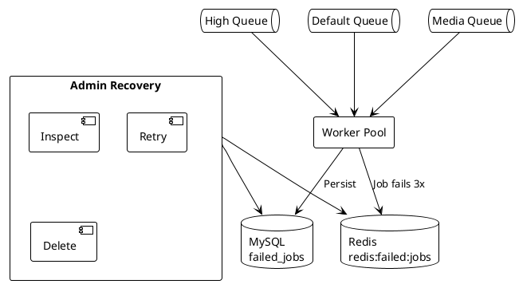

# 05.03.06.07 - Failed Jobs

**Project:** GsmUi
**Architecture:** C4 Model – Level 2 (Container)
**Container:** Queue Workers
**Framework:** Laravel 13 + Horizon
**Version:** 1.0.0

---

# Purpose

This document describes how GsmUi handles failed jobs, including the dead-letter queue (DLQ), retry strategies, failure classification, and administrative recovery workflows. Failed job handling is critical for maintaining data integrity and operational reliability.

---

# Responsibilities

Failed job handling is responsible for:

* Capturing failed job payloads
* Preserving exception context
* Enforcing retry policies
* Moving exhausted jobs to DLQ
* Providing admin recovery workflows
* Alerting on failure patterns
* Analyzing failure root causes

---

# Failure Classification

Not all failures are equal. GsmUi classifies failures into categories:

| Category | Cause | Action |
|----------|-------|--------|
| Transient | Network timeout, downstream unavailable | Automatic retry with backoff |
| Data | Invalid input, missing record | Alert admin, may need manual fix |
| Code | Bug in job logic | Fix and redeploy, then retry |
| Resource | Memory limit, timeout | Increase limits or optimize job |
| Dependency | External service down | Retry or circuit break |

---

# Retry Strategy

GsmUi uses exponential backoff for automatic retries:

```php
// Job class
public $tries = 3;

public function backoff(): array
{
    return [10, 30, 60]; // seconds
}

// Or via Horizon config
'tries' => 3,
```

Retry behavior:

* Attempt 1 fails → wait 10 seconds → retry
* Attempt 2 fails → wait 30 seconds → retry
* Attempt 3 fails → move to DLQ

Jobs with custom retry logic implement the `backoff()` method or use Laravel's `RetryUntil` interface.

---

# Dead-Letter Queue (DLQ)

When a job exhausts all retry attempts, it is moved to the DLQ.

DLQ storage:

```text
Redis: redis:failed:jobs (primary)
MySQL: failed_jobs (secondary, permanent)
```

The DLQ preserves:

* Full job payload
* Exception message and stack trace
* Attempt count
* Timestamp of last failure
* Queue name
* Job ID

---

# DLQ Structure



---

# Failed Job Lifecycle

```text
Job Dispatched
    │
    ▼
Attempt 1 → Fail
    │
    ▼ (backoff: 10s)
Attempt 2 → Fail
    │
    ▼ (backoff: 30s)
Attempt 3 → Fail
    │
    ▼ (exhausted)
DLQ (Redis + MySQL)
    │
    ├── Admin inspects
    ├── Admin retries (if fixed)
    └── Admin deletes (if obsolete)
```

---

# Failed Job Payload

A failed job record contains:

```json
{
  "id": "uuid",
  "connection": "redis",
  "queue": "media",
  "payload": "{...serialized job...}",
  "exception": "App\\Exceptions\\MediaProcessingException",
  "failed_at": "2024-01-15T10:30:00Z",
  "attempts": 3
}
```

---

# Retry from DLQ

Administrators can retry failed jobs from:

1. Horizon dashboard
2. Tinker / artisan command
3. Admin panel UI

```php
// Retry a specific failed job
FailedJob::where('id', $id)->first()->retry();

// Retry all failed jobs in a queue
FailedJob::where('queue', 'media')->each->retry();
```

Retrying a job:

* Removes from DLQ
* Resets attempt count
* Re-dispatches with fresh timestamp
* Respects original queue assignment

---

# Bulk Retry

Horizon supports bulk retry operations:

```bash
# Retry all failed jobs
php artisan horizon:retry-all

# Retry failed jobs by queue
php artisan horizon:retry media

# Retry by ID range
php artisan horizon:retry --from=1 --to=100
```

Bulk retries are rate-limited to avoid overwhelming workers.

---

# Deleting Failed Jobs

Failed jobs can be deleted when:

* The underlying issue is resolved and the job is no longer needed
* The job is obsolete (e.g., stale data)
* The DLQ exceeds retention limits

```php
// Delete a specific job
FailedJob::where('id', $id)->first()->delete();

// Delete all jobs older than 30 days
FailedJob::where('failed_at', '<', now()->subDays(30))->delete();
```

---

# DLQ Retention

DLQ entries are retained for:

| Environment | Retention |
|-------------|-----------|
| Production | 30 days |
| Staging | 7 days |
| Local | 1 day |

A scheduled command purges expired entries:

```bash
php artisan queue:prune-failed --hours=720
```

---

# Alerting

Alert administrators when:

* DLQ size exceeds threshold
* Same job fails repeatedly (>10 times)
* Critical queue has failed jobs
* Failure rate spikes (>20% of throughput)

Alert channels:

* Email
* Slack (future)
* PagerDuty (future)

---

# Failure Analysis

When investigating failures:

1. Identify the exception type and message
2. Check job payload for invalid data
3. Review worker logs for context
4. Check downstream system health
5. Determine if failure is transient or systemic

Patterns to watch:

| Pattern | Action |
|---------|--------|
| Same job failing repeatedly | Bug in job logic |
| Timeout on media queue | Increase timeout or optimize |
| Memory errors | Reduce batch size |
| Downstream errors | Check external service health |

---

# Admin Workflows

### Inspect Failed Job

1. Navigate to Horizon dashboard
2. Select queue
3. View failed jobs list
4. Inspect payload and exception

### Retry Failed Job

1. Select failed job
2. Click "Retry"
3. Job is re-dispatched to original queue
4. Monitor retry outcome

### Delete Failed Job

1. Select failed job
2. Click "Delete"
3. Job is permanently removed from DLQ

### Bulk Retry

1. Select multiple failed jobs
2. Click "Retry Selected"
3. Jobs are re-dispatched in sequence
4. Monitor for new failures

---

# Circuit Breaker Integration

For jobs with flaky downstream dependencies, use circuit breakers:

```php
use Spatie\Async\Process\CachedSleeper;

class CallExternalApi implements ShouldQueue
{
    public function handle(): void
    {
        $response = Http::timeout(10)
            ->retry(3, 1000)
            ->get('https://api.example.com/data');

        if ($response->failed()) {
            throw new \Exception('API unavailable');
        }
    }
}
```

Circuit breakers prevent cascading failures when downstream systems are unavailable.

---

# Idempotency

Jobs must be designed to be idempotent — safe to retry without side effects:

```php
class ProcessPayment implements ShouldQueue
{
    public function handle(): void
    {
        if ($this->payment->isProcessed()) {
            return; // Already processed, safe to skip
        }

        $this->payment->process();
    }
}
```

Idempotency ensures that retries do not cause duplicate side effects.

---

# Security

Failed jobs may contain sensitive data:

* User PII
* Payment information
* API tokens
* Internal system details

Access to failed jobs should be restricted to authorized personnel. Failed job payloads should be reviewed carefully before sharing or logging.

---

# Testing

Test failure scenarios:

```php
public function test_job_fails_after_max_attempts(): void
{
    ProcessMedia::fake();

    ProcessMedia::dispatch($invalidFile);

    // Simulate 3 failures
    for ($i = 0; $i < 3; $i++) {
        $this->artisan('queue:work --once')->execute();
    }

    FailedJob::assertCount(1);
}

public function test_failed_job_can_be_retried(): void
{
    $failedJob = FailedJob::create([...]);

    $failedJob->retry();

    // Job should be dispatched again
    $this->assertDatabaseMissing('failed_jobs', ['id' => $failedJob->id]);
}
```

---

# Performance Targets

| Metric | Target |
|--------|--------|
| Failed job capture | <1 second after failure |
| Retry dispatch | <5 seconds |
| DLQ query | <2 seconds |
| Alert delivery | <5 minutes after threshold |
| DLQ retention enforcement | Daily |

---

# Summary

Failed job handling ensures that transient and permanent failures are managed appropriately. Through automatic retries with backoff, a persistent DLQ, and administrative recovery tools, GsmUi maintains data integrity and operational resilience while providing visibility into failure patterns.

---

# Advanced Failure Handling

## Failure Classification Taxonomy

GsmUi classifies failures into detailed categories:

```text
Failures
├── Transient
│   ├── Network timeout
│   ├── DNS resolution failure
│   ├── Connection refused
│   ├── Rate limit exceeded
│   └── Service temporarily unavailable
├── Permanent
│   ├── Invalid input data
│   ├── Missing resource
│   ├── Permission denied
│   └── Business rule violation
├── Systemic
│   ├── Memory limit exceeded
│   ├── Timeout exceeded
│   ├── Disk full
│   └── Database connection exhausted
└── External
    ├── Third-party API down
    ├── Webhook delivery failed
    ├── Email bounce
    └── Payment gateway error
```

---

## Failure Detection

Failures are detected at multiple levels:

### Worker-Level Detection

```php
// Worker detects job timeout
if (microtime(true) - $startTime > $job->timeout()) {
    $job->fail(new TimeoutException('Job exceeded timeout'));
    return;
}
```

### Job-Level Detection

```php
public function handle(): void
{
    try {
        $result = $this->externalApi->call($this->endpoint);
    } catch (ConnectionException $e) {
        // Transient failure — retry
        throw $e;
    } catch (InvalidResponseException $e) {
        // Permanent failure — don't retry
        $this->fail($e);
    }
}
```

### System-Level Detection

```php
// Horizon detects memory limit
if ($workerMemory > $config['memory'] * 0.9) {
    $worker->restart('memory_limit');
}
```

---

# Retry Strategies

## Fixed Delay Retry

```php
class RetryFixedDelay implements ShouldQueue
{
    public int $tries = 5;

    public function backoff(): int
    {
        return 30; // Always wait 30 seconds
    }
}
```

---

## Exponential Backoff Retry

```php
class RetryExponentialBackoff implements ShouldQueue
{
    public int $tries = 5;

    public function backoff(): array
    {
        return [10, 30, 60, 120, 300]; // Increasing delays
    }
}
```

---

## Fibonacci Backoff Retry

```php
class RetryFibonacciBackoff implements ShouldQueue
{
    public int $tries = 6;

    public function backoff(): array
    {
        return [1, 1, 2, 3, 5, 8]; // Fibonacci sequence in minutes
    }
}
```

---

## Jittered Backoff

Add randomness to prevent thundering herd:

```php
class RetryJitteredBackoff implements ShouldQueue
{
    public int $tries = 5;

    public function backoff(): array
    {
        return [10, 30, 60, 120, 300];
    }

    public function retryAfter(): int
    {
        // Add jitter: base delay ± 25%
        $base = $this->backoff()[$this->attempts() - 1] ?? 300;
        $jitter = $base * 0.25 * (mt_rand() / mt_getrandmax());
        return $base + $jitter;
    }
}
```

---

## Conditional Retry

```php
class RetryConditionally implements ShouldQueue
{
    public int $tries = 5;

    public function backoff(): array
    {
        return [10, 30, 60, 120, 300];
    }

    public function shouldRetry(Throwable $exception): bool
    {
        // Don't retry on validation errors
        if ($exception instanceof ValidationException) {
            return false;
        }

        // Don't retry on business rule violations
        if ($exception instanceof BusinessRuleException) {
            return false;
        }

        // Retry on transient errors
        if ($exception instanceof ConnectionException) {
            return true;
        }

        // Default: retry
        return true;
    }
}
```

---

# Dead-Letter Queue Management

## DLQ Operations

```php
// List all failed jobs
$failedJobs = DB::table('failed_jobs')
    ->orderBy('failed_at', 'desc')
    ->paginate(50);

// Retry a specific job
$failedJob = DB::table('failed_jobs')->find($id);
$failedJob->retry();

// Retry all failed jobs for a queue
DB::table('failed_jobs')
    ->where('queue', 'media')
    ->each(function ($job) {
        $job->retry();
    });

// Delete a specific failed job
DB::table('failed_jobs')->where('id', $id)->delete();

// Delete all failed jobs older than 30 days
DB::table('failed_jobs')
    ->where('failed_at', '<', now()->subDays(30))
    ->delete();
```

---

## DLQ Retention Policy

```php
// app/Console/Commands/PurgeFailedJobs.php
class PurgeFailedJobs extends Command
{
    protected $signature = 'queue:purge-failed 
                            {--days=30 : Retention period in days}
                            {--queue= : Only purge jobs from this queue}';

    public function handle(): int
    {
        $days = $this->option('days');
        $queue = $this->option('queue');

        $query = DB::table('failed_jobs')
            ->where('failed_at', '<', now()->subDays($days));

        if ($queue) {
            $query->where('queue', $queue);
        }

        $count = $query->delete();

        $this->info("Purged {$count} failed jobs older than {$days} days.");
        return self::SUCCESS;
    }
}
```

---

## DLQ Archival

Before deletion, archive failed jobs for analysis:

```php
class ArchiveFailedJobs extends Command
{
    public function handle(): int
    {
        $jobs = DB::table('failed_jobs')
            ->where('failed_at', '<', now()->subDays(30))
            ->get();

        // Archive to S3
        Storage::disk('s3')->put(
            'failed-jobs/' . date('Y-m-d') . '.json',
            $jobs->toJson()
        );

        // Delete from database
        DB::table('failed_jobs')
            ->where('failed_at', '<', now()->subDays(30))
            ->delete();

        return self::SUCCESS;
    }
}
```

---

# Failure Analysis

## Exception Classification

```php
class ExceptionAnalyzer
{
    public function classify(Throwable $exception): string
    {
        return match (true) {
            $exception instanceof ConnectionException => 'transient',
            $exception instanceof TimeoutException => 'transient',
            $exception instanceof RateLimitException => 'transient',
            $exception instanceof ValidationException => 'permanent',
            $exception instanceof NotFoundException => 'permanent',
            $exception instanceof PermissionDeniedException => 'permanent',
            $exception instanceof MemoryException => 'systemic',
            $exception instanceof DiskFullException => 'systemic',
            default => 'unknown',
        };
    }
}
```

---

## Failure Pattern Detection

```php
class FailurePatternDetector
{
    public function detectPatterns(): array
    {
        $failures = DB::table('failed_jobs')
            ->where('failed_at', '>', now()->subHours(24))
            ->get();

        $patterns = [];

        // Group by exception type
        $byException = $failures->groupBy('exception');
        foreach ($byException as $exception => $jobs) {
            if ($jobs->count() > 10) {
                $patterns[] = [
                    'type' => 'exception_spike',
                    'exception' => $exception,
                    'count' => $jobs->count(),
                    'severity' => 'warning',
                ];
            }
        }

        // Group by queue
        $byQueue = $failures->groupBy('queue');
        foreach ($byQueue as $queue => $jobs) {
            if ($jobs->count() > 20) {
                $patterns[] = [
                    'type' => 'queue_failure_spike',
                    'queue' => $queue,
                    'count' => $jobs->count(),
                    'severity' => 'critical',
                ];
            }
        }

        return $patterns;
    }
}
```

---

## Root Cause Analysis

```text
Root Cause Analysis Framework

1. Identify the failure
   - What job failed?
   - What exception was thrown?
   - How many times has it failed?

2. Gather context
   - What was the job payload?
   - What time did it fail?
   - What was the system state?

3. Analyze the exception
   - Is it transient or permanent?
   - Is it a bug or expected behavior?
   - Is it a one-time or recurring issue?

4. Determine root cause
   - Code bug → Fix and redeploy
   - Data issue → Fix data and retry
   - External dependency → Check service health
   - Resource issue → Scale infrastructure

5. Implement fix
   - Deploy code fix
   - Fix data
   - Add retry logic
   - Scale resources

6. Verify fix
   - Retry failed job
   - Monitor for recurrence
   - Update runbooks
```

---

# Circuit Breaker Implementation

## Circuit Breaker State Machine

```text
Closed → Open → Half-Open → Closed
  │        │        │
  │        │        └── Test request succeeds
  │        │
  │        └── Failure count exceeds threshold
  │
  └── Normal operation
```

---

## Circuit Breaker in Jobs

```php
class CallExternalApi implements ShouldQueue
{
    use Dispatchable, InteractsWithQueue, Queueable, SerializesModels;

    public int $tries = 3;

    public function handle(): void
    {
        $circuitBreaker = new CircuitBreaker(
            key: 'external-api',
            threshold: 5,
            timeout: 60
        );

        if ($circuitBreaker->isOpen()) {
            throw new CircuitOpenException('Circuit breaker is open');
        }

        try {
            $response = Http::timeout(10)->get($this->url);
            
            if ($response->successful()) {
                $circuitBreaker->recordSuccess();
                $this->processResponse($response);
            } else {
                $circuitBreaker->recordFailure();
                throw new \Exception('API returned ' . $response->status());
            }
        } catch (\Exception $e) {
            $circuitBreaker->recordFailure();
            throw $e;
        }
    }
}
```

---

## Circuit Breaker Configuration

```php
// config/circuit-breaker.php
return [
    'external-api' => [
        'threshold' => 5,        // Failures before opening
        'timeout' => 60,         // Seconds before half-open
        'half-open-max' => 3,    // Test requests in half-open
    ],
    'payment-gateway' => [
        'threshold' => 3,
        'timeout' => 120,
        'half-open-max' => 2,
    ],
];
```

---

# Idempotency in Retried Jobs

## Database Idempotency Key

```php
class ProcessPayment implements ShouldQueue
{
    public function handle(): void
    {
        // Use idempotency key to prevent double processing
        $idempotencyKey = 'payment:' . $this->paymentId;
        
        $lock = Cache::lock($idempotencyKey, 300);
        
        if (!$lock->get()) {
            // Another worker is processing this payment
            Log::info('Payment already being processed', [
                'payment_id' => $this->paymentId,
            ]);
            return;
        }

        try {
            // Check if already processed
            $payment = Payment::find($this->paymentId);
            if ($payment->status === 'completed') {
                return;
            }

            // Process payment
            $this->gateway->charge($payment);
            $payment->update(['status' => 'completed']);
        } finally {
            $lock->release();
        }
    }
}
```

---

## Redis Idempotency

```php
class SendNotification implements ShouldQueue
{
    public function handle(): void
    {
        $key = 'notification:sent:' . $this->notificationId;
        
        if (Redis::exists($key)) {
            return; // Already sent
        }

        // Send notification
        Notification::send($this->user, $this->notification);
        
        // Mark as sent (expire after 24 hours)
        Redis::setex($key, 86400, 1);
    }
}
```

---

# Alerting for Failed Jobs

## Alert Rules

```php
// config/alerts.php
return [
    'failed-jobs' => [
        // Alert when DLQ exceeds threshold
        'dlq_depth' => [
            'warning' => 50,
            'critical' => 200,
        ],
        
        // Alert on failure rate spike
        'failure_rate' => [
            'warning' => 0.05,  // 5%
            'critical' => 0.20, // 20%
        ],
        
        // Alert on same job failing repeatedly
        'repeated_failure' => [
            'threshold' => 10,
            'window' => 3600, // 1 hour
        ],
        
        // Alert on critical queue failures
        'critical_queue' => [
            'queues' => ['high', 'default'],
            'threshold' => 5,
        ],
    ],
];
```

---

## Alert Implementation

```php
class CheckFailedJobs extends Command
{
    public function handle(): int
    {
        $config = config('alerts.failed-jobs');

        // Check DLQ depth
        $dlqDepth = DB::table('failed_jobs')->count();
        
        if ($dlqDepth >= $config['dlq_depth']['critical']) {
            Alert::critical("DLQ depth critical: {$dlqDepth}");
        } elseif ($dlqDepth >= $config['dlq_depth']['warning']) {
            Alert::warning("DLQ depth high: {$dlqDepth}");
        }

        // Check failure rate
        $recentFailures = DB::table('failed_jobs')
            ->where('failed_at', '>', now()->subMinutes(5))
            ->count();
        
        $recentJobs = $this->getRecentJobCount();
        $failureRate = $recentJobs > 0 ? $recentFailures / $recentJobs : 0;
        
        if ($failureRate >= $config['failure_rate']['critical']) {
            Alert::critical("Failure rate critical: " . round($failureRate * 100, 2) . "%");
        } elseif ($failureRate >= $config['failure_rate']['warning']) {
            Alert::warning("Failure rate high: " . round($failureRate * 100, 2) . "%");
        }

        return self::SUCCESS;
    }
}
```

---

# Admin Workflows

## Failed Job Dashboard

```text
Failed Jobs Dashboard

┌──────────────────────────────────────────────────────────────┐
│  Queue: media          Status: 23 failed jobs                │
│  ────────────────────────────────────────────────────────────│
│                                                              │
│  ID    │ Job Class           │ Failed At       │ Exception  │
│  ──────┼─────────────────────┼─────────────────┼────────────│
│  1234  │ ProcessMedia        │ 10 min ago      │ Timeout    │
│  1233  │ ProcessMedia        │ 15 min ago      │ Timeout    │
│  1230  │ GenerateThumbnails  │ 30 min ago      │ Memory     │
│  1228  │ ProcessMedia        │ 1 hour ago      │ API Error  │
│  1225  │ UpdateSearchIndex   │ 2 hours ago     │ DB Error   │
│                                                              │
│  Actions: [Retry Selected] [Delete Selected] [Retry All]    │
└──────────────────────────────────────────────────────────────┘
```

---

## Bulk Operations

```php
// Retry all failed jobs in a queue
class RetryFailedJobsCommand extends Command
{
    protected $signature = 'queue:retry-all 
                            {--queue= : Only retry jobs from this queue}
                            {--limit=50 : Maximum jobs to retry}';

    public function handle(): int
    {
        $query = DB::table('failed_jobs');
        
        if ($queue = $this->option('queue')) {
            $query->where('queue', $queue);
        }

        $jobs = $query->limit($this->option('limit'))->get();

        foreach ($jobs as $job) {
            try {
                $job->retry();
                $this->info("Retried job {$job->id}");
            } catch (\Exception $e) {
                $this->error("Failed to retry job {$job->id}: {$e->getMessage()}");
            }
        }

        return self::SUCCESS;
    }
}
```

---

# Failure Prevention

## Pre-Dispatch Validation

```php
class ProcessMedia implements ShouldQueue
{
    public static function dispatchWithValidation(Media $file): ?PendingDispatch
    {
        // Validate before dispatch
        if (!$file->exists()) {
            Log::warning('Cannot dispatch: file does not exist', [
                'file_id' => $file->id,
            ]);
            return null;
        }

        if ($file->size > 100 * 1024 * 1024) { // 100MB
            Log::warning('Cannot dispatch: file too large', [
                'file_id' => $file->id,
                'size' => $file->size,
            ]);
            return null;
        }

        return static::dispatch($file);
    }
}
```

---

## Resource Checking

```php
class LargeExport implements ShouldQueue
{
    public function handle(): void
    {
        // Check available memory
        $freeMemory = $this->getAvailableMemory();
        if ($freeMemory < 512 * 1024 * 1024) { // 512MB
            throw new InsufficientResourcesException('Not enough memory');
        }

        // Check disk space
        $freeDisk = disk_free_space(storage_path());
        if ($freeDisk < 1 * 1024 * 1024 * 1024) { // 1GB
            throw new InsufficientResourcesException('Not enough disk space');
        }

        // Process export
        $this->generateExport();
    }
}
```

---

# Failed Job Configuration Reference

## Complete Failed Job Configuration

```php
// config/queue.php
return [
    'failed' => [
        'driver' => env('QUEUE_FAILED_DRIVER', 'database-uuids'),
        'database' => env('DB_CONNECTION', 'mysql'),
        'table' => 'failed_jobs',
    ],
];
```

---

## Failed Job Table Schema

```sql
CREATE TABLE failed_jobs (
    id BIGINT UNSIGNED AUTO_INCREMENT PRIMARY KEY,
    uuid VARCHAR(255) NOT NULL UNIQUE,
    connection TEXT NOT NULL,
    queue TEXT NOT NULL,
    payload LONGTEXT NOT NULL,
    exception LONGTEXT NOT NULL,
    failed_at TIMESTAMP DEFAULT CURRENT_TIMESTAMP,
    INDEX idx_queue (queue),
    INDEX idx_failed_at (failed_at)
) ENGINE=InnoDB DEFAULT CHARSET=utf8mb4;
```

---

## Failed Job Model

```php
class FailedJob extends Model
{
    protected $table = 'failed_jobs';
    
    protected $fillable = [
        'uuid',
        'connection',
        'queue',
        'payload',
        'exception',
        'failed_at',
    ];

    protected $casts = [
        'failed_at' => 'datetime',
        'payload' => 'array',
    ];

    public function retry(): void
    {
        $payload = json_decode($this->payload, true);
        $command = unserialize($payload['command']);
        
        $command->dispatch(...array_values($command->job->data->command));
        
        $this->delete();
    }
}
```

---

# Failed Job Analysis Framework

## Failure Classification Matrix

| Category | Cause | Detection | Resolution | Prevention |
|----------|-------|-----------|------------|------------|
| Transient | Network timeout | Exception type | Retry with backoff | Add retry logic |
| Transient | Rate limit | HTTP 429 | Retry after delay | Implement rate limiting |
| Permanent | Invalid data | Validation exception | Fix data | Add validation |
| Permanent | Missing resource | NotFound exception | Check data | Add existence check |
| Code | Bug | Exception analysis | Fix code | Add tests |
| Code | Logic error | Unexpected behavior | Review code | Add monitoring |
| Resource | Memory limit | Memory exception | Increase limit | Optimize code |
| Resource | Timeout | Timeout exception | Increase timeout | Optimize code |
| External | API down | Connection error | Retry or circuit break | Add circuit breaker |
| External | Service unavailable | HTTP 503 | Retry with backoff | Add fallback |

---

## Failure Root Cause Analysis

```php
class FailureAnalyzer
{
    public function analyze(FailedJob $job): array
    {
        $payload = json_decode($job->payload, true);
        $exception = $job->exception;
        
        return [
            'job_id' => $job->id,
            'job_class' => $payload['displayName'] ?? 'Unknown',
            'queue' => $job->queue,
            'connection' => $job->connection,
            'exception_class' => $this->extractExceptionClass($exception),
            'exception_message' => $this->extractExceptionMessage($exception),
            'stack_trace' => $this->extractStackTrace($exception),
            'classification' => $this->classifyException($exception),
            'root_cause' => $this->determineRootCause($exception, $payload),
            'recommended_action' => $this->recommendAction($exception, $payload),
            'failed_at' => $job->failed_at,
        ];
    }

    private function classifyException(string $exception): string
    {
        return match (true) {
            str_contains($exception, 'ConnectionException') => 'transient',
            str_contains($exception, 'TimeoutException') => 'transient',
            str_contains($exception, 'RateLimitException') => 'transient',
            str_contains($exception, 'ValidationException') => 'permanent',
            str_contains($exception, 'NotFoundException') => 'permanent',
            str_contains($exception, 'MemoryException') => 'resource',
            str_contains($exception, 'TimeoutException') => 'resource',
            default => 'unknown',
        };
    }
}
```

---

# Failed Job Recovery Strategies

## Automatic Recovery

```php
class AutoRecoveryStrategy
{
    public function recover(FailedJob $job): bool
    {
        $classification = $this->classify($job);
        
        return match ($classification) {
            'transient' => $this->retryWithBackoff($job),
            'permanent' => $this->skipAndLog($job),
            'resource' => $this->adjustAndRetry($job),
            'external' => $this->circuitBreakAndRetry($job),
            default => false,
        };
    }

    private function retryWithBackoff(FailedJob $job): bool
    {
        $backoff = $this->calculateBackoff($job->attempts());
        
        dispatch(function () use ($job) {
            $job->retry();
        })->delay(now()->addSeconds($backoff));
        
        return true;
    }

    private function adjustAndRetry(FailedJob $job): bool
    {
        // Increase resource limits
        $payload = json_decode($job->payload, true);
        $command = unserialize($payload['command']);
        
        if ($command->timeout < 600) {
            $command->timeout *= 2;
        }
        
        if ($command->memory < 1024) {
            $command->memory *= 2;
        }
        
        $command->dispatch();
        return true;
    }
}
```

---

## Manual Recovery

```php
class ManualRecoveryStrategy
{
    public function recover(FailedJob $job, string $action): bool
    {
        return match ($action) {
            'retry' => $this->retry($job),
            'retry_with_modified_payload' => $this->retryModified($job),
            'skip' => $this->skip($job),
            'delete' => $this->delete($job),
            default => false,
        };
    }

    private function retryModified(FailedJob $job): bool
    {
        $payload = json_decode($job->payload, true);
        $command = unserialize($payload['command']);
        
        // Modify payload
        $command->data = $this->sanitizeData($command->data);
        
        // Dispatch modified job
        $command->dispatch();
        
        // Delete old failed job
        $job->delete();
        
        return true;
    }
}
```

---

# Failed Job Alerting

## Alert Configuration

```php
// config/alerts.php
return [
    'failed-jobs' => [
        'dlq_depth' => [
            'warning' => 50,
            'critical' => 200,
        ],
        'failure_rate' => [
            'warning' => 0.05,
            'critical' => 0.20,
        ],
        'repeated_failure' => [
            'threshold' => 10,
            'window' => 3600,
        ],
        'critical_queue' => [
            'queues' => ['high', 'default'],
            'threshold' => 5,
        ],
    ],
];
```

---

## Alert Implementation

```php
class FailedJobAlertService
{
    public function checkAndAlert(): void
    {
        $config = config('alerts.failed-jobs');

        // Check DLQ depth
        $dlqDepth = DB::table('failed_jobs')->count();
        
        if ($dlqDepth >= $config['dlq_depth']['critical']) {
            $this->sendAlert('critical', "DLQ depth critical: {$dlqDepth}");
        } elseif ($dlqDepth >= $config['dlq_depth']['warning']) {
            $this->sendAlert('warning', "DLQ depth high: {$dlqDepth}");
        }

        // Check failure rate
        $recentFailures = DB::table('failed_jobs')
            ->where('failed_at', '>', now()->subMinutes(5))
            ->count();
        
        $recentJobs = $this->getRecentJobCount();
        $failureRate = $recentJobs > 0 ? $recentFailures / $recentJobs : 0;
        
        if ($failureRate >= $config['failure_rate']['critical']) {
            $this->sendAlert('critical', "Failure rate critical: " . round($failureRate * 100, 2) . "%");
        } elseif ($failureRate >= $config['failure_rate']['warning']) {
            $this->sendAlert('warning', "Failure rate high: " . round($failureRate * 100, 2) . "%");
        }

        // Check repeated failures
        $repeatedFailures = $this->getRepeatedFailures($config['repeated_failure']['threshold']);
        
        foreach ($repeatedFailures as $failure) {
            $this->sendAlert('warning', "Repeated failure: {$failure['job_class']} ({$failure['count']} times)");
        }
    }
}
```

---

# Failed Job Dashboard

## Dashboard Features

```text
Failed Jobs Dashboard

┌──────────────────────────────────────────────────────────────┐
│  Failed Jobs Overview                                        │
│  ────────────────────────────────────────────────────────────│
│                                                              │
│  Total Failed: 234        Last 24h: 45        Last 7d: 189  │
│                                                              │
│  By Queue:                                                   │
│  ├── high: 2 (0.8%)                                         │
│  ├── default: 12 (5.1%)                                     │
│  ├── mail: 8 (3.4%)                                         │
│  ├── media: 15 (6.4%)                                       │
│  ├── search: 3 (1.3%)                                       │
│  ├── exports: 22 (9.4%)                                     │
│  ├── analytics: 18 (7.7%)                                   │
│  └── backups: 12 (5.1%)                                     │
│                                                              │
│  By Exception:                                               │
│  ├── TimeoutException: 45 (19.2%)                           │
│  ├── ConnectionException: 38 (16.2%)                        │
│  ├── ValidationException: 28 (12.0%)                        │
│  ├── MemoryException: 15 (6.4%)                             │
│  └── Other: 108 (46.2%)                                     │
│                                                              │
│  Actions: [Retry All] [Delete All] [Export]                 │
└──────────────────────────────────────────────────────────────┘
```

---

## Failed Job List

```text
Failed Jobs List

┌──────────────────────────────────────────────────────────────┐
│  ID    │ Job Class           │ Queue    │ Failed At  │ Excp │
│  ──────┼─────────────────────┼──────────┼────────────┼──────│
│  1234  │ ProcessMedia        │ media    │ 10 min ago │ TO   │
│  1233  │ ProcessMedia        │ media    │ 15 min ago │ TO   │
│  1230  │ GenerateThumbnails  │ media    │ 30 min ago │ MEM  │
│  1228  │ ProcessMedia        │ media    │ 1 hour ago │ API  │
│  1225  │ UpdateSearchIndex   │ search   │ 2 hours ago│ DB   │
│                                                              │
│  [Select All] [Retry Selected] [Delete Selected]            │
└──────────────────────────────────────────────────────────────┘
```

---

# Failed Job Testing

## Unit Tests

```php
class FailedJobTest extends TestCase
{
    public function test_failed_job_is_recorded(): void
    {
        $job = new FailingJob();
        
        try {
            $job->handle();
        } catch (\Exception $e) {
            // Expected
        }
        
        $this->assertDatabaseHas('failed_jobs', [
            'queue' => 'default',
            'payload' => '%"displayName":"App\\Jobs\\FailingJob"%',
        ]);
    }

    public function test_failed_job_can_be_retried(): void
    {
        $failedJob = FailedJob::create([
            'uuid' => Str::uuid(),
            'connection' => 'redis',
            'queue' => 'default',
            'payload' => json_encode(['command' => serialize(new FailingJob())]),
            'exception' => 'Test exception',
        ]);
        
        $failedJob->retry();
        
        $this->assertDatabaseMissing('failed_jobs', ['id' => $failedJob->id]);
    }
}
```

---

## Integration Tests

```php
class FailedJobIntegrationTest extends TestCase
{
    public function test_job_failure_is_captured(): void
    {
        FailingJob::dispatch();
        
        $this->artisan('queue:work --once');
        
        $this->assertDatabaseHas('failed_jobs', [
            'queue' => 'default',
        ]);
    }

    public function test_retry_resets_attempt_count(): void
    {
        $failedJob = FailedJob::create([...]);
        
        $failedJob->retry();
        
        $this->assertDatabaseMissing('failed_jobs', ['id' => $failedJob->id]);
        $this->assertDatabaseHas('jobs', [
            'attempts' => 0,
        ]);
    }
}
```

---

# Failed Job Best Practices

1. **Design for idempotency** — Jobs may be retried
2. **Use meaningful exception messages** — Help with debugging
3. **Log context** — Include job ID, queue, attempt count
4. **Alert on patterns** — Detect repeated failures
5. **Implement circuit breakers** — Prevent cascading failures
6. **Set appropriate retries** — Balance between persistence and resource usage
7. **Monitor DLQ size** — Alert when it grows too large
8. **Document failure scenarios** — Create runbooks for common failures
9. **Test failure handling** — Verify retry and DLQ behavior
10. **Archive old failures** — Retain for analysis but don't grow indefinitely

---

# Failed Job Reference

## Failed Job Configuration Reference

| Setting | Type | Default | Description |
|---------|------|---------|-------------|
| `failed.driver` | string | `database-uuids` | Failed job driver |
| `failed.database` | string | `mysql` | Database connection |
| `failed.table` | string | `failed_jobs` | Failed jobs table |

---

## Failed Job Commands Reference

| Command | Description |
|---------|-------------|
| `php artisan queue:failed` | List failed jobs |
| `php artisan queue:retry {id}` | Retry failed job |
| `php artisan queue:retry {id1} {id2}` | Retry multiple failed jobs |
| `php artisan queue:retry-all` | Retry all failed jobs |
| `php artisan queue:forget {id}` | Delete failed job |
| `php artisan queue:flush` | Flush all failed jobs |

---

## Failed Job Classification Reference

| Category | Cause | Detection | Resolution | Prevention |
|----------|-------|-----------|------------|------------|
| Transient | Network timeout | Exception type | Retry with backoff | Add retry logic |
| Transient | Rate limit | HTTP 429 | Retry after delay | Implement rate limiting |
| Permanent | Invalid data | Validation exception | Fix data | Add validation |
| Permanent | Missing resource | NotFound exception | Check data | Add existence check |
| Code | Bug | Exception analysis | Fix code | Add tests |
| Code | Logic error | Unexpected behavior | Review code | Add monitoring |
| Resource | Memory limit | Memory exception | Increase limit | Optimize code |
| Resource | Timeout | Timeout exception | Increase timeout | Optimize code |
| External | API down | Connection error | Retry or circuit break | Add circuit breaker |
| External | Service unavailable | HTTP 503 | Retry with backoff | Add fallback |

---

## Failed Job Troubleshooting Checklist

- [ ] Check exception type and message
- [ ] Check job payload for invalid data
- [ ] Check job attempt count
- [ ] Check job backoff configuration
- [ ] Check worker logs for context
- [ ] Check downstream system health
- [ ] Check database connections
- [ ] Check Redis connections
- [ ] Check memory usage
- [ ] Check timeout settings

---

## Failed Job Troubleshooting Guide

| Issue | Cause | Solution |
|-------|-------|----------|
| Job failing immediately | Permanent error | Fix code or data |
| Job failing after retries | Transient error | Check downstream systems |
| Job timeout | Too slow | Increase timeout or optimize |
| Job memory | Too large | Reduce batch size |
| Job duplicate | No idempotency | Add idempotency check |
| DLQ growing | Persistent failures | Investigate root cause |
| Retry not working | Max attempts exceeded | Increase max attempts |

---

## Failed Job Best Practices

1. **Design for idempotency** — Jobs may be retried
2. **Use meaningful exception messages** — Help with debugging
3. **Log context** — Include job ID, queue, attempt count
4. **Alert on patterns** — Detect repeated failures
5. **Implement circuit breakers** — Prevent cascading failures
6. **Set appropriate retries** — Balance between persistence and resource usage
7. **Monitor DLQ size** — Alert when it grows too large
8. **Document failure scenarios** — Create runbooks for common failures
9. **Test failure handling** — Verify retry and DLQ behavior
10. **Archive old failures** — Retain for analysis but don't grow indefinitely

---

# Failed Job Advanced Configuration

## Failed Job Notification Configuration

Configure failed job notifications:

```php
// AppServiceProvider.php
use Laravel\Horizon\Events\FailedJob;

Event::listen(function (FailedJob $event) {
    Notification::send(
        User::where('role', 'admin')->get(),
        new JobFailedNotification($event->job)
    );
});
```

---

## Failed Job Retry Configuration

Configure retry behavior:

```php
class ProcessPayment implements ShouldQueue
{
    use Dispatchable, InteractsWithQueue, Queueable, SerializesModels;

    public int $tries = 5;

    public function backoff(): array
    {
        return [10, 30, 60, 120, 300];
    }

    public function retryUntil(): DateTime
    {
        return now()->addHours(24);
    }

    public function handle(): void
    {
        $this->gateway->charge($this->payment);
    }
}
```

Retry configuration options:

| Option | Description |
|--------|-------------|
| `$tries` | Maximum retry attempts |
| `$backoff` | Retry delay (seconds) |
| `$retryUntil` | Absolute retry deadline |
| `$max_exceptions` | Maximum exceptions before fail |

---

## Failed Job Alert Configuration

Configure failed job alerts:

```php
// config/alerts.php
return [
    'failed-jobs' => [
        'dlq_depth' => [
            'warning' => 50,
            'critical' => 200,
        ],
        'failure_rate' => [
            'warning' => 0.05,
            'critical' => 0.20,
        ],
        'repeated_failure' => [
            'threshold' => 10,
            'window' => 3600,
        ],
        'critical_queue' => [
            'queues' => ['high', 'default'],
            'threshold' => 5,
        ],
    ],
];
```

---

## Failed Job Dashboard Configuration

Configure failed job dashboard:

```php
// config/horizon.php
return [
    'dashboard' => [
        'middleware' => ['web', 'auth'],
        'allowed_ips' => ['10.0.0.0/8'],
        'rate_limit' => 60,
    ],
];
```

---

## Failed Job Logging Configuration

Configure failed job logging:

```php
// config/logging.php
return [
    'channels' => [
        'failed-jobs' => [
            'driver' => 'daily',
            'path' => storage_path('logs/failed-jobs.log'),
            'level' => 'error',
            'days' => 30,
        ],
    ],
];
```

---

## Failed Job Security Configuration

Configure failed job security:

```php
// config/queue.php
return [
    'failed' => [
        'driver' => 'database-uuids',
        'database' => env('DB_CONNECTION', 'mysql'),
        'table' => 'failed_jobs',
        'encrypt' => true, // Encrypt failed job payloads
    ],
];
```

---

## Failed Job Archival Configuration

Configure failed job archival:

```php
class ArchiveFailedJobsCommand extends Command
{
    protected $signature = 'queue:archive-failed 
                            {--days=30 : Retention period in days}
                            {--queue= : Only archive jobs from this queue}';

    public function handle(): int
    {
        $days = $this->option('days');
        $queue = $this->option('queue');

        $query = DB::table('failed_jobs')
            ->where('failed_at', '<', now()->subDays($days));

        if ($queue) {
            $query->where('queue', $queue);
        }

        $jobs = $query->get();

        // Archive to S3
        Storage::disk('s3')->put(
            'failed-jobs/' . date('Y-m-d') . '.json',
            $jobs->toJson()
        );

        // Delete from database
        $query->delete();

        $this->info("Archived " . count($jobs) . " failed jobs older than {$days} days.");

        return self::SUCCESS;
    }
}
```

---

## Failed Job Retention Configuration

Configure failed job retention:

```php
class PurgeFailedJobsCommand extends Command
{
    protected $signature = 'queue:purge-failed 
                            {--days=30 : Retention period in days}
                            {--queue= : Only purge jobs from this queue}';

    public function handle(): int
    {
        $days = $this->option('days');
        $queue = $this->option('queue');

        $query = DB::table('failed_jobs')
            ->where('failed_at', '<', now()->subDays($days));

        if ($queue) {
            $query->where('queue', $queue);
        }

        $count = $query->delete();

        $this->info("Purged {$count} failed jobs older than {$days} days.");

        return self::SUCCESS;
    }
}
```

---

## Failed Job Analysis Configuration

Configure failed job analysis:

```php
class FailedJobAnalyzer
{
    public function analyze(string $queue, int $hours = 24): array
    {
        $failures = DB::table('failed_jobs')
            ->where('queue', $queue)
            ->where('failed_at', '>', now()->subHours($hours))
            ->get();

        $byException = $failures->groupBy('exception');
        $byJob = collect($failures)->map(fn ($f) => json_decode($f->payload, true)['displayName'] ?? 'Unknown')->groupBy(fn ($j) => $j);

        return [
            'queue' => $queue,
            'period_hours' => $hours,
            'total_failures' => $failures->count(),
            'by_exception' => $byException->map(fn ($f) => $f->count()),
            'by_job' => $byJob->map(fn ($f) => $f->count()),
            'recommendations' => $this->getRecommendations($failures),
        ];
    }

    private function getRecommendations($failures): array
    {
        $recommendations = [];

        foreach ($failures->groupBy('exception') as $exception => $jobs) {
            if ($jobs->count() > 10) {
                $recommendations[] = [
                    'type' => 'exception_spike',
                    'exception' => $exception,
                    'count' => $jobs->count(),
                    'action' => 'Investigate root cause',
                ];
            }
        }

        return $recommendations;
    }
}
```

---

## Failed Job Recovery Configuration

Configure failed job recovery:

```php
class FailedJobRecovery
{
    public function recover(string $queue): array
    {
        $failedJobs = DB::table('failed_jobs')
            ->where('queue', $queue)
            ->get();

        $recovered = 0;
        $skipped = 0;

        foreach ($failedJobs as $job) {
            if ($this->shouldRecover($job)) {
                $this->retryJob($job);
                $recovered++;
            } else {
                $skipped++;
            }
        }

        return [
            'queue' => $queue,
            'total' => $failedJobs->count(),
            'recovered' => $recovered,
            'skipped' => $skipped,
        ];
    }

    private function shouldRecover($job): bool
    {
        $payload = json_decode($job->payload, true);
        $exception = $job->exception;

        // Don't recover permanent failures
        if (str_contains($exception, 'ValidationException')) {
            return false;
        }

        // Don't recover if max attempts exceeded
        if (($payload['attempts'] ?? 0) >= 5) {
            return false;
        }

        return true;
    }
}
```

---

# Next Document

**05.03.06.08 - Batch Processing** describes how GsmUi uses Laravel's batch, chain, and chunking features for coordinated multi-job operations.
