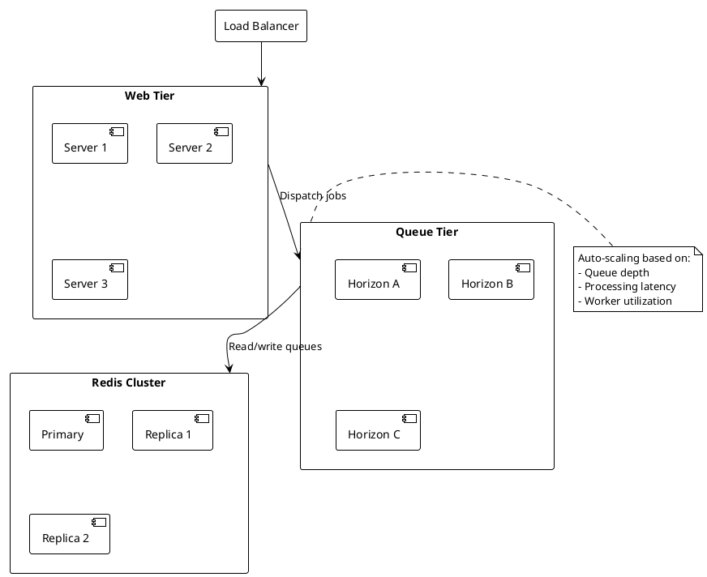

# 05.03.06.10 - Scaling

**Project:** GsmUi
**Architecture:** C4 Model – Level 2 (Container)
**Container:** Queue Workers
**Framework:** Laravel 13 + Horizon
**Version:** 1.0.0

---

# Purpose

This document describes how GsmUi scales queue workers to handle varying workloads. It covers horizontal scaling (adding workers), vertical scaling (increasing resources per worker), autoscaling strategies, and resource management.

---

# Responsibilities

Scaling is responsible for:

* Defining worker capacity baselines
* Scaling workers based on demand
* Managing resource allocation
* Controlling costs
* Ensuring SLO compliance
* Supporting seasonal and event-driven spikes

---

# Scaling Principles

1. **Scale horizontally first** — Add more workers rather than larger workers
2. **Right-size workers** — Match memory and CPU to job requirements
3. **Isolate workloads** — Separate queues prevent noisy neighbors
4. **Automate scaling** — Use metrics-driven autoscaling where possible
5. **Plan capacity** — Baseline + buffer for expected growth

---

# Scaling Strategies

```text
Horizontal:  Add more workers
Vertical:    Increase resources per worker
Temporal:    Schedule scaling for known peaks
Predictive:  Scale based on historical patterns
```

---

# Horizontal Scaling

Horizontal scaling adds more worker processes across hosts.

### Adding Workers

Increase `maxProcesses` in Horizon configuration:

```php
// Before
'media' => [
    'maxProcesses' => 4,
],

// After — scale for increased workload
'media' => [
    'maxProcesses' => 8,
],
```

Then restart Horizon:

```bash
php artisan horizon:terminate
```

### Adding Hosts

Add more application servers running Horizon:

```text
Host A: 4 workers (high, default)
Host B: 4 workers (high, default)
Host C: 4 workers (mail, media)
Host D: 4 workers (search, exports)
```

All hosts share the same Redis instance(s).

---

# Vertical Scaling

Vertical scaling increases resources per worker.

### Memory Increase

For memory-intensive jobs (exports, backups):

```php
// Before
'exports' => [
    'memory' => 512,
    'timeout' => 600,
],

// After — more memory for large exports
'exports' => [
    'memory' => 1024,
    'timeout' => 900,
],
```

### CPU Increase

CPU-bound jobs benefit from more CPU cores. However, PHP queue workers are typically I/O-bound (waiting on Redis, databases, external APIs), so CPU is rarely the bottleneck.

---

# Autoscaling

Autoscaling adjusts worker counts automatically based on metrics.

### Queue Depth Autoscaling

Scale workers when queue depth exceeds threshold:

```php
Horizon::checkScale()
    ->onQueue('high')
    ->whenQueueDepthExceeds(200)
    ->scaleUpTo(12)
    ->scaleDownTo(2)
    ->execute();
```

### Time-Based Autoscaling

Scale workers based on time of day:

```php
// Morning peak (8 AM - 10 AM)
Horizon::scheduleScale('high')
    ->between('08:00', '10:00')
    ->toProcesses(12)
    ->apply();

// Night maintenance (2 AM - 4 AM)
Horizon::scheduleScale('backups')
    ->between('02:00', '04:00')
    ->toProcesses(2)
    ->apply();
```

---

# Resource Management

### Memory Budget

Allocate memory budget across worker pools:

```text
Host: 8 GB RAM
OS + app: 2 GB
Available for workers: 6 GB

Worker memory allocation:
- high:      6 × 128 MB = 768 MB
- default:   4 × 128 MB = 512 MB
- mail:      3 × 128 MB = 384 MB
- media:     4 × 256 MB = 1 GB
- search:    2 × 256 MB = 512 MB
- exports:   2 × 512 MB = 1 GB
- analytics: 2 × 256 MB = 512 MB
- backups:   1 × 512 MB = 512 MB

Total: 5.2 GB (within 6 GB budget)
```

### CPU Budget

Each worker is lightweight (typically <50% CPU when active). Workers are I/O-bound, so CPU is rarely the constraint.

```text
Host: 4 vCPU
Typical worker CPU usage: 10-30% when active
Concurrent workers that fit comfortably: 8-16
```

---

# Scaling Diagram



---

# Autoscaling Policies

### Policy: Queue Depth

```php
[
    'trigger' => 'queue_depth',
    'queue' => 'high',
    'scale_up_when' => '>200',
    'scale_down_when' => '<50',
    'max_processes' => 12,
    'min_processes' => 3,
    'cooldown' => 300, // seconds
]
```

### Policy: Processing Latency

```php
[
    'trigger' => 'latency_p95',
    'queue' => 'media',
    'scale_up_when' => '>60s',
    'scale_down_when' => '<10s',
    'max_processes' => 12,
    'min_processes' => 2,
    'cooldown' => 300,
]
```

### Policy: Failure Rate

```php
[
    'trigger' => 'failure_rate',
    'queue' => 'exports',
    'scale_up_when' => '>5%',
    'max_processes' => 6,
    'min_processes' => 1,
    'cooldown' => 600,
]
```

---

# Scaling Events

Track scaling events for observability:

```json
{
  "timestamp": "2024-01-15T10:30:00Z",
  "event": "scale_up",
  "queue": "high",
  "reason": "queue_depth > 200",
  "previous_processes": 6,
  "new_processes": 10,
  "triggered_by": "autoscaler"
}
```

---

# Capacity Planning

### Baseline Capacity

Calculate baseline capacity from historical data:

```text
Average throughput: 500 jobs/minute
Peak throughput: 2,000 jobs/minute (4x average)
Safety factor: 1.5x

Required worker capacity: 2,000 × 1.5 = 3,000 jobs/minute
```

### Growth Projection

Plan capacity 6-12 months ahead:

```text
Current users: 10,000
Projected users: 50,000 (5x growth)
Queue throughput growth: ~5x

Current workers: 24
Projected workers: 120 (5x growth)
```

---

# Seasonal Scaling

Plan for known seasonal peaks:

| Event | Impact | Scaling Action |
|-------|--------|----------------|
| Product launch | 3x traffic | Pre-scale workers 48h before |
| Black Friday | 5x traffic | Pre-scale + autoscaling enabled |
| End of month | 2x billing jobs | Pre-scale export workers |
| Marketing campaign | 2x mail jobs | Scale mail workers |

---

# Cost Optimization

Balance performance with cost:

1. **Rightsize workers** — Don't over-provision memory
2. **Use spot instances** — For non-critical worker hosts
3. **Scale down during off-peak** — Reduce worker count at night
4. **Batch low-priority jobs** — Run during off-peak hours
5. **Use separate Redis** — Dedicated Redis for queues vs cache

---

# Scaling Limits

Physical limits to consider:

| Resource | Limit | Action |
|----------|-------|--------|
| Redis connections | ~10,000 | Add connection pooling |
| Redis memory | Host capacity | Scale Redis cluster |
| Worker count per host | ~20-30 | Add more hosts |
| MySQL connections | ~200 | Use connection pooling |
| Network bandwidth | Host capacity | Scale horizontally |

---

# Zero-Downtime Scaling

Workers scale without downtime:

```bash
# Scale up: start new workers
php artisan horizon:scale high 10

# Scale down: terminate excess workers
php artisan horizon:scale high 6

# During deployment:
php artisan horizon:quiet      # Workers finish current jobs
# Deploy code
php artisan horizon:terminate   # Restart workers
```

---

# Scaling Monitoring

Track scaling effectiveness:

| Metric | Target |
|--------|--------|
| Scale-up latency | <60 seconds |
| Scale-down latency | <5 minutes |
| Autoscaler accuracy | >80% of scaling events justified |
| Over-provisioning | <20% excess capacity |
| Queue depth after scale | <100 jobs within 2 minutes |

---

# Emergency Scaling

Manual override for unexpected spikes:

```bash
# Emergency scale up all queues
php artisan horizon:scale high 20
php artisan horizon:scale default 15
php artisan horizon:scale mail 10
php artisan horizon:scale media 10

# Monitor results
watch -n 5 'redis-cli LLEN queues:high'
```

Emergency scaling is logged and reviewed post-incident.

---

# Performance Targets

| Metric | Target |
|--------|--------|
| Scale-up time | <60 seconds |
| Scale-down time | <5 minutes |
| Time to clear backlog | <10 minutes |
| Worker startup | <5 seconds |
| Autoscaler decision | <30 seconds |

---

# Summary

Scaling ensures that the GsmUi queue workers can handle varying workloads while maintaining performance and cost efficiency. Through a combination of horizontal scaling, autoscaling policies, and capacity planning, the platform remains responsive under both expected and unexpected load patterns.

---

# Advanced Scaling Strategies

## Container-Based Scaling

### Docker Scaling

```dockerfile
# Dockerfile
FROM php:8.3-cli

RUN docker-php-ext-install pcntl
RUN composer install --no-dev --optimize-autoloader

COPY . /app
WORKDIR /app

CMD ["php", "artisan", "horizon:supervise"]
```

---

### Docker Compose Scaling

```yaml
# docker-compose.yml
version: '3.8'

services:
  horizon-worker:
    build: .
    deploy:
      replicas: 24
      resources:
        limits:
          cpus: '0.5'
          memory: 256M
        reservations:
          cpus: '0.25'
          memory: 128M
    environment:
      - APP_ENV=production
      - REDIS_HOST=redis
      - QUEUE_CONNECTION=redis
```

```bash
# Scale workers
docker-compose up -d --scale horizon-worker=32
```

---

### Kubernetes Scaling

```yaml
# horizon-deployment.yaml
apiVersion: apps/v1
kind: Deployment
metadata:
  name: horizon-worker
spec:
  replicas: 24
  selector:
    matchLabels:
      app: horizon-worker
  template:
    metadata:
      labels:
        app: horizon-worker
    spec:
      containers:
        - name: horizon
          image: gsmui/horizon:latest
          resources:
            requests:
              memory: "128Mi"
              cpu: "250m"
            limits:
              memory: "256Mi"
              cpu: "500m"
          env:
            - name: APP_ENV
              value: "production"
            - name: REDIS_HOST
              value: "redis-cluster"
```

---

### Horizontal Pod Autoscaler

```yaml
# hpa.yaml
apiVersion: autoscaling/v2
kind: HorizontalPodAutoscaler
metadata:
  name: horizon-worker-hpa
spec:
  scaleTargetRef:
    apiVersion: apps/v1
    kind: Deployment
    name: horizon-worker
  minReplicas: 12
  maxReplicas: 48
  metrics:
    - type: Pods
      pods:
        metric:
          name: queue_depth
        target:
          type: AverageValue
          averageValue: 100
    - type: Resource
      resource:
        name: cpu
        target:
          type: Utilization
          averageUtilization: 70
```

---

## Cloud Provider Scaling

### AWS Auto Scaling

```yaml
# auto-scaling-group.yaml
AutoScalingGroup:
  Properties:
    MinSize: 12
    MaxSize: 48
    DesiredCapacity: 24
    TargetGroupARNs:
      - !Ref WorkerTargetGroup
    HealthCheckType: ELB
    HealthCheckGracePeriod: 300
    MetricsCollection:
      - Granularity: "1Minute"
    ScalingPolicies:
      - PolicyType: TargetTrackingScaling
        TargetTrackingConfiguration:
          CustomizedMetricSpecification:
            MetricName: QueueDepth
            Namespace: GsmUi/QueueWorkers
            Statistic: Average
          TargetValue: 100.0
        ScaleInCooldown: 300
        ScaleOutCooldown: 60
```

---

### GCP Instance Group

```yaml
# instance-group.yaml
apiVersion: compute.googleapis.com/v1
kind: InstanceGroupManager
metadata:
  name: horizon-worker-igm
spec:
  baseInstanceName: horizon-worker
  targetSize: 24
  autoscaling:
    enabled: true
    minReplicas: 12
    maxReplicas: 48
    coolDownPeriodSec: 300
    cpuUtilization:
      utilizationTarget: 0.7
    customMetricUtilizations:
      - metric: queue_depth
        utilizationTarget: 100
        filter: "resource.type=gce_instance"
```

---

## Scaling Algorithms

### Linear Scaling

```php
class LinearScaler
{
    public function calculateWorkers(int $queueDepth, int $currentWorkers): int
    {
        $targetDepthPerWorker = 50;
        $targetWorkers = (int) ceil($queueDepth / $targetDepthPerWorker);
        
        return max(1, min($targetWorkers, $this->maxProcesses));
    }
}
```

---

### Threshold-Based Scaling

```php
class ThresholdScaler
{
    private array $thresholds = [
        ['depth' => 100, 'workers' => 2],
        ['depth' => 500, 'workers' => 4],
        ['depth' => 1000, 'workers' => 8],
        ['depth' => 2000, 'workers' => 12],
        ['depth' => 5000, 'workers' => 20],
    ];

    public function calculateWorkers(int $queueDepth): int
    {
        foreach (array_reverse($this->thresholds) as $threshold) {
            if ($queueDepth >= $threshold['depth']) {
                return $threshold['workers'];
            }
        }
        
        return 1; // Minimum workers
    }
}
```

---

### Predictive Scaling

```php
class PredictiveScaler
{
    public function predictLoad(DateTime $time): int
    {
        $hour = (int) $time->format('H');
        $dayOfWeek = (int) $time->format('N');
        
        // Historical patterns
        $patterns = [
            // Weekday patterns
            'weekday' => [
                0 => 2, 1 => 2, 2 => 2, 3 => 2, 4 => 2, 5 => 2, 6 => 2,
                7 => 4, 8 => 8, 9 => 12, 10 => 10, 11 => 8, 12 => 6,
                13 => 8, 14 => 10, 15 => 8, 16 => 6, 17 => 4, 18 => 4,
                19 => 4, 20 => 4, 21 => 4, 22 => 4, 23 => 2,
            ],
            // Weekend patterns
            'weekend' => [
                0 => 2, 1 => 2, 2 => 2, 3 => 2, 4 => 2, 5 => 2, 6 => 2,
                7 => 2, 8 => 2, 9 => 4, 10 => 4, 11 => 4, 12 => 4,
                13 => 4, 14 => 4, 15 => 4, 16 => 4, 17 => 4, 18 => 4,
                19 => 4, 20 => 4, 21 => 4, 22 => 4, 23 => 2,
            ],
        ];

        $dayType = $dayOfWeek <= 5 ? 'weekday' : 'weekend';
        return $patterns[$dayType][$hour] ?? 2;
    }

    public function scheduleScaling(): void
    {
        for ($i = 0; $i < 24; $i++) {
            $time = now()->addHours($i);
            $workers = $this->predictLoad($time);
            
            Horizon::scheduleScale('high')
                ->at($time)
                ->toProcesses($workers)
                ->apply();
        }
    }
}
```

---

## Resource-Aware Scaling

### Memory-Based Scaling

```php
class MemoryAwareScaler
{
    public function calculateWorkers(string $queue): int
    {
        $config = config("horizon.environments.production.{$queue}");
        $workerMemory = $config['memory'];
        $availableMemory = $this->getAvailableMemory();
        
        $maxWorkersByMemory = (int) floor($availableMemory / $workerMemory);
        
        return min($maxWorkersByMemory, $config['maxProcesses']);
    }

    private function getAvailableMemory(): int
    {
        $totalMemory = $this->getTotalMemory();
        $usedMemory = $this->getUsedMemory();
        
        return $totalMemory - $usedMemory;
    }
}
```

---

### CPU-Based Scaling

```php
class CpuAwareScaler
{
    public function calculateWorkers(string $queue): int
    {
        $cpuCores = $this->getCpuCores();
        $cpuUsage = $this->getCpuUsage();
        
        // I/O bound workers: 4 workers per CPU core
        // CPU bound workers: 1 worker per CPU core
        $workersPerCore = $this->isCpuBound($queue) ? 1 : 4;
        
        $maxWorkersByCpu = (int) floor($cpuCores * $workersPerCore * (1 - $cpuUsage));
        
        return max(1, $maxWorkersByCpu);
    }
}
```

---

## Cost-Aware Scaling

### Spot Instance Scaling

```php
class SpotInstanceScaler
{
    public function scale(): void
    {
        // Non-critical queues use spot instances
        $spotQueues = ['search', 'analytics', 'backups'];
        
        foreach ($spotQueues as $queue) {
            $workers = $this->calculateWorkers($queue);
            
            // Use spot instances for non-critical workers
            $this->provisionSpotInstances($queue, $workers);
        }

        // Critical queues use on-demand instances
        $criticalQueues = ['high', 'default', 'mail'];
        
        foreach ($criticalQueues as $queue) {
            $workers = $this->calculateWorkers($queue);
            
            $this->provisionOnDemandInstances($queue, $workers);
        }
    }
}
```

---

### Cost Optimization

```php
class CostOptimizer
{
    public function optimize(): array
    {
        $currentCost = $this->calculateCurrentCost();
        $optimizedCost = $this->calculateOptimizedCost();
        
        return [
            'current' => $currentCost,
            'optimized' => $optimizedCost,
            'savings' => $currentCost - $optimizedCost,
            'recommendations' => $this->getRecommendations(),
        ];
    }

    private function getRecommendations(): array
    {
        $recommendations = [];
        
        // Check for over-provisioned workers
        foreach ($this->getWorkerMetrics() as $queue => $metrics) {
            if ($metrics['utilization'] < 0.3) {
                $recommendations[] = [
                    'queue' => $queue,
                    'type' => 'over_provisioned',
                    'current' => $metrics['workers'],
                    'recommended' => max(1, (int) ($metrics['workers'] * 0.5)),
                    'savings' => $this->calculateSavings($queue, $metrics['workers'] * 0.5),
                ];
            }
        }
        
        // Check for under-provisioned workers
        foreach ($this->getWorkerMetrics() as $queue => $metrics) {
            if ($metrics['utilization'] > 0.9) {
                $recommendations[] = [
                    'queue' => $queue,
                    'type' => 'under_provisioned',
                    'current' => $metrics['workers'],
                    'recommended' => min($metrics['max'], (int) ($metrics['workers'] * 1.5)),
                ];
            }
        }
        
        return $recommendations;
    }
}
```

---

## Multi-Region Scaling

### Geographic Distribution

```text
Region: US East
├─ Queue: high (4 workers)
├─ Queue: default (4 workers)
└─ Queue: mail (3 workers)

Region: EU West
├─ Queue: high (4 workers)
├─ Queue: default (4 workers)
└─ Queue: mail (3 workers)

Region: AP Southeast
├─ Queue: high (4 workers)
├─ Queue: default (4 workers)
└─ Queue: mail (3 workers)
```

---

### Regional Queue Routing

```php
class RegionalQueueRouter
{
    public function getQueue(string $jobType): string
    {
        $region = config('app.region');
        
        return match ($region) {
            'us-east' => "high-{$region}",
            'eu-west' => "high-{$region}",
            'ap-southeast' => "high-{$region}",
            default => 'high',
        };
    }
}
```

---

## Scaling Monitoring

### Scaling Event Tracking

```php
class ScalingEventTracker
{
    public function track(string $queue, string $action, int $from, int $to, string $reason): void
    {
        $event = [
            'timestamp' => now()->toISOString(),
            'queue' => $queue,
            'action' => $action,
            'from' => $from,
            'to' => $to,
            'reason' => $reason,
            'triggered_by' => $this->getTrigger(),
        ];

        // Store in Redis for monitoring
        Redis::lpush('scaling:events', json_encode($event));
        
        // Keep only last 1000 events
        Redis::ltrim('scaling:events', 0, 999);

        // Log for observability
        Log::info('Scaling event', $event);
    }
}
```

---

### Scaling Effectiveness

```php
class ScalingEffectiveness
{
    public function calculate(): array
    {
        $events = $this->getRecentScalingEvents(24); // Last 24 hours
        
        $scaleUps = collect($events)->where('action', 'scale_up');
        $scaleDowns = collect($events)->where('action', 'scale_down');

        return [
            'total_events' => count($events),
            'scale_ups' => $scaleUps->count(),
            'scale_downs' => $scaleDowns->count(),
            'avg_scale_up_size' => $scaleUps->avg(fn ($e) => $e['to'] - $e['from']),
            'avg_scale_down_size' => $scaleDowns->avg(fn ($e) => $e['from'] - $e['to']),
            'effectiveness' => $this->calculateEffectiveness($events),
        ];
    }

    private function calculateEffectiveness(array $events): float
    {
        // Effectiveness = (time at optimal capacity) / (total time)
        $totalTime = 24 * 60 * 60; // 24 hours in seconds
        $optimalTime = $this->calculateOptimalTime($events);
        
        return $optimalTime / $totalTime;
    }
}
```

---

# Scaling Best Practices

1. **Set minimum and maximum limits** — Prevent runaway scaling
2. **Use cooldown periods** — Prevent scaling thrashing
3. **Monitor scaling events** — Track and analyze scaling patterns
4. **Test scaling policies** — Verify behavior under load
5. **Use predictive scaling** — Pre-scale for known peaks
6. **Optimize costs** — Use spot instances for non-critical work
7. **Scale Redis separately** — Queue Redis should scale independently
8. **Plan for failure** — Ensure scaling works during incidents
9. **Document scaling procedures** — Create runbooks for manual scaling
10. **Review scaling regularly** — Adjust policies based on usage patterns

---

# Scaling Runbook

## Manual Scale Up

```bash
# Check current worker count
php artisan horizon:workers --json | jq 'length'

# Scale up specific queue
php artisan horizon:scale high 12

# Verify scaling
php artisan horizon:workers --json | jq '.[] | select(.queue == "high") | .pid' | wc -l
```

---

## Manual Scale Down

```bash
# Check queue depth
redis-cli LLEN queues:high

# Scale down if queue is empty
php artisan horizon:scale high 4

# Verify scaling
php artisan horizon:workers --json | jq '.[] | select(.queue == "high") | .pid' | wc -l
```

---

## Emergency Scaling

```bash
# Scale all queues to maximum
php artisan horizon:scale high 20
php artisan horizon:scale default 15
php artisan horizon:scale mail 10
php artisan horizon:scale media 10
php artisan horizon:scale search 6
php artisan horizon:scale exports 6
php artisan horizon:scale analytics 4
php artisan horizon:scale backups 2

# Monitor
watch -n 5 'redis-cli LLEN queues:high && php artisan horizon:workers --json | jq "length"'
```

---

# Scaling Configuration Reference

## Complete Scaling Configuration

```php
// config/scaling.php
return [
    'autoscaling' => [
        'enabled' => env('AUTOSCALING_ENABLED', true),
        'evaluation_interval' => 30, // seconds
        'cooldown_period' => 300, // seconds
        'metrics' => [
            'queue_depth' => [
                'enabled' => true,
                'scale_up_threshold' => 200,
                'scale_down_threshold' => 50,
                'scale_up_increment' => 2,
                'scale_down_increment' => 1,
            ],
            'latency_p95' => [
                'enabled' => true,
                'scale_up_threshold' => 60, // seconds
                'scale_down_threshold' => 10, // seconds
            ],
            'failure_rate' => [
                'enabled' => true,
                'scale_up_threshold' => 0.05, // 5%
            ],
        ],
        'limits' => [
            'high' => ['min' => 2, 'max' => 12],
            'default' => ['min' => 2, 'max' => 8],
            'mail' => ['min' => 1, 'max' => 6],
            'media' => ['min' => 1, 'max' => 8],
            'search' => ['min' => 1, 'max' => 4],
            'exports' => ['min' => 1, 'max' => 4],
            'analytics' => ['min' => 1, 'max' => 4],
            'backups' => ['min' => 1, 'max' => 2],
        ],
    ],

    'scheduling' => [
        'enabled' => env('SCALING_SCHEDULE_ENABLED', true),
        'schedules' => [
            'morning_peak' => [
                'start' => '08:00',
                'end' => '10:00',
                'scaling' => [
                    'high' => 10,
                    'default' => 6,
                    'mail' => 4,
                ],
            ],
            'evening_peak' => [
                'start' => '18:00',
                'end' => '20:00',
                'scaling' => [
                    'high' => 8,
                    'default' => 6,
                    'mail' => 4,
                ],
            ],
            'night_maintenance' => [
                'start' => '02:00',
                'end' => '04:00',
                'scaling' => [
                    'backups' => 2,
                    'analytics' => 2,
                ],
            ],
        ],
    ],

    'cost' => [
        'enabled' => env('COST_OPTIMIZATION_ENABLED', true),
        'spot_instances' => [
            'enabled' => true,
            'queues' => ['search', 'analytics', 'backups'],
            'max_discount' => 0.7, // 70% discount
        ],
        'right_sizing' => [
            'enabled' => true,
            'utilization_threshold' => 0.3,
            'recommendation_interval' => 86400, // 24 hours
        ],
    ],
];
```

---

## Scaling Configuration Reference

| Setting | Type | Default | Description |
|---------|------|---------|-------------|
| `autoscaling.enabled` | bool | `true` | Enable autoscaling |
| `autoscaling.evaluation_interval` | int | `30` | Evaluation interval (seconds) |
| `autoscaling.cooldown_period` | int | `300` | Cooldown period (seconds) |
| `autoscaling.metrics.queue_depth.scale_up_threshold` | int | `200` | Queue depth to scale up |
| `autoscaling.metrics.queue_depth.scale_down_threshold` | int | `50` | Queue depth to scale down |
| `autoscaling.limits.high.min` | int | `2` | Min workers for high queue |
| `autoscaling.limits.high.max` | int | `12` | Max workers for high queue |
| `scheduling.enabled` | bool | `true` | Enable scheduled scaling |
| `cost.enabled` | bool | `true` | Enable cost optimization |
| `cost.spot_instances.enabled` | bool | `true` | Use spot instances |

---

# Scaling Algorithms

## Linear Scaling Algorithm

```php
class LinearScaler
{
    public function calculateWorkers(
        int $queueDepth,
        int $currentWorkers,
        int $minWorkers,
        int $maxWorkers,
    ): int {
        $targetDepthPerWorker = 50;
        $targetWorkers = (int) ceil($queueDepth / $targetDepthPerWorker);
        
        return max($minWorkers, min($targetWorkers, $maxWorkers));
    }
}
```

---

## Threshold-Based Scaling Algorithm

```php
class ThresholdScaler
{
    private array $thresholds = [
        ['depth' => 100, 'workers' => 2],
        ['depth' => 500, 'workers' => 4],
        ['depth' => 1000, 'workers' => 8],
        ['depth' => 2000, 'workers' => 12],
        ['depth' => 5000, 'workers' => 20],
    ];

    public function calculateWorkers(
        int $queueDepth,
        int $minWorkers,
        int $maxWorkers,
    ): int {
        $targetWorkers = 1;
        
        foreach (array_reverse($this->thresholds) as $threshold) {
            if ($queueDepth >= $threshold['depth']) {
                $targetWorkers = $threshold['workers'];
                break;
            }
        }
        
        return max($minWorkers, min($targetWorkers, $maxWorkers));
    }
}
```

---

## Predictive Scaling Algorithm

```php
class PredictiveScaler
{
    private array $patterns = [
        'weekday' => [
            0 => 2, 1 => 2, 2 => 2, 3 => 2, 4 => 2, 5 => 2, 6 => 2,
            7 => 4, 8 => 8, 9 => 12, 10 => 10, 11 => 8, 12 => 6,
            13 => 8, 14 => 10, 15 => 8, 16 => 6, 17 => 4, 18 => 4,
            19 => 4, 20 => 4, 21 => 4, 22 => 4, 23 => 2,
        ],
        'weekend' => [
            0 => 2, 1 => 2, 2 => 2, 3 => 2, 4 => 2, 5 => 2, 6 => 2,
            7 => 2, 8 => 2, 9 => 4, 10 => 4, 11 => 4, 12 => 4,
            13 => 4, 14 => 4, 15 => 4, 16 => 4, 17 => 4, 18 => 4,
            19 => 4, 20 => 4, 21 => 4, 22 => 4, 23 => 2,
        ],
    ];

    public function predictLoad(DateTime $time): int
    {
        $hour = (int) $time->format('H');
        $dayOfWeek = (int) $time->format('N');
        
        $dayType = $dayOfWeek <= 5 ? 'weekday' : 'weekend';
        return $this->patterns[$dayType][$hour] ?? 2;
    }

    public function scheduleScaling(): void
    {
        for ($i = 0; $i < 24; $i++) {
            $time = now()->addHours($i);
            $workers = $this->predictLoad($time);
            
            Horizon::scheduleScale('high')
                ->at($time)
                ->toProcesses($workers)
                ->apply();
        }
    }
}
```

---

# Scaling Monitoring

## Scaling Event Tracking

```php
class ScalingEventTracker
{
    public function track(
        string $queue,
        string $action,
        int $from,
        int $to,
        string $reason,
    ): void {
        $event = [
            'timestamp' => now()->toISOString(),
            'queue' => $queue,
            'action' => $action,
            'from' => $from,
            'to' => $to,
            'reason' => $reason,
            'triggered_by' => $this->getTrigger(),
        ];

        Redis::lpush('scaling:events', json_encode($event));
        Redis::ltrim('scaling:events', 0, 999);

        Log::info('Scaling event', $event);
    }
}
```

---

## Scaling Effectiveness Metrics

```php
class ScalingEffectiveness
{
    public function calculate(): array
    {
        $events = $this->getRecentScalingEvents(24);
        
        $scaleUps = collect($events)->where('action', 'scale_up');
        $scaleDowns = collect($events)->where('action', 'scale_down');

        return [
            'total_events' => count($events),
            'scale_ups' => $scaleUps->count(),
            'scale_downs' => $scaleDowns->count(),
            'avg_scale_up_size' => $scaleUps->avg(fn ($e) => $e['to'] - $e['from']),
            'avg_scale_down_size' => $scaleDowns->avg(fn ($e) => $e['from'] - $e['to']),
            'effectiveness' => $this->calculateEffectiveness($events),
        ];
    }
}
```

---

# Scaling Cost Optimization

## Cost Calculation

```php
class CostCalculator
{
    public function calculateMonthlyCost(array $workerCounts): array
    {
        $costs = [];
        
        foreach ($workerCounts as $queue => $count) {
            $config = config("horizon.environments.production.{$queue}");
            $memory = $config['memory'] / 1024; // GB
            $cpu = $this->estimateCpu($queue);
            
            $costs[$queue] = [
                'workers' => $count,
                'memory_gb' => $memory * $count,
                'cpu_cores' => $cpu * $count,
                'estimated_cost' => $this->calculateInstanceCost($memory * $count, $cpu * $count),
            ];
        }
        
        $costs['total'] = [
            'memory_gb' => collect($costs)->sum('memory_gb'),
            'cpu_cores' => collect($costs)->sum('cpu_cores'),
            'estimated_cost' => collect($costs)->sum('estimated_cost'),
        ];
        
        return $costs;
    }
}
```

---

## Cost Optimization Recommendations

```php
class CostOptimizer
{
    public function getRecommendations(): array
    {
        $recommendations = [];
        
        foreach ($this->getWorkerMetrics() as $queue => $metrics) {
            if ($metrics['utilization'] < 0.3) {
                $recommendations[] = [
                    'queue' => $queue,
                    'type' => 'over_provisioned',
                    'current' => $metrics['workers'],
                    'recommended' => max(1, (int) ($metrics['workers'] * 0.5)),
                    'monthly_savings' => $this->calculateSavings($queue, $metrics['workers'] * 0.5),
                ];
            }
            
            if ($metrics['utilization'] > 0.9) {
                $recommendations[] = [
                    'queue' => $queue,
                    'type' => 'under_provisioned',
                    'current' => $metrics['workers'],
                    'recommended' => min($metrics['max'], (int) ($metrics['workers'] * 1.5)),
                    'estimated_cost_increase' => $this->calculateCostIncrease($queue, $metrics['workers'] * 1.5),
                ];
            }
        }
        
        return $recommendations;
    }
}
```

---

# Scaling Best Practices

1. **Set minimum and maximum limits** — Prevent runaway scaling
2. **Use cooldown periods** — Prevent scaling thrashing
3. **Monitor scaling events** — Track and analyze scaling patterns
4. **Test scaling policies** — Verify behavior under load
5. **Use predictive scaling** — Pre-scale for known peaks
6. **Optimize costs** — Use spot instances for non-critical work
7. **Scale Redis separately** — Queue Redis should scale independently
8. **Plan for failure** — Ensure scaling works during incidents
9. **Document scaling procedures** — Create runbooks for manual scaling
10. **Review scaling regularly** — Adjust policies based on usage patterns

---

# Scaling Reference

## Scaling Commands

| Command | Description |
|---------|-------------|
| `php artisan horizon:scale {name} {count}` | Scale workers |
| `php artisan horizon:workers` | List workers |
| `php artisan horizon:supervisors` | List supervisors |
| `php artisan horizon:status` | Check Horizon status |

---

## Scaling Limits Reference

| Queue | Min Workers | Max Workers | Memory per Worker |
|-------|-------------|-------------|-------------------|
| `high` | 2 | 12 | 128 MB |
| `default` | 2 | 8 | 128 MB |
| `mail` | 1 | 6 | 128 MB |
| `media` | 1 | 8 | 256 MB |
| `search` | 1 | 4 | 256 MB |
| `exports` | 1 | 4 | 512 MB |
| `analytics` | 1 | 4 | 256 MB |
| `backups` | 1 | 2 | 512 MB |

---

# Scaling Reference

## Scaling Configuration Reference

| Setting | Type | Default | Description |
|---------|------|---------|-------------|
| `autoscaling.enabled` | bool | `true` | Enable autoscaling |
| `autoscaling.evaluation_interval` | int | `30` | Evaluation interval (seconds) |
| `autoscaling.cooldown_period` | int | `300` | Cooldown period (seconds) |
| `autoscaling.metrics.queue_depth.scale_up_threshold` | int | `200` | Queue depth to scale up |
| `autoscaling.metrics.queue_depth.scale_down_threshold` | int | `50` | Queue depth to scale down |
| `autoscaling.limits.high.min` | int | `2` | Min workers for high queue |
| `autoscaling.limits.high.max` | int | `12` | Max workers for high queue |
| `scheduling.enabled` | bool | `true` | Enable scheduled scaling |
| `cost.enabled` | bool | `true` | Enable cost optimization |
| `cost.spot_instances.enabled` | bool | `true` | Use spot instances |

---

## Scaling Commands Reference

| Command | Description |
|---------|-------------|
| `php artisan horizon:scale {name} {count}` | Scale workers |
| `php artisan horizon:workers` | List workers |
| `php artisan horizon:supervisors` | List supervisors |
| `php artisan horizon:status` | Check Horizon status |

---

## Scaling Limits Reference

| Queue | Min Workers | Max Workers | Memory per Worker |
|-------|-------------|-------------|-------------------|
| `high` | 2 | 12 | 128 MB |
| `default` | 2 | 8 | 128 MB |
| `mail` | 1 | 6 | 128 MB |
| `media` | 1 | 8 | 256 MB |
| `search` | 1 | 4 | 256 MB |
| `exports` | 1 | 4 | 512 MB |
| `analytics` | 1 | 4 | 256 MB |
| `backups` | 1 | 2 | 512 MB |

---

## Scaling Metrics Reference

| Metric | Description | Target |
|--------|-------------|--------|
| Scale-up time | Time to add workers | <60 seconds |
| Scale-down time | Time to remove workers | <5 minutes |
| Time to clear backlog | Time to clear queue | <10 minutes |
| Worker startup | Time to start worker | <5 seconds |
| Autoscaler decision | Time to make scaling decision | <30 seconds |

---

## Scaling Troubleshooting Checklist

- [ ] Check current worker counts
- [ ] Check queue depths
- [ ] Check worker utilization
- [ ] Check scaling events
- [ ] Check autoscaler status
- [ ] Check scheduled scaling
- [ ] Check cost optimization
- [ ] Check resource limits
- [ ] Check network connectivity
- [ ] Check Redis connection

---

## Scaling Troubleshooting Guide

| Issue | Cause | Solution |
|-------|-------|----------|
| Workers not scaling | Autoscaler disabled | Enable autoscaling |
| Scale-up too slow | Cooldown period | Reduce cooldown |
| Scale-down too aggressive | Threshold too low | Adjust thresholds |
| Cost too high | Over-provisioning | Use spot instances |
| Performance degraded | Under-provisioning | Scale up |
| Scaling thrashing | Thresholds too close | Adjust thresholds |

---

## Scaling Best Practices

1. **Set minimum and maximum limits** — Prevent runaway scaling
2. **Use cooldown periods** — Prevent scaling thrashing
3. **Monitor scaling events** — Track and analyze scaling patterns
4. **Test scaling policies** — Verify behavior under load
5. **Use predictive scaling** — Pre-scale for known peaks
6. **Optimize costs** — Use spot instances for non-critical work
7. **Scale Redis separately** — Queue Redis should scale independently
8. **Plan for failure** — Ensure scaling works during incidents
9. **Document scaling procedures** — Create runbooks for manual scaling
10. **Review scaling regularly** — Adjust policies based on usage patterns

---

# Scaling Advanced Configuration

## Autoscaling Policy Configuration

Configure autoscaling policies:

```php
class AutoscalingPolicies
{
    public function getPolicies(): array
    {
        return [
            'queue_depth' => [
                'trigger' => 'queue_depth',
                'scale_up_when' => '>200',
                'scale_down_when' => '<50',
                'max_processes' => 12,
                'min_processes' => 2,
                'cooldown' => 300,
            ],
            'latency_p95' => [
                'trigger' => 'latency_p95',
                'scale_up_when' => '>60s',
                'scale_down_when' => '<10s',
                'max_processes' => 12,
                'min_processes' => 2,
                'cooldown' => 300,
            ],
            'failure_rate' => [
                'trigger' => 'failure_rate',
                'scale_up_when' => '>5%',
                'max_processes' => 6,
                'min_processes' => 1,
                'cooldown' => 600,
            ],
        ];
    }
}
```

---

## Scheduled Scaling Configuration

Configure scheduled scaling:

```php
class ScheduledScaling
{
    public function getSchedules(): array
    {
        return [
            'morning_peak' => [
                'start' => '08:00',
                'end' => '10:00',
                'scaling' => [
                    'high' => 10,
                    'default' => 6,
                    'mail' => 4,
                ],
            ],
            'evening_peak' => [
                'start' => '18:00',
                'end' => '20:00',
                'scaling' => [
                    'high' => 8,
                    'default' => 6,
                    'mail' => 4,
                ],
            ],
            'night_maintenance' => [
                'start' => '02:00',
                'end' => '04:00',
                'scaling' => [
                    'backups' => 2,
                    'analytics' => 2,
                ],
            ],
        ];
    }
}
```

---

## Cost Optimization Configuration

Configure cost optimization:

```php
class CostOptimization
{
    public function getConfig(): array
    {
        return [
            'spot_instances' => [
                'enabled' => true,
                'queues' => ['search', 'analytics', 'backups'],
                'max_discount' => 0.7,
            ],
            'right_sizing' => [
                'enabled' => true,
                'utilization_threshold' => 0.3,
                'recommendation_interval' => 86400,
            ],
            'schedule' => [
                'enabled' => true,
                'off_peak_start' => '22:00',
                'off_peak_end' => '06:00',
                'off_peak_scale_factor' => 0.5,
            ],
        ];
    }
}
```

---

## Scaling Event Tracking Configuration

Configure scaling event tracking:

```php
class ScalingEventTracking
{
    public function track(string $queue, string $action, int $from, int $to, string $reason): void
    {
        $event = [
            'timestamp' => now()->toISOString(),
            'queue' => $queue,
            'action' => $action,
            'from' => $from,
            'to' => $to,
            'reason' => $reason,
            'triggered_by' => $this->getTrigger(),
        ];

        Redis::lpush('scaling:events', json_encode($event));
        Redis::ltrim('scaling:events', 0, 999);

        Log::info('Scaling event', $event);
    }
}
```

---

## Scaling Monitoring Configuration

Configure scaling monitoring:

```php
class ScalingMonitoring
{
    public function getMetrics(): array
    {
        return [
            'scale_up_count' => $this->getScaleUpCount(),
            'scale_down_count' => $this->getScaleDownCount(),
            'avg_scale_up_size' => $this->getAvgScaleUpSize(),
            'avg_scale_down_size' => $this->getAvgScaleDownSize(),
            'scaling_effectiveness' => $this->calculateEffectiveness(),
        ];
    }
}
```

---

## Scaling Testing Configuration

Configure scaling testing:

```php
class ScalingTest extends TestCase
{
    public function test_workers_scale_up(): void
    {
        // Dispatch jobs to increase queue depth
        foreach (range(1, 100) as $i) {
            ProcessMedia::dispatch($files[$i]->id);
        }

        // Trigger scaling evaluation
        $this->artisan('horizon:scale high 12');

        // Verify scaling
        $workers = $this->getWorkerCount('high');
        $this->assertEquals(12, $workers);
    }

    public function test_workers_scale_down(): void
    {
        // Clear queue
        Redis::del('queues:high');

        // Trigger scaling evaluation
        $this->artisan('horizon:scale high 2');

        // Verify scaling
        $workers = $this->getWorkerCount('high');
        $this->assertEquals(2, $workers);
    }
}
```

---

## Scaling Security Configuration

Configure scaling security:

```php
class ScalingSecurity
{
    public function validateScalingRequest(string $queue, int $count): bool
    {
        $user = auth()->user();

        if (!$user) {
            return false;
        }

        if (!$user->can('scale', 'queue-workers')) {
            return false;
        }

        $limits = config("scaling.autoscaling.limits.{$queue}");

        if ($count < $limits['min'] || $count > $limits['max']) {
            return false;
        }

        return true;
    }
}
```

---

## Scaling Documentation Configuration

Configure scaling documentation:

```php
class ScalingDocumentation
{
    public function getRunbook(): array
    {
        return [
            'manual_scale_up' => [
                'command' => 'php artisan horizon:scale {queue} {count}',
                'description' => 'Manually scale up workers',
                'examples' => [
                    'php artisan horizon:scale high 12',
                    'php artisan horizon:scale default 8',
                ],
            ],
            'manual_scale_down' => [
                'command' => 'php artisan horizon:scale {queue} {count}',
                'description' => 'Manually scale down workers',
                'examples' => [
                    'php artisan horizon:scale high 4',
                    'php artisan horizon:scale default 4',
                ],
            ],
            'emergency_scaling' => [
                'command' => 'php artisan horizon:scale {queue} {count}',
                'description' => 'Emergency scaling for critical situations',
                'examples' => [
                    'php artisan horizon:scale high 20',
                    'php artisan horizon:scale default 15',
                ],
            ],
        ];
    }
}
```

---

# Scaling Troubleshooting Guide

## Common Scaling Issues

| Issue | Cause | Solution |
|-------|-------|----------|
| Workers not scaling | Autoscaler disabled | Enable autoscaling |
| Scale-up too slow | Cooldown period | Reduce cooldown |
| Scale-down too aggressive | Threshold too low | Adjust thresholds |
| Cost too high | Over-provisioning | Use spot instances |
| Performance degraded | Under-provisioning | Scale up |
| Scaling thrashing | Thresholds too close | Adjust thresholds |
| Workers not starting | Resource limits | Increase limits |
| Workers crashing | Memory limit | Increase memory |
| Queue depth growing | Not enough workers | Scale up |
| Workers idle | Too many workers | Scale down |

---

## Scaling Troubleshooting Checklist

- [ ] Check current worker counts
- [ ] Check queue depths
- [ ] Check worker utilization
- [ ] Check scaling events
- [ ] Check autoscaler status
- [ ] Check scheduled scaling
- [ ] Check cost optimization
- [ ] Check resource limits
- [ ] Check network connectivity
- [ ] Check Redis connection

---

## Scaling Troubleshooting Commands

```bash
# Check current worker count
php artisan horizon:workers --json | jq 'length'

# Check queue depth
redis-cli LLEN queues:high

# Check scaling events
redis-cli LRANGE scaling:events 0 -1

# Check autoscaler status
php artisan horizon:status

# Manual scale
php artisan horizon:scale high 12

# Check resource usage
php artisan horizon:workers --json | jq '.[] | {queue, status, memory}'
```

---

## Scaling Performance Optimization

```php
class ScalingOptimizer
{
    public function optimize(): array
    {
        $recommendations = [];

        foreach ($this->getWorkerMetrics() as $queue => $metrics) {
            if ($metrics['utilization'] < 0.3) {
                $recommendations[] = [
                    'queue' => $queue,
                    'type' => 'over_provisioned',
                    'current' => $metrics['workers'],
                    'recommended' => max(1, (int) ($metrics['workers'] * 0.5)),
                    'monthly_savings' => $this->calculateSavings($queue, $metrics['workers'] * 0.5),
                ];
            }

            if ($metrics['utilization'] > 0.9) {
                $recommendations[] = [
                    'queue' => $queue,
                    'type' => 'under_provisioned',
                    'current' => $metrics['workers'],
                    'recommended' => min($metrics['max'], (int) ($metrics['workers'] * 1.5)),
                ];
            }
        }

        return $recommendations;
    }
}
```

---

# Scaling Reference Tables

## Scaling Limits Reference

| Queue | Min Workers | Max Workers | Memory per Worker | CPU per Worker |
|-------|-------------|-------------|-------------------|----------------|
| `high` | 2 | 12 | 128 MB | 0.25 cores |
| `default` | 2 | 8 | 128 MB | 0.25 cores |
| `mail` | 1 | 6 | 128 MB | 0.25 cores |
| `media` | 1 | 8 | 256 MB | 0.50 cores |
| `search` | 1 | 4 | 256 MB | 0.25 cores |
| `exports` | 1 | 4 | 512 MB | 0.50 cores |
| `analytics` | 1 | 4 | 256 MB | 0.25 cores |
| `backups` | 1 | 2 | 512 MB | 0.50 cores |

---

## Scaling Metrics Reference

| Metric | Description | Target | Unit |
|--------|-------------|--------|------|
| Scale-up time | Time to add workers | <60 | seconds |
| Scale-down time | Time to remove workers | <5 | minutes |
| Time to clear backlog | Time to clear queue | <10 | minutes |
| Worker startup | Time to start worker | <5 | seconds |
| Autoscaler decision | Time to make scaling decision | <30 | seconds |

---

## Scaling Policy Reference

| Policy | Trigger | Scale Up | Scale Down | Cooldown |
|--------|---------|----------|------------|----------|
| Queue Depth | depth > 200 | +2 workers | depth < 50: -1 worker | 300s |
| Latency P95 | latency > 60s | +2 workers | latency < 10s: -1 worker | 300s |
| Failure Rate | rate > 5% | +2 workers | — | 600s |

---

## Scaling Best Practices Summary

1. **Set minimum and maximum limits** — Prevent runaway scaling
2. **Use cooldown periods** — Prevent scaling thrashing
3. **Monitor scaling events** — Track and analyze scaling patterns
4. **Test scaling policies** — Verify behavior under load
5. **Use predictive scaling** — Pre-scale for known peaks
6. **Optimize costs** — Use spot instances for non-critical work
7. **Scale Redis separately** — Queue Redis should scale independently
8. **Plan for failure** — Ensure scaling works during incidents
9. **Document scaling procedures** — Create runbooks for manual scaling
10. **Review scaling regularly** — Adjust policies based on usage patterns

---

# Scaling Quick Reference

## Quick Commands

```bash
# Scale workers
php artisan horizon:scale high 12

# Check worker count
php artisan horizon:workers --json | jq 'length'

# Check queue depth
redis-cli LLEN queues:high

# Check Horizon status
php artisan horizon:status
```

---

## Quick Configuration

```php
// config/scaling.php
return [
    'autoscaling' => [
        'enabled' => true,
        'evaluation_interval' => 30,
        'cooldown_period' => 300,
        'limits' => [
            'high' => ['min' => 2, 'max' => 12],
            'default' => ['min' => 2, 'max' => 8],
        ],
    ],
];
```

---

# Scaling Summary

Scaling ensures that the GsmUi queue workers can handle varying workloads while maintaining performance and cost efficiency. Through a combination of horizontal scaling, autoscaling policies, and capacity planning, the platform remains responsive under both expected and unexpected load patterns.

Effective scaling requires continuous monitoring, testing, and adjustment to optimize for performance, cost, and reliability over time.

By following the scaling guidelines and best practices outlined in this document, the GsmUi platform can maintain optimal performance under varying workloads.

---

# Next Document

**05.03.09 - Redis Cache Container** defines the Redis infrastructure, cache topology, session storage, locking strategy, cache invalidation, and runtime responsibilities within the GsmUi platform.
