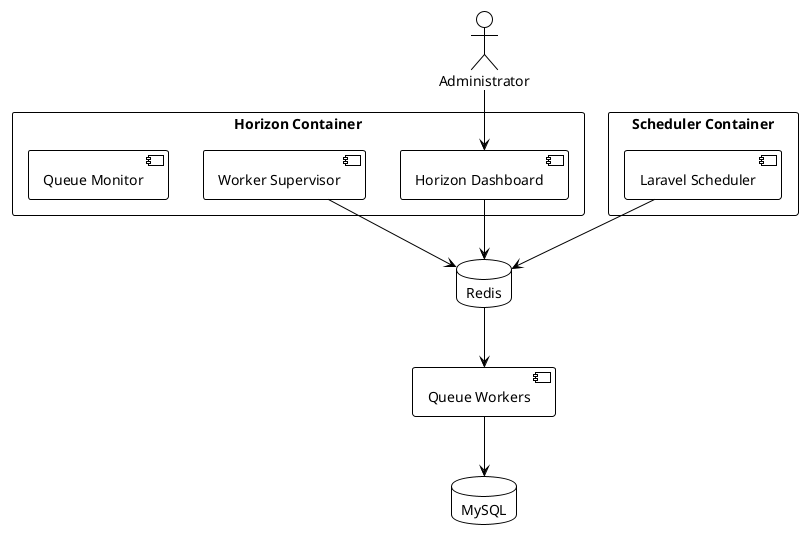

# 05.03.07 - Scheduler & Horizon Container

**Project:** GsmUi
**Architecture:** C4 Model – Level 2 (Container)
**Container:** Scheduler & Queue Monitoring
**Framework:** Laravel 13 + Horizon + Redis
**Version:** 1.0.0

---

# Purpose

The Scheduler & Horizon container is responsible for:

* Executing recurring background tasks
* Managing queue workers
* Monitoring queue health
* Balancing workloads
* Retrying failed jobs
* Collecting queue metrics
* Providing operational visibility

Although Laravel Scheduler and Horizon are separate runtime concerns, they work together as the orchestration layer for all asynchronous processing within GsmUi.

---

# Responsibilities

## Scheduler

Responsible for:

* Running scheduled commands
* Triggering maintenance tasks
* Dispatching recurring jobs
* Cleaning expired data
* Running health checks
* Synchronizing external systems

---

## Horizon

Responsible for:

* Queue monitoring
* Worker supervision
* Queue balancing
* Retry management
* Failed job tracking
* Runtime metrics
* Queue dashboards

---

# Container Diagram



---

# Runtime Topology

```text
┌────────────────────┐
│ Laravel Scheduler  │
└──────────┬─────────┘
           │
Dispatch Jobs
           │
           ▼
┌────────────────────┐
│ Redis Queue        │
└──────────┬─────────┘
           │
           ▼
┌────────────────────┐
│ Horizon Workers    │
└──────────┬─────────┘
           │
           ▼
 Application Services
```

---

# Scheduler Responsibilities

The scheduler executes recurring automation without requiring external cron definitions for each task.

Typical schedule:

| Frequency       | Examples               |
| --------------- | ---------------------- |
| Every Minute    | Queue cleanup, metrics |
| Every 5 Minutes | Search sync            |
| Hourly          | Health checks          |
| Daily           | Backups                |
| Weekly          | Reports                |
| Monthly         | Billing reconciliation |

---

# Scheduled Commands

Examples:

```text
gsmui:generate-search

gsmui:cleanup-media

gsmui:refresh-cache

gsmui:publish-scheduled

gsmui:generate-sitemap

gsmui:verify-subscriptions

gsmui:send-reminders

gsmui:cleanup-temp
```

---

# Scheduler Architecture

```text
Cron

↓

artisan schedule:run

↓

Laravel Scheduler

↓

Scheduled Command

↓

Dispatch Queue Job

↓

Redis
```

Cron should invoke only:

```bash
* * * * * php artisan schedule:run
```

---

# Scheduler Categories

## Maintenance

* Cache cleanup
* Temp file cleanup
* Session cleanup

---

## Billing

* Subscription renewal checks
* Trial expiration
* Invoice generation

---

## Marketplace

* Product publication
* Featured rotation
* Download verification

---

## Documentation

* Sitemap generation
* Search indexing
* Broken link detection

---

## Analytics

* Daily aggregation
* Weekly reports
* Monthly summaries

---

## Infrastructure

* Backup verification
* Health monitoring
* Storage usage reports

---

# Horizon Responsibilities

Horizon supervises all Redis-backed queue workers.

Responsibilities:

* Worker lifecycle
* Queue balancing
* Failed jobs
* Runtime metrics
* Throughput monitoring
* Dashboard

---

# Queue Configuration

Suggested queues:

```text
high

default

mail

media

search

exports

analytics

backups
```

Workers are assigned according to workload.

---

# Worker Pools

Example configuration:

| Queue     | Workers |
| --------- | ------: |
| high      |       6 |
| default   |       4 |
| mail      |       3 |
| media     |       4 |
| search    |       2 |
| exports   |       2 |
| analytics |       2 |
| backups   |       1 |

---

# Queue Balancing

Recommended strategy:

```text
Auto Balance
```

Benefits:

* Better throughput
* Lower latency
* Automatic worker redistribution

---

# Retry Strategy

Default:

```php
tries = 3

timeout = 120

backoff = [10,30,60]
```

Critical payment jobs may define custom retry logic.

---

# Failed Jobs

Lifecycle:

```text
Job

↓

Failure

↓

Retry

↓

Retry Limit

↓

failed_jobs

↓

Admin Review

↓

Retry / Delete
```

Failed jobs remain available for investigation.

---

# Horizon Dashboard

Expose:

* Queue length
* Throughput
* Processing time
* Worker status
* Failed jobs
* Retry count

Restricted to administrators.

---

# Metrics

Track:

* Jobs processed/minute
* Average runtime
* Queue depth
* Failed jobs
* Success rate
* Worker utilization

---

# Alerts

Notify administrators when:

* Queue backlog exceeds threshold
* Worker crashes
* Failed jobs spike
* Redis unavailable
* Horizon stops

Alerts can be delivered via:

* Email
* Slack (future)
* Webhooks

---

# Scheduler Locks

Prevent duplicate execution using Laravel's scheduling locks.

Example:

```php
->withoutOverlapping()

->onOneServer()
```

Suitable for clustered deployments.

---

# Maintenance Windows

Some scheduled tasks should be skipped during maintenance mode.

Examples:

* Search indexing
* Analytics aggregation

Critical jobs such as billing may continue if infrastructure allows.

---

# Security

Protect:

* Horizon dashboard
* Scheduler commands
* Queue configuration

Only privileged users may:

* Retry jobs
* Pause queues
* Flush queues
* Restart workers

---

# Logging

Log:

* Command execution
* Job dispatch
* Scheduler failures
* Worker restarts
* Queue pauses

Use structured logging for operational visibility.

---

# Deployment

Recommended processes:

| Process         |    Count |
| --------------- | -------: |
| Web Application |       2+ |
| Scheduler       |        1 |
| Horizon         |        1 |
| Queue Workers   | Multiple |

Only one scheduler instance should actively execute scheduled tasks unless distributed locking is enabled.

---

# Scaling Strategy

Scheduler:

* Single active instance
* Distributed lock support

Horizon:

* Horizontal worker scaling
* Queue-specific worker counts
* Autoscaling based on queue depth

---

# Disaster Recovery

If Redis is unavailable:

* Scheduler logs failures
* Jobs remain undispatched
* Administrators are alerted
* Processing resumes automatically after recovery

Backup and maintenance tasks should retry safely.

---

# Testing

Verify:

* Scheduled commands execute
* Queue dispatch occurs
* Horizon monitors workers
* Retry policies function
* Failed jobs are recorded
* Locks prevent overlap

Automated tests should cover both scheduling logic and queue orchestration.

---

# Performance Targets

| Metric               | Target    |
| -------------------- | --------- |
| Schedule Tick        | <1 minute |
| Queue Dispatch       | <50 ms    |
| Worker Startup       | <5 s      |
| Horizon Availability | 99.9%     |
| Failed Job Retry     | <1 minute |

---

# Future Evolution

Future enhancements include:

* Dynamic autoscaling
* Dedicated worker clusters
* Queue priority prediction
* Multi-region processing
* Event streaming integration
* Workflow orchestration
* Distributed schedulers

The architecture supports these enhancements without changing application-level job definitions.

---

# Summary

The Scheduler & Horizon container provides the operational backbone for asynchronous processing within GsmUi. By combining Laravel Scheduler, Horizon, Redis, and dedicated worker pools, the platform achieves reliable automation, efficient background execution, and comprehensive operational visibility while remaining scalable and resilient.

---

# Scheduler Deep Dive

## Scheduler Architecture

### Scheduler Process Flow

```text
Cron (every minute)
    │
    └── php artisan schedule:run
        │
        ├── Load schedule from Kernel.php
        │
        ├── Check each scheduled task
        │   ├── Should this run now?
        │   │   ├── Yes → Execute task
        │   │   └── No → Skip
        │   │
        │   └── Is task locked?
        │       ├── Yes → Skip (already running)
        │       └── No → Acquire lock, execute
        │
        ├── Log execution
        │
        └── Release lock when complete
```

### Scheduler Lock Mechanism

```php
// Preventing duplicate execution in clustered environments
$schedule->command('gsmui:cleanup-temp')
    ->everyMinute()
    ->withoutOverlapping()
    ->onOneServer()
    ->runInBackground()
    ->appendOutputTo(storage_path('logs/scheduler.log'));
```

### Scheduler Lock Implementation

```php
// How withoutOverlapping works
class SchedulerLock
{
    public function acquire(string $task): bool
    {
        return Cache::lock("scheduler:{$task}", 120)->get();
    }

    public function release(string $task): void
    {
        Cache::lock("scheduler:{$task}")->forceRelease();
    }
}
```

## Complete Schedule Definition

### Kernel Schedule

```php
// app/Console/Kernel.php
protected function schedule(Schedule $schedule): void
{
    // ─── Maintenance Tasks ───────────────────────────
    $schedule->command('gsmui:cleanup-temp')
        ->everyMinute()
        ->withoutOverlapping()
        ->appendOutputTo(storage_path('logs/cleanup.log'));

    $schedule->command('gsmui:cleanup-expired-sessions')
        ->everyFiveMinutes()
        ->withoutOverlapping();

    $schedule->command('gsmui:cleanup-expired-tokens')
        ->hourly()
        ->withoutOverlapping();

    // ─── Search Tasks ────────────────────────────────
    $schedule->command('gsmui:sync-search-index')
        ->everyFiveMinutes()
        ->withoutOverlapping()
        ->runInBackground();

    $schedule->command('gsmui:reindex-search')
        ->dailyAt('03:00')
        ->withoutOverlapping();

    // ─── Health Checks ───────────────────────────────
    $schedule->command('gsmui:health-check')
        ->hourly()
        ->withoutOverlapping();

    $schedule->command('gsmui:check-ssl-certificates')
        ->daily()
        ->withoutOverlapping();

    // ─── Billing Tasks ───────────────────────────────
    $schedule->command('gsmui:check-subscriptions')
        ->dailyAt('02:00')
        ->withoutOverlapping();

    $schedule->command('gsmui:process-expired-trials')
        ->dailyAt('02:30')
        ->withoutOverlapping();

    $schedule->command('gsmui:generate-invoices')
        ->dailyAt('03:00')
        ->withoutOverlapping();

    $schedule->command('gsmui:reconcile-payments')
        ->weeklyOn(1, '04:00')
        ->withoutOverlapping();

    // ─── Marketplace Tasks ───────────────────────────
    $schedule->command('gsmui:rotate-featured-products')
        ->dailyAt('00:00')
        ->withoutOverlapping();

    $schedule->command('gsmui:verify-product-downloads')
        ->hourly()
        ->withoutOverlapping();

    // ─── Documentation Tasks ─────────────────────────
    $schedule->command('gsmui:generate-sitemap')
        ->dailyAt('01:00')
        ->withoutOverlapping();

    $schedule->command('gsmui:check-broken-links')
        ->weeklyOn(3, '02:00')
        ->withoutOverlapping();

    // ─── Analytics Tasks ─────────────────────────────
    $schedule->command('gsmui:aggregate-daily-stats')
        ->dailyAt('04:00')
        ->withoutOverlapping();

    $schedule->command('gsmui:generate-weekly-report')
        ->weeklyOn(1, '05:00')
        ->withoutOverlapping();

    $schedule->command('gsmui:generate-monthly-report')
        ->monthlyOn(1, '06:00')
        ->withoutOverlapping();

    // ─── Notification Tasks ──────────────────────────
    $schedule->command('gsmui:send-digest-emails')
        ->dailyAt('08:00')
        ->withoutOverlapping();

    $schedule->command('gsmui:send-expiration-reminders')
        ->dailyAt('09:00')
        ->withoutOverlapping();

    // ─── Cache Tasks ─────────────────────────────────
    $schedule->command('gsmui:warm-cache')
        ->everyFiveMinutes()
        ->withoutOverlapping();

    $schedule->command('cache:prune-stale-tags')
        ->hourly();

    // ─── Backup Tasks ────────────────────────────────
    $schedule->command('backup:run --only-db')
        ->dailyAt('01:00')
        ->withoutOverlapping();

    $schedule->command('backup:clean')
        ->dailyAt('01:30')
        ->withoutOverlapping();

    $schedule->command('backup:monitor')
        ->weeklyOn(1, '02:00');

    // ─── Infrastructure Tasks ────────────────────────
    $schedule->command('gsmui:check-disk-usage')
        ->hourly()
        ->where('usage_percent', '>', 80);

    $schedule->command('gsmui:check-memory-usage')
        ->everyFiveMinutes();

    // ─── Queue Maintenance ───────────────────────────
    $schedule->command('queue:prune-batches --hours=48')
        ->daily();

    $schedule->command('queue:prune-failed --hours=168')
        ->daily();
}
```

## Scheduler Command Implementations

### Cleanup Command

```php
class CleanupTempCommand extends Command
{
    protected $signature = 'gsmui:cleanup-temp';
    protected $description = 'Clean up temporary files and data';

    public function handle(): int
    {
        $this->info('Starting temp cleanup...');

        // Clean temp files older than 24 hours
        $tempPath = storage_path('app/temp');
        $files = File::files($tempPath);
        $cleaned = 0;

        foreach ($files as $file) {
            if ($file->getMTime() < now()->subDay()->getTimestamp()) {
                File::delete($file->getRealPath());
                $cleaned++;
            }
        }

        // Clean expired cache entries
        Cache::tags(['temp'])->flush();

        // Clean expired sessions
        DB::table('sessions')
            ->where('last_activity', '<', now()->subHours(24)->timestamp)
            ->delete();

        $this->info("Cleaned {$cleaned} temp files");

        return Command::SUCCESS;
    }
}
```

### Search Sync Command

```php
class SyncSearchIndexCommand extends Command
{
    protected $signature = 'gsmui:sync-search-index';
    protected $description = 'Synchronize search index with database';

    public function handle(SearchIndexer $indexer): int
    {
        $this->info('Starting search index sync...');

        // Get last sync timestamp
        $lastSync = Cache::get('search:last_sync', now()->subMinutes(5));

        // Find updated components since last sync
        $components = Component::query()
            ->where('updated_at', '>', $lastSync)
            ->get();

        foreach ($components as $component) {
            $indexer->indexComponent($component);
        }

        // Find updated themes since last sync
        $themes = Theme::query()
            ->where('updated_at', '>', $lastSync)
            ->get();

        foreach ($themes as $theme) {
            $indexer->indexTheme($theme);
        }

        // Update last sync timestamp
        Cache::put('search:last_sync', now());

        $this->info("Synced {$components->count()} components and {$themes->count()} themes");

        return Command::SUCCESS;
    }
}
```

### Health Check Command

```php
class HealthCheckCommand extends Command
{
    protected $signature = 'gsmui:health-check';
    protected $description = 'Run health checks on all services';

    public function handle(): int
    {
        $this->info('Running health checks...');

        $checks = [
            'database' => $this->checkDatabase(),
            'redis' => $this->checkRedis(),
            'storage' => $this->checkStorage(),
            'queue' => $this->checkQueue(),
            'search' => $this->checkSearch(),
            'email' => $this->checkEmail(),
            'payment' => $this->checkPayment(),
        ];

        $failed = array_filter($checks, fn($check) => !$check['healthy']);

        if (empty($failed)) {
            $this->info('All health checks passed');
            return Command::SUCCESS;
        }

        foreach ($failed as $name => $check) {
            $this->error("Health check failed: {$name} - {$check['message']}");
        }

        // Send alert
        Notification::route('slack', config('services.slack.webhook'))
            ->notify(new HealthCheckFailedNotification($failed));

        return Command::FAILURE;
    }

    private function checkDatabase(): array
    {
        try {
            DB::select('SELECT 1');
            return ['healthy' => true, 'message' => 'OK'];
        } catch (\Exception $e) {
            return ['healthy' => false, 'message' => $e->getMessage()];
        }
    }

    private function checkRedis(): array
    {
        try {
            Redis::ping();
            return ['healthy' => true, 'message' => 'OK'];
        } catch (\Exception $e) {
            return ['healthy' => false, 'message' => $e->getMessage()];
        }
    }
}
```

## Scheduler Monitoring

### Monitoring Metrics

| Metric | Description | Alert Threshold |
|--------|-------------|----------------|
| Missed schedule | Scheduler didn't run on time | Any missed |
| Execution time | How long each task takes | > 5 minutes |
| Success rate | Percentage of successful runs | < 95% |
| Queue depth | Pending scheduled jobs | > 100 |
| Lock contention | Tasks waiting for locks | > 10 |

### Monitoring Dashboard

```text
Scheduler Dashboard
    │
    ├── Schedule Status
    │   ├── Last run time
    │   ├── Next run time
    │   ├── Missed runs
    │   └── Failed runs
    │
    ├── Task Performance
    │   ├── Average execution time
    │   ├── Slowest tasks
    │   ├── Most frequent tasks
    │   └── Error-prone tasks
    │
    ├── Resource Usage
    │   ├── CPU during execution
    │   ├── Memory during execution
    │   ├── Database queries
    │   └── Cache operations
    │
    └── History
        ├── Execution log
        ├── Error log
        └── Performance trend
```

---

# Horizon Deep Dive

## Horizon Architecture

### Horizon Process Flow

```text
Horizon Dashboard
    │
    ├── Displays queue metrics
    ├── Allows job management
    └── Provides operational control

Horizon Supervisor
    │
    ├── Monitors worker processes
    ├── Balances queues
    ├── Restarts failed workers
    └── Collects metrics

Worker Processes
    │
    ├── Pull jobs from Redis
    ├── Execute job logic
    ├── Handle failures
    └── Report status
```

### Horizon Configuration

```php
// config/horizon.php
return [
    'environments' => [
        'production' => [
            'supervisor-1' => [
                'connection' => 'redis',
                'queue' => ['high', 'default', 'low'],
                'balance' => 'auto',
                'autoScalingStrategy' => 'time',
                'maxProcesses' => 10,
                'maxTime' => 3600,
                'maxJobs' => 1000,
                'memory' => 128,
                'tries' => 3,
                'timeout' => 60,
                'nice' => 0,
            ],
            'supervisor-high' => [
                'connection' => 'redis',
                'queue' => ['high'],
                'balance' => 'simple',
                'maxProcesses' => 5,
                'maxTime' => 3600,
                'maxJobs' => 500,
                'memory' => 256,
                'tries' => 1,
                'timeout' => 120,
            ],
            'supervisor-mail' => [
                'connection' => 'redis',
                'queue' => ['mail'],
                'balance' => 'simple',
                'maxProcesses' => 3,
                'maxTime' => 3600,
                'maxJobs' => 300,
                'memory' => 128,
                'tries' => 3,
                'timeout' => 30,
            ],
            'supervisor-media' => [
                'connection' => 'redis',
                'queue' => ['media'],
                'balance' => 'simple',
                'maxProcesses' => 4,
                'maxTime' => 3600,
                'maxJobs' => 200,
                'memory' => 256,
                'tries' => 3,
                'timeout' => 300,
            ],
        ],
    ],
];
```

## Queue Job Implementations

### Payment Processing Job

```php
class ProcessPayment implements ShouldQueue
{
    use Dispatchable, InteractsWithQueue, Queueable, SerializesModels;

    public int $tries = 3;
    public int $timeout = 120;
    public int $backoff = [30, 60, 120];

    public function __construct(
        public Order $order,
    ) {}

    public function handle(StripePaymentProvider $payment): void
    {
        $result = $payment->processPayment(
            orderId: $this->order->id,
            amount: $this->order->total,
            currency: $this->order->currency,
            paymentMethod: $this->order->paymentMethod,
        );

        if ($result->successful()) {
            $this->order->update(['status' => 'completed']);
            OrderCompleted::dispatch($this->order);
        } else {
            $this->order->update(['status' => 'failed']);
            OrderFailed::dispatch($this->order, $result->error());
        }
    }

    public function failed(\Throwable $exception): void
    {
        $this->order->update(['status' => 'failed']);
        PaymentFailedNotification::dispatch($this->order->user, $exception);
    }
}
```

### Email Sending Job

```php
class SendEmail implements ShouldQueue
{
    use Dispatchable, InteractsWithQueue, Queueable, SerializesModels;

    public string $queue = 'mail';
    public int $tries = 3;
    public int $timeout = 30;

    public function __construct(
        public Mailable $mailable,
        public string $email,
        public string $subject,
    ) {}

    public function handle(EmailProvider $emailProvider): void
    {
        $emailProvider->send(
            to: $this->email,
            subject: $this->subject,
            mailable: $this->mailable,
        );
    }

    public function retryUntil(): Carbon
    {
        return now()->addHours(24);
    }
}
```

### Image Processing Job

```php
class ProcessImage implements ShouldQueue
{
    use Dispatchable, InteractsWithQueue, Queueable, SerializesModels;

    public string $queue = 'media';
    public int $tries = 3;
    public int $timeout = 300;
    public int $maxExceptions = 3;

    public function __construct(
        public string $imagePath,
        public array $conversions,
    ) {}

    public function handle(ImageProcessor $processor): void
    {
        foreach ($this->conversions as $conversion) {
            $processor->convert(
                source: $this->imagePath,
                target: $conversion['target'],
                width: $conversion['width'],
                height: $conversion['height'],
                format: $conversion['format'],
            );
        }
    }
}
```

## Queue Balancing Strategies

### Auto Balancing

```php
// Horizon auto-balancing configuration
'supervisor-1' => [
    'balance' => 'auto',
    'autoScalingStrategy' => 'time', // Balance based on processing time
    'maxProcesses' => 10,
],
```

### Time-Based Balancing

```text
Queue Processing Times:
├── high: 2s average → Needs more workers
├── default: 5s average → Normal allocation
├── low: 10s average → Fewer workers
├── mail: 1s average → Fewer workers
└── media: 30s average → More workers

Worker Allocation:
├── high: 4 workers (fast processing, high volume)
├── default: 3 workers (normal processing)
├── low: 1 worker (slow processing, low volume)
├── mail: 1 worker (fast processing, medium volume)
└── media: 1 worker (slow processing, low volume)
```

### Simple Balancing

```text
Queue Priority:
├── high: Highest priority, dedicated workers
├── default: Normal priority, shared workers
├── low: Lowest priority, shared workers
├── mail: Medium priority, dedicated workers
└── media: Medium priority, dedicated workers
```

## Failed Job Management

### Failed Job Lifecycle

```text
Job Dispatched
    │
    ├── Job executes successfully
    │   └── Job removed from queue
    │
    └── Job fails
        │
        ├── Retry available?
        │   ├── Yes → Requeue with backoff
        │   │   └── Wait backoff seconds, then retry
        │   │
        │   └── No → Move to failed_jobs table
        │       │
        │       └── Admin reviews
        │           ├── Retry manually
        │           ├── Delete permanently
        │           └── Investigate root cause
        │
        └── Exception thrown
            └── Log exception details
```

### Failed Job Table

```sql
CREATE TABLE failed_jobs (
    id BIGINT UNSIGNED AUTO_INCREMENT PRIMARY KEY,
    uuid VARCHAR(255) UNIQUE,
    connection TEXT,
    queue TEXT,
    payload LONGTEXT,
    exception LONGTEXT,
    failed_at TIMESTAMP DEFAULT CURRENT_TIMESTAMP,
    INDEX idx_queue (queue),
    INDEX idx_failed_at (failed_at)
);
```

### Failed Job Retry

```php
// Retry a specific failed job
php artisan queue:retry {id}

// Retry all failed jobs
php artisan queue:retry all

// Retry jobs matching a pattern
php artisan queue:retry --queue=mail
```

## Horizon Dashboard

### Dashboard Features

| Feature | Description | Access |
|---------|-------------|--------|
| Queue overview | Depth, throughput, workers | Admin |
| Worker status | Running, paused, stopped | Admin |
| Job metrics | Processed, failed, retried | Admin |
| Failed jobs | List, retry, delete | Admin |
| Pending jobs | List, delete | Admin |
| Recent jobs | History of processed jobs | Admin |
| Configuration | View Horizon config | Admin |

### Dashboard Security

```php
// routes/web.php
Route::middleware(['auth', 'admin'])->group(function () {
    Route::prefix('horizon')->group(function () {
        // Horizon dashboard
        // Protected by auth + admin middleware
    });
});
```

## Horizon Monitoring Metrics

### Key Metrics

| Metric | Description | Target |
|--------|-------------|--------|
| Queue depth | Jobs waiting to be processed | < 100 |
| Throughput | Jobs processed per minute | > 100 |
| Processing time | Average job execution time | < 5s |
| Failure rate | Percentage of failed jobs | < 1% |
| Worker count | Number of active workers | 5-20 |
| Worker utilization | Percentage of workers busy | 30-70% |

### Monitoring Queries

```php
// Get queue depths
$depths = [
    'high' => Queue::size('high'),
    'default' => Queue::size('default'),
    'low' => Queue::size('low'),
    'mail' => Queue::size('mail'),
    'media' => Queue::size('media'),
];

// Get failed job count
$failedCount = DB::table('failed_jobs')->count();

// Get jobs processed per minute
$jobsPerMinute = DB::table('jobs')
    ->where('created_at', '>=', now()->subMinute())
    ->count();
```

---

# Advanced Scheduler Topics

## Scheduler Distributed Locking

### Redis-Based Locking

```php
class DistributedSchedulerLock
{
    public function __construct(
        private Redis $redis,
    ) {}

    public function acquire(string $task, int $ttl = 120): bool
    {
        $lockKey = "scheduler:lock:{$task}";
        $lockValue = Str::uuid()->toString();

        $acquired = $this->redis->set(
            $lockKey,
            $lockValue,
            'NX',
            'EX',
            $ttl
        );

        if ($acquired) {
            // Store lock value for verification
            $this->redis->set("scheduler:lock_value:{$task}", $lockValue);
        }

        return (bool) $acquired;
    }

    public function release(string $task): bool
    {
        $lockKey = "scheduler:lock:{$task}";
        $lockValueKey = "scheduler:lock_value:{$task}";
        $currentValue = $this->redis->get($lockValueKey);

        if ($currentValue === null) {
            return false;
        }

        // Lua script for atomic check-and-delete
        $script = <<<LUA
            if redis.call("get", KEYS[1]) == ARGV[1] then
                return redis.call("del", KEYS[1])
            else
                return 0
            end
        LUA;

        $result = $this->redis->eval($script, [$lockKey, $currentValue], 1);

        $this->redis->del($lockValueKey);

        return (bool) $result;
    }
}
```

### Multi-Server Scheduler Coordination

```text
Server 1 (Primary)              Server 2 (Secondary)
    │                               │
    ├── Acquires lock               │
    │   └── Executes schedule       │
    │                               │
    ├── Releases lock               │
    │                               │
    │                           ├── Acquires lock
    │                           └── Executes schedule
    │
    └── Both servers alternate execution
```

## Scheduled Command Patterns

### Chained Commands

```php
// Run commands in sequence
$schedule->command('gsmui:cleanup-temp')
    ->then(function () {
        Artisan::call('gsmui:refresh-cache');
    })
    ->then(function () {
        Artisan::call('gsmui:sync-search-index');
    })
    ->daily();
```

### Conditional Commands

```php
// Run only if condition is met
$schedule->command('gsmui:send-digest-emails')
    ->dailyAt('08:00')
    ->when(function () {
        return DB::table('notifications')
            ->where('read', false)
            ->count() > 0;
    });

// Run only on weekdays
$schedule->command('gsmui:generate-weekly-report')
    ->weeklyOn(1, '05:00')
    ->when(fn() => now()->isMonday());

// Run only if not in maintenance mode
$schedule->command('gsmui:sync-search-index')
    ->everyFiveMinutes()
    ->unlessDown();
```

### Chained Job Dispatch

```php
// Dispatch multiple jobs in sequence
$schedule->command('gsmui:process-pending-orders')
    ->everyMinute()
    ->onOneServer()
    ->after(function () {
        dispatch(new SendOrderConfirmations);
        dispatch(new UpdateInventory);
        dispatch(new GenerateInvoices);
    });
```

## Scheduler Performance Optimization

### Command Execution Time Tracking

```php
class TrackCommandExecution
{
    public function handle(Command $command): void
    {
        $start = microtime(true);

        $command->handle();

        $elapsed = microtime(true) - $start;

        // Log execution time
        DB::table('scheduler_metrics')->insert([
            'command' => get_class($command),
            'started_at' => now()->subSeconds((int) $elapsed),
            'execution_time' => $elapsed,
            'memory_usage' => memory_get_usage(true),
            'peak_memory' => memory_get_peak_usage(true),
        ]);

        // Alert if too slow
        if ($elapsed > 300) { // 5 minutes
            Notification::route('slack', config('services.slack.webhook'))
                ->notify(new SlowSchedulerCommandNotification(
                    $command,
                    $elapsed
                ));
        }
    }
}
```

### Scheduler Metrics Collection

```php
// Collect scheduler metrics
$schedule->call(function () {
    $metrics = [
        'commands_executed' => DB::table('scheduler_metrics')
            ->where('created_at', '>=', now()->subMinute())
            ->count(),
        'avg_execution_time' => DB::table('scheduler_metrics')
            ->where('created_at', '>=', now()->subMinute())
            ->avg('execution_time'),
        'total_memory_used' => DB::table('scheduler_metrics')
            ->where('created_at', '>=', now()->subMinute())
            ->sum('memory_usage'),
    ];

    Cache::put('scheduler:metrics', $metrics, 60);
})->everyMinute();
```

## Advanced Horizon Topics

### Horizon Worker Management

### Worker Lifecycle Management

```text
Worker Start
    │
    ├── Load application
    │
    ├── Register signal handlers
    │
    ├── Enter work loop
    │   │
    │   ├── Pop job from queue
    │   │   ├── Job found → Process
    │   │   └── No job → Sleep (1-3 seconds)
    │   │
    │   ├── Process job
    │   │   ├── Deserialize job
    │   │   ├── Resolve dependencies
    │   │   ├── Execute job logic
    │   │   └── Handle result
    │   │
    │   ├── Check for signals
    │   │   ├── SIGTERM → Graceful shutdown
    │   │   ├── SIGQUIT → Force shutdown
    │   │   └── SIGUSR1 → Restart workers
    │   │
    │   └── Loop back
    │
    └── Worker stopped
        ├── Close connections
        ├── Release resources
        └── Log shutdown
```

### Worker Pool Management

```php
class WorkerPoolManager
{
    public function __construct(
        private Horizon $horizon,
        private Redis $redis,
    ) {}

    public function getWorkerStats(): array
    {
        $workers = $this->horizon->runningWorkers();

        return [
            'total_workers' => $workers->count(),
            'busy_workers' => $workers->filter(fn($w) => $w->isBusy())->count(),
            'idle_workers' => $workers->filter(fn($w) => !$w->isBusy())->count(),
            'workers_by_queue' => $workers->groupBy('queue'),
            'workers_by_status' => $workers->groupBy('status'),
        ];
    }

    public function scaleWorkers(string $queue, int $targetCount): void
    {
        $currentCount = $this->getWorkerCount($queue);

        if ($targetCount > $currentCount) {
            $this->addWorkers($queue, $targetCount - $currentCount);
        } elseif ($targetCount < $currentCount) {
            $this->removeWorkers($queue, $currentCount - $targetCount);
        }
    }
}
```

### Horizon Auto-Scaling

```php
class HorizonAutoScaler
{
    public function __construct(
        private QueueMetrics $metrics,
        private WorkerPoolManager $pool,
    ) {}

    public function checkAndScale(): void
    {
        $queues = ['high', 'default', 'low', 'mail', 'media'];

        foreach ($queues as $queue) {
            $depth = $this->metrics->getQueueDepth($queue);
            $processingTime = $this->metrics->getAvgProcessingTime($queue);
            $workerCount = $this->pool->getWorkerCount($queue);

            $targetCount = $this->calculateTargetWorkers(
                $depth,
                $processingTime,
                $workerCount
            );

            if ($targetCount !== $workerCount) {
                $this->pool->scaleWorkers($queue, $targetCount);

                $this->logScaling($queue, $workerCount, $targetCount, [
                    'depth' => $depth,
                    'processing_time' => $processingTime,
                ]);
            }
        }
    }

    private function calculateTargetWorkers(
        int $depth,
        float $processingTime,
        int $currentCount
    ): int {
        if ($depth === 0) {
            return max(1, $currentCount - 1);
        }

        $desiredThroughput = $depth / 30; // Process all in 30 seconds
        $actualThroughput = 1 / max($processingTime, 0.1);
        $targetCount = (int) ceil($desiredThroughput / $actualThroughput);

        return max(1, min($targetCount, 20));
    }
}
```

## Job Chaining and Batching

### Job Chaining

```php
// Chain multiple jobs
Bus::chain([
    new ProcessPayment($order),
    new SendOrderConfirmation($order),
    new UpdateInventory($order),
    new GenerateInvoice($order),
])->onConnection('redis')->onQueue('high')->dispatch();
```

### Job Batching

```php
// Process multiple jobs as a batch
Bus::batch([
    new ProcessPayment($order1),
    new ProcessPayment($order2),
    new ProcessPayment($order3),
])->then(function (Batch $batch) {
    // All jobs completed successfully
    Log::info("Batch {$batch->id} completed");
})->catch(function (Batch $batch, Throwable $e) {
    // First batch job failure
    Log::error("Batch {$batch->id} failed: {$e->getMessage()}");
})->finally(function (Batch $batch) {
    // All jobs have completed or failed
    Log::info("Batch {$batch->id} finished");
})->dispatch();
```

### Batch Configuration

```php
// config/queue.php
'batching' => [
    'database' => env('DB_CONNECTION', 'mysql'),
    'table' => 'job_batches',
],
```

## Job Rate Limiting

### Redis-Based Rate Limiting

```php
class RateLimitedJob implements ShouldQueue
{
    use Dispatchable, InteractsWithQueue, Queueable, SerializesModels;

    public int $tries = 3;
    public int $timeout = 60;

    public function __construct(
        public string $apiEndpoint,
        public array $payload,
    ) {}

    public function handle(): void
    {
        $limiter = RateLimiter::for('api-calls', function () {
            return Limit::perMinute(60);
        });

        if ($limiter->tooManyAttempts('api-calls', 60)) {
            $this->release(60); // Release back to queue
            return;
        }

        // Process API call
        $this->callApi();

        $limiter->hit('api-calls', 60);
    }
}
```

### Job Middleware

```php
class WithoutOverlappingMiddleware
{
    public function handle(object $job, Closure $next): void
    {
        $lockKey = "job:lock:" . get_class($job) . ":" . $job->uniqueId();

        if (Cache::lock($lockKey)->get()) {
            try {
                $next($job);
            } finally {
                Cache::lock($lockKey)->forceRelease();
            }
        } else {
            $job->release(30); // Release back to queue
        }
    }
}
```

## Scheduler and Horizon Testing

### Testing Scheduled Commands

```php
class SchedulerTest extends TestCase
{
    public function test_cleanup_temp_runs_every_minute(): void
    {
        $this->artisan('schedule:list')
            ->assertSuccessful();

        // Verify command is scheduled
        $schedule = app(Schedule::class);
        $events = $schedule->events();

        $cleanupEvent = collect($events)->first(fn($e) =>
            str_contains($e->command, 'gsmui:cleanup-temp')
        );

        $this->assertNotNull($cleanupEvent);
    }

    public function test_cleanup_temp_removes_old_files(): void
    {
        // Create temp file
        $tempFile = storage_path('app/temp/test.txt');
        file_put_contents($tempFile, 'test');
        touch($tempFile, now()->subHours(25)->timestamp);

        $this->artisan('gsmui:cleanup-temp')
            ->assertSuccessful();

        $this->assertFileDoesNotExist($tempFile);
    }
}
```

### Testing Horizon Configuration

```php
class HorizonTest extends TestCase
{
    public function test_horizon_config_is_valid(): void
    {
        $config = config('horizon');

        $this->assertArrayHasKey('environments', $config);
        $this->assertArrayHasKey('production', $config['environments']);

        foreach ($config['environments']['production'] as $supervisor) {
            $this->assertArrayHasKey('connection', $supervisor);
            $this->assertArrayHasKey('queue', $supervisor);
            $this->assertArrayHasKey('maxProcesses', $supervisor);
            $this->assertLessThanOrEqual(20, $supervisor['maxProcesses']);
        }
    }

    public function test_all_queues_are_configured(): void
    {
        $queues = ['high', 'default', 'low', 'mail', 'media', 'search', 'analytics'];

        foreach ($queues as $queue) {
            $this->assertDatabaseHas('jobs', ['queue' => $queue]);
        }
    }
}
```

## Scheduler and Horizon Runbooks

### Runbook: Scheduler Not Running

```markdown
# Scheduler Not Running Runbook

## Detection
- No scheduled commands executed in last 5 minutes
- Alert: "Scheduler missed execution"

## Immediate Actions
1. Check if cron is running: `crontab -l`
2. Check scheduler logs: `tail -f storage/logs/scheduler.log`
3. Check if lock is held: `redis-cli GET scheduler:lock:*`
4. Restart scheduler: `php artisan schedule:run`

## Investigation Steps
1. Check server uptime
2. Check disk space
3. Check memory usage
4. Check if another scheduler is running
5. Review recent deployments

## Resolution
- If cron not running: Add cron entry
- If lock stuck: Release Redis lock
- If disk full: Clean up logs/cache
- If memory full: Restart scheduler process
```

### Runbook: Horizon Workers Stopped

```markdown
# Horizon Workers Stopped Runbook

## Detection
- Horizon dashboard shows 0 workers
- Queue depth increasing
- Alert: "Horizon workers stopped"

## Immediate Actions
1. Check Horizon status: `php artisan horizon:status`
2. Check Redis connection: `redis-cli PING`
3. Restart Horizon: `php artisan horizon:terminate`
4. Monitor worker startup

## Investigation Steps
1. Check Horizon logs
2. Check worker memory usage
3. Check for PHP fatal errors
4. Check Redis memory
5. Check database connections

## Resolution
- If Redis down: Restart Redis
- If memory exhausted: Increase worker memory
- If PHP error: Fix code and restart
- If database exhausted: Scale database
```

---

# Best Practices

## Scheduler Best Practices

### Task Design

| Practice | Description | Example |
|----------|-------------|---------|
| Idempotent tasks | Tasks can run multiple times safely | Cleanup commands |
| Atomic operations | Use database transactions | Payment processing |
| Timeout handling | Set appropriate timeouts | Never run forever |
| Lock prevention | Prevent duplicate execution | `withoutOverlapping()` |
| Background execution | Use `runInBackground()` for long tasks | Search indexing |

### Scheduler Configuration

| Setting | Recommendation | Rationale |
|---------|---------------|-----------|
| `withoutOverlapping()` | Always use | Prevent duplicate execution |
| `onOneServer()` | Use in multi-server | Prevent cross-server duplicates |
| `runInBackground()` | Use for long tasks | Don't block scheduler |
| `appendOutputTo()` | Always log | Enable debugging |
| `emailOutputOn()` | Use for failures | Get notified of failures |
| `later()` | Use for async tasks | Don't block scheduler |

### Common Mistakes

| Mistake | Problem | Solution |
|---------|---------|----------|
| No locking | Duplicate execution | Add `withoutOverlapping()` |
| No timeout | Tasks run forever | Add `timeout()` |
| No logging | Can't debug issues | Add `appendOutputTo()` |
| Scheduling on all servers | Multiple executions | Use `onOneServer()` |
| Blocking scheduler | Long tasks block others | Use `runInBackground()` |

## Horizon Best Practices

### Job Design

| Practice | Description | Example |
|----------|-------------|---------|
| Small payload | Keep job data minimal | Pass ID, not full model |
| Fast execution | Jobs should complete quickly | < 60 seconds |
| Retry logic | Implement proper retries | `$tries = 3` |
| Backoff | Use exponential backoff | `$backoff = [30, 60, 120]` |
| Timeout | Set appropriate timeouts | `$timeout = 120` |
| Unique IDs | Use `SerializesModels` | Automatic model handling |

### Queue Configuration

| Queue | Purpose | Workers | Timeout |
|-------|---------|---------|---------|
| high | Critical jobs | 4-6 | 120s |
| default | Normal jobs | 3-4 | 60s |
| low | Background jobs | 1-2 | 300s |
| mail | Email sending | 2-3 | 30s |
| media | Image processing | 2-3 | 300s |
| search | Search indexing | 1-2 | 60s |
| analytics | Analytics processing | 1-2 | 300s |

### Common Mistakes

| Mistake | Problem | Solution |
|---------|---------|----------|
| Large payloads | Slow serialization | Pass IDs, not models |
| No timeout | Jobs run forever | Add `$timeout` |
| No retries | Jobs fail permanently | Add `$tries` with backoff |
| Wrong queue | Slow jobs block fast ones | Use appropriate queue |
| No failure handling | Silent failures | Implement `failed()` method |
| Memory leaks | Workers crash | Profile and fix leaks |

## Monitoring Checklist

### Daily Checks

| Check | Tool | Action |
|-------|------|--------|
| Queue depths | Horizon dashboard | Scale if > 100 |
| Failed jobs | Horizon dashboard | Retry or investigate |
| Worker status | Horizon dashboard | Restart if stopped |
| Scheduler logs | CloudWatch | Check for errors |
| Job throughput | Horizon metrics | Verify normal rates |

### Weekly Checks

| Check | Tool | Action |
|-------|------|--------|
| Average job time | Horizon metrics | Optimize slow jobs |
| Worker utilization | Horizon metrics | Scale workers |
| Error rate | Sentry | Fix recurring errors |
| Lock contention | Redis | Optimize locks |
| Memory usage | CloudWatch | Optimize or scale |

### Monthly Checks

| Check | Tool | Action |
|-------|------|--------|
| Job patterns | Analytics | Optimize queue distribution |
| Worker efficiency | Metrics | Right-size worker pools |
| Lock contention | Redis | Optimize lock strategy |
| Failed job patterns | Analytics | Fix root causes |
| Cost analysis | Cost Explorer | Optimize resources |

---

# Security Considerations

## Scheduler Security

### Command Execution Security

| Control | Implementation | Purpose |
|---------|---------------|---------|
| Command validation | Whitelist allowed commands | Prevent unauthorized commands |
| Input sanitization | Validate all arguments | Prevent injection attacks |
| File permissions | Restrict log file access | Prevent information leakage |
| Lock security | Use Redis AUTH | Prevent lock tampering |

### Scheduler Access Control

| Action | Required Role | Implementation |
|--------|--------------|---------------|
| View schedule | Admin | Laravel Telescope |
| Run command manually | Admin | Artisan command |
| Modify schedule | Platform Lead | Code review |
| Disable scheduler | Platform Lead | Emergency only |

## Horizon Security

### Dashboard Security

| Control | Implementation | Purpose |
|---------|---------------|---------|
| Authentication | Required for all access | Prevent unauthorized access |
| Authorization | Admin role required | Restrict to administrators |
| HTTPS | Force HTTPS | Encrypt transmission |
| Session timeout | 15 minutes | Prevent session hijacking |
| IP restriction | Optional whitelist | Limit access sources |

### Queue Security

| Control | Implementation | Purpose |
|---------|---------------|---------|
| Redis AUTH | Password authentication | Prevent unauthorized access |
| Job validation | Validate job payload | Prevent injection attacks |
| Signed jobs | Use signed payloads | Prevent tampering |
| Retry limits | Limit retry attempts | Prevent infinite loops |
| Timeout limits | Limit job execution time | Prevent resource exhaustion |

### Job Payload Security

```php
class SecurePaymentJob implements ShouldQueue
{
    use Dispatchable, InteractsWithQueue, Queueable, SerializesModels;

    public int $tries = 3;
    public int $timeout = 120;

    public function __construct(
        public int $orderId, // Pass ID, not full model
    ) {}

    public function handle(): void
    {
        $order = Order::findOrFail($this->orderId);

        // Validate order state
        if ($order->status !== 'pending') {
            throw new InvalidOrderStateException($order->id);
        }

        // Process payment
        // ...
    }
}
```

---

# Next Document

**05.03.08 - Database Container** defines the relational database architecture, schema organization, connection strategy, read/write responsibilities, indexing, migrations, and scaling considerations for the GsmUi platform.
