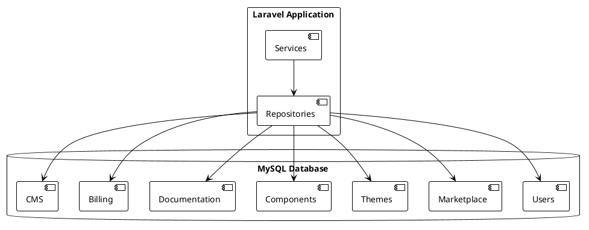

# 05.03.08 - Database Container

**Project:** GsmUi
**Architecture:** C4 Model – Level 2 (Container)
**Container:** Relational Database (MySQL)
**Framework:** Laravel 13 + Eloquent ORM
**Database:** MySQL 8.4 LTS (Primary)
**Version:** 1.0.0

---

# Purpose

The Database Container is the persistent storage layer of GsmUi. It stores all business entities, relationships, audit trails, configuration, and metadata required to operate the platform.

The database is designed as a **single relational database** for the MVP using a **Modular Monolith** architecture. Each business domain owns its tables while sharing a common database.

Future evolution supports:

* Read replicas
* Database sharding
* CQRS read models
* Microservice extraction

---

# Responsibilities

The Database Container is responsible for:

* Persistent storage
* ACID transactions
* Referential integrity
* Constraints
* Indexing
* Query optimization
* Soft deletes
* Audit data
* Historical records

The database is **not responsible** for:

* Business rules
* Authorization
* Search indexing
* Cache
* Rendering
* File storage

---

# Container Diagram



---

# Technology Stack

| Technology         | Purpose                                 |
| ------------------ | --------------------------------------- |
| MySQL 8.4 LTS      | Primary relational database             |
| InnoDB             | Storage engine                          |
| UTF8MB4            | Character encoding                      |
| Laravel Migrations | Schema management                       |
| Eloquent ORM       | Data access                             |
| Redis              | Cache & queues (outside this container) |

---

# Database Organization

The database is organized by business domains.

```text id="db02"
Authentication

Users

Roles & Permissions

Components

Themes

Templates

Marketplace

Billing

Documentation

Playground

CMS

Blog

Analytics

Notifications

Settings

System
```

Each domain owns its schema and relationships.

---

# High-Level Entity Groups

```text id="db03"
Users

↓

Subscriptions

↓

Orders

↓

Licenses

↓

Downloads

↓

Marketplace Products
```

```text id="db04"
Themes

↓

Theme Versions

↓

Theme Tokens

↓

Exports
```

```text id="db05"
Components

↓

Examples

↓

Documentation

↓

Playground
```

---

# Domain Ownership

| Domain        | Example Tables                 |
| ------------- | ------------------------------ |
| Identity      | users, sessions                |
| Authorization | roles, permissions             |
| Components    | components, component_versions |
| Themes        | themes, theme_tokens           |
| Marketplace   | products, categories           |
| Billing       | subscriptions, invoices        |
| Documentation | docs_pages                     |
| Blog          | posts, categories              |
| CMS           | pages, menus                   |
| Playground    | projects, files                |

Each domain evolves independently.

---

# Connection Strategy

Primary connection:

```text id="db06"
mysql
```

Future:

```text id="db07"
mysql-read

mysql-write

analytics

reporting
```

Repositories abstract connection selection.

---

# Transactions

Transactions are coordinated by the Action layer.

Rules:

* Keep transactions short.
* Avoid external network calls inside transactions.
* Dispatch events after commit.

---

# Foreign Keys

Use foreign keys for:

* Ownership
* Parent-child relationships
* Referential integrity

Examples:

```text id="db08"
orders.user_id

themes.author_id

components.category_id

licenses.order_id
```

---

# Soft Deletes

Supported where recovery is valuable.

Examples:

* Users
* Components
* Themes
* Templates
* Blog posts

Permanent deletion is restricted to administrative workflows.

---

# Audit Columns

Standard columns:

```text id="db09"
created_at

updated_at

deleted_at
```

Additional ownership columns where appropriate:

```text id="db10"
created_by

updated_by
```

---

# Indexing Strategy

Index:

* Foreign keys
* Slugs
* Status
* Published dates
* Search fields
* Frequently filtered columns

Examples:

```text id="db11"
slug

email

status

published_at

category_id

user_id
```

---

# Unique Constraints

Examples:

```text id="db12"
users.email

themes.slug

components.slug

roles.name

permissions.name
```

Enforce business uniqueness at the database level.

---

# UUID Strategy

Primary keys:

* BIGINT AUTO_INCREMENT (MVP)

Public identifiers (optional):

* UUID
* ULID

Used for:

* API exposure
* Share links
* Public resources

---

# Schema Naming

Naming conventions:

* snake_case
* plural table names
* singular foreign keys

Example:

```text id="db13"
marketplace_products

theme_versions

component_examples
```

---

# Migration Strategy

Every schema change uses Laravel Migrations.

Rules:

* Small migrations
* Forward-only
* No manual schema changes
* Version controlled

Deployment executes migrations automatically.

---

# Seeding Strategy

Seed:

* Roles
* Permissions
* Default themes
* Sample components
* CMS pages
* Documentation categories

Production seeders must be idempotent.

---

# Read / Write Pattern

```text id="db14"
Action

↓

Service

↓

Repository

↓

MySQL
```

Repositories are the only layer interacting with Eloquent models.

---

# Backup Strategy

Backups include:

* Full database
* Binary logs (future)
* Daily snapshots

Managed using:

* Spatie Backup
* Cloud object storage

Restore procedures must be tested regularly.

---

# Performance Guidelines

* Use eager loading
* Avoid N+1 queries
* Paginate large datasets
* Use covering indexes
* Select only required columns
* Archive historical records when appropriate

---

# Partition Candidates

Future partitioning:

* Activity logs
* Analytics
* Notifications
* Audit records
* Search history

These tables typically grow faster than transactional data.

---

# Reporting

Operational reporting uses:

* Dedicated query services
* Cached aggregates
* Materialized summaries (future)

Avoid heavy reporting queries on transactional tables during peak usage.

---

# Security

Database users follow least privilege.

Application account:

* CRUD on application schema
* No administrative privileges

Administrative operations use separate credentials.

---

# Encryption

Sensitive data:

* Encrypted via Laravel
* Passwords hashed (Argon2id)
* Secrets never stored in plaintext

At-rest encryption depends on infrastructure provider.

---

# Monitoring

Monitor:

* Slow queries
* Deadlocks
* Lock contention
* Connection count
* Replication status (future)
* Storage growth

Use:

* Telescope (development)
* MySQL Performance Schema
* Infrastructure monitoring

---

# Failure Recovery

Recovery plan:

1. Detect issue.
2. Restore latest backup if required.
3. Replay binary logs (future).
4. Verify integrity.
5. Resume services.

Recovery procedures are documented and tested.

---

# Testing

Test:

* Migrations
* Foreign keys
* Constraints
* Transactions
* Index usage
* Repository integration

Database tests should use isolated environments.

---

# Performance Targets

| Metric                  | Target      |
| ----------------------- | ----------- |
| Simple Query            | <20 ms      |
| Complex Query           | <100 ms     |
| Transaction             | <200 ms     |
| Connection Availability | 99.9%       |
| Backup Duration         | <30 minutes |

---

# Scalability Roadmap

Phase 1:

* Single MySQL instance

Phase 2:

* Read replicas

Phase 3:

* Read/write splitting

Phase 4:

* Domain-specific databases

Phase 5:

* Microservice-owned databases

Application architecture already supports this evolution through repositories and services.

---

# Future Evolution

Future enhancements include:

* MySQL Group Replication
* Read replicas
* CQRS read models
* Online schema changes
* Data warehouse integration
* Event sourcing (selected domains)

These changes do not affect business logic because persistence is abstracted behind repositories.

---

# Connection Pooling

## Connection Pool Architecture

Connection pooling maintains a set of reusable database connections to avoid the overhead of establishing new connections for each request.

```text
┌─────────────────────────────────────────────────────────────┐
│                  Connection Pool Architecture                 │
├─────────────────────────────────────────────────────────────┤
│                                                              │
│  ┌──────────────┐  ┌──────────────┐  ┌──────────────┐     │
│  │  Request 1   │  │  Request 2   │  │  Request 3   │     │
│  └──────┬───────┘  └──────┬───────┘  └──────┬───────┘     │
│         │                 │                 │               │
│         └────────┬────────┴────────┬────────┘               │
│                  │                 │                         │
│                  ▼                 ▼                         │
│         ┌─────────────────────────────────┐                 │
│         │       Connection Pool            │                 │
│         │  ┌─────┬─────┬─────┬─────┐     │                 │
│         │  │ C1  │ C2  │ C3  │ C4  │     │                 │
│         │  └─────┴─────┴─────┴─────┘     │                 │
│         │  Min: 2  Max: 10                │                 │
│         │  Idle Timeout: 300s             │                 │
│         └──────────────┬──────────────────┘                 │
│                        │                                    │
│                        ▼                                    │
│         ┌─────────────────────────────────┐                 │
│         │         MySQL Server             │                 │
│         └─────────────────────────────────┘                 │
│                                                              │
└─────────────────────────────────────────────────────────────┘
```

## Connection Pool Configuration

```php
<?php

// config/database.php
return [
    'mysql' => [
        'driver' => 'mysql',
        'url' => env('DATABASE_URL'),
        'host' => env('DB_HOST', '127.0.0.1'),
        'port' => env('DB_PORT', '3306'),
        'database' => env('DB_DATABASE', 'gsmui'),
        'username' => env('DB_USERNAME', 'root'),
        'password' => env('DB_PASSWORD', ''),
        'unix_socket' => env('DB_SOCKET', ''),
        'charset' => 'utf8mb4',
        'collation' => 'utf8mb4_unicode_ci',
        'prefix' => '',
        'prefix_indexes' => true,
        'strict' => true,
        'engine' => null,

        // Connection pooling configuration
        'pool' => [
            'min_connections' => env('DB_POOL_MIN', 2),
            'max_connections' => env('DB_POOL_MAX', 10),
            'idle_timeout' => env('DB_POOL_IDLE_TIMEOUT', 300),
            'lifetime' => env('DB_POOL_LIFETIME', 1440),
            'wait_timeout' => env('DB_POOL_WAIT_TIMEOUT', 10),
        ],

        // Read/Write splitting
        'read' => [
            'host' => [
                env('DB_READ_HOST_1', env('DB_HOST')),
                env('DB_READ_HOST_2'),
            ],
        ],
        'write' => [
            'host' => [
                env('DB_WRITE_HOST', env('DB_HOST')),
            ],
        ],
    ],
];
```

### Connection Pool Monitoring

```php
<?php

namespace App\Services;

use Illuminate\Support\Facades\DB;
use Illuminate\Support\Facades\Redis;

class ConnectionPoolMonitor
{
    public function getStats(): array
    {
        $connection = DB::connection('mysql');

        return [
            'active_connections' => $this->getActiveConnections($connection),
            'idle_connections' => $this->getIdleConnections($connection),
            'total_connections' => $this->getTotalConnections($connection),
            'max_connections' => $this->getMaxConnections($connection),
            'pool_utilization' => $this->getPoolUtilization($connection),
            'waiting_requests' => $this->getWaitingRequests($connection),
        ];
    }

    private function getActiveConnections($connection): int
    {
        $result = DB::select("SHOW STATUS LIKE 'Threads_connected'");
        return (int) ($result[0]->Value ?? 0);
    }

    private function getIdleConnections($connection): int
    {
        $result = DB::select("SHOW STATUS LIKE 'Threads_running'");
        return (int) ($result[0]->Value ?? 0);
    }

    private function getTotalConnections($connection): int
    {
        $result = DB::select("SHOW STATUS LIKE 'Max_used_connections'");
        return (int) ($result[0]->Value ?? 0);
    }

    private function getMaxConnections($connection): int
    {
        $result = DB::select("SHOW VARIABLES LIKE 'max_connections'");
        return (int) ($result[0]->Value ?? 0);
    }

    private function getPoolUtilization($connection): float
    {
        $active = $this->getActiveConnections($connection);
        $max = $this->getMaxConnections($connection);
        return $max > 0 ? ($active / $max) * 100 : 0;
    }

    private function getWaitingRequests($connection): int
    {
        $result = DB::select("SHOW STATUS LIKE 'Threads_connected'");
        return (int) ($result[0]->Value ?? 0);
    }

    public function recordMetrics(): void
    {
        $stats = $this->getStats();

        Redis::hset('db:pool:stats', [
            'active' => $stats['active_connections'],
            'idle' => $stats['idle_connections'],
            'total' => $stats['total_connections'],
            'utilization' => $stats['pool_utilization'],
            'timestamp' => now()->timestamp,
        ]);

        if ($stats['pool_utilization'] > 80) {
            logger()->warning('Database connection pool utilization high', $stats);
        }
    }
}
```

## Read Replicas

### Read Replica Configuration

```php
<?php

namespace App\Providers;

use Illuminate\Database\Connections\Connection;
use Illuminate\Support\ServiceProvider;

class ReadReplicaServiceProvider extends ServiceProvider
{
    public function boot(): void
    {
        DB::proceedIf(function () {
            return config('database.read_replicas.enabled', false);
        });

        DB::beforeExecuting(function ($query, $bindings, $connection) {
            if ($this->shouldUseReadReplica($query)) {
                $connection->useConnection('mysql-read');
            }
        });
    }

    private function shouldUseReadReplica(string $query): bool
    {
        $query = strtolower(trim($query));

        $readPatterns = [
            '/^select/',
            '/^show/',
            '/^explain/',
        ];

        foreach ($readPatterns as $pattern) {
            if (preg_match($pattern, $query)) {
                return true;
            }
        }

        return false;
    }
}
```

### Read/Write Splitting Middleware

```php
<?php

namespace App\Http\Middleware;

use Closure;
use Illuminate\Http\Request;
use Illuminate\Support\Facades\DB;
use Symfony\Component\HttpFoundation\Response;

class ReadReplicaMiddleware
{
    public function handle(Request $request, Closure $next): Response
    {
        if ($request->isMethod('GET') || $request->isMethod('HEAD')) {
            DB::purge('mysql');
            config(['database.connections.mysql.database' => env('DB_READ_DATABASE', env('DB_DATABASE'))]);
        }

        return $next($request);
    }
}
```

## Query Optimization

### Query Optimization Strategy

```text
┌─────────────────────────────────────────────────────────────┐
│                 Query Optimization Strategy                   │
├─────────────────────────────────────────────────────────────┤
│                                                              │
│  1. Prevention                                              │
│     ├── Eloquent eager loading                              │
│     ├── Prevent lazy loading in dev                         │
│     ├── Select only needed columns                          │
│     └── Use cursor() for large datasets                     │
│                                                              │
│  2. Detection                                               │
│     ├── Slow query logging                                  │
│     ├── Telescope profiling                                 │
│     ├── EXPLAIN analysis                                    │
│     └── Connection pool monitoring                          │
│                                                              │
│  3. Optimization                                            │
│     ├── Index optimization                                  │
│     ├── Query rewriting                                     │
│     ├── Batch operations                                    │
│     └── Cache layer                                         │
│                                                              │
│  4. Monitoring                                              │
│     ├── Query count per request                             │
│     ├── Average query time                                  │
│     ├── N+1 detection                                       │
│     └── Deadlock monitoring                                 │
│                                                              │
└─────────────────────────────────────────────────────────────┘
```

### Eloquent Eager Loading

```php
<?php

namespace App\Repositories;

use App\Models\Component;
use Illuminate\Database\Eloquent\Collection;

class ComponentRepository
{
    public function getPopular(int $limit = 15): Collection
    {
        return Component::query()
            ->with([
                'category:id,name,slug',
                'author:id,name,avatar',
                'latestVersion:id,version_number,created_at',
            ])
            ->where('is_published', true)
            ->orderByDesc('download_count')
            ->limit($limit)
            ->get();
    }

    public function search(string $query, array $filters = []): Collection
    {
        return Component::query()
            ->with(['category:id,name'])
            ->where('is_published', true)
            ->where(function ($q) use ($query) {
                $q->where('name', 'LIKE', "%{$query}%")
                  ->orWhere('description', 'LIKE', "%{$query}%");
            })
            ->when($filters['category'] ?? null, function ($q, $category) {
                $q->where('category_id', $category);
            })
            ->get();
    }
}
```

### Query Performance Profiler

```php
<?php

namespace App\Services;

use Illuminate\Support\Facades\DB;
use Illuminate\Support\Facades\Log;

class QueryProfiler
{
    private array $queries = [];
    private float $startTime;

    public function start(): void
    {
        $this->startTime = microtime(true);
        $this->queries = [];

        DB::listen(function ($query) {
            $this->queries[] = [
                'sql' => $query->sql,
                'bindings' => $query->bindings,
                'time' => $query->time,
                'connection' => $query->connectionName,
            ];
        });
    }

    public function stop(): array
    {
        $totalTime = (microtime(true) - $this->startTime) * 1000;

        $result = [
            'total_queries' => count($this->queries),
            'total_time_ms' => round($totalTime, 2),
            'queries' => $this->queries,
            'slowest_query' => $this->getSlowestQuery(),
            'n_plus_one_detected' => $this->detectNPlusOne(),
        ];

        if ($totalTime > 200) {
            Log::warning('Slow request detected', $result);
        }

        return $result;
    }

    private function getSlowestQuery(): ?array
    {
        if (empty($this->queries)) {
            return null;
        }

        return collect($this->queries)->sortByDesc('time')->first();
    }

    private function detectNPlusOne(): bool
    {
        $sqlPatterns = array_column($this->queries, 'sql');
        $grouped = collect($sqlPatterns)->groupBy(function ($sql) {
            return preg_replace('/\d+/', '?', $sql);
        });

        return $grouped->contains(function ($group) {
            return $group->count() > 3;
        });
    }
}
```

---

# Migration Strategy

## Migration Principles

### Forward-Only Migrations

```php
<?php

namespace App\Providers;

use Illuminate\Database\Migrations\MigrationRepositoryInterface;
use Illuminate\Support\ServiceProvider;

class MigrationServiceProvider extends ServiceProvider
{
    public function register(): void
    {
        $this->app->bind(MigrationRepositoryInterface::class, function ($app) {
            return new class implements MigrationRepositoryInterface {
                private $repository;

                public function __construct($repository)
                {
                    $this->repository = $repository;
                }

                public function revert($migration)
                {
                    throw new \RuntimeException(
                        'Rollback disabled in production. Use forward-only migrations.'
                    );
                }
            };
        });
    }
}
```

### Migration Naming Convention

```php
<?php

// Timestamps indicate migration order
// 2026_01_01_000001_create_users_table.php
// 2026_01_01_000002_create_components_table.php

return new class extends Migration
{
    public function up(): void
    {
        Schema::create('components', function (Blueprint $table) {
            $table->id();
            $table->foreignId('category_id')->constrained();
            $table->foreignId('author_id')->constrained('users');
            $table->string('name');
            $table->string('slug')->unique();
            $table->text('description')->nullable();
            $table->boolean('is_published')->default(false);
            $table->unsignedInteger('download_count')->default(0);
            $table->decimal('average_rating', 3, 2)->default(0);
            $table->timestamps();
            $table->softDeletes();

            $table->index('is_published');
            $table->index('download_count');
            $table->index('created_at');
        });
    }

    public function down(): void
    {
        Schema::dropIfExists('components');
    }
};
```

### Zero-Downtime Migrations

```php
<?php

// Migration with zero-downtime approach
return new class extends Migration
{
    public function up(): void
    {
        // Step 1: Add new column (nullable)
        Schema::table('components', function (Blueprint $table) {
            $table->string('new_field')->nullable()->after('name');
        });

        // Step 2: Populate data
        DB::table('components')
            ->whereNull('new_field')
            ->update(['new_field' => DB::raw('name')]);

        // Step 3: Add NOT NULL constraint (after data population)
        Schema::table('components', function (Blueprint $table) {
            $table->string('new_field')->nullable(false)->change();
        });
    }

    public function down(): void
    {
        Schema::table('components', function (Blueprint $table) {
            $table->dropColumn('new_field');
        });
    }
};
```

### Migration Testing

```php
<?php

namespace Tests\Feature\Database;

use Illuminate\Foundation\Testing\RefreshDatabase;
use Tests\TestCase;

class MigrationTest extends TestCase
{
    use RefreshDatabase;

    public function test_migrations_run_forward(): void
    {
        $this->artisan('migrate', '--force');
        $this->artisan('migrate:status')
            ->assertExitCode(0);
    }

    public function test_migrations_are_idempotent(): void
    {
        $this->artisan('migrate', '--force');
        $this->artisan('migrate', '--force');
        $this->assertDatabaseHas('migrations', [
            'batch' => 1,
        ]);
    }

    public function test_seeders_are_idempotent(): void
    {
        $this->artisan('db:seed', '--force');
        $initialCount = DB::table('roles')->count();
        $this->artisan('db:seed', '--force');
        $finalCount = DB::table('roles')->count();
        $this->assertEquals($initialCount, $finalCount);
    }
}
```

---

# Backup & Recovery

## Backup Architecture

### Automated Backup System

```php
<?php

namespace App\Console\Commands;

use Illuminate\Console\Command;
use Illuminate\Support\Facades\DB;
use Illuminate\Support\Facades\Storage;
use Spatie\Backup\BackupDestination\BackupDestination;

class DatabaseBackupCommand extends Command
{
    protected $signature = 'backup:database
                            {--full : Full backup instead of incremental}
                            {--compress : Compress the backup}';

    protected $description = 'Create a database backup';

    public function handle(): int
    {
        $timestamp = now()->format('Y-m-d_H-i-s');
        $filename = "gsmui_{$timestamp}.sql";

        $this->info("Starting backup: {$filename}");

        try {
            // Create backup
            $this->createBackup($filename);

            // Compress if requested
            if ($this->option('compress')) {
                $this->compressBackup($filename);
                $filename .= '.gz';
            }

            // Upload to S3
            $this->uploadToS3($filename);

            // Cleanup old local backups
            $this->cleanupLocalBackups();

            $this->info("Backup completed: {$filename}");
            return Command::SUCCESS;

        } catch (\Exception $e) {
            $this->error("Backup failed: {$e->getMessage()}");
            return Command::FAILURE;
        }
    }

    private function createBackup(string $filename): void
    {
        $path = storage_path("backups/{$filename}");
        $dbConfig = config('database.connections.mysql');

        $command = sprintf(
            'mysqldump -h %s -u %s -p%s %s > %s',
            escapeshellarg($dbConfig['host']),
            escapeshellarg($dbConfig['username']),
            escapeshellarg($dbConfig['password']),
            escapeshellarg($dbConfig['database']),
            escapeshellarg($path)
        );

        exec($command, $output, $returnCode);

        if ($returnCode !== 0) {
            throw new \RuntimeException('mysqldump failed');
        }
    }

    private function compressBackup(string $filename): void
    {
        $path = storage_path("backups/{$filename}");
        $compressedPath = "{$path}.gz";

        $input = fopen($path, 'rb');
        $output = gzopen($compressedPath, 'wb9');

        while (!feof($input)) {
            gzwrite($output, fread($input, 1024 * 512));
        }

        fclose($input);
        gzclose($output);
        unlink($path);
    }

    private function uploadToS3(string $filename): void
    {
        $path = storage_path("backups/{$filename}");
        $s3Path = "backups/mysql/{$filename}";

        Storage::disk('s3')->put($s3Path, file_get_contents($path), [
            'ServerSideEncryption' => 'AES256',
        ]);

        $this->info("Uploaded to S3: {$s3Path}");
    }

    private function cleanupLocalBackups(): void
    {
        $backupDir = storage_path('backups');
        $files = glob("{$backupDir}/gsmui_*.sql*");

        foreach ($files as $file) {
            if (filemtime($file) < now()->subDays(7)->timestamp) {
                unlink($file);
                $this->info("Cleaned up: " . basename($file));
            }
        }
    }
}
```

### Backup Verification

```php
<?php

namespace App\Console\Commands;

use Illuminate\Console\Command;
use Illuminate\Support\Facades\DB;
use Illuminate\Support\Facades\Storage;

class VerifyBackupCommand extends Command
{
    protected $signature = 'backup:verify {backup_file}';
    protected $description = 'Verify a database backup';

    public function handle(): int
    {
        $backupFile = $this->argument('backup_file');

        $this->info("Verifying backup: {$backupFile}");

        try {
            // Download backup from S3
            $localPath = $this->downloadBackup($backupFile);

            // Verify file integrity
            $this->verifyFileIntegrity($localPath);

            // Test restore to temporary database
            $this->testRestore($localPath);

            // Cleanup
            unlink($localPath);

            $this->info('Backup verification passed');
            return Command::SUCCESS;

        } catch (\Exception $e) {
            $this->error("Verification failed: {$e->getMessage()}");
            return Command::FAILURE;
        }
    }

    private function downloadBackup(string $backupFile): string
    {
        $localPath = storage_path("backups/verify/{$backupFile}");
        $s3Path = "backups/mysql/{$backupFile}";

        $content = Storage::disk('s3')->get($s3Path);
        file_put_contents($localPath, $content);

        return $localPath;
    }

    private function verifyFileIntegrity(string $path): void
    {
        $size = filesize($path);
        if ($size < 1024) {
            throw new \RuntimeException('Backup file too small');
        }

        $content = file_get_contents($path, false, null, 0, 1024);
        if (strpos($content, 'MySQL dump') === false &&
            strpos($content, '-- Table structure') === false) {
            throw new \RuntimeException('Not a valid MySQL dump');
        }
    }

    private function testRestore(string $path): void
    {
        $tempDb = 'gsmui_verify_' . uniqid();

        DB::statement("CREATE DATABASE {$tempDb}");
        DB::statement("USE {$tempDb}");

        exec("mysql -u root {$tempDb} < {$path}", $output, $returnCode);

        if ($returnCode !== 0) {
            DB::statement("DROP DATABASE {$tempDb}");
            throw new \RuntimeException('Restore test failed');
        }

        // Verify table count
        $tables = DB::select("SHOW TABLES");
        if (empty($tables)) {
            DB::statement("DROP DATABASE {$tempDb}");
            throw new \RuntimeException('No tables found in backup');
        }

        DB::statement("DROP DATABASE {$tempDb}");
    }
}
```

---

# Data Partitioning

## Partition Strategy

### Range Partitioning for Time-Series Data

```php
<?php

namespace App\Database\Partitions;

use Illuminate\Database\Schema\Blueprint;
use Illuminate\Support\Facades\Schema;

class ActivityLogPartitioner
{
    public function createPartitions(): void
    {
        $months = [
            now()->format('Y_m'),
            now()->addMonth()->format('Y_m'),
            now()->addMonths(2)->format('Y_m'),
        ];

        foreach ($months as $month) {
            $tableName = "activity_logs_{$month}";

            if (!Schema::hasTable($tableName)) {
                Schema::create($tableName, function (Blueprint $table) use ($month) {
                    $table->id();
                    $table->foreignId('user_id')->constrained();
                    $table->string('loggable_type');
                    $table->unsignedBigInteger('loggable_id');
                    $table->string('event');
                    $table->json('properties')->nullable();
                    $table->string('ip_address', 45)->nullable();
                    $table->timestamp('created_at');

                    $table->index('user_id');
                    $table->index('created_at');
                    $table->index(['loggable_type', 'loggable_id']);
                });
            }
        }
    }

    public function dropOldPartitions(int $retainMonths = 12): void
    {
        $cutoffDate = now()->subMonths($retainMonths);

        $partitions = Schema::getTables()
            ->filter(fn($table) => str_starts_with($table, 'activity_logs_'));

        foreach ($partitions as $partition) {
            $month = str_replace('activity_logs_', '', $partition);
            $partitionDate = \Carbon\Carbon::createFromFormat('Y_m', $month);

            if ($partitionDate->lt($cutoffDate)) {
                Schema::dropIfExists($partition);
            }
        }
    }
}
```

### Automated Partition Management

```php
<?php

namespace App\Console\Commands;

use Illuminate\Console\Command;

class ManagePartitionsCommand extends Command
{
    protected $signature = 'db:manage-partitions';
    protected $description = 'Create and manage database partitions';

    public function handle(): int
    {
        $partitions = ['activity_logs', 'notifications', 'metrics'];

        foreach ($partitions as $table) {
            $this->info("Managing partitions for {$table}");
            $this->createFuturePartitions($table);
            $this->dropOldPartitions($table);
        }

        return Command::SUCCESS;
    }

    private function createFuturePartitions(string $table): void
    {
        $futureMonths = 3;
        for ($i = 0; $i < $futureMonths; $i++) {
            $month = now()->addMonths($i)->format('Y_m');
            $this->createPartition($table, $month);
        }
    }

    private function createPartition(string $table, string $month): void
    {
        $partitionName = "{$table}_{$month}";
        $startDate = \Carbon\Carbon::createFromFormat('Y_m', $month)->startOfMonth();
        $endDate = $startDate->copy()->endOfMonth();

        DB::statement("
            ALTER TABLE {$table}
            ADD PARTITION (
                PARTITION {$partitionName} VALUES LESS THAN (UNIX_TIMESTAMP('{$endDate->toDateTimeString()}'))
            )
        ");
    }

    private function dropOldPartitions(string $table): void
    {
        $retainMonths = 24;
        $cutoff = now()->subMonths($retainMonths)->format('Y_m');

        $partitions = DB::select("
            SELECT PARTITION_NAME
            FROM INFORMATION_SCHEMA.PARTITIONS
            WHERE TABLE_NAME = '{$table}'
            AND PARTITION_NAME != 'p_default'
        ");

        foreach ($partitions as $partition) {
            $month = str_replace("{$table}_", '', $partition->PARTITION_NAME);
            if ($month < $cutoff) {
                DB::statement("ALTER TABLE {$table} DROP PARTITION {$partition->PARTITION_NAME}");
            }
        }
    }
}
```

---

# Indexing Strategy

## Index Design Principles

### Index Types

```text
┌─────────────────────────────────────────────────────────────┐
│                    Index Types                                │
├─────────────────────────────────────────────────────────────┤
│                                                              │
│  1. Primary Index                                           │
│     ├── Auto-incrementing BIGINT ID                         │
│     ├── Clustered index (InnoDB)                            │
│     └── Used for internal lookups                           │
│                                                              │
│  2. Secondary Index                                         │
│     ├── Single column: name, email, slug                    │
│     ├── Multi-column: (category_id, is_published)           │
│     └── Used for filtering and sorting                      │
│                                                              │
│  3. Unique Index                                            │
│     ├── Email (users)                                       │
│     ├── Slug (components, themes)                           │
│     └── Business uniqueness enforcement                     │
│                                                              │
│  4. Composite Index                                         │
│     ├── (user_id, created_at) for timeline queries          │
│     ├── (category_id, download_count) for rankings          │
│     └── Order matters: most selective first                 │
│                                                              │
│  5. Covering Index                                          │
│     ├── Includes all columns needed for query               │
│     ├── Avoids table lookup                                 │
│     └── Best for read-heavy queries                         │
│                                                              │
│  6. Full-Text Index                                         │
│     ├── Search on name + description                        │
│     ├── MySQL FULLTEXT engine                               │
│     └── Complements Meilisearch                             │
│                                                              │
└─────────────────────────────────────────────────────────────┘
```

### Index Implementation Examples

```php
<?php

// components migration
Schema::create('components', function (Blueprint $table) {
    $table->id();
    $table->foreignId('category_id')->constrained();
    $table->foreignId('author_id')->constrained('users');
    $table->string('name');
    $table->string('slug')->unique();
    $table->text('description')->nullable();
    $table->boolean('is_published')->default(false);
    $table->unsignedInteger('download_count')->default(0);
    $table->decimal('average_rating', 3, 2)->default(0);
    $table->timestamps();
    $table->softDeletes();

    // Indexes
    $table->index('is_published');
    $table->index('download_count');
    $table->index('created_at');
    $table->index('average_rating');

    // Composite indexes
    $table->index(['category_id', 'is_published']);
    $table->index(['category_id', 'download_count']);
    $table->index(['author_id', 'created_at']);
    $table->index(['is_published', 'download_count']);

    // Full-text index
    $table->fullText(['name', 'description']);
});
```

### Index Monitoring

```php
<?php

namespace App\Services;

use Illuminate\Support\Facades\DB;

class IndexMonitorService
{
    public function getUnusedIndexes(): array
    {
        $results = DB::select("
            SELECT
                object_schema,
                object_name,
                index_name
            FROM performance_schema.table_io_waits_summary_by_index_usage
            WHERE object_schema = DATABASE()
            AND index_name IS NOT NULL
            AND count_read = 0
            AND index_name != 'PRIMARY'
            ORDER BY object_name, index_name
        ");

        return $results;
    }

    public function getMissingIndexes(): array
    {
        $results = DB::select("
            SELECT
                object_schema,
                object_name,
                rows_scanned,
                rows_fetched
            FROM performance_schema.table_scans
            WHERE object_schema = DATABASE()
            AND rows_fetched / NULLIF(rows_scanned, 0) > 0.9
            ORDER BY rows_scanned DESC
        ");

        return $results;
    }

    public function getIndexStatistics(): array
    {
        return [
            'unused_indexes' => $this->getUnusedIndexes(),
            'missing_indexes' => $this->getMissingIndexes(),
            'table_stats' => $this->getTableStats(),
        ];
    }

    private function getTableStats(): array
    {
        return DB::select("
            SELECT
                table_name,
                table_rows,
                data_length,
                index_length,
                data_free
            FROM information_schema.tables
            WHERE table_schema = DATABASE()
            ORDER BY data_length DESC
        ");
    }
}
```

---

# Monitoring

## Database Monitoring Stack

### Slow Query Monitoring

```php
<?php

namespace App\Providers;

use Illuminate\Database\Connection;
use Illuminate\Support\Facades\DB;
use Illuminate\Support\Facades\Log;
use Illuminate\Support\ServiceProvider;

class DatabaseMonitoringServiceProvider extends ServiceProvider
{
    public function boot(): void
    {
        DB::listen(function ($query) {
            if ($query->time > 1000) {
                Log::channel('slow_queries')->warning('Slow query detected', [
                    'sql' => $query->sql,
                    'time' => $query->time,
                    'bindings' => $query->bindings,
                    'connection' => $query->connectionName,
                ]);
            }

            if ($query->time > 100) {
                $this->recordMetric('db.query.time', $query->time);
            }
        });
    }

    private function recordMetric(string $name, float $value): void
    {
        \Illuminate\Support\Facades\Redis::incr("metrics:{$name}");
        \Illuminate\Support\Facades\Redis::incrbyfloat("metrics:{$name}:sum", $value);
    }
}
```

### Database Health Check

```php
<?php

namespace App\Health;

use Illuminate\Support\Facades\DB;
use Spatie\Health\Checks\Check;
use Spatie\Health\Checks\Result;

class DatabaseCheck extends Check
{
    public function run(): Result
    {
        try {
            $startTime = microtime(true);
            DB::select('SELECT 1');
            $duration = (microtime(true) - $startTime) * 1000;

            $result = Result::make()->ok()
                ->withMetric($duration)
                ->withMeta([
                    'connection' => DB::getDefaultConnection(),
                    'response_time_ms' => round($duration, 2),
                ]);

            return $result;
        } catch (\Exception $e) {
            return Result::make()->failed()
                ->withReason("Database connection failed: {$e->getMessage()}");
        }
    }
}
```

### Deadlock Detection

```php
<?php

namespace App\Services;

use Illuminate\Support\Facades\DB;
use Illuminate\Support\Facades\Redis;

class DeadlockDetector
{
    public function check(): array
    {
        $result = DB::select("SHOW ENGINE INNODB STATUS");
        $status = $result[0]->Status ?? '';

        preg_match('/LATEST DETECTED DEADLOCK.*?------/s', $status, $matches);

        if (!empty($matches)) {
            $this->handleDeadlock($matches[0]);
            return [
                'deadlock_detected' => true,
                'details' => $matches[0],
            ];
        }

        return [
            'deadlock_detected' => false,
        ];
    }

    private function handleDeadlock(string $details): void
    {
        Redis::incr('db:deadlocks');
        Redis::lpush('db:deadlock_log', json_encode([
            'timestamp' => now()->toIso8601String(),
            'details' => $details,
        ]));
        Redis::ltrim('db:deadlock_log', 0, 99);

        logger()->error('Database deadlock detected', ['details' => $details]);
    }

    public function getDeadlockStats(): array
    {
        $totalDeadlocks = Redis::get('db:deadlocks') ?? 0;
        $recentDeadlocks = Redis::lrange('db:deadlock_log', 0, 9);

        return [
            'total_deadlocks' => (int) $totalDeadlocks,
            'recent_deadlocks' => array_map('json_decode', $recentDeadlocks),
        ];
    }
}
```

### Storage Monitoring

```php
<?php

namespace App\Services;

use Illuminate\Support\Facades\DB;

class StorageMonitor
{
    public function getStorageStats(): array
    {
        $result = DB::select("
            SELECT
                table_name,
                ROUND(data_length / 1024 / 1024, 2) AS data_mb,
                ROUND(index_length / 1024 / 1024, 2) AS index_mb,
                ROUND((data_length + index_length) / 1024 / 1024, 2) AS total_mb,
                table_rows,
                auto_increment
            FROM information_schema.tables
            WHERE table_schema = DATABASE()
            ORDER BY (data_length + index_length) DESC
        ");

        return [
            'tables' => $result,
            'total_size_mb' => array_sum(array_column($result, 'total_mb')),
            'total_tables' => count($result),
        ];
    }

    public function getGrowthProjection(int $days = 30): array
    {
        $currentStats = $this->getStorageStats();
        $currentSize = $currentStats['total_size_mb'];

        // Simple linear projection
        $dailyGrowth = DB::select("
            SELECT
                DATEDIFF(NOW(), MIN(created_at)) AS days,
                COUNT(*) AS rows_added
            FROM activity_logs
            WHERE created_at >= DATE_SUB(NOW(), INTERVAL 30 DAY)
        ");

        $growthRate = !empty($dailyGrowth[0]->days)
            ? $dailyGrowth[0]->rows_added / $dailyGrowth[0]->days
            : 0;

        return [
            'current_size_mb' => $currentSize,
            'daily_growth_rate' => round($growthRate, 2),
            'projected_size_mb' => round($currentSize + ($growthRate * $days * 0.001), 2),
            'projection_days' => $days,
        ];
    }
}
```

---

# Query Optimization

## Advanced Query Patterns

### Query Builder Optimization

```php
<?php

namespace App\Repositories;

use Illuminate\Database\Eloquent\Builder;

class OptimizedComponentRepository
{
    public function searchWithAggregates(string $query): Builder
    {
        return Component::query()
            ->select([
                'components.id',
                'components.name',
                'components.slug',
                'components.description',
                'components.download_count',
                'components.average_rating',
            ])
            ->selectRaw('
                (components.download_count * 0.6 +
                 components.average_rating * 20 +
                 DATEDIFF(NOW(), components.created_at) * -0.1) as relevance_score
            ')
            ->with([
                'category:id,name,slug',
                'author:id,name,avatar',
            ])
            ->where('components.is_published', true)
            ->where(function ($q) use ($query) {
                $q->where('components.name', 'LIKE', "%{$query}%")
                  ->orWhere('components.description', 'LIKE', "%{$query}%");
            })
            ->orderByDesc('relevance_score')
            ->limit(50);
    }

    public function getWithStats(int $componentId): ?Component
    {
        return Component::query()
            ->withCount(['examples', 'versions', 'ratings'])
            ->with([
                'category:id,name',
                'author:id,name,avatar',
                'latestVersion:id,version_number,released_at',
            ])
            ->where('id', $componentId)
            ->first();
    }

    public function getBulkData(array $ids): Collection
    {
        return Component::query()
            ->whereIn('id', $ids)
            ->with([
                'category:id,name,slug',
                'author:id,name',
            ])
            ->get()
            ->keyBy('id');
    }
}
```

### Database Query Profiling

```php
<?php

namespace App\Services;

use Illuminate\Support\Facades\DB;

class QueryProfiler
{
    public function profile(string $label, callable $callback): array
    {
        $startQueries = $this->getQueryCount();
        $startTime = microtime(true);

        $result = $callback();

        $endTime = microtime(true);
        $endQueries = $this->getQueryCount();

        return [
            'label' => $label,
            'result' => $result,
            'duration_ms' => round(($endTime - $startTime) * 1000, 2),
            'queries_executed' => $endQueries - $startQueries,
            'memory_peak' => memory_get_peak_usage(true),
        ];
    }

    private function getQueryCount(): int
    {
        return DB::getQueryLog() ? count(DB::getQueryLog()) : 0;
    }

    public function analyzeSlowQueries(int $thresholdMs = 100): array
    {
        $log = DB::getQueryLog();
        $slowQueries = [];

        foreach ($log as $query) {
            if (($query['time'] ?? 0) > $thresholdMs) {
                $slowQueries[] = [
                    'sql' => $query['query'],
                    'time_ms' => $query['time'],
                    'bindings' => $query['bindings'],
                ];
            }
        }

        return $slowQueries;
    }

    public function getExplainPlan(string $sql, array $bindings = []): array
    {
        $stmt = DB::select("EXPLAIN {$sql}", $bindings);
        return $stmt;
    }
}
```

## Connection Pooling

### Connection Pool Configuration

```php
<?php

namespace App\Providers;

use Illuminate\Support\ServiceProvider;
use Illuminate\Database\DatabaseManager;

class ConnectionPoolServiceProvider extends ServiceProvider
{
    public function boot(): void
    {
        $this->configureConnectionPool();
    }

    private function configureConnectionPool(): void
    {
        $poolConfig = config('database.pool', []);

        config([
            'database.connections.mysql.options' => [
                PDO::ATTR_PERSISTENT => true,
                PDO::ATTR_EMULATE_PREPARES => false,
                PDO::ATTR_ERRMODE => PDO::ERRMODE_EXCEPTION,
                PDO::MYSQL_ATTR_INIT_COMMAND => "SET NAMES utf8mb4 COLLATE utf8mb4_unicode_ci",
            ],
        ]);
    }

    public function register(): void
    {
        $this->app->singleton('db.pool.monitor', function () {
            return new \App\Services\ConnectionPoolMonitor();
        });
    }
}
```

### Connection Pool Health Check

```php
<?php

namespace App\Health;

use Illuminate\Support\Facades\DB;
use Spatie\Health\Checks\Check;
use Spatie\Health\Checks\Result;

class ConnectionPoolCheck extends Check
{
    public function run(): Result
    {
        try {
            $stats = $this->getConnectionStats();

            $utilization = $stats['utilization'] ?? 0;

            if ($utilization > 90) {
                return Result::make()->failed()
                    ->withReason("Connection pool utilization critical: {$utilization}%")
                    ->withMeta($stats);
            }

            if ($utilization > 70) {
                return Result::make()->warning()
                    ->withReason("Connection pool utilization high: {$utilization}%")
                    ->withMeta($stats);
            }

            return Result::make()->ok()
                ->withMetric($utilization)
                ->withMeta($stats);

        } catch (\Exception $e) {
            return Result::make()->failed()
                ->withReason("Connection pool check failed: {$e->getMessage()}");
        }
    }

    private function getConnectionStats(): array
    {
        $result = DB::select("SHOW STATUS LIKE 'Threads_connected'");
        $connected = (int) ($result[0]->Value ?? 0);

        $maxResult = DB::select("SHOW VARIABLES LIKE 'max_connections'");
        $max = (int) ($maxResult[0]->Value ?? 151);

        return [
            'connected' => $connected,
            'max' => $max,
            'utilization' => round(($connected / $max) * 100, 2),
            'available' => $max - $connected,
        ];
    }
}
```

---

# Database Monitoring

## Monitoring Dashboard Metrics

### Key Database Metrics

| Metric | Description | Alert Threshold |
|--------|-------------|-----------------|
| Active connections | Current connection count | >80% of max |
| Query latency p95 | 95th percentile query time | >100ms |
| Query latency p99 | 99th percentile query time | >500ms |
| Slow queries | Queries exceeding threshold | >10/hour |
| Deadlocks | InnoDB deadlock count | >0/hour |
| Buffer pool hit ratio | InnoDB buffer pool efficiency | <95% |
| Table scan ratio | Full table scans vs index scans | >10% |
| Replication lag | Read replica lag | >5 seconds |
| Storage growth rate | Daily data growth | >1GB/day |
| Backup age | Hours since last backup | >25 hours |

### Monitoring Queries

```sql
-- Active connections
SELECT COUNT(*) as active_connections
FROM information_schema.processlist
WHERE db = 'gsmui';

-- Query performance
SELECT
    digest_text,
    count_star as exec_count,
    ROUND(avg_timer_wait / 1000000000, 2) as avg_time_ms,
    ROUND(max_timer_wait / 1000000000, 2) as max_time_ms
FROM performance_schema.events_statements_summary_by_digest
WHERE schema_name = 'gsmui'
ORDER BY avg_timer_wait DESC
LIMIT 20;

-- InnoDB buffer pool
SELECT
    (SELECT VARIABLE_VALUE FROM performance_schema.global_status WHERE VARIABLE_NAME = 'Innodb_buffer_pool_read_requests') as reads,
    (SELECT VARIABLE_VALUE FROM performance_schema.global_status WHERE VARIABLE_NAME = 'Innodb_buffer_pool_reads') as disk_reads,
    ROUND((1 - (
        (SELECT VARIABLE_VALUE FROM performance_schema.global_status WHERE VARIABLE_NAME = 'Innodb_buffer_pool_reads') /
        (SELECT VARIABLE_VALUE FROM performance_schema.global_status WHERE VARIABLE_NAME = 'Innodb_buffer_pool_read_requests')
    )) * 100, 2) as hit_ratio;

-- Table statistics
SELECT
    table_name,
    table_rows,
    ROUND(data_length / 1024 / 1024, 2) as data_mb,
    ROUND(index_length / 1024 / 1024, 2) as index_mb,
    auto_increment
FROM information_schema.tables
WHERE table_schema = 'gsmui'
ORDER BY data_length + index_length DESC;

-- Index usage
SELECT
    object_name,
    index_name,
    count_read,
    count_write,
    count_fetch
FROM performance_schema.table_io_waits_summary_by_index_usage
WHERE object_schema = 'gsmui'
AND index_name IS NOT NULL
ORDER BY count_read DESC;
```

### Real-Time Monitoring Service

```php
<?php

namespace App\Services;

use Illuminate\Support\Facades\DB;
use Illuminate\Support\Facades\Redis;

class DatabaseMonitorService
{
    public function collectMetrics(): array
    {
        $metrics = [
            'connections' => $this->getConnectionMetrics(),
            'queries' => $this->getQueryMetrics(),
            'buffer_pool' => $this->getBufferPoolMetrics(),
            'tables' => $this->getTableMetrics(),
            'timestamp' => now()->toIso8601String(),
        ];

        $this->storeMetrics($metrics);

        return $metrics;
    }

    private function getConnectionMetrics(): array
    {
        $result = DB::select("SHOW STATUS WHERE Variable_name IN ('Threads_connected', 'Threads_running', 'Max_used_connections')");
        $metrics = [];
        foreach ($result as $row) {
            $metrics[strtolower($row->Variable_name)] = (int) $row->Value;
        }
        return $metrics;
    }

    private function getQueryMetrics(): array
    {
        $result = DB::select("
            SELECT
                COUNT(*) as total_queries,
                SUM(CASE WHEN event_name = 'statement/com/Select' THEN 1 ELSE 0 END) as select_queries,
                SUM(CASE WHEN event_name = 'statement/com/Insert' THEN 1 ELSE 0 END) as insert_queries,
                SUM(CASE WHEN event_name = 'statement/com/Update' THEN 1 ELSE 0 END) as update_queries,
                SUM(CASE WHEN event_name = 'statement/com/Delete' THEN 1 ELSE 0 END) as delete_queries
            FROM performance_schema.events_statements_summary_by_event_name
        ");

        return $result[0] ?? [];
    }

    private function getBufferPoolMetrics(): array
    {
        $result = DB::select("
            SELECT
                VARIABLE_NAME,
                VARIABLE_VALUE
            FROM performance_schema.global_status
            WHERE VARIABLE_NAME IN (
                'Innodb_buffer_pool_read_requests',
                'Innodb_buffer_pool_reads',
                'Innodb_buffer_pool_pages_total',
                'Innodb_buffer_pool_pages_free'
            )
        ");

        $metrics = [];
        foreach ($result as $row) {
            $metrics[strtolower($row->VARIABLE_NAME)] = (int) $row->VARIABLE_VALUE;
        }

        if (isset($metrics['innodb_buffer_pool_read_requests']) && $metrics['innodb_buffer_pool_read_requests'] > 0) {
            $metrics['hit_ratio'] = round(
                (1 - $metrics['innodb_buffer_pool_reads'] / $metrics['innodb_buffer_pool_read_requests']) * 100,
                2
            );
        }

        return $metrics;
    }

    private function getTableMetrics(): array
    {
        return DB::select("
            SELECT
                table_name,
                table_rows,
                ROUND(data_length / 1024 / 1024, 2) as data_mb,
                ROUND(index_length / 1024 / 1024, 2) as index_mb,
                ROUND((data_length + index_length) / 1024 / 1024, 2) as total_mb
            FROM information_schema.tables
            WHERE table_schema = DATABASE()
            AND table_type = 'BASE TABLE'
            ORDER BY (data_length + index_length) DESC
            LIMIT 20
        ");
    }

    private function storeMetrics(array $metrics): void
    {
        $key = 'db:metrics:' . now()->format('Y-m-d-H-i');
        Redis::setex($key, 86400, json_encode($metrics));

        Redis::lpush('db:metrics:latest', json_encode($metrics));
        Redis::ltrim('db:metrics:latest', 0, 99);
    }

    public function getLatestMetrics(): ?array
    {
        $latest = Redis::lindex('db:metrics:latest', 0);
        return $latest ? json_decode($latest, true) : null;
    }

    public function getMetricsHistory(int $hours = 24): array
    {
        $keys = Redis::keys('db:metrics:' . now()->format('Y-m-d') . '-*');
        $metrics = [];

        foreach ($keys as $key) {
            $data = Redis::get($key);
            if ($data) {
                $metrics[] = json_decode($data, true);
            }
        }

        usort($metrics, fn($a, $b) => $a['timestamp'] <=> $b['timestamp']);

        return $metrics;
    }
}
```

---

# Data Archival

## Archival Strategy

### Archival Service

```php
<?php

namespace App\Services;

use Illuminate\Support\Facades\DB;
use Illuminate\Support\Facades\Storage;

class DataArchivalService
{
    public function archiveActivityLogs(int $olderThanDays = 365): int
    {
        $cutoffDate = now()->subDays($olderThanDays);

        $records = DB::table('activity_logs')
            ->where('created_at', '<', $cutoffDate)
            ->limit(10000)
            ->get();

        if ($records->isEmpty()) {
            return 0;
        }

        $archiveFile = "archives/activity_logs_{$cutoffDate->format('Y_m')}.json";
        Storage::disk('s3')->put($archiveFile, $records->toJson());

        DB::table('activity_logs')
            ->where('created_at', '<', $cutoffDate)
            ->limit(10000)
            ->delete();

        return $records->count();
    }

    public function archiveNotifications(int $olderThanDays = 90): int
    {
        $cutoffDate = now()->subDays($olderThanDays);

        $count = DB::table('notifications')
            ->where('created_at', '<', $cutoffDate)
            ->where('read_at', '!=', null)
            ->count();

        DB::table('notifications')
            ->where('created_at', '<', $cutoffDate)
            ->where('read_at', '!=', null)
            ->delete();

        return $count;
    }

    public function getArchivalCandidates(): array
    {
        $tables = [
            'activity_logs' => 365,
            'notifications' => 90,
            'search_history' => 180,
            'api_request_logs' => 30,
            'cache_statistics' => 7,
        ];

        $candidates = [];
        foreach ($tables as $table => $retentionDays) {
            $count = DB::table($table)
                ->where('created_at', '<', now()->subDays($retentionDays))
                ->count();

            $candidates[$table] = [
                'retention_days' => $retentionDays,
                'records_to_archive' => $count,
                'estimated_size_mb' => $this->estimateTableSize($table, $count),
            ];
        }

        return $candidates;
    }

    private function estimateTableSize(string $table, int $count): float
    {
        $avgRowSize = DB::select("SELECT AVG(DATA_LENGTH + INDEX_LENGTH) as avg_size FROM information_schema.TABLES WHERE TABLE_SCHEMA = DATABASE() AND TABLE_NAME = '{$table}'");
        $bytes = ($avgRowSize[0]->avg_size ?? 1024) * $count;
        return round($bytes / 1024 / 1024, 2);
    }
}
```

---

# Summary

The Database Container provides a robust relational foundation for GsmUi using MySQL, Laravel Migrations, and Eloquent. By organizing data around business domains, enforcing referential integrity, and abstracting access through repositories, the platform achieves a scalable, maintainable persistence layer ready for future growth.

---

# Objectives

| Objective | Description |
|-----------|-------------|
| Persistent Store | Provide reliable ACID-compliant storage for all business entities |
| Domain Isolation | Each business domain owns its tables with clear boundaries |
| Referential Integrity | Enforce foreign keys and constraints at the database level |
| Audit Trail | Record creation, modification, and deletion history |
| Performance | Meet <20ms simple query and <100ms complex query targets |
| Scalability | Support future read replicas, CQRS, and microservice extraction |
| Security | Implement least-privilege access and encryption for sensitive data |
| Migration Safety | Forward-only, version-controlled schema evolution |

---

# Timeline

| Phase | Duration | Deliverable |
|-------|----------|-------------|
| Schema Design | Weeks 1–3 | Complete ERD for all 15 domain groups |
| Migration Creation | Weeks 4–5 | All Laravel migrations, seeders |
| Indexing & Optimization | Week 6 | Composite indexes, query plan review |
| Integration Testing | Weeks 7–8 | Repository integration tests, constraint validation |
| Staging Deployment | Week 9 | Seeded staging database, load testing |
| Production Launch | Week 10 | Live database, backup verification |
| Read Replica Setup | Month 4 | MySQL read replica configuration |
| CQRS Exploration | Month 6 | Read model separation for analytics |

---

# Budget

| Item | Cost | Notes |
|------|------|-------|
| MySQL 8.4 LTS (Managed) | $200/month | AWS RDS / PlanetScale |
| Storage (SSD) | $50/month | 100GB baseline, auto-scaling |
| Backups | $30/month | Daily snapshots + binary logs |
| Read Replica (Phase 2) | $200/month | Identical instance spec |
| Monitoring | $50/month | Performance Schema + infrastructure |
| Total Monthly (MVP) | ~$330/month | |
| Total Monthly (Scaled) | ~$780/month | With read replica |

---

# Risk

| Risk | Impact | Likelihood | Mitigation |
|------|--------|------------|------------|
| N+1 query performance | High | Medium | Enforce eager loading, Telescope profiling |
| Data migration failure | High | Low | Dry-run migrations, rollback scripts |
| Connection pool exhaustion | Medium | Low | Configure pool limits, monitor connections |
| Deadlock under load | High | Low | Short transactions, isolation testing |
| Schema drift between environments | Medium | Medium | CI migration verification, no manual changes |
| Backup restoration failure | Critical | Low | Monthly restore drills |
| Accidental data deletion | High | Medium | Soft deletes, admin confirmation workflows |
| Storage growth exceeding budget | Medium | Low | Archive strategy, retention policies |

---

# Security

Implemented protections:

* Application database user follows least-privilege (CRUD only, no DDL)
* Administrative operations use separate credentials
* Passwords hashed with Argon2id
* Sensitive fields encrypted via Laravel
* Secrets never stored in plaintext
* At-rest encryption via infrastructure provider
* Network-level access restrictions (VPC, security groups)
* Audit logging for all data modifications
* Backup encryption at rest
* TLS for replication traffic

---

# Testing

Test coverage requirements:

| Test Type | Target |
|-----------|--------|
| Migration tests | 100% of migrations |
| Foreign key validation | All constrained columns |
| Constraint verification | Unique, check, not-null |
| Transaction isolation | ACID compliance |
| Index usage | Query plan review |
| Repository integration | All repositories |
| Seed idempotency | All seeders |
| Backup restoration | Monthly drill |

Testing approach:

* Use isolated test databases per developer
* Run migrations forward and backward
* Verify foreign key cascades
* Test soft delete recovery workflows
* Benchmark query performance against targets

---

# Performance

| Metric | Target | Measurement |
|--------|--------|-------------|
| Simple query | <20 ms | p95 latency |
| Complex query (joins) | <100 ms | p95 latency |
| Transaction commit | <200 ms | p95 latency |
| Connection availability | 99.9% | Uptime monitoring |
| Backup duration | <30 minutes | Full snapshot |
| Index hit ratio | >99% | Performance Schema |
| Deadlocks per day | 0 | Monitoring alerts |

Optimization strategies:

* Eager loading for predictable relationships
* Covering indexes for frequent query patterns
* Cursor pagination for large datasets
* Select only required columns
* Archive historical records quarterly

---

# Future Evolution

| Enhancement | Phase | Impact |
|-------------|-------|--------|
| MySQL Group Replication | Phase 3 | High availability |
| Read replicas | Phase 2 | Read scaling |
| CQRS read models | Phase 4 | Analytics offloading |
| Online schema changes | Phase 3 | Zero-downtime migrations |
| Data warehouse integration | Phase 5 | Advanced analytics |
| Event sourcing (billing) | Phase 6 | Audit completeness |
| Domain-specific databases | Phase 6 | Microservice extraction |
| Database sharding | Phase 7 | Horizontal scaling |

Persistence is abstracted behind repositories, ensuring business logic remains unaffected by infrastructure changes.

---

# Competitors

| Competitor | Database Approach | GsmUi Differentiator |
|------------|-------------------|----------------------|
| WordPress/Envato | MySQL with custom schemas | Domain-driven, typed migrations |
| Tailwind UI | No database (static) | Dynamic marketplace, user data |
| Figma | Proprietary cloud DB | Open-source compatible, self-hostable |
| ThemeForest | Legacy MySQL | Modern Laravel, Eloquent, DDD |
| ShadCN | No database | Full platform with billing, CMS |
| Mintlify | PostgreSQL | MySQL-native, Laravel ecosystem |

---

# Brand

Database design reflects GsmUi's brand values:

* **Reliability**: ACID transactions ensure data consistency
* **Transparency**: Audit columns track every change
* **Professionalism**: Consistent naming and schema patterns
* **Scalability**: Schema evolves without breaking existing contracts
* **Security**: Encryption and access controls protect user data
* **Openness**: Standard MySQL compatible with any hosting provider

---

# API

Database serves the API Container through:

| Consumer | Access Pattern |
|----------|----------------|
| REST API | Repository layer → Eloquent models |
| Livewire | Direct Eloquent through services |
| MCP Clients | Same API endpoints, token auth |
| CLI Tools | Artisan commands, repository layer |
| Webhooks | Transactional reads after events |
| Analytics | Read replicas (future) |
| Search | Meilisearch index synchronization |

Data access rules:

* Never expose raw Eloquent models in API responses
* Use API Resources for serialization
* Enforce query scopes per consumer type
* Rate-limit API reads separately from writes

---

# Events

Database-triggered events:

| Trigger | Event | Action |
|---------|-------|--------|
| User created | UserRegistered | Welcome email, default role |
| Order completed | OrderCompleted | License generation, notification |
| Subscription changed | SubscriptionUpdated | Entitlement recalculation |
| Theme published | ThemePublished | Search index update, cache clear |
| Component released | ComponentReleased | Notification dispatch |
| Blog post published | ArticlePublished | Search indexing, social share |
| Payment failed | PaymentFailed | Subscription suspension |
| Backup completed | BackupVerified | Monitoring log |

Events are dispatched after transaction commit to prevent phantom reads.

---

# Database

Database domain organization:

| Domain | Tables | Priority |
|--------|--------|----------|
| Identity | users, sessions, password_resets | P0 |
| Authorization | roles, permissions, model_has_roles | P0 |
| Components | components, component_versions, examples | P0 |
| Themes | themes, theme_versions, theme_tokens | P0 |
| Marketplace | products, categories, reviews | P0 |
| Billing | subscriptions, orders, invoices, licenses | P0 |
| Documentation | docs_pages, docs_categories | P1 |
| Blog | posts, categories, comments | P1 |
| CMS | pages, menus, blocks | P1 |
| Playground | projects, files | P2 |
| Notifications | notifications | P1 |
| Analytics | activity_logs, metrics | P2 |
| Settings | settings, feature_flags | P1 |
| System | migrations, jobs, cache | P0 |

Total estimated tables (MVP): ~65

---

# KPIs

| KPI | Target | Measurement |
|-----|--------|-------------|
| Query p95 latency | <20 ms | Performance Schema |
| Complex query p95 | <100 ms | Query monitoring |
| Migration success rate | 100% | CI pipeline |
| Backup success rate | 100% | Daily verification |
| Data integrity violations | 0 | Constraint monitoring |
| Connection pool utilization | <80% | Infrastructure metrics |
| Storage growth rate | <10GB/month | Monthly audit |
| Index hit ratio | >99% | Performance Schema |
| Deadlock incidents | 0/month | Alert monitoring |
| Schema drift incidents | 0 | CI verification |

---

# Resources

| Resource | Allocation | Notes |
|----------|------------|-------|
| Database Engineer | 1 FTE | Schema design, optimization |
| Backend Developers | 2 FTE | Migrations, repositories |
| DevOps Engineer | 0.5 FTE | Infrastructure, backups |
| QA Engineer | 0.5 FTE | Database testing |
| MySQL 8.4 LTS | Managed service | AWS RDS / PlanetScale |
| Redis | Separate container | Cache, queues, sessions |
| Meilisearch | Separate container | Full-text search |
| Monitoring | Telescope + Grafana | Query and health monitoring |
| CI/CD | GitHub Actions | Migration verification |

---

# Conclusion

The Database Container provides a robust relational foundation for GsmUi using MySQL, Laravel Migrations, and Eloquent. By organizing data around business domains, enforcing referential integrity, and abstracting access through repositories, the platform achieves a scalable, maintainable persistence layer ready for future growth.

---

# Next Document

**05.03.09 - Redis Cache Container** defines the Redis infrastructure, cache topology, queue storage, session storage, locking strategy, cache invalidation, and runtime responsibilities within the GsmUi platform.
