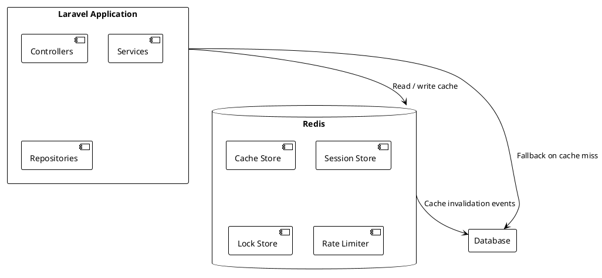

# 05.03.09 - Redis Cache Container

**Project:** GsmUi
**Architecture:** C4 Model – Level 2 (Container)
**Container:** Cache (Redis)
**Framework:** Laravel 13 + Redis
**Version:** 1.0.0

---

# Purpose

The Redis Cache Container provides high-performance caching for the GsmUi platform. It stores frequently accessed data, computed values, session state, and coordination primitives to reduce database load, improve response times, and enhance overall application performance.

---

# Responsibilities

The Cache Container is responsible for:

* Storing frequently accessed application data
* Caching computed and aggregated values
* Storing user session state
* Managing cache tags and invalidation
* Implementing cache locking primitives
* Supporting atomic operations
* Tracking cache hit/miss rates
* Managing TTL and expiration

---

# Container Diagram



---

# Technology Stack

| Technology | Purpose |
|------------|---------|
| Redis 7.2+ | Primary cache backend |
| Laravel Cache | Cache abstraction layer |
| Redis Tags | Cache grouping and invalidation |
| Laravel Session | Session state storage |

---

# Cache Stores

GsmUi organizes cache into logical stores:

| Store | Purpose | TTL |
|-------|---------|-----|
| `cache` | General application cache | Varies |
| `session` | User session data | 2 hours |
| `lock` | Distributed locks | Short-lived |
| `rate_limiter` | API rate limiting | Varies |

---

# Cache Architecture

```text
Application Request
    │
    ▼
Check Cache (Redis)
    │
    ├── Hit → Return cached data
    │
    └── Miss → Query Database
            │
            ▼
        Return data + Cache result
```

---

# Cache Strategies

### Read-Through

Cache is checked first. On miss, data is fetched from the database and cached.

```php
$users = Cache::remember('users:active', 3600, function () {
    return User::where('active', true)->get();
});
```

### Write-Through

Data is written to cache and database simultaneously.

```php
Cache::put('user:' . $userId, $user, 3600);
$user->save();
```

### Cache-Aside

Application manages cache explicitly.

```php
// Read
$user = Cache::get('user:' . $userId);

// Write
Cache::put('user:' . $userId, $user, 3600);

// Invalidate
Cache::forget('user:' . $userId);
```

GsmUi primarily uses **cache-aside** for fine-grained invalidation control.

---

# TTL Management

Different data types have different TTL requirements:

| Data Type | TTL | Rationale |
|-----------|-----|-----------|
| User sessions | 2 hours | Active session duration |
| API responses | 5 minutes | Frequently changing data |
| Static pages | 24 hours | Rarely changes |
| Aggregated data | 1 hour | Computed periodically |
| Configuration | 24 hours | Rarely changes |
| Rate limits | Varies | Per-endpoint |

---

# Cache Keys

Keys follow a consistent naming convention:

```text
cache:{prefix}:{type}:{id}

Examples:
cache:user:123
cache:users:active
cache:theme:45
cache:search:query:wireframe
cache:page:home
```

Prefixes prevent key collisions across applications sharing Redis.

---

# Cache Invalidation

Cache invalidation ensures data consistency.

### Event-Driven Invalidation

```php
class UserUpdated implements ShouldQueue
{
    public function handle(User $user): void
    {
        Cache::forget('user:' . $user->id);
        Cache::forget('users:active');
        Cache::tags('users')->flush();
    }
}
```

### Tag-Based Invalidation

Tags group related cache entries:

```php
// Store with tag
Cache::tags(['users', 'active'])->put('user:123', $data, 3600);

// Invalidate all entries with tag
Cache::tags(['users'])->flush();
```

### Time-Based Expiration

TTL ensures eventual consistency:

```php
Cache::put('data', $value, 3600); // Expires in 1 hour
```

Even if invalidation events are missed, TTL bounds staleness.

---

# Session Storage

User sessions are stored in Redis:

```php
// config/session.php
'driver' => env('SESSION_DRIVER', 'redis'),
'connection' => env('SESSION_CONNECTION', 'cache'),
```

Session data:

```text
Key: laravel:session:{session-id}
TTL: 120 minutes (2 hours)
Value: Serialized session data
```

Sessions are automatically expired by Redis TTL.

---

# Distributed Locks

Locks prevent race conditions in distributed systems:

```php
$lock = Cache::lock('processing-user-123', 60);

if ($lock->get()) {
    // Critical section
    processUserData($user);

    $lock->release();
}
```

Locks are automatically released after TTL to prevent deadlocks.

---

# Rate Limiting

Rate limiting uses Redis for atomic counters:

```php
RateLimiter::for('api', function (Request $request) {
    return Limit::perMinute(60)->by($request->ip());
});
```

Rate limit state:

```text
Key: laravel:rate_limit:{fingerprint}
TTL: 60 seconds
Value: Incrementing counter
```

---

# Redis Configuration

```text
# Cache-specific Redis config
maxmemory 4gb
maxmemory-policy allkeys-lru

save ""
appendonly no

# For session persistence, use AOF:
# appendonly yes
# appendfsync everysec
```

---

# Cache Warming

Warm cache proactively:

```php
class WarmCache implements ShouldQueue
{
    public function handle(): void
    {
        // Pre-load frequently accessed data
        Cache::remember('users:active', 3600, fn () => User::active()->get());
        Cache::remember('themes:featured', 3600, fn () => Theme::featured()->get());
    }
}

// Schedule cache warming
Schedule::job(WarmCache::class)->hourly();
```

---

# Cache Monitoring

Monitor cache health:

| Metric | Target |
|--------|--------|
| Hit rate | >90% |
| Miss rate | <10% |
| P99 latency | <5 ms |
| Memory usage | <70% of maxmemory |
| Evictions | Near zero for cache data |

---

# Cache Tags

Tags enable grouped invalidation:

```php
// Store with tags
Cache::tags(['themes', 'published'])->put('theme:45', $data, 3600);

// Flush by tag
Cache::tags(['themes'])->flush();
```

Tags are stored in Redis sets and used to identify keys for bulk invalidation.

---

# Cache Statistics

Track cache statistics:

| Statistic | Purpose |
|-----------|---------|
| Keyspace hits | Successful cache reads |
| Keyspace misses | Failed cache reads |
| Hit rate | Efficiency metric |
| Memory usage | Capacity planning |
| Evicted keys | Memory pressure indicator |

---

# Multi-Tenancy

If multi-tenant, prefix cache keys by tenant:

```php
Cache::put("tenant:{$tenantId}:users", $data, 3600);
```

Or use separate Redis databases per tenant.

---

# Security

* Redis access restricted to application servers
* No sensitive data in cache keys
* Session IDs are random and unguessable
* Cache data is not encrypted at rest (use infrastructure encryption)

---

# Testing

Test cache behavior:

```php
public function test_cache_stores_and_retrieves(): void
{
    Cache::put('test-key', 'value', 60);

    $this->assertEquals('value', Cache::get('test-key'));
}

public function test_cache_expires(): void
{
    Cache::put('test-key', 'value', 1);

    sleep(2);

    $this->assertNull(Cache::get('test-key'));
}
```

---

# Performance Targets

| Metric | Target |
|--------|--------|
| Cache hit latency | <1 ms |
| Cache miss latency | <5 ms |
| Hit rate | >90% |
| Session read | <1 ms |
| Lock acquisition | <1 ms |

---

# Summary

The Redis Cache Container provides high-performance caching for GsmUi, reducing database load and improving response times. Through strategic TTL management, cache tagging, and event-driven invalidation, the platform maintains data consistency while achieving excellent cache hit rates.

---

---

# Redis Cluster Architecture

For production deployments requiring high availability and horizontal scaling, GsmUi supports Redis Cluster mode.

### Cluster Topology

```text
┌─────────────┐  ┌─────────────┐  ┌─────────────┐
│  Redis Node  │  │  Redis Node  │  │  Redis Node  │
│  (Primary)   │  │  (Primary)   │  │  (Primary)   │
│  Slots 0-5460│  │Slots 5461-10922│ │Slots 10923-16383│
└──────┬──────┘  └──────┬──────┘  └──────┬──────┘
       │                │                │
       ▼                ▼                ▼
┌─────────────┐  ┌─────────────┐  ┌─────────────┐
│  Redis Node  │  │  Redis Node  │  │  Redis Node  │
│  (Replica)   │  │  (Replica)   │  │  (Replica)   │
└─────────────┘  └─────────────┘  └─────────────┘
```

### Cluster Configuration

```php
// config/database.php
'redis' => [
    'client' => env('REDIS_CLIENT', 'phpredis'),
    'options' => [
        'cluster' => env('REDIS_CLUSTER', 'redis'),
        'prefix' => env('REDIS_PREFIX', 'gsmui:'),
    ],
    'clusters' => [
        'default' => [
            [
                'host' => env('REDIS_HOST', '127.0.0.1'),
                'port' => env('REDIS_PORT', 6379),
                'password' => env('REDIS_PASSWORD'),
                'database' => 0,
            ],
        ],
    ],
],
```

### Hash Slot Distribution

Redis Cluster distributes keys across 16384 hash slots:

```text
Key hashing: CRC16(key) % 16384

Example:
  "cache:user:123"    → slot 7532
  "cache:theme:45"    → slot 12891
  "session:abc123"    → slot 3247
```

### Cluster Failover

Automatic failover occurs when a primary node fails:

```text
1. Replica detects primary failure (cluster-node-timeout)
2. Replica promotes to primary
3. Cluster rebalances slots
4. Client reconnects to new primary
5. Old primary rejoins as replica when recovered
```

### Cluster Limitations

| Limitation | Impact | Mitigation |
|------------|--------|------------|
| No multi-key cross-slot transactions | Cannot atomically operate on keys in different slots | Use hash tags `{key}` to force co-location |
| Lua scripts limited to single slot | Cannot run scripts across slots | Design keys with hash tags |
| Multi-database not supported | Only database 0 | Use key prefixes for separation |
| Larger memory overhead | ~3x memory per key | Monitor and scale accordingly |

### Hash Tags for Key Co-location

Force related keys into the same slot using hash tags:

```text
Cache tags use hash tags for atomic operations:
  "{cache:user:123}:data"
  "{cache:user:123}:sessions"
  "{cache:user:123}:permissions"
```

All keys with the same hash tag `{cache:user:123}` land in the same slot, enabling multi-key operations.

### Cluster Health Monitoring

```text
Cluster State Checks:
  - CLUSTER INFO → cluster_state: ok
  - CLUSTER NODES → node status and slots
  - CLUSTER SLOTS → slot distribution

Health Metrics:
  - cluster_state: ok/fail
  - cluster_slots_assigned: 16384
  - cluster_slots_ok: 16384
  - cluster_known_nodes: 6
  - cluster_size: 3
```

### Cluster Deployment Procedure

```bash
# 1. Create Redis cluster (6 nodes, 3 primary + 3 replica)
redis-cli --cluster create \
  node1:6379 node2:6379 node3:6379 \
  node4:6379 node5:6379 node6:6379 \
  --cluster-replicas 1

# 2. Verify cluster health
redis-cli --cluster check node1:6379

# 3. Update Laravel configuration
php artisan config:cache

# 4. Test cluster connectivity
php artisan tinker
>>> Redis::cluster(['set', 'test', 'ok']);
>>> Redis::cluster(['get', 'test']);
```

---

# Sentinel High Availability

For deployments that need automatic failover without the complexity of Redis Cluster, GsmUi supports Redis Sentinel.

### Sentinel Architecture

```text
┌─────────────────┐
│ Sentinel Master  │
│ (Monitor)        │
└────────┬────────┘
         │
    ┌────┴────┐
    ▼         ▼
┌────────┐ ┌────────┐
│Master 1│ │Replica 1│
└────────┘ └────────┘
    │
    ▼
┌────────┐
│Replica 2│
└────────┘

Sentinels monitor master and replicas.
Automatic failover on master failure.
```

### Sentinel Configuration

```php
// config/database.php
'redis' => [
    'sentinels' => [
        [
            'host' => env('REDIS_SENTINEL_HOST_1', 'sentinel1'),
            'port' => env('REDIS_SENTINEL_PORT_1', 26379),
        ],
        [
            'host' => env('REDIS_SENTINEL_HOST_2', 'sentinel2'),
            'port' => env('REDIS_SENTINEL_PORT_2', 26379),
        ],
        [
            'host' => env('REDIS_SENTINEL_HOST_3', 'sentinel3'),
            'port' => env('REDIS_SENTINEL_PORT_3', 26379),
        ],
    ],
    'options' => [
        'service' => env('REDIS_SENTINEL_SERVICE', 'mymaster'),
    ],
],
```

### Sentinel Failover Process

```text
1. Sentinels detect master unreachable (down-after-milliseconds)
2. Sentinels agree master is down (quorum reached)
3. Sentinel selects best replica for promotion
4. Selected replica promoted to master
5. Other replicas reconfigured to replicate new master
6. Old master configured as replica when recovered
7. Clients notified of new master address
```

### Sentinel Configuration Parameters

```text
# sentinel.conf
sentinel monitor mymaster master-host 6379 2
sentinel down-after-milliseconds mymaster 5000
sentinel failover-timeout mymaster 10000
sentinel parallel-syncs mymaster 1
sentinel auth-pass mymaster <password>
```

---

# Redis Memory Management

Effective memory management is critical for cache performance and cost control.

### Memory Allocation Strategy

```text
# redis.conf
maxmemory 4gb
maxmemory-policy allkeys-lru

# Available policies:
# noeviction     - Return errors when memory limit reached
# allkeys-lru    - Evict any key using LRU
# volatile-lru   - Evict keys with TTL using LRU
# allkeys-random - Evict random keys
# volatile-random- Evict random keys with TTL
# volatile-ttl   - Evict keys with shortest TTL
# allkeys-lfu    - Evict any key using LFU
# volatile-lfu   - Evict keys with TTL using LFU
```

### Memory Usage Monitoring

```bash
# Check memory usage
redis-cli INFO memory

# Memory metrics:
# used_memory: 2.5GB
# used_memory_human: 2.50G
# used_memory_rss: 3.2GB
# used_memory_peak: 4.1GB
# used_memory_peak_human: 4.10G
# mem_fragmentation_ratio: 1.28
# maxmemory: 4GB
# maxmemory_human: 4.00G
# maxmemory_policy: allkeys-lru
```

### Memory Optimization Techniques

| Technique | Description | Impact |
|-----------|-------------|--------|
| Short keys | Use abbreviations (`u:123:d` vs `user:123:data`) | 20-40% savings |
| Integer encoding | Store integers as integers, not strings | 30-50% savings |
| Zip lists | Small hashes/lists stored as flat lists | 50-70% savings |
| String dedup | Use interning for repeated strings | 10-20% savings |
| LZ4 compression | Compress large values | 40-60% savings |

### Memory Fragmentation

Monitor and address fragmentation:

```bash
# Check fragmentation ratio
redis-cli INFO memory | grep mem_fragmentation_ratio

# If ratio > 1.5, trigger defragmentation
redis-cli MEMORY PURGE

# Or enable active defragmentation in redis.conf
active-defrag yes
active-defrag-threshold-lower 10
active-defrag-threshold-upper 100
active-defrag-cycle-min 1
active-defrag-cycle-max 25
```

### Key Expiration Strategies

```text
Lazy Expiration:
  - Keys checked on access
  - No CPU overhead for expired keys
  - May accumulate expired keys temporarily

Active Expiration:
  - Background thread checks keys
  - Up to 10 keys per cycle (100ms)
  - Ensures memory freed promptly

Combined approach in GsmUi:
  - Use lazy expiration for session data
  - Use active expiration for cache keys
  - Set TTL on all cached data
```

### Memory Budget Planning

```text
Per-Entity Memory Estimates:

  Session data:     ~2 KB per user
  User cache:       ~1 KB per user
  Theme metadata:   ~500 bytes per theme
  Component data:   ~1 KB per component
  Search results:   ~500 bytes per query cache
  Rate limits:      ~100 bytes per IP

Total for 10K concurrent users:
  Sessions:         ~20 MB
  User cache:       ~10 MB
  Rate limits:      ~1 MB
  Overhead:         ~5 MB
  Total:            ~36 MB (well within 4GB limit)
```

---

# Redis Persistence

For cache-only deployments, persistence is disabled. For session storage or data that must survive restarts, configure persistence.

### RDB Snapshots

```text
# redis.conf
save 900 1      # Save if at least 1 key changed in 900 seconds
save 300 10     # Save if at least 10 keys changed in 300 seconds
save 60 10000   # Save if at least 10000 keys changed in 60 seconds

dbfilename dump.rdb
dir /var/lib/redis
```

### AOF (Append-Only File)

```text
# redis.conf
appendonly yes
appendfilename "appendonly.aof"

# Sync policy:
appendfsync everysec    # Best balance (recommended)
# appendfsync always    # Safest, slowest
# appendfsync no        # Fastest, risk data loss

# AOF rewrite
auto-aof-rewrite-percentage 100
auto-aof-rewrite-min-size 64mb
```

### Persistence for GsmUi

```text
Cache (Redis DB 0):  No persistence (appendonly no)
Session (Redis DB 1): AOF with everysec sync
Queue (Redis DB 2):  No persistence (appendonly no)
Lock (Redis DB 3):   No persistence (appendonly no)

Rationale:
  - Cache can be rebuilt from database
  - Sessions benefit from persistence across restarts
  - Queue jobs are persisted in database
  - Locks are short-lived and self-expire
```

### Backup Procedure

```bash
# 1. Trigger RDB snapshot
redis-cli BGSAVE

# 2. Wait for completion
redis-cli LASTSAVE

# 3. Copy RDB file to backup location
cp /var/lib/redis/dump.rdb /backup/redis/dump-$(date +%Y%m%d).rdb

# 4. Compress backup
gzip /backup/redis/dump-$(date +%Y%m%d).rdb

# 5. Retain last 7 daily backups
find /backup/redis -name "dump-*.rdb.gz" -mtime +7 -delete
```

---

# Redis Security

### Authentication

```text
# redis.conf
requirepass <strong-password>

# Or use ACLs (Redis 6+)
aclfile /etc/redis/users.acl

# User definitions
user default on >password ~cache:* &* +get +set +del +expire
user readonly on >password ~* &* -@write
```

### ACL (Access Control Lists)

```text
# Create application user with limited access
ACL SETUSER gsmui-app on >password \
  ~cache:* \
  ~session:* \
  ~rate_limit:* \
  &* \
  +get +set +del +expire +mget +pipeline

# Create monitoring user (read-only)
ACL SETUSER monitor on >password \
  ~* \
  &* \
  +info +ping +echo +get
```

### Network Security

```text
# Bind to specific interfaces
bind 127.0.0.1 10.0.0.1

# Disable dangerous commands
rename-command FLUSHDB ""
rename-command FLUSHALL ""
rename-command DEBUG ""
rename-command CONFIG ""
```

### TLS Configuration

```text
# TLS for Redis (Redis 6+)
tls-port 6380
tls-cert-file /etc/redis/tls/redis.crt
tls-key-file /etc/redis/tls/redis.key
tls-ca-cert-file /etc/redis/tls/ca.crt
tls-auth-clients optional
```

---

# Redis Queues

GsmUi uses Redis as the primary queue driver for background jobs.

### Queue Configuration

```php
// config/queue.php
'connections' => [
    'redis' => [
        'driver' => 'redis',
        'connection' => env('QUEUE_REDIS_CONNECTION', 'default'),
        'queue' => env('QUEUE_NAME', 'gsmui'),
        'retry_after' => 90,
        'block_for' => null,
    ],
],
```

### Queue Routing

```text
Queue names and their purposes:

  default        → General background jobs
  cache          → Cache warming and invalidation
  search         → Search index updates
  media          → Image processing and uploads
  notifications  → Email and push notifications
  exports        → CSV and report generation
  webhooks       → Outbound webhook delivery
```

### Queue Worker Configuration

```bash
# Start queue workers
php artisan queue:work redis --queue=default,cache,search,media

# Worker options:
# --tries=3          : Retry failed jobs 3 times
# --timeout=60       : Kill job after 60 seconds
# --memory=256       : Restart if memory exceeds 256MB
# --max-time=3600    : Restart after 1 hour
```

### Job Prioritization

```php
// Dispatch to specific queue
ProcessMedia::dispatch($media)->onQueue('media');
WarmCache::dispatch()->onQueue('cache');
SendNotification::dispatch($user)->onQueue('notifications');

// Priority: notifications > media > cache > default
```

### Queue Monitoring

```text
Monitor queue depth:
  redis-cli LLEN queue:gsmui:default
  redis-cli LLEN queue:gsmui:cache
  redis-cli LLEN queue:gsmui:search

Monitor processing rate:
  Horizon dashboard → Metrics → Throughput
```

---

# Redis Pub/Sub

GsmUi uses Redis Pub/Sub for real-time event broadcasting.

### Channel Architecture

```text
Channel Pattern: {prefix}:{domain}:{entity}:{event}

Examples:
  gsmui:broadcast:user:connected
  gsmui:broadcast:theme:updated
  gsmui:broadcast:component:published
  gsmui:private:user:123:notifications
```

### Laravel Broadcasting

```php
// config/broadcasting.php
'connections' => [
    'redis' => [
        'driver' => 'redis',
        'connection' => 'broadcasting',
    ],
],
```

### Event Broadcasting

```php
class ThemeUpdated implements ShouldBroadcast
{
    public function __construct(public Theme $theme) {}

    public function broadcastOn(): array
    {
        return [
            new Channel('themes.' . $this->theme->id),
            new Channel('themes.published'),
        ];
    }

    public function broadcastAs(): string
    {
        return 'updated';
    }
}
```

### Pub/Sub Memory Management

```text
Pub/Sub channels consume memory per subscriber.
GsmUi limits:

  - Max 1000 active channels
  - Channel idle timeout: 30 seconds
  - Subscriber message buffer: 100 messages
  - Unreachable subscribers disconnected after 30s
```

---

# Redis Transactions

Redis transactions ensure atomicity for multi-key operations.

### Basic Transactions

```text
MULTI
SET cache:user:123 "data"
EXPIRE cache:user:123 3600
EXEC
```

### Lua Scripts (Atomic Operations)

```php
// Atomic cache update with lock
$script = <<<LUA
    local key = KEYS[1]
    local value = ARGV[1]
    local ttl = ARGV[2]
    local lockKey = KEYS[2]

    -- Check lock
    if redis.call('GET', lockKey) then
        return 0
    end

    -- Set value with TTL
    redis.call('SETEX', key, ttl, value)

    -- Set lock with shorter TTL
    redis.call('SETEX', lockKey, 5, '1')

    return 1
LUA;

$result = Redis::eval($script, 2, $cacheKey, $lockKey, $value, $ttl);
```

### Pipeline Operations

```php
// Batch operations for performance
Redis::pipeline(function ($pipe) {
    $pipe->set('cache:user:123', $userData);
    $pipe->expire('cache:user:123', 3600);
    $pipe->set('cache:user:123:permissions', $permissions);
    $pipe->expire('cache:user:123:permissions', 3600);
});
```

---

# Redis Replication

### Read Replicas

```text
Primary (Read/Write)
    │
    ├── Replica 1 (Read-only)
    ├── Replica 2 (Read-only)
    └── Replica 3 (Read-only)

Replication flow:
  1. Primary writes to AOF
  2. Primary propagates to replicas
  3. Replica applies changes
  4. Replica acknowledges to primary
```

### Replica Configuration

```text
# replica.conf
replicaof primary-host 6379
replica-read-only yes
replica-priority 100

# Replication buffer
repl-backlog-size 256mb
repl-backlog-ttl 3600
```

### Read/Write Splitting

```php
// Laravel supports read/write splitting
'redis' => [
    'default' => [
        'url' => env('REDIS_URL'),
        'host' => env('REDIS_HOST'),
        'port' => env('REDIS_PORT'),
        'password' => env('REDIS_PASSWORD'),
        'database' => 0,
    ],
    'read' => [
        'url' => env('REDIS_READ_URL'),
        'host' => env('REDIS_READ_HOST'),
        'port' => env('REDIS_READ_PORT'),
        'password' => env('REDIS_PASSWORD'),
        'database' => 0,
    ],
],
```

---

# Redis Troubleshooting

### Common Issues

| Issue | Cause | Solution |
|-------|-------|----------|
| High latency | Slow commands, large keys | Use `redis-cli --bigkeys` to find large keys |
| Memory exhaustion | TTL too long, no eviction | Set `maxmemory-policy allkeys-lru` |
| Connection refused | Max clients reached | Increase `maxclients` in config |
| Cluster split | Network partition | Check cluster health, rebalance |
| Evictions | Memory limit reached | Increase `maxmemory` or optimize data |

### Diagnostic Commands

```bash
# Server info
redis-cli INFO server
redis-cli INFO memory
redis-cli INFO clients
redis-cli INFO stats

# Slow log
redis-cli SLOWLOG GET 10

# Key analysis
redis-cli --bigkeys
redis-cli --memkeys

# Client connections
redis-cli CLIENT LIST

# Replication status
redis-cli INFO replication
```

### Performance Tuning Checklist

```text
□ Enable pipeline for batch operations
□ Use hash tags for related keys
□ Set appropriate TTL on all keys
□ Monitor memory usage
□ Configure eviction policy
□ Use Lua scripts for atomic operations
□ Enable active defragmentation
□ Set maxmemory limit
□ Monitor slow log
□ Use read replicas for read-heavy workloads
```

---

# Redis Migration

### Migration Strategy

```text
1. Assessment Phase
   - Audit current cache usage
   - Measure key sizes and counts
   - Identify migration dependencies
   - Plan migration timeline

2. Preparation Phase
   - Set up target Redis instance
   - Configure replication
   - Test connectivity from application
   - Prepare rollback plan

3. Migration Phase
   - Enable dual-write (write to both old and new)
   - Backfill data from old to new
   - Verify data consistency
   - Switch read traffic
   - Switch write traffic
   - Monitor for issues

4. Cleanup Phase
   - Remove dual-write logic
   - Decommission old instance
   - Update monitoring
   - Document changes
```

### Data Migration Commands

```bash
# Export from source
redis-cli --rdb /backup/redis/dump.rdb

# Import to target
redis-cli --pipe < commands.txt

# Or use MIGRATE for live migration
redis-cli MIGRATE target-host 6379 key 0 5000 COPY REPLACE
```

---

# Cache Patterns Deep Dive

### Thundering Herd Prevention

When a popular cache key expires, many concurrent requests may attempt to rebuild it simultaneously, overwhelming the database.

```php
class CacheWarmer
{
    public function getOrRebuild(string $key, callable $callback, int $ttl): mixed
    {
        $value = Cache::get($key);

        if ($value !== null) {
            return $value;
        }

        // Acquire lock to prevent thundering herd
        $lock = Cache::lock("lock:{$key}", 10);

        if ($lock->get()) {
            try {
                // Double-check after acquiring lock
                $value = Cache::get($key);

                if ($value !== null) {
                    return $value;
                }

                $value = $callback();
                Cache::put($key, $value, $ttl);

                return $value;
            } finally {
                $lock->release();
            }
        }

        // Another process is rebuilding, wait and return cached value
        usleep(50000); // 50ms
        return Cache::get($key) ?? $callback();
    }
}
```

### Cache Stampede Prevention

```php
class StampedePrevention
{
    public function getWithEarlyExpiration(string $key, callable $callback, int $ttl): mixed
    {
        $value = Cache::get($key);

        if ($value !== null) {
            return $value;
        }

        // Add random jitter to prevent synchronized expiration
        $jitter = random_int(0, (int) ($ttl * 0.1));

        $value = $callback();
        Cache::put($key, $value, $ttl + $jitter);

        return $value;
    }
}
```

### Cache Aside with Stale-While-Revalidate

```php
class StaleWhileRevalidate
{
    public function getOrRevalidate(string $key, callable $callback, int $ttl, int $staleTtl): mixed
    {
        $data = Cache::get($key);

        if ($data !== null) {
            // Check if data is stale
            $age = time() - $data['timestamp'];

            if ($age < $ttl) {
                return $data['value'];
            }

            // Data is stale but still valid, revalidate in background
            if ($age < $ttl + $staleTtl) {
                if (!Cache::has("revalidating:{$key}")) {
                    Cache::put("revalidating:{$key}", true, 60);
                    RevalidateCache::dispatch($key, $callback, $ttl);
                }
                return $data['value'];
            }
        }

        // Data is expired or missing, rebuild synchronously
        $value = $callback();
        Cache::put($key, ['value' => $value, 'timestamp' => time()], $ttl + $staleTtl);

        return $value;
    }
}
```

### Multi-Level Caching

GsmUi uses a multi-level caching strategy for optimal performance:

```text
L1: Browser Cache (Service Worker)
    - Static assets: 1 year
    - API responses: 5 minutes
    - User data: 1 minute

L2: CDN Edge Cache
    - Static assets: 1 week
    - API responses: 1 minute

L3: Application Cache (Redis)
    - Database queries: varies
    - Computed values: varies
    - Session data: 2 hours

L4: Database Query Cache
    - MySQL query cache
    - InnoDB buffer pool
```

### Multi-Level Cache Implementation

```php
class MultiLevelCache
{
    public function get(string $key): mixed
    {
        // L1: Local memory cache (per-request)
        $value = app('cache')->store('array')->get($key);
        if ($value !== null) {
            return $value;
        }

        // L2: Redis cache
        $value = Cache::get($key);
        if ($value !== null) {
            // Populate L1 for subsequent requests in this process
            app('cache')->store('array')->put($key, $value, 60);
            return $value;
        }

        return null;
    }

    public function put(string $key, mixed $value, int $ttl): void
    {
        // Write to both levels
        app('cache')->store('array')->put($key, $value, $ttl);
        Cache::put($key, $value, $ttl);
    }

    public function invalidate(string $key): void
    {
        app('cache')->store('array')->forget($key);
        Cache::forget($key);
    }
}
```

---

# Redis Data Structures

GsmUi leverages various Redis data structures for different use cases.

### Strings

```text
Simple key-value storage:

SET cache:user:123 '{"name":"John","email":"john@example.com"}'
GET cache:user:123
EXPIRE cache:user:123 3600

Use cases:
  - Simple cache entries
  - Session data
  - Rate limit counters
  - Feature flags
```

### Hashes

```text
Object storage with multiple fields:

HSET cache:user:123 name "John" email "john@example.com" role "admin"
HGET cache:user:123 name
HGETALL cache:user:123

Use cases:
  - User profile data
  - Configuration settings
  - Entity metadata
  - Shopping cart items
```

### Lists

```text
Ordered collections:

LPUSH queue:default '{"job":"ProcessMedia","id":123}'
RPOP queue:default
LRANGE queue:default 0 -1

Use cases:
  - Job queues
  - Activity feeds
  - Message queues
  - Recent items
```

### Sets

```text
Uniqueness enforcement:

SADD tags:user:123 "laravel" "livewire" "flux"
SMEMBERS tags:user:123
SISMEMBER tags:user:123 "laravel"

Use cases:
  - User tags
  - Online users
  - Unique visitors
  - Permissions
```

### Sorted Sets

```text
Ranked collections:

ZADD leaderboard 1000 "user:123" 950 "user:456"
ZRANGEBYSCORE leaderboard 0 1000
ZREVRANGE leaderboard 0 9

Use cases:
  - Leaderboards
  - Priority queues
  - Time-series data
  - Rate limiting with timestamps
```

### HyperLogLog

```text
Cardinality estimation:

PFADD unique:users:2024-01-01 "user:123" "user:456"
PFADD unique:users:2024-01-01 "user:789"
PFCount unique:users:2024-01-01  # Returns 3

Use cases:
  - Unique visitor counting
  - Distinct item counting
  - Analytics (approximate)
```

### Streams

```text
Event sourcing:

XADD events * type "user.registered" user_id 123 timestamp 1700000000
XRANGE events - +
XREAD COUNT 10 STREAMS events 0

Use cases:
  - Event sourcing
  - Activity logs
  - Audit trails
  - Real-time event processing
```

---

# Redis Operations Reference

### Key Operations

```text
Key Management:
  DEL key                  - Delete key
  EXISTS key               - Check if key exists
  EXPIRE key seconds       - Set TTL
  PERSIST key              - Remove TTL
  TTL key                  - Get remaining TTL
  TYPE key                 - Get key type
  KEYS pattern             - Find keys (use SCAN in production)
  SCAN cursor MATCH pattern COUNT 100 - Iterate keys safely
```

### String Operations

```text
String Operations:
  SET key value            - Set value
  GET key                  - Get value
  SETEX key seconds value  - Set with TTL
  MSET key1 v1 key2 v2    - Set multiple
  MGET key1 key2           - Get multiple
  INCR key                 - Increment
  DECR key                 - Decrement
  INCRBY key amount        - Increment by amount
  APPEND key value         - Append to string
```

### Hash Operations

```text
Hash Operations:
  HSET key field value     - Set field
  HGET key field           - Get field
  HGETALL key              - Get all fields
  HMSET key f1 v1 f2 v2   - Set multiple fields
  HMGET key f1 f2          - Get multiple fields
  HDEL key field           - Delete field
  HINCRBY key field amount - Increment field
  HLEN key                 - Get field count
  HEXISTS key field        - Check field exists
```

### List Operations

```text
List Operations:
  LPUSH key value          - Push to head
  RPUSH key value          - Push to tail
  LPOP key                 - Pop from head
  RPOP key                 - Pop from tail
  LRANGE key start stop    - Get range
  LLEN key                 - Get length
  LINDEX key index         - Get by index
  LREM key count value     - Remove values
```

### Set Operations

```text
Set Operations:
  SADD key member          - Add member
  SREM key member          - Remove member
  SMEMBERS key             - Get all members
  SISMEMBER key member     - Check membership
  SCARD key                - Get count
  SUNION key1 key2         - Union
  SINTER key1 key2         - Intersection
  SDIFF key1 key2          - Difference
```

### Sorted Set Operations

```text
Sorted Set Operations:
  ZADD key score member    - Add with score
  ZREM key member          - Remove member
  ZRANGE key start stop    - Get range (ascending)
  ZREVRANGE key start stop - Get range (descending)
  ZSCORE key member        - Get score
  ZRANK key member         - Get rank
  ZINCRBY key score member - Increment score
  ZCARD key                - Get count
  ZRANGEBYSCORE key min max - Get by score range
```

### Stream Operations

```text
Stream Operations:
  XADD key * field value   - Add entry
  XRANGE key start end     - Get range
  XLEN key                 - Get length
  XREAD COUNT n STREAMS key id - Read entries
  XGROUP CREATE key group id   - Create consumer group
  XREADGROUP GROUP group consumer COUNT n STREAMS key >
```

---

# Redis Best Practices

### Key Naming Conventions

```text
Best Practices:
  - Use colon separators: cache:user:123
  - Include domain prefix: gsmui:cache:user:123
  - Use descriptive names: cache:theme:published:list
  - Avoid special characters
  - Keep keys under 512 bytes

Naming Patterns:
  {domain}:{entity}:{id}
  {domain}:{entity}:{id}:{attribute}
  {domain}:{entity}:{id}:{sub-entity}:{sub-id}

Examples:
  cache:user:123
  cache:user:123:permissions
  cache:user:123:sessions
  cache:theme:45
  cache:theme:45:components
  session:abc123
  lock:user:123:update
  rate_limit:api:192.168.1.1
```

### Memory Optimization

```text
Optimization Tips:
  1. Use short keys
     Bad:  cache:user_profile_settings_for_user_123
     Good: cache:ups:123

  2. Use hashes for small objects
     Bad:  SET user:123:name "John"
           SET user:123:email "john@example.com"
     Good: HSET user:123 name "John" email "john@example.com"

  3. Use ziplist encoding for small collections
     redis.conf:
     list-max-ziplist-size -2
     hash-max-ziplist-entries 128
     hash-max-ziplist-value 64

  4. Use integer encoding for numeric values
     redis-cli Object encoding key
     Should return "int" for integer values

  5. Compress large values
     Use gzip/lz4 for values > 1KB
     Decompress on read
```

### Connection Management

```text
Connection Pooling:
  - Use persistent connections
  - Configure pool size appropriately
  - Monitor connection count
  - Set connection timeouts

Laravel Configuration:
  'redis' => [
    'options' => [
      'tcp_keepalive' => 60,
      'persistent_connections' => true,
    ],
  ],
```

### Pipeline Best Practices

```text
Pipeline Guidelines:
  1. Batch related operations
  2. Limit pipeline size to 1000 commands
  3. Use pipelines for bulk operations
  4. Avoid pipelines for critical paths (use transactions)
  5. Monitor pipeline performance

Example:
  Redis::pipeline(function ($pipe) {
      for ($i = 0; $i < 1000; $i++) {
          $pipe->set("key:{$i}", "value:{$i}");
      }
  });
```

---

# Redis Deployment Guide

### Development Setup

```bash
# Install Redis
brew install redis  # macOS
sudo apt install redis-server  # Ubuntu

# Start Redis
redis-server

# Connect to Redis
redis-cli

# Verify connection
redis-cli PING
# Should return PONG
```

### Production Setup

```bash
# 1. Install Redis
sudo apt install redis-server

# 2. Configure Redis
sudo nano /etc/redis/redis.conf

# Key configurations:
# bind 127.0.0.1 10.0.0.1
# requirepass <password>
# maxmemory 4gb
# maxmemory-policy allkeys-lru
# appendonly yes

# 3. Start Redis
sudo systemctl start redis-server
sudo systemctl enable redis-server

# 4. Verify
redis-cli -a <password> PING
```

### Docker Setup

```yaml
# docker-compose.yml
services:
  redis:
    image: redis:7.2-alpine
    ports:
      - "6379:6379"
    volumes:
      - redis_data:/data
      - ./redis.conf:/usr/local/etc/redis/redis.conf
    command: redis-server /usr/local/etc/redis/redis.conf
    restart: unless-stopped

  redis-commander:
    image: rediscommander/redis-commander:latest
    ports:
      - "8081:8081"
    environment:
      - REDIS_HOSTS=local:redis:6379
    depends_on:
      - redis

volumes:
  redis_data:
```

### Kubernetes Setup

```yaml
# redis-deployment.yaml
apiVersion: apps/v1
kind: StatefulSet
metadata:
  name: redis
spec:
  serviceName: redis
  replicas: 3
  selector:
    matchLabels:
      app: redis
  template:
    metadata:
      labels:
        app: redis
    spec:
      containers:
        - name: redis
          image: redis:7.2-alpine
          ports:
            - containerPort: 6379
          resources:
            requests:
              memory: "1Gi"
              cpu: "500m"
            limits:
              memory: "4Gi"
              cpu: "2000m"
          volumeMounts:
            - name: redis-data
              mountPath: /data
  volumeClaimTemplates:
    - metadata:
        name: redis-data
      spec:
        accessModes: ["ReadWriteOnce"]
        resources:
          requests:
            storage: 10Gi
```

### Monitoring Setup

```bash
# Install Redis Exporter for Prometheus
docker run -d --name redis-exporter \
  -p 9121:9121 \
  oliver006/redis_exporter \
  --redis.addr=redis://localhost:6379 \
  --redis.password=<password>

# Prometheus configuration
scrape_configs:
  - job_name: 'redis'
    static_configs:
      - targets: ['redis-exporter:9121']
```

---

# Cache Implementation Reference

### User Cache

```php
class UserCache
{
    public function get(User $user): array
    {
        return Cache::tags(["users", "user:{$user->id}"])->remember(
            "user:{$user->id}:profile",
            3600,
            fn () => $user->toArray()
        );
    }

    public function invalidate(User $user): void
    {
        Cache::tags(["user:{$user->id}"])->flush();
    }

    public function invalidateAll(): void
    {
        Cache::tags(["users"])->flush();
    }
}
```

### Theme Cache

```php
class ThemeCache
{
    public function getPublished(): Collection
    {
        return Cache::remember('themes:published', 1800, function () {
            return Theme::where('status', 'published')
                ->with('author', 'category')
                ->get();
        });
    }

    public function get(string $id): ?Theme
    {
        return Cache::remember("theme:{$id}", 3600, function () use ($id) {
            return Theme::with('components', 'author', 'category')->find($id);
        });
    }

    public function invalidate(Theme $theme): void
    {
        Cache::forget("theme:{$theme->id}");
        Cache::forget('themes:published');
    }
}
```

### Component Cache

```php
class ComponentCache
{
    public function get(string $id): ?Component
    {
        return Cache::remember("component:{$id}", 3600, function () use ($id) {
            return Component::with('author', 'category', 'tags')->find($id);
        });
    }

    public function getForTheme(string $themeId): Collection
    {
        return Cache::tags(["theme:{$themeId}:components"])->remember(
            "theme:{$themeId}:components:list",
            1800,
            fn () => Component::where('theme_id', $themeId)->get()
        );
    }
}
```

### Search Cache

```php
class SearchCache
{
    public function get(string $query): ?array
    {
        $key = 'search:' . md5($query);
        return Cache::get($key);
    }

    public function put(string $query, array $results, int $ttl = 300): void
    {
        $key = 'search:' . md5($query);
        Cache::put($key, $results, $ttl);
    }

    public function invalidate(): void
    {
        $keys = Cache::tags(['search'])->keys();
        Cache::tags(['search'])->flush();
    }
}
```

---

# Cache Performance Analysis

### Benchmarking

```php
class CacheBenchmark
{
    public function benchmark(): array
    {
        $results = [];
        $iterations = 10000;

        // SET benchmark
        $start = microtime(true);
        for ($i = 0; $i < $iterations; $i++) {
            Cache::put("bench:{$i}", "value:{$i}", 60);
        }
        $results['set_time'] = microtime(true) - $start;
        $results['set_ops'] = $iterations / $results['set_time'];

        // GET benchmark
        $start = microtime(true);
        for ($i = 0; $i < $iterations; $i++) {
            Cache::get("bench:{$i}");
        }
        $results['get_time'] = microtime(true) - $start;
        $results['get_ops'] = $iterations / $results['get_time'];

        // Pipeline benchmark
        $start = microtime(true);
        Redis::pipeline(function ($pipe) use ($iterations) {
            for ($i = 0; $i < $iterations; $i++) {
                $pipe->set("pipe:{$i}", "value:{$i}");
            }
        });
        $results['pipeline_time'] = microtime(true) - $start;
        $results['pipeline_ops'] = $iterations / $results['pipeline_time'];

        return $results;
    }
}
```

### Performance Metrics

```text
Target Metrics:

  Operation          | Latency (p50) | Latency (p99)
  -------------------|---------------|---------------
  SET (small value)  | <0.5ms        | <2ms
  GET (small value)  | <0.3ms        | <1ms
  Pipeline (100)     | <5ms          | <15ms
  Transaction        | <1ms          | <5ms
  Lock acquire       | <1ms          | <5ms

  Throughput Targets:
    - Single node: 100K+ ops/second
    - Pipeline: 500K+ ops/second
    - Cluster: 300K+ ops/second (across nodes)
```

---

# Cache Cleanup and Maintenance

### Expired Key Cleanup

```text
Redis handles expired keys in two ways:

  1. Lazy Expiration
     - Checked when key is accessed
     - If expired, returns nil and removes key
     - No CPU overhead for expired keys
     - May accumulate expired keys temporarily

  2. Active Expiration
     - Background thread checks keys
     - Up to 10 keys per cycle (100ms)
     - ~25% of keys with TTL will be checked per second
     - Ensures memory freed promptly
```

### Memory Defragmentation

```bash
# Check fragmentation ratio
redis-cli INFO memory | grep mem_fragmentation_ratio

# If ratio > 1.5, enable active defragmentation
redis-cli CONFIG SET active-defrag yes
redis-cli CONFIG SET active-defrag-threshold-lower 10
redis-cli CONFIG SET active-defrag-threshold-upper 100
redis-cli CONFIG SET active-defrag-cycle-min 1
redis-cli CONFIG SET active-defrag-cycle-max 25

# Manual defragmentation (if needed)
redis-cli MEMORY PURGE
```

### Cache Warming Schedule

```php
class CacheWarmingSchedule
{
    public function schedule(Schedule $schedule): void
    {
        // Warm every 15 minutes
        $schedule->job(new WarmUserCache)->everyFifteenMinutes();
        $schedule->job(new WarmThemeCache)->everyFifteenMinutes();
        $schedule->job(new WarmComponentCache)->everyFifteenMinutes();

        // Warm every hour
        $schedule->job(new WarmSearchCache)->hourly();
        $schedule->job(new WarmAnalyticsCache)->hourly();

        // Warm daily
        $schedule->job(new WarmConfigurationCache)->daily();
    }
}
```

---

# Summary

The Redis Cache Container provides high-performance caching for GsmUi, reducing database load and improving response times. Through strategic TTL management, cache tagging, and event-driven invalidation, the platform maintains data consistency while achieving excellent cache hit rates.

Supporting infrastructure includes cluster mode for horizontal scaling, Sentinel for high availability, comprehensive security controls, queue management, pub/sub broadcasting, and thorough monitoring. Together, these capabilities ensure the Redis layer remains performant, reliable, and secure as the platform grows.

Additional capabilities include cache stampede prevention, multi-level caching strategies, comprehensive Redis data structure usage, deployment automation, performance benchmarking, and maintenance procedures. These ensure the caching infrastructure scales effectively with platform growth while maintaining consistent performance characteristics.

---

# Next Document

**05.03.10 - Search Container** describes the search engine infrastructure, indexing strategy, relevance tuning, and integration with the GsmUi application.
