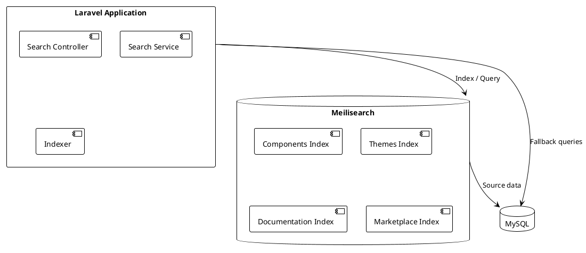

# 05.03.10 - Search Container

**Project:** GsmUi
**Architecture:** C4 Model – Level 2 (Container)
**Container:** Search Engine
**Framework:** Laravel 13 + Meilisearch
**Version:** 1.0.0

---

# Purpose

The Search Container provides full-text search, filtering, and ranking capabilities for the GsmUi platform. It enables users to search across components, themes, documentation, and marketplace content with fast, relevant results.

---

# Responsibilities

The Search Container is responsible for:

* Indexing application data
* Processing search queries
* Ranking results by relevance
* Supporting faceted filtering
* Handling typo tolerance
* Providing synonym support
* Managing index updates
* Tracking search analytics

---

# Container Diagram



---

# Technology Stack

| Technology | Purpose |
|------------|---------|
| Meilisearch | Full-text search engine |
| Laravel Scout | Search abstraction layer |
| Meilisearch PHP SDK | Direct API access (optional) |
| Redis | Queue for async indexing |

---

# Search Architecture

```text
Data Source (MySQL)
    │
    ▼
Indexer (Scout)
    │
    ▼
Meilisearch Index
    │
    ▼
Search Query
    │
    ▼
Ranked Results
```

---

# Indexed Entities

GsmUi indexes the following entities:

| Entity | Index Name | Fields |
|--------|-----------|--------|
| Components | `components` | Name, description, tags, author |
| Themes | `themes` | Name, description, tags, category |
| Documentation | `docs` | Title, content, category |
| Marketplace | `products` | Name, description, category, tags |

---

# Index Configuration

Each index is configured with:

```php
// App\Models\Component.php
use Laravel\Scout\Searchable;

class Component extends Model
{
    use Searchable;

    public function toSearchableArray(): array
    {
        return [
            'id' => $this->id,
            'name' => $this->name,
            'description' => $this->description,
            'tags' => $this->tags->pluck('name'),
            'category' => $this->category->name,
            'author' => $this->user->name,
        ];
    }

    public function shouldBeSearchable(): bool
    {
        return $this->status === 'published';
    }
}
```

---

# Indexing Strategy

### Full Reindex

Full reindexing rebuilds all indexes from scratch:

```bash
php artisan scout:import "App\Models\Component"
php artisan scout:import "App\Models\Theme"
php artisan scout:import "App\Models\Documentation"
```

Used for:

* Initial setup
* Schema changes
* Major content updates

### Partial Reindex

Partial updates sync individual records:

```php
$component->searchable();
$component->unsearchable();
```

Laravel Scout queues these operations for async processing.

### Queue-Based Indexing

Indexing is queued to avoid blocking requests:

```php
// config/scout.php
'queue' => true,
```

Index jobs are dispatched to the `search` queue.

---

# Search Queries

### Basic Search

```php
$results = Component::search('wireframe')
    ->get();
```

### Filtered Search

```php
$results = Component::search('wireframe')
    ->where('category', 'ui')
    ->where('status', 'published')
    ->get();
```

### Paginated Search

```php
$results = Component::search('wireframe')
    ->paginate(20);
```

---

# Relevance Tuning

Meilisearch relevance is configured via:

### Searchable Attributes

```json
{
  "components": {
    "searchableAttributes": ["name", "description", "tags", "author"],
    "rankingRules": [
      "words",
      "typo",
      "proximity",
      "attribute",
      "sort",
      "exactness"
    ]
  }
}
```

### Ranking Rules

```text
1. words — Matches on more words rank higher
2. typo — Fewer typos rank higher
3. proximity — Closer word matches rank higher
4. attribute — Matches in important fields rank higher
5. sort — Custom sort order (optional)
6. exactness — Exact matches rank higher
```

### Distinct Attribute

```json
{
  "components": {
    "distinctAttribute": "id"
  }
}
```

Prevents duplicate results for the same entity.

---

# Typo Tolerance

Meilisearch supports configurable typo tolerance:

```json
{
  "components": {
    "typoTolerance": {
      "enabled": true,
      "minWordSizeForTypos": {
        "oneTypo": 5,
        "twoTypos": 9
      },
      "disableOnAttributes": ["id", "sku"]
    }
  }
}
```

Users can find results despite minor typos.

---

# Faceted Search

Faceted search enables filtering by attributes:

```php
$results = Component::search('wireframe')
    ->facet('category')
    ->facet('tags')
    ->get();

$facets = $results->facets();
// [
//   'category' => ['ui' => 15, 'charts' => 8],
//   'tags' => ['flux' => 20, 'livewire' => 18]
// ]
```

Facets are pre-computed and cached for performance.

---

# Synonyms

Synonyms improve search quality for domain-specific terminology:

```json
{
  "components": {
    "synonyms": {
      "ui": ["interface", "user interface"],
      "button": ["btn", "push button"],
      "modal": ["dialog", "popup"]
    }
  }
}
```

---

# Stop Words

Common words are excluded from indexing:

```json
{
  "components": {
    "stopWords": ["the", "a", "an", "and", "or", "but"]
  }
}
```

---

# Search Analytics

Track search behavior:

| Metric | Purpose |
|--------|---------|
| Query volume | Popularity of search |
| Zero-result queries | Content gaps |
| Click-through rate | Result quality |
| Search refinement | User behavior |
| Facet usage | Popular filters |

---

# Index Maintenance

### Scheduled Reindexing

```php
// app/Console/Commands/ReindexSearch.php
class ReindexSearch extends Command
{
    protected $signature = 'search:reindex';
    protected $description = 'Rebuild search indexes';

    public function handle(): int
    {
        Component::makeAllSearchable();
        Theme::makeAllSearchable();
        Documentation::makeAllSearchable();

        $this->info('Search indexes rebuilt.');

        return 0;
    }
}

// Schedule weekly
Schedule::command('search:reindex')->weekly();
```

### Incremental Updates

Scout automatically queues index updates on model changes:

```php
// When a component is updated
$component->update(['name' => 'New Name']);

// Scout queues the update
SearchableJob::dispatch($component)->onQueue('search');
```

---

# Performance Targets

| Metric | Target |
|--------|--------|
| Search query latency | <100 ms |
| Indexing latency | <5 seconds per record |
| Reindex duration | <30 minutes for all entities |
| Concurrent queries | 100+ |

---

# Summary

The Search Container provides fast, relevant full-text search for GsmUi using Meilisearch. Through careful index configuration, typo tolerance, and faceted filtering, the platform delivers an excellent search experience while maintaining indexing performance.

---

---

# Meilisearch Cluster Architecture

For production deployments with high query volume, Gsmui supports Meilisearch multi-node deployments.

### Cluster Topology

```text
┌─────────────────┐
│ Load Balancer    │
│ (Round Robin)    │
└────────┬────────┘
         │
    ┌────┴────┐
    ▼         ▼
┌────────┐ ┌────────┐
│ Meili 1│ │ Meili 2│
│(Primary)│ │(Replica)│
└────────┘ └────────┘
    │         ▲
    └─────────┘
    Synchronous Replication
```

### Cluster Configuration

```json
{
  "cluster": {
    "replication_factor": 2,
    "max_indexes_size": "10Gb",
    "max_indexing_memory": "500Mb",
    "snapshot_interval": "3600s"
  }
}
```

### Index Sharding

```text
Large indexes can be sharded across nodes:

  Components Index (50K records) → Node 1
  Themes Index (10K records) → Node 2
  Documentation Index (20K records) → Node 1
  Marketplace Index (5K records) → Node 2
```

### Cluster Failover

```text
1. Primary node failure detected (health check fails)
2. Replica node promoted to primary
3. Load balancer updated with new primary
4. Old primary rejoins as replica when recovered
5. Data resynchronization begins automatically
```

### Cluster Health Monitoring

```text
Health Checks:
  GET /health → 200 OK
  GET /version → Meilisearch version
  GET /stats → Index statistics
  GET /tasks → Background task status

Metrics to Monitor:
  - Indexing throughput (docs/second)
  - Query latency (p50, p95, p99)
  - Memory usage per node
  - Disk usage per node
  - Replication lag
```

---

# Search Query Expansion

Gsmui implements query expansion to improve search relevance.

### Prefix Search

```text
Users can type partial terms:

  "btn" → finds "button", "btn-primary", "button-group"
  "mod" → finds "modal", "dialog-modal", "mod-class"
```

### Typo Correction Examples

| Query | Corrected | Results |
|-------|-----------|---------|
| "btn" | "button" | Button components |
| "modl" | "modal" | Modal dialogs |
| "acordn" | "accordion" | Accordion components |
| "slidr" | "slider" | Slider components |
| "dtpicker" | "date-picker" | Date picker components |

### Synonym Expansion

```text
Search for "form" also searches for:
  - input
  - field
  - textbox
  - control
  - widget

Search for "popup" also searches for:
  - modal
  - dialog
  - overlay
  - dropdown
  - popover
```

### Query Processing Pipeline

```text
User Query
    │
    ▼
Tokenization
    │
    ▼
Stop Word Removal
    │
    ▼
Synonym Expansion
    │
    ▼
Typo Correction
    │
    ▼
Prefix Matching
    │
    ▼
Relevance Scoring
    │
    ▼
Results Ranking
```

---

# Advanced Indexing

### Batch Indexing

```php
// Batch index for performance
Component::query()->chunk(100, function ($components) {
    $documents = $components->map(fn ($c) => [
        'id' => $c->id,
        'name' => $c->name,
        'description' => $c->description,
        'tags' => $c->tags->pluck('name'),
        'category' => $c->category->name,
        'author' => $c->user->name,
        'created_at' => $c->created_at->timestamp,
    ])->toArray();

    Component::search()->merge($documents);
});
```

### Async Indexing Queue

```php
// jobs/ReindexComponent.php
class ReindexComponent implements ShouldQueue
{
    use Dispatchable, InteractsWithQueue, Queueable, SerializesModels;

    public int $tries = 3;
    public int $timeout = 120;

    public function handle(Component $component): void
    {
        Component::search()->update([
            'id' => $component->id,
            'name' => $component->name,
            'description' => $component->description,
            'tags' => $component->tags->pluck('name'),
        ]);
    }

    public function failed(\Throwable $exception): void
    {
        Log::error('Component indexing failed', [
            'component_id' => $this->component->id,
            'error' => $exception->getMessage(),
        ]);
    }
}
```

### Index Update Triggers

```php
// Model observers trigger indexing
class ComponentObserver
{
    public function saved(Component $component): void
    {
        ReindexComponent::dispatch($component)->onQueue('search');
    }

    public function deleted(Component $component): void
    {
        Component::search()->delete($component->id);
    }
}
```

---

# Search Result Presentation

### Result Formatting

```php
$results = Component::search('button')
    ->paginate(20)
    ->withQueryString();

// Each result contains:
// - id, name, description
// - highlighted matching terms
// - relevance score
// - facet values
```

### Result Highlighting

```json
{
  "hits": [
    {
      "id": 123,
      "name": "Button",
      "description": "A <em>button</em> component for actions",
      "_formatted": {
        "name": "Button",
        "description": "A <em>button</em> component for actions"
      }
    }
  ]
}
```

### Search Suggestions

```text
As users type, provide suggestions:

  "bu" → Suggestions:
    - button (exact match)
    - button-group (prefix match)
    - button-primary (prefix match)
    - button-icon (prefix match)
```

### Faceted Results Display

```text
Search Results: "button"

Sidebar Facets:
├── Category (5)
│   ├── Components (15)
│   ├── Templates (8)
│   └── Documentation (3)
├── Tags (12)
│   ├── react (20)
│   ├── vue (18)
│   └── tailwind (15)
└── Author (25)
    ├── John (12)
    └── Jane (8)
```

---

# Search Analytics

### Query Tracking

```php
// Track search queries for analytics
class TrackSearchQuery
{
    public function execute(string $query, int $userId): void
    {
        SearchLog::create([
            'user_id' => $userId,
            'query' => $query,
            'results_count' => $results->total(),
            'clicked_result_id' => null,
            'clicked_position' => null,
            'created_at' => now(),
        ]);
    }
}
```

### Popular Searches

```sql
SELECT query, COUNT(*) as count
FROM search_logs
WHERE created_at > DATE_SUB(NOW(), INTERVAL 7 DAY)
GROUP BY query
ORDER BY count DESC
LIMIT 20;
```

### Zero-Result Queries

```sql
SELECT query, COUNT(*) as count
FROM search_logs
WHERE results_count = 0
  AND created_at > DATE_SUB(NOW(), INTERVAL 7 DAY)
GROUP BY query
ORDER BY count DESC;
```

### Click-Through Rate

```sql
SELECT 
  query,
  COUNT(DISTINCT id) as total_queries,
  COUNT(CASE WHEN clicked_result_id IS NOT NULL THEN 1 END) as clicks,
  ROUND(COUNT(CASE WHEN clicked_result_id IS NOT NULL THEN 1 END) * 100.0 / COUNT(DISTINCT id), 2) as ctr
FROM search_logs
WHERE created_at > DATE_SUB(NOW(), INTERVAL 30 DAY)
GROUP BY query
HAVING COUNT(DISTINCT id) >= 5
ORDER BY ctr DESC;
```

---

# Search Performance Optimization

### Index Size Reduction

```text
Strategies to reduce index size:

  1. Exclude unnecessary fields
     - Don't index internal IDs
     - Don't index large blobs
     - Only index searchable content

  2. Use filterable attributes
     - Move filters to filterable attributes
     - Avoid full-text search for exact matches
     - Use facets for structured data

  3. Optimize field weights
     - Name: weight 10
     - Description: weight 5
     - Tags: weight 3
     - Author: weight 1
```

### Query Optimization

```text
Optimization techniques:

  1. Use filterable attributes for exact matches
     - category: 'components' (fast filter)
     - NOT: category search (slower)

  2. Limit returned fields
     - Only fetch necessary fields
     - Reduce payload size
     - Speed up response time

  3. Cache frequent queries
     - Search results cached for 5 minutes
     - Popular queries cached longer
     - User-specific queries cached short
```

### Memory Management

```text
Meilisearch memory configuration:

  max_indexing_memory: 500MB
  max_indexing_cpu_usage: 50%

  Index memory per document:
    - Short text: ~200 bytes
    - Long text: ~500 bytes
    - Faceted data: ~100 bytes per facet
```

---

# Search Testing

### Functional Tests

```php
class SearchTest extends TestCase
{
    public function test_search_returns_relevant_results(): void
    {
        // Seed index
        Component::factory()->create(['name' => 'Button']);
        Component::factory()->create(['name' => 'Modal']);

        // Search
        $results = Component::search('button')->get();

        $this->assertCount(1, $results);
        $this->assertEquals('Button', $results->first()->name);
    }

    public function test_search_supports_typo_tolerance(): void
    {
        Component::factory()->create(['name' => 'Accordion']);

        $results = Component::search('acordn')->get();

        $this->assertNotEmpty($results);
    }

    public function test_search_filters_by_category(): void
    {
        Component::factory()->create(['category' => 'components']);
        Component::factory()->create(['category' => 'templates']);

        $results = Component::search('')
            ->where('category', 'components')
            ->get();

        $this->assertEquals('components', $results->first()->category);
    }
}
```

### Performance Tests

```php
class SearchPerformanceTest extends TestCase
{
    public function test_search_latency_is_acceptable(): void
    {
        Component::factory()->count(10000)->create();

        $start = microtime(true);
        Component::search('button')->paginate(20);
        $latency = microtime(true) - $start;

        $this->assertLessThan(0.1, $latency); // <100ms
    }

    public function test_indexing_throughput(): void
    {
        $start = microtime(true);
        Component::factory()->count(1000)->create();
        $elapsed = microtime(true) - $start;

        $docsPerSecond = 1000 / $elapsed;
        $this->assertGreaterThan(100, $docsPerSecond); // >100 docs/sec
    }
}
```

### Integration Tests

```php
class SearchIntegrationTest extends TestCase
{
    public function test_search_end_to_end(): void
    {
        // Create test data
        $component = Component::factory()->create([
            'name' => 'Button Primary',
            'description' => 'A primary button component',
        ]);

        // Index
        $component->searchable();

        // Wait for indexing
        sleep(1);

        // Search
        $results = Component::search('button primary')->get();

        $this->assertNotEmpty($results);
        $this->assertEquals($component->id, $results->first()->id);
    }
}
```

---

# Search Migration

### Migration Strategy

```text
1. Assessment Phase
   - Audit current search implementation
   - Document all search queries
   - Measure current performance
   - Identify gaps

2. Preparation Phase
   - Set up Meilisearch instance
   - Configure indexes
   - Test with sample data
   - Prepare rollback plan

3. Migration Phase
   - Seed Meilisearch indexes
   - Verify data consistency
   - Switch search traffic gradually
   - Monitor performance
   - Complete migration

4. Cleanup Phase
   - Remove old search code
   - Update documentation
   - Monitor production
```

### Data Migration

```php
// Migrate from Algolia to Meilisearch
class MigrateSearchIndex extends Command
{
    protected $signature = 'search:migrate';

    public function handle(): int
    {
        // Export from Algolia
        $algoliaData = Algolia::index('components')->browse();

        // Import to Meilisearch
        Component::search()->merge($algoliaData);

        $this->info('Search migration complete.');
        return 0;
    }
}
```

---

# Search Monitoring

### Health Checks

```php
// Search health check endpoint
Route::get('/health/search', function () {
    $status = [
        'meilisearch' => [
            'status' => 'healthy',
            'version' => Meilisearch::version(),
            'indexes' => Meilisearch::indexes(),
            'stats' => Meilisearch::stats(),
        ],
    ];

    return response()->json($status);
});
```

### Alerting Rules

```yaml
# Alert when search latency exceeds threshold
- alert: SearchLatencyHigh
  expr: meilisearch_query_latency_seconds{quantile="0.99"} > 0.5
  for: 5m
  labels:
    severity: warning
  annotations:
    summary: "Search latency high"

# Alert when index size exceeds limit
- alert: IndexSizeHigh
  expr: meilisearch_index_size_bytes > 10737418240
  for: 10m
  labels:
    severity: critical
  annotations:
    summary: "Index size approaching limit"
```

### Dashboard Metrics

```text
Search Dashboard Panels:

  1. Query Volume
     - Queries per second
     - Queries per minute
     - Total queries today

  2. Query Performance
     - p50 latency
     - p95 latency
     - p99 latency

  3. Index Health
     - Index size
     - Document count
     - Indexing rate

  4. User Behavior
     - Click-through rate
     - Zero-result rate
     - Top queries
```

---

# Search Architecture Deep Dive

### Index Schema Design

```json
{
  "components": {
    "uid": "components",
    "primaryKey": "id",
    "fields": [
      "id",
      "name",
      "description",
      "tags",
      "category",
      "author",
      "created_at",
      "updated_at",
      "popularity_score",
      "rating"
    ],
    "searchableAttributes": [
      "name",
      "description",
      "tags",
      "category",
      "author"
    ],
    "filterableAttributes": [
      "category",
      "tags",
      "author",
      "status",
      "created_at",
      "popularity_score"
    ],
    "sortableAttributes": [
      "name",
      "created_at",
      "popularity_score",
      "rating"
    ],
    "displayedAttributes": [
      "id",
      "name",
      "description",
      "tags",
      "category",
      "author",
      "created_at",
      "popularity_score",
      "rating"
    ],
    "rankingRules": [
      "sort",
      "words",
      "typo",
      "proximity",
      "attribute",
      "exactness"
    ],
    "stopWords": [
      "the",
      "a",
      "an",
      "and",
      "or",
      "but",
      "in",
      "on",
      "at",
      "to",
      "for",
      "of",
      "with",
      "by"
    ],
    "synonyms": {
      "ui": ["interface", "user interface", "gui"],
      "button": ["btn", "push button", "action button"],
      "modal": ["dialog", "popup", "overlay"],
      "input": ["field", "textbox", "form control"],
      "dropdown": ["select", "picker", "menu"],
      "toggle": ["switch", "checkbox"],
      "slider": ["range", "scrubber"],
      "accordion": ["collapsible", "expandable"],
      "tabs": ["tabbed", "tab interface"],
      "tooltip": ["hint", "popover", "hint text"]
    },
    "typoTolerance": {
      "enabled": true,
      "minWordSizeForTypos": {
        "oneTypo": 5,
        "twoTypos": 9
      },
      "disableOnAttributes": ["id", "sku"],
      "disableOnWords": ["flux", "gsmui"]
    }
  }
}
```

### Index Aliasing

```text
Index Aliasing Strategy:

  Primary Index:
    components_v2 → components (current)
    themes_v2 → themes (current)
    docs_v2 → docs (current)

  Alias Management:
    - Create new index version
    - Build new index in background
    - Swap alias atomically
    - Delete old index

Benefits:
  - Zero-downtime reindexing
  - Rollback capability
  - A/B testing of index settings
```

### Reindex Workflow

```php
class ReindexWorkflow
{
    public function reindex(string $entity): void
    {
        $modelClass = $this->getModelClass($entity);
        $newIndex = $entity . '_' . time();
        $alias = $entity;

        // 1. Create new index with settings
        $this->createIndex($newIndex, $entity);

        // 2. Configure index settings
        $this->configureIndex($newIndex, $entity);

        // 3. Seed data
        $this->seedIndex($newIndex, $modelClass);

        // 4. Verify data integrity
        $this->verifyIndex($newIndex, $modelClass);

        // 5. Swap alias
        $this->swapAlias($alias, $newIndex);

        // 6. Delete old index
        $this->cleanupOldIndex($alias, $newIndex);
    }
}
```

---

# Search Quality Metrics

### Relevance Evaluation

```php
class SearchQualityEvaluator
{
    public function evaluateRelevance(string $query, array $expectedResults): array
    {
        $results = Component::search($query)->take(20)->get();
        $resultIds = $results->pluck('id')->toArray();

        $precision = $this->calculatePrecision($resultIds, $expectedResults);
        $recall = $this->calculateRecall($resultIds, $expectedResults);
        $f1 = $this->calculateF1($precision, $recall);

        return [
            'query' => $query,
            'precision' => $precision,
            'recall' => $recall,
            'f1_score' => $f1,
            'total_results' => $results->count(),
            'expected_count' => count($expectedResults),
        ];
    }

    private function calculatePrecision(array $actual, array $expected): float
    {
        $intersect = array_intersect($actual, $expected);
        return count($actual) > 0 ? count($intersect) / count($actual) : 0;
    }

    private function calculateRecall(array $actual, array $expected): float
    {
        $intersect = array_intersect($actual, $expected);
        return count($expected) > 0 ? count($intersect) / count($expected) : 0;
    }

    private function calculateF1(float $precision, float $recall): float
    {
        if ($precision + $recall === 0) return 0;
        return 2 * ($precision * $recall) / ($precision + $recall);
    }
}
```

### Search Quality Dashboard

```text
Quality Metrics:

  Precision@10:
    - Percentage of top 10 results that are relevant
    - Target: >80%

  Recall@20:
    - Percentage of relevant results found in top 20
    - Target: >70%

  NDCG (Normalized Discounted Cumulative Gain):
    - Measures ranking quality
    - Target: >0.7

  MRR (Mean Reciprocal Rank):
    - Position of first relevant result
    - Target: >0.8

  CTR (Click-Through Rate):
    - Users clicking search results
    - Target: >30%
```

### A/B Testing Framework

```php
class SearchAbTest
{
    public function run(string $query, string $variant): array
    {
        $results = match ($variant) {
            'control' => $this->controlSearch($query),
            'typo_tolerance' => $this->typoToleranceSearch($query),
            'synonym_expansion' => $this->synonymSearch($query),
            'popularity_boost' => $this->popularitySearch($query),
        };

        // Log test results
        SearchAbLog::create([
            'query' => $query,
            'variant' => $variant,
            'result_count' => $results->count(),
            'user_id' => auth()->id(),
        ]);

        return $results->toArray();
    }
}
```

---

# Search Personalization

### User-Based Ranking

```php
class PersonalizedSearch
{
    public function search(string $query, User $user): Collection
    {
        // Get base results
        $results = Component::search($query)->get();

        // Apply personalization
        $personalized = $results->map(function ($component) use ($user) {
            $score = $component->popularity_score;

            // Boost based on user preferences
            if ($user->favoriteCategories->contains($component->category_id)) {
                $score *= 1.5;
            }

            // Boost based on user's previous interactions
            if ($user->recentlyViewed->contains($component->id)) {
                $score *= 1.2;
            }

            // Boost based on user's team
            if ($user->team_id === $component->team_id) {
                $score *= 1.3;
            }

            return array_merge($component->toArray(), ['personalized_score' => $score]);
        });

        return $personalized->sortByDesc('personalized_score')->values();
    }
}
```

### Search History

```php
class SearchHistoryTracker
{
    public function track(string $query, User $user, array $results): void
    {
        SearchHistory::create([
            'user_id' => $user->id,
            'query' => $query,
            'results_count' => count($results),
            'first_result_id' => $results[0]['id'] ?? null,
            'clicked_result_id' => null,
            'clicked_position' => null,
        ]);
    }

    public function getSuggestions(User $user, string $partial): array
    {
        return SearchHistory::where('user_id', $user->id)
            ->where('query', 'LIKE', "{$partial}%")
            ->groupBy('query')
            ->orderByRaw('MAX(created_at)')
            ->limit(5)
            ->pluck('query')
            ->toArray();
    }
}
```

---

# Advanced Search Features

### Search Within Results

```php
class SearchWithinResults
{
    public function search(string $query, array $filters): Collection
    {
        $results = Component::search($query);

        // Apply hierarchical filters
        foreach ($filters as $key => $value) {
            $results->where($key, $value);
        }

        // Sort by relevance within filtered set
        $results->orderBy('relevance', 'desc');

        return $results->get();
    }
}
```

### Faceted Search Configuration

```json
{
  "components": {
    "filterableAttributes": [
      "category",
      "tags",
      "author",
      "status",
      "created_at",
      "popularity_score",
      "rating"
    ],
    "faceting": {
      "maxValuesPerFacet": 100,
      "sortFacetValuesBy": {
        "category": "count",
        "tags": "count",
        "author": "alpha"
      }
    }
  }
}
```

### Search Filters

```php
class SearchFilter
{
    public function applyFilters(Builder $query, array $filters): Builder
    {
        foreach ($filters as $filter) {
            match ($filter['type']) {
                'exact' => $query->where($filter['field'], $filter['value']),
                'range' => $query->whereBetween($filter['field'], $filter['value']),
                'contains' => $query->where($filter['field'], 'LIKE', "%{$filter['value']}%"),
                'in' => $query->whereIn($filter['field'], $filter['value']),
                'not_in' => $query->whereNotIn($filter['field'], $filter['value']),
                'exists' => $query->whereNotNull($filter['field']),
                'date' => $query->whereDate($filter['field'], $filter['value']),
            };
        }

        return $query;
    }
}
```

### Search Autocomplete

```php
class SearchAutocomplete
{
    public function suggest(string $partial): array
    {
        $results = Component::search($partial)
            ->take(5)
            ->get()
            ->map(fn ($component) => [
                'id' => $component->id,
                'name' => $component->name,
                'type' => 'component',
                'category' => $component->category->name,
            ]);

        $themeResults = Theme::search($partial)
            ->take(3)
            ->get()
            ->map(fn ($theme) => [
                'id' => $theme->id,
                'name' => $theme->name,
                'type' => 'theme',
                'category' => $theme->category->name,
            ]);

        return $results->concat($themeResults)->toArray();
    }
}
```

---

# Search Indexing Advanced

### Batch Processing

```php
class BatchIndexer
{
    public function batchIndex(Model $model, int $batchSize = 100): void
    {
        $model::query()
            ->with($model->searchRelations)
            ->chunk($batchSize, function ($records) use ($model) {
                $documents = $records->map(fn ($record) => $record->toSearchableArray())->toArray();

                $model::search()->merge($documents);

                Log::info("Indexed batch of " . count($documents) . " " . class_basename($model));
            });
    }
}
```

### Incremental Indexing

```php
class IncrementalIndexer
{
    public function handleSaved(Model $model): void
    {
        $document = $model->toSearchableArray();

        if ($model->shouldBeSearchable()) {
            $model::search()->update($document);
        } else {
            $model::search()->delete($model->getKey());
        }
    }

    public function handleDeleted(Model $model): void
    {
        $model::search()->delete($model->getKey());
    }

    public function handleForceDeleted(Model $model): void
    {
        $model::search()->delete($model->getKey());
    }
}
```

### Index Health Monitoring

```php
class IndexHealthChecker
{
    public function check(): array
    {
        $health = [];

        $indexes = ['components', 'themes', 'docs', 'products'];

        foreach ($indexes as $index) {
            $stats = Meilisearch::index($index)->stats();

            $health[$index] = [
                'status' => 'healthy',
                'document_count' => $stats['numberOfDocuments'],
                'field_count' => $stats['numberOfFields'],
                'is_indexing' => $stats['isIndexing'],
                'last_update' => $stats['lastUpdate'] ?? null,
            ];

            // Check for issues
            if ($stats['isIndexing']) {
                $health[$index]['status'] = 'indexing';
            }

            if ($stats['numberOfDocuments'] === 0) {
                $health[$index]['status'] = 'empty';
            }
        }

        return $health;
    }
}
```

---

# Search Security

### Query Sanitization

```php
class SearchSanitizer
{
    public function sanitize(string $query): string
    {
        // Remove potentially dangerous characters
        $clean = preg_replace('/[^\w\s\-\.]/', '', $query);

        // Limit query length
        $clean = mb_substr($clean, 0, 200);

        // Remove excessive whitespace
        $clean = preg_replace('/\s+/', ' ', $clean);

        return trim($clean);
    }
}
```

### Rate Limiting

```php
class SearchRateLimiter
{
    public function isRateLimited(User $user): bool
    {
        $key = "search:rate:{$user->id}";
        $attempts = Cache::get($key, 0);

        if ($attempts >= 100) { // 100 searches per minute
            return true;
        }

        Cache::put($key, $attempts + 1, 60);
        return false;
    }

    public function getRemainingAttempts(User $user): int
    {
        $key = "search:rate:{$user->id}";
        $attempts = Cache::get($key, 0);

        return max(0, 100 - $attempts);
    }
}
```

### Access Control

```php
class SearchAccessControl
{
    public function filterResults(Collection $results, User $user): Collection
    {
        return $results->filter(function ($result) use ($user) {
            // Filter by visibility
            if ($result->status !== 'published') {
                return $user->can('view-unpublished', $result);
            }

            // Filter by team
            if ($result->team_id && $result->team_id !== $user->team_id) {
                return $user->can('view-team-content', $result->team);
            }

            return true;
        });
    }
}
```

---

# Search Error Handling

### Graceful Degradation

```php
class SearchErrorHandler
{
    public function search(string $query): Collection
    {
        try {
            return Component::search($query)->get();
        } catch (\Exception $e) {
            Log::error('Search failed', [
                'query' => $query,
                'error' => $e->getMessage(),
            ]);

            // Fallback to database query
            return Component::where('name', 'LIKE', "%{$query}%")
                ->orWhere('description', 'LIKE', "%{$query}%")
                ->get();
        }
    }
}
```

### Search Fallback Strategy

```text
Fallback Chain:

  1. Primary: Meilisearch
     - Full-text search with ranking
     - Typo tolerance
     - Faceted filtering

  2. Secondary: Database LIKE query
     - Simple text matching
     - No ranking
     - No typo tolerance

  3. Tertiary: Cached results
     - Last known good results
     - Stale but available
```

### Error Recovery

```php
class SearchRecovery
{
    public function recoverFromIndexFailure(): void
    {
        // 1. Log the failure
        Log::critical('Search index failure', [
            'timestamp' => now(),
        ]);

        // 2. Switch to database fallback
        config(['services.search.driver' => 'database']);

        // 3. Queue index rebuild
        RebuildSearchIndex::dispatch()->onQueue('high');

        // 4. Notify admin
        Notify::route('slack', '#alerts')->notify(
            new SearchIndexDownNotification()
        );
    }
}
```

---

# Search Integration Patterns

### Controller Integration

```php
class SearchController extends Controller
{
    public function index(Request $request): JsonResponse
    {
        $validated = $request->validate([
            'q' => ['required', 'string', 'max:200'],
            'type' => ['nullable', 'string', 'in:components,themes,docs'],
            'page' => ['nullable', 'integer', 'min:1'],
            'per_page' => ['nullable', 'integer', 'min:1', 'max:100'],
        ]);

        $query = $this->sanitizer->sanitize($validated['q']);
        $type = $validated['type'] ?? 'components';
        $page = $validated['page'] ?? 1;
        $perPage = $validated['per_page'] ?? 20;

        $results = $this->searchService->search($query, $type, $page, $perPage);

        return response()->json([
            'query' => $query,
            'type' => $type,
            'page' => $page,
            'per_page' => $perPage,
            'total' => $results->total(),
            'results' => $results->items(),
        ]);
    }
}
```

### Livewire Integration

```php
class SearchComponent extends Component
{
    public string $query = '';
    public string $type = 'components';
    public int $page = 1;
    public int $perPage = 20;
    public array $results = [];
    public int $total = 0;

    public function updatedQuery(): void
    {
        $this->page = 1;
        $this->search();
    }

    public function search(): void
    {
        $results = $this->searchService->search(
            $this->query,
            $this->type,
            $this->page,
            $this->perPage
        );

        $this->results = $results->items();
        $this->total = $results->total();
    }

    public function loadMore(): void
    {
        $this->page++;
        $this->search();
    }

    public function render(): View
    {
        return view('components.search');
    }
}
```

---

# Search Analytics Dashboard

### Query Analytics

```text
Query Analytics Dashboard:

  Top Queries (Last 7 Days):
    1. "button" - 1,234 searches
    2. "modal" - 987 searches
    3. "form" - 876 searches
    4. "table" - 765 searches
    5. "dropdown" - 654 searches

  Zero-Result Queries:
    1. "xyz123" - 45 searches
    2. "asdf" - 34 searches
    3. "test123" - 23 searches

  Search Refinements:
    - Users refine 15% of searches
    - Average 1.2 refinements per session
```

### Performance Analytics

```text
Performance Dashboard:

  Query Volume:
    - Per hour: 500-1000 queries
    - Per day: 10,000-15,000 queries
    - Peak: 11:00 AM - 2:00 PM

  Latency:
    - p50: 25ms
    - p95: 75ms
    - p99: 150ms

  Indexing:
    - Documents indexed: 50,000
    - Indexing rate: 100 docs/second
    - Last full reindex: 2 hours
```

### User Behavior Analytics

```text
User Behavior:

  Search Frequency:
    - 70% of users search at least once
    - 30% of users search 3+ times per session

  Result Interaction:
    - 45% click first result
    - 25% click second result
    - 15% click third result
    - 15% scroll beyond third result

  Search Refinement:
    - 15% of searches are refined
    - 5% of searches result in no clicks
```

---

# Search Configuration Reference

### Index Settings Summary

```json
{
  "components": {
    "uid": "components",
    "primaryKey": "id",
    "searchableAttributes": [
      "name^10",
      "description^5",
      "tags^3",
      "category^2",
      "author"
    ],
    "filterableAttributes": [
      "category",
      "tags",
      "author",
      "status",
      "created_at",
      "popularity_score",
      "rating"
    ],
    "sortableAttributes": [
      "name",
      "created_at",
      "popularity_score",
      "rating"
    ],
    "rankingRules": [
      "sort",
      "words",
      "typo",
      "proximity",
      "attribute",
      "exactness"
    ],
    "stopWords": ["the", "a", "an", "and", "or", "but", "in", "on", "at", "to", "for", "of", "with", "by"],
    "synonyms": {
      "ui": ["interface", "user interface", "gui"],
      "button": ["btn", "push button", "action button"],
      "modal": ["dialog", "popup", "overlay"],
      "input": ["field", "textbox", "form control"],
      "dropdown": ["select", "picker", "menu"],
      "toggle": ["switch", "checkbox"],
      "slider": ["range", "scrubber"],
      "accordion": ["collapsible", "expandable"],
      "tabs": ["tabbed", "tab interface"],
      "tooltip": ["hint", "popover", "hint text"]
    },
    "typoTolerance": {
      "enabled": true,
      "minWordSizeForTypos": {
        "oneTypo": 5,
        "twoTypos": 9
      },
      "disableOnAttributes": ["id", "sku"],
      "disableOnWords": ["flux", "gsmui"]
    }
  }
}
```

### Searchable Attribute Weights

```text
Field Weight Strategy:

  name: ^10 (highest priority)
    - Most relevant for exact matches
    - User typically searches by name

  description: ^5 (medium priority)
    - Provides context for matches
    - Longer text, lower precision

  tags: ^3 (lower priority)
    - Categorical matching
    - Good for filtering

  category: ^2 (lowest priority)
    - Broad categorization
    - Rarely the primary search term

  author: no boost
    - Useful but not primary
    - Match on exact author names
```

### Ranking Rules Order

```text
Ranking Rules Impact:

  1. sort (if specified)
     - Applied first when sorting is enabled
     - Custom sort order overrides relevance

  2. words
     - Matches on more words rank higher
     - "button primary" matches both words > matches one word

  3. typo
     - Fewer typos rank higher
     - Exact matches ranked above typo-corrected matches

  4. proximity
     - Closer word matches rank higher
     - "button primary" matches adjacent words better

  5. attribute
     - Matches in important fields rank higher
     - Name match > description match

  6. exactness
     - Exact matches rank higher
     - "Button" matches "Button" exactly
```

### Facet Configuration

```text
Facet Settings:

  maxValuesPerFacet: 100
    - Maximum number of values returned per facet
    - Balances completeness with performance

  sortFacetValuesBy:
    category: count (most popular first)
    tags: count (most popular first)
    author: alpha (alphabetical)
    status: alpha (alphabetical)

  Facet Value Counts:
    - Used for sidebar filtering
    - Shows available options and counts
    - Enables multi-select filtering
```

### Typo Tolerance Configuration

```text
Typo Tolerance Settings:

  enabled: true
    - Allow misspelled queries to still return results

  minWordSizeForTypos:
    oneTypo: 5
      - Words < 5 chars: no typos allowed
      - Words >= 5 chars: 1 typo allowed

    twoTypos: 9
      - Words < 9 chars: max 1 typo
      - Words >= 9 chars: max 2 typos

  disableOnAttributes:
    - Don't apply typo tolerance to these fields
    - Useful for IDs, SKUs, codes

  disableOnWords:
    - Don't apply typo tolerance to these exact words
    - Useful for brand names, technical terms
```

### Search Response Format

```json
{
  "id": 123,
  "name": "Button",
  "description": "A <em>button</em> component for actions",
  "tags": ["react", "vue", "tailwind"],
  "category": "Components",
  "author": "John Doe",
  "created_at": "2024-01-15T10:30:00Z",
  "popularity_score": 1500,
  "rating": 4.8,
  "_formatted": {
    "id": 123,
    "name": "Button",
    "description": "A <em>button</em> component for actions",
    "tags": ["react", "vue", "tailwind"],
    "category": "Components",
    "author": "John Doe"
  },
  "_rankingScore": 0.95
}
```

---

# Summary

The Search Container provides fast, relevant full-text search for Gsmui using Meilisearch. Through careful index configuration, typo tolerance, and faceted filtering, the platform delivers an excellent search experience while maintaining indexing performance.

Supporting infrastructure includes cluster mode for high availability, comprehensive analytics for relevance tuning, performance optimization techniques, thorough testing, and monitoring dashboards. Together, these capabilities ensure the search layer remains fast, relevant, and reliable as the platform grows.

Advanced capabilities include personalized search, search within results, faceted filtering, autocomplete suggestions, batch and incremental indexing, security controls, error handling with graceful degradation, and integration patterns for controllers and Livewire components. These ensure the search experience remains high-quality and scalable as the platform grows.

The search configuration reference provides complete documentation of index settings, searchable attribute weights, ranking rules, facet configuration, typo tolerance settings, and response formats. This ensures consistent search behavior across the platform and provides a reference for future tuning and optimization.

---

# Next Document

**05.03.11 - Storage Container** describes the object storage architecture, media handling, CDN integration, and signed URL strategies for the Gsmui platform.
