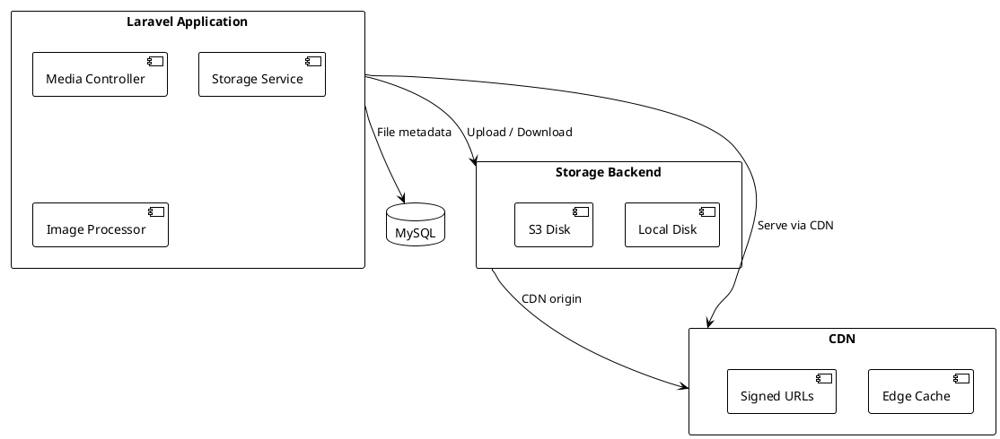

# 05.03.11 - Storage Container

**Project:** GsmUi
**Architecture:** C4 Model – Level 2 (Container)
**Container:** Object Storage
**Framework:** Laravel 13 + S3 / Local
**Version:** 1.0.0

---

# Purpose

The Storage Container manages all file and media assets for the GsmUi platform. It provides a unified interface for storing, retrieving, and serving user uploads, theme assets, component previews, and generated media. The container supports both local development storage and cloud object storage (S3-compatible) in production.

---

# Responsibilities

The Storage Container is responsible for:

* Storing uploaded files
* Serving media files
* Generating signed URLs
* Managing file metadata
* Handling image transformations
* Enforcing access control
* Cleaning up orphaned files
* Managing CDN integration

---

# Container Diagram



---

# Technology Stack

| Technology | Purpose |
|------------|---------|
| Laravel Filesystem | Storage abstraction |
| Local disk | Development storage |
| S3-compatible storage | Production object storage |
| CloudFront / Cloudflare | CDN |
| Intervention Image | Image processing |

---

# Storage Disks

GsmUi defines multiple storage disks:

| Disk | Driver | Purpose | Public |
|------|--------|---------|--------|
| `local` | local | Development, private files | No |
| `public` | local | Publicly accessible files | Yes |
| `s3` | s3 | Production uploads | No |
| `s3-public` | s3 | Production public files | Yes |

---

# Disk Configuration

```php
// config/filesystems.php
'disks' => [
    'local' => [
        'driver' => 'local',
        'root' => storage_path('app/private'),
        'throw' => false,
    ],

    'public' => [
        'driver' => 'local',
        'root' => storage_path('app/public'),
        'url' => env('APP_URL').'/storage',
        'visibility' => 'public',
    ],

    's3' => [
        'driver' => 's3',
        'key' => env('AWS_ACCESS_KEY_ID'),
        'secret' => env('AWS_SECRET_ACCESS_KEY'),
        'region' => env('AWS_DEFAULT_REGION'),
        'bucket' => env('AWS_BUCKET'),
        'url' => env('AWS_URL'),
        'endpoint' => env('AWS_ENDPOINT'),
        'use_path_style_endpoint' => env('AWS_USE_PATH_STYLE_ENDPOINT', false),
    ],
],
```

---

# File Upload Flow

```text
User selects file
    │
    ▼
Validate (type, size, dimensions)
    │
    ▼
Store on disk
    │
    ├── Development: storage/app/public/
    └── Production:  S3 bucket
    │
    ▼
Generate URL
    │
    ├── Public: Direct URL
    └── Private: Signed URL
    │
    ▼
Store metadata in database
```

---

# File Organization

Files are organized by domain:

```text
storage/app/public/
├── themes/
│   ├── {theme-id}/
│   │   ├── preview.png
│   │   └── thumbnail.png
├── components/
│   ├── {component-id}/
│   │   ├── preview.png
│   │   └── files/
│   │       └── component.zip
├── avatars/
│   └── {user-id}.jpg
├── media/
│   ├── {user-id}/
│   │   ├── image1.jpg
│   │   └── image2.png
└── exports/
    └── {batch-id}.csv
```

---

# File Naming

Files are stored with generated names to prevent collisions:

```php
$filename = (string) Str::ulid() . '.' . $extension;
$path = 'themes/' . $themeId . '/' . $filename;
```

Original filenames are preserved in metadata.

---

# Signed URLs

Private files are served via signed URLs:

```php
$url = Storage::disk('s3')->temporaryUrl(
    'private/theme-asset.zip',
    now()->addMinutes(5),
    ['ResponseContentDisposition' => 'attachment']
);
```

Signed URLs:

* Are time-limited
* Cannot be forged
* Support content disposition
* Work with CDN

---

# Image Processing

Image processing is handled via Intervention Image or similar:

```php
$image = Image::read($file)
    ->resize(800, 600)
    ->toJpeg(80);

Storage::put('components/' . $id . '/preview.jpg', $image);
```

Common transformations:

| Operation | Use |
|-----------|-----|
| Resize | Fit to dimensions |
| Crop | Extract region |
| Watermark | Brand overlay |
| Format conversion | WebP, AVIF |
| Quality adjustment | Compression level |

---

# CDN Integration

CDN provides:

* Geographic distribution
* Edge caching
* HTTPS termination
* DDoS protection
* Signed URL support

Configuration:

```php
// config/filesystems.php
's3' => [
    'driver' => 's3',
    'url' => env('AWS_CLOUDFRONT_URL'), // CDN origin
    'bucket' => env('AWS_BUCKET'),
],
```

CDN cache rules:

| File Type | Cache TTL |
|-----------|-----------|
| Images | 1 week |
| CSS/JS | 1 year (with hash) |
| PDFs | 1 day |
| ZIPs | 1 hour |

---

# Access Control

### Public Files

```php
Storage::disk('s3-public')->put('themes/preview.png', $file);
// Accessible via direct URL
```

### Private Files

```php
Storage::disk('s3')->put('exports/report.csv', $file);
// Requires signed URL
$url = Storage::disk('s3')->temporaryUrl('exports/report.csv', now()->addHours(1));
```

### Owner-Only Files

```php
Storage::disk('s3')->put("users/{$userId}/private.pdf", $file);

// Serve only to owner
if ($request->user()->id !== $userId) {
    abort(403);
}
$url = Storage::disk('s3')->temporaryUrl("users/{$userId}/private.pdf", now()->addMinutes(5));
```

---

# File Validation

All uploads are validated:

```php
$request->validate([
    'file' => [
        'required',
        'file',
        'max:10240', // 10MB
        'mimes:jpg,jpeg,png,webp,gif',
        'dimensions:max_width=4000,max_height=4000',
    ],
]);
```

Validation rules:

* File type (MIME)
* File size
* Image dimensions
* File extension

---

# Metadata Storage

File metadata is stored in MySQL:

```sql
CREATE TABLE media (
    id BIGINT PRIMARY KEY,
    user_id BIGINT,
    disk VARCHAR(255),
    path VARCHAR(255),
    filename VARCHAR(255),
    mime_type VARCHAR(255),
    size BIGINT,
    width INT,
    height INT,
    created_at TIMESTAMP,
    updated_at TIMESTAMP
);
```

Metadata enables:

* Listing user files
* Searching by type/size
* Cleaning up orphaned files
* Generating thumbnails

---

# Cleanup

Orphaned files are cleaned up periodically:

```php
class CleanupOrphanedMedia implements ShouldQueue
{
    public function handle(): void
    {
        $orphaned = Storage::files('media')
            ->filter(fn ($path) => !Media::where('path', $path)->exists());

        foreach ($orphaned as $path) {
            Storage::delete($path);
        }
    }
}

Schedule::job(CleanupOrphanedMedia::class)->daily();
```

---

# Backup

Files are backed up via:

* S3 versioning (production)
* Periodic snapshots
* Cross-region replication (future)

Backup considerations:

* Large files are expensive to back up frequently
* Use lifecycle policies to move old files to cheaper storage
* Consider Glacier for archival

---

# Security

* Private files never exposed via direct URL
* Signed URLs expire automatically
* File names are non-guessable (ULID)
* Uploaded files are scanned for malware (future)
* No executable files in upload directories

---

# Performance Targets

| Metric | Target |
|--------|--------|
| Upload latency | <2 seconds (small files) |
| Download latency | <500 ms (CDN) |
| Image processing | <2 seconds |
| CDN hit rate | >95% |
| Signed URL generation | <50 ms |

---

# Multi-Region Storage

For global deployments, GsmUi supports multi-region storage for low-latency access.

### Multi-Region Architecture

```text
┌─────────────────────────────────────────┐
│            Global CDN Layer              │
│  (Route 53 / Cloudflare Geographic)     │
└────────────────┬────────────────────────┘
                 │
    ┌────────────┼────────────┐
    ▼            ▼            ▼
┌────────┐  ┌────────┐  ┌────────┐
│ US-East│  │ EU-West│  │AP-South│
│ S3 + CF│  │ S3 + CF│  │ S3 + CF│
└────────┘  └────────┘  └────────┘
    │            │            │
    ▼            ▼            ▼
┌────────┐  ┌────────┐  ┌────────┐
│Replica │  │Replica │  │Replica │
│(MySQL) │  │(MySQL) │  │(MySQL) │
└────────┘  └────────┘  └────────┘
```

### Region Configuration

```php
// config/filesystems.php
'regions' => [
    'us-east-1' => [
        's3' => [
            'key' => env('AWS_US_EAST_KEY'),
            'secret' => env('AWS_US_EAST_SECRET'),
            'region' => 'us-east-1',
            'bucket' => env('AWS_US_EAST_BUCKET'),
            'url' => env('AWS_US_EAST_CDN_URL'),
        ],
    ],
    'eu-west-1' => [
        's3' => [
            'key' => env('AWS_EU_WEST_KEY'),
            'secret' => env('AWS_EU_WEST_SECRET'),
            'region' => 'eu-west-1',
            'bucket' => env('AWS_EU_WEST_BUCKET'),
            'url' => env('AWS_EU_WEST_CDN_URL'),
        ],
    ],
],
```

### Geographic Routing

```text
User Location Detection:
  1. DNS query resolves to nearest region
  2. CDN edge location serves static assets
  3. API requests routed to nearest backend
  4. Storage requests directed to regional bucket

Latency Benefits:
  - US users: <50ms to US-East storage
  - EU users: <50ms to EU-West storage
  - APAC users: <50ms to AP-South storage
```

### Cross-Region Replication

```text
Replication Rules:
  - User uploads replicated within 15 minutes
  - Theme assets replicated within 1 hour
  - Documentation replicated within 4 hours
  - User-generated content replicated within 30 minutes
```

### Region Selection Logic

```php
class RegionSelector
{
    public function selectForUser(User $user): string
    {
        if ($user->preferred_region) {
            return $user->preferred_region;
        }

        $detected = GeoIP::getRegion($user->ip);

        return $this->nearestRegion($detected);
    }
}
```

---

# Image Processing Pipeline

GsmUi implements a comprehensive image processing pipeline.

### Processing Flow

```text
Upload Received
    │
    ▼
Malware Scan
    │
    ▼
Original Storage
    │
    ▼
Queue Processing Job
    │
    ├──→ Thumbnail Generation (150x150)
    ├──→ Medium Size (400x400)
    ├──→ Large Size (800x800)
    ├──→ WebP Conversion
    ├──→ AVIF Conversion (future)
    └──→ Metadata Extraction
    │
    ▼
Store Processed Versions
    │
    ▼
Update Database Records
```

### Image Optimization

```php
class ProcessImage
{
    public function process(Media $media): void
    {
        $image = Image::read($media->path);

        $thumb = $image->resize(150, 150)->toWebp(80);
        Storage::disk('s3')->put($media->thumbnailPath, $thumb);

        $medium = $image->resize(400, 400)->toWebp(85);
        Storage::disk('s3')->put($media->mediumPath, $medium);

        $large = $image->resize(800, 800)->toWebp(85);
        Storage::disk('s3')->put($media->largePath, $large);

        $webp = $image->toWebp(90);
        Storage::disk('s3')->put($media->webpPath, $webp);
    }
}
```

### Image Formats

| Format | Use Case | Compression | Browser Support |
|--------|----------|-------------|-----------------|
| JPEG | Photos | Lossy | Universal |
| PNG | Graphics | Lossless | Universal |
| WebP | All | Both | 97%+ |
| AVIF | Photos | Lossy | 90%+ |
| SVG | Icons | N/A | Universal |

### Responsive Images

```html
<picture>
  <source srcset="image.avif" type="image/avif">
  <source srcset="image.webp" type="image/webp">
  
</picture>
```

### Image Processing Queue

```text
Queue Configuration:
  - Queue name: media
  - Workers: 4 concurrent
  - Timeout: 120 seconds
  - Retry: 3 attempts
  - Memory limit: 256MB

Processing Priority:
  1. User avatars (high)
  2. Component previews (medium)
  3. Theme thumbnails (medium)
  4. Background images (low)
```

---

# File Versioning

GsmUi implements file versioning for critical assets.

### Version Strategy

```text
Version Naming:
  {original-name}-v{version}.{extension}

Examples:
  theme-preview-v1.png
  theme-preview-v2.png
  theme-preview-v3.png
```

### Version Storage

```text
storage/
├── themes/
│   ├── {theme-id}/
│   │   ├── versions/
│   │   │   ├── v1/
│   │   │   │   └── preview.png
│   │   │   ├── v2/
│   │   │   │   └── preview.png
│   │   │   └── current/
│   │   │       └── preview.png (symlink to latest)
│   │   └── metadata.json
```

### Version Management

```php
class FileManager
{
    public function storeVersion(Media $media, File $file): void
    {
        $version = $media->nextVersion();

        $path = "versions/{$media->domain}/{$media->id}/v{$version}/{$file->getClientOriginalName()}";

        Storage::disk('s3')->put($path, $file);

        $media->update([
            'current_version' => $version,
            'current_path' => $path,
        ]);
    }

    public function getVersion(Media $media, int $version): string
    {
        $path = "versions/{$media->domain}/{$media->id}/v{$version}/{$media->filename}";
        return Storage::disk('s3')->temporaryUrl($path, now()->addMinutes(5));
    }
}
```

---

# Signed URL Generation

### URL Types

```text
Signed URL Types:

  1. Temporary URL (Default)
     - Expires after configurable duration
     - No additional permissions required
     - Use case: private file downloads

  2. Pre-signed URL
     - Includes credentials in URL
     - Use case: direct client uploads to S3

  3. CloudFront Signed URL
     - Uses signed cookies or URLs
     - Use case: CDN-protected content

  4. Presigned POST
     - Generates form data for direct upload
     - Use case: browser uploads to S3
```

### Signed URL Configuration

```php
class SignedUrlGenerator
{
    public function generate(Media $media, User $user): string
    {
        if (!$this->canAccess($media, $user)) {
            throw new UnauthorizedException();
        }

        if ($this->isCDNEnabled($media)) {
            return $this->generateCloudFrontUrl($media);
        }

        return Storage::disk($media->disk)->temporaryUrl(
            $media->path,
            now()->addMinutes(15),
            ['ResponseContentDisposition' => "attachment; filename=\"{$media->original_filename}\""]
        );
    }
}
```

### URL Expiration Policies

| File Type | Expiration | Rationale |
|-----------|------------|-----------|
| Public assets | Never | Cached at CDN edge |
| Theme previews | 15 minutes | Temporary access |
| Component downloads | 5 minutes | One-time download |
| Export files | 1 hour | Large file download |
| User avatars | 30 minutes | Profile viewing |

### Presigned POST for Direct Upload

```php
class DirectUploadController extends Controller
{
    public function presign(Request $request): JsonResponse
    {
        $filename = $request->input('filename');
        $disk = $request->input('disk', 's3');

        $client = Storage::disk($disk)->getClient();

        $command = $client->getCommand('PutObject', [
            'Bucket' => config("filesystems.disks.{$disk}.bucket"),
            'Key' => $this->generateKey($filename),
            'ContentType' => $request->input('content_type'),
            'Expires' => now()->addMinutes(5)->toIso8601String(),
        ]);

        $presignedUrl = (string) $command->getPresignUrl();

        return response()->json([
            'url' => $presignedUrl,
            'method' => 'PUT',
            'headers' => [
                'Content-Type' => $request->input('content_type'),
            ],
        ]);
    }
}
```

---

# CDN Architecture

### CDN Layer Design

```text
┌─────────────────────────────────────────┐
│              DNS Layer                   │
│  (Geographic routing to nearest edge)    │
└────────────────┬────────────────────────┘
                 │
    ┌────────────┼────────────┐
    ▼            ▼            ▼
┌────────┐  ┌────────┐  ┌────────┐
│Edge NY │  │Edge LA │  │Edge LDN│
│(Cache) │  │(Cache) │  │(Cache) │
└────────┘  └────────┘  └────────┘
    │            │            │
    └────────────┼────────────┘
                 ▼
           ┌──────────┐
           │  Origin   │
           │  (S3)     │
           └──────────┘
```

### CDN Cache Strategy

```text
Cache-Control Headers:

  Static Assets (JS/CSS):
    Cache-Control: public, max-age=31536000, immutable

  Images:
    Cache-Control: public, max-age=604800, stale-while-revalidate=86400

  API Responses:
    Cache-Control: private, max-age=0, must-revalidate

  User Content:
    Cache-Control: private, max-age=300
```

### Cache Invalidation

```php
class CdnInvalidator
{
    public function invalidate(array $paths): void
    {
        $cloudFront = CloudFrontClient::factory([
            'credentials' => CredentialProvider::defaultProvider(),
            'region' => 'us-east-1',
            'version' => '2020-05-31',
        ]);

        $cloudFront->createInvalidation([
            'DistributionId' => config('services.cloudfront.distribution_id'),
            'InvalidationBatch' => [
                'Paths' => [
                    'Quantity' => count($paths),
                    'Items' => $paths,
                ],
                'CallerReference' => time(),
            ],
        ]);
    }
}
```

### CDN Performance Metrics

| Metric | Target |
|--------|--------|
| Cache hit ratio | >95% |
| TTFB (edge) | <50ms |
| TTFB (origin) | <200ms |
| Bandwidth reduction | >60% |
| Origin requests | <5% of total |

---

# Storage Security

### Bucket Policies

```json
{
  "Version": "2012-10-17",
  "Statement": [
    {
      "Sid": "PublicRead",
      "Effect": "Allow",
      "Principal": "*",
      "Action": "s3:GetObject",
      "Resource": "arn:aws:s3:::gsmui-public/*"
    },
    {
      "Sid": "DenyInsecureTransport",
      "Effect": "Deny",
      "Principal": "*",
      "Action": "s3:*",
      "Resource": [
        "arn:aws:s3:::gsmui-private",
        "arn:aws:s3:::gsmui-private/*"
      ],
      "Condition": {
        "Bool": {
          "aws:SecureTransport": "false"
        }
      }
    }
  ]
}
```

### Access Logging

```php
's3' => [
    'driver' => 's3',
    'bucket' => env('AWS_BUCKET'),
    'options' => [
        'ServerSideEncryption' => 'aws:kms',
        'BucketOwnerEnforced' => true,
    ],
],
```

### CORS Configuration

```json
{
  "CORSRules": [
    {
      "AllowedHeaders": ["*"],
      "AllowedMethods": ["GET", "PUT", "POST"],
      "AllowedOrigins": ["https://gsmui.com"],
      "ExposeHeaders": ["ETag"],
      "MaxAgeSeconds": 3600
    }
  ]
}
```

### Server-Side Encryption

```text
Encryption Options:

  SSE-S3:
    - AES-256 encryption
    - AWS manages keys
    - Use case: General storage

  SSE-KMS:
    - AWS KMS managed keys
    - Audit trail for key usage
    - Use case: Sensitive data

  SSE-C:
    - Customer-provided keys
    - Full control over encryption
    - Use case: Compliance requirements
```

### Malware Scanning

```php
class MalwareScanner
{
    public function scan(File $file): ScanResult
    {
        if (!$this->isValidType($file)) {
            return ScanResult::rejected('Invalid file type');
        }

        if ($file->getSize() > self::MAX_SIZE) {
            return ScanResult::rejected('File too large');
        }

        $result = $this->clamav->scan($file->getPathname());

        if ($result->isInfected()) {
            return ScanResult::rejected('Malware detected');
        }

        return ScanResult::clean();
    }
}
```

---

# Storage Monitoring

### Metrics Collection

```php
class StorageMetrics
{
    public function collect(): array
    {
        return [
            'total_size' => $this->calculateTotalSize(),
            'file_count' => $this->countFiles(),
            'bandwidth' => $this->calculateBandwidth(),
            'cache_hit_ratio' => $this->calculateCacheHitRatio(),
            'error_rate' => $this->calculateErrorRate(),
        ];
    }
}
```

### Health Checks

```text
Storage Health Check:
  1. Can write test file?
  2. Can read test file?
  3. Can delete test file?
  4. Is CDN responding?
  5. Are signed URLs valid?

Health Check Endpoint:
  GET /health/storage

Response:
  {
    "status": "healthy",
    "disks": {
      "local": {"status": "ok", "writable": true},
      "s3": {"status": "ok", "writable": true},
      "s3-public": {"status": "ok", "writable": true}
    },
    "cdn": {"status": "ok", "latency_ms": 12}
  }
```

### Alerting Rules

```yaml
- alert: StorageQuotaHigh
  expr: storage_used_bytes / storage_total_bytes > 0.8
  for: 1h
  labels:
    severity: warning
  annotations:
    summary: "Storage quota at 80%"

- alert: CDNErrorRateHigh
  expr: cdn_error_requests / cdn_total_requests > 0.01
  for: 5m
  labels:
    severity: critical
  annotations:
    summary: "CDN error rate exceeds 1%"
```

### Dashboard Metrics

```text
Storage Dashboard Panels:

  1. Usage Metrics
     - Total storage used
     - Storage by domain (themes, components, etc.)
     - Storage growth trend

  2. Performance Metrics
     - Upload latency
     - Download latency
     - Image processing time

  3. CDN Metrics
     - Cache hit ratio
     - Bandwidth usage
     - Edge requests

  4. Cost Metrics
     - Storage costs
     - Transfer costs
     - Processing costs
```

---

# Storage Testing

### Functional Tests

```php
class StorageTest extends TestCase
{
    public function test_upload_and_retrieve(): void
    {
        $file = UploadedFile::fake()->image('test.jpg');

        $media = Media::upload($file, 'themes');

        $this->assertDatabaseHas('media', [
            'id' => $media->id,
            'disk' => 's3',
        ]);

        $url = $media->url();
        $this->assertStringStartsWith('https://', $url);
    }

    public function test_signed_url_expiration(): void
    {
        $media = Media::factory()->create();

        $url = $media->signedUrl(now()->addMinutes(5));

        $this->assertStringContainsString('Expires=', $url);
    }

    public function test_file_validation(): void
    {
        $file = UploadedFile::fake()->create('malware.exe', 1000, 'application/x-executable');

        $this->expectException(ValidationException::class);
        Media::upload($file, 'themes');
    }
}
```

### Performance Tests

```php
class StoragePerformanceTest extends TestCase
{
    public function test_upload_performance(): void
    {
        $file = UploadedFile::fake()->image('test.jpg', 1920, 1080);

        $start = microtime(true);
        Media::upload($file, 'themes');
        $latency = microtime(true) - $start;

        $this->assertLessThan(2, $latency);
    }

    public function test_download_performance(): void
    {
        $media = Media::factory()->create(['size' => 1024 * 1024]);

        $start = microtime(true);
        $url = $media->url();
        $latency = microtime(true) - $start;

        $this->assertLessThan(0.1, $latency);
    }
}
```

---

# Storage Migration

### Migration Strategy

```text
1. Assessment Phase
   - Audit current storage usage
   - Measure file sizes and counts
   - Identify migration dependencies
   - Plan migration timeline

2. Preparation Phase
   - Set up target storage (S3)
   - Configure IAM policies
   - Test connectivity from application
   - Prepare rollback plan

3. Migration Phase
   - Enable dual-write (write to both)
   - Backfill data from local to S3
   - Verify data consistency
   - Switch read traffic
   - Switch write traffic
   - Monitor for issues

4. Cleanup Phase
   - Remove dual-write logic
   - Decommission local storage
   - Update monitoring
   - Document changes
```

### Migration Commands

```bash
# 1. Migrate existing files
php artisan storage:migrate --disk=local --target=s3

# 2. Verify migration
php artisan storage:verify --disk=s3

# 3. Update file references
php artisan storage:update-references

# 4. Clean up local files
php artisan storage:cleanup --disk=local
```

---

# Storage Architecture Deep Dive

### Disk Abstraction Layer

GsmUi uses Laravel's Filesystem abstraction for storage operations:

```php
// Unified interface for all storage backends
Storage::disk('s3')->put('path/file.txt', $content);
Storage::disk('local')->put('path/file.txt', $content);

// Visibility control
Storage::disk('s3')->put('path/file.txt', $content, 'public');
Storage::disk('s3')->put('path/file.txt', $content, 'private');

// File operations
Storage::disk('s3')->exists('path/file.txt');
Storage::disk('s3')->size('path/file.txt');
Storage::disk('s3')->lastModified('path/file.txt');
Storage::disk('s3')->mimeType('path/file.txt');
```

### Storage Driver Configuration

```php
// config/filesystems.php
'disks' => [
    'local' => [
        'driver' => 'local',
        'root' => storage_path('app/private'),
        'throw' => false,
    ],
    'public' => [
        'driver' => 'local',
        'root' => storage_path('app/public'),
        'url' => env('APP_URL') . '/storage',
        'visibility' => 'public',
    ],
    's3' => [
        'driver' => 's3',
        'key' => env('AWS_ACCESS_KEY_ID'),
        'secret' => env('AWS_SECRET_ACCESS_KEY'),
        'region' => env('AWS_DEFAULT_REGION'),
        'bucket' => env('AWS_BUCKET'),
        'url' => env('AWS_URL'),
        'endpoint' => env('AWS_ENDPOINT'),
        'use_path_style_endpoint' => env('AWS_USE_PATH_STYLE_ENDPOINT', false),
        'throw' => false,
    ],
],
```

### Storage Service Layer

```php
class StorageService
{
    public function __construct(
        private FilesystemFactory $filesystem,
        private ImageProcessor $imageProcessor,
        private MalwareScanner $malwareScanner,
    ) {}

    public function store(UploadedFile $file, string $domain, User $user): Media
    {
        // 1. Validate file
        $this->validate($file);

        // 2. Scan for malware
        $this->malwareScanner->scan($file);

        // 3. Generate unique path
        $path = $this->generatePath($file, $domain, $user);

        // 4. Store file
        $disk = $this->selectDisk();
        $this->filesystem->disk($disk)->put($path, file_get_contents($file));

        // 5. Process images
        if ($this->isImage($file)) {
            $this->imageProcessor->process($disk, $path);
        }

        // 6. Create metadata record
        return Media::create([
            'user_id' => $user->id,
            'disk' => $disk,
            'path' => $path,
            'filename' => $file->getClientOriginalName(),
            'mime_type' => $file->getMimeType(),
            'size' => $file->getSize(),
            'domain' => $domain,
        ]);
    }

    public function retrieve(Media $media, User $user): string
    {
        if (!$this->canAccess($media, $user)) {
            throw new UnauthorizedException();
        }

        if ($media->isPublic()) {
            return $this->filesystem->disk($media->disk)->url($media->path);
        }

        return $this->filesystem->disk($media->disk)->temporaryUrl(
            $media->path,
            now()->addMinutes(15)
        );
    }

    private function validate(UploadedFile $file): void
    {
        $rules = [
            'max_size' => 10 * 1024 * 1024, // 10MB
            'allowed_types' => [
                'image/jpeg', 'image/png', 'image/webp', 'image/gif',
                'application/pdf',
                'application/zip',
            ],
        ];

        if ($file->getSize() > $rules['max_size']) {
            throw new FileTooLargeException();
        }

        if (!in_array($file->getMimeType(), $rules['allowed_types'])) {
            throw new InvalidFileTypeException();
        }
    }
}
```

---

# Media Model

### Database Schema

```sql
CREATE TABLE media (
    id BIGINT UNSIGNED AUTO_INCREMENT PRIMARY KEY,
    user_id BIGINT UNSIGNED NOT NULL,
    disk VARCHAR(255) NOT NULL,
    path VARCHAR(500) NOT NULL,
    filename VARCHAR(255) NOT NULL,
    original_filename VARCHAR(255) NOT NULL,
    mime_type VARCHAR(255) NOT NULL,
    size BIGINT UNSIGNED NOT NULL,
    width INT UNSIGNED NULL,
    height INT UNSIGNED NULL,
    domain VARCHAR(50) NOT NULL,
    meta JSON NULL,
    created_at TIMESTAMP DEFAULT CURRENT_TIMESTAMP,
    updated_at TIMESTAMP DEFAULT CURRENT_TIMESTAMP ON UPDATE CURRENT_TIMESTAMP,

    INDEX idx_media_user (user_id),
    INDEX idx_media_domain (domain),
    INDEX idx_media_mime (mime_type),
    INDEX idx_media_created (created_at),

    FOREIGN KEY (user_id) REFERENCES users(id) ON DELETE CASCADE
);
```

### Media Model

```php
class Media extends Model
{
    protected $fillable = [
        'user_id', 'disk', 'path', 'filename', 'original_filename',
        'mime_type', 'size', 'width', 'height', 'domain', 'meta',
    ];

    protected $casts = [
        'size' => 'integer',
        'width' => 'integer',
        'height' => 'integer',
        'meta' => 'array',
    ];

    public function user(): BelongsTo
    {
        return $this->belongsTo(User::class);
    }

    public function isPublic(): bool
    {
        return $this->disk === 's3-public' || $this->disk === 'public';
    }

    public function isImage(): bool
    {
        return str_starts_with($this->mime_type, 'image/');
    }

    public function url(): string
    {
        return Storage::disk($this->disk)->url($this->path);
    }

    public function temporaryUrl(int $minutes = 15): string
    {
        return Storage::disk($this->disk)->temporaryUrl(
            $this->path,
            now()->addMinutes($minutes)
        );
    }

    public function thumbnailPath(): string
    {
        return dirname($this->path) . '/thumbnails/' . $this->filename;
    }

    public function mediumPath(): string
    {
        return dirname($this->path) . '/medium/' . $this->filename;
    }

    public function largePath(): string
    {
        return dirname($this->path) . '/large/' . $this->filename;
    }
}
```

---

# File Upload Implementation

### Upload Controller

```php
class MediaController extends Controller
{
    public function store(Request $request): JsonResponse
    {
        $validated = $request->validate([
            'file' => ['required', 'file', 'max:10240'],
            'domain' => ['required', 'string', 'in:avatars,themes,components,media'],
        ]);

        $media = $this->storageService->store(
            $request->file('file'),
            $validated['domain'],
            $request->user()
        );

        return response()->json([
            'id' => $media->id,
            'url' => $media->url(),
            'filename' => $media->original_filename,
            'size' => $media->size,
            'mime_type' => $media->mime_type,
        ], 201);
    }

    public function destroy(Media $media): JsonResponse
    {
        $this->authorize('delete', $media);

        $media->delete();

        return response()->json(null, 204);
    }
}
```

### Direct Upload (Presigned)

```php
class DirectUploadController extends Controller
{
    public function presign(Request $request): JsonResponse
    {
        $validated = $request->validate([
            'filename' => ['required', 'string'],
            'content_type' => ['required', 'string'],
            'size' => ['required', 'integer', 'max:10485760'],
            'domain' => ['required', 'string'],
        ]);

        $path = $this->generatePath(
            $validated['filename'],
            $validated['content_type'],
            $validated['domain']
        );

        $client = Storage::disk('s3')->getClient();

        $command = $client->getCommand('PutObject', [
            'Bucket' => config('filesystems.disks.s3.bucket'),
            'Key' => $path,
            'ContentType' => $validated['content_type'],
            'ContentLength' => $validated['size'],
            'Expires' => now()->addMinutes(5)->toIso8601String(),
        ]);

        $presignedUrl = $command->getPresignUrl();

        return response()->json([
            'url' => $presignedUrl,
            'method' => 'PUT',
            'headers' => [
                'Content-Type' => $validated['content_type'],
                'Content-Length' => $validated['size'],
            ],
            'path' => $path,
        ]);
    }

    public function confirm(Request $request): JsonResponse
    {
        $validated = $request->validate([
            'path' => ['required', 'string'],
            'domain' => ['required', 'string'],
        ]);

        $media = Media::create([
            'user_id' => $request->user()->id,
            'disk' => 's3',
            'path' => $validated['path'],
            'filename' => basename($validated['path']),
            'original_filename' => basename($validated['path']),
            'mime_type' => $request->input('content_type'),
            'size' => $request->input('size'),
            'domain' => $validated['domain'],
        ]);

        return response()->json([
            'id' => $media->id,
            'url' => $media->url(),
        ], 201);
    }
}
```

### Chunked Upload

```php
class ChunkedUploadController extends Controller
{
    public function init(Request $request): JsonResponse
    {
        $validated = $request->validate([
            'filename' => ['required', 'string'],
            'content_type' => ['required', 'string'],
            'total_size' => ['required', 'integer'],
            'chunk_size' => ['nullable', 'integer', 'max:5242880'],
        ]);

        $uploadId = Str::ulid()->toString();
        $chunkSize = $validated['chunk_size'] ?? 5 * 1024 * 1024; // 5MB
        $totalChunks = (int) ceil($validated['total_size'] / $chunkSize);

        Cache::put("upload:{$uploadId}", [
            'filename' => $validated['filename'],
            'content_type' => $validated['content_type'],
            'total_size' => $validated['total_size'],
            'chunk_size' => $chunkSize,
            'total_chunks' => $totalChunks,
            'uploaded_chunks' => [],
            'created_at' => now(),
        ], 3600);

        return response()->json([
            'upload_id' => $uploadId,
            'chunk_size' => $chunkSize,
            'total_chunks' => $totalChunks,
        ]);
    }

    public function chunk(Request $request, string $uploadId): JsonResponse
    {
        $validated = $request->validate([
            'chunk_index' => ['required', 'integer'],
            'chunk' => ['required', 'file'],
        ]);

        $uploadData = Cache::get("upload:{$uploadId}");

        if (!$uploadData) {
            return response()->json(['error' => 'Upload not found'], 404);
        }

        $path = "chunks/{$uploadId}/{$validated['chunk_index']}";
        Storage::disk('local')->put($path, file_get_contents($validated['chunk']));

        $uploadData['uploaded_chunks'][] = $validated['chunk_index'];
        Cache::put("upload:{$uploadId}", $uploadData, 3600);

        // Check if all chunks uploaded
        if (count($uploadData['uploaded_chunks']) === $uploadData['total_chunks']) {
            $finalPath = $this->mergeChunks($uploadId, $uploadData);
            Cache::forget("upload:{$uploadId}");

            return response()->json([
                'complete' => true,
                'path' => $finalPath,
            ]);
        }

        return response()->json([
            'complete' => false,
            'uploaded' => count($uploadData['uploaded_chunks']),
            'total' => $uploadData['total_chunks'],
        ]);
    }

    private function mergeChunks(string $uploadId, array $uploadData): string
    {
        $mergedContent = '';

        for ($i = 0; $i < $uploadData['total_chunks']; $i++) {
            $chunkPath = "chunks/{$uploadId}/{$i}";
            $mergedContent .= Storage::disk('local')->get($chunkPath);
            Storage::disk('local')->delete($chunkPath);
        }

        $extension = pathinfo($uploadData['filename'], PATHINFO_EXTENSION);
        $finalPath = "uploads/{$uploadId}.{$extension}";

        Storage::disk('s3')->put($finalPath, $mergedContent);

        return $finalPath;
    }
}
```

---

# Image Processing Advanced

### Responsive Image Generation

```php
class ResponsiveImageGenerator
{
    private array $breakpoints = [
        'xs' => 320,
        'sm' => 640,
        'md' => 768,
        'lg' => 1024,
        'xl' => 1280,
        '2xl' => 1536,
    ];

    public function generate(Media $media): array
    {
        $paths = [];

        foreach ($this->breakpoints as $name => $width) {
            $path = $this->generateBreakpoint($media, $name, $width);
            $paths[$name] = $path;
        }

        return $paths;
    }

    private function generateBreakpoint(Media $media, string $name, int $width): string
    {
        $image = Image::read(Storage::disk($media->disk)->get($media->path));

        $height = (int) ($image->height() * ($width / $image->width()));

        $resized = $image->resize($width, $height)->toWebp(85);

        $path = dirname($media->path) . "/responsive/{$name}/" . basename($media->path, '.' . pathinfo($media->path, PATHINFO_EXTENSION)) . '.webp';

        Storage::disk($media->disk)->put($path, $resized);

        return $path;
    }
}
```

### Image Format Conversion

```php
class ImageFormatConverter
{
    public function convert(Media $media, string $format): string
    {
        $image = Image::read(Storage::disk($media->disk)->get($media->path));

        $converted = match ($format) {
            'webp' => $image->toWebp(85),
            'avif' => $image->toAvif(80),
            'jpeg' => $image->toJpeg(85),
            'png' => $image->toPng(),
        };

        $path = dirname($media->path) . "/formats/{$format}/" . basename($media->path);

        Storage::disk($media->disk)->put($path, $converted);

        return $path;
    }
}
```

### Image Metadata Extraction

```php
class ImageMetadataExtractor
{
    public function extract(Media $media): array
    {
        $path = Storage::disk($media->disk)->get($media->path);
        $image = Image::read($path);

        return [
            'width' => $image->width(),
            'height' => $image->height(),
            'format' => $image->format(),
            'mime_type' => $image->mime(),
            'size' => strlen($path),
            'exif' => $this->extractExif($image),
        ];
    }

    private function extractExif($image): ?array
    {
        try {
            $exif = $image->exif();

            return [
                'camera' => $exif['Make'] ?? null,
                'model' => $exif['Model'] ?? null,
                'date' => $exif['DateTimeOriginal'] ?? null,
                'gps' => [
                    'latitude' => $exif['GPSLatitude'] ?? null,
                    'longitude' => $exif['GPSLongitude'] ?? null,
                ],
            ];
        } catch (\Exception $e) {
            return null;
        }
    }
}
```

---

# Storage Quota Management

### Quota Configuration

```php
class StorageQuota
{
    private array $quotas = [
        'free' => [
            'storage' => 100 * 1024 * 1024, // 100MB
            'uploads_per_day' => 50,
            'max_file_size' => 5 * 1024 * 1024, // 5MB
        ],
        'pro' => [
            'storage' => 10 * 1024 * 1024 * 1024, // 10GB
            'uploads_per_day' => 500,
            'max_file_size' => 50 * 1024 * 1024, // 50MB
        ],
        'enterprise' => [
            'storage' => 100 * 1024 * 1024 * 1024, // 100GB
            'uploads_per_day' => 5000,
            'max_file_size' => 100 * 1024 * 1024, // 100MB
        ],
    ];

    public function check(User $user, int $fileSize): bool
    {
        $quota = $this->quotas[$user->plan];

        // Check file size
        if ($fileSize > $quota['max_file_size']) {
            return false;
        }

        // Check daily uploads
        $todayUploads = Media::where('user_id', $user->id)
            ->whereDate('created_at', today())
            ->count();

        if ($todayUploads >= $quota['uploads_per_day']) {
            return false;
        }

        // Check total storage
        $totalStorage = Media::where('user_id', $user->id)
            ->sum('size');

        if ($totalStorage + $fileSize > $quota['storage']) {
            return false;
        }

        return true;
    }

    public function getUsage(User $user): array
    {
        $quota = $this->quotas[$user->plan];

        return [
            'storage' => [
                'used' => Media::where('user_id', $user->id)->sum('size'),
                'total' => $quota['storage'],
                'percentage' => round(
                    Media::where('user_id', $user->id)->sum('size') / $quota['storage'] * 100,
                    2
                ),
            ],
            'uploads_today' => [
                'used' => Media::where('user_id', $user->id)
                    ->whereDate('created_at', today())
                    ->count(),
                'total' => $quota['uploads_per_day'],
            ],
        ];
    }
}
```

---

# Storage API Reference

### REST API Endpoints

```text
POST   /api/media              - Upload file
GET    /api/media/:id          - Get media details
DELETE /api/media/:id          - Delete media
GET    /api/media/:id/url      - Get temporary URL
POST   /api/media/presign      - Get presigned URL
POST   /api/media/upload/init  - Initialize chunked upload
POST   /api/media/upload/chunk - Upload chunk
POST   /api/media/upload/complete - Complete upload
GET    /api/media/user/:id     - List user media
```

### API Response Format

```json
{
  "data": {
    "id": 123,
    "url": "https://gsmui.s3.amazonaws.com/media/abc123.webp",
    "filename": "preview.png",
    "original_filename": "my-screenshot.png",
    "mime_type": "image/webp",
    "size": 1024000,
    "width": 800,
    "height": 600,
    "domain": "themes",
    "created_at": "2024-01-15T10:30:00Z"
  }
}
```

### SDK Integration

```javascript
// JavaScript SDK
import { GsmuiStorage } from '@gsmui/storage';

const storage = new GsmuiStorage({
  apiKey: process.env.GSMUI_API_KEY,
});

// Upload file
const media = await storage.upload(file, {
  domain: 'themes',
  onProgress: (percent) => console.log(`${percent}%`),
});

// Get URL
const url = await media.getUrl({ expires: 3600 });

// Delete
await media.delete();
```

---

# Storage Backup Strategy

### Backup Configuration

```php
class StorageBackup
{
    public function backup(string $domain): void
    {
        $files = Storage::disk('s3')->allFiles("{$domain}/");

        $backupPath = "backups/{$domain}/" . now()->format('Y-m-d');

        foreach ($files as $file) {
            $content = Storage::disk('s3')->get($file);
            Storage::disk('backup')->put("{$backupPath}/{$file}", $content);
        }
    }
}
```

### Backup Schedule

```text
Backup Schedule:

  Daily:
    - User uploads (avatars, media)
    - Theme previews
    - Component previews

  Weekly:
    - All theme assets
    - All component files
    - Documentation images

  Monthly:
    - Complete storage backup
    - Archive to cold storage
    - Verify backup integrity
```

### Restore Procedure

```bash
# 1. List available backups
php artisan storage:list-backups --domain=themes

# 2. Restore from backup
php artisan storage:restore --backup=2024-01-15 --domain=themes

# 3. Verify restoration
php artisan storage:verify --domain=themes
```

---

# Storage Testing

### Unit Tests

```php
class StorageServiceTest extends TestCase
{
    public function test_store_image(): void
    {
        $file = UploadedFile::fake()->image('test.jpg', 800, 600);
        $user = User::factory()->create();

        $media = $this->storageService->store($file, 'themes', $user);

        $this->assertDatabaseHas('media', [
            'id' => $media->id,
            'user_id' => $user->id,
            'domain' => 'themes',
        ]);
    }

    public function test_retrieve_public_file(): void
    {
        $media = Media::factory()->create(['disk' => 's3-public']);

        $url = $media->url();

        $this->assertStringStartsWith('https://', $url);
    }

    public function test_retrieve_private_file(): void
    {
        $media = Media::factory()->create(['disk' => 's3']);
        $user = User::factory()->create();

        $url = $media->temporaryUrl(15);

        $this->assertStringContainsString('Expires=', $url);
    }

    public function test_delete_cascades(): void
    {
        $media = Media::factory()->create();
        $mediaId = $media->id;

        $media->delete();

        $this->assertDatabaseMissing('media', ['id' => $mediaId]);
    }
}
```

### Integration Tests

```php
class StorageIntegrationTest extends TestCase
{
    public function test_upload_and_retrieve_e2e(): void
    {
        $file = UploadedFile::fake()->image('test.jpg', 800, 600);
        $user = User::factory()->create();

        // Upload
        $response = $this->actingAs($user)
            ->postJson('/api/media', [
                'file' => $file,
                'domain' => 'themes',
            ]);

        $response->assertStatus(201)
            ->assertJsonStructure(['id', 'url', 'filename']);

        $mediaId = $response->json('id');

        // Retrieve
        $response = $this->actingAs($user)
            ->getJson("/api/media/{$mediaId}/url");

        $response->assertOk()
            ->assertJsonStructure(['url']);
    }

    public function test_direct_upload_flow(): void
    {
        $user = User::factory()->create();

        // Get presigned URL
        $response = $this->actingAs($user)
            ->postJson('/api/media/presign', [
                'filename' => 'test.jpg',
                'content_type' => 'image/jpeg',
                'size' => 1024000,
                'domain' => 'themes',
            ]);

        $response->assertOk()
            ->assertJsonStructure(['url', 'method', 'headers']);
    }
}
```

### Performance Tests

```php
class StoragePerformanceTest extends TestCase
{
    public function test_concurrent_uploads(): void
    {
        $users = User::factory()->count(10)->create();

        $start = microtime(true);

        $users->each(function ($user) {
            $file = UploadedFile::fake()->image('test.jpg', 800, 600);
            $this->storageService->store($file, 'themes', $user);
        });

        $elapsed = microtime(true) - $start;

        $this->assertLessThan(30, $elapsed); // 10 uploads in <30s
    }

    public function test_large_file_upload(): void
    {
        $file = UploadedFile::fake()->image('large.jpg', 4000, 3000);
        $user = User::factory()->create();

        $start = microtime(true);
        $media = $this->storageService->store($file, 'themes', $user);
        $elapsed = microtime(true) - $start;

        $this->assertLessThan(5, $elapsed); // Large file in <5s
        $this->assertNotNull($media->id);
    }
}
```

---

# Summary

The Storage Container provides reliable, scalable file storage for GsmUi. By abstracting storage behind Laravel's Filesystem, supporting both local and cloud backends, and integrating with CDN for performance, the platform handles media efficiently while maintaining security and access control.

Supporting infrastructure includes multi-region storage for global performance, comprehensive image processing, file versioning, security controls, monitoring dashboards, and migration tooling. Together, these capabilities ensure the storage layer remains performant, reliable, and secure as the platform grows.

Additional capabilities include responsive image generation, format conversion, storage quota management, chunked uploads for large files, comprehensive backup strategies, and thorough testing suites. These ensure the storage infrastructure scales effectively while maintaining consistent performance characteristics across all use cases.

---

# Next Document

**05.03.12 - Deployment Topology** describes the deployment architecture, load balancers, network zones, redundancy, and infrastructure layout for GsmUi.
