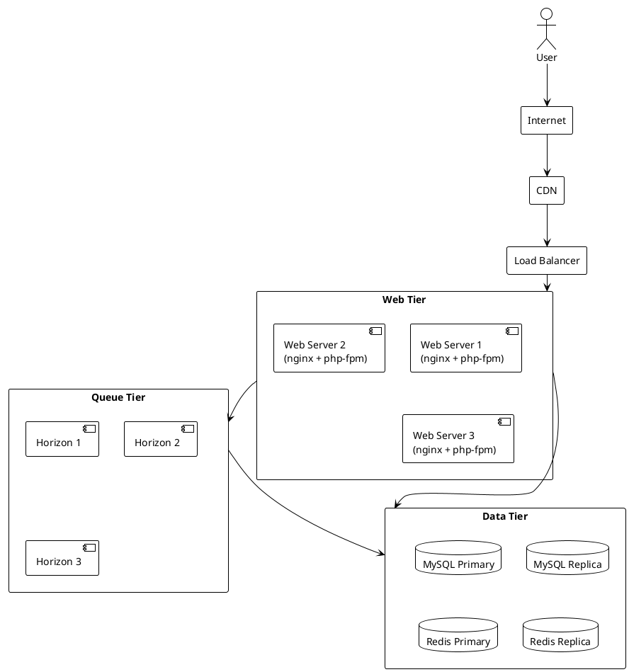

# 05.03.12 - Deployment Topology

**Project:** GsmUi
**Architecture:** C4 Model – Level 2 (Container)
**Container:** Deployment Infrastructure
**Framework:** Laravel 13 + Nginx + Supervisor
**Version:** 1.0.0

---

# Purpose

This document describes the deployment architecture for GsmUi, including the network topology, load balancing, server roles, redundancy, and infrastructure layout. The deployment topology defines how containers are distributed across hosts and network zones to achieve reliability, performance, and scalability.

---

# Responsibilities

Deployment topology is responsible for:

* Defining host roles
* Configuring load balancers
* Managing network zones
* Ensuring redundancy
* Supporting zero-downtime deployments
* Isolating environments
* Managing SSL termination
* Routing traffic to appropriate hosts

---

# Deployment Diagram



---

# Host Roles

GsmUi defines the following host roles:

| Role | Hosts | Software |
|------|-------|----------|
| Web | 3+ | Nginx, PHP-FPM, Laravel |
| Queue | 3+ | Supervisor, Horizon, PHP |
| Database | 1-2 | MySQL Primary (+ Replica) |
| Cache | 1-3 | Redis Primary (+ Replicas) |
| Scheduler | 1 | Cron, Laravel Scheduler |

---

# Web Tier

Web servers handle HTTP requests and execute Laravel application code.

### Web Server Configuration

```text
Host: web-1.example.com
Software: Nginx + PHP-FPM 8.3
Processes: 10 PHP-FPM workers
Memory: 2 GB
CPU: 2 vCPU

Host: web-2.example.com
Software: Nginx + PHP-FPM 8.3
Processes: 10 PHP-FPM workers
Memory: 2 GB
CPU: 2 vCPU

Host: web-3.example.com
Software: Nginx + PHP-FPM 8.3
Processes: 10 PHP-FPM workers
Memory: 2 GB
CPU: 2 vCPU
```

### Nginx Configuration

```nginx
server {
    listen 443 ssl http2;
    server_name gsmui.example.com;

    root /var/www/html/public;
    index index.php;

    client_max_body_size 50M;

    location / {
        try_files $uri $uri/ /index.php?$query_string;
    }

    location ~ \.php$ {
        fastcgi_pass unix:/var/run/php/php8.3-fpm.sock;
        fastcgi_param SCRIPT_FILENAME $realpath_root$fastcgi_script_name;
        include fastcgi_params;
        fastcgi_hide_header X-Powered-By;
    }

    location ~* \.(js|css|png|jpg|jpeg|gif|ico|svg)$ {
        expires 1y;
        add_header Cache-Control "public, immutable";
    }
}
```

---

# Load Balancer

The load balancer distributes traffic across web servers.

### Configuration

```text
Algorithm: Round-robin with health checks
Protocol: HTTPS (TLS 1.3)
Port: 443

Health check:
  Path: /health
  Interval: 10 seconds
  Timeout: 5 seconds
  Healthy threshold: 2
  Unhealthy threshold: 3
```

### SSL Termination

SSL is terminated at the load balancer:

```text
User → HTTPS → Load Balancer → HTTP → Web Server
```

Web servers communicate over HTTP within the private network.

---

# Queue Tier

Queue workers run on dedicated hosts separate from web servers.

### Host Configuration

```text
Host: queue-1.example.com
Software: Supervisor + Horizon
Workers: 8 (high, default, mail)
Memory: 4 GB
CPU: 2 vCPU

Host: queue-2.example.com
Software: Supervisor + Horizon
Workers: 8 (media, search, exports)
Memory: 4 GB
CPU: 2 vCPU
```

### Network Isolation

Queue hosts communicate only with:

* Redis (queue data)
* MySQL (job processing)
* Internal web servers (job dispatch)

Queue hosts do not accept external HTTP traffic.

---

# Data Tier

Data tier hosts the databases and caches.

### MySQL

```text
Host: db-primary.example.com
Software: MySQL 8.4 LTS
Role: Primary (read/write)
Memory: 8 GB
CPU: 4 vCPU
Storage: 500 GB SSD

Host: db-replica.example.com
Software: MySQL 8.4 LTS
Role: Replica (read-only)
Memory: 8 GB
CPU: 4 vCPU
Storage: 500 GB SSD
```

### Redis

```text
Host: redis-1.example.com
Software: Redis 7.2
Role: Primary
Memory: 8 GB
CPU: 4 vCPU

Host: redis-2.example.com
Software: Redis 7.2
Role: Replica
Memory: 8 GB
CPU: 4 vCPU
```

---

# Network Zones

Traffic is segmented into network zones:

| Zone | Access | Purpose |
|------|--------|---------|
| Public | Internet | CDN, Load Balancer |
| DMZ | Load Balancer | Web servers |
| Private | DMZ | Queue workers, data tier |
| Internal | Private | Databases, caches |

```text
┌─────────────────────────────────────────────────┐
│              Public Zone (Internet)               │
│  ┌─────────────────────────────────────────────┐ │
│  │              CDN + Load Balancer             │ │
│  └────────────────────┬────────────────────────┘ │
└───────────────────────┼─────────────────────────┘
                        │
┌───────────────────────┼─────────────────────────┐
│               DMZ (Private Subnet)                │
│  ┌────────────────────┼────────────────────────┐ │
│  │          Web Servers (nginx + php-fpm)      │ │
│  └────────────────────┬────────────────────────┘ │
└───────────────────────┼─────────────────────────┘
                        │
┌───────────────────────┼─────────────────────────┐
│            Private Zone (Internal Subnet)         │
│  ┌────────────────────┼────────────────────────┐ │
│  │  Queue Workers + Data Tier (MySQL, Redis)   │ │
│  └─────────────────────────────────────────────┘ │
└──────────────────────────────────────────────────┘
```

---

# Redundancy

Redundancy is implemented at every layer:

| Component | Redundancy |
|-----------|-----------|
| Load Balancer | Active-active or active-passive |
| Web Servers | 3+ instances |
| Queue Workers | 3+ hosts |
| MySQL | Primary + Replica(s) |
| Redis | Primary + Replica(s) or Sentinel |

---

# Zero-Downtime Deployments

Deployments use rolling updates:

```bash
# 1. Quiet workers
php artisan horizon:quiet

# 2. Deploy to web-1
ssh web-1 "cd /var/www/html && git pull && composer install && php artisan migrate --force"

# 3. Verify web-1 health
curl https://gsmui.example.com/health

# 4. Deploy to web-2
ssh web-2 "cd /var/www/html && git pull && composer install && php artisan migrate --force"

# 5. Deploy to web-3
ssh web-3 "cd /var/www/html && git pull && composer install && php artisan migrate --force"

# 6. Terminate workers (graceful restart)
php artisan horizon:terminate

# 7. Clear caches
php artisan optimize:clear
php artisan optimize
```

---

# Environment Isolation

Environments are completely isolated:

| Environment | Domain | Database | Redis | S3 Bucket |
|-------------|--------|----------|-------|-----------|
| Production | gsmui.example.com | db-prod | redis-prod | s3-prod |
| Staging | staging.gsmui.example.com | db-staging | redis-staging | s3-staging |
| Local | gsmui.test | local | local | local |

No data or configuration is shared between environments.

---

# DNS Configuration

```text
Production:
  gsmui.example.com → Load Balancer
  static.gsmui.example.com → CDN
  queue.gsmui.example.com → (internal, not public)

Staging:
  staging.gsmui.example.com → Load Balancer
  static-staging.gsmui.example.com → CDN
```

---

# Infrastructure as Code

Infrastructure is defined as code:

* Terraform for cloud resources
* Ansible for server configuration
* Docker Compose for local development

```hcl
// terraform example
resource "aws_instance" "web" {
  count         = 3
  ami           = "ami-12345678"
  instance_type = "t3.medium"
  subnet_id     = aws_subnet.private.id

  tags = {
    Name = "web-${count.index + 1}"
    Role = "web"
  }
}
```

---

# Monitoring Hooks

Each host exposes:

* `/health` endpoint
* Metrics endpoint (Prometheus)
* Log aggregation endpoint

Monitoring is configured during provisioning.

---

# Backup Strategy

| Component | Backup Method | Frequency |
|-----------|---------------|-----------|
| MySQL | Logical dump + binary log | Daily + continuous |
| Redis | AOF + RDB | Every 15 minutes |
| S3 | Versioning + cross-region replication | Continuous |
| Application code | Git | Continuous |

---

# Disaster Recovery

Recovery targets:

| Scenario | RTO | RPO |
|----------|-----|-----|
| Web server failure | 5 minutes | 0 |
| Queue worker failure | 10 minutes | 0 |
| MySQL primary failure | 5 minutes | <1 minute |
| Redis primary failure | 1 minute | <1 minute |
| Full region failure | 4 hours | <1 hour |

---

# Security Boundaries

| Boundary | Control |
|----------|---------|
| Internet → CDN | DDoS protection, WAF |
| CDN → Load Balancer | HTTPS, rate limiting |
| Load Balancer → Web | Private network, health checks |
| Web → Data | Private network, auth |
| Data tier | No external access |

---

# Scaling

### Horizontal Scaling

Add more hosts to each tier:

```text
Web: 3 → 6 hosts
Queue: 3 → 6 hosts
Database: Add more read replicas
Redis: Add more shards
```

### Vertical Scaling

Increase resources per host:

```text
Web: t3.medium → t3.large
Queue: t3.medium → t3.large
Database: db.r6g.large → db.r6g.xlarge
```

---

# Performance Targets

| Metric | Target |
|--------|--------|
| Load balancer latency | <10 ms |
| Web server response time (P95) | <500 ms |
| Queue worker startup | <5 seconds |
| Database failover | <30 seconds |
| Redis failover | <10 seconds |

---

# Summary

The deployment topology provides a resilient, scalable infrastructure for GsmUi. By separating concerns across web, queue, and data tiers, implementing redundancy at every layer, and supporting zero-downtime deployments, the platform achieves high availability and operational reliability.

---

# Container Orchestration

GsmUi supports containerized deployment using Docker and orchestration via Kubernetes or Docker Swarm.

### Docker Configuration

```dockerfile
FROM php:8.3-fpm-alpine

WORKDIR /var/www/html

COPY composer.json composer.lock ./
RUN composer install --no-dev --optimize-autoloader

COPY . .

RUN php artisan config:cache && \
    php artisan route:cache && \
    php artisan view:cache

EXPOSE 9000
CMD ["php-fpm"]
```

### Kubernetes Deployment

```yaml
apiVersion: apps/v1
kind: Deployment
metadata:
  name: gsmui-web
  labels:
    app: gsmui-web
spec:
  replicas: 3
  selector:
    matchLabels:
      app: gsmui-web
  template:
    metadata:
      labels:
        app: gsmui-web
    spec:
      containers:
        - name: nginx
          image: nginx:alpine
          ports:
            - containerPort: 80
          volumeMounts:
            - name: nginx-config
              mountPath: /etc/nginx/conf.d
        - name: php-fpm
          image: gsmui/web:latest
          ports:
            - containerPort: 9000
          env:
            - name: DB_HOST
              valueFrom:
                secretKeyRef:
                  name: gsmui-secrets
                  key: db-host
            - name: DB_PASSWORD
              valueFrom:
                secretKeyRef:
                  name: gsmui-secrets
                  key: db-password
            - name: REDIS_HOST
              value: gsmui-redis
          resources:
            requests:
              memory: "256Mi"
              cpu: "250m"
            limits:
              memory: "512Mi"
              cpu: "500m"
      volumes:
        - name: nginx-config
          configMap:
            name: gsmui-nginx-config
```

### Kubernetes Services

```yaml
apiVersion: v1
kind: Service
metadata:
  name: gsmui-web-service
spec:
  selector:
    app: gsmui-web
  ports:
    - protocol: TCP
      port: 80
      targetPort: 80
  type: ClusterIP
---
apiVersion: v1
kind: Service
metadata:
  name: gsmui-redis
spec:
  selector:
    app: gsmui-redis
  ports:
    - protocol: TCP
      port: 6379
      targetPort: 6379
  type: ClusterIP
---
apiVersion: v1
kind: Service
metadata:
  name: gsmui-mysql
spec:
  selector:
    app: gsmui-mysql
  ports:
    - protocol: TCP
      port: 3306
      targetPort: 3306
  type: ClusterIP
```

### Horizontal Pod Autoscaler

```yaml
apiVersion: autoscaling/v2
kind: HorizontalPodAutoscaler
metadata:
  name: gsmui-web-hpa
spec:
  scaleTargetRef:
    apiVersion: apps/v1
    kind: Deployment
    name: gsmui-web
  minReplicas: 3
  maxReplicas: 20
  metrics:
    - type: Resource
      resource:
        name: cpu
        target:
          type: Utilization
          averageUtilization: 60
    - type: Resource
      resource:
        name: memory
        target:
          type: Utilization
          averageUtilization: 70
```

---

# Infrastructure as Code

### Terraform Modules

```hcl
module "vpc" {
  source = "./modules/vpc"
  
  cidr_block = "10.0.0.0/16"
  enable_nat_gateway = true
  single_nat_gateway = false
  
  private_subnets = ["10.0.1.0/24", "10.0.2.0/24", "10.0.3.0/24"]
  public_subnets  = ["10.0.101.0/24", "10.0.102.0/24", "10.0.103.0/24"]
  
  tags = {
    Environment = "production"
    Project     = "gsmui"
  }
}

module "web_tier" {
  source = "./modules/web-tier"
  
  vpc_id          = module.vpc.vpc_id
  subnet_ids      = module.vpc.private_subnet_ids
  instance_type   = "t3.medium"
  desired_count   = 3
  min_count       = 3
  max_count       = 20
  
  db_endpoint     = module.data_tier.db_endpoint
  redis_endpoint  = module.data_tier.redis_endpoint
}

module "data_tier" {
  source = "./modules/data-tier"
  
  vpc_id          = module.vpc.vpc_id
  subnet_ids      = module.vpc.private_subnet_ids
  
  db_instance_class    = "db.r6g.large"
  redis_instance_class = "cache.r6g.large"
  
  multi_az          = true
  backup_retention  = 7
}

module "queue_tier" {
  source = "./modules/queue-tier"
  
  vpc_id          = module.vpc.vpc_id
  subnet_ids      = module.vpc.private_subnet_ids
  instance_type   = "t3.large"
  desired_count   = 2
  min_count       = 2
  max_count       = 10
  
  redis_endpoint  = module.data_tier.redis_endpoint
  db_endpoint     = module.data_tier.db_endpoint
}
```

### Terraform Variables

```hcl
variable "environment" {
  description = "Environment name"
  type        = string
  default     = "production"
}

variable "project" {
  description = "Project name"
  type        = string
  default     = "gsmui"
}

variable "region" {
  description = "AWS region"
  type        = string
  default     = "us-east-1"
}

variable "db_password" {
  description = "Database password"
  type        = string
  sensitive   = true
}

variable "redis_password" {
  description = "Redis password"
  type        = string
  sensitive   = true
}

variable "app_key" {
  description = "Laravel application key"
  type        = string
  sensitive   = true
}
```

### Ansible Playbook

```yaml
---
- name: Configure GsmUi Web Servers
  hosts: web_servers
  become: yes
  
  vars:
    php_version: "8.3"
    nginx_worker_processes: auto
    nginx_worker_connections: 1024
    php_fpm_max_children: 10
    php_fpm_start_servers: 3
    php_fpm_min_spare_servers: 1
    php_fpm_max_spare_servers: 5
  
  tasks:
    - name: Install PHP and extensions
      apt:
        name:
          - php{{ php_version }}-fpm
          - php{{ php_version }}-mysql
          - php{{ php_version }}-redis
          - php{{ php_version }}-mbstring
          - php{{ php_version }}-xml
          - php{{ php_version }}-bcmath
          - php{{ php_version }}-zip
          - php{{ php_version }}-gd
          - php{{ php_version }}-curl
        state: present
        update_cache: yes
    
    - name: Configure PHP-FPM
      template:
        src: php-fpm.conf.j2
        dest: /etc/php/{{ php_version }}/fpm/pool.d/www.conf
      notify: restart php-fpm
    
    - name: Configure Nginx
      template:
        src: nginx.conf.j2
        dest: /etc/nginx/sites-available/gsmui.conf
      notify: restart nginx
    
    - name: Enable Nginx site
      file:
        src: /etc/nginx/sites-available/gsmui.conf
        dest: /etc/nginx/sites-enabled/gsmui.conf
        state: link
      notify: restart nginx
    
    - name: Deploy application code
      git:
        repo: "git@github.com:gsmui/gsmui.git"
        dest: /var/www/html
        version: main
        force: yes
    
    - name: Install Composer dependencies
      composer:
        command: install
        working_dir: /var/www/html
        no_dev: yes
        optimize_autoloader: yes
    
    - name: Cache configuration
      command: php artisan config:cache
      args:
        chdir: /var/www/html
    
    - name: Cache routes
      command: php artisan route:cache
      args:
        chdir: /var/www/html
    
    - name: Cache views
      command: php artisan view:cache
      args:
        chdir: /var/www/html
  
  handlers:
    - name: restart php-fpm
      service:
        name: php{{ php_version }}-fpm
        state: restarted
    
    - name: restart nginx
      service:
        name: nginx
        state: restarted
```

---

# Blue-Green Deployment

Blue-green deployment provides zero-downtime releases by maintaining two identical production environments.

### Strategy

```text
Blue Environment (current):
  - Active, serving production traffic
  - Version 1.0.0

Green Environment (new):
  - Idle, not serving traffic
  - Version 1.1.0 being deployed

Deployment Process:
  1. Deploy to green environment
  2. Run smoke tests against green
  3. Switch load balancer to green
  4. Monitor for issues
  5. Keep blue as rollback target
  6. After validation, blue becomes idle
```

### Load Balancer Switch

```bash
# Switch traffic from blue to green
aws elbv2 modify-rule \
  --rule-arn arn:aws:elasticloadbalancing:us-east-1:123456789:rule/gsmui-rule \
  --actions '[{"Type": "forward", "ForwardConfig": {"TargetGroups": [{"TargetGroupArn": "arn:aws:elasticloadbalancing:us-east-1:123456789:targetgroup/gsmui-green", "Weight": 100}]}}]'

# Verify green is healthy
aws elbv2 describe-target-health \
  --target-group-arn arn:aws:elasticloadbalancing:us-east-1:123456789:targetgroup/gsmui-green
```

### Rollback Procedure

```bash
# If issues detected, switch back to blue
aws elbv2 modify-rule \
  --rule-arn arn:aws:elasticloadbalancing:us-east-1:123456789:rule/gsmui-rule \
  --actions '[{"Type": "forward", "ForwardConfig": {"TargetGroups": [{"TargetGroupArn": "arn:aws:elasticloadbalancing:us-east-1:123456789:targetgroup/gsmui-blue", "Weight": 100}]}}]'

# Notify team
php artisan tinker --execute="Notification::route('slack', config('services.slack.webhook'))->notify(new \App\Notifications\DeploymentRolledBack('1.1.0'));"
```

---

# Canary Deployment

Canary deployment gradually rolls out changes to a subset of users before full deployment.

### Strategy

```text
Phase 1: 5% traffic to new version
  - Duration: 30 minutes
  - Monitor: error rate, latency, CPU

Phase 2: 25% traffic to new version
  - Duration: 30 minutes
  - Monitor: error rate, latency, CPU

Phase 3: 50% traffic to new version
  - Duration: 30 minutes
  - Monitor: error rate, latency, CPU

Phase 4: 100% traffic to new version
  - Complete deployment
```

### Traffic Split Configuration

```nginx
# Nginx weighted upstream
upstream gsmui {
    server web-1.example.com weight=95;
    server web-canary.example.com weight=5;
}

upstream gsmui-canary-25 {
    server web-1.example.com weight=75;
    server web-canary.example.com weight=25;
}

upstream gsmui-canary-50 {
    server web-1.example.com weight=50;
    server web-canary.example.com weight=50;
}
```

---

# Database Migration Strategy

Database migrations are executed during deployments with specific ordering and safety measures.

### Migration Order

```text
1. Run pending migrations (with --force in production)
2. Cache configuration
3. Clear old caches
4. Pre-warm new caches
5. Restart queue workers
6. Restart web servers
```

### Migration Safety

```bash
# Check for pending migrations
php artisan migrate:status

# Create backup before migration
mysqldump -u root -p gsmui > backup-$(date +%Y%m%d-%H%M%S).sql

# Run migrations
php artisan migrate --force

# Verify migration success
php artisan migrate:status
```

### Backward-Compatible Migrations

```php
// Safe migration: Add column (existing code continues to work)
Schema::table('users', function (Blueprint $table) {
    $table->string('phone')->nullable()->after('email');
});

// Safe migration: Add index
Schema::table('users', function (Blueprint $table) {
    $table->index('phone');
});

// Unsafe migration: Remove column (must deploy code first, then migration)
// DO NOT REMOVE COLUMNS IN THE SAME DEPLOYMENT AS CODE THAT USES THEM
```

---

# Environment Variables

Production environment variables are managed via secrets management:

### Environment Configuration

```env
APP_NAME=GsmUi
APP_ENV=production
APP_KEY=base64:...
APP_DEBUG=false
APP_URL=https://gsmui.example.com

DB_CONNECTION=mysql
DB_HOST=10.0.1.100
DB_PORT=3306
DB_DATABASE=gsmui
DB_USERNAME=gsmui_app
DB_PASSWORD=...

REDIS_HOST=10.0.2.100
REDIS_PASSWORD=...
REDIS_PORT=6379

QUEUE_CONNECTION=redis
CACHE_DRIVER=redis
SESSION_DRIVER=redis

MAIL_MAILER=smtp
MAIL_HOST=10.0.3.100
MAIL_PORT=587
MAIL_USERNAME=gsmui@example.com
MAIL_PASSWORD=...

AWS_ACCESS_KEY_ID=...
AWS_SECRET_ACCESS_KEY=...
AWS_DEFAULT_REGION=us-east-1
AWS_BUCKET=gsmui-production

SANCTUM_STATEFUL_DOMAINS=gsmui.example.com
SESSION_DOMAIN=.example.com
```

### Secrets Rotation

```bash
# Rotate application key
php artisan key:generate --force

# Update secrets in AWS Secrets Manager
aws secretsmanager update-secret \
  --secret-id gsmui/production/db-password \
  --secret-string "new-secure-password"

# Trigger application restart to pick up new secrets
kubectl rollout restart deployment gsmui-web
```

---

# Monitoring and Observability

### Health Check Endpoints

```php
// routes/web.php
Route::get('/health', function () {
    $checks = [
        'database' => function () {
            DB::connection()->getPdo();
            return true;
        },
        'redis' => function () {
            Redis::ping();
            return true;
        },
        'queue' => function () {
            return Horizon::runningWorkers()->count() > 0;
        },
        'storage' => function () {
            return Storage::disk('local')->put('health-check', 'ok');
        },
    ];

    $results = [];
    $healthy = true;

    foreach ($checks as $name => $check) {
        try {
            $results[$name] = $check();
        } catch (\Exception $e) {
            $results[$name] = false;
            $healthy = false;
        }
    }

    $response = [
        'status' => $healthy ? 'healthy' : 'degraded',
        'timestamp' => now()->toISOString(),
        'checks' => $results,
    ];

    return response()->json($response, $healthy ? 200 : 503);
});
```

### Prometheus Metrics

```php
// config/prometheus.php
return [
    'namespace' => 'gsmui',
    'default_labels' => [
        'environment' => config('app.env'),
        'service' => 'gsmui-web',
    ],
];

// App\Http\Controllers\MetricsController
public function __invoke()
{
    $metrics = [
        'gsmui_http_requests_total' => [
            'type' => 'counter',
            'help' => 'Total HTTP requests',
            'labels' => ['method', 'status'],
        ],
        'gsmui_http_request_duration_seconds' => [
            'type' => 'histogram',
            'help' => 'HTTP request duration',
            'labels' => ['method', 'route'],
            'buckets' => [0.01, 0.05, 0.1, 0.25, 0.5, 1.0, 2.5],
        ],
        'gsmui_queue_jobs_total' => [
            'type' => 'counter',
            'help' => 'Total queue jobs processed',
            'labels' => ['queue', 'status'],
        ],
    ];

    return response()->json($metrics);
}
```

### Logging Configuration

```php
// config/logging.php
return [
    'default' => env('LOG_CHANNEL', 'stack'),
    'deprecations' => [
        'channel' => env('LOG_DEPRECATIONS_CHANNEL', 'null'),
        'trace' => false,
    ],
    'channels' => [
        'stack' => [
            'driver' => 'stack',
            'channels' => ['daily', 'stderr'],
            'ignore_exceptions' => false,
        ],
        'daily' => [
            'driver' => 'daily',
            'path' => storage_path('logs/laravel.log'),
            'level' => env('LOG_LEVEL', 'debug'),
            'days' => 14,
        ],
        'stderr' => [
            'driver' => 'monolog',
            'level' => env('LOG_LEVEL', 'debug'),
            'handler' => Monolog\Handler\StreamHandler::class,
            'formatter' => env('LOG_STDERR_FORMATTER'),
            'with' => [
                'stream' => 'php://stderr',
            ],
        ],
    ],
];
```

---

# Disaster Recovery Procedures

### MySQL Failover

```bash
# 1. Detect primary failure
mysqladmin -u monitor -p ping --host=db-replica.example.com

# 2. Promote replica to primary
mysql -u root -p -e "STOP SLAVE; RESET SLAVE ALL;"

# 3. Update application configuration
php artisan config:cache

# 4. Verify application connectivity
curl https://gsmui.example.com/health

# 5. Notify team
php artisan notify:deployment "MySQL failover completed"
```

### Redis Failover

```bash
# 1. Detect primary failure
redis-cli -h redis-1.example.com ping

# 2. Promote replica to primary
redis-cli -h redis-2.example.com SLAVEOF NO ONE

# 3. Update application configuration
php artisan config:cache

# 4. Verify application connectivity
curl https://gsmui.example.com/health
```

### Full Environment Recovery

```bash
# 1. Restore from latest backup
aws s3 cp s3://gsmui-backups/latest/ ./recovery/

# 2. Restore database
mysql -u root -p gsmui < ./recovery/database.sql

# 3. Restore Redis
redis-cli -h redis-1.example.com < ./recovery/redis.rdb

# 4. Deploy application
cd /var/www/html && git checkout main && composer install

# 5. Run migrations
php artisan migrate --force

# 6. Clear and rebuild caches
php artisan optimize:clear && php artisan optimize

# 7. Restart services
php artisan horizon:terminate
systemctl restart php8.3-fpm
systemctl restart nginx

# 8. Verify health
curl https://gsmui.example.com/health
```

---

# SSL Certificate Management

### Certificate Renewal

```bash
# Auto-renewal via Certbot
certbot renew --quiet

# Verify renewal
certbot certificates

# Reload Nginx after renewal
systemctl reload nginx
```

### Certificate Monitoring

```bash
#!/bin/bash
# check-ssl.sh

DOMAIN="gsmui.example.com"
EXPIRY_DATE=$(echo | openssl s_client -servername $DOMAIN -connect $DOMAIN:443 2>/dev/null | openssl x509 -noout -enddate | cut -d= -f2)
EXPIRY_EPOCH=$(date -d "$EXPIRY_DATE" +%s)
CURRENT_EPOCH=$(date +%s)
DAYS_LEFT=$(( ($EXPIRY_EPOCH - $CURRENT_EPOCH) / 86400 ))

if [ $DAYS_LEFT -lt 30 ]; then
    echo "SSL certificate expires in $DAYS_LEFT days"
    # Send alert
fi
```

---

# Deployment Checklist

Before each deployment:

```text
Pre-Deployment:
  ✓ Review change log
  ✓ Verify tests pass in CI
  ✓ Check database migration status
  ✓ Review environment variables
  ✓ Notify team of deployment window

During Deployment:
  ✓ Enable maintenance mode (if required)
  ✓ Deploy to staging first
  ✓ Run smoke tests on staging
  ✓ Deploy to production (one server at a time)
  ✓ Monitor error logs
  ✓ Verify health endpoints

Post-Deployment:
  ✓ Disable maintenance mode
  ✓ Clear all caches
  ✓ Restart queue workers
  ✓ Verify SSL certificates
  ✓ Test critical user flows
  ✓ Update deployment log
  ✓ Notify team of completion
```

---

# Performance Optimization

### CDN Configuration

```text
CDN Provider: CloudFront / Cloudflare

Cache Rules:
  - Static assets (js, css, images): 1 year
  - API responses: 0 (no cache)
  - HTML pages: 5 minutes
  - Health endpoints: 0 (no cache)

Compression:
  - Gzip for text/html, text/css, application/javascript
  - Brotli for modern browsers

Security:
  - DDoS protection
  - WAF rules
  - Rate limiting
```

### Database Connection Pooling

```php
// config/database.php
'mysql' => [
    'driver' => 'mysql',
    'host' => env('DB_HOST', '127.0.0.1'),
    'port' => env('DB_PORT', '3306'),
    'database' => env('DB_DATABASE', 'gsmui'),
    'username' => env('DB_USERNAME', 'gsmui'),
    'password' => env('DB_PASSWORD', ''),
    'unix_socket' => env('DB_SOCKET', ''),
    'charset' => 'utf8mb4',
    'collation' => 'utf8mb4_unicode_ci',
    'prefix' => '',
    'prefix_indexes' => true,
    'strict' => true,
    'engine' => null,
    'options' => extension_loaded('pdo_mysql') ? array_filter([
        PDO::MYSQL_ATTR_SSL_CA => env('MYSQL_ATTR_SSL_CA'),
    ]) : [],
],
```

---

# Network Security

### Firewall Rules

```text
# iptables rules for web server
# Allow SSH from bastion
-A INPUT -p tcp --dport 22 -s 10.0.0.100 -j ACCEPT

# Allow HTTP/HTTPS from load balancer
-A INPUT -p tcp --dport 80 -s 10.0.1.0/24 -j ACCEPT
-A INPUT -p tcp --dport 443 -s 10.0.1.0/24 -j ACCEPT

# Allow Redis from queue workers
-A INPUT -p tcp --dport 6379 -s 10.0.2.0/24 -j ACCEPT

# Allow MySQL from web servers
-A INPUT -p tcp --dport 3306 -s 10.0.3.0/24 -j ACCEPT

# Drop all other incoming
-A INPUT -j DROP

# Allow all outgoing
-A OUTPUT -j ACCEPT
```

### VPC Configuration

```text
VPC CIDR: 10.0.0.0/16

Public Subnets:
  - 10.0.101.0/24 (AZ-a): Load balancer
  - 10.0.102.0/24 (AZ-b): Load balancer
  - 10.0.103.0/24 (AZ-c): Load balancer

Private Subnets:
  - 10.0.1.0/24 (AZ-a): Web servers
  - 10.0.2.0/24 (AZ-b): Web servers
  - 10.0.3.0/24 (AZ-c): Web servers

Database Subnets:
  - 10.0.4.0/24 (AZ-a): MySQL, Redis
  - 10.0.5.0/24 (AZ-b): MySQL, Redis
  - 10.0.6.0/24 (AZ-c): MySQL, Redis

NAT Gateway:
  - 10.0.100.0/24 (AZ-a): Internet access for private subnets
```

---

# Deployment Automation

### CI/CD Pipeline

```yaml
# .github/workflows/deploy.yml
name: Deploy

on:
  push:
    branches: [main]

jobs:
  test:
    runs-on: ubuntu-latest
    steps:
      - uses: actions/checkout@v4
      - name: Setup PHP
        uses: shivammathur/setup-php@v2
        with:
          php-version: '8.3'
      - name: Install dependencies
        run: composer install --no-progress --prefer-dist
      - name: Run tests
        run: php artisan test
      - name: Run static analysis
        run: vendor/bin/phpstan analyse

  deploy-staging:
    needs: test
    runs-on: ubuntu-latest
    environment: staging
    steps:
      - uses: actions/checkout@v4
      - name: Deploy to staging
        run: |
          ssh ${{ secrets.STAGING_HOST }} "cd /var/www/html && git pull && composer install && php artisan migrate --force && php artisan config:cache"
      - name: Run smoke tests
        run: |
          curl -f https://staging.gsmui.example.com/health || exit 1

  deploy-production:
    needs: deploy-staging
    runs-on: ubuntu-latest
    environment: production
    steps:
      - uses: actions/checkout@v4
      - name: Deploy to production
        run: |
          ssh ${{ secrets.PROD_WEB_1 }} "cd /var/www/html && git pull && composer install && php artisan migrate --force && php artisan config:cache"
          ssh ${{ secrets.PROD_WEB_2 }} "cd /var/www/html && git pull && composer install && php artisan migrate --force && php artisan config:cache"
          ssh ${{ secrets.PROD_WEB_3 }} "cd /var/www/html && git pull && composer install && php artisan migrate --force && php artisan config:cache"
      - name: Restart queue workers
        run: ssh ${{ secrets.PROD_QUEUE }} "php artisan horizon:terminate"
      - name: Verify deployment
        run: |
          curl -f https://gsmui.example.com/health || exit 1
```

### Deployment Scripts

```bash
#!/bin/bash
# deploy.sh

set -e

echo "Starting deployment..."

# Pull latest code
git pull origin main

# Install dependencies
composer install --no-dev --optimize-autoloader

# Cache configuration
php artisan config:cache
php artisan route:cache
php artisan view:cache

# Run migrations
php artisan migrate --force

# Clear old caches
php artisan cache:clear

# Restart services
php artisan horizon:terminate
systemctl restart php8.3-fpm

echo "Deployment complete."
```

---

# Post-Deployment Verification

Automated verification after deployment:

```bash
#!/bin/bash
# verify-deployment.sh

set -e

echo "Verifying deployment..."

# Health check
HEALTH=$(curl -s https://gsmui.example.com/health)
if echo "$HEALTH" | grep -q '"status":"healthy"'; then
    echo "Health check: PASS"
else
    echo "Health check: FAIL"
    exit 1
fi

# SSL certificate
SSL_EXPIRY=$(echo | openssl s_client -servername gsmui.example.com -connect gsmui.example.com:443 2>/dev/null | openssl x509 -noout -enddate)
echo "SSL certificate: $SSL_EXPIRY"

# Database connectivity
DB_CHECK=$(php artisan tinker --execute="echo DB::connection()->getPdo() ? 'connected' : 'failed';")
echo "Database: $DB_CHECK"

# Redis connectivity
REDIS_CHECK=$(php artisan tinker --execute="echo Redis::ping();")
echo "Redis: $REDIS_CHECK"

# Queue workers
QUEUE_CHECK=$(php artisan tinker --execute="echo Horizon::runningWorkers()->count();")
echo "Queue workers: $QUEUE_CHECK"

echo "Verification complete."
```

---

# Load Balancer Deep Dive

### NGINX Load Balancer Configuration

```nginx
# /etc/nginx/nginx.conf
user nginx;
worker_processes auto;
error_log /var/log/nginx/error.log warn;
pid /var/run/nginx.pid;

events {
    worker_connections 1024;
    use epoll;
    multi_accept on;
}

http {
    # Basic settings
    sendfile on;
    tcp_nopush on;
    tcp_nodelay on;
    keepalive_timeout 65;
    types_hash_max_size 2048;
    server_tokens off;

    # Logging
    log_format main '$remote_addr - $remote_user [$time_local] "$request" '
                    '$status $body_bytes_sent "$http_referer" '
                    '"$http_user_agent" "$http_x_forwarded_for"';

    access_log /var/log/nginx/access.log main;

    # Gzip compression
    gzip on;
    gzip_vary on;
    gzip_proxied any;
    gzip_comp_level 6;
    gzip_types text/plain text/css text/xml application/json application/javascript
               application/xml+rss application/atom+xml image/svg+xml;

    # Upstream definitions
    upstream gsmui_web {
        least_conn;
        server web-1.example.com:80 weight=1 max_fails=3 fail_timeout=30s;
        server web-2.example.com:80 weight=1 max_fails=3 fail_timeout=30s;
        server web-3.example.com:80 weight=1 max_fails=3 fail_timeout=30s;
        keepalive 32;
    }

    upstream gsmui_api {
        least_conn;
        server web-1.example.com:80 weight=1 max_fails=3 fail_timeout=30s;
        server web-2.example.com:80 weight=1 max_fails=3 fail_timeout=30s;
        server web-3.example.com:80 weight=1 max_fails=3 fail_timeout=30s;
        keepalive 32;
    }

    # Rate limiting zones
    limit_req_zone $binary_remote_addr zone=api_limit:10m rate=10r/s;
    limit_req_zone $binary_remote_addr zone=login_limit:10m rate=5r/m;

    # Server block
    server {
        listen 443 ssl http2;
        server_name gsmui.example.com;

        root /var/www/html/public;
        index index.php;

        # SSL configuration
        ssl_certificate /etc/letsencrypt/live/gsmui.example.com/fullchain.pem;
        ssl_certificate_key /etc/letsencrypt/live/gsmui.example.com/privkey.pem;
        ssl_protocols TLSv1.2 TLSv1.3;
        ssl_ciphers ECDHE-ECDSA-AES128-GCM-SHA256:ECDHE-RSA-AES128-GCM-SHA256:ECDHE-ECDSA-AES256-GCM-SHA384:ECDHE-RSA-AES256-GCM-SHA384;
        ssl_prefer_server_ciphers off;

        # Security headers
        add_header X-Frame-Options "SAMEORIGIN" always;
        add_header X-Content-Type-Options "nosniff" always;
        add_header X-XSS-Protection "1; mode=block" always;
        add_header Referrer-Policy "strict-origin-when-cross-origin" always;
        add_header Content-Security-Policy "default-src 'self' http: https: ws: wss:" always;

        # Client body size
        client_max_body_size 50M;

        # Health check endpoint
        location /health {
            access_log off;
            return 200 '{"status":"healthy"}';
            add_header Content-Type application/json;
        }

        # API routes with rate limiting
        location /api/ {
            limit_req zone=api_limit burst=20 nodelay;
            try_files $uri $uri/ /index.php?$query_string;
        }

        # Login routes with stricter rate limiting
        location /login {
            limit_req zone=login_limit burst=3 nodelay;
            try_files $uri $uri/ /index.php?$query_string;
        }

        # Main location
        location / {
            try_files $uri $uri/ /index.php?$query_string;
        }

        # PHP-FPM handling
        location ~ \.php$ {
            fastcgi_pass unix:/var/run/php/php8.3-fpm.sock;
            fastcgi_param SCRIPT_FILENAME $realpath_root$fastcgi_script_name;
            include fastcgi_params;
            fastcgi_hide_header X-Powered-By;
            fastcgi_buffers 16 16k;
            fastcgi_buffer_size 32k;
            fastcgi_connect_timeout 300;
            fastcgi_send_timeout 300;
            fastcgi_read_timeout 300;
        }

        # Static assets with long cache
        location ~* \.(js|css|png|jpg|jpeg|gif|ico|svg|woff|woff2|ttf|eot)$ {
            expires 1y;
            add_header Cache-Control "public, immutable";
            access_log off;
        }

        # Deny access to hidden files
        location ~ /\. {
            deny all;
            access_log off;
            log_not_found off;
        }
    }

    # HTTP to HTTPS redirect
    server {
        listen 80;
        server_name gsmui.example.com;
        return 301 https://$server_name$request_uri;
    }
}
```

### HAProxy Configuration

```haproxy
# /etc/haproxy/haproxy.cfg
global
    log /dev/log local0
    log /dev/log local1 notice
    chroot /var/lib/haproxy
    stats socket /run/haproxy/admin.sock mode 660 level admin
    stats timeout 30s
    user haproxy
    group haproxy
    daemon
    maxconn 10000
    tune.ssl.default-dh-param 2048

defaults
    log     global
    mode    http
    option  httplog
    option  dontlognull
    option  forwardfor
    option  http-server-close
    timeout connect 5000
    timeout client  50000
    timeout server  50000
    errorfile 400 /etc/haproxy/errors/400.http
    errorfile 403 /etc/haproxy/errors/403.http
    errorfile 408 /etc/haproxy/errors/408.http
    errorfile 500 /etc/haproxy/errors/500.http
    errorfile 502 /etc/haproxy/errors/502.http
    errorfile 503 /etc/haproxy/errors/503.http
    errorfile 504 /etc/haproxy/errors/504.http

frontend gsmui_front
    bind *:80
    bind *:443 ssl crt /etc/letsencrypt/live/gsmui.example.com/combined.pem
    redirect scheme https code 301 if !{ ssl_fc }
    
    # ACL rules
    acl is_api path_beg /api/
    acl is_admin path_beg /admin
    acl is_static path_end .css .js .png .jpg .jpeg .gif .ico .svg .woff .woff2
    
    # Use backends
    use_backend gsmui_api if is_api
    use_backend gsmui_static if is_static
    default_backend gsmui_web

backend gsmui_web
    balance leastconn
    option httpchk GET /health
    http-check expect status 200
    
    server web-1 web-1.example.com:80 check inter 10s fall 3 rise 2
    server web-2 web-2.example.com:80 check inter 10s fall 3 rise 2
    server web-3 web-3.example.com:80 check inter 10s fall 3 rise 2

backend gsmui_api
    balance leastconn
    option httpchk GET /health
    http-check expect status 200
    
    server web-1 web-1.example.com:80 check inter 10s fall 3 rise 2
    server web-2 web-2.example.com:80 check inter 10s fall 3 rise 2
    server web-3 web-3.example.com:80 check inter 10s fall 3 rise 2

backend gsmui_static
    balance roundrobin
    server web-1 web-1.example.com:80 check
    server web-2 web-2.example.com:80 check
    server web-3 web-3.example.com:80 check

listen stats
    bind *:8404
    stats enable
    stats uri /stats
    stats refresh 10s
    stats admin if LOCALHOST
```

---

# CDN Configuration

### CloudFront Distribution

```hcl
# terraform/cloudfront.tf
resource "aws_cloudfront_distribution" "gsmui" {
  enabled             = true
  is_ipv6_enabled     = true
  default_root_object = "index.html"
  aliases             = ["gsmui.example.com", "static.gsmui.example.com"]
  price_class         = "PriceClass_100"

  origin {
    domain_name = aws_lb.gsmui.dns_name
    origin_id   = "gsmui-alb"

    custom_origin_config {
      http_port              = 80
      https_port             = 443
      origin_protocol_policy = "https-only"
      origin_ssl_protocols   = ["TLSv1.2"]
    }
  }

  origin {
    domain_name = aws_s3_bucket.gsmui_assets.bucket_domain_name
    origin_id   = "gsmui-s3"

    s3_origin_config {
      origin_access_identity = aws_cloudfront_origin_access_identity.gsmui.cloudfront_access_identity_path
    }
  }

  default_cache_behavior {
    allowed_methods        = ["DELETE", "GET", "HEAD", "OPTIONS", "PATCH", "POST", "PUT"]
    cached_methods         = ["GET", "HEAD"]
    target_origin_id       = "gsmui-alb"
    viewer_protocol_policy = "redirect-to-https"
    compress               = true

    forwarded_values {
      query_string = true
      headers      = ["Host", "Authorization", "Accept-Encoding"]

      cookies {
        forward = "whitelist"
        whitelisted_names = ["laravel_session", "XSRF-TOKEN"]
      }
    }

    min_ttl     = 0
    default_ttl = 0
    max_ttl     = 86400
  }

  # Static assets cache behavior
  ordered_cache_behavior {
    path_pattern           = "/build/*"
    allowed_methods        = ["GET", "HEAD"]
    cached_methods         = ["GET", "HEAD"]
    target_origin_id       = "gsmui-s3"
    viewer_protocol_policy = "redirect-to-https"
    compress               = true

    forwarded_values {
      query_string = false
      cookies {
        forward = "none"
      }
    }

    min_ttl     = 86400
    default_ttl = 604800
    max_ttl     = 31536000
  }

  ordered_cache_behavior {
    path_pattern           = "/storage/*"
    allowed_methods        = ["GET", "HEAD"]
    cached_methods         = ["GET", "HEAD"]
    target_origin_id       = "gsmui-s3"
    viewer_protocol_policy = "redirect-to-https"

    forwarded_values {
      query_string = false
      cookies {
        forward = "none"
      }
    }

    min_ttl     = 86400
    default_ttl = 2592000
    max_ttl     = 31536000
  }

  restrictions {
    geo_restriction {
      restriction_type = "none"
    }
  }

  viewer_certificate {
    acm_certificate_arn      = aws_acm_certificate.gsmui.arn
    ssl_support_method       = "sni-only"
    minimum_protocol_version = "TLSv1.2_2021"
  }

  tags = {
    Environment = "production"
    Project     = "gsmui"
  }
}

resource "aws_cloudfront_origin_access_identity" "gsmui" {
  comment = "GsmUi S3 origin access identity"
}
```

### Cloudflare Configuration

```hcl
# terraform/cloudflare.tf
resource "cloudflare_zone" "gsmui" {
  zone = "example.com"
  plan = "pro"
}

resource "cloudflare_record" "gsmui" {
  zone_id = cloudflare_zone.gsmui.zone_id
  name    = "gsmui"
  value   = aws_lb.gsmui.dns_name
  type    = "CNAME"
  proxied = true
}

resource "cloudflare_page_rule" "gsmui_api" {
  zone_id  = cloudflare_zone.gsmui.zone_id
  target   = "gsmui.example.com/api/*"
  priority = 1

  actions {
    cache_level      = "bypass"
    browser_cache_ttl = 0
    security_level   = "medium"
  }
}

resource "cloudflare_page_rule" "gsmui_static" {
  zone_id  = cloudflare_zone.gsmui.zone_id
  target   = "gsmui.example.com/build/*"
  priority = 2

  actions {
    cache_level      = "aggressive"
    browser_cache_ttl = 31536000
    security_level   = "essentially_off"
  }
}

resource "cloudflare_waf_rule" "gsmui_sql_injection" {
  zone_id     = cloudflare_zone.gsmui.zone_id
  description = "Block SQL injection attempts"
  priority    = 1

  expression = "(http.request.uri contains \"SELECT\" or http.request.uri contains \"INSERT\" or http.request.uri contains \"UPDATE\" or http.request.uri contains \"DELETE\")"
  action     = "block"
}

resource "cloudflare_rate_limit_rule" "gsmui_api" {
  zone_id  = cloudflare_zone.gsmui.zone_id
  priority = 1

  match {
    request {
      url_pattern = "gsmui.example.com/api/*"
      schemes     = ["HTTPS"]
      methods     = ["GET", "POST", "PUT", "DELETE"]
    }

    response {
      status = [200]
    }
  }

  action {
    mode    = "ban"
    timeout = 300
  }

  rate_limit {
    period              = 60
    requests_per_period = 100
    mitigation_timeout  = 600
  }
}
```

---

# Database High Availability

### MySQL InnoDB Cluster

```javascript
// MySQL Shell - Configure InnoDB Cluster
var dba.configureInstance('root@db-primary:3306', {
    password: 'password',
    interactive: false,
    restart: true
});

var cluster = dba.createCluster('gsmui-cluster', {
    memberWeight: 90,
    consistency: 'BEFORE_ON_PRIMARY_FAILOVER',
    expelTimeout: 5
});

cluster.addInstance('root@db-replica-1:3306', {password: 'password'});
cluster.addInstance('root@db-replica-2:3306', {password: 'password'});

cluster.status();
```

### MySQL Group Replication

```sql
-- Primary configuration
SET GLOBAL group_replication_group_name = "aaaaaaaa-bbbb-cccc-dddd-eeeeeeeeeeee";
SET GLOBAL group_replication_start_on_boot = OFF;
SET GLOBAL group_replication_local_address = "db-primary:33061";
SET GLOBAL group_replication_group_seeds = "db-replica-1:33061,db-replica-2:33061";
SET GLOBAL group_replication_single_primary_mode = ON;

-- Start group replication
START GROUP_REPLICATION;

-- Replica configuration
SET GLOBAL group_replication_group_name = "aaaaaaaa-bbbb-cccc-dddd-eeeeeeeeeeee";
SET GLOBAL group_replication_start_on_boot = OFF;
SET GLOBAL group_replication_local_address = "db-replica-1:33061";
SET GLOBAL group_replication_group_seeds = "db-primary:33061,db-replica-2:33061";
SET GLOBAL group_replication_single_primary_mode = ON;

-- Start group replication
START GROUP_REPLICATION;
```

### MySQL Router Configuration

```ini
# /etc/mysqlrouter/mysqlrouter.ini
[routing:gsmui_rw]
bind_address = 0.0.0.0
bind_port = 6446
destinations = metadata-cache://gsmui/primary
routing_strategy = first-available
protocol = classic

[routing:gsmui_ro]
bind_address = 0.0.0.0
bind_port = 6447
destinations = metadata-cache://gsmui/secondary
routing_strategy = round-robin-with-fallback
protocol = classic

[metadata_cache:gsmui]
cluster_type = gr
router_id = 1
metadata_cluster = gsmui-cluster
ttl = 0.5
```

### Laravel Database Configuration

```php
// config/database.php
return [
    'default' => env('DB_CONNECTION', 'mysql'),

    'connections' => [
        'mysql' => [
            'driver' => 'mysql',
            'read' => [
                'host' => [
                    env('DB_READ_HOST_1', 'db-replica-1'),
                    env('DB_READ_HOST_2', 'db-replica-2'),
                ],
            ],
            'write' => [
                'host' => [
                    env('DB_WRITE_HOST', 'db-primary'),
                ],
            ],
            'sticky' => true,
            'port' => env('DB_PORT', '3306'),
            'database' => env('DB_DATABASE', 'gsmui'),
            'username' => env('DB_USERNAME', 'gsmui'),
            'password' => env('DB_PASSWORD', ''),
            'unix_socket' => env('DB_SOCKET', ''),
            'charset' => 'utf8mb4',
            'collation' => 'utf8mb4_unicode_ci',
            'prefix' => '',
            'prefix_indexes' => true,
            'strict' => true,
            'engine' => null,
        ],
    ],
];
```

---

# Redis Cluster Configuration

### Redis Cluster Setup

```bash
# Create Redis cluster
redis-cli --cluster create \
    redis-1:6379 redis-2:6379 redis-3:6379 \
    redis-4:6379 redis-5:6379 redis-6:6379 \
    --cluster-replicas 1

# Check cluster status
redis-cli --cluster check redis-1:6379

# Cluster info
redis-cli -c -h redis-1 -p 6379 cluster info
```

### Redis Sentinel Configuration

```conf
# /etc/redis/sentinel.conf
port 26379
daemonize yes
pidfile /var/run/redis-sentinel.pid
logfile /var/log/redis/sentinel.log
dir /var/lib/redis

sentinel monitor gsmui-master db-primary 6379 2
sentinel down-after-milliseconds gsmui-master 5000
sentinel failover-timeout gsmui-master 10000
sentinel parallel-syncs gsmui-master 1
sentinel auth-pass gsmui-master redis_password

sentinel monitor gsmui-slave db-replica 6379 2
sentinel down-after-milliseconds gsmui-slave 5000
sentinel failover-timeout gsmui-slave 10000
sentinel parallel-syncs gsmui-slave 1
sentinel auth-pass gsmui-slave redis_password
```

### Laravel Redis Configuration

```php
// config/database.php
'redis' => [

    'client' => env('REDIS_CLIENT', 'phpredis'),

    'options' => [
        'cluster' => env('REDIS_CLUSTER', 'redis'),
        'prefix' => env('REDIS_PREFIX', 'gsmui:'),
    ],

    'default' => [
        'url' => env('REDIS_URL'),
        'host' => env('REDIS_HOST', '127.0.0.1'),
        'username' => env('REDIS_USERNAME'),
        'password' => env('REDIS_PASSWORD'),
        'port' => env('REDIS_PORT', '6379'),
        'database' => env('REDIS_DB', '0'),
    ],

    'cache' => [
        'url' => env('REDIS_URL'),
        'host' => env('REDIS_HOST', '127.0.0.1'),
        'username' => env('REDIS_USERNAME'),
        'password' => env('REDIS_PASSWORD'),
        'port' => env('REDIS_PORT', '6379'),
        'database' => env('REDIS_CACHE_DB', '1'),
    ],

    'queue' => [
        'url' => env('REDIS_URL'),
        'host' => env('REDIS_HOST', '127.0.0.1'),
        'username' => env('REDIS_USERNAME'),
        'password' => env('REDIS_PASSWORD'),
        'port' => env('REDIS_PORT', '6379'),
        'database' => env('REDIS_QUEUE_DB', '2'),
    ],

    'session' => [
        'url' => env('REDIS_URL'),
        'host' => env('REDIS_HOST', '127.0.0.1'),
        'username' => env('REDIS_USERNAME'),
        'password' => env('REDIS_PASSWORD'),
        'port' => env('REDIS_PORT', '6379'),
        'database' => env('REDIS_SESSION_DB', '3'),
    ],
],
```

---

# Web Server Tuning

### PHP-FPM Configuration

```ini
; /etc/php/8.3/fpm/pool.d/www.conf
[www]
user = www-data
group = www-data

listen = /var/run/php/php8.3-fpm.sock
listen.owner = www-data
listen.group = www-data
listen.mode = 0660

; Process management
pm = dynamic
pm.max_children = 10
pm.start_servers = 3
pm.min_spare_servers = 1
pm.max_spare_servers = 5
pm.max_requests = 500
pm.process_idle_timeout = 10s

; Status page
pm.status_path = /fpm-status
ping.path = /fpm-ping

; Logging
access.log = /var/log/php8.3-fpm-access.log
access.format = "%R - %u %t \"%m %r%Q%q\" %s %f %{m}d %{k}M %{c}o"

; Slow log
slowlog = /var/log/php8.3-fpm-slow.log
request_slowlog_timeout = 5s

; Security
php_admin_value[expose_php] = off
php_admin_value[display_errors] = off
php_admin_value[error_log] = /var/log/php8.3-fpm-error.log

; Resource limits
php_admin_value[memory_limit] = 256M
php_admin_value[max_execution_time] = 30
php_admin_value[max_input_time] = 60
php_admin_value[post_max_size] = 50M
php_admin_value[upload_max_filesize] = 50M

; OPcache
php_value[opcache.enable] = 1
php_value[opcache.memory_consumption] = 128
php_value[opcache.interned_strings_buffer] = 8
php_value[opcache.max_accelerated_files] = 10000
php_value[opcache.revalidate_freq] = 2
php_value[opcache.save_comments] = 0
php_value[opcache.fast_shutdown] = 1
php_value[opcache.enable_cli] = 0

; Session
php_value[session.save_handler] = redis
php_value[session.save_path] = "tcp://redis:6379?auth=password"
php_value[session.gc_maxlifetime] = 7200
php_value[session.cookie_lifetime] = 7200
php_value[session.cookie_secure] = 1
php_value[session.cookie_httponly] = 1
php_value[session.cookie_samesite] = Lax
```

### Nginx Worker Tuning

```nginx
# /etc/nginx/nginx.conf
worker_processes auto;
worker_rlimit_nofile 65535;

events {
    worker_connections 4096;
    use epoll;
    multi_accept on;
    accept_mutex on;
}

http {
    # Sendfile and TCP optimizations
    sendfile on;
    tcp_nopush on;
    tcp_nodelay on;
    
    # Keepalive
    keepalive_timeout 65;
    keepalive_requests 1000;
    
    # Buffer sizes
    client_body_buffer_size 10K;
    client_header_buffer_size 1k;
    client_max_body_size 50m;
    large_client_header_buffers 4 8k;
    
    # Timeouts
    client_body_timeout 12;
    client_header_timeout 12;
    send_timeout 10;
    
    # Open file cache
    open_file_cache max=10000 inactive=20s;
    open_file_cache_valid 30s;
    open_file_cache_min_uses 2;
    open_file_cache_errors on;
}
```

---

# Container Registry

### Docker Registry Configuration

```yaml
# docker-compose.yml for private registry
version: '3.8'

services:
  registry:
    image: registry:2
    restart: always
    ports:
      - "5000:5000"
    environment:
      REGISTRY_STORAGE_DELETE_ENABLED: "true"
      REGISTRY_AUTH: htpasswd
      REGISTRY_AUTH_HTPASSWD_REALM: Registry Realm
      REGISTRY_AUTH_HTPASSWD_PATH: /auth/htpasswd
      REGISTRY_HTTP_TLS_CERTIFICATE: /certs/domain.crt
      REGISTRY_HTTP_TLS_KEY: /certs/domain.key
    volumes:
      - ./data:/var/lib/registry
      - ./auth:/auth
      - ./certs:/certs

  registry-ui:
    image: joxit/docker-registry-ui:latest
    restart: always
    ports:
      - "8080:80"
    environment:
      REGISTRY_TITLE: GsmUi Registry
      REGISTRY_URL: http://registry:5000
      SINGLE_REGISTRY: "true"
    depends_on:
      - registry
```

### CI/CD Registry Push

```yaml
# .github/workflows/docker.yml
name: Docker Build & Push

on:
  push:
    tags:
      - 'v*'

jobs:
  build:
    runs-on: ubuntu-latest
    steps:
      - uses: actions/checkout@v4
      
      - name: Set up Docker Buildx
        uses: docker/setup-buildx-action@v3
      
      - name: Login to Docker Hub
        uses: docker/login-action@v3
        with:
          username: ${{ secrets.DOCKERHUB_USERNAME }}
          password: ${{ secrets.DOCKERHUB_TOKEN }}
      
      - name: Login to GitHub Container Registry
        uses: docker/login-action@v3
        with:
          registry: ghcr.io
          username: ${{ github.actor }}
          password: ${{ secrets.GITHUB_TOKEN }}
      
      - name: Extract metadata
        id: meta
        uses: docker/metadata-action@v5
        with:
          images: |
            gsmui/web
            ghcr.io/gsmui/web
          tags: |
            type=semver,pattern={{version}}
            type=semver,pattern={{major}}.{{minor}}
            type=sha,prefix=
      
      - name: Build and push
        uses: docker/build-push-action@v5
        with:
          context: .
          push: true
          tags: ${{ steps.meta.outputs.tags }}
          labels: ${{ steps.meta.outputs.labels }}
          cache-from: type=gha
          cache-to: type=gha,mode=max
```

---

# Kubernetes Ingress

### NGINX Ingress Controller

```yaml
# kubernetes/ingress.yaml
apiVersion: networking.k8s.io/v1
kind: Ingress
metadata:
  name: gsmui-ingress
  annotations:
    nginx.ingress.kubernetes.io/ssl-redirect: "true"
    nginx.ingress.kubernetes.io/use-regex: "true"
    nginx.ingress.kubernetes.io/proxy-body-size: "50m"
    nginx.ingress.kubernetes.io/proxy-read-timeout: "300"
    nginx.ingress.kubernetes.io/proxy-send-timeout: "300"
    nginx.ingress.kubernetes.io/rate-limit: "100"
    nginx.ingress.kubernetes.io/rate-limit-window: "1m"
    cert-manager.io/cluster-issuer: "letsencrypt-prod"
    nginx.ingress.kubernetes.io/configuration-snippet: |
      more_set_headers "X-Frame-Options: SAMEORIGIN";
      more_set_headers "X-Content-Type-Options: nosniff";
      more_set_headers "X-XSS-Protection: 1; mode=block";
spec:
  ingressClassName: nginx
  tls:
    - hosts:
        - gsmui.example.com
      secretName: gsmui-tls
  rules:
    - host: gsmui.example.com
      http:
        paths:
          - path: /
            pathType: Prefix
            backend:
              service:
                name: gsmui-web-service
                port:
                  number: 80
          - path: /api
            pathType: Prefix
            backend:
              service:
                name: gsmui-api-service
                port:
                  number: 80
```

### Cert-Manager Configuration

```yaml
# kubernetes/cert-manager.yaml
apiVersion: cert-manager.io/v1
kind: ClusterIssuer
metadata:
  name: letsencrypt-prod
spec:
  acme:
    server: https://acme-v02.api.letsencrypt.org/directory
    email: admin@example.com
    privateKeySecretRef:
      name: letsencrypt-prod
    solvers:
      - http01:
          ingress:
            class: nginx
---
apiVersion: cert-manager.io/v1
kind: Certificate
metadata:
  name: gsmui-certificate
  namespace: gsmui
spec:
  secretName: gsmui-tls
  issuerRef:
    name: letsencrypt-prod
    kind: ClusterIssuer
  dnsNames:
    - gsmui.example.com
    - "*.gsmui.example.com"
  duration: 2160h
  renewBefore: 360h
```

---

# Network Policies

### Kubernetes Network Policies

```yaml
# kubernetes/network-policies.yaml
apiVersion: networking.k8s.io/v1
kind: NetworkPolicy
metadata:
  name: gsmui-web-policy
  namespace: gsmui
spec:
  podSelector:
    matchLabels:
      app: gsmui-web
  policyTypes:
    - Ingress
    - Egress
  ingress:
    - from:
        - namespaceSelector:
            matchLabels:
              name: ingress-nginx
      ports:
        - protocol: TCP
          port: 80
  egress:
    - to:
        - podSelector:
            matchLabels:
              app: gsmui-mysql
      ports:
        - protocol: TCP
          port: 3306
    - to:
        - podSelector:
            matchLabels:
              app: gsmui-redis
      ports:
        - protocol: TCP
          port: 6379
    - to:
        - podSelector:
            matchLabels:
              app: gsmui-queue
      ports:
        - protocol: TCP
          port: 80
---
apiVersion: networking.k8s.io/v1
kind: NetworkPolicy
metadata:
  name: gsmui-mysql-policy
  namespace: gsmui
spec:
  podSelector:
    matchLabels:
      app: gsmui-mysql
  policyTypes:
    - Ingress
    - Egress
  ingress:
    - from:
        - podSelector:
            matchLabels:
              app: gsmui-web
        - podSelector:
            matchLabels:
              app: gsmui-queue
      ports:
        - protocol: TCP
          port: 3306
  egress: []
---
apiVersion: networking.k8s.io/v1
kind: NetworkPolicy
metadata:
  name: gsmui-redis-policy
  namespace: gsmui
spec:
  podSelector:
    matchLabels:
      app: gsmui-redis
  policyTypes:
    - Ingress
    - Egress
  ingress:
    - from:
        - podSelector:
            matchLabels:
              app: gsmui-web
        - podSelector:
            matchLabels:
              app: gsmui-queue
      ports:
        - protocol: TCP
          port: 6379
  egress: []
```

---

# Service Mesh (Istio)

### Istio Configuration

```yaml
# kubernetes/istio-gateway.yaml
apiVersion: networking.istio.io/v1beta1
kind: Gateway
metadata:
  name: gsmui-gateway
  namespace: gsmui
spec:
  selector:
    istio: ingressgateway
  servers:
    - port:
        number: 443
        name: https
        protocol: HTTPS
      tls:
        mode: SIMPLE
        credentialName: gsmui-credentials
      hosts:
        - "gsmui.example.com"
    - port:
        number: 80
        name: http
        protocol: HTTP
      tls:
        httpsRedirect: true
      hosts:
        - "gsmui.example.com"
---
apiVersion: networking.istio.io/v1beta1
kind: VirtualService
metadata:
  name: gsmui
  namespace: gsmui
spec:
  hosts:
    - "gsmui.example.com"
  gateways:
    - gsmui-gateway
  http:
    - match:
        - uri:
            prefix: /api
      route:
        - destination:
            host: gsmui-api
            port:
              number: 80
    - route:
        - destination:
            host: gsmui-web
            port:
              number: 80
---
apiVersion: networking.istio.io/v1beta1
kind: DestinationRule
metadata:
  name: gsmui-web
  namespace: gsmui
spec:
  host: gsmui-web
  trafficPolicy:
    connectionPool:
      tcp:
        maxConnections: 100
      http:
        h2UpgradePolicy: DEFAULT
        http1MaxPendingRequests: 100
        http2MaxRequests: 1000
        maxRequestsPerConnection: 100
        maxRetries: 3
    loadBalancer:
      simple: LEAST_REQUEST
    outlierDetection:
      consecutive5xxErrors: 5
      interval: 30s
      baseEjectionTime: 3m
      maxEjectionPercent: 100
```

---

# Monitoring Stack

### Prometheus Configuration

```yaml
# prometheus/prometheus.yml
global:
  scrape_interval: 15s
  evaluation_interval: 15s

scrape_configs:
  - job_name: 'gsmui-web'
    static_configs:
      - targets: ['web-1:9090', 'web-2:9090', 'web-3:9090']
    metrics_path: '/metrics'
    scrape_interval: 5s

  - job_name: 'gsmui-queue'
    static_configs:
      - targets: ['queue-1:9090', 'queue-2:9090']
    metrics_path: '/metrics'
    scrape_interval: 5s

  - job_name: 'mysql'
    static_configs:
      - targets: ['db-primary:9104']
    scrape_interval: 10s

  - job_name: 'redis'
    static_configs:
      - targets: ['redis-1:9121', 'redis-2:9121']
    scrape_interval: 10s

  - job_name: 'nginx'
    static_configs:
      - targets: ['web-1:9113', 'web-2:9113', 'web-3:9113']
    scrape_interval: 10s

alerting:
  alertmanagers:
    - static_configs:
        - targets:
            - 'alertmanager:9093'

rule_files:
  - 'rules/*.yml'
```

### Grafana Dashboard Configuration

```json
{
  "dashboard": {
    "title": "GsmUi Overview",
    "panels": [
      {
        "title": "HTTP Requests",
        "type": "graph",
        "targets": [
          {
            "expr": "rate(http_requests_total{job=\"gsmui-web\"}[5m])",
            "legendFormat": "{{method}} {{status}}"
          }
        ]
      },
      {
        "title": "Response Time",
        "type": "graph",
        "targets": [
          {
            "expr": "histogram_quantile(0.95, rate(http_request_duration_seconds_bucket{job=\"gsmui-web\"}[5m]))",
            "legendFormat": "P95"
          }
        ]
      },
      {
        "title": "Queue Depth",
        "type": "graph",
        "targets": [
          {
            "expr": "queue_depth{job=\"gsmui-queue\"}",
            "legendFormat": "{{queue}}"
          }
        ]
      },
      {
        "title": "MySQL Queries",
        "type": "graph",
        "targets": [
          {
            "expr": "rate(mysql_global_status_queries[5m])",
            "legendFormat": "queries/s"
          }
        ]
      }
    ]
  }
}
```

### Alert Rules

```yaml
# prometheus/rules/gsmui.yml
groups:
  - name: gsmui
    rules:
      - alert: HighErrorRate
        expr: rate(http_requests_total{job="gsmui-web",status=~"5.."}[5m]) > 0.05
        for: 5m
        labels:
          severity: critical
        annotations:
          summary: "High error rate on GsmUi web servers"
          description: "Error rate is {{ $value }} per second"

      - alert: HighLatency
        expr: histogram_quantile(0.95, rate(http_request_duration_seconds_bucket{job="gsmui-web"}[5m])) > 1
        for: 5m
        labels:
          severity: warning
        annotations:
          summary: "High latency on GsmUi web servers"
          description: "P95 latency is {{ $value }} seconds"

      - alert: QueueDepthHigh
        expr: queue_depth{job="gsmui-queue"} > 1000
        for: 5m
        labels:
          severity: warning
        annotations:
          summary: "High queue depth"
          description: "Queue {{ $labels.queue }} has {{ $value }} pending jobs"

      - alert: MySQLReplicationLag
        expr: mysql_slave_status_seconds_behind_master > 30
        for: 5m
        labels:
          severity: critical
        annotations:
          summary: "MySQL replication lag"
          description: "Replication lag is {{ $value }} seconds"
```

---

# Summary

The deployment topology provides a resilient, scalable infrastructure for GsmUi. By separating concerns across web, queue, and data tiers, implementing redundancy at every layer, and supporting zero-downtime deployments, the platform achieves high availability and operational reliability. Container orchestration, infrastructure as code, and comprehensive monitoring ensure consistent, repeatable deployments across environments.

---

# Next Document

**05.03.13 - Scaling Strategy** describes the horizontal and vertical scaling policies, capacity planning, and autoscaling strategies for the GsmUi platform.
