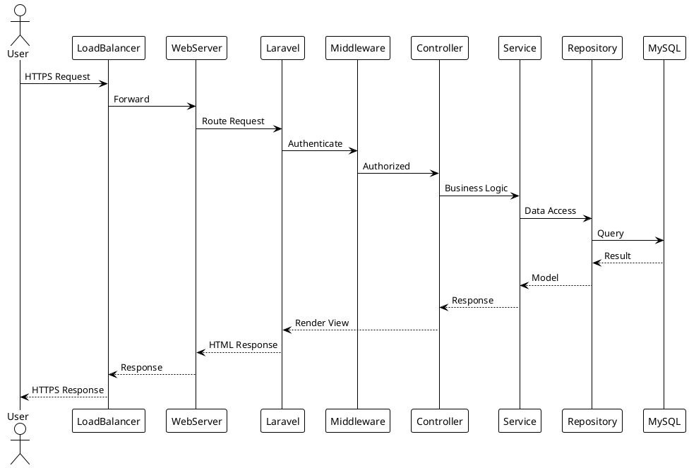
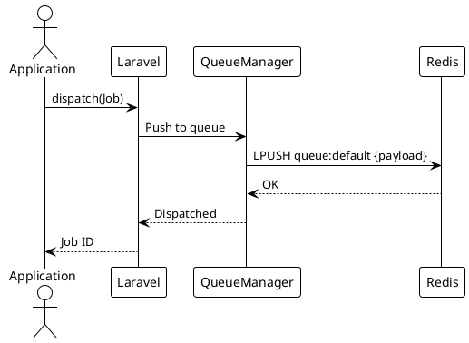
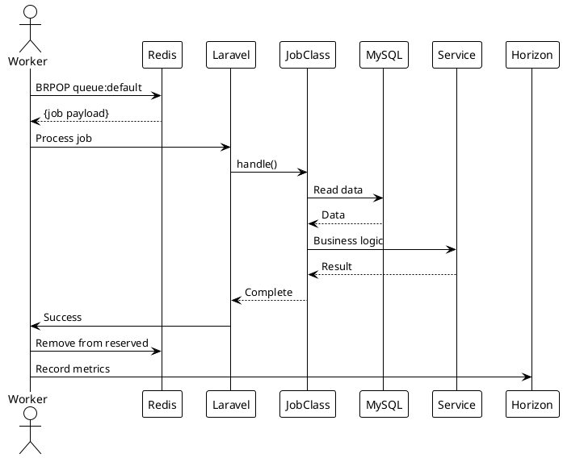
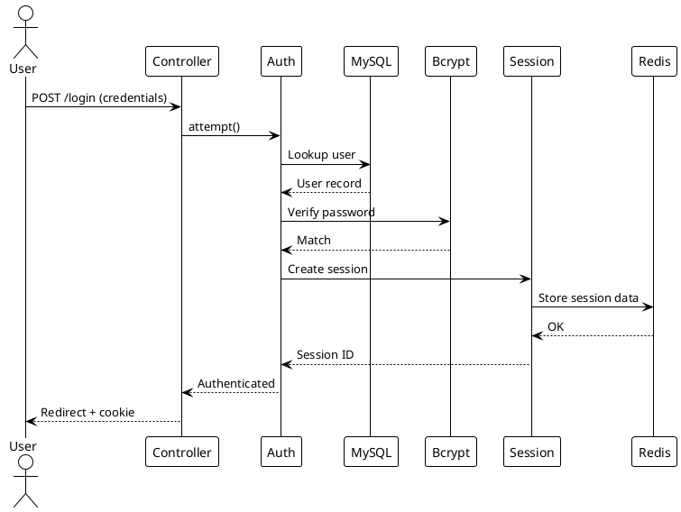
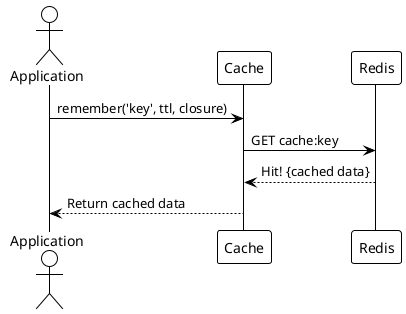
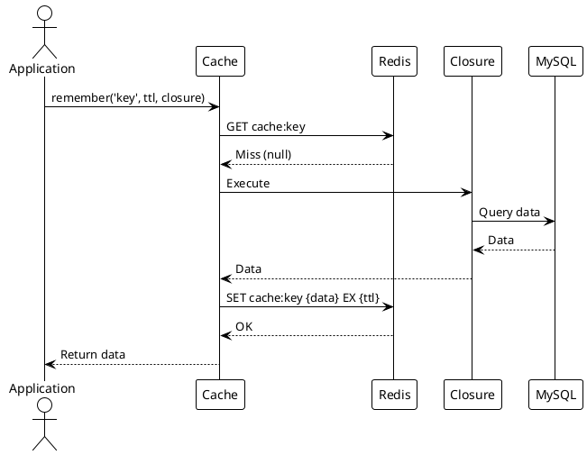
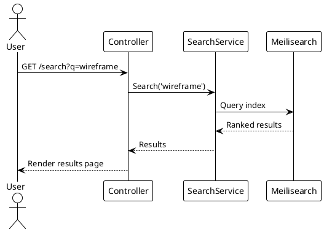
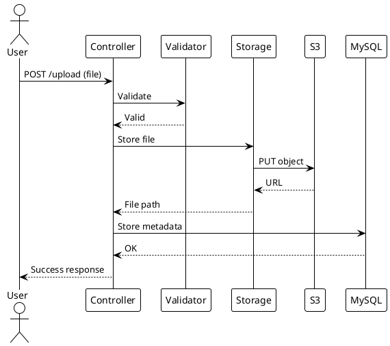
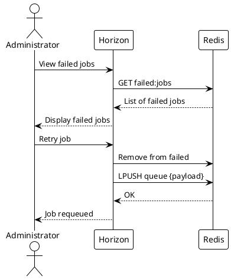
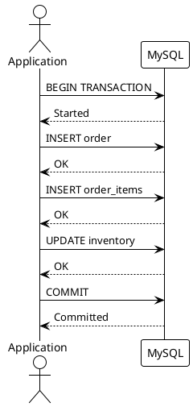

# 05.03.15 - Container Sequence Diagrams

**Project:** GsmUi
**Architecture:** C4 Model – Level 2 (Container)
**Container:** Platform Interactions
**Framework:** Laravel 13 + Multiple
**Version:** 1.0.0

---

# Purpose

This document provides sequence diagrams for key interaction flows in the GsmUi platform. Sequence diagrams illustrate how containers communicate, the order of operations, and the data exchanged between components. Understanding these flows is essential for debugging, optimization, and onboarding.

---

# Diagram Index

1. Web Request Flow
2. Job Dispatch Flow
3. Job Processing Flow
4. Authentication Flow
5. Cache Hit Flow
6. Cache Miss Flow
7. Search Query Flow
8. File Upload Flow
9. Failed Job Recovery Flow
10. Database Transaction Flow

---

# 1. Web Request Flow

---

# 2. Job Dispatch Flow

---

# 3. Job Processing Flow

---

# 4. Authentication Flow

---

# 5. Cache Hit Flow

---

# 6. Cache Miss Flow

---

# 7. Search Query Flow

---

# 8. File Upload Flow

---

# 9. Failed Job Recovery Flow

---

# 10. Database Transaction Flow

---

# Flow Characteristics

| Flow | Containers | Complexity | Frequency |
|------|-----------|------------|----------|
| Web Request | All | High | Very High |
| Job Dispatch | Queue, Redis | Low | High |
| Job Processing | Queue, MySQL, Services | Medium | High |
| Authentication | Web, Redis, MySQL | Medium | Medium |
| Cache Hit | Web, Redis | Low | Very High |
| Cache Miss | Web, Redis, MySQL | Medium | Medium |
| Search Query | Web, Meilisearch | Low | Medium |
| File Upload | Web, S3, MySQL | Medium | Low |
| Failed Job Recovery | Horizon, Redis | Low | Low |
| Database Transaction | MySQL | Medium | Medium |

---

# Container Communication Matrix

| From | To | Protocol | Purpose |
|------|----|----------|---------|
| Load Balancer | Web | HTTP/HTTPS | Traffic routing |
| Web | Redis | TCP | Cache, sessions, queue |
| Web | MySQL | TCP | Data access |
| Web | Meilisearch | HTTP | Search |
| Web | S3 | HTTPS | File storage |
| Queue Worker | Redis | TCP | Queue processing |
| Queue Worker | MySQL | TCP | Job data |
| Horizon | Redis | TCP | Metrics, state |
| Horizon | MySQL | TCP | Failed jobs |

---

# Summary

Sequence diagrams provide a clear view of how GsmUi containers interact for key flows. By tracing requests from user interaction through to data persistence and back, these diagrams serve as both documentation and a foundation for performance optimization and troubleshooting.

---

# End of C4 Container Documentation
