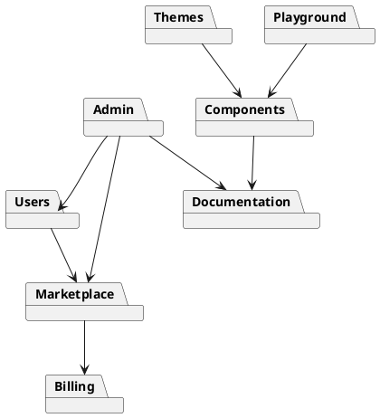

# 05.04 - Domain-Driven Design (DDD)

**Project:** GsmUi
**Architecture:** Domain-Driven Design (DDD)
**Version:** 1.0.0

---

# Purpose

This document defines the Domain-Driven Design (DDD) architecture for GsmUi. The platform is organized around business domains rather than technical layers, ensuring each module owns its data, business rules, services, events, and user interfaces.

The architecture follows a **Modular Monolith** approach where each domain is independently developed and tested while remaining within a single Laravel application.

---

# Design Principles

Every domain must be:

* Independent
* Cohesive
* Testable
* Replaceable
* Extensible
* Loosely coupled

Domains communicate only through:

* Services
* Events
* Contracts (Interfaces)
* Value Objects

Never through direct database manipulation.

---

# DDD Layers

```text
Presentation Layer
        │
Application Layer
        │
Domain Layer
        │
Infrastructure Layer
```

---

# Layer Responsibilities

## Presentation Layer

Contains:

* Livewire Components
* Blade Views
* Controllers
* API Resources
* Form Requests

Responsible only for:

* HTTP
* Validation
* Rendering
* User Interaction

No business logic belongs here.

---

## Application Layer

Coordinates business operations.

Contains:

* Services
* Actions
* Commands
* Queries
* DTOs

Responsibilities:

* Execute use cases
* Start transactions
* Dispatch events
* Coordinate repositories

---

## Domain Layer

Contains the business rules.

Includes:

* Entities
* Value Objects
* Domain Services
* Policies
* Events
* Specifications
* Business Rules

This layer contains the core of GsmUi.

---

## Infrastructure Layer

Contains:

* Eloquent Models
* Repositories
* Storage
* Mail
* Cache
* Queue
* External APIs
* Payment Providers

---

# Bounded Contexts

GsmUi is divided into independent bounded contexts.

```text
Authentication
Users
Components
Documentation
Themes
Templates
Marketplace
Billing
Blog
CMS
Playground
Charts
Showcase
Search
Notifications
Analytics
Admin
System
```

Each context owns its:

* Models
* Database tables
* Services
* Policies
* Livewire components
* Routes
* Events
* Jobs
* Tests

---

# Domain Overview

## Authentication

Responsibilities:

* Login
* Registration
* Email Verification
* Password Reset
* Two-Factor Authentication
* Sessions
* API Tokens

Owns:

```text
UserCredential
LoginAttempt
Session
```

---

## Users

Responsibilities:

* Profiles
* Preferences
* Teams
* API Keys
* Favorites
* Notifications

Owns:

```text
User
Profile
Preference
ApiKey
```

---

## Components

Core business module.

Responsibilities:

* UI Components
* Examples
* Variants
* Documentation
* Versions
* Releases

Owns:

```text
Component
ComponentVersion
ComponentExample
ComponentCategory
```

---

## Documentation

Responsibilities:

* Guides
* API Docs
* Examples
* Search
* Versioning

Owns:

```text
Documentation
DocumentationVersion
Section
Article
```

---

## Themes

Responsibilities:

* Theme generation
* Theme publishing
* Theme downloads
* Theme previews

Owns:

```text
Theme
ThemeVersion
ThemeToken
ThemeExport
```

---

## Playground

Responsibilities:

* Live editing
* Preview
* Export
* Save projects

Owns:

```text
Playground
PlaygroundProject
Snippet
```

---

## Templates

Responsibilities:

* Premium templates
* Downloads
* Categories
* Licensing

Owns:

```text
Template
TemplateVersion
TemplateDownload
```

---

## Marketplace

Responsibilities:

* Products
* Pricing
* Orders
* Coupons
* Reviews

Owns:

```text
Product
Order
Coupon
Review
```

---

## Billing

Responsibilities:

* Plans
* Subscriptions
* Payments
* Licenses
* Invoices

Owns:

```text
Plan
Subscription
Invoice
Payment
License
```

---

## Blog

Responsibilities:

* Articles
* Authors
* Categories
* Tags
* SEO

Owns:

```text
Post
Category
Tag
Series
```

---

## CMS

Responsibilities:

* Pages
* Menus
* Settings
* Banners
* FAQs

Owns:

```text
Page
Menu
Banner
Setting
Faq
```

---

## Showcase

Responsibilities:

* Community projects
* Ratings
* Comments
* Collections

Owns:

```text
Showcase
Collection
Comment
```

---

## Charts

Responsibilities:

* Chart templates
* Chart builder
* Export
* Presets

Owns:

```text
Chart
Preset
```

---

## Notifications

Responsibilities:

* Emails
* In-App Notifications
* Webhooks
* Preferences

Owns:

```text
Notification
Preference
```

---

## Analytics

Responsibilities:

* Usage
* Downloads
* Revenue
* Dashboard metrics

Owns:

```text
Metric
Event
DashboardWidget
```

---

## Admin

Responsibilities:

* Moderation
* User management
* Settings
* Reports

Owns:

```text
AuditLog
FeatureFlag
SystemSetting
```

---

# Domain Relationships



---

# Shared Kernel

Shared components used across domains.

Includes:

```text
Enums
Traits
Contracts
Exceptions
Helpers
Support
Value Objects
DTOs
Events
```

The shared kernel must remain small.

---

# Aggregates

Examples of aggregate roots.

## Component Aggregate

Root

Component

Children

* Version
* Example
* Variant
* Documentation

---

## Theme Aggregate

Root

Theme

Children

* Colors
* Tokens
* Export
* Preview

---

## Order Aggregate

Root

Order

Children

* Items
* Payment
* Invoice
* License

---

# Domain Events

Each domain publishes events.

Examples

```text
ComponentReleased

ThemePublished

ThemeDownloaded

TemplatePurchased

SubscriptionCreated

InvoicePaid

UserRegistered

ShowcaseApproved

ArticlePublished
```

Other domains react through listeners.

---

# Domain Services

Business rules belong inside services.

Examples

```text
ComponentService

ThemeService

DocumentationService

BillingService

MarketplaceService

SearchService

AnalyticsService
```

---

# Repositories

Every aggregate has a repository.

Examples

```text
ComponentRepository

ThemeRepository

OrderRepository

UserRepository

DocumentationRepository
```

Repositories never contain business rules.

---

# Value Objects

Immutable objects representing concepts.

Examples

```text
Money

Color

Email

ThemeToken

Slug

Version

Coordinate

DateRange
```

Benefits:

* Immutable
* Type-safe
* Reusable

---

# Specifications

Business rules are expressed as specifications.

Examples

```text
CanPublishComponent

CanDownloadTemplate

HasActiveSubscription

IsPremiumUser

ThemeIsValid
```

---

# Application Services

Application services orchestrate use cases.

Example

```text
CreateOrder

PublishTheme

GenerateTheme

ApproveShowcase

PublishComponent
```

---

# Anti-Corruption Layer

External integrations are isolated.

Adapters include:

* Stripe
* Paddle
* LemonSqueezy
* GitHub
* Meilisearch
* Resend
* S3

Internal domains never depend directly on vendor SDKs.

---

# Transactions

Transactions are limited to one aggregate whenever possible.

Cross-domain consistency is maintained using:

* Events
* Queues
* Retry mechanisms

---

# Module Independence

Every domain must compile and evolve independently.

Allowed dependencies:

```text
Users

↓

Billing

↓

Marketplace
```

Forbidden:

```text
Marketplace

↓

Users

↓

Marketplace
```

Avoid circular dependencies.

---

# Folder Structure

```text
app/

Domains/

    Users/

    Components/

    Documentation/

    Themes/

    Marketplace/

    Billing/

    Blog/

    Playground/

    Showcase/

    Admin/

Shared/

Infrastructure/
```

Each domain contains:

```text
Actions/

DTOs/

Enums/

Events/

Exceptions/

Http/

Jobs/

Livewire/

Mail/

Models/

Policies/

Repositories/

Rules/

Services/

Tests/

ValueObjects/

Views/
```

---

# Benefits

This DDD approach provides:

* Clear ownership
* Easier testing
* Better scalability
* Independent evolution
* Cleaner business logic
* Reduced coupling
* Better onboarding
* Future microservice readiness

---

# Future Evolution

The bounded contexts defined here can be extracted into standalone services if required, while preserving their public contracts. The MVP remains a Modular Monolith to maximize development velocity and operational simplicity, with DDD boundaries ensuring long-term maintainability.

---

# DDD Implementation Patterns

## Aggregate Design Patterns

### Component Aggregate

```php
// Domain Entity
class Component
{
    private ComponentId $id;
    private string $name;
    private string $slug;
    private string $description;
    private ComponentStatus $status;
    private UserId $authorId;
    private ComponentVersion $currentVersion;
    private Collection $versions;
    private Collection $examples;
    private Collection $categories;
    private Carbon $createdAt;
    private Carbon $updatedAt;

    public function release(): void
    {
        if ($this->status !== ComponentStatus::Draft) {
            throw new ComponentCannotBeReleasedException($this->id);
        }

        $this->status = ComponentStatus::Published;
        $this->releasedAt = Carbon::now();

        $this->recordEvent(new ComponentReleased(
            $this->id,
            $this->currentVersion,
            $this->authorId
        ));
    }

    public function addVersion(ComponentVersion $version): void
    {
        $this->versions->add($version);
        $this->currentVersion = $version->version();

        $this->recordEvent(new ComponentVersionAdded(
            $this->id,
            $version
        ));
    }
}
```

### Value Objects

```php
// Value Object
final class ComponentVersion
{
    private string $major;
    private string $minor;
    private string $patch;

    public function __construct(string $version)
    {
        if (!preg_match('/^\d+\.\d+\.\d+$/', $version)) {
            throw new InvalidVersionException($version);
        }

        [$this->major, $this->minor, $this->patch] = explode('.', $version);
    }

    public function __toString(): string
    {
        return "{$this->major}.{$this->minor}.{$this->patch}";
    }

    public function isGreaterThan(self $other): bool
    {
        return version_compare((string) $this, (string) $other) > 0;
    }

    public function isMinorUpdate(self $other): bool
    {
        return $this->major === $other->major
            && $this->minor !== $other->minor;
    }

    public function isMajorUpdate(self $other): bool
    {
        return $this->major !== $other->major;
    }
}
```

### Domain Events

```php
// Domain Event
class ComponentReleased
{
    public function __construct(
        public readonly ComponentId $componentId,
        public readonly ComponentVersion $version,
        public readonly UserId $releasedBy,
        public readonly Carbon $releasedAt = new Carbon(),
    ) {}
}

// Event Dispatcher Integration
class ComponentEventDispatcher
{
    public function dispatch(ComponentReleased $event): void
    {
        // Dispatch to Laravel event system
        event($event);

        // Store event for event sourcing (optional)
        $this->eventStore->append($event);
    }
}
```

## Repository Patterns

### Repository Interface

```php
interface ComponentRepository
{
    public function findById(ComponentId $id): ?Component;
    public function findBySlug(string $slug): ?Component;
    public function save(Component $component): void;
    public function delete(ComponentId $id): void;
    public function findPublished(int $limit = 20, int $offset = 0): array;
    public function countByAuthor(UserId $authorId): int;
    public function findByCategory(CategoryId $categoryId): array;
}
```

### Eloquent Repository Implementation

```php
class EloquentComponentRepository implements ComponentRepository
{
    public function __construct(
        private ComponentModel $model
    ) {}

    public function findById(ComponentId $id): ?Component
    {
        $model = $this->model->find($id->value());

        return $model ? $this->toDomain($model) : null;
    }

    public function save(Component $component): void
    {
        $model = $this->toModel($component);
        $model->save();

        // Update in-memory ID if new
        if ($component->id() === null) {
            $component->setId(new ComponentId($model->id));
        }
    }

    private function toDomain(ComponentModel $model): Component
    {
        return Component::reconstitute(
            id: new ComponentId($model->id),
            name: $model->name,
            slug: $model->slug,
            description: $model->description,
            status: ComponentStatus::from($model->status),
            authorId: new UserId($model->author_id),
            versions: $this->mapVersions($model->versions),
            examples: $this->mapExamples($model->examples),
        );
    }

    private function toModel(Component $component): ComponentModel
    {
        return new ComponentModel([
            'id' => $component->id()?->value(),
            'name' => $component->name(),
            'slug' => $component->slug(),
            'description' => $component->description(),
            'status' => $component->status()->value,
            'author_id' => $component->authorId()->value(),
        ]);
    }
}
```

## Domain Service Patterns

### Component Service

```php
class ComponentService
{
    public function __construct(
        private ComponentRepository $repository,
        private EventDispatcher $events,
        private SearchIndexer $search,
        private AuthorizationChecker $auth,
    ) {}

    public function publishComponent(
        PublishComponentCommand $command
    ): Component {
        // Check authorization
        $this->auth->check('publish-component', $command->userId);

        // Load aggregate
        $component = $this->repository->findById(
            $command->componentId
        );

        if ($component === null) {
            throw new ComponentNotFoundException($command->componentId);
        }

        // Execute domain logic
        $component->release();

        // Persist
        $this->repository->save($component);

        // Index for search
        $this->search->indexComponent($component);

        // Dispatch events
        $this->events->dispatch(new ComponentReleased(
            $component->id(),
            $component->currentVersion(),
            $command->userId
        ));

        return $component;
    }
}
```

## CQRS Pattern

### Command Side

```php
// Command
class PublishComponentCommand
{
    public function __construct(
        public readonly ComponentId $componentId,
        public readonly UserId $userId,
    ) {}
}

// Command Handler
class PublishComponentHandler
{
    public function __construct(
        private ComponentRepository $repository,
        private EventDispatcher $events,
    ) {}

    public function handle(PublishComponentCommand $command): void
    {
        $component = $this->repository->findById($command->componentId);

        $component->release();

        $this->repository->save($component);

        $this->events->dispatch(new ComponentReleased(
            $component->id(),
            $component->currentVersion(),
            $command->userId
        ));
    }
}
```

### Query Side

```php
// Query
class GetComponentBySlugQuery
{
    public function __construct(
        public readonly string $slug,
    ) {}
}

// Query Handler
class GetComponentBySlugHandler
{
    public function __construct(
        private ComponentReadRepository $readRepository,
    ) {}

    public function handle(GetComponentBySlugQuery $query): ?ComponentReadModel
    {
        return $this->readRepository->findBySlug($query->slug);
    }
}

// Read Model (denormalized for query performance)
class ComponentReadModel
{
    public function __construct(
        public readonly string $id,
        public readonly string $name,
        public readonly string $slug,
        public readonly string $description,
        public readonly string $status,
        public readonly string $authorName,
        public readonly int $versionCount,
        public readonly int $downloadCount,
        public readonly float $ratingAverage,
    ) {}
}
```

## Specification Pattern

### Specifications

```php
interface Specification
{
    public function isSatisfiedBy(mixed $candidate): bool;
}

class CanPublishComponent implements Specification
{
    public function isSatisfiedBy(Component $component): bool
    {
        return $component->status() === ComponentStatus::Draft
            && $component->hasVersion()
            && $component->hasExamples()
            && $component->hasDescription();
    }
}

class IsPremiumUser implements Specification
{
    public function isSatisfiedBy(User $user): bool
    {
        return $user->hasActiveSubscription()
            && $user->subscription()->tier() !== SubscriptionTier::Free;
    }
}

class ThemeIsValid implements Specification
{
    public function isSatisfiedBy(Theme $theme): bool
    {
        return $theme->hasRequiredTokens()
            && $theme->colorsHaveSufficientContrast()
            && $theme->isValidCss();
    }
}
```

## Anti-Corruption Layer

### Stripe Integration

```php
// Domain Interface
interface PaymentProvider
{
    public function createSubscription(
        UserId $userId,
        PlanId $planId,
        PaymentMethod $paymentMethod
    ): Subscription;

    public function cancelSubscription(
        SubscriptionId $subscriptionId
    ): void;

    public function processPayment(
        PaymentId $paymentId,
        Amount $amount
    ): PaymentResult;
}

// Stripe Adapter
class StripePaymentProvider implements PaymentProvider
{
    public function __construct(
        private StripeClient $stripe,
    ) {}

    public function createSubscription(
        UserId $userId,
        PlanId $planId,
        PaymentMethod $paymentMethod
    ): Subscription {
        // Map domain models to Stripe API
        $stripeCustomer = $this->findOrCreateCustomer($userId);
        $stripePrice = $this->mapPlanToPrice($planId);

        // Call Stripe API
        $stripeSubscription = $this->stripe->subscriptions->create([
            'customer' => $stripeCustomer->id,
            'items' => [['price' => $stripePrice->id]],
            'payment_behavior' => 'default_incomplete',
            'expand' => ['latest_invoice.payment_intent'],
        ]);

        // Map Stripe response to domain model
        return new Subscription(
            id: new SubscriptionId($stripeSubscription->id),
            userId: $userId,
            planId: $planId,
            status: SubscriptionStatus::from($stripeSubscription->status),
        );
    }
}
```

## Event Sourcing (Optional)

### Event Store

```php
class EventStore
{
    public function append(DomainEvent $event): void
    {
        DB::table('domain_events')->insert([
            'event_id' => Str::uuid(),
            'aggregate_type' => class_basename($event->aggregateType()),
            'aggregate_id' => $event->aggregateId(),
            'event_type' => class_basename($event),
            'event_data' => json_encode($event),
            'metadata' => json_encode([
                'user_id' => $event->userId(),
                'ip_address' => $event->ipAddress(),
            ]),
            'created_at' => $event->occurredAt(),
        ]);
    }

    public function getEvents(string $aggregateType, string $aggregateId): array
    {
        return DB::table('domain_events')
            ->where('aggregate_type', $aggregateType)
            ->where('aggregate_id', $aggregateId)
            ->orderBy('created_at')
            ->get()
            ->map(fn($record) => $this->deserialize($record))
            ->toArray();
    }
}
```

### Aggregate Reconstruction

```php
class ComponentAggregate
{
    public static function reconstitute(
        ComponentId $id,
        array $events
    ): self {
        $component = new self();

        foreach ($events as $event) {
            $component->apply($event);
        }

        return $component;
    }

    private function apply(DomainEvent $event): void
    {
        match ($event::class) {
            ComponentCreated::class => $this->whenCreated($event),
            ComponentReleased::class => $this->whenReleased($event),
            ComponentVersionAdded::class => $this->whenVersionAdded($event),
            default => throw new \InvalidArgumentException(
                "Unknown event: " . $event::class
            ),
        };
    }
}
```

## Testing DDD Components

### Aggregate Tests

```php
class ComponentTest extends TestCase
{
    public function test_component_can_be_published(): void
    {
        $component = Component::create(
            name: 'Button',
            slug: 'button',
            description: 'A button component',
            authorId: new UserId(1),
        );

        $component->addVersion(new ComponentVersion('1.0.0'));
        $component->addExample(new ComponentExample(
            title: 'Basic Button',
            code: '<x-gsmui:button>Click me</x-gsmui:button>'
        ));

        $component->release();

        $this->assertEquals(
            ComponentStatus::Published,
            $component->status()
        );
        $this->assertNotNull($component->releasedAt());
        $this->assertCount(1, $component->recordedEvents());
    }

    public function test_component_cannot_be_published_without_version(): void
    {
        $component = Component::create(
            name: 'Button',
            slug: 'button',
            description: 'A button component',
            authorId: new UserId(1),
        );

        $this->expectException(ComponentCannotBeReleasedException::class);

        $component->release();
    }
}
```

### Repository Tests

```php
class EloquentComponentRepositoryTest extends TestCase
{
    public function test_can_save_and_retrieve_component(): void
    {
        $repository = new EloquentComponentRepository(
            new ComponentModel()
        );

        $component = Component::create(
            name: 'Button',
            slug: 'button',
            description: 'A button component',
            authorId: new UserId(1),
        );

        $repository->save($component);

        $retrieved = $repository->findById($component->id());

        $this->assertNotNull($retrieved);
        $this->assertEquals('Button', $retrieved->name());
    }
}
```

### Service Tests

```php
class ComponentServiceTest extends TestCase
{
    public function test_publish_component_dispatches_event(): void
    {
        $events = Mockery::mock(EventDispatcher::class);
        $events->shouldReceive('dispatch')
            ->once()
            ->with(Mockery::type(ComponentReleased::class));

        $repository = Mockery::mock(ComponentRepository::class);
        $repository->shouldReceive('findById')
            ->once()
            ->andReturn($this->createDraftComponent());
        $repository->shouldReceive('save')
            ->once();

        $service = new ComponentService($repository, $events);

        $service->publishComponent(new PublishComponentCommand(
            componentId: new ComponentId(1),
            userId: new UserId(1),
        ));
    }
}
```

## DDD Anti-Patterns to Avoid

| Anti-Pattern | Description | Solution |
|-------------|-------------|----------|
| Anemic Domain Model | Entities with only getters/setters | Move behavior into entities |
| God Object | One class doing everything | Split into bounded contexts |
| Domain Events Everywhere | Events for every small change | Events for cross-boundary only |
| Shared Database | Multiple domains share tables | Isolate database per domain |
| Cyclic Dependencies | Domain A depends on B, B on A | Introduce shared kernel or facade |
| Business Logic in Controllers | Logic in Livewire/Controllers | Move to services/entities |
| Data Transfer Everywhere | DTOs for internal communication | Use entities within bounded context |

---

# DDD Migration Strategy

## Strangler Fig Pattern

The Strangler Fig pattern allows gradual migration from a legacy architecture to DDD without a big-bang rewrite.

### Migration Phases

```text
Phase 1: Identify
    │
    ├── Map existing functionality to bounded contexts
    │
    ├── Identify highest-value migration targets
    │
    └── Define migration boundaries

Phase 2: Extract
    │
    ├── Create new DDD context alongside legacy
    │
    ├── Implement anti-corruption layer
    │
    └── Route traffic to new context

Phase 3: Migrate
    │
    ├── Move data to new context
    │
    ├── Update all callers
    │
    └── Verify functionality

Phase 4: Decommission
    │
    ├── Remove legacy code
    │
    ├── Remove anti-corruption layer
    │
    └── Clean up database
```

### Migration Priority Matrix

| Context | Business Value | Technical Debt | Migration Effort | Priority |
|---------|---------------|---------------|-----------------|----------|
| Authentication | High | Low | Low | First |
| Billing | High | Medium | Medium | Second |
| Components | High | Low | Medium | Third |
| Documentation | Medium | Low | Low | Fourth |
| Marketplace | High | Medium | High | Fifth |
| Blog | Low | Low | Low | Last |

## Database Migration Strategy

### Schema Evolution

```text
Legacy Schema
    │
    ├── Identify aggregate boundaries
    │
    ├── Create new tables per aggregate
    │
    ├── Migrate data in chunks
    │
    ├── Update application to use new schema
    │
    └── Drop legacy tables
```

### Data Migration Example

```php
class MigrateComponentsToDDD extends Migration
{
    public function up(): void
    {
        // Create new aggregate table
        Schema::create('components_v2', function (Blueprint $table) {
            $table->uuid('id')->primary();
            $table->string('name');
            $table->string('slug')->unique();
            $table->text('description');
            $table->string('status');
            $table->foreignId('author_id');
            $table->json('metadata');
            $table->timestamps();

            $table->index('status');
            $table->index('author_id');
        });

        // Migrate data in chunks
        DB::table('components')
            ->orderBy('id')
            ->chunk(100, function ($components) {
                foreach ($components as $component) {
                    DB::table('components_v2')->insert([
                        'id' => Str::uuid(),
                        'name' => $component->name,
                        'slug' => $component->slug,
                        'description' => $component->description,
                        'status' => $component->status,
                        'author_id' => $component->user_id,
                        'metadata' => json_encode([
                            'legacy_id' => $component->id,
                        ]),
                        'created_at' => $component->created_at,
                        'updated_at' => $component->updated_at,
                    ]);
                }
            });
    }
}
```

## API Migration Strategy

### Versioning During Migration

```text
API v1 (Legacy)
    │
    ├── Keep running during migration
    │
    ├── Route to legacy implementation
    │
    └── Deprecation headers added

API v2 (DDD)
    │
    ├── New endpoints using DDD patterns
    │
    ├── Route to new implementation
    │
    └── Full documentation
```

### Migration Router

```php
class MigrationRouter
{
    public function route(Request $request): string
    {
        $path = $request->path();

        // Check if path should use new implementation
        if ($this->isMigrated($path)) {
            return 'ddd';
        }

        // Default to legacy
        return 'legacy';
    }

    private function isMigrated(string $path): bool
    {
        $migratedPaths = [
            'api/v2/components',
            'api/v2/themes',
            'api/v2/billing',
        ];

        foreach ($migratedPaths as $migratedPath) {
            if (str_starts_with($path, $migratedPath)) {
                return true;
            }
        }

        return false;
    }
}
```

## Testing During Migration

### Migration Test Strategy

| Test Type | Purpose | Scope |
|-----------|---------|-------|
| Contract tests | Ensure API compatibility | All endpoints |
| Integration tests | Verify data migration | Migrated data |
| Regression tests | Ensure no functionality lost | All features |
| Performance tests | Ensure no degradation | Critical paths |
| Parallel runs | Compare old vs new results | All operations |

### Parallel Run Implementation

```php
class ParallelRunTest extends TestCase
{
    public function test_component_publish_parallel(): void
    {
        // Old implementation
        $oldResult = $this->legacyService->publishComponent($componentId);

        // New implementation
        $newResult = $this->dddService->publishComponent($componentId);

        // Compare results
        $this->assertEquals(
            $oldResult->status(),
            $newResult->status()
        );
        $this->assertEquals(
            $oldResult->name(),
            $newResult->name()
        );
    }
}
```

## Team Organization for DDD

### Team Structure

| Team | Responsibility | Bounded Contexts |
|------|---------------|-----------------|
| Platform Team | Core infrastructure | Authentication, Users, Admin |
| Product Team | Business features | Components, Themes, Templates |
| Commerce Team | Revenue features | Billing, Marketplace |
| Content Team | Content features | Documentation, Blog, CMS |
| Growth Team | User engagement | Showcase, Notifications, Analytics |

### Team Topology

```text
Platform Team
    │
    ├── Authentication Context
    ├── Users Context
    ├── Admin Context
    └── Shared Kernel

Product Team
    │
    ├── Components Context
    ├── Themes Context
    ├── Templates Context
    └── Playground Context

Commerce Team
    │
    ├── Billing Context
    └── Marketplace Context

Content Team
    │
    ├── Documentation Context
    ├── Blog Context
    └── CMS Context

Growth Team
    │
    ├── Showcase Context
    ├── Notifications Context
    └── Analytics Context
```

### Cross-Team Communication

| Pattern | Use Case | Implementation |
|---------|----------|---------------|
| Domain Events | Async cross-context | Laravel events |
| Shared Kernel | Shared types/contracts | Composer package |
| Published Language | Cross-team APIs | OpenAPI spec |
| Customer-Supplier | Dependent contexts | Service interfaces |

## DDD Maturity Model

### Maturity Levels

| Level | Description | Characteristics |
|-------|-------------|----------------|
| 1: Initial | Ad-hoc organization | No clear boundaries, business logic everywhere |
| 2: Managed | Basic domain organization | Some separation, services extract business logic |
| 3: Defined | Full DDD implementation | Aggregates, value objects, domain events, repositories |
| 4: Measured | DDD with metrics | Domain metrics, bounded context health, team autonomy |
| 5: Optimizing | Continuous improvement | DDD refactoring, event sourcing, CQRS where beneficial |

### Maturity Assessment

| Criterion | Level 1 | Level 2 | Level 3 | Level 4 | Level 5 |
|-----------|---------|---------|---------|---------|---------|
| Business logic location | Controllers | Services | Entities | Entities + Specs | Full DDD |
| Bounded contexts | None | Partial | Complete | Independent | Extractable |
| Domain events | None | Laravel events | Dedicated events | Event store | Event sourcing |
| Team autonomy | None | Some | Full per context | Independent teams | Platform teams |
| Testing | Unit only | Unit + Feature | Full DDD tests | Domain-focused | Contract tests |

---

# DDD Documentation Standards

## Context Map

The context map is the primary artifact for understanding domain relationships.

### Context Map Template

```text
Context Map: GsmUi Platform
Date: 2025-01-15
Author: Platform Team

Bounded Contexts:
├── Authentication
│   ├── Owner: Platform Team
│   ├── Language: Ubiquitous (auth)
│   └── Status: Stable
│
├── Users
│   ├── Owner: Platform Team
│   ├── Language: Ubiquitous (user)
│   └── Status: Stable
│
├── Components
│   ├── Owner: Product Team
│   ├── Language: Ubiquitous (component)
│   └── Status: Evolving
│
├── Themes
│   ├── Owner: Product Team
│   ├── Language: Ubiquitous (theme)
│   └── Status: Evolving
│
├── Billing
│   ├── Owner: Commerce Team
│   ├── Language: Ubiquitous (billing)
│   └── Status: Stable
│
├── Marketplace
│   ├── Owner: Commerce Team
│   ├── Language: Ubiquitous (marketplace)
│   └── Status: Stable
│
└── Documentation
    ├── Owner: Content Team
    ├── Language: Ubiquitous (docs)
    └── Status: Stable

Relationships:
├── Components → Documentation (Published Language)
├── Components → Themes (Customer-Supplier)
├── Marketplace → Billing (Customer-Supplier)
├── Marketplace → Components (Partnership)
└── All → Authentication (Conformist)
```

## Ubiquitous Language

Each bounded context maintains its own ubiquitous language.

### Components Context Language

| Term | Definition | synonyms | Anti-patterns |
|------|-----------|----------|--------------|
| Component | A reusable UI element | Widget, Element | "Module" (too vague) |
| Version | A release of a component | Release, Edition | "Update" (ambiguous) |
| Variant | A visual style option | Style, Theme | "Type" (confusing) |
| Example | A usage demonstration | Demo, Sample | "Test" (misleading) |
| Category | A grouping classification | Group, Tag | "Class" (OOP confusion) |

### Billing Context Language

| Term | Definition | synonyms | Anti-patterns |
|------|-----------|----------|--------------|
| Plan | A subscription tier | Tier, Level | "Package" (vague) |
| Subscription | An active billing relationship | Membership, Account | "Order" (one-time) |
| Invoice | A billing statement | Bill, Statement | "Receipt" (post-payment) |
| Payment | A monetary transaction | Charge, Transaction | "Purchase" (broader) |
| License | Access rights to a product | Permission, Access | "Key" (implementation) |

## Aggregate Documentation

### Component Aggregate

```text
Aggregate: Component
Root Entity: Component
Value Objects: ComponentId, ComponentVersion, Slug, Description
Entities: ComponentVersion, ComponentExample, ComponentVariant
Specifications: CanPublishComponent, HasRequiredFields

Invariants:
1. Component must have at least one version to be published
2. Component slug must be unique across all components
3. Component status must be Draft before it can be Published
4. Component cannot be deleted if it has active subscriptions

Business Rules:
- Only the author or admin can publish a component
- Published components cannot be modified (create new version)
- Component versions must follow semver
- Component must have at least one example to be published

Events Published:
- ComponentCreated
- ComponentReleased
- ComponentVersionAdded
- ComponentArchived

Events Consumed:
- UserRegistered (initialize author profile)
- SubscriptionActivated (grant premium access)
```

## Domain Event Documentation

### Event Template

```text
Event: ComponentReleased
Published By: Components Context
Consumed By: Notifications, Search, Analytics, Marketplace

Payload:
├── component_id (uuid)
├── version (string: "1.2.3")
├── author_id (uuid)
├── released_at (datetime)
└── metadata (json)

Consumer Actions:
├── Notifications: Send release notification to followers
├── Search: Index component in Meilisearch
├── Analytics: Track release event
└── Marketplace: Update featured components

Failure Handling:
├── Notifications: Retry 3 times, then log warning
├── Search: Queue for reindex
├── Analytics: Store for later aggregation
└── Marketplace: Retry 5 times, then alert

SLA: Event processed within 5 minutes
```

## Repository Documentation

### Repository Interface Contract

```text
Repository: ComponentRepository
Aggregate: Component
Storage: MySQL (components table)

Interface Contract:
├── findById(ComponentId): ?Component
│   ├── Returns null if not found
│   ├── Includes versions and examples
│   └── Does not include soft-deleted
│
├── findBySlug(string): ?Component
│   ├── Case-insensitive lookup
│   ├── Returns null if not found
│   └── Includes versions and examples
│
├── save(Component): void
│   ├── Creates or updates based on ID
│   ├── Persists aggregate and children
│   └── Uses database transaction
│
├── delete(ComponentId): void
│   ├── Soft deletes component
│   ├── Does not delete versions/examples
│   └── Requires authorization
│
└── findPublished(int, int): array
    ├── Returns paginated results
    ├── Ordered by created_at desc
    └── Includes author relationship
```

## Value Object Documentation

### Money Value Object

```text
Value Object: Money
Context: Billing, Marketplace

Properties:
├── amount (int): Amount in cents
├── currency (string): ISO 4217 currency code

Invariants:
1. Amount must be non-negative
2. Currency must be valid ISO 4217 code
3. Currency must be uppercase

Operations:
├── add(Money): Money (same currency required)
├── subtract(Money): Money (same currency required)
├── multiply(int): Money
├── equals(Money): bool
├── greaterThan(Money): bool
├── format(): string (e.g., "$49.99")
└── convertTo(Currency, Rate): Money

Anti-Patterns to Avoid:
├── Using floats for money (use integers for cents)
├── Mixing currencies in operations
└── Storing money as strings
```

## Bounded Context Integration Guide

### Integration Patterns by Relationship

| Pattern | When to Use | Example |
|---------|-------------|---------|
| Published Language | Shared data format | Component JSON schema |
| Customer-Supplier | One context depends on another | Marketplace → Billing |
| Conformist | One context conforms to another | All → Authentication |
| Partnership | Bidirectional collaboration | Components ↔ Themes |
| Separate Ways | No integration needed | Blog ↔ Analytics |
| Open Host Service | Public API for multiple consumers | API Gateway |
| Internal Shared Kernel | Shared types/contracts | Value objects package |

### Integration Checklist

| Step | Action | Owner | Status |
|------|--------|-------|--------|
| 1 | Define shared language | Both teams | Pending |
| 2 | Create published language schema | Provider team | Pending |
| 3 | Implement provider interface | Provider team | Pending |
| 4 | Implement consumer adapter | Consumer team | Pending |
| 5 | Write contract tests | Both teams | Pending |
| 6 | Test integration end-to-end | Both teams | Pending |
| 7 | Document integration | Tech writer | Pending |

---

# Next Document

**05.05 - Module Boundaries** defines the dependencies, ownership rules, public interfaces, and communication patterns between all GsmUi modules to prevent tight coupling and maintain architectural integrity.
