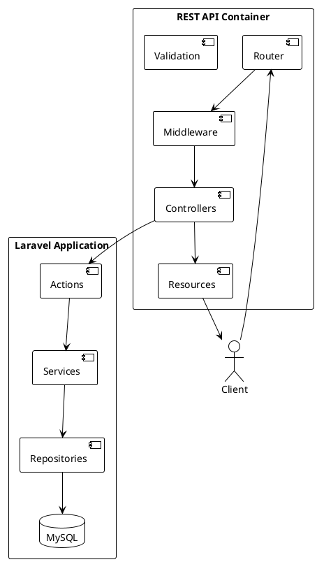

# 05.03.05 - API Container

**Project:** GsmUi
**Architecture:** C4 Model – Level 2 (Container)
**Container:** REST API Container
**Framework:** Laravel 13 + Sanctum
**Version:** 1.0.0

---

# Purpose

The API Container exposes GsmUi's business capabilities to external consumers through a secure, versioned REST API.

Although the primary frontend is built with **Livewire 4**, every major business capability is designed to be API-first, ensuring future compatibility with:

* Mobile applications
* MCP Clients
* CLI Tools
* Third-party Integrations
* Partner Applications
* Future React/Vue Frontends
* GraphQL Gateway

The API Container never contains business logic. It orchestrates requests through the Action and Service layers.

---

# Responsibilities

The API Container is responsible for:

* REST endpoints
* Authentication
* Authorization
* Input validation
* Resource serialization
* Rate limiting
* API versioning
* Webhook endpoints
* Error formatting
* API documentation

It is **not responsible** for:

* Business rules
* Database queries
* HTML rendering
* Theme rendering

---

# Container Diagram



---

# Technology Stack

| Technology            | Purpose         |
| --------------------- | --------------- |
| Laravel 13            | HTTP Framework  |
| Sanctum               | Authentication  |
| Fortify               | User Security   |
| Livewire 4            | Internal UI     |
| Spatie Permission     | Authorization   |
| Laravel API Resources | Serialization   |
| OpenAPI               | Documentation   |
| Redis                 | Rate Limiting   |
| Horizon               | Background Jobs |

---

# API Consumers

Supported consumers include:

```text
Web SPA

Mobile Apps

CLI

MCP Clients

Partner Systems

AI Agents

Automation Scripts

Future SDKs
```

---

# Base URL

```text
/api/v1
```

Future versions:

```text
/api/v2
/api/v3
```

Breaking changes require a new version.

---

# API Modules

Each business domain exposes its own endpoints.

```text
Authentication

Users

Components

Documentation

Themes

Templates

Marketplace

Billing

Playground

Charts

Search

Notifications

Analytics

Admin
```

---

# Route Organization

```
routes/

api.php

↓

routes/api/

auth.php

users.php

components.php

themes.php

templates.php

billing.php

marketplace.php

playground.php

admin.php
```

Each module owns its routes.

---

# Request Lifecycle

```text
HTTPS Request

↓

Route

↓

Middleware

↓

Authentication

↓

Authorization

↓

Validation

↓

Controller

↓

Action

↓

Service

↓

Repository

↓

Database

↓

API Resource

↓

JSON Response
```

---

# Authentication

Supported methods:

## SPA

* Sanctum Cookies

## API

* Personal Access Tokens

## Future

* OAuth2
* Enterprise SSO
* JWT Gateway (optional)

---

# Authorization

Authorization uses:

* Policies
* Gates
* Spatie Permission

Example:

```php
$this->authorize('update', $theme);
```

No authorization logic belongs inside services.

---

# API Controllers

Controllers are intentionally thin.

Example:

```php
public function store(
    StoreThemeRequest $request,
    CreateThemeAction $action
)
{
    return ThemeResource::make(
        $action->execute(
            CreateThemeData::fromRequest($request)
        )
    );
}
```

---

# Validation

Validation pipeline:

```text
HTTP Request

↓

Form Request

↓

DTO

↓

Action

↓

Business Rules
```

Validation layers:

* HTTP validation
* DTO validation
* Business validation

---

# Resources

Every response uses API Resources.

Examples:

```text
ComponentResource

ThemeResource

TemplateResource

UserResource

OrderResource

LicenseResource
```

Never expose raw Eloquent models.

---

# Response Format

Success:

```json
{
  "success": true,
  "data": {},
  "meta": {},
  "links": {}
}
```

Failure:

```json
{
  "success": false,
  "message": "Validation failed.",
  "errors": {}
}
```

---

# Pagination

Supported:

* Length-aware pagination
* Simple pagination
* Cursor pagination

Default:

```text
15 records
```

Maximum:

```text
100 records
```

---

# Filtering

Standard parameters:

```text
?category=forms

?status=published

?sort=name

?direction=asc

?page=2
```

---

# Search

Delegated to SearchService.

Example:

```text
GET /api/v1/search?q=button
```

Supports:

* Full text
* Filters
* Suggestions

---

# File Uploads

Supports:

* Images
* Themes
* Templates
* Documentation Assets
* Avatars

Storage:

* Spatie Media Library
* Object Storage

---

# Downloads

Downloads require:

* Authentication
* License verification
* Signed URL
* Audit logging

---

# Webhooks

Inbound:

```text
Stripe

Paddle

LemonSqueezy

GitHub
```

Outbound:

```text
Purchase Completed

Subscription Renewed

Theme Published

Template Released
```

Webhook handlers are idempotent.

---

# Rate Limiting

| Endpoint       |   Limit |
| -------------- | ------: |
| Public         |  60/min |
| Authenticated  | 120/min |
| Search         |  30/min |
| Authentication |   5/min |
| Webhooks       |  Custom |

---

# Error Handling

Standard status codes:

| Code | Purpose      |
| ---- | ------------ |
| 200  | Success      |
| 201  | Created      |
| 204  | Deleted      |
| 400  | Bad Request  |
| 401  | Unauthorized |
| 403  | Forbidden    |
| 404  | Not Found    |
| 409  | Conflict     |
| 422  | Validation   |
| 429  | Rate Limit   |
| 500  | Server Error |

---

# Security

Implemented protections:

* HTTPS
* CSRF (SPA)
* Rate limiting
* Input validation
* Output escaping
* Signed URLs
* Token authentication
* Audit logging

---

# Caching

Cached endpoints:

* Components
* Documentation
* Navigation
* Themes
* Pricing

Dynamic user data is not cached publicly.

---

# Queue Integration

API requests dispatch jobs for:

* Email
* Search indexing
* Image processing
* Theme compilation
* Analytics

Heavy work never blocks HTTP responses.

---

# Monitoring

Track:

* Request latency
* Error rate
* Authentication failures
* Rate-limit violations
* Endpoint usage

Tools:

* Telescope
* Horizon
* Spatie Health

---

# API Documentation

Generate OpenAPI documentation containing:

* Authentication
* Endpoints
* Schemas
* Parameters
* Responses
* Examples
* Error codes

Documentation should be regenerated during CI.

---

# Folder Structure

```text
app/

Domains/

Components/

Http/

Controllers/

Api/

Resources/

Requests/
```

Example:

```text
Components/

Http/

Controllers/

Api/

ComponentController.php

Resources/

ComponentResource.php

Requests/

StoreComponentRequest.php
```

---

# Testing Strategy

Every endpoint requires:

* Authentication tests
* Authorization tests
* Validation tests
* CRUD tests
* Pagination tests
* Performance tests
* Contract tests

Target:

* ≥90% endpoint coverage

---

# Performance Targets

| Metric                 | Target  |
| ---------------------- | ------- |
| Average Response       | <200 ms |
| Search                 | <100 ms |
| Authentication         | <150 ms |
| Download Authorization | <100 ms |
| API Availability       | 99.9%   |

---

# Future Evolution

Future enhancements include:

* GraphQL gateway
* MCP-native endpoints
* Public SDK generation
* WebSocket events
* API key scopes
* Enterprise APIs
* Batch operations
* Async APIs

The Action and Service layers remain unchanged, ensuring long-term compatibility.

---

# API Gateway Patterns

## Gateway Architecture

The API Gateway serves as the single entry point for all external API consumers. It handles cross-cutting concerns like authentication, rate limiting, request transformation, and response caching.

```text
                    ┌─────────────────────────────────────────┐
                    │              API Gateway                  │
                    │  ┌───────────┬───────────┬───────────┐  │
                    │  │   Auth    │   Rate    │  Request  │  │
                    │  │  Filter   │  Limiter  │Transform  │  │
                    │  └───────────┴───────────┴───────────┘  │
                    │  ┌───────────┬───────────┬───────────┐  │
                    │  │  Response │  Circuit  │   Log     │  │
                    │  │  Cache    │  Breaker  │  Router   │  │
                    │  └───────────┴───────────┴───────────┘  │
                    └──────────┬──────────────────┬────────────┘
                               │                  │
              ┌────────────────┘                  └────────────────┐
              │                                                    │
    ┌─────────▼─────────┐                              ┌──────────▼──────────┐
    │  Auth Service      │                              │  Core API Service    │
    │  /api/v1/auth/*    │                              │  /api/v1/*          │
    └───────────────────┘                              └─────────────────────┘
```

## Gateway Implementation

### Nginx API Gateway

```nginx
# nginx/api-gateway.conf

# Rate limiting zones
limit_req_zone $binary_remote_addr zone=api_general:10m rate=60r/m;
limit_req_zone $binary_remote_addr zone=api_auth:10m rate=5r/m;
limit_req_zone $binary_remote_addr zone=api_search:10m rate=30r/m;

# Upstream definitions
upstream api_backend {
    least_conn;
    server app-1:8000 weight=3;
    server app-2:8000 weight=3;
    server app-3:8000 weight=2;
    keepalive 32;
}

upstream auth_backend {
    server app-1:8001;
    keepalive 16;
}

# API Gateway server
server {
    listen 443 ssl http2;
    server_name api.gsmui.com;

    ssl_certificate /etc/ssl/certs/gsmui-api.crt;
    ssl_certificate_key /etc/ssl/private/gsmui-api.key;

    # Security headers
    add_header X-Request-ID $request_id always;
    add_header X-RateLimit-Limit $limit_req_status always;
    add_header X-Content-Type-Options nosniff always;
    add_header X-Frame-Options DENY always;

    # Request size limit
    client_max_body_size 50m;

    # Timeouts
    proxy_connect_timeout 10s;
    proxy_send_timeout 30s;
    proxy_read_timeout 30s;

    # Authentication endpoints
    location /api/v1/auth/ {
        limit_req zone=api_auth burst=5 nodelay;
        limit_req_status 429;

        proxy_pass http://auth_backend;
        proxy_set_header Host $host;
        proxy_set_header X-Real-IP $remote_addr;
        proxy_set_header X-Forwarded-For $proxy_add_x_forwarded_for;
        proxy_set_header X-Forwarded-Proto $scheme;
        proxy_set_header X-Request-ID $request_id;
    }

    # Search endpoints
    location /api/v1/search {
        limit_req zone=api_search burst=10 nodelay;
        limit_req_status 429;

        proxy_pass http://api_backend;
        proxy_set_header Host $host;
        proxy_set_header X-Real-IP $remote_addr;
        proxy_set_header X-Forwarded-For $proxy_add_x_forwarded_for;
        proxy_set_header X-Forwarded-Proto $scheme;
        proxy_set_header X-Request-ID $request_id;
    }

    # General API endpoints
    location /api/ {
        limit_req zone=api_general burst=20 nodelay;
        limit_req_status 429;

        proxy_pass http://api_backend;
        proxy_set_header Host $host;
        proxy_set_header X-Real-IP $remote_addr;
        proxy_set_header X-Forwarded-For $proxy_add_x_forwarded_for;
        proxy_set_header X-Forwarded-Proto $scheme;
        proxy_set_header X-Request-ID $request_id;

        # Response caching for GET requests
        proxy_cache_valid 200 5m;
        proxy_cache_valid 404 1m;
        proxy_cache_use_stale error timeout updating http_500 http_502 http_503;
        add_header X-Cache-Status $upstream_cache_status;
    }

    # Health check (no rate limiting)
    location /health {
        proxy_pass http://api_backend/health;
        access_log off;
    }

    # Default deny
    location / {
        return 404;
    }
}
```

## Gateway Middleware Pipeline

### PHP Gateway Middleware

```php
<?php

namespace App\Http\Middleware;

use Closure;
use Illuminate\Http\Request;
use Illuminate\Support\Facades\Redis;
use Symfony\Component\HttpFoundation\Response;

class ApiGatewayMiddleware
{
    public function handle(Request $request, Closure $next): Response
    {
        // Add request ID
        $request->headers->set('X-Request-ID', $request->headers->get('X-Request-ID', uniqid()));

        // Log request
        $this->logRequest($request);

        // Execute request
        $response = $next($request);

        // Add response headers
        $response->headers->set('X-Request-ID', $request->headers->get('X-Request-ID'));
        $response->headers->set('X-Response-Time', $this->getResponseTime($request));

        // Log response
        $this->logResponse($request, $response);

        return $response;
    }

    private function logRequest(Request $request): void
    {
        $data = [
            'method' => $request->method(),
            'path' => $request->path(),
            'ip' => $request->ip(),
            'user_agent' => $request->userAgent(),
            'timestamp' => now()->toIso8601String(),
        ];

        Redis::lpush('api:requests', json_encode($data));
        Redis::ltrim('api:requests', 0, 9999);
    }

    private function logResponse(Request $request, Response $response): void
    {
        $data = [
            'method' => $request->method(),
            'path' => $request->path(),
            'status' => $response->getStatusCode(),
            'response_time' => $this->getResponseTime($request),
            'timestamp' => now()->toIso8601String(),
        ];

        Redis::lpush('api:responses', json_encode($data));
        Redis::ltrim('api:responses', 0, 9999);
    }

    private function getResponseTime(Request $request): float
    {
        return (microtime(true) - $request->server('REQUEST_TIME_FLOAT')) * 1000;
    }
}
```

---

# Rate Limiting

## Rate Limiting Architecture

Rate limiting protects the API from abuse and ensures fair usage across consumers.

```text
┌─────────────────────────────────────────────────────────┐
│                   Rate Limiting Stack                     │
├─────────────────────────────────────────────────────────┤
│                                                          │
│  Layer 1: IP-based (Nginx)                              │
│  ┌─────────────────────────────────────────────┐        │
│  │  limit_req_zone $binary_remote_addr          │        │
│  │  rate=60r/m burst=20                         │        │
│  └─────────────────────────────────────────────┘        │
│                                                          │
│  Layer 2: User-based (Redis)                            │
│  ┌─────────────────────────────────────────────┐        │
│  │  Redis sliding window                        │        │
│  │  Per-user quotas                             │        │
│  └─────────────────────────────────────────────┘        │
│                                                          │
│  Layer 3: Endpoint-based (Application)                  │
│  ┌─────────────────────────────────────────────┐        │
│  │  Laravel RateLimiter                         │        │
│  │  Endpoint-specific limits                    │        │
│  └─────────────────────────────────────────────┘        │
│                                                          │
└─────────────────────────────────────────────────────────┘
```

## Rate Limit Configuration

```php
<?php

namespace App\Providers;

use Illuminate\Cache\RateLimiting\Limit;
use Illuminate\Http\Request;
use Illuminate\Support\Facades\RateLimiter;
use Illuminate\Support\ServiceProvider;

class RateLimitServiceProvider extends ServiceProvider
{
    public function boot(): void
    {
        RateLimiter::for('api', function (Request $request) {
            return Limit::perMinute(120)
                ->by($request->user()?->id ?: $request->ip())
                ->response(function (Request $request, array $headers) {
                    return response()->json([
                        'success' => false,
                        'message' => 'Rate limit exceeded.',
                        'retry_after' => $headers['Retry-After'] ?? 60,
                    ], 429, $headers);
                });
        });

        RateLimiter::for('auth', function (Request $request) {
            return Limit::perMinute(5)
                ->by($request->ip());
        });

        RateLimiter::for('search', function (Request $request) {
            return Limit::perMinute(30)
                ->by($request->user()?->id ?: $request->ip());
        });

        RateLimiter::for('webhooks', function (Request $request) {
            return Limit::perMinute(100)
                ->by($request->ip());
        });

        RateLimiter::for('premium', function (Request $request) {
            $limit = $request->user()?->subscription?->rate_limit ?? 60;
            return Limit::perMinute($limit)
                ->by($request->user()->id);
        });
    }
}
```

### Redis Rate Limiter

```php
<?php

namespace App\Services;

use Illuminate\Support\Facades\Redis;

class RedisRateLimiter
{
    public function attempt(string $key, int $maxAttempts, int $windowSeconds, callable $callback): mixed
    {
        $now = microtime(true);
        $windowStart = $now - $windowSeconds;

        $pipeline = Redis::pipeline();
        $pipeline->zremrangebyscore($key, 0, $windowStart);
        $pipeline->zadd($key, [$now => $now]);
        $pipeline->zcard($key);
        $pipeline->expire($key, $windowSeconds);
        $results = $pipeline->execute();

        $attempts = $results[2];

        if ($attempts > $maxAttempts) {
            $retryAfter = ceil($windowSeconds - ($now - $now));
            throw new RateLimitExceededException($retryAfter);
        }

        return $callback();
    }

    public function remaining(string $key, int $maxAttempts, int $windowSeconds): int
    {
        $now = microtime(true);
        $windowStart = $now - $windowSeconds;

        Redis::zremrangebyscore($key, 0, $windowStart);
        $attempts = Redis::zcard($key);

        return max(0, $maxAttempts - $attempts);
    }

    public function reset(string $key): void
    {
        Redis::del($key);
    }
}
```

### Rate Limit Headers

```php
<?php

namespace App\Http\Middleware;

use Closure;
use Illuminate\Http\Request;
use Illuminate\Support\Facades\RateLimiter;
use Symfony\Component\HttpFoundation\Response;

class RateLimitHeadersMiddleware
{
    public function handle(Request $request, Closure $next): Response
    {
        $response = $next($request);

        $limiter = RateLimiter::limiter('api');
        $key = $request->user()?->id ?: $request->ip();
        $maxAttempts = 120;

        $remaining = $maxAttempts - $limiter->attempts($key);
        $retryAfter = $limiter->availableIn($key);

        $response->headers->set('X-RateLimit-Limit', $maxAttempts);
        $response->headers->set('X-RateLimit-Remaining', max(0, $remaining));
        $response->headers->set('X-RateLimit-Reset', now()->addSeconds($retryAfter)->timestamp);

        if ($remaining <= 0) {
            $response->headers->set('Retry-After', $retryAfter);
        }

        return $response;
    }
}
```

---

# Request/Response Lifecycle

## Complete Request Lifecycle

```text
Client Request
    │
    ▼
┌──────────────┐
│   TLS/SSL    │
│ Termination  │
└──────┬───────┘
       │
       ▼
┌──────────────┐
│   Nginx      │
│   Gateway    │
└──────┬───────┘
       │
       ├── Rate Limiting Check
       ├── Request ID Generation
       ├── IP Whitelist/Blacklist
       │
       ▼
┌──────────────┐
│  Laravel     │
│  HTTP Kernel │
└──────┬───────┘
       │
       ├── TrustProxies Middleware
       ├── HandleCors Middleware
       ├── PreventRequestsDuringMaintenance
       ├── ValidatePostSize
       ├── TrimStrings
       ├── ConvertEmptyStringsToNull
       │
       ▼
┌──────────────┐
│   Route      │
│   Resolution │
└──────┬───────┘
       │
       ├── Authenticate (API Guard)
       ├── ThrottleRequests
       ├── ApiVersion
       │
       ▼
┌──────────────┐
│  Controller  │
└──────┬───────┘
       │
       ├── FormRequest Validation
       ├── Authorization Check
       ├── Action Execution
       │
       ▼
┌──────────────┐
│   Action     │
└──────┬───────┘
       │
       ├── DTO Creation
       ├── Service Invocation
       ├── Event Dispatch
       │
       ▼
┌──────────────┐
│   Service    │
└──────┬───────┘
       │
       ├── Business Rules
       ├── Repository Calls
       ├── Domain Events
       │
       ▼
┌──────────────┐
│  Repository  │
└──────┬───────┘
       │
       ├── Eloquent Queries
       ├── Cache Checks
       ├── Database Operations
       │
       ▼
┌──────────────┐
│  API Resource│
│  Response    │
└──────┬───────┘
       │
       ├── Serialization
       ├── Response Headers
       ├── Rate Limit Headers
       │
       ▼
   Client Response
```

## Request Pipeline Implementation

```php
<?php

namespace App\Http;

use Illuminate\Foundation\Http\Kernel;

class ApiKernel extends Kernel
{
    protected $middleware = [
        \App\Http\Middleware\TrustProxies::class,
        \Illuminate\Http\Middleware\HandleCors::class,
        \App\Http\Middleware\PreventRequestsDuringMaintenance::class,
        \Illuminate\Foundation\Http\Middleware\ValidatePostSize::class,
        \App\Http\Middleware\TrimStrings::class,
        \Illuminate\Foundation\Http\Middleware\ConvertEmptyStringsToNull::class,
    ];

    protected $middlewareGroups = [
        'web' => [
            \Illuminate\Cookie\Middleware\EncryptCookies::class,
            \Illuminate\Cookie\Middleware\AddQueuedCookiesToResponse::class,
            \Illuminate\Session\Middleware\StartSession::class,
            \Illuminate\View\Middleware\ShareErrorsFromSession::class,
            \Illuminate\Foundation\Http\Middleware\VerifyCsrfToken::class,
            \Illuminate\Routing\Middleware\SubstituteBindings::class,
        ],
        'api' => [
            \Laravel\Sanctum\Http\Middleware\EnsureFrontendRequestsAreStateful::class,
            \Illuminate\Routing\Middleware\ThrottleRequests::class.':api',
            \Illuminate\Routing\Middleware\SubstituteBindings::class,
            \App\Http\Middleware\ApiGatewayMiddleware::class,
            \App\Http\Middleware\RateLimitHeadersMiddleware::class,
            \App\Http\Middleware\ApiVersionMiddleware::class,
        ],
    ];

    protected $middlewareAliases = [
        'auth' => \App\Http\Middleware\Authenticate::class,
        'auth.basic' => \Illuminate\Auth\Middleware\AuthenticateWithBasicAuth::class,
        'auth.session' => \Illuminate\Session\Middleware\AuthenticateSession::class,
        'cache.headers' => \Illuminate\Http\Middleware\SetCacheHeaders::class,
        'can' => \Illuminate\Auth\Middleware\Authorize::class,
        'guest' => \App\Http\Middleware\RedirectIfAuthenticated::class,
        'password.confirm' => \Illuminate\Auth\Middleware\RequirePassword::class,
        'signed' => \App\Http\Middleware\ValidateSignature::class,
        'throttle' => \Illuminate\Routing\Middleware\ThrottleRequests::class,
        'verified' => \Illuminate\Auth\Middleware\EnsureEmailIsVerified::class,
        'api.version' => \App\Http\Middleware\ApiVersionMiddleware::class,
        'api.scopes' => \App\Http\Middleware\ApiScopesMiddleware::class,
    ];
}
```

---

# Middleware Pipeline

## Custom Middleware Stack

### Authentication Middleware

```php
<?php

namespace App\Http\Middleware;

use Closure;
use Illuminate\Http\Request;
use Illuminate\Support\Facades\Auth;
use Symfony\Component\HttpFoundation\Response;

class ApiAuthenticateMiddleware
{
    public function handle(Request $request, Closure $next): Response
    {
        // Check for API token
        $token = $request->bearerToken();

        if (!$token) {
            return response()->json([
                'success' => false,
                'message' => 'Authentication token required.',
            ], 401);
        }

        // Validate token
        $user = Auth::guard('sanctum')->user();

        if (!$user) {
            return response()->json([
                'success' => false,
                'message' => 'Invalid or expired token.',
            ], 401);
        }

        // Check token scopes
        $requiredScopes = $request->route()->getAction('scopes') ?? [];

        foreach ($requiredScopes as $scope) {
            if (!$user->tokenCan($scope)) {
                return response()->json([
                    'success' => false,
                    'message' => "Insufficient scope: {$scope}",
                ], 403);
            }
        }

        $request->setUserResolver(fn () => $user);

        return $next($request);
    }
}
```

### CORS Middleware

```php
<?php

namespace App\Http\Middleware;

use Closure;
use Illuminate\Http\Request;
use Symfony\Component\HttpFoundation\Response;

class CorsMiddleware
{
    public function handle(Request $request, Closure $next): Response
    {
        $headers = [
            'Access-Control-Allow-Origin' => $this->getAllowedOrigin($request),
            'Access-Control-Allow-Methods' => 'GET, POST, PUT, PATCH, DELETE, OPTIONS',
            'Access-Control-Allow-Headers' => 'Content-Type, Authorization, X-Request-ID, X-API-Version',
            'Access-Control-Allow-Credentials' => 'true',
            'Access-Control-Max-Age' => '86400',
            'Access-Control-Expose-Headers' => 'X-RateLimit-Limit, X-RateLimit-Remaining, X-RateLimit-Reset',
        ];

        if ($request->isMethod('OPTIONS')) {
            return response('', 204)->withHeaders($headers);
        }

        $response = $next($request);

        foreach ($headers as $key => $value) {
            $response->headers->set($key, $value);
        }

        return $response;
    }

    private function getAllowedOrigin(Request $request): string
    {
        $origin = $request->headers->get('Origin');
        $allowedOrigins = config('cors.allowed_origins', ['https://gsmui.com']);

        return in_array($origin, $allowedOrigins) ? $origin : $allowedOrigins[0];
    }
}
```

### Request Logging Middleware

```php
<?php

namespace App\Http\Middleware;

use Closure;
use Illuminate\Http\Request;
use Illuminate\Support\Facades\Log;
use Symfony\Component\HttpFoundation\Response;

class RequestLoggingMiddleware
{
    public function handle(Request $request, Closure $next): Response
    {
        $startTime = microtime(true);

        $requestId = $request->headers->get('X-Request-ID', uniqid('req_'));
        $request->headers->set('X-Request-ID', $requestId);

        Log::channel('api')->info('Incoming request', [
            'request_id' => $requestId,
            'method' => $request->method(),
            'url' => $request->fullUrl(),
            'ip' => $request->ip(),
            'user_agent' => $request->userAgent(),
            'user_id' => $request->user()?->id,
        ]);

        $response = $next($request);

        $duration = (microtime(true) - $startTime) * 1000;

        Log::channel('api')->info('Request completed', [
            'request_id' => $requestId,
            'method' => $request->method(),
            'url' => $request->path(),
            'status' => $response->getStatusCode(),
            'duration_ms' => round($duration, 2),
        ]);

        return $response;
    }
}
```

---

# API Versioning

## Versioning Strategy

API versioning ensures backward compatibility while allowing the API to evolve.

### URL Path Versioning

```php
<?php

// routes/api.php
Route::prefix('v1')->group(function () {
    require __DIR__ . '/api/v1/auth.php';
    require __DIR__ . '/api/v1/users.php';
    require __DIR__ . '/api/v1/components.php';
    require __DIR__ . '/api/v1/themes.php';
});

Route::prefix('v2')->group(function () {
    require __DIR__ . '/api/v2/auth.php';
    require __DIR__ . '/api/v2/users.php';
});
```

### Version Negotiation Middleware

```php
<?php

namespace App\Http\Middleware;

use Closure;
use Illuminate\Http\Request;
use Symfony\Component\HttpFoundation\Response;

class ApiVersionMiddleware
{
    private array $supportedVersions = ['v1', 'v2'];
    private string $defaultVersion = 'v1';
    private string $deprecatedVersion = 'v1';

    public function handle(Request $request, Closure $next): Response
    {
        // Extract version from URL
        $version = $this->extractVersionFromUrl($request);

        // Validate version
        if ($version && !in_array($version, $this->supportedVersions)) {
            return response()->json([
                'success' => false,
                'message' => "API version '{$version}' is not supported.",
                'supported_versions' => $this->supportedVersions,
            ], 400);
        }

        $version = $version ?? $this->defaultVersion;

        // Set version in request
        $request->attributes->set('api_version', $version);

        $response = $next($request);

        // Add version headers
        $response->headers->set('X-API-Version', $version);
        $response->headers->set('X-Supported-Versions', implode(', ', $this->supportedVersions));

        // Add deprecation notice
        if ($version === $this->deprecatedVersion) {
            $response->headers->set('Deprecation', 'true');
            $response->headers->set('Sunset', 'Sat, 01 Jan 2027 00:00:00 GMT');
            $response->headers->set('Link', '</api/v2>; rel="successor-version"');
        }

        return $response;
    }

    private function extractVersionFromUrl(Request $request): ?string
    {
        $path = $request->path();
        if (preg_match('/^v(\d+)\//', $path, $matches)) {
            return 'v' . $matches[1];
        }
        return null;
    }
}
```

### Version-Specific Resources

```php
<?php

namespace App\Http\Resources\V1;

use Illuminate\Http\Resources\Json\JsonResource;

class ComponentResource extends JsonResource
{
    public function toArray($request): array
    {
        return [
            'id' => $this->id,
            'name' => $this->name,
            'slug' => $this->slug,
            'description' => $this->description,
            'category' => $this->category->name,
            'created_at' => $this->created_at->toIso8601String(),
        ];
    }
}
```

```php
<?php

namespace App\Http\Resources\V2;

use Illuminate\Http\Resources\Json\JsonResource;

class ComponentResource extends JsonResource
{
    public function toArray($request): array
    {
        return [
            'id' => $this->id,
            'name' => $this->name,
            'slug' => $this->slug,
            'description' => $this->description,
            'category' => [
                'id' => $this->category->id,
                'name' => $this->category->name,
                'slug' => $this->category->slug,
            ],
            'tags' => $this->tags->pluck('name'),
            'stats' => [
                'downloads' => $this->total_downloads,
                'rating' => $this->average_rating,
            ],
            'created_at' => $this->created_at->toIso8601String(),
            'updated_at' => $this->updated_at->toIso8601String(),
        ];
    }
}
```

---

# OpenAPI Specification

## OpenAPI Config

```yaml
# openapi.yaml
openapi: 3.1.0
info:
  title: GsmUi API
  description: |
    The GsmUi API provides access to the GsmUi platform's components, themes,
    templates, marketplace, and billing capabilities.

    ## Authentication
    All API requests require authentication via Bearer tokens.

    ## Rate Limiting
    - Authenticated: 120 requests/minute
    - Search: 30 requests/minute
    - Authentication: 5 requests/minute

    ## Versioning
    The API is versioned via URL path: `/api/v1/`
  version: 2.15.0
  contact:
    name: GsmUi API Support
    email: api@gsmui.com
  license:
    name: MIT
    url: https://opensource.org/licenses/MIT

servers:
  - url: https://api.gsmui.com/api/v1
    description: Production
  - url: https://staging-api.gsmui.com/api/v1
    description: Staging

paths:
  /components:
    get:
      summary: List components
      operationId: listComponents
      tags: [Components]
      parameters:
        - name: category
          in: query
          schema:
            type: string
        - name: sort
          in: query
          schema:
            type: string
            enum: [name, created_at, downloads]
        - name: page
          in: query
          schema:
            type: integer
            default: 1
      responses:
        '200':
          description: Successful response
          content:
            application/json:
              schema:
                $ref: '#/components/schemas/ComponentList'
        '429':
          description: Rate limit exceeded

  /components/{id}:
    get:
      summary: Get component
      operationId: getComponent
      tags: [Components]
      parameters:
        - name: id
          in: path
          required: true
          schema:
            type: integer
      responses:
        '200':
          description: Successful response
          content:
            application/json:
              schema:
                $ref: '#/components/schemas/Component'
        '404':
          description: Component not found

components:
  securitySchemes:
    bearerAuth:
      type: http
      scheme: bearer
      bearerFormat: JWT

  schemas:
    Component:
      type: object
      properties:
        id:
          type: integer
        name:
          type: string
        slug:
          type: string
        description:
          type: string
        category:
          type: string
        created_at:
          type: string
          format: date-time

    ComponentList:
      type: object
      properties:
        success:
          type: boolean
        data:
          type: array
          items:
            $ref: '#/components/schemas/Component'
        meta:
          $ref: '#/components/schemas/PaginationMeta'
        links:
          $ref: '#/components/schemas/PaginationLinks'

    PaginationMeta:
      type: object
      properties:
        current_page:
          type: integer
        last_page:
          type: integer
        per_page:
          type: integer
        total:
          type: integer

    PaginationLinks:
      type: object
      properties:
        self:
          type: string
        first:
          type: string
        last:
          type: string
        prev:
          type: string
        next:
          type: string

security:
  - bearerAuth: []
```

---

# GraphQL Considerations

## GraphQL Gateway

```php
<?php

namespace App\GraphQL;

use GraphQL\Type\Definition\Type;
use GraphQL\Type\Schema;
use GraphQL\Type\SchemaConfig;

class GraphQLGateway
{
    private Schema $schema;

    public function __construct()
    {
        $this->schema = $this->buildSchema();
    }

    private function buildSchema(): Schema
    {
        $queryType = new \GraphQL\Type\Definition\ObjectType([
            'name' => 'Query',
            'fields' => [
                'components' => [
                    'type' => Type::listOf(\App\GraphQL\Types\ComponentType::get()),
                    'args' => [
                        'category' => Type::string(),
                        'search' => Type::string(),
                        'first' => Type::int(),
                    ],
                    'resolve' => function ($root, $args) {
                        return app(\App\Services\ComponentService::class)
                            ->graphqlQuery($args);
                    },
                ],
                'theme' => [
                    'type' => \App\GraphQL\Types\ThemeType::get(),
                    'args' => [
                        'id' => Type::nonNull(Type::id()),
                    ],
                    'resolve' => function ($root, $args) {
                        return app(\App\Services\ThemeService::class)
                            ->find($args['id']);
                    },
                ],
            ],
        ]);

        $mutationType = new \GraphQL\Type\Definition\ObjectType([
            'name' => 'Mutation',
            'fields' => [
                'createOrder' => [
                    'type' => \App\GraphQL\Types\OrderType::get(),
                    'args' => [
                        'product_id' => Type::nonNull(Type::id()),
                        'quantity' => Type::int(),
                    ],
                    'resolve' => function ($root, $args, $context) {
                        return app(\App\Services\BillingService::class)
                            ->createOrderFromGraphQL($args, $context['user']);
                    },
                ],
            ],
        ]);

        return new Schema(new SchemaConfig([
            'query' => $queryType,
            'mutation' => $mutationType,
        ]));
    }

    public function execute(string $query, ?array $variables = null, ?array $context = null): array
    {
        return \GraphQL\GraphQL::executeQuery(
            $this->schema,
            $query,
            null,
            $context ?? [],
            $variables ?? []
        );
    }
}
```

---

# gRPC Considerations

## gRPC Service Definition

```protobuf
// proto/gsmui/v1/component.proto
syntax = "proto3";

package gsmui.v1;

import "google/protobuf/timestamp.proto";

service ComponentService {
  rpc GetComponent(GetComponentRequest) returns (Component);
  rpc ListComponents(ListComponentsRequest) returns (ListComponentsResponse);
  rpc CreateComponent(CreateComponentRequest) returns (Component);
  rpc UpdateComponent(UpdateComponentRequest) returns (Component);
  rpc DeleteComponent(DeleteComponentRequest) returns (google.protobuf.Empty);
}

message Component {
  int64 id = 1;
  string name = 2;
  string slug = 3;
  string description = 4;
  string category = 5;
  google.protobuf.Timestamp created_at = 6;
  google.protobuf.Timestamp updated_at = 7;
}

message GetComponentRequest {
  int64 id = 1;
}

message ListComponentsRequest {
  string category = 1;
  string search = 2;
  int32 page = 3;
  int32 per_page = 4;
}

message ListComponentsResponse {
  repeated Component data = 1;
  PaginationMeta meta = 2;
}

message PaginationMeta {
  int32 current_page = 1;
  int32 last_page = 2;
  int32 per_page = 3;
  int32 total = 4;
}

message CreateComponentRequest {
  string name = 1;
  string description = 2;
  int64 category_id = 3;
}

message UpdateComponentRequest {
  int64 id = 1;
  string name = 2;
  string description = 3;
  int64 category_id = 4;
}

message DeleteComponentRequest {
  int64 id = 1;
}
```

---

# WebSocket Support

## WebSocket Configuration

```php
<?php

namespace App\Providers;

use Illuminate\Support\Facades\Broadcast;
use Illuminate\Support\ServiceProvider;

class WebSocketServiceProvider extends ServiceProvider
{
    public function boot(): void
    {
        Broadcast::channel('user.{userId}', function ($user, $userId) {
            return (int) $user->id === (int) $userId;
        });

        Broadcast::channel('components', function ($user) {
            return $user->can('view-components');
        });

        Broadcast::channel('admin', function ($user) {
            return $user->hasRole('admin');
        });
    }
}
```

## WebSocket Event Classes

```php
<?php

namespace App\Events;

use Illuminate\Broadcasting\Channel;
use Illuminate\Broadcasting\InteractsWithSockets;
use Illuminate\Contracts\Broadcasting\ShouldBroadcast;
use Illuminate\Foundation\Events\Dispatchable;
use Illuminate\Queue\SerializesModels;

class ComponentUpdated implements ShouldBroadcast
{
    use Dispatchable, InteractsWithSockets, SerializesModels;

    public function __construct(
        public readonly int $componentId,
        public readonly string $action,
        public readonly array $data
    ) {}

    public function broadcastOn(): Channel
    {
        return new Channel('components');
    }

    public function broadcastAs(): string
    {
        return 'component.updated';
    }

    public function broadcastWith(): array
    {
        return [
            'id' => $this->componentId,
            'action' => $this->action,
            'data' => $this->data,
            'timestamp' => now()->toIso8601String(),
        ];
    }
}
```

---

# Middleware Pipeline Summary

| Middleware | Priority | Purpose |
|------------|----------|---------|
| TrustProxies | 1 | IP forwarding |
| HandleCors | 2 | Cross-origin requests |
| RateLimitMiddleware | 3 | Request throttling |
| ApiAuthenticate | 4 | Token validation |
| ApiVersion | 5 | Version routing |
| ApiScopes | 6 | Scope validation |
| RequestLogging | 7 | Audit trail |
| RateLimitHeaders | 8 | Response headers |

---

# Batch Operations

## Batch Request Support

The API supports batch operations for efficient bulk processing.

### Batch Endpoint

```php
<?php

namespace App\Http\Controllers\Api;

use App\Http\Controllers\Controller;
use Illuminate\Http\Request;
use Illuminate\Http\JsonResponse;

class BatchController extends Controller
{
    public function handle(Request $request): JsonResponse
    {
        $request->validate([
            'operations' => 'required|array|max:50',
            'operations.*.method' => 'required|in:GET,POST,PUT,DELETE',
            'operations.*.path' => 'required|string',
            'operations.*.body' => 'nullable|array',
        ]);

        $operations = $request->input('operations');
        $results = [];

        foreach ($operations as $index => $operation) {
            $results[] = $this->executeOperation($operation, $index);
        }

        return response()->json([
            'success' => true,
            'results' => $results,
        ]);
    }

    private function executeOperation(array $operation, int $index): array
    {
        try {
            $method = $operation['method'];
            $path = $operation['path'];
            $body = $operation['body'] ?? null;

            $httpRequest = \Illuminate\Http\Request::create($path, $method, $body ?? []);
            $response = app()->make(\Illuminate\Contracts\Http\Kernel::class)->handle($httpRequest);

            return [
                'index' => $index,
                'status' => $response->getStatusCode(),
                'body' => json_decode($response->getContent(), true),
            ];
        } catch (\Exception $e) {
            return [
                'index' => $index,
                'status' => 500,
                'error' => $e->getMessage(),
            ];
        }
    }
}
```

### Batch Processing Rules

| Rule | Value | Description |
|------|-------|-------------|
| Max operations per batch | 50 | Prevents resource exhaustion |
| Timeout per operation | 30s | Individual operation timeout |
| Total batch timeout | 5min | Overall batch timeout |
| Atomicity | Non-atomic | Operations execute independently |
| Error handling | Per-operation | One failure doesn't stop others |
| Response format | Array of results | Each result indexed by position |

---

# Async API Support

## Long-Running Operations

For operations that exceed HTTP timeout limits, the API supports asynchronous execution.

### Async Request Pattern

```php
<?php

namespace App\Http\Controllers\Api;

use App\Http\Controllers\Controller;
use Illuminate\Http\Request;
use Illuminate\Http\JsonResponse;
use Illuminate\Support\Facades\Bus;

class AsyncController extends Controller
{
    public function submitJob(Request $request): JsonResponse
    {
        $validated = $request->validate([
            'type' => 'required|string',
            'params' => 'required|array',
            'callback_url' => 'nullable|url',
        ]);

        $job = new \App\Jobs\ProcessAsyncOperation(
            $validated['type'],
            $validated['params'],
            $validated['callback_url'] ?? null,
            $request->user()->id
        );

        $jobId = Bus::dispatch($job)->getJobId();

        return response()->json([
            'success' => true,
            'job_id' => $jobId,
            'status_url' => "/api/v1/jobs/{$jobId}",
            'estimated_duration' => $this->estimateDuration($validated['type']),
        ], 202);
    }

    public function getJobStatus(string $jobId): JsonResponse
    {
        $job = \App\Models\AsyncJob::find($jobId);

        if (!$job) {
            return response()->json([
                'success' => false,
                'message' => 'Job not found',
            ], 404);
        }

        return response()->json([
            'success' => true,
            'job_id' => $job->id,
            'status' => $job->status,
            'progress' => $job->progress,
            'result' => $job->result,
            'created_at' => $job->created_at->toIso8601String(),
            'updated_at' => $job->updated_at->toIso8601String(),
        ]);
    }

    private function estimateDuration(string $type): int
    {
        return match($type) {
            'theme_generation' => 30,
            'bulk_export' => 60,
            'search_reindex' => 120,
            default => 30,
        };
    }
}
```

### Async Job Model

```php
<?php

namespace App\Models;

use Illuminate\Database\Eloquent\Model;
use Illuminate\Database\Eloquent\SoftDeletes;

class AsyncJob extends Model
{
    use SoftDeletes;

    protected $fillable = [
        'user_id',
        'type',
        'params',
        'callback_url',
        'status',
        'progress',
        'result',
        'error',
        'started_at',
        'completed_at',
    ];

    protected $casts = [
        'params' => 'json',
        'result' => 'json',
        'progress' => 'integer',
    ];

    const STATUS_PENDING = 'pending';
    const STATUS_RUNNING = 'running';
    const STATUS_COMPLETED = 'completed';
    const STATUS_FAILED = 'failed';
    const STATUS_CANCELLED = 'cancelled';

    public function user()
    {
        return $this->belongsTo(User::class);
    }

    public function markAsRunning(): void
    {
        $this->update([
            'status' => self::STATUS_RUNNING,
            'started_at' => now(),
        ]);
    }

    public function markAsCompleted(array $result): void
    {
        $this->update([
            'status' => self::STATUS_COMPLETED,
            'progress' => 100,
            'result' => $result,
            'completed_at' => now(),
        ]);

        $this->notifyCallback();
    }

    public function markAsFailed(string $error): void
    {
        $this->update([
            'status' => self::STATUS_FAILED,
            'error' => $error,
            'completed_at' => now(),
        ]);

        $this->notifyCallback();
    }

    private function notifyCallback(): void
    {
        if ($this->callback_url) {
            \App\Jobs\NotifyAsyncCallback::dispatch($this);
        }
    }
}
```

---

# API Version Lifecycle

## Version Lifecycle Management

### Version Status Definitions

| Status | Description | Duration |
|--------|-------------|----------|
| Active | Current stable version, fully supported | 12 months |
| Deprecated | Still functional, but migration recommended | 6 months |
| Sunset | Will be removed, headers warn clients | 3 months |
| Removed | No longer available | Permanent |

### Deprecation Headers

```php
<?php

namespace App\Http\Middleware;

use Closure;
use Illuminate\Http\Request;
use Symfony\Component\HttpFoundation\Response;

class ApiDeprecationMiddleware
{
    private array $deprecatedVersions = [
        'v1' => [
            'deprecated_at' => '2026-06-01',
            'sunset_at' => '2026-12-01',
            'successor' => 'v2',
        ],
    ];

    public function handle(Request $request, Closure $next): Response
    {
        $version = $request->attributes->get('api_version');

        $response = $next($request);

        if (isset($this->deprecatedVersions[$version])) {
            $deprecation = $this->deprecatedVersions[$version];

            $response->headers->set('Deprecation', $deprecation['deprecated_at']);
            $response->headers->set('Sunset', $deprecation['sunset_at']);
            $response->headers->set('Link', "</api/{$deprecation['successor']}>; rel=\"successor-version\"");

            $response->headers->set('X-API-Warning', "Version {$version} is deprecated. Please migrate to {$deprecation['successor']}.");
        }

        return $response;
    }
}
```

### Version Migration Guide Generator

```php
<?php

namespace App\Services;

class VersionMigrationGuide
{
    public function generate(string $fromVersion, string $toVersion): array
    {
        $changes = $this->getChanges($fromVersion, $toVersion);

        return [
            'from' => $fromVersion,
            'to' => $toVersion,
            'breaking_changes' => $changes['breaking'],
            'new_features' => $changes['new'],
            'deprecated_features' => $changes['deprecated'],
            'migration_steps' => $this->getMigrationSteps($fromVersion, $toVersion),
            'estimated_effort' => $this->estimateEffort($changes),
        ];
    }

    private function getChanges(string $from, string $to): array
    {
        return [
            'breaking' => [
                'ComponentResource now includes nested category object',
                'Pagination response structure changed',
                'Search endpoint requires authentication',
            ],
            'new' => [
                'Bulk operations support',
                'GraphQL gateway',
                'WebSocket events',
                'Async API for long-running operations',
            ],
            'deprecated' => [
                'Legacy pagination format',
                'XML response format',
            ],
        ];
    }

    private function getMigrationSteps(string $from, string $to): array
    {
        return [
            'Update base URL from /api/' . $from . ' to /api/' . $to,
            'Review ComponentResource response structure',
            'Add authentication to search requests',
            'Update client libraries',
            'Test all API integrations',
            'Update webhook endpoints',
        ];
    }

    private function estimateEffort(array $changes): string
    {
        $breakingCount = count($changes['breaking']);
        if ($breakingCount <= 2) return 'Low (1-2 hours)';
        if ($breakingCount <= 5) return 'Medium (4-8 hours)';
        return 'High (1-2 days)';
    }
}
```

---

# API Key Management

## API Key System

### API Key Model

```php
<?php

namespace App\Models;

use Illuminate\Database\Eloquent\Model;
use Illuminate\Database\Eloquent\SoftDeletes;
use Illuminate\Support\Str;

class ApiKey extends Model
{
    use SoftDeletes;

    protected $fillable = [
        'user_id',
        'name',
        'key',
        'secret',
        'scopes',
        'rate_limit',
        'expires_at',
        'last_used_at',
        'is_active',
    ];

    protected $casts = [
        'scopes' => 'json',
        'expires_at' => 'datetime',
        'last_used_at' => 'datetime',
        'is_active' => 'boolean',
    ];

    public static function generate(string $userId, string $name, array $scopes = []): array
    {
        $key = 'gsm_' . Str::random(32);
        $secret = Str::random(48);

        $apiKey = static::create([
            'user_id' => $userId,
            'name' => $name,
            'key' => $key,
            'secret' => hash('sha256', $secret),
            'scopes' => $scopes,
            'rate_limit' => 60,
            'expires_at' => now()->addYear(),
            'is_active' => true,
        ]);

        return [
            'key' => $key,
            'secret' => $secret,
            'id' => $apiKey->id,
        ];
    }

    public function isValid(): bool
    {
        return $this->is_active
            && ($this->expires_at === null || $this->expires_at->isFuture());
    }

    public function hasScope(string $scope): bool
    {
        return in_array('*', $this->scopes ?? []) || in_array($scope, $this->scopes ?? []);
    }

    public function recordUsage(): void
    {
        $this->update(['last_used_at' => now()]);
    }

    public function revoke(): void
    {
        $this->update(['is_active' => false]);
    }

    public function user()
    {
        return $this->belongsTo(User::class);
    }
}
```

### API Key Authentication Middleware

```php
<?php

namespace App\Http\Middleware;

use Closure;
use Illuminate\Http\Request;
use App\Models\ApiKey;
use Symfony\Component\HttpFoundation\Response;

class ApiKeyAuthenticateMiddleware
{
    public function handle(Request $request, Closure $next): Response
    {
        $key = $request->header('X-API-Key');

        if (!$key) {
            return response()->json([
                'success' => false,
                'message' => 'API key required.',
            ], 401);
        }

        $apiKey = ApiKey::where('key', $key)->first();

        if (!$apiKey || !$apiKey->isValid()) {
            return response()->json([
                'success' => false,
                'message' => 'Invalid or expired API key.',
            ], 401);
        }

        $apiKey->recordUsage();

        $request->setUserResolver(fn () => $apiKey->user);

        return $next($request);
    }
}
```

---

# API Analytics

## Usage Analytics System

### Analytics Tracking

```php
<?php

namespace App\Services;

use Illuminate\Support\Facades\DB;
use Illuminate\Support\Facades\Redis;

class ApiAnalyticsService
{
    public function trackRequest(array $data): void
    {
        $pipeline = Redis::pipeline();

        // Track by endpoint
        $pipeline->incr("api:analytics:endpoint:{$data['method']}:{$data['path']}");

        // Track by user
        if (isset($data['user_id'])) {
            $pipeline->incr("api:analytics:user:{$data['user_id']}");
        }

        // Track by status code
        $pipeline->incr("api:analytics:status:{$data['status']}");

        // Track response time
        $pipeline->lpush("api:analytics:response_time", $data['response_time_ms']);
        $pipeline->ltrim("api:analytics:response_time", 0, 9999);

        // Track by time
        $hour = now()->format('Y-m-d-H');
        $pipeline->incr("api:analytics:hourly:{$hour}");

        $pipeline->execute();
    }

    public function getEndpointStats(string $method, string $path): array
    {
        $key = "api:analytics:endpoint:{$method}:{$path}";
        $totalRequests = Redis::get($key) ?? 0;

        $responseTimes = Redis::lrange("api:analytics:response_time", 0, -1);
        $avgResponseTime = !empty($responseTimes)
            ? array_sum(array_map('floatval', $responseTimes)) / count($responseTimes)
            : 0;

        return [
            'total_requests' => (int) $totalRequests,
            'avg_response_time_ms' => round($avgResponseTime, 2),
            'endpoint' => "{$method} {$path}",
        ];
    }

    public function getUsageStats(int $days = 30): array
    {
        $stats = [];
        for ($i = $days; $i >= 0; $i--) {
            $date = now()->subDays($i)->format('Y-m-d');
            $hourKey = now()->subDays($i)->format('Y-m-d-H');
            $stats[$date] = (int) (Redis::get("api:analytics:hourly:{$hourKey}") ?? 0);
        }
        return $stats;
    }

    public function getTopEndpoints(int $limit = 10): array
    {
        $keys = Redis::keys('api:analytics:endpoint:*');
        $endpoints = [];

        foreach ($keys as $key) {
            $parts = explode(':', $key);
            $method = $parts[3] ?? 'UNKNOWN';
            $path = $parts[4] ?? '/';
            $count = (int) Redis::get($key);

            $endpoints[] = [
                'method' => $method,
                'path' => $path,
                'count' => $count,
            ];
        }

        usort($endpoints, fn($a, $b) => $b['count'] <=> $a['count']);

        return array_slice($endpoints, 0, $limit);
    }
}
```

### Analytics Dashboard API

```php
<?php

namespace App\Http\Controllers\Api;

use App\Http\Controllers\Controller;
use App\Services\ApiAnalyticsService;
use Illuminate\Http\JsonResponse;

class ApiAnalyticsController extends Controller
{
    public function __construct(
        private ApiAnalyticsService $analytics
    ) {}

    public function overview(): JsonResponse
    {
        return response()->json([
            'success' => true,
            'data' => [
                'total_requests_today' => $this->analytics->getUsageStats(1),
                'top_endpoints' => $this->analytics->getTopEndpoints(),
                'avg_response_time' => $this->analytics->getAvgResponseTime(),
                'error_rate' => $this->analytics->getErrorRate(),
            ],
        ]);
    }

    public function endpointStats(string $method, string $path): JsonResponse
    {
        $stats = $this->analytics->getEndpointStats($method, $path);

        return response()->json([
            'success' => true,
            'data' => $stats,
        ]);
    }
}
```

---

# Summary

The API Container provides a secure, versioned, and modular interface to the GsmUi platform. By delegating all business workflows to Actions and Services, using standardized resources, and enforcing consistent validation, authentication, and authorization, the API is prepared to serve web, mobile, automation, and AI consumers while remaining maintainable and scalable.

---

# Objectives

| Objective | Description |
|-----------|-------------|
| API-First Design | Every business capability accessible via REST |
| Versioned Endpoints | Backward-compatible API evolution |
| Secure Authentication | Sanctum tokens, SPA cookies, future OAuth2 |
| Consistent Serialization | API Resources for all responses |
| Comprehensive Documentation | OpenAPI spec auto-generated from code |
| Rate Limiting | Protect against abuse, fair usage |
| Webhook Support | Inbound provider events, outbound notifications |
| External Consumer Ready | Mobile, CLI, MCP, partner integrations |

---

# Timeline

| Phase | Duration | Deliverable |
|-------|----------|-------------|
| Route & Middleware | Weeks 1–2 | Auth, rate limiting, versioning |
| Core Endpoints | Weeks 3–5 | Users, Components, Themes, Templates |
| Marketplace API | Weeks 6–7 | Products, orders, reviews |
| Billing API | Weeks 8–9 | Subscriptions, invoices, webhooks |
| Documentation | Week 10 | OpenAPI spec, interactive docs |
| Search & Playground API | Weeks 11–12 | Search endpoints, playground CRUD |
| Admin API | Weeks 13–14 | Admin-only endpoints |
| Testing & QA | Weeks 15–16 | Contract tests, performance tests |
| Production Hardening | Week 17 | Rate limiting, monitoring, alerting |

---

# Budget

| Item | Cost | Notes |
|------|------|-------|
| API Gateway (future) | $100/month | Rate limiting, analytics |
| Documentation Hosting | $10/month | OpenAPI explorer |
| Monitoring | $50/month | Telescope, Grafana |
| Load Testing | $30/month | k6 cloud (optional) |
| Total Monthly (MVP) | ~$90/month | Minimal overhead |

---

# Risk

| Risk | Impact | Likelihood | Mitigation |
|------|--------|------------|------------|
| Breaking changes in API | High | Medium | Versioned URLs, deprecation headers |
| Rate limit bypass | Medium | Low | Redis-backed, multi-layer limiting |
| Token compromise | High | Low | Token scoping, expiration, rotation |
| Webhook replay attacks | Medium | Low | Idempotent handlers, signature verification |
| Payload injection | High | Low | Strict validation, input sanitization |
| API abuse / scraping | Medium | Medium | Rate limiting, IP blocking, CAPTCHA |
| Documentation drift | Low | Medium | Auto-generated from code annotations |
| Version maintenance burden | Medium | Medium | Sunset policy, migration guides |

---

# Security

Implemented protections:

* HTTPS enforced on all endpoints
* CSRF protection for SPA authentication
* Rate limiting per endpoint category
* Input validation on every request
* Output escaping via API Resources
* Signed URLs for file downloads
* Sanctum token authentication
* Audit logging for sensitive operations
* Webhook signature verification
* Token scope restrictions
* IP allowlisting for admin API (future)

---

# Testing

Testing requirements for every endpoint:

| Test Type | Coverage |
|-----------|----------|
| Authentication | Valid/invalid/expired tokens |
| Authorization | Role and permission checks |
| Validation | All request fields, edge cases |
| CRUD operations | Full lifecycle |
| Pagination | Default, custom, cursor |
| Rate limiting | Threshold verification |
| Error responses | Consistent format |
| Contract tests | Request/response schema |

Target: ≥90% endpoint coverage with automated tests.

---

# Performance

| Metric | Target |
|--------|--------|
| Average response time | <200 ms |
| Search endpoint | <100 ms |
| Authentication | <150 ms |
| Download authorization | <100 ms |
| API availability | 99.9% |
| P95 latency | <500 ms |

Optimizations:

* Redis caching for read-heavy endpoints
* Eloquent eager loading
* Response compression
* Query result caching with TTL
* Async processing for write-heavy operations

---

# Future Evolution

| Enhancement | Phase | Impact |
|-------------|-------|--------|
| GraphQL gateway | Phase 3 | Flexible queries |
| MCP-native endpoints | Phase 2 | AI agent integration |
| Public SDK generation | Phase 3 | Developer ecosystem |
| WebSocket events | Phase 4 | Real-time updates |
| API key scopes | Phase 2 | Fine-grained access |
| Enterprise APIs | Phase 5 | B2B integrations |
| Batch operations | Phase 3 | Bulk processing |
| Async APIs (webhook callbacks) | Phase 4 | Long-running operations |

---

# Competitors

| Competitor | API Approach | GsmUi Differentiator |
|------------|-------------|----------------------|
| Stripe | REST, versioned | Domain-specific, Laravel-native |
| GitHub | REST + GraphQL | Full marketplace API |
| Twilio | REST, webhook-heavy | Simpler scope, component-focused |
| Auth0 | REST, OAuth2 | Sanctum-native, Laravel integration |
| Algolia | REST, search-only | Full platform API |
| WordPress REST | REST, inconsistent | Clean, typed, documented |

---

# Brand

API design reflects GsmUi's brand:

* **Consistency**: Uniform response format across all endpoints
* **Developer Experience**: Clear error messages, comprehensive docs
* **Security**: Industry-standard authentication and authorization
* **Reliability**: Idempotent operations, retry-friendly design
* **Transparency**: Versioned endpoints, deprecation notices
* **Performance**: Sub-200ms responses, efficient pagination

---

# Events

Webhook and API-triggered events:

| Event | Direction | Consumer |
|-------|-----------|----------|
| payment.invoice.created | Inbound | Billing module |
| payment.subscription.updated | Inbound | Billing module |
| payment.charge.failed | Inbound | Billing module |
| github.push | Inbound | Component engine |
| purchase.completed | Outbound | Partner systems |
| theme.published | Outbound | Marketplace consumers |
| order.shipped | Outbound | Customer notifications |
| license.generated | Outbound | Download system |

Webhook handlers must be idempotent and return 200 quickly.

---

# Database

API Container database access:

| Pattern | Implementation |
|---------|---------------|
| Read operations | Repository → Eloquent → MySQL |
| Write operations | Controller → Action → Service → Repository |
| Caching | Redis for frequently accessed data |
| Search | Meilisearch (async indexing) |
| File storage | Spatie Media Library → Object Storage |

Rules:

* Never expose Eloquent models directly
* Always use API Resources for serialization
* Enforce query scopes per consumer
* Log all API access for audit trails

---

# KPIs

| KPI | Target | Measurement |
|-----|--------|-------------|
| API uptime | 99.9% | Health monitoring |
| Avg response time | <200 ms | Application monitoring |
| Error rate | <0.1% | Error tracking |
| Auth failure rate | <1% | Security monitoring |
| Rate limit hits | <5% of requests | Redis counters |
| Documentation coverage | 100% endpoints | OpenAPI spec |
| Test coverage | ≥90% | PHPUnit |
| Consumer satisfaction | >4.5/5 | API surveys |
| Webhook delivery rate | >99% | Delivery tracking |
| Token revocation time | <1 minute | Token management |

---

# Resources

| Resource | Allocation | Notes |
|----------|------------|-------|
| API Developer | 1 FTE | Endpoint implementation |
| Backend Developer | 1 FTE | Actions, services, repositories |
| QA Engineer | 0.5 FTE | Contract tests, performance tests |
| Technical Writer | 0.25 FTE | API documentation |
| API Gateway | Future phase | Rate limiting, analytics |
| Monitoring | Telescope + Grafana | Request tracking |
| Load Testing | k6 (optional) | Performance validation |

---

# Conclusion

The API Container provides a secure, versioned, and modular interface to the GsmUi platform. By delegating all business workflows to Actions and Services, using standardized resources, and enforcing consistent validation, authentication, and authorization, the API is prepared to serve web, mobile, automation, and AI consumers while remaining maintainable and scalable.

---

# Next Document

**05.03.06 - Queue Workers Container** details the background processing container, worker topology, Horizon configuration, Redis integration, job execution lifecycle, scaling strategy, and operational responsibilities for asynchronous workloads.
