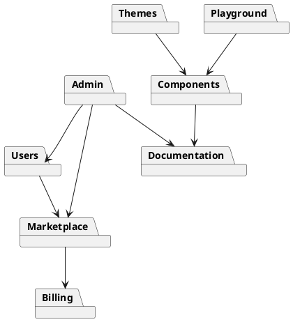

# 05.04 - Domain-Driven Design (DDD)

**Project:** GsmUi
**Architecture:** Domain-Driven Design (DDD)
**Version:** 1.0.0

---

# Purpose

This document defines the Domain-Driven Design (DDD) architecture for GsmUi. The platform is organized around business domains rather than technical layers, ensuring each module owns its data, business rules, services, events, and user interfaces.

The architecture follows a **Modular Monolith** approach where each domain is independently developed and tested while remaining within a single Laravel application.

---

# Design Principles

Every domain must be:

* Independent
* Cohesive
* Testable
* Replaceable
* Extensible
* Loosely coupled

Domains communicate only through:

* Services
* Events
* Contracts (Interfaces)
* Value Objects

Never through direct database manipulation.

---

# DDD Layers

```text
Presentation Layer
        │
Application Layer
        │
Domain Layer
        │
Infrastructure Layer
```

---

# Layer Responsibilities

## Presentation Layer

Contains:

* Livewire Components
* Blade Views
* Controllers
* API Resources
* Form Requests

Responsible only for:

* HTTP
* Validation
* Rendering
* User Interaction

No business logic belongs here.

---

## Application Layer

Coordinates business operations.

Contains:

* Services
* Actions
* Commands
* Queries
* DTOs

Responsibilities:

* Execute use cases
* Start transactions
* Dispatch events
* Coordinate repositories

---

## Domain Layer

Contains the business rules.

Includes:

* Entities
* Value Objects
* Domain Services
* Policies
* Events
* Specifications
* Business Rules

This layer contains the core of GsmUi.

---

## Infrastructure Layer

Contains:

* Eloquent Models
* Repositories
* Storage
* Mail
* Cache
* Queue
* External APIs
* Payment Providers

---

# Bounded Contexts

GsmUi is divided into independent bounded contexts.

```text
Authentication
Users
Components
Documentation
Themes
Templates
Marketplace
Billing
Blog
CMS
Playground
Charts
Showcase
Search
Notifications
Analytics
Admin
System
```

Each context owns its:

* Models
* Database tables
* Services
* Policies
* Livewire components
* Routes
* Events
* Jobs
* Tests

---

# Domain Overview

## Authentication

Responsibilities:

* Login
* Registration
* Email Verification
* Password Reset
* Two-Factor Authentication
* Sessions
* API Tokens

Owns:

```text
UserCredential
LoginAttempt
Session
```

---

## Users

Responsibilities:

* Profiles
* Preferences
* Teams
* API Keys
* Favorites
* Notifications

Owns:

```text
User
Profile
Preference
ApiKey
```

---

## Components

Core business module.

Responsibilities:

* UI Components
* Examples
* Variants
* Documentation
* Versions
* Releases

Owns:

```text
Component
ComponentVersion
ComponentExample
ComponentCategory
```

---

## Documentation

Responsibilities:

* Guides
* API Docs
* Examples
* Search
* Versioning

Owns:

```text
Documentation
DocumentationVersion
Section
Article
```

---

## Themes

Responsibilities:

* Theme generation
* Theme publishing
* Theme downloads
* Theme previews

Owns:

```text
Theme
ThemeVersion
ThemeToken
ThemeExport
```

---

## Playground

Responsibilities:

* Live editing
* Preview
* Export
* Save projects

Owns:

```text
Playground
PlaygroundProject
Snippet
```

---

## Templates

Responsibilities:

* Premium templates
* Downloads
* Categories
* Licensing

Owns:

```text
Template
TemplateVersion
TemplateDownload
```

---

## Marketplace

Responsibilities:

* Products
* Pricing
* Orders
* Coupons
* Reviews

Owns:

```text
Product
Order
Coupon
Review
```

---

## Billing

Responsibilities:

* Plans
* Subscriptions
* Payments
* Licenses
* Invoices

Owns:

```text
Plan
Subscription
Invoice
Payment
License
```

---

## Blog

Responsibilities:

* Articles
* Authors
* Categories
* Tags
* SEO

Owns:

```text
Post
Category
Tag
Series
```

---

## CMS

Responsibilities:

* Pages
* Menus
* Settings
* Banners
* FAQs

Owns:

```text
Page
Menu
Banner
Setting
Faq
```

---

## Showcase

Responsibilities:

* Community projects
* Ratings
* Comments
* Collections

Owns:

```text
Showcase
Collection
Comment
```

---

## Charts

Responsibilities:

* Chart templates
* Chart builder
* Export
* Presets

Owns:

```text
Chart
Preset
```

---

## Notifications

Responsibilities:

* Emails
* In-App Notifications
* Webhooks
* Preferences

Owns:

```text
Notification
Preference
```

---

## Analytics

Responsibilities:

* Usage
* Downloads
* Revenue
* Dashboard metrics

Owns:

```text
Metric
Event
DashboardWidget
```

---

## Admin

Responsibilities:

* Moderation
* User management
* Settings
* Reports

Owns:

```text
AuditLog
FeatureFlag
SystemSetting
```

---

# Domain Relationships



---

# Shared Kernel

Shared components used across domains.

Includes:

```text
Enums
Traits
Contracts
Exceptions
Helpers
Support
Value Objects
DTOs
Events
```

The shared kernel must remain small.

---

# Aggregates

Examples of aggregate roots.

## Component Aggregate

Root

Component

Children

* Version
* Example
* Variant
* Documentation

---

## Theme Aggregate

Root

Theme

Children

* Colors
* Tokens
* Export
* Preview

---

## Order Aggregate

Root

Order

Children

* Items
* Payment
* Invoice
* License

---

# Domain Events

Each domain publishes events.

Examples

```text
ComponentReleased

ThemePublished

ThemeDownloaded

TemplatePurchased

SubscriptionCreated

InvoicePaid

UserRegistered

ShowcaseApproved

ArticlePublished
```

Other domains react through listeners.

---

# Domain Services

Business rules belong inside services.

Examples

```text
ComponentService

ThemeService

DocumentationService

BillingService

MarketplaceService

SearchService

AnalyticsService
```

---

# Repositories

Every aggregate has a repository.

Examples

```text
ComponentRepository

ThemeRepository

OrderRepository

UserRepository

DocumentationRepository
```

Repositories never contain business rules.

---

# Value Objects

Immutable objects representing concepts.

Examples

```text
Money

Color

Email

ThemeToken

Slug

Version

Coordinate

DateRange
```

Benefits:

* Immutable
* Type-safe
* Reusable

---

# Specifications

Business rules are expressed as specifications.

Examples

```text
CanPublishComponent

CanDownloadTemplate

HasActiveSubscription

IsPremiumUser

ThemeIsValid
```

---

# Application Services

Application services orchestrate use cases.

Example

```text
CreateOrder

PublishTheme

GenerateTheme

ApproveShowcase

PublishComponent
```

---

# Anti-Corruption Layer

External integrations are isolated.

Adapters include:

* Stripe
* Paddle
* LemonSqueezy
* GitHub
* Meilisearch
* Resend
* S3

Internal domains never depend directly on vendor SDKs.

---

# Transactions

Transactions are limited to one aggregate whenever possible.

Cross-domain consistency is maintained using:

* Events
* Queues
* Retry mechanisms

---

# Module Independence

Every domain must compile and evolve independently.

Allowed dependencies:

```text
Users

↓

Billing

↓

Marketplace
```

Forbidden:

```text
Marketplace

↓

Users

↓

Marketplace
```

Avoid circular dependencies.

---

# Folder Structure

```text
app/

Domains/

    Users/

    Components/

    Documentation/

    Themes/

    Marketplace/

    Billing/

    Blog/

    Playground/

    Showcase/

    Admin/

Shared/

Infrastructure/
```

Each domain contains:

```text
Actions/

DTOs/

Enums/

Events/

Exceptions/

Http/

Jobs/

Livewire/

Mail/

Models/

Policies/

Repositories/

Rules/

Services/

Tests/

ValueObjects/

Views/
```

---

# Bounded Contexts Deep Dive

## Context Definition

A bounded context defines a specific responsibility within the system and a clear boundary within which a particular domain model applies.

```text
┌─────────────────────────────────────────────────────────────┐
│                    Bounded Context Map                       │
├─────────────────────────────────────────────────────────────┤
│                                                              │
│  ┌─────────────┐    ┌─────────────┐    ┌─────────────┐    │
│  │     Auth     │◄───│    Users    │───►│  Components  │    │
│  │             │    │             │    │             │    │
│  │  Identity   │    │  Profile   │    │  Library    │    │
│  │  Access     │    │  Teams     │    │  Variants   │    │
│  └─────────────┘    └─────────────┘    └─────────────┘    │
│         ▲                  │                    │            │
│         │                  ▼                    ▼            │
│  ┌─────────────┐    ┌─────────────┐    ┌─────────────┐    │
│  │   Billing   │    │ Marketplace │    │    Themes    │    │
│  │             │◄───│             │    │             │    │
│  │  Subscriptions│   │  Products  │    │  Engine     │    │
│  │  Payments   │    │  Orders    │    │  Tokens     │    │
│  └─────────────┘    └─────────────┘    └─────────────┘    │
│                                                              │
│  ┌─────────────┐    ┌─────────────┐    ┌─────────────┐    │
│  │    Docs      │    │ Playground  │    │    Blog     │    │
│  │             │    │             │    │             │    │
│  │  Guides     │    │  Editor    │    │  Articles   │    │
│  │  API Ref    │    │  Preview   │    │  Comments   │    │
│  └─────────────┘    └─────────────┘    └─────────────┘    │
│                                                              │
│  ┌─────────────┐    ┌─────────────┐    ┌─────────────┐    │
│  │    CMS      │    │  Showcase   │    │   Charts    │    │
│  │             │    │             │    │             │    │
│  │  Pages      │    │  Projects  │    │  Builder    │    │
│  │  Menus      │    │  Ratings   │    │  Presets    │    │
│  └─────────────┘    └─────────────┘    └─────────────┘    │
│                                                              │
└─────────────────────────────────────────────────────────────┘
```

## Context Relationships

```text
┌─────────────────────────────────────────────────────────────┐
│              Context Relationship Types                       │
├─────────────────────────────────────────────────────────────┤
│                                                              │
│  Partnership: Two contexts evolve together                   │
│    Auth ◄────► Users                                        │
│                                                              │
│  Customer-Supplier: Upstream provides, downstream consumes   │
│    Users ────► Marketplace                                  │
│    Components ────► Themes                                  │
│                                                              │
│  Conformist: Downstream conforms to upstream model           │
│    Marketplace ────► Billing (Stripe API)                   │
│                                                              │
│  Anti-Corruption Layer: Translation between contexts         │
│    Billing ◄─── ACL ───► Stripe                            │
│    Search ◄─── ACL ───► Meilisearch                        │
│                                                              │
│  Open Host Service: Published API for multiple consumers    │
│    Components API ───► Themes, Playground, Marketplace      │
│                                                              │
│  Published Language: Shared protocol                        │
│    Events: UserRegistered, ThemePublished, etc.             │
│                                                              │
└─────────────────────────────────────────────────────────────┘
```

---

# Aggregate Roots

## Aggregate Design Principles

An aggregate is a cluster of domain objects that can be treated as a single unit. The aggregate root is the only entry point for modifications.

### Component Aggregate

```php
<?php

namespace App\Domains\Components\Models;

use App\Domains\Components\ValueObjects\ComponentName;
use App\Domains\Components\ValueObjects\Version;
use App\Domains\Components\Events\ComponentReleased;
use Illuminate\Database\Eloquent\Model;
use Illuminate\Database\Eloquent\Relations\HasMany;
use Illuminate\Database\Eloquent\Relations\BelongsTo;
use Illuminate\Database\Eloquent\SoftDeletes;

class Component extends Model
{
    use SoftDeletes;

    protected $fillable = [
        'category_id',
        'author_id',
        'name',
        'slug',
        'description',
        'is_published',
        'download_count',
        'average_rating',
    ];

    protected $casts = [
        'is_published' => 'boolean',
        'download_count' => 'integer',
        'average_rating' => 'float',
    ];

    // Aggregate root enforces invariants
    public function release(Version $version): void
    {
        if (!$this->is_published) {
            throw new \DomainException('Cannot release unpublished component.');
        }

        $this->versions()->create([
            'version_number' => $version->toString(),
            'released_at' => now(),
        ]);

        event(new ComponentReleased($this->id, $version));
    }

    public function incrementDownloads(): void
    {
        $this->increment('download_count');
    }

    public function updateRating(float $rating): void
    {
        $avg = $this->ratings()->avg('score');
        $this->update(['average_rating' => $avg]);
    }

    // Relationships
    public function category(): BelongsTo
    {
        return $this->belongsTo(Category::class);
    }

    public function author(): BelongsTo
    {
        return $this->belongsTo(User::class, 'author_id');
    }

    public function versions(): HasMany
    {
        return $this->hasMany(ComponentVersion::class);
    }

    public function examples(): HasMany
    {
        return $this->hasMany(ComponentExample::class);
    }

    public function ratings(): HasMany
    {
        return $this->hasMany(ComponentRating::class);
    }
}
```

### Theme Aggregate

```php
<?php

namespace App\Domains\Themes\Models;

use App\Domains\Themes\ValueObjects\ColorPalette;
use App\Domains\Themes\ValueObjects\ThemeToken;
use App\Domains\Themes\Events\ThemePublished;
use Illuminate\Database\Eloquent\Model;
use Illuminate\Database\Eloquent\Relations\HasMany;
use Illuminate\Database\Eloquent\Relations\BelongsTo;
use Illuminate\Database\Eloquent\SoftDeletes;

class Theme extends Model
{
    use SoftDeletes;

    protected $fillable = [
        'author_id',
        'name',
        'slug',
        'description',
        'is_published',
        'price',
        'download_count',
    ];

    protected $casts = [
        'is_published' => 'boolean',
        'price' => 'decimal:2',
        'download_count' => 'integer',
    ];

    public function publish(): void
    {
        if ($this->tokens()->count() === 0) {
            throw new \DomainException('Theme must have at least one token set.');
        }

        $this->update(['is_published' => true]);
        event(new ThemePublished($this->id));
    }

    public function generateTokens(ColorPalette $palette): void
    {
        $tokens = $palette->toTokens();

        foreach ($tokens as $name => $value) {
            $this->tokens()->create([
                'name' => $name,
                'value' => $value,
            ]);
        }
    }

    public function author(): BelongsTo
    {
        return $this->belongsTo(User::class, 'author_id');
    }

    public function tokens(): HasMany
    {
        return $this->hasMany(ThemeToken::class);
    }

    public function versions(): HasMany
    {
        return $this->hasMany(ThemeVersion::class);
    }
}
```

### Order Aggregate

```php
<?php

namespace App\Domains\Billing\Models;

use App\Domains\Billing\ValueObjects\Money;
use App\Domains\Billing\Events\OrderCompleted;
use App\Domains\Billing\Events\OrderCancelled;
use Illuminate\Database\Eloquent\Model;
use Illuminate\Database\Eloquent\Relations\HasMany;
use Illuminate\Database\Eloquent\Relations\BelongsTo;
use Illuminate\Database\Eloquent\SoftDeletes;

class Order extends Model
{
    use SoftDeletes;

    protected $fillable = [
        'user_id',
        'status',
        'total_amount',
        'currency',
        'payment_method',
        'payment_id',
    ];

    protected $casts = [
        'total_amount' => 'decimal:2',
    ];

    public function complete(string $paymentId): void
    {
        if ($this->status !== 'pending') {
            throw new \DomainException('Only pending orders can be completed.');
        }

        $this->update([
            'status' => 'completed',
            'payment_id' => $paymentId,
        ]);

        $this->items->each(function ($item) {
            $item->generateLicense();
        });

        event(new OrderCompleted($this->id));
    }

    public function cancel(): void
    {
        if ($this->status === 'completed') {
            throw new \DomainException('Completed orders cannot be cancelled.');
        }

        $this->update(['status' => 'cancelled']);
        event(new OrderCancelled($this->id));
    }

    public function getTotal(): Money
    {
        return new Money($this->total_amount, $this->currency);
    }

    public function user(): BelongsTo
    {
        return $this->belongsTo(User::class);
    }

    public function items(): HasMany
    {
        return $this->hasMany(OrderItem::class);
    }

    public function payments(): HasMany
    {
        return $this->hasMany(Payment::class);
    }
}
```

---

# Domain Events

## Event Architecture

Domain events represent significant occurrences within a bounded context.

### Event Implementation

```php
<?php

namespace App\Domains\Components\Events;

use Illuminate\Foundation\Events\Dispatchable;
use Illuminate\Queue\SerializesModels;

class ComponentReleased
{
    use Dispatchable, SerializesModels;

    public function __construct(
        public readonly int $componentId,
        public readonly string $version,
        public readonly ?int $releasedBy = null
    ) {}

    public static function eventName(): string
    {
        return 'component.released';
    }

    public function toPayload(): array
    {
        return [
            'component_id' => $this->componentId,
            'version' => $this->version,
            'released_by' => $this->releasedBy,
            'timestamp' => now()->toIso8601String(),
        ];
    }
}
```

### Event Listeners

```php
<?php

namespace App\Domains\Components\Listeners;

use App\Domains\Components\Events\ComponentReleased;
use App\Domains\Search\Jobs\IndexComponentJob;
use App\Domains\Notifications\Jobs\SendComponentReleaseNotificationJob;
use Illuminate\Contracts\Queue\ShouldQueue;

class ComponentReleasedListener implements ShouldQueue
{
    public function handle(ComponentReleased $event): void
    {
        // Update search index
        IndexComponentJob::dispatch($event->componentId);

        // Notify followers
        SendComponentReleaseNotificationJob::dispatch($event->componentId);

        // Update analytics
        \App\Domains\Analytics\Models\ComponentMetric::create([
            'component_id' => $event->componentId,
            'event' => 'released',
            'version' => $event->version,
        ]);
    }
}
```

### Event Store

```php
<?php

namespace App\Domains\Shared;

use Illuminate\Support\Facades\DB;

class EventStore
{
    public function store(string $aggregateType, int $aggregateId, string $eventName, array $payload): void
    {
        DB::table('domain_events')->insert([
            'aggregate_type' => $aggregateType,
            'aggregate_id' => $aggregateId,
            'event_name' => $eventName,
            'payload' => json_encode($payload),
            'created_at' => now(),
        ]);
    }

    public function getEvents(string $aggregateType, int $aggregateId): array
    {
        return DB::table('domain_events')
            ->where('aggregate_type', $aggregateType)
            ->where('aggregate_id', $aggregateId)
            ->orderBy('created_at')
            ->get()
            ->toArray();
    }

    public function getEventsByType(string $eventName, int $sinceId = 0): array
    {
        return DB::table('domain_events')
            ->where('event_name', $eventName)
            ->where('id', '>', $sinceId)
            ->orderBy('id')
            ->limit(100)
            ->get()
            ->toArray();
    }
}
```

---

# Value Objects

## Value Object Implementation

```php
<?php

namespace App\Domains\Shared\ValueObjects;

use Illuminate\Support\Str;

class Money
{
    public function __construct(
        public readonly float $amount,
        public readonly string $currency = 'USD'
    ) {
        $this->validate();
    }

    private function validate(): void
    {
        if ($this->amount < 0) {
            throw new \InvalidArgumentException('Money amount cannot be negative.');
        }

        if (strlen($this->currency) !== 3) {
            throw new \InvalidArgumentException('Currency must be a 3-letter code.');
        }
    }

    public function add(Money $other): Money
    {
        if ($this->currency !== $other->currency) {
            throw new \DomainException('Cannot add different currencies.');
        }

        return new Money($this->amount + $other->amount, $this->currency);
    }

    public function subtract(Money $other): Money
    {
        if ($this->currency !== $other->currency) {
            throw new \DomainException('Cannot subtract different currencies.');
        }

        return new Money($this->amount - $other->amount, $this->currency);
    }

    public function multiply(float $multiplier): Money
    {
        return new Money($this->amount * $multiplier, $this->currency);
    }

    public function equals(Money $other): bool
    {
        return $this->amount === $other->amount && $this->currency === $other->currency;
    }

    public function toString(): string
    {
        return number_format($this->amount, 2) . ' ' . $this->currency;
    }

    public function toArray(): array
    {
        return [
            'amount' => $this->amount,
            'currency' => $this->currency,
        ];
    }
}
```

### Email Value Object

```php
<?php

namespace App\Domains\Shared\ValueObjects;

class Email
{
    public function __construct(
        public readonly string $value
    ) {
        $this->validate();
    }

    private function validate(): void
    {
        if (!filter_var($this->value, FILTER_VALIDATE_EMAIL)) {
            throw new \InvalidArgumentException("Invalid email: {$this->value}");
        }
    }

    public function domain(): string
    {
        return explode('@', $this->value)[1];
    }

    public function equals(Email $other): bool
    {
        return strtolower($this->value) === strtolower($other->value);
    }

    public function __toString(): string
    {
        return $this->value;
    }
}
```

### Version Value Object

```php
<?php

namespace App\Domains\Shared\ValueObjects;

class Version
{
    public function __construct(
        public readonly int $major,
        public readonly int $minor,
        public readonly int $patch = 0
    ) {
        $this->validate();
    }

    private function validate(): void
    {
        if ($this->major < 0 || $this->minor < 0 || $this->patch < 0) {
            throw new \InvalidArgumentException('Version numbers cannot be negative.');
        }
    }

    public static function fromString(string $version): self
    {
        $parts = explode('.', $version);
        return new self(
            (int) ($parts[0] ?? 0),
            (int) ($parts[1] ?? 0),
            (int) ($parts[2] ?? 0)
        );
    }

    public function nextMajor(): self
    {
        return new self($this->major + 1, 0, 0);
    }

    public function nextMinor(): self
    {
        return new self($this->major, $this->minor + 1, 0);
    }

    public function nextPatch(): self
    {
        return new self($this->major, $this->minor, $this->patch + 1);
    }

    public function isGreaterThan(Version $other): bool
    {
        if ($this->major !== $other->major) {
            return $this->major > $other->major;
        }
        if ($this->minor !== $other->minor) {
            return $this->minor > $other->minor;
        }
        return $this->patch > $other->patch;
    }

    public function toString(): string
    {
        return "{$this->major}.{$this->minor}.{$this->patch}";
    }

    public function __toString(): string
    {
        return $this->toString();
    }
}
```

---

# Domain Services

## Domain Service Implementation

```php
<?php

namespace App\Domains\Components\Services;

use App\Domains\Components\Models\Component;
use App\Domains\Components\ValueObjects\ComponentName;
use App\Domains\Components\Events\ComponentReleased;
use App\Domains\Shared\Contracts\ComponentRepositoryInterface;

class ComponentDomainService
{
    public function __construct(
        private ComponentRepositoryInterface $repository
    ) {}

    public function releaseComponent(int $componentId, string $version): Component
    {
        $component = $this->repository->findById($componentId);

        if (!$component) {
            throw new \DomainException("Component not found: {$componentId}");
        }

        if (!$component->is_published) {
            throw new \DomainException('Cannot release unpublished component.');
        }

        $versionObj = \App\Domains\Shared\ValueObjects\Version::fromString($version);

        $component->release($versionObj);

        return $component;
    }

    public function calculatePopularity(Component $component): float
    {
        $downloads = $component->download_count;
        $rating = $component->average_rating;
        $age = $component->created_at->diffInDays(now());

        // Popularity formula
        $downloadScore = min($downloads / 1000, 1.0) * 50;
        $ratingScore = ($rating / 5) * 30;
        $recencyScore = max(0, (365 - $age) / 365) * 20;

        return round($downloadScore + $ratingScore + $recencyScore, 2);
    }

    public function validateComponentName(ComponentName $name, ?int $excludeId = null): bool
    {
        $existing = $this->repository->findBySlug($name->toSlug());

        if ($existing && $existing->id !== $excludeId) {
            return false;
        }

        return true;
    }
}
```

---

# Anti-Corruption Layer

## ACL Implementation

```php
<?php

namespace App\Infrastructure\Adapters;

use App\Domains\Billing\Contracts\PaymentProviderInterface;
use App\Domains\Billing\ValueObjects\Money;
use App\Domains\Billing\ValueObjects\PaymentResult;
use Stripe\Stripe;
use Stripe\Charge;
use Stripe\Exception\ApiErrorException;

class StripeAdapter implements PaymentProviderInterface
{
    public function __construct()
    {
        Stripe::setApiKey(config('services.stripe.secret'));
    }

    public function charge(Money $amount, string $token, array $metadata = []): PaymentResult
    {
        try {
            $charge = Charge::create([
                'amount' => $this->convertToCents($amount),
                'currency' => strtolower($amount->currency),
                'source' => $token,
                'metadata' => $metadata,
            ]);

            return new PaymentResult(
                success: true,
                transactionId: $charge->id,
                message: 'Payment successful',
                rawResponse: $charge->toArray()
            );
        } catch (ApiErrorException $e) {
            return new PaymentResult(
                success: false,
                transactionId: null,
                message: $e->getMessage(),
                rawResponse: ['error' => $e->getMessage()]
            );
        }
    }

    public function refund(string $transactionId, ?Money $amount = null): bool
    {
        try {
            $params = [];
            if ($amount) {
                $params['amount'] = $this->convertToCents($amount);
            }

            \Stripe\Refund::create([
                'charge' => $transactionId,
            ] + $params);

            return true;
        } catch (ApiErrorException $e) {
            return false;
        }
    }

    private function convertToCents(Money $amount): int
    {
        return (int) ($amount->amount * 100);
    }
}
```

### Meilisearch Adapter

```php
<?php

namespace App\Infrastructure\Adapters;

use App\Domains\Search\Contracts\SearchProviderInterface;
use Meilisearch\Client;

class MeilisearchAdapter implements SearchProviderInterface
{
    private Client $client;

    public function __construct()
    {
        $this->client = new Client(
            config('services.meilisearch.host'),
            config('services.meilisearch.key')
        );
    }

    public function index(string $indexName, array $documents): void
    {
        $index = $this->client->index($indexName);
        $index->addDocuments($documents);
    }

    public function search(string $indexName, string $query, array $filters = []): array
    {
        $index = $this->client->index($indexName);

        $searchParams = ['q' => $query];
        if (!empty($filters)) {
            $searchParams['filter'] = $filters;
        }

        return $index->search($query, $searchParams)->toArray();
    }

    public function delete(string $indexName, int $id): void
    {
        $index = $this->client->index($indexName);
        $index->deleteDocument($id);
    }

    public function clearIndex(string $indexName): void
    {
        $index = $this->client->index($indexName);
        $index->deleteAllDocuments();
    }
}
```

---

# Event Storming

## Event Storming Workshop Format

### Workshop Process

```text
┌─────────────────────────────────────────────────────────────┐
│              Event Storming Workshop Process                  │
├─────────────────────────────────────────────────────────────┤
│                                                              │
│  Phase 1: Brainstorming Domain Events                        │
│  ─────────────────────────────────────                       │
│  • Post-it notes for all domain events                       │
│  • Orange sticky notes                                       │
│  • Past tense verbs (UserRegistered, OrderCompleted)         │
│  • No filtering, all ideas welcome                           │
│                                                              │
│  Phase 2: Identify Commands                                  │
│  ─────────────────────────────                               │
│  • Blue sticky notes for commands                            │
│  • Commands trigger events                                   │
│  • RegisterUser → UserRegistered                             │
│  • PlaceOrder → OrderPlaced                                  │
│                                                              │
│  Phase 3: Identify Aggregates                                │
│  ────────────────────────────                                │
│  • Yellow sticky notes for aggregates                        │
│  • Aggregates handle commands                                │
│  • User aggregate handles RegisterUser                       │
│  • Order aggregate handles PlaceOrder                        │
│                                                              │
│  Phase 4: Identify Bounded Contexts                          │
│  ──────────────────────────────────                          │
│  • Draw boundaries around related aggregates                 │
│  • Define context relationships                              │
│  • Identify integration points                               │
│                                                              │
│  Phase 5: Define Policies                                    │
│  ──────────────────────────                                  │
│  • Purple sticky notes for policies                          │
│  • When X happens, then Y                                    │
│  • Automated business rules                                  │
│                                                              │
└─────────────────────────────────────────────────────────────┘
```

### Event Storming Results for GsmUi

```text
┌─────────────────────────────────────────────────────────────┐
│  Authentication Context                                      │
│  ───────────────────────                                     │
│  Events: UserRegistered, UserLoggedIn, PasswordReset         │
│  Commands: RegisterUser, LoginUser, ResetPassword            │
│  Aggregates: User, Session, Credential                       │
│  Policies: SendWelcomeEmail, EnforcePasswordPolicy           │
├─────────────────────────────────────────────────────────────┤
│  Components Context                                          │
│  ────────────────────                                        │
│  Events: ComponentCreated, ComponentReleased, ComponentRated │
│  Commands: CreateComponent, ReleaseComponent, RateComponent  │
│  Aggregates: Component, ComponentVersion, ComponentExample   │
│  Policies: ValidateComponent, UpdateSearchIndex              │
├─────────────────────────────────────────────────────────────┤
│  Themes Context                                              │
│  ────────────────                                            │
│  Events: ThemeCreated, ThemePublished, ThemeDownloaded       │
│  Commands: CreateTheme, PublishTheme, DownloadTheme          │
│  Aggregates: Theme, ThemeToken, ThemeExport                  │
│  Policies: GenerateTokens, UpdateAnalytics                   │
├─────────────────────────────────────────────────────────────┤
│  Marketplace Context                                         │
│  ────────────────────                                        │
│  Events: ProductListed, OrderPlaced, ReviewSubmitted         │
│  Commands: ListProduct, PlaceOrder, SubmitReview             │
│  Aggregates: Product, Order, Review                          │
│  Policies: ValidateOrder, CalculateCommission                │
├─────────────────────────────────────────────────────────────┤
│  Billing Context                                             │
│  ───────────────                                             │
│  Events: SubscriptionCreated, PaymentProcessed, InvoicePaid  │
│  Commands: CreateSubscription, ProcessPayment, GenerateInvoice│
│  Aggregates: Subscription, Payment, Invoice                  │
│  Policies: CheckPaymentStatus, SendInvoiceEmail              │
└─────────────────────────────────────────────────────────────┘
```

---

# Context Mapping

## Context Map Diagram

```text
┌─────────────────────────────────────────────────────────────┐
│                    Context Map                                │
├─────────────────────────────────────────────────────────────┤
│                                                              │
│  ┌─────────────┐ Customer-Supplier ┌─────────────┐        │
│  │    Auth     │────────────────────│    Users    │        │
│  │             │                    │             │        │
│  │  Provider   │                    │  Consumer   │        │
│  └─────────────┘                    └──────┬──────┘        │
│                                            │                │
│                                    Partnership              │
│                                            │                │
│                                    ┌───────▼───────┐       │
│                                    │  Marketplace  │       │
│                                    │               │       │
│                                    │  Provider     │       │
│                                    └───────┬───────┘       │
│                                            │                │
│                              Customer-Supplier              │
│                                            │                │
│  ┌─────────────┐                    ┌──────▼──────┐        │
│  │ Components  │ Open Host Service  │   Billing   │        │
│  │             │◄───────────────────│             │        │
│  │  Provider   │                    │  Consumer   │        │
│  └──────┬──────┘                    └─────────────┘        │
│         │                                                   │
│  Conformist                                                 │
│         │                                                   │
│  ┌──────▼──────┐                                           │
│  │   Themes    │                                           │
│  │             │                                           │
│  │  Consumer   │                                           │
│  └─────────────┘                                           │
│                                                              │
└─────────────────────────────────────────────────────────────┘
```

## Context Map Implementation

```php
<?php

namespace App\Domains\Shared\Contracts;

interface ComponentRepositoryInterface
{
    public function findById(int $id): ?Component;
    public function findBySlug(string $slug): ?Component;
    public function save(Component $component): Component;
    public function delete(int $id): bool;
    public function getPopular(int $limit = 15): Collection;
    public function search(string $query, array $filters = []): Collection;
}

interface ThemeRepositoryInterface
{
    public function findById(int $id): ?Theme;
    public function findBySlug(string $slug): ?Theme;
    public function save(Theme $theme): Theme;
    public function delete(int $id): bool;
    public function getPublished(int $limit = 15): Collection;
}

interface OrderRepositoryInterface
{
    public function findById(int $id): ?Order;
    public function findByUser(int $userId): Collection;
    public function save(Order $order): Order;
    public function getByStatus(string $status): Collection;
}
```

---

# Shared Kernel

## Shared Kernel Components

```php
<?php

namespace App\Domains\Shared\Enums;

enum OrderStatus: string
{
    case Pending = 'pending';
    case Processing = 'processing';
    case Completed = 'completed';
    case Cancelled = 'cancelled';
    case Refunded = 'refunded';

    public function label(): string
    {
        return match($this) {
            self::Pending => 'Pending',
            self::Processing => 'Processing',
            self::Completed => 'Completed',
            self::Cancelled => 'Cancelled',
            self::Refunded => 'Refunded',
        };
    }

    public function isActive(): bool
    {
        return in_array($this, [self::Pending, self::Processing]);
    }
}
```

### Shared Exceptions

```php
<?php

namespace App\Domains\Shared\Exceptions;

class DomainException extends \RuntimeException
{
    public function __construct(string $message, int $code = 0, ?\Throwable $previous = null)
    {
        parent::__construct($message, $code, $previous);
    }
}

class EntityNotFoundException extends DomainException
{
    public function __construct(string $entityType, int $id)
    {
        parent::__construct("{$entityType} not found: {$id}");
    }
}

class InsufficientPermissionsException extends DomainException
{
    public function __construct(string $action, string $resource)
    {
        parent::__construct("Insufficient permissions to {$action} {$resource}");
    }
}
```

---

# Specifications

## Specification Pattern

```php
<?php

namespace App\Domains\Components\Specifications;

use App\Domains\Components\Models\Component;

class CanPublishComponent
{
    public function isSatisfiedBy(Component $component): bool
    {
        return $component->name !== null
            && $component->description !== null
            && $component->category_id !== null
            && $component->versions()->count() > 0
            && $component->examples()->count() >= 3;
    }

    public function reasons(Component $component): array
    {
        $reasons = [];

        if ($component->name === null) {
            $reasons[] = 'Component must have a name.';
        }
        if ($component->description === null) {
            $reasons[] = 'Component must have a description.';
        }
        if ($component->category_id === null) {
            $reasons[] = 'Component must have a category.';
        }
        if ($component->versions()->count() === 0) {
            $reasons[] = 'Component must have at least one version.';
        }
        if ($component->examples()->count() < 3) {
            $reasons[] = 'Component must have at least 3 examples.';
        }

        return $reasons;
    }
}
```

---

# Module Independence

## Dependency Rules

### Allowed Dependencies

```text
Shared Kernel
    │
    ├── Auth Domain
    ├── Users Domain
    ├── Components Domain
    ├── Themes Domain
    ├── Marketplace Domain
    ├── Billing Domain
    ├── Documentation Domain
    └── All other domains
```

### Forbidden Dependencies

```text
Components Domain ──X──► Themes Domain
Themes Domain ──X──► Components Domain
Marketplace Domain ──X──► Billing Domain
Billing Domain ──X──► Marketplace Domain
```

### Dependency Enforcement

```php
<?php

namespace App\Domains\Components;

// Components domain only depends on:
// 1. Shared Kernel
// 2. Users Domain (for author info)
// 3. Auth Domain (for permissions)

use App\Domains\Shared\ValueObjects\Version;
use App\Domains\Shared\Contracts\UserRepositoryInterface;
use App\Domains\Shared\Events\DomainEvent;

// NEVER directly depend on:
// - Themes domain
// - Marketplace domain
// - Billing domain
// - Infrastructure details
```

---

# Aggregate Roots

## Aggregate Design Principles

An aggregate is a cluster of domain objects that can be treated as a single unit. The aggregate root is the only entry point for modifications.

### Component Aggregate

```php
<?php

namespace App\Domains\Components\Models;

use App\Domains\Components\ValueObjects\ComponentName;
use App\Domains\Components\ValueObjects\Version;
use App\Domains\Components\Events\ComponentReleased;
use Illuminate\Database\Eloquent\Model;
use Illuminate\Database\Eloquent\Relations\HasMany;
use Illuminate\Database\Eloquent\Relations\BelongsTo;
use Illuminate\Database\Eloquent\SoftDeletes;

class Component extends Model
{
    use SoftDeletes;

    protected $fillable = [
        'category_id',
        'author_id',
        'name',
        'slug',
        'description',
        'is_published',
        'download_count',
        'average_rating',
    ];

    protected $casts = [
        'is_published' => 'boolean',
        'download_count' => 'integer',
        'average_rating' => 'float',
    ];

    // Aggregate root enforces invariants
    public function release(Version $version): void
    {
        if (!$this->is_published) {
            throw new \DomainException('Cannot release unpublished component.');
        }

        $this->versions()->create([
            'version_number' => $version->toString(),
            'released_at' => now(),
        ]);

        event(new ComponentReleased($this->id, $version));
    }

    public function incrementDownloads(): void
    {
        $this->increment('download_count');
    }

    public function updateRating(float $rating): void
    {
        $avg = $this->ratings()->avg('score');
        $this->update(['average_rating' => $avg]);
    }

    // Relationships
    public function category(): BelongsTo
    {
        return $this->belongsTo(Category::class);
    }

    public function author(): BelongsTo
    {
        return $this->belongsTo(User::class, 'author_id');
    }

    public function versions(): HasMany
    {
        return $this->hasMany(ComponentVersion::class);
    }

    public function examples(): HasMany
    {
        return $this->hasMany(ComponentExample::class);
    }

    public function ratings(): HasMany
    {
        return $this->hasMany(ComponentRating::class);
    }
}
```

### Theme Aggregate

```php
<?php

namespace App\Domains\Themes\Models;

use App\Domains\Themes\ValueObjects\ColorPalette;
use App\Domains\Themes\ValueObjects\ThemeToken;
use App\Domains\Themes\Events\ThemePublished;
use Illuminate\Database\Eloquent\Model;
use Illuminate\Database\Eloquent\Relations\HasMany;
use Illuminate\Database\Eloquent\Relations\BelongsTo;
use Illuminate\Database\Eloquent\SoftDeletes;

class Theme extends Model
{
    use SoftDeletes;

    protected $fillable = [
        'author_id',
        'name',
        'slug',
        'description',
        'is_published',
        'price',
        'download_count',
    ];

    protected $casts = [
        'is_published' => 'boolean',
        'price' => 'decimal:2',
        'download_count' => 'integer',
    ];

    public function publish(): void
    {
        if ($this->tokens()->count() === 0) {
            throw new \DomainException('Theme must have at least one token set.');
        }

        $this->update(['is_published' => true]);
        event(new ThemePublished($this->id));
    }

    public function generateTokens(ColorPalette $palette): void
    {
        $tokens = $palette->toTokens();

        foreach ($tokens as $name => $value) {
            $this->tokens()->create([
                'name' => $name,
                'value' => $value,
            ]);
        }
    }

    public function author(): BelongsTo
    {
        return $this->belongsTo(User::class, 'author_id');
    }

    public function tokens(): HasMany
    {
        return $this->hasMany(ThemeToken::class);
    }

    public function versions(): HasMany
    {
        return $this->hasMany(ThemeVersion::class);
    }
}
```

### Order Aggregate

```php
<?php

namespace App\Domains\Billing\Models;

use App\Domains\Billing\ValueObjects\Money;
use App\Domains\Billing\Events\OrderCompleted;
use App\Domains\Billing\Events\OrderCancelled;
use Illuminate\Database\Eloquent\Model;
use Illuminate\Database\Eloquent\Relations\HasMany;
use Illuminate\Database\Eloquent\Relations\BelongsTo;
use Illuminate\Database\Eloquent\SoftDeletes;

class Order extends Model
{
    use SoftDeletes;

    protected $fillable = [
        'user_id',
        'status',
        'total_amount',
        'currency',
        'payment_method',
        'payment_id',
    ];

    protected $casts = [
        'total_amount' => 'decimal:2',
    ];

    public function complete(string $paymentId): void
    {
        if ($this->status !== 'pending') {
            throw new \DomainException('Only pending orders can be completed.');
        }

        $this->update([
            'status' => 'completed',
            'payment_id' => $paymentId,
        ]);

        $this->items->each(function ($item) {
            $item->generateLicense();
        });

        event(new OrderCompleted($this->id));
    }

    public function cancel(): void
    {
        if ($this->status === 'completed') {
            throw new \DomainException('Completed orders cannot be cancelled.');
        }

        $this->update(['status' => 'cancelled']);
        event(new OrderCancelled($this->id));
    }

    public function getTotal(): Money
    {
        return new Money($this->total_amount, $this->currency);
    }

    public function user(): BelongsTo
    {
        return $this->belongsTo(User::class);
    }

    public function items(): HasMany
    {
        return $this->hasMany(OrderItem::class);
    }

    public function payments(): HasMany
    {
        return $this->hasMany(Payment::class);
    }
}
```

---

# Domain Events

## Event Architecture

Domain events represent significant occurrences within a bounded context.

### Event Implementation

```php
<?php

namespace App\Domains\Components\Events;

use Illuminate\Foundation\Events\Dispatchable;
use Illuminate\Queue\SerializesModels;

class ComponentReleased
{
    use Dispatchable, SerializesModels;

    public function __construct(
        public readonly int $componentId,
        public readonly string $version,
        public readonly ?int $releasedBy = null
    ) {}

    public static function eventName(): string
    {
        return 'component.released';
    }

    public function toPayload(): array
    {
        return [
            'component_id' => $this->componentId,
            'version' => $this->version,
            'released_by' => $this->releasedBy,
            'timestamp' => now()->toIso8601String(),
        ];
    }
}
```

### Event Listeners

```php
<?php

namespace App\Domains\Components\Listeners;

use App\Domains\Components\Events\ComponentReleased;
use App\Domains\Search\Jobs\IndexComponentJob;
use App\Domains\Notifications\Jobs\SendComponentReleaseNotificationJob;
use Illuminate\Contracts\Queue\ShouldQueue;

class ComponentReleasedListener implements ShouldQueue
{
    public function handle(ComponentReleased $event): void
    {
        // Update search index
        IndexComponentJob::dispatch($event->componentId);

        // Notify followers
        SendComponentReleaseNotificationJob::dispatch($event->componentId);

        // Update analytics
        \App\Domains\Analytics\Models\ComponentMetric::create([
            'component_id' => $event->componentId,
            'event' => 'released',
            'version' => $event->version,
        ]);
    }
}
```

### Event Store

```php
<?php

namespace App\Domains\Shared;

use Illuminate\Support\Facades\DB;

class EventStore
{
    public function store(string $aggregateType, int $aggregateId, string $eventName, array $payload): void
    {
        DB::table('domain_events')->insert([
            'aggregate_type' => $aggregateType,
            'aggregate_id' => $aggregateId,
            'event_name' => $eventName,
            'payload' => json_encode($payload),
            'created_at' => now(),
        ]);
    }

    public function getEvents(string $aggregateType, int $aggregateId): array
    {
        return DB::table('domain_events')
            ->where('aggregate_type', $aggregateType)
            ->where('aggregate_id', $aggregateId)
            ->orderBy('created_at')
            ->get()
            ->toArray();
    }

    public function getEventsByType(string $eventName, int $sinceId = 0): array
    {
        return DB::table('domain_events')
            ->where('event_name', $eventName)
            ->where('id', '>', $sinceId)
            ->orderBy('id')
            ->limit(100)
            ->get()
            ->toArray();
    }
}
```

---

# Value Objects

## Value Object Implementation

```php
<?php

namespace App\Domains\Shared\ValueObjects;

use Illuminate\Support\Str;

class Money
{
    public function __construct(
        public readonly float $amount,
        public readonly string $currency = 'USD'
    ) {
        $this->validate();
    }

    private function validate(): void
    {
        if ($this->amount < 0) {
            throw new \InvalidArgumentException('Money amount cannot be negative.');
        }

        if (strlen($this->currency) !== 3) {
            throw new \InvalidArgumentException('Currency must be a 3-letter code.');
        }
    }

    public function add(Money $other): Money
    {
        if ($this->currency !== $other->currency) {
            throw new \DomainException('Cannot add different currencies.');
        }

        return new Money($this->amount + $other->amount, $this->currency);
    }

    public function subtract(Money $other): Money
    {
        if ($this->currency !== $other->currency) {
            throw new \DomainException('Cannot subtract different currencies.');
        }

        return new Money($this->amount - $other->amount, $this->currency);
    }

    public function multiply(float $multiplier): Money
    {
        return new Money($this->amount * $multiplier, $this->currency);
    }

    public function equals(Money $other): bool
    {
        return $this->amount === $other->amount && $this->currency === $other->currency;
    }

    public function toString(): string
    {
        return number_format($this->amount, 2) . ' ' . $this->currency;
    }

    public function toArray(): array
    {
        return [
            'amount' => $this->amount,
            'currency' => $this->currency,
        ];
    }
}
```

### Email Value Object

```php
<?php

namespace App\Domains\Shared\ValueObjects;

class Email
{
    public function __construct(
        public readonly string $value
    ) {
        $this->validate();
    }

    private function validate(): void
    {
        if (!filter_var($this->value, FILTER_VALIDATE_EMAIL)) {
            throw new \InvalidArgumentException("Invalid email: {$this->value}");
        }
    }

    public function domain(): string
    {
        return explode('@', $this->value)[1];
    }

    public function equals(Email $other): bool
    {
        return strtolower($this->value) === strtolower($other->value);
    }

    public function __toString(): string
    {
        return $this->value;
    }
}
```

### Version Value Object

```php
<?php

namespace App\Domains\Shared\ValueObjects;

class Version
{
    public function __construct(
        public readonly int $major,
        public readonly int $minor,
        public readonly int $patch = 0
    ) {
        $this->validate();
    }

    private function validate(): void
    {
        if ($this->major < 0 || $this->minor < 0 || $this->patch < 0) {
            throw new \InvalidArgumentException('Version numbers cannot be negative.');
        }
    }

    public static function fromString(string $version): self
    {
        $parts = explode('.', $version);
        return new self(
            (int) ($parts[0] ?? 0),
            (int) ($parts[1] ?? 0),
            (int) ($parts[2] ?? 0)
        );
    }

    public function nextMajor(): self
    {
        return new self($this->major + 1, 0, 0);
    }

    public function nextMinor(): self
    {
        return new self($this->major, $this->minor + 1, 0);
    }

    public function nextPatch(): self
    {
        return new self($this->major, $this->minor, $this->patch + 1);
    }

    public function isGreaterThan(Version $other): bool
    {
        if ($this->major !== $other->major) {
            return $this->major > $other->major;
        }
        if ($this->minor !== $other->minor) {
            return $this->minor > $other->minor;
        }
        return $this->patch > $other->patch;
    }

    public function toString(): string
    {
        return "{$this->major}.{$this->minor}.{$this->patch}";
    }

    public function __toString(): string
    {
        return $this->toString();
    }
}
```

### Color Value Object

```php
<?php

namespace App\Domains\Shared\ValueObjects;

class Color
{
    private static array $namedColors = [
        'red' => '#FF0000',
        'green' => '#00FF00',
        'blue' => '#0000FF',
        'white' => '#FFFFFF',
        'black' => '#000000',
    ];

    public function __construct(
        public readonly string $hex
    ) {
        $this->hex = $this->normalize($hex);
        $this->validate();
    }

    private function normalize(string $hex): string
    {
        $hex = ltrim($hex, '#');

        if (isset(self::$namedColors[strtolower($hex)])) {
            return ltrim(self::$namedColors[strtolower($hex)], '#');
        }

        if (strlen($hex) === 3) {
            $hex = $hex[0] . $hex[0] . $hex[1] . $hex[1] . $hex[2] . $hex[2];
        }

        return strtoupper($hex);
    }

    private function validate(): void
    {
        if (!preg_match('/^[0-9A-F]{6}$/', $this->hex)) {
            throw new \InvalidArgumentException("Invalid hex color: {$this->hex}");
        }
    }

    public function rgb(): array
    {
        return [
            'r' => hexdec(substr($this->hex, 0, 2)),
            'g' => hexdec(substr($this->hex, 2, 2)),
            'b' => hexdec(substr($this->hex, 4, 2)),
        ];
    }

    public function luminance(): float
    {
        $rgb = $this->rgb();
        return (0.299 * $rgb['r'] + 0.587 * $rgb['g'] + 0.114 * $rgb['b']) / 255;
    }

    public function isLight(): bool
    {
        return $this->luminance() > 0.5;
    }

    public function isDark(): bool
    {
        return !$this->isLight();
    }

    public function contrastRatio(Color $other): float
    {
        $l1 = max($this->luminance(), $other->luminance());
        $l2 = min($this->luminance(), $other->luminance());
        return ($l1 + 0.05) / ($l2 + 0.05);
    }

    public function toHex(): string
    {
        return "#{$this->hex}";
    }

    public function __toString(): string
    {
        return $this->toHex();
    }
}
```

### Slug Value Object

```php
<?php

namespace App\Domains\Shared\ValueObjects;

use Illuminate\Support\Str;

class Slug
{
    public function __construct(
        public readonly string $value
    ) {
        $this->validate();
    }

    private function validate(): void
    {
        if (!preg_match('/^[a-z0-9]+(?:-[a-z0-9]+)*$/', $this->value)) {
            throw new \InvalidArgumentException("Invalid slug: {$this->value}");
        }

        if (strlen($this->value) > 255) {
            throw new \InvalidArgumentException('Slug exceeds maximum length.');
        }
    }

    public static function fromString(string $input): self
    {
        return new self(Str::slug($input));
    }

    public function equals(Slug $other): bool
    {
        return $this->value === $other->value;
    }

    public function __toString(): string
    {
        return $this->value;
    }
}
```

---

# Domain Services

## Domain Service Implementation

```php
<?php

namespace App\Domains\Components\Services;

use App\Domains\Components\Models\Component;
use App\Domains\Components\ValueObjects\ComponentName;
use App\Domains\Components\Events\ComponentReleased;
use App\Domains\Shared\Contracts\ComponentRepositoryInterface;

class ComponentDomainService
{
    public function __construct(
        private ComponentRepositoryInterface $repository
    ) {}

    public function releaseComponent(int $componentId, string $version): Component
    {
        $component = $this->repository->findById($componentId);

        if (!$component) {
            throw new \DomainException("Component not found: {$componentId}");
        }

        if (!$component->is_published) {
            throw new \DomainException('Cannot release unpublished component.');
        }

        $versionObj = \App\Domains\Shared\ValueObjects\Version::fromString($version);

        $component->release($versionObj);

        return $component;
    }

    public function calculatePopularity(Component $component): float
    {
        $downloads = $component->download_count;
        $rating = $component->average_rating;
        $age = $component->created_at->diffInDays(now());

        // Popularity formula
        $downloadScore = min($downloads / 1000, 1.0) * 50;
        $ratingScore = ($rating / 5) * 30;
        $recencyScore = max(0, (365 - $age) / 365) * 20;

        return round($downloadScore + $ratingScore + $recencyScore, 2);
    }

    public function validateComponentName(ComponentName $name, ?int $excludeId = null): bool
    {
        $existing = $this->repository->findBySlug($name->toSlug());

        if ($existing && $existing->id !== $excludeId) {
            return false;
        }

        return true;
    }
}
```

---

# Anti-Corruption Layer

## ACL Implementation

```php
<?php

namespace App\Infrastructure\Adapters;

use App\Domains\Billing\Contracts\PaymentProviderInterface;
use App\Domains\Billing\ValueObjects\Money;
use App\Domains\Billing\ValueObjects\PaymentResult;
use Stripe\Stripe;
use Stripe\Charge;
use Stripe\Exception\ApiErrorException;

class StripeAdapter implements PaymentProviderInterface
{
    public function __construct()
    {
        Stripe::setApiKey(config('services.stripe.secret'));
    }

    public function charge(Money $amount, string $token, array $metadata = []): PaymentResult
    {
        try {
            $charge = Charge::create([
                'amount' => $this->convertToCents($amount),
                'currency' => strtolower($amount->currency),
                'source' => $token,
                'metadata' => $metadata,
            ]);

            return new PaymentResult(
                success: true,
                transactionId: $charge->id,
                message: 'Payment successful',
                rawResponse: $charge->toArray()
            );
        } catch (ApiErrorException $e) {
            return new PaymentResult(
                success: false,
                transactionId: null,
                message: $e->getMessage(),
                rawResponse: ['error' => $e->getMessage()]
            );
        }
    }

    public function refund(string $transactionId, ?Money $amount = null): bool
    {
        try {
            $params = [];
            if ($amount) {
                $params['amount'] = $this->convertToCents($amount);
            }

            \Stripe\Refund::create([
                'charge' => $transactionId,
            ] + $params);

            return true;
        } catch (ApiErrorException $e) {
            return false;
        }
    }

    private function convertToCents(Money $amount): int
    {
        return (int) ($amount->amount * 100);
    }
}
```

### Meilisearch Adapter

```php
<?php

namespace App\Infrastructure\Adapters;

use App\Domains\Search\Contracts\SearchProviderInterface;
use Meilisearch\Client;

class MeilisearchAdapter implements SearchProviderInterface
{
    private Client $client;

    public function __construct()
    {
        $this->client = new Client(
            config('services.meilisearch.host'),
            config('services.meilisearch.key')
        );
    }

    public function index(string $indexName, array $documents): void
    {
        $index = $this->client->index($indexName);
        $index->addDocuments($documents);
    }

    public function search(string $indexName, string $query, array $filters = []): array
    {
        $index = $this->client->index($indexName);

        $searchParams = ['q' => $query];
        if (!empty($filters)) {
            $searchParams['filter'] = $filters;
        }

        return $index->search($query, $searchParams)->toArray();
    }

    public function delete(string $indexName, int $id): void
    {
        $index = $this->client->index($indexName);
        $index->deleteDocument($id);
    }

    public function clearIndex(string $indexName): void
    {
        $index = $this->client->index($indexName);
        $index->deleteAllDocuments();
    }
}
```

---

# Event Storming

## Event Storming Workshop Format

### Workshop Process

```text
┌─────────────────────────────────────────────────────────────┐
│              Event Storming Workshop Process                  │
├─────────────────────────────────────────────────────────────┤
│                                                              │
│  Phase 1: Brainstorming Domain Events                        │
│  ─────────────────────────────────────                       │
│  • Post-it notes for all domain events                       │
│  • Orange sticky notes                                       │
│  • Past tense verbs (UserRegistered, OrderCompleted)         │
│  • No filtering, all ideas welcome                           │
│                                                              │
│  Phase 2: Identify Commands                                  │
│  ─────────────────────────────                               │
│  • Blue sticky notes for commands                            │
│  • Commands trigger events                                   │
│  • RegisterUser → UserRegistered                             │
│  • PlaceOrder → OrderPlaced                                  │
│                                                              │
│  Phase 3: Identify Aggregates                                │
│  ────────────────────────────                                │
│  • Yellow sticky notes for aggregates                        │
│  • Aggregates handle commands                                │
│  • User aggregate handles RegisterUser                       │
│  • Order aggregate handles PlaceOrder                        │
│                                                              │
│  Phase 4: Identify Bounded Contexts                          │
│  ──────────────────────────────────                          │
│  • Draw boundaries around related aggregates                 │
│  • Define context relationships                              │
│  • Identify integration points                               │
│                                                              │
│  Phase 5: Define Policies                                    │
│  ──────────────────────────                                  │
│  • Purple sticky notes for policies                          │
│  • When X happens, then Y                                    │
│  • Automated business rules                                  │
│                                                              │
└─────────────────────────────────────────────────────────────┘
```

### Event Storming Results for GsmUi

```text
┌─────────────────────────────────────────────────────────────┐
│  Authentication Context                                      │
│  ───────────────────────                                     │
│  Events: UserRegistered, UserLoggedIn, PasswordReset         │
│  Commands: RegisterUser, LoginUser, ResetPassword            │
│  Aggregates: User, Session, Credential                       │
│  Policies: SendWelcomeEmail, EnforcePasswordPolicy           │
├─────────────────────────────────────────────────────────────┤
│  Components Context                                          │
│  ────────────────────                                        │
│  Events: ComponentCreated, ComponentReleased, ComponentRated │
│  Commands: CreateComponent, ReleaseComponent, RateComponent  │
│  Aggregates: Component, ComponentVersion, ComponentExample   │
│  Policies: ValidateComponent, UpdateSearchIndex              │
├─────────────────────────────────────────────────────────────┤
│  Themes Context                                              │
│  ────────────────                                            │
│  Events: ThemeCreated, ThemePublished, ThemeDownloaded       │
│  Commands: CreateTheme, PublishTheme, DownloadTheme          │
│  Aggregates: Theme, ThemeToken, ThemeExport                  │
│  Policies: GenerateTokens, UpdateAnalytics                   │
├─────────────────────────────────────────────────────────────┤
│  Marketplace Context                                         │
│  ────────────────────                                        │
│  Events: ProductListed, OrderPlaced, ReviewSubmitted         │
│  Commands: ListProduct, PlaceOrder, SubmitReview             │
│  Aggregates: Product, Order, Review                          │
│  Policies: ValidateOrder, CalculateCommission                │
├─────────────────────────────────────────────────────────────┤
│  Billing Context                                             │
│  ───────────────                                             │
│  Events: SubscriptionCreated, PaymentProcessed, InvoicePaid  │
│  Commands: CreateSubscription, ProcessPayment, GenerateInvoice│
│  Aggregates: Subscription, Payment, Invoice                  │
│  Policies: CheckPaymentStatus, SendInvoiceEmail              │
└─────────────────────────────────────────────────────────────┘
```

---

# Context Mapping

## Context Map Diagram

```text
┌─────────────────────────────────────────────────────────────┐
│                    Context Map                                │
├─────────────────────────────────────────────────────────────┤
│                                                              │
│  ┌─────────────┐ Customer-Supplier ┌─────────────┐        │
│  │    Auth     │────────────────────│    Users    │        │
│  │             │                    │             │        │
│  │  Provider   │                    │  Consumer   │        │
│  └─────────────┘                    └──────┬──────┘        │
│                                            │                │
│                                    Partnership              │
│                                            │                │
│                                    ┌───────▼───────┐       │
│                                    │  Marketplace  │       │
│                                    │               │       │
│                                    │  Provider     │       │
│                                    └───────┬───────┘       │
│                                            │                │
│                              Customer-Supplier              │
│                                            │                │
│  ┌─────────────┐                    ┌──────▼──────┐        │
│  │ Components  │ Open Host Service  │   Billing   │        │
│  │             │◄───────────────────│             │        │
│  │  Provider   │                    │  Consumer   │        │
│  └──────┬──────┘                    └─────────────┘        │
│         │                                                   │
│  Conformist                                                 │
│         │                                                   │
│  ┌──────▼──────┐                                           │
│  │   Themes    │                                           │
│  │             │                                           │
│  │  Consumer   │                                           │
│  └─────────────┘                                           │
│                                                              │
└─────────────────────────────────────────────────────────────┘
```

## Context Map Implementation

```php
<?php

namespace App\Domains\Shared\Contracts;

interface ComponentRepositoryInterface
{
    public function findById(int $id): ?Component;
    public function findBySlug(string $slug): ?Component;
    public function save(Component $component): Component;
    public function delete(int $id): bool;
    public function getPopular(int $limit = 15): Collection;
    public function search(string $query, array $filters = []): Collection;
}

interface ThemeRepositoryInterface
{
    public function findById(int $id): ?Theme;
    public function findBySlug(string $slug): ?Theme;
    public function save(Theme $theme): Theme;
    public function delete(int $id): bool;
    public function getPublished(int $limit = 15): Collection;
}

interface OrderRepositoryInterface
{
    public function findById(int $id): ?Order;
    public function findByUser(int $userId): Collection;
    public function save(Order $order): Order;
    public function getByStatus(string $status): Collection;
}
```

---

# Shared Kernel

## Shared Kernel Components

```php
<?php

namespace App\Domains\Shared\Enums;

enum OrderStatus: string
{
    case Pending = 'pending';
    case Processing = 'processing';
    case Completed = 'completed';
    case Cancelled = 'cancelled';
    case Refunded = 'refunded';

    public function label(): string
    {
        return match($this) {
            self::Pending => 'Pending',
            self::Processing => 'Processing',
            self::Completed => 'Completed',
            self::Cancelled => 'Cancelled',
            self::Refunded => 'Refunded',
        };
    }

    public function isActive(): bool
    {
        return in_array($this, [self::Pending, self::Processing]);
    }
}
```

### Shared Exceptions

```php
<?php

namespace App\Domains\Shared\Exceptions;

class DomainException extends \RuntimeException
{
    public function __construct(string $message, int $code = 0, ?\Throwable $previous = null)
    {
        parent::__construct($message, $code, $previous);
    }
}

class EntityNotFoundException extends DomainException
{
    public function __construct(string $entityType, int $id)
    {
        parent::__construct("{$entityType} not found: {$id}");
    }
}

class InsufficientPermissionsException extends DomainException
{
    public function __construct(string $action, string $resource)
    {
        parent::__construct("Insufficient permissions to {$action} {$resource}");
    }
}
```

---

# Specifications

## Specification Pattern

```php
<?php

namespace App\Domains\Components\Specifications;

use App\Domains\Components\Models\Component;

class CanPublishComponent
{
    public function isSatisfiedBy(Component $component): bool
    {
        return $component->name !== null
            && $component->description !== null
            && $component->category_id !== null
            && $component->versions()->count() > 0
            && $component->examples()->count() >= 3;
    }

    public function reasons(Component $component): array
    {
        $reasons = [];

        if ($component->name === null) {
            $reasons[] = 'Component must have a name.';
        }
        if ($component->description === null) {
            $reasons[] = 'Component must have a description.';
        }
        if ($component->category_id === null) {
            $reasons[] = 'Component must have a category.';
        }
        if ($component->versions()->count() === 0) {
            $reasons[] = 'Component must have at least one version.';
        }
        if ($component->examples()->count() < 3) {
            $reasons[] = 'Component must have at least 3 examples.';
        }

        return $reasons;
    }
}
```

---

# Module Independence

## Dependency Rules

### Allowed Dependencies

```text
Shared Kernel
    │
    ├── Auth Domain
    ├── Users Domain
    ├── Components Domain
    ├── Themes Domain
    ├── Marketplace Domain
    ├── Billing Domain
    ├── Documentation Domain
    └── All other domains
```

### Forbidden Dependencies

```text
Components Domain ──X──► Themes Domain
Themes Domain ──X──► Components Domain
Marketplace Domain ──X──► Billing Domain
Billing Domain ──X──► Marketplace Domain
```

### Dependency Enforcement

```php
<?php

namespace App\Domains\Components;

// Components domain only depends on:
// 1. Shared Kernel
// 2. Users Domain (for author info)
// 3. Auth Domain (for permissions)

use App\Domains\Shared\ValueObjects\Version;
use App\Domains\Shared\Contracts\UserRepositoryInterface;
use App\Domains\Shared\Events\DomainEvent;

// NEVER directly depend on:
// - Themes domain
// - Marketplace domain
// - Billing domain
// - Infrastructure details
```

---

# Application Services

## Application Service Implementation

### Use Case: Create Order

```php
<?php

namespace App\Domains\Billing\Application;

use App\Domains\Billing\Models\Order;
use App\Domains\Billing\Models\OrderItem;
use App\Domains\Billing\Events\OrderCreated;
use App\Domains\Shared\Contracts\OrderRepositoryInterface;
use App\Domains\Shared\ValueObjects\Money;

class CreateOrderUseCase
{
    public function __construct(
        private OrderRepositoryInterface $orderRepository
    ) {}

    public function execute(CreateOrderCommand $command): Order
    {
        // Validate user
        $this->validateUser($command->userId);

        // Calculate total
        $total = $this->calculateTotal($command->items);

        // Create order aggregate
        $order = new Order();
        $order->user_id = $command->userId;
        $order->status = 'pending';
        $order->total_amount = $total->amount;
        $order->currency = $total->currency;

        $order = $this->orderRepository->save($order);

        // Create order items
        foreach ($command->items as $item) {
            $orderItem = new OrderItem();
            $orderItem->order_id = $order->id;
            $orderItem->product_id = $item['product_id'];
            $orderItem->quantity = $item['quantity'] ?? 1;
            $orderItem->price = $item['price'];
            $orderItem->save();
        }

        // Dispatch domain event
        event(new OrderCreated($order->id, $command->userId, $total));

        return $order;
    }

    private function validateUser(int $userId): void
    {
        $user = \App\Models\User::find($userId);
        if (!$user) {
            throw new \DomainException("User not found: {$userId}");
        }
        if (!$user->hasVerifiedEmail()) {
            throw new \DomainException('Email must be verified to place orders.');
        }
    }

    private function calculateTotal(array $items): Money
    {
        $total = 0.0;
        $currency = 'USD';

        foreach ($items as $item) {
            $total += $item['price'] * ($item['quantity'] ?? 1);
        }

        return new Money($total, $currency);
    }
}
```

### Use Case: Publish Theme

```php
<?php

namespace App\Domains\Themes\Application;

use App\Domains\Themes\Models\Theme;
use App\Domains\Themes\Events\ThemePublished;
use App\Domains\Themes\Contracts\ThemeRepositoryInterface;
use App\Domains\Search\Contracts\SearchProviderInterface;

class PublishThemeUseCase
{
    public function __construct(
        private ThemeRepositoryInterface $themeRepository,
        private SearchProviderInterface $searchProvider
    ) {}

    public function execute(PublishThemeCommand $command): Theme
    {
        $theme = $this->themeRepository->findById($command->themeId);

        if (!$theme) {
            throw new \DomainException("Theme not found: {$command->themeId}");
        }

        // Validate theme can be published
        $this->validateTheme($theme);

        // Publish the theme
        $theme->publish();

        // Index in search
        $this->searchProvider->index('themes', [
            'id' => $theme->id,
            'name' => $theme->name,
            'description' => $theme->description,
            'author' => $theme->author->name,
        ]);

        // Dispatch domain event
        event(new ThemePublished($theme->id, $command->userId));

        return $theme;
    }

    private function validateTheme(Theme $theme): void
    {
        if ($theme->tokens()->count() === 0) {
            throw new \DomainException('Theme must have at least one token set.');
        }

        if (empty($theme->name)) {
            throw new \DomainException('Theme must have a name.');
        }

        if (empty($theme->description)) {
            throw new \DomainException('Theme must have a description.');
        }
    }
}
```

---

# Benefits

This DDD approach provides:

* Clear ownership
* Easier testing
* Better scalability
* Independent evolution
* Cleaner business logic
* Reduced coupling
* Better onboarding
* Future microservice readiness

---

# Future Evolution

The bounded contexts defined here can be extracted into standalone services if required, while preserving their public contracts. The MVP remains a Modular Monolith to maximize development velocity and operational simplicity, with DDD boundaries ensuring long-term maintainability.

---

# Next Document

**05.05 - Module Boundaries** defines the dependencies, ownership rules, public interfaces, and communication patterns between all GsmUi modules to prevent tight coupling and maintain architectural integrity.
