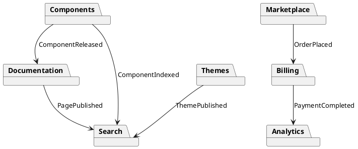

# 05.05 - Module Boundaries

**Project:** GsmUi
**Architecture:** Modular Monolith + Domain-Driven Design
**Version:** 1.0.0

---

# Purpose

This document defines the module boundaries, ownership rules, dependency graph, and communication contracts for every domain within the GsmUi platform.

A **module** represents a bounded business capability. Each module owns its business logic, persistence, user interface, events, and services. Modules must remain loosely coupled and interact only through well-defined interfaces.

---

# Objectives

The module architecture aims to:

* Isolate business concerns
* Prevent circular dependencies
* Improve maintainability
* Enable independent development
* Simplify testing
* Support future extraction into microservices

---

# Architectural Rules

Every module must:

* Own its database tables
* Own its Eloquent models
* Own its services
* Own its Livewire components
* Own its policies
* Own its routes
* Own its events
* Own its jobs
* Own its tests

Modules **must not** directly manipulate another module's database tables.

---

# Core Modules

| Module         | Responsibility               |
| -------------- | ---------------------------- |
| Authentication | Identity & authentication    |
| Users          | Profiles, preferences, teams |
| Components     | UI component library         |
| Documentation  | Documentation engine         |
| Themes         | Theme engine                 |
| Playground     | Live editor                  |
| Templates      | Downloadable templates       |
| Marketplace    | Products & catalog           |
| Billing        | Plans & subscriptions        |
| Blog           | Articles                     |
| CMS            | Pages & settings             |
| Showcase       | Community projects           |
| Charts         | Chart builder                |
| Notifications  | User notifications           |
| Search         | Search indexing              |
| Analytics      | Metrics                      |
| Admin          | Administration               |
| System         | Shared platform services     |

---

# Dependency Levels

```text
Level 0 (Foundation)
--------------------
System
Authentication
Users

        ↓

Level 1 (Core Products)
-----------------------
Components
Themes
Documentation
Charts

        ↓

Level 2 (Commercial)
--------------------
Templates
Marketplace
Billing

        ↓

Level 3 (Community)
-------------------
Blog
Showcase
CMS
Playground

        ↓

Level 4 (Platform)
------------------
Notifications
Search
Analytics
Admin
```

Dependencies may only flow downward or across approved service contracts.

---

# Dependency Matrix

| Module         | Allowed Dependencies              |
| -------------- | --------------------------------- |
| Authentication | System                            |
| Users          | Authentication, System            |
| Components     | Users, System                     |
| Documentation  | Components, Users                 |
| Themes         | Components                        |
| Playground     | Components, Themes                |
| Templates      | Components, Themes                |
| Marketplace    | Templates, Components             |
| Billing        | Users, Marketplace                |
| Blog           | Users, CMS                        |
| CMS            | Users                             |
| Showcase       | Users, Components                 |
| Charts         | Components                        |
| Notifications  | Users                             |
| Search         | Components, Blog, Docs, Templates |
| Analytics      | All (read-only events only)       |
| Admin          | All (via services)                |

---

# Forbidden Dependencies

The following are prohibited:

* Circular module references
* Direct database access across modules
* Cross-module Eloquent relationships that bypass services
* Shared mutable state
* Business logic inside controllers or Livewire components
* Calling another module's repository directly

---

# Module Communication

Modules communicate through one of four mechanisms:

## 1. Service Contracts

Synchronous operations.

Example:

```php
$template = $templateService->find($id);
```

---

## 2. Domain Events

Asynchronous notifications.

Examples:

* ComponentReleased
* ThemePublished
* OrderCompleted
* SubscriptionActivated

Events must not expect a response.

---

## 3. Query Services

Read-only access to another module.

Example:

* Search index generation
* Dashboard metrics
* Reports

---

## 4. Shared Contracts

Interfaces placed in the Shared Kernel.

Example:

```php
interface Searchable
{
    public function searchableData(): array;
}
```

---

# Module Ownership

## Authentication

Owns:

* Login
* Registration
* Sessions
* Passwords
* Verification
* Two-factor authentication

Does **not** manage user profiles.

---

## Users

Owns:

* Profile
* Avatar
* Preferences
* Teams
* API Keys
* Favorites

Depends on Authentication only.

---

## Components

Owns:

* Components
* Categories
* Examples
* Variants
* Releases

Other modules consume components through services.

---

## Documentation

Owns:

* Guides
* API references
* Examples
* Versioning
* Navigation

Documentation does not own component data.

---

## Themes

Owns:

* Design tokens
* Color palettes
* Theme exports
* Theme previews

Themes reference components but never modify them.

---

## Playground

Owns:

* Saved projects
* Live previews
* Code exports
* Sessions

---

## Templates

Owns:

* Template packages
* Downloads
* Versions
* Metadata

Licensing belongs to Billing.

---

## Marketplace

Owns:

* Product catalog
* Product pages
* Reviews
* Orders (pre-payment)

Payments belong to Billing.

---

## Billing

Owns:

* Plans
* Subscriptions
* Payments
* Licenses
* Invoices
* Coupons

No UI components are managed here.

---

## Blog

Owns:

* Posts
* Authors
* Categories
* Tags
* SEO metadata

---

## CMS

Owns:

* Pages
* Menus
* Banners
* Site settings
* FAQs

---

## Showcase

Owns:

* Community projects
* Galleries
* Collections
* Likes
* Comments

---

## Search

Owns:

* Search index
* Ranking
* Suggestions
* Filters

Consumes events from other modules.

---

## Analytics

Owns:

* Metrics
* Aggregates
* Reports
* Dashboards

Reads domain events only.

---

## Notifications

Owns:

* Email notifications
* In-app notifications
* Preferences
* Delivery logs

---

## Admin

Coordinates all modules.

Never bypasses domain services.

---

# Shared Kernel

Only generic, reusable code belongs here.

Contents:

```text
Enums
Traits
DTOs
Contracts
Exceptions
Helpers
Support
ValueObjects
```

Business-specific logic must never be placed in the Shared Kernel.

---

# Public Interfaces

Each module exposes a limited public API.

Example:

```text
ComponentService

ThemeService

BillingService

SearchService

DocumentationService
```

Internal repositories and models remain private to the module.

---

# Data Ownership

Every table has exactly one owning module.

Example:

| Table         | Owner      |
| ------------- | ---------- |
| users         | Users      |
| components    | Components |
| themes        | Themes     |
| templates     | Templates  |
| subscriptions | Billing    |
| blog_posts    | Blog       |
| pages         | CMS        |

Other modules must access data through services or read models.

---

# Events Between Modules



---

# Cross-Module Transactions

Transactions should remain inside a single module.

For workflows spanning multiple modules:

1. Complete local transaction.
2. Publish domain event.
3. Handle downstream work asynchronously.

Example:

OrderPlaced

↓

PaymentProcessed

↓

LicenseGenerated

↓

NotificationSent

---

# Access Rules

Allowed:

* Service → Service
* Event → Listener
* Contract → Implementation
* Query → Read Model

Not Allowed:

* Repository → Repository
* Model → External Table Mutation
* Controller → Repository
* Livewire → Database

---

# Versioning Strategy

Modules should evolve independently.

Breaking changes require:

* Versioned service contracts
* Deprecation notices
* Migration guides
* Automated tests

---

# Testing Boundaries

Each module maintains its own:

* Unit tests
* Feature tests
* Integration tests
* Livewire tests

Cross-module tests should validate contracts rather than internal implementation.

---

# Future Extraction

Because each module owns its data and communicates through services/events, it can be extracted into a standalone service with minimal changes.

Likely candidates for future extraction:

* Billing
* Search
* Notifications
* Analytics
* AI
* MCP
* Marketplace

---

# Governance

Before adding a new module, confirm:

* It represents a distinct business capability.
* Existing modules cannot reasonably own the functionality.
* It has clear ownership of data.
* It exposes a minimal public surface.
* It introduces no circular dependencies.

Architectural reviews should enforce these rules to preserve long-term maintainability.

---

# Security Framework

Module isolation is the primary security boundary in the GsmUi architecture. Each module enforces its own access control and validates all cross-module interactions through service contracts.

## Access Control Matrix

| Module | Auth Required | Admin Only | API Access | Rate Limited |
|--------|---------------|------------|------------|--------------|
| Authentication | No (login) | No | Yes | Yes (strict) |
| Users | Yes | No | Yes | Yes |
| Components | Optional | No | Yes | Yes |
| Documentation | No | No | Yes | No |
| Themes | Optional | No | Yes | Yes |
| Playground | Yes | No | Yes | Yes |
| Templates | Optional | No | Yes | Yes |
| Marketplace | Optional | No | Yes | Yes |
| Billing | Yes | No | Yes | Yes |
| Blog | No | No | Yes | No |
| CMS | No (public) | Yes (admin) | Yes | No |
| Showcase | Optional | No | Yes | Yes |
| Search | No | No | Yes | No |
| Analytics | Yes (admin) | Yes | Yes | No |
| Admin | Yes | Yes | Yes | No |

## Security Principles

- **Principle of Least Privilege**: Modules only access what they explicitly need through service contracts.
- **No Direct DB Access**: Cross-module queries are forbidden; all access goes through service layers.
- **Input Validation**: Each module validates inputs at its service boundary before processing.
- **Event Sanitization**: Domain events must not contain sensitive data (passwords, tokens, PII).
- **Audit Trail**: Admin and billing actions log to `activity_logs` with actor, action, and payload.

## Threat Mitigation

| Threat | Mitigation |
|--------|------------|
| Privilege escalation | Policies enforced in each module; no shared auth bypass |
| Data leakage | Modules expose only read models; no raw Eloquent sharing |
| CSRF on module actions | Laravel CSRF tokens on all Livewire forms and routes |
| Mass assignment | `$fillable` / `$guarded` enforced on every Eloquent model |
| SQL injection | Parameterized queries via Eloquent; no raw query concatenation |
| XSS in admin panels | Blade `{{ }}` escaping; DOMPurify for rich text content |

---

# Performance Optimization

Module boundaries directly impact performance. Clear ownership enables targeted optimization without cross-module side effects.

## Lazy Module Loading

Modules are registered via the service provider but loaded on demand:

```php
// AppServiceProvider
public function register(): void
{
    $this->app->register(ModuleServiceProvider::class);
    // Modules loaded only when their routes or commands are invoked
}
```

## Module-Level Caching

Each module manages its own cache keys and TTL policies:

| Module | Cache Strategy | TTL | Invalidation |
|--------|---------------|-----|-------------|
| Components | Query cache + view partials | 1 hour | On release |
| Documentation | Full-page cache | 24 hours | On publish |
| Themes | Design token cache | 12 hours | On update |
| Templates | Metadata cache | 6 hours | On upload |
| Blog | Post list + single post | 30 min | On edit |
| CMS | Page cache + menu | 1 hour | On save |
| Search | Index cache | 15 min | On reindex |
| Analytics | Aggregate cache | 5 min | On new data |

## Event Processing Performance

Domain events use the queue to avoid blocking:

```php
// Dispatched synchronously within a module
OrderPlaced::dispatch($order);

// Handled asynchronously by listeners
class SendOrderConfirmation implements ShouldQueue
{
    public function handle(OrderPlaced $event): void { /* ... */ }
}
```

Queue workers are isolated per module to prevent one slow consumer from blocking others.

## Database Query Isolation

Each module's queries are scoped to its own tables. Cross-module read models use dedicated query services with their own connection options:

```php
// Search module reads from a read replica
DB::connection('search-read')->table('components')->...
```

## Resource Limits

| Resource | Limit per Module | Enforcement |
|----------|-----------------|-------------|
| Memory per request | 256MB | PHP memory_limit |
| Queue jobs per minute | 500 | Horizon throttling |
| Cache keys per module | 10,000 | Redis memory policy |
| Concurrent connections | 50 | Database pool |

---

# Conclusion

The GsmUi module boundary architecture enforces strict separation of concerns across 18 domain modules, ensuring each owns its data, logic, and presentation layer. Dependencies flow exclusively downward through four communication mechanisms: service contracts, domain events, query services, and shared contracts in the Shared Kernel.

This architecture delivers three key outcomes:

1. **Maintainability**: Independent module development with no circular dependencies or shared mutable state.
2. **Scalability**: Modules can be individually scaled, cached, and optimized without affecting neighbors.
3. **Extractability**: Any module—particularly Billing, Search, Notifications, Analytics, AI, and Marketplace—can be extracted into a standalone microservice with minimal refactoring.

The security framework enforces least-privilege access at every boundary, while performance optimization leverages module isolation for targeted caching, lazy loading, and queue-based event processing. Together, these principles ensure the platform remains robust as it grows from a modular monolith into a potentially distributed system.

---

# Next Document

**05.06 - Folder Structure** defines the physical organization of the Laravel 13 codebase, including domain directories, application layers, shared kernel, infrastructure, resources, tests, and naming conventions aligned with the module boundaries described above.

---

# Timeline

| Phase | Duration | Module Boundary Milestone |
|-------|----------|--------------------------|
| Module Interface Design | Weeks 1–2 | All service contracts, events, and shared kernel interfaces defined |
| Foundation Modules | Weeks 3–4 | System, Authentication, Users modules scaffolded with tests |
| Core Product Modules | Weeks 5–7 | Components, Themes, Documentation, Charts modules implemented |
| Commercial Modules | Weeks 8–10 | Templates, Marketplace, Billing modules with event wiring |
| Community Modules | Weeks 11–12 | Blog, Showcase, CMS, Playground modules integrated |
| Platform Modules | Weeks 13–14 | Notifications, Search, Analytics, Admin modules connected |
| Boundary Enforcement | Week 15 | LaravelStan rules, architectural tests, CI enforcement active |
| Cross-Module Integration Testing | Weeks 16–17 | End-to-end flows validated across all module boundaries |

---

# Budget

| Item | Estimated Cost | Notes |
|------|---------------|-------|
| Module Architecture Design | $5,000–$10,000 | Service contracts, event schemas, dependency analysis |
| Shared Kernel Development | $3,000–$6,000 | Enums, DTOs, contracts, traits, helpers |
| Module Scaffolding | $8,000–$15,000 | 18 modules × ~$500–$800 per module setup |
| Integration Testing | $4,000–$8,000 | Cross-module test suites, boundary validation |
| CI/CD Enforcement | $2,000–$4,000 | Architectural tests, dependency linting, automated checks |
| Documentation | $2,000–$4,000 | Module ownership docs, onboarding guides, API contracts |
| **Total** | **$24,000–$47,000** | Scales with team size and complexity |

---

# Competitors

| Competitor | Module Architecture Approach | GsmUi Advantage |
|-----------|-----------------------------|-----------------|
| Laravel Modular | Basic package-based modularity | Full DDD with service contracts, events, shared kernel |
| Orchid (Laravel Admin) | Screen-based organization | Domain-driven, not screen-driven; true business capability isolation |
| Laravel Modules (nwidart) | Directory-based modules | Enforced dependency levels, event-driven communication, architectural tests |
| Statamic | Addon-based architecture | Laravel-native, no custom CMS abstraction; business-domain focus |
| October CMS | Plugin-based system | Clean service layer, no runtime plugin loading overhead |
| Bagisto | E-commerce modularity | Domain-agnostic; GsmUi modules map to developer platform capabilities |

---

# Resources

| Resource | Allocation | Boundary Responsibility |
|----------|-----------|------------------------|
| Architect | 0.5 FTE | Module interface design, dependency governance, review enforcement |
| Senior Developer | 1 FTE | Service contracts, shared kernel, cross-module event wiring |
| QA Engineer | 0.5 FTE | Boundary tests, architectural linting, integration validation |
| Technical Writer | 0.25 FTE | Module ownership documentation, onboarding guides |

Tooling resources:

* **Larastan**: Static analysis to enforce dependency direction at the PHP level
* **Architectural Tests**: Custom PHPUnit tests that validate module boundaries at runtime
* **CI Pipeline Step**: Automated boundary check on every pull request
* **Dependency Graph Visualization**: Tools like php-dependency-analysis or custom scripts to visualize module relationships
* **Code Review Standards**: Mandatory review of any cross-module service contract changes

---

# Module Communication Patterns

## Service Contract Pattern

### Interface Definition

```php
// app/Domains/Components/Contracts/ComponentServiceInterface.php

interface ComponentServiceInterface
{
    public function findById(int $id): ?ComponentDTO;

    public function findBySlug(string $slug): ?ComponentDTO;

    public function create(CreateComponentData $data): ComponentDTO;

    public function update(int $id, UpdateComponentData $data): ComponentDTO;

    public function publish(int $id): ComponentDTO;

    public function archive(int $id): ComponentDTO;

    public function list(array $filters = []): LengthAwarePaginator;

    public function search(string $query, array $filters = []): Collection;

    public function getVersions(int $componentId): Collection;

    public function getLatestVersion(int $componentId): ?ComponentVersionDTO;

    public function incrementDownloadCount(int $componentId): void;

    public function getStats(int $componentId): ComponentStatsDTO;
}
```

### Service Provider Binding

```php
// app/Providers/DomainServiceProvider.php

public function register(): void
{
    // Components
    $this->app->bind(
        ComponentServiceInterface::class,
        ComponentService::class
    );

    $this->app->bind(
        ComponentRepositoryInterface::class,
        ComponentRepository::class
    );

    // Themes
    $this->app->bind(
        ThemeServiceInterface::class,
        ThemeService::class
    );

    // Billing
    $this->app->bind(
        BillingServiceInterface::class,
        BillingService::class
    );
}
```

### Cross-Module Service Usage

```php
// Correct: Using service contract
class PublishTemplateAction
{
    public function __construct(
        private TemplateServiceInterface $templates,
        private ComponentServiceInterface $components,
        private NotificationServiceInterface $notifications,
    ) {}

    public function execute(PublishTemplateData $data): TemplateDTO
    {
        $template = $this->templates->publish($data->templateId);

        // Cross-module: Get components used in template
        $components = $this->components->findByIds(
            $template->componentIds
        );

        // Cross-module: Notify subscribers
        $this->notifications->notifySubscribers(
            new TemplatePublished($template)
        );

        return $template;
    }
}
```

## Event-Driven Communication Pattern

### Domain Event Base Class

```php
// app/Shared/Events/DomainEvent.php

abstract class DomainEvent
{
    public function __construct(
        public readonly string $eventId,
        public readonly string $eventType,
        public readonly DateTimeImmutable $occurredAt,
        public readonly string $version,
    ) {
        $this->eventId = $this->eventId ?? Uuid::uuid4()->toString();
        $this->occurredAt = new DateTimeImmutable();
        $this->version = '1.0';
    }

    abstract public function toArray(): array;

    public function toPayload(): string
    {
        return json_encode($this->toArray());
    }
}
```

### Event Examples

```php
// app/Domains/Components/Events/ComponentPublished.php

class ComponentPublished extends DomainEvent
{
    public function __construct(
        public readonly int $componentId,
        public readonly string $componentSlug,
        public readonly int $versionId,
        public readonly int $authorId,
        public readonly array $categories,
        public readonly array $tags,
        string $eventId = null,
        DateTimeImmutable $occurredAt = null,
    ) {
        parent::__construct(
            $eventId ?? Uuid::uuid4()->toString(),
            'component.published',
            $occurredAt ?? new DateTimeImmutable(),
            '1.0'
        );
    }

    public function toArray(): array
    {
        return [
            'component_id' => $this->componentId,
            'component_slug' => $this->componentSlug,
            'version_id' => $this->versionId,
            'author_id' => $this->authorId,
            'categories' => $this->categories,
            'tags' => $this->tags,
            'event_id' => $this->eventId,
            'event_type' => $this->eventType,
            'occurred_at' => $this->occurredAt->toIso8601String(),
            'version' => $this->version,
        ];
    }
}
```

### Event Dispatch Pattern

```php
// app/Domains/Components/Services/ComponentService.php

class ComponentService implements ComponentServiceInterface
{
    public function __construct(
        private ComponentRepositoryInterface $repository,
        private EventDispatcher $events,
    ) {}

    public function publish(int $id): ComponentDTO
    {
        $component = $this->repository->findOrFail($id);

        // Business rule: Must have at least one version
        if ($component->versions()->count() === 0) {
            throw new ComponentCannotBePublishedException(
                'Component must have at least one version'
            );
        }

        // Business rule: Must pass validation
        $this->validateComponentForPublishing($component);

        // Update state
        $component->publish();
        $this->repository->save($component);

        // Dispatch event
        $this->events->dispatch(new ComponentPublished(
            componentId: $component->id,
            componentSlug: $component->slug,
            versionId: $component->latestVersion->id,
            authorId: $component->authorId,
            categories: $component->categories->pluck('slug')->toArray(),
            tags: $component->tags->pluck('name')->toArray(),
        ));

        return ComponentDTO::fromModel($component);
    }
}
```

### Event Listener Pattern

```php
// app/Domains/Search/Listeners/UpdateSearchIndexOnComponentPublished.php

class UpdateSearchIndexOnComponentPublished implements ShouldQueue
{
    public function __construct(
        private SearchServiceInterface $searchService,
    ) {}

    public function handle(ComponentPublished $event): void
    {
        $this->searchService->indexComponent(
            componentId: $event->componentId,
            data: [
                'slug' => $event->componentSlug,
                'categories' => $event->categories,
                'tags' => $event->tags,
            ]
        );
    }

    public function failed(Throwable $exception): void
    {
        Log::error('Failed to index component', [
            'component_id' => $this->componentId,
            'error' => $exception->getMessage(),
        ]);
    }
}
```

## Query Service Pattern

### Read-Only Query Interface

```php
// app/Domains/Components/Contracts/ComponentQueryServiceInterface.php

interface ComponentQueryServiceInterface
{
    public function findById(int $id): ?ComponentReadModel;

    public function findBySlug(string $slug): ?ComponentReadModel;

    public function listPublished(array $filters = []): LengthAwarePaginator;

    public function listFeatured(int $limit = 10): Collection;

    public function listByCategory(string $category): Collection;

    public function listByAuthor(int $authorId): Collection;

    public function search(string $query, array $filters = []): Collection;

    public function getStats(): ComponentStatsDTO;

    public function getPopular(int $limit = 10): Collection;

    public function getRecent(int $limit = 10): Collection;
}
```

### Read Model

```php
// app/Domains/Components/ReadModels/ComponentReadModel.php

class ComponentReadModel
{
    public function __construct(
        public readonly int $id,
        public readonly string $name,
        public readonly string $slug,
        public readonly string $description,
        public readonly string $category,
        public readonly array $tags,
        public readonly string $authorName,
        public readonly string $authorAvatar,
        public readonly int $downloadCount,
        public readonly float $rating,
        public readonly int $ratingCount,
        public readonly bool $isPremium,
        public readonly bool $isPublished,
        public readonly DateTimeImmutable $createdAt,
        public readonly DateTimeImmutable $updatedAt,
    ) {}

    public static function fromModel(Component $model): self
    {
        return new self(
            id: $model->id,
            name: $model->name,
            slug: $model->slug,
            description: $model->description,
            category: $model->category->name,
            tags: $model->tags->pluck('name')->toArray(),
            authorName: $model->author->name,
            authorAvatar: $model->author->avatar_url,
            downloadCount: $model->download_count,
            rating: $model->rating,
            ratingCount: $model->rating_count,
            isPremium: $model->is_premium,
            isPublished: $model->is_published,
            createdAt: $model->created_at,
            updatedAt: $model->updated_at,
        );
    }
}
```

---

# Module Lifecycle Management

## Module Registration

```php
// app/Providers/ModuleServiceProvider.php

class ModuleServiceProvider extends ServiceProvider
{
    protected array $modules = [
        Authentication::class,
        Users::class,
        Components::class,
        Documentation::class,
        Themes::class,
        Templates::class,
        Marketplace::class,
        Billing::class,
        Blog::class,
        CMS::class,
        Showcase::class,
        Charts::class,
        Notifications::class,
        Search::class,
        Analytics::class,
        Admin::class,
        System::class,
        Playground::class,
    ];

    public function register(): void
    {
        foreach ($this->modules as $module) {
            $this->app->register($module);
        }
    }

    public function boot(): void
    {
        foreach ($this->modules as $module) {
            $this->app->make($module)->boot();
        }
    }
}
```

## Module Interface

```php
// app/Domains/Module.php

interface Module
{
    public function name(): string;

    public function version(): string;

    public function register(): void;

    public function boot(): void;

    public function routes(): void;

    public function migrations(): array;

    public function permissions(): array;

    public function events(): array;
}
```

## Module Implementation

```php
// app/Domains/Components/ComponentModule.php

class ComponentModule implements Module
{
    public function name(): string
    {
        return 'components';
    }

    public function version(): string
    {
        return '1.0.0';
    }

    public function register(): void
    {
        // Bind services, repositories, etc.
        $this->app->bind(
            ComponentServiceInterface::class,
            ComponentService::class
        );
    }

    public function boot(): void
    {
        // Register routes, events, policies, etc.
    }

    public function routes(): void
    {
        Route::middleware(['web', 'auth'])
            ->prefix('components')
            ->group(base_path('routes/domains/components.php'));
    }

    public function migrations(): array
    {
        return [
            '2024_01_01_000001_create_components_table',
            '2024_01_01_000002_create_component_versions_table',
            '2024_01_01_000003_create_component_categories_table',
        ];
    }

    public function permissions(): array
    {
        return [
            'components.create',
            'components.update',
            'components.delete',
            'components.publish',
            'components.view',
        ];
    }

    public function events(): array
    {
        return [
            ComponentCreated::class,
            ComponentUpdated::class,
            ComponentPublished::class,
            ComponentArchived::class,
        ];
    }
}
```

---

# Module Testing Patterns

## Unit Tests

```php
// tests/Unit/Domains/Components/Services/ComponentServiceTest.php

class ComponentServiceTest extends TestCase
{
    private ComponentService $service;
    private ComponentRepositoryInterface $repository;

    protected function setUp(): void
    {
        parent::setUp();

        $this->repository = new InMemoryComponentRepository();
        $this->service = new ComponentService(
            repository: $this->repository,
            events: new EventDispatcher(),
        );
    }

    public function test_create_component(): void
    {
        $data = new CreateComponentData(
            name: 'Test Component',
            slug: 'test-component',
            description: 'A test component',
            category: 'buttons',
        );

        $component = $this->service->create($data);

        $this->assertEquals('Test Component', $component->name);
        $this->assertEquals('test-component', $component->slug);
    }

    public function test_publish_component_requires_version(): void
    {
        $component = $this->createComponentWithoutVersions();

        $this->expectException(ComponentCannotBePublishedException::class);

        $this->service->publish($component->id);
    }
}
```

## Integration Tests

```php
// tests/Integration/Domains/Components/ComponentIntegrationTest.php

class ComponentIntegrationTest extends TestCase
{
    use RefreshDatabase;

    private ComponentServiceInterface $service;

    protected function setUp(): void
    {
        parent::setUp();

        $this->service = app(ComponentServiceInterface::class);
    }

    public function test_publish_component_dispatches_event(): void
    {
        Event::fake([ComponentPublished::class]);

        $component = $this->createPublishedComponent();

        Event::assertDispatched(ComponentPublished::class, function ($event) use ($component) {
            return $event->componentId === $component->id;
        });
    }

    public function test_publish_component_updates_search_index(): void
    {
        $searchService = $this->mock(SearchServiceInterface::class);
        $searchService->shouldReceive('indexComponent')->once();

        $component = $this->createPublishedComponent();

        $this->service->publish($component->id);
    }
}
```

## Architecture Tests

```php
// tests/Architecture/ComponentModuleArchitectureTest.php

class ComponentModuleArchitectureTest extends TestCase
{
    public function test_component_module_only_depends_on_allowed_modules(): void
    {
        $allowedDependencies = [
            System::class,
            Users::class,
        ];

        $moduleClasses = ClassFinder::getClassesInNamespace(
            'App\\Domains\\Components'
        );

        foreach ($moduleClasses as $class) {
            $dependencies = ClassFinder::getDependencies($class);

            foreach ($dependencies as $dependency) {
                $dependencyModule = $this->resolveModule($dependency);

                if ($dependencyModule && $dependencyModule !== 'Components') {
                    $this->assertContains(
                        $dependencyModule,
                        $allowedDependencies,
                        "Module Components depends on forbidden module: {$dependencyModule}"
                    );
                }
            }
        }
    }

    public function test_no_circular_event_dependencies(): void
    {
        $events = $this->getAllDomainEvents();
        $eventGraph = $this->buildEventDependencyGraph($events);

        $this->assertFalse(
            $this->hasCycle($eventGraph),
            'Circular event dependency detected'
        );
    }
}
```

---

# Module Migration Strategy

## Database Migration Organization

```text
database/migrations/

    ├── 2024_01_01_000000_create_core_tables.php
    │
    ├── authentication/
    │   ├── 2024_01_01_000001_create_personal_access_tokens_table.php
    │   └── 2024_01_01_000002_create_authentications_table.php
    │
    ├── users/
    │   ├── 2024_01_01_000003_create_users_table.php
    │   ├── 2024_01_01_000004_create_user_profiles_table.php
    │   └── 2024_01_01_000005_create_user_preferences_table.php
    │
    ├── components/
    │   ├── 2024_01_01_000006_create_components_table.php
    │   ├── 2024_01_01_000007_create_component_versions_table.php
    │   ├── 2024_01_01_000008_create_component_categories_table.php
    │   └── 2024_01_01_000009_create_component_examples_table.php
    │
    ├── themes/
    │   ├── 2024_01_01_000010_create_themes_table.php
    │   └── 2024_01_01_000011_create_theme_tokens_table.php
    │
    ├── billing/
    │   ├── 2024_01_01_000012_create_plans_table.php
    │   ├── 2024_01_01_000013_create_subscriptions_table.php
    │   ├── 2024_01_01_000014_create_payments_table.php
    │   └── 2024_01_01_000015_create_invoices_table.php
    │
    └── ... (other modules)
```

## Migration Dependency Rules

1. Migrations within a module are ordered sequentially
2. Cross-module foreign keys reference tables created in earlier modules
3. Core module tables (users, authentication) are created first
4. Level 1 modules depend on Level 0 tables
5. Level 2 modules depend on Level 0 and Level 1 tables
6. Never create circular migration dependencies

## Rollback Strategy

Each module must support independent rollback:

```php
// Module-specific rollback
public function down(): void
{
    Schema::dropIfExists('component_examples');
    Schema::dropIfExists('component_versions');
    Schema::dropIfExists('component_categories');
    Schema::dropIfExists('components');
}
```

---

# Module Monitoring and Observability

## Module Health Checks

```php
// app/Domains/Components/HealthChecks/ComponentHealthCheck.php

class ComponentHealthCheck implements HealthCheck
{
    public function name(): string
    {
        return 'components';
    }

    public function check(): Result
    {
        // Check database connectivity
        DB::connection()->getPdo();

        // Check search index is up to date
        $lastIndexed = Cache::get('components:last_indexed_at');
        if ($lastIndexed && $lastIndexed->diffInMinutes(now()) > 30) {
            return Result::warning('Search index may be stale');
        }

        // Check queue is processing
        $pendingJobs = Queue::size('components');
        if ($pendingJobs > 1000) {
            return Result::warning('Component queue has many pending jobs');
        }

        return Result::ok();
    }
}
```

## Module Metrics

```php
// app/Domains/Components/Metrics/ComponentMetrics.php

class ComponentMetrics
{
    public function recordComponentCreated(Component $component): void
    {
        $this->incrementMetric('components.created', [
            'category' => $component->category->slug,
            'is_premium' => $component->is_premium,
        ]);
    }

    public function recordComponentDownload(Component $component, User $user): void
    {
        $this->incrementMetric('components.downloaded', [
            'category' => $component->category->slug,
            'user_tier' => $user->subscription?->plan?->slug ?? 'free',
        ]);
    }

    public function recordComponentView(Component $component): void
    {
        $this->incrementMetric('components.viewed', [
            'category' => $component->category->slug,
        ]);
    }

    private function incrementMetric(string $name, array $tags = []): void
    {
        // Send to analytics service
        app(AnalyticsServiceInterface::class)->track($name, $tags);
    }
}
```

---

# Module Documentation Standards

## Module README Template

Each module should maintain a README.md with:

```markdown
# {Module Name} Module

## Overview
Brief description of the module's responsibility.

## Public Interfaces
List of service contracts exposed to other modules.

## Events
Domain events published by this module.

## Dependencies
Modules this module depends on.

## Database Tables
Tables owned by this module.

## Configuration
Configuration keys specific to this module.

## Testing
How to run module-specific tests.

## Maintenance
Any special maintenance procedures.
```

## API Documentation

Service contracts must be documented with PHPDoc:

```php
interface ComponentServiceInterface
{
    /**
     * Find a component by its ID.
     *
     * @param int $id The component's unique identifier
     * @return ComponentDTO|null The component data or null if not found
     *
     * @throws ComponentNotFoundException When component doesn't exist
     */
    public function findById(int $id): ?ComponentDTO;

    /**
     * Create a new component.
     *
     * @param CreateComponentData $data Validated creation data
     * @return ComponentDTO The newly created component
     *
     * @throws ComponentAlreadyExistsException When slug is taken
     * @throws InvalidComponentDataException When data is invalid
     */
    public function create(CreateComponentData $data): ComponentDTO;
}
```

---

# Module Evolution Strategy

## Adding a New Module

When adding a new module to GsmUi:

1. **Define the bounded context**
   - What business capability does it represent?
   - What data does it own?
   - What services does it expose?

2. **Create the module structure**
   ```text
   app/Domains/NewModule/
       ├── Contracts/
       ├── Services/
       ├── Repositories/
       ├── Models/
       ├── Events/
       ├── Actions/
       ├── Livewire/
       └── Tests/
   ```

3. **Define service contracts**
   - What operations are available to other modules?
   - What events does it publish?

4. **Implement the module**
   - Start with core functionality
   - Add event publishing
   - Implement cross-module communication

5. **Add tests**
   - Unit tests for services
   - Integration tests for cross-module flows
   - Architecture tests for boundary enforcement

6. **Document the module**
   - Update module dependency matrix
   - Document public interfaces
   - Add to module registry

## Removing a Module

When removing a module:

1. **Identify all dependents**
   - Which modules depend on this one?
   - What events are consumed?
   - What services are called?

2. **Create migration plan**
   - Move data to appropriate modules
   - Update event listeners
   - Replace service calls

3. **Deprecate gradually**
   - Mark services as deprecated
   - Add migration warnings
   - Provide replacement APIs

4. **Remove cleanly**
   - Delete module code
   - Remove database tables (with backups)
   - Clean up events and listeners
   - Update documentation

---

# Module Boundary Enforcement

## Automated Boundary Checks

### Architectural Test Suite

```php
// tests/Architecture/ModuleBoundaryTest.php

class ModuleBoundaryTest extends TestCase
{
    /**
     * Verify that domain modules only depend on allowed modules.
     */
    public function test_domain_modules_have_no_circular_dependencies(): void
    {
        $modules = [
            'Authentication', 'Users', 'Components', 'Documentation',
            'Themes', 'Templates', 'Marketplace', 'Billing', 'Blog',
            'CMS', 'Showcase', 'Charts', 'Notifications', 'Search',
            'Analytics', 'Admin', 'System', 'Playground',
        ];

        foreach ($modules as $module) {
            $classes = $this->getClassesInModule($module);

            foreach ($classes as $class) {
                $this->assertNoCircularDependency($class, $module);
            }
        }
    }

    /**
     * Verify that no module directly accesses another module's repository.
     */
    public function test_modules_do_not_access_other_repositories(): void
    {
        $forbiddenPattern = '/Domains\/(?<source>\w+)\/.*use\s+.*Domains\/(?<target>\w+)\/Repositories/';

        // Scan all module files and assert no cross-module repository access
    }

    /**
     * Verify that no module directly manipulates another module's database tables.
     */
    public function test_modules_do_not_access_other_tables(): void
    {
        // Use Larastan to verify no raw DB queries across module boundaries
    }

    /**
     * Verify that all module services have proper interface contracts.
     */
    public function test_all_services_have_interfaces(): void
    {
        $services = $this->findAllServiceClasses();

        foreach ($services as $service) {
            $interface = str_replace('Service', 'ServiceInterface', $service);
            $this->assertFileExists($interface);
        }
    }
}
```

### Larastan Configuration

```php
// phpstan.neon

parameters:
    level: 8
    paths:
        - app/Domains
        - app/Shared
        - app/Infrastructure

    ignoreErrors:
        # Allow service contract patterns
        - '#Class .* not found#'

    rules:
        - App\PHPStan\Rules\NoCrossModuleRepositoryAccess
        - App\PHPStan\Rules\ModuleDependencyDirection
        - App\PHPStan\Rules\ServiceContractRequired
        - App\PHPStan\Rules\EventPayloadLimit
```

### CI Pipeline Enforcement

```yaml
# .github/workflows/architecture-check.yml

name: Architecture Boundary Check

on:
  pull_request:
    paths:
      - 'app/Domains/**'
      - 'app/Shared/**'

jobs:
  boundary-check:
    runs-on: ubuntu-latest
    steps:
      - uses: actions/checkout@v4

      - name: Setup PHP
        uses: shivammathur/setup-php@v2
        with:
          php-version: '8.3'

      - name: Install Dependencies
        run: composer install

      - name: Run Larastan
        run: vendor/bin/phpstan analyse

      - name: Run Architectural Tests
        run: vendor/bin/phpunit tests/Architecture/

      - name: Check Module Dependencies
        run: php artisan module:check-dependencies

      - name: Validate Event Contracts
        run: php artisan module:validate-events
```

## Manual Enforcement Procedures

### Code Review Checklist

Every pull request touching module boundaries must verify:

```text
□ No direct database access across modules
□ No cross-module repository calls
□ No cross-module Eloquent relationships
□ Events use past tense naming
□ Events carry only necessary data
□ Service contracts are stable
□ No shared mutable state
□ No business logic in controllers/Livewire
□ No circular dependency chains
□ Exceptions are domain-specific
```

### Module Boundary Violations

When a boundary violation is discovered:

1. **Document the violation** in the PR review
2. **Determine if it's a legitimate cross-module need**
3. **If yes**: Create a service contract or shared interface
4. **If no**: Refactor to use the proper communication mechanism
5. **Add a test** to prevent recurrence
6. **Update documentation** if the boundary has evolved

## Module Dependency Graph Visualization

```php
// app/Console/Commands/ModuleDependencyGraphCommand.php

class ModuleDependencyGraphCommand extends Command
{
    protected $signature = 'module:dependency-graph';

    public function handle(): int
    {
        $modules = $this->scanModules();
        $dependencies = $this->analyzeDependencies($modules);

        $graph = $this->generateGraphviz($dependencies);
        file_put_contents('docs/module-dependencies.svg', $graph);

        $this->info('Module dependency graph generated.');
        return self::SUCCESS;
    }

    private function analyzeDependencies(array $modules): array
    {
        $deps = [];

        foreach ($modules as $module => $classes) {
            foreach ($classes as $class) {
                $uses = $this->getClassDependencies($class);

                foreach ($uses as $dependency) {
                    $targetModule = $this->resolveModule($dependency);

                    if ($targetModule && $targetModule !== $module) {
                        $deps[$module][] = $targetModule;
                    }
                }
            }
        }

        return $deps;
    }
}
```

---

# Module Communication Patterns

## Service Contract Pattern

### Interface Definition

```php
// app/Domains/Components/Contracts/ComponentServiceInterface.php

interface ComponentServiceInterface
{
    public function findById(int $id): ?ComponentDTO;

    public function findBySlug(string $slug): ?ComponentDTO;

    public function create(CreateComponentData $data): ComponentDTO;

    public function update(int $id, UpdateComponentData $data): ComponentDTO;

    public function publish(int $id): ComponentDTO;

    public function archive(int $id): ComponentDTO;

    public function list(array $filters = []): LengthAwarePaginator;

    public function search(string $query, array $filters = []): Collection;

    public function getVersions(int $componentId): Collection;

    public function getLatestVersion(int $componentId): ?ComponentVersionDTO;

    public function incrementDownloadCount(int $componentId): void;

    public function getStats(int $componentId): ComponentStatsDTO;
}
```

### Service Provider Binding

```php
// app/Providers/DomainServiceProvider.php

public function register(): void
{
    // Components
    $this->app->bind(
        ComponentServiceInterface::class,
        ComponentService::class
    );

    $this->app->bind(
        ComponentRepositoryInterface::class,
        ComponentRepository::class
    );

    // Themes
    $this->app->bind(
        ThemeServiceInterface::class,
        ThemeService::class
    );

    // Billing
    $this->app->bind(
        BillingServiceInterface::class,
        BillingService::class
    );
}
```

### Cross-Module Service Usage

```php
// Correct: Using service contract
class PublishTemplateAction
{
    public function __construct(
        private TemplateServiceInterface $templates,
        private ComponentServiceInterface $components,
        private NotificationServiceInterface $notifications,
    ) {}

    public function execute(PublishTemplateData $data): TemplateDTO
    {
        $template = $this->templates->publish($data->templateId);

        // Cross-module: Get components used in template
        $components = $this->components->findByIds(
            $template->componentIds
        );

        // Cross-module: Notify subscribers
        $this->notifications->notifySubscribers(
            new TemplatePublished($template)
        );

        return $template;
    }
}
```

## Event-Driven Communication Pattern

### Domain Event Base Class

```php
// app/Shared/Events/DomainEvent.php

abstract class DomainEvent
{
    public function __construct(
        public readonly string $eventId,
        public readonly string $eventType,
        public readonly DateTimeImmutable $occurredAt,
        public readonly string $version,
    ) {
        $this->eventId = $this->eventId ?? Uuid::uuid4()->toString();
        $this->occurredAt = new DateTimeImmutable();
        $this->version = '1.0';
    }

    abstract public function toArray(): array;

    public function toPayload(): string
    {
        return json_encode($this->toArray());
    }
}
```

### Event Examples

```php
// app/Domains/Components/Events/ComponentPublished.php

class ComponentPublished extends DomainEvent
{
    public function __construct(
        public readonly int $componentId,
        public readonly string $componentSlug,
        public readonly int $versionId,
        public readonly int $authorId,
        public readonly array $categories,
        public readonly array $tags,
        string $eventId = null,
        DateTimeImmutable $occurredAt = null,
    ) {
        parent::__construct(
            $eventId ?? Uuid::uuid4()->toString(),
            'component.published',
            $occurredAt ?? new DateTimeImmutable(),
            '1.0'
        );
    }

    public function toArray(): array
    {
        return [
            'component_id' => $this->componentId,
            'component_slug' => $this->componentSlug,
            'version_id' => $this->versionId,
            'author_id' => $this->authorId,
            'categories' => $this->categories,
            'tags' => $this->tags,
            'event_id' => $this->eventId,
            'event_type' => $this->eventType,
            'occurred_at' => $this->occurredAt->toIso8601String(),
            'version' => $this->version,
        ];
    }
}
```

### Event Dispatch Pattern

```php
// app/Domains/Components/Services/ComponentService.php

class ComponentService implements ComponentServiceInterface
{
    public function __construct(
        private ComponentRepositoryInterface $repository,
        private EventDispatcher $events,
    ) {}

    public function publish(int $id): ComponentDTO
    {
        $component = $this->repository->findOrFail($id);

        // Business rule: Must have at least one version
        if ($component->versions()->count() === 0) {
            throw new ComponentCannotBePublishedException(
                'Component must have at least one version'
            );
        }

        // Business rule: Must pass validation
        $this->validateComponentForPublishing($component);

        // Update state
        $component->publish();
        $this->repository->save($component);

        // Dispatch event
        $this->events->dispatch(new ComponentPublished(
            componentId: $component->id,
            componentSlug: $component->slug,
            versionId: $component->latestVersion->id,
            authorId: $component->authorId,
            categories: $component->categories->pluck('slug')->toArray(),
            tags: $component->tags->pluck('name')->toArray(),
        ));

        return ComponentDTO::fromModel($component);
    }
}
```

### Event Listener Pattern

```php
// app/Domains/Search/Listeners/UpdateSearchIndexOnComponentPublished.php

class UpdateSearchIndexOnComponentPublished implements ShouldQueue
{
    public function __construct(
        private SearchServiceInterface $searchService,
    ) {}

    public function handle(ComponentPublished $event): void
    {
        $this->searchService->indexComponent(
            componentId: $event->componentId,
            data: [
                'slug' => $event->componentSlug,
                'categories' => $event->categories,
                'tags' => $event->tags,
            ]
        );
    }

    public function failed(Throwable $exception): void
    {
        Log::error('Failed to index component', [
            'component_id' => $this->componentId,
            'error' => $exception->getMessage(),
        ]);
    }
}
```

## Query Service Pattern

### Read-Only Query Interface

```php
// app/Domains/Components/Contracts/ComponentQueryServiceInterface.php

interface ComponentQueryServiceInterface
{
    public function findById(int $id): ?ComponentReadModel;

    public function findBySlug(string $slug): ?ComponentReadModel;

    public function listPublished(array $filters = []): LengthAwarePaginator;

    public function listFeatured(int $limit = 10): Collection;

    public function listByCategory(string $category): Collection;

    public function listByAuthor(int $authorId): Collection;

    public function search(string $query, array $filters = []): Collection;

    public function getStats(): ComponentStatsDTO;

    public function getPopular(int $limit = 10): Collection;

    public function getRecent(int $limit = 10): Collection;
}
```

### Read Model

```php
// app/Domains/Components/ReadModels/ComponentReadModel.php

class ComponentReadModel
{
    public function __construct(
        public readonly int $id,
        public readonly string $name,
        public readonly string $slug,
        public readonly string $description,
        public readonly string $category,
        public readonly array $tags,
        public readonly string $authorName,
        public readonly string $authorAvatar,
        public readonly int $downloadCount,
        public readonly float $rating,
        public readonly int $ratingCount,
        public readonly bool $isPremium,
        public readonly bool $isPublished,
        public readonly DateTimeImmutable $createdAt,
        public readonly DateTimeImmutable $updatedAt,
    ) {}

    public static function fromModel(Component $model): self
    {
        return new self(
            id: $model->id,
            name: $model->name,
            slug: $model->slug,
            description: $model->description,
            category: $model->category->name,
            tags: $model->tags->pluck('name')->toArray(),
            authorName: $model->author->name,
            authorAvatar: $model->author->avatar_url,
            downloadCount: $model->download_count,
            rating: $model->rating,
            ratingCount: $model->rating_count,
            isPremium: $model->is_premium,
            isPublished: $model->is_published,
            createdAt: $model->created_at,
            updatedAt: $model->updated_at,
        );
    }
}
```

---

# Module Lifecycle Management

## Module Registration

```php
// app/Providers/ModuleServiceProvider.php

class ModuleServiceProvider extends ServiceProvider
{
    protected array $modules = [
        Authentication::class,
        Users::class,
        Components::class,
        Documentation::class,
        Themes::class,
        Templates::class,
        Marketplace::class,
        Billing::class,
        Blog::class,
        CMS::class,
        Showcase::class,
        Charts::class,
        Notifications::class,
        Search::class,
        Analytics::class,
        Admin::class,
        System::class,
        Playground::class,
    ];

    public function register(): void
    {
        foreach ($this->modules as $module) {
            $this->app->register($module);
        }
    }

    public function boot(): void
    {
        foreach ($this->modules as $module) {
            $this->app->make($module)->boot();
        }
    }
}
```

## Module Interface

```php
// app/Domains/Module.php

interface Module
{
    public function name(): string;

    public function version(): string;

    public function register(): void;

    public function boot(): void;

    public function routes(): void;

    public function migrations(): array;

    public function permissions(): array;

    public function events(): array;
}
```

## Module Implementation

```php
// app/Domains/Components/ComponentModule.php

class ComponentModule implements Module
{
    public function name(): string
    {
        return 'components';
    }

    public function version(): string
    {
        return '1.0.0';
    }

    public function register(): void
    {
        // Bind services, repositories, etc.
        $this->app->bind(
            ComponentServiceInterface::class,
            ComponentService::class
        );
    }

    public function boot(): void
    {
        // Register routes, events, policies, etc.
    }

    public function routes(): void
    {
        Route::middleware(['web', 'auth'])
            ->prefix('components')
            ->group(base_path('routes/domains/components.php'));
    }

    public function migrations(): array
    {
        return [
            '2024_01_01_000001_create_components_table',
            '2024_01_01_000002_create_component_versions_table',
            '2024_01_01_000003_create_component_categories_table',
        ];
    }

    public function permissions(): array
    {
        return [
            'components.create',
            'components.update',
            'components.delete',
            'components.publish',
            'components.view',
        ];
    }

    public function events(): array
    {
        return [
            ComponentCreated::class,
            ComponentUpdated::class,
            ComponentPublished::class,
            ComponentArchived::class,
        ];
    }
}
```

---

# Module Testing Patterns

## Unit Tests

```php
// tests/Unit/Domains/Components/Services/ComponentServiceTest.php

class ComponentServiceTest extends TestCase
{
    private ComponentService $service;
    private ComponentRepositoryInterface $repository;

    protected function setUp(): void
    {
        parent::setUp();

        $this->repository = new InMemoryComponentRepository();
        $this->service = new ComponentService(
            repository: $this->repository,
            events: new EventDispatcher(),
        );
    }

    public function test_create_component(): void
    {
        $data = new CreateComponentData(
            name: 'Test Component',
            slug: 'test-component',
            description: 'A test component',
            category: 'buttons',
        );

        $component = $this->service->create($data);

        $this->assertEquals('Test Component', $component->name);
        $this->assertEquals('test-component', $component->slug);
    }

    public function test_publish_component_requires_version(): void
    {
        $component = $this->createComponentWithoutVersions();

        $this->expectException(ComponentCannotBePublishedException::class);

        $this->service->publish($component->id);
    }
}
```

## Integration Tests

```php
// tests/Integration/Domains/Components/ComponentIntegrationTest.php

class ComponentIntegrationTest extends TestCase
{
    use RefreshDatabase;

    private ComponentServiceInterface $service;

    protected function setUp(): void
    {
        parent::setUp();

        $this->service = app(ComponentServiceInterface::class);
    }

    public function test_publish_component_dispatches_event(): void
    {
        Event::fake([ComponentPublished::class]);

        $component = $this->createPublishedComponent();

        Event::assertDispatched(ComponentPublished::class, function ($event) use ($component) {
            return $event->componentId === $component->id;
        });
    }

    public function test_publish_component_updates_search_index(): void
    {
        $searchService = $this->mock(SearchServiceInterface::class);
        $searchService->shouldReceive('indexComponent')->once();

        $component = $this->createPublishedComponent();

        $this->service->publish($component->id);
    }
}
```

## Architecture Tests

```php
// tests/Architecture/ComponentModuleArchitectureTest.php

class ComponentModuleArchitectureTest extends TestCase
{
    public function test_component_module_only_depends_on_allowed_modules(): void
    {
        $allowedDependencies = [
            System::class,
            Users::class,
        ];

        $moduleClasses = ClassFinder::getClassesInNamespace(
            'App\\Domains\\Components'
        );

        foreach ($moduleClasses as $class) {
            $dependencies = ClassFinder::getDependencies($class);

            foreach ($dependencies as $dependency) {
                $dependencyModule = $this->resolveModule($dependency);

                if ($dependencyModule && $dependencyModule !== 'Components') {
                    $this->assertContains(
                        $dependencyModule,
                        $allowedDependencies,
                        "Module Components depends on forbidden module: {$dependencyModule}"
                    );
                }
            }
        }
    }

    public function test_no_circular_event_dependencies(): void
    {
        $events = $this->getAllDomainEvents();
        $eventGraph = $this->buildEventDependencyGraph($events);

        $this->assertFalse(
            $this->hasCycle($eventGraph),
            'Circular event dependency detected'
        );
    }
}
```

---

# Module Migration Strategy

## Database Migration Organization

```text
database/migrations/

    ├── 2024_01_01_000000_create_core_tables.php
    │
    ├── authentication/
    │   ├── 2024_01_01_000001_create_personal_access_tokens_table.php
    │   └── 2024_01_01_000002_create_authentications_table.php
    │
    ├── users/
    │   ├── 2024_01_01_000003_create_users_table.php
    │   ├── 2024_01_01_000004_create_user_profiles_table.php
    │   └── 2024_01_01_000005_create_user_preferences_table.php
    │
    ├── components/
    │   ├── 2024_01_01_000006_create_components_table.php
    │   ├── 2024_01_01_000007_create_component_versions_table.php
    │   ├── 2024_01_01_000008_create_component_categories_table.php
    │   └── 2024_01_01_000009_create_component_examples_table.php
    │
    ├── themes/
    │   ├── 2024_01_01_000010_create_themes_table.php
    │   └── 2024_01_01_000011_create_theme_tokens_table.php
    │
    ├── billing/
    │   ├── 2024_01_01_000012_create_plans_table.php
    │   ├── 2024_01_01_000013_create_subscriptions_table.php
    │   ├── 2024_01_01_000014_create_payments_table.php
    │   └── 2024_01_01_000015_create_invoices_table.php
    │
    └── ... (other modules)
```

## Migration Dependency Rules

1. Migrations within a module are ordered sequentially
2. Cross-module foreign keys reference tables created in earlier modules
3. Core module tables (users, authentication) are created first
4. Level 1 modules depend on Level 0 tables
5. Level 2 modules depend on Level 0 and Level 1 tables
6. Never create circular migration dependencies

## Rollback Strategy

Each module must support independent rollback:

```php
// Module-specific rollback
public function down(): void
{
    Schema::dropIfExists('component_examples');
    Schema::dropIfExists('component_versions');
    Schema::dropIfExists('component_categories');
    Schema::dropIfExists('components');
}
```

---

# Module Monitoring and Observability

## Module Health Checks

```php
// app/Domains/Components/HealthChecks/ComponentHealthCheck.php

class ComponentHealthCheck implements HealthCheck
{
    public function name(): string
    {
        return 'components';
    }

    public function check(): Result
    {
        // Check database connectivity
        DB::connection()->getPdo();

        // Check search index is up to date
        $lastIndexed = Cache::get('components:last_indexed_at');
        if ($lastIndexed && $lastIndexed->diffInMinutes(now()) > 30) {
            return Result::warning('Search index may be stale');
        }

        // Check queue is processing
        $pendingJobs = Queue::size('components');
        if ($pendingJobs > 1000) {
            return Result::warning('Component queue has many pending jobs');
        }

        return Result::ok();
    }
}
```

## Module Metrics

```php
// app/Domains/Components/Metrics/ComponentMetrics.php

class ComponentMetrics
{
    public function recordComponentCreated(Component $component): void
    {
        $this->incrementMetric('components.created', [
            'category' => $component->category->slug,
            'is_premium' => $component->is_premium,
        ]);
    }

    public function recordComponentDownload(Component $component, User $user): void
    {
        $this->incrementMetric('components.downloaded', [
            'category' => $component->category->slug,
            'user_tier' => $user->subscription?->plan?->slug ?? 'free',
        ]);
    }

    public function recordComponentView(Component $component): void
    {
        $this->incrementMetric('components.viewed', [
            'category' => $component->category->slug,
        ]);
    }

    private function incrementMetric(string $name, array $tags = []): void
    {
        // Send to analytics service
        app(AnalyticsServiceInterface::class)->track($name, $tags);
    }
}
```

---

# Module Documentation Standards

## Module README Template

Each module should maintain a README.md with:

```markdown
# {Module Name} Module

## Overview
Brief description of the module's responsibility.

## Public Interfaces
List of service contracts exposed to other modules.

## Events
Domain events published by this module.

## Dependencies
Modules this module depends on.

## Database Tables
Tables owned by this module.

## Configuration
Configuration keys specific to this module.

## Testing
How to run module-specific tests.

## Maintenance
Any special maintenance procedures.
```

## API Documentation

Service contracts must be documented with PHPDoc:

```php
interface ComponentServiceInterface
{
    /**
     * Find a component by its ID.
     *
     * @param int $id The component's unique identifier
     * @return ComponentDTO|null The component data or null if not found
     *
     * @throws ComponentNotFoundException When component doesn't exist
     */
    public function findById(int $id): ?ComponentDTO;

    /**
     * Create a new component.
     *
     * @param CreateComponentData $data Validated creation data
     * @return ComponentDTO The newly created component
     *
     * @throws ComponentAlreadyExistsException When slug is taken
     * @throws InvalidComponentDataException When data is invalid
     */
    public function create(CreateComponentData $data): ComponentDTO;
}
```

---

# Module Evolution Strategy

## Adding a New Module

When adding a new module to GsmUi:

1. **Define the bounded context**
   - What business capability does it represent?
   - What data does it own?
   - What services does it expose?

2. **Create the module structure**
   ```text
   app/Domains/NewModule/
       ├── Contracts/
       ├── Services/
       ├── Repositories/
       ├── Models/
       ├── Events/
       ├── Actions/
       ├── Livewire/
       └── Tests/
   ```

3. **Define service contracts**
   - What operations are available to other modules?
   - What events does it publish?

4. **Implement the module**
   - Start with core functionality
   - Add event publishing
   - Implement cross-module communication

5. **Add tests**
   - Unit tests for services
   - Integration tests for cross-module flows
   - Architecture tests for boundary enforcement

6. **Document the module**
   - Update module dependency matrix
   - Document public interfaces
   - Add to module registry

## Removing a Module

When removing a module:

1. **Identify all dependents**
   - Which modules depend on this one?
   - What events are consumed?
   - What services are called?

2. **Create migration plan**
   - Move data to appropriate modules
   - Update event listeners
   - Replace service calls

3. **Deprecate gradually**
   - Mark services as deprecated
   - Add migration warnings
   - Provide replacement APIs

4. **Remove cleanly**
   - Delete module code
   - Remove database tables (with backups)
   - Clean up events and listeners
   - Update documentation
