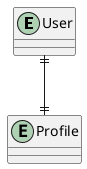
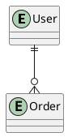
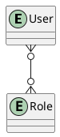

# 06.04 - Relationships & Entity Standards

**Project:** GsmUi
**Architecture:** Database Relationship Standards
**Database:** MySQL 8.4 LTS (InnoDB)
**Framework:** Laravel 13 + Eloquent ORM
**Pattern:** Domain-Driven Design (DDD)
**Version:** 1.0.0

---

# Purpose

This document defines how entities relate to each other throughout the GsmUi platform.

A consistent relationship model improves:

* Data integrity
* Query performance
* Maintainability
* Domain isolation
* Eloquent consistency
* Future scalability

Relationships should reflect real business rules rather than implementation convenience.

---

# Design Principles

Every relationship must be:

* Explicit
* Business-driven
* Strongly typed
* Indexed
* Backed by foreign keys
* Consistent across domains

Avoid implicit or undocumented relationships.

---

# Relationship Types

The platform uses five primary relationship patterns:

| Type             | Usage                |
| ---------------- | -------------------- |
| One-to-One       | Profiles, Settings   |
| One-to-Many      | Users → Orders       |
| Many-to-Many     | Roles ↔ Permissions  |
| Polymorphic      | Media, Activity Logs |
| Self-Referencing | Categories, Menus    |

---

# One-to-One (1:1)

Used when two entities always belong together.

Example:

```text id="rel01"
User

↓

Profile
```

PlantUML:



Examples:

* User → Profile
* User → Preferences
* User → API Settings

---

# One-to-Many (1:N)

Most common relationship.

Example:

```text id="rel03"
User

↓

Orders
```

PlantUML:



Examples:

* User → Orders
* User → Themes
* User → Templates
* Category → Components
* Theme → Theme Versions
* Product → Reviews

---

# Many-to-Many (N:N)

Requires a pivot table.

Example:

```text id="rel05"
Roles

↓

role_user

↓

Users
```

PlantUML:



Examples:

* Users ↔ Roles
* Roles ↔ Permissions
* Products ↔ Categories
* Components ↔ Tags
* Themes ↔ Tags

---

# Pivot Table Standards

Rules:

* Alphabetical naming
* Singular entity names
* Foreign keys
* Composite unique index

Example:

```text id="rel07"
component_tag

permission_role

role_user
```

Typical schema:

```php id="rel08"
component_id

tag_id
```

Additional pivot metadata is allowed when required.

---

# Polymorphic Relationships

Use only when entities genuinely share the same behavior.

Recommended for:

* Media
* Comments
* Activity Logs
* Notifications

Example:

```text id="rel09"
Media

↓

Theme

Component

Blog

Template
```

Laravel example:

```php id="rel10"
morphTo()

morphMany()
```

Avoid polymorphic relationships for core transactional data.

---

# Self-Referencing Relationships

Used for hierarchical structures.

Example:

```text id="rel11"
Category

↓

Parent Category

↓

Child Category
```

Schema:

```php id="rel12"
parent_id
```

Examples:

* Categories
* Menus
* Documentation navigation
* CMS pages

---

# Aggregate Roots

Each domain has an aggregate root.

Examples:

| Domain        | Aggregate Root    |
| ------------- | ----------------- |
| Themes        | Theme             |
| Components    | Component         |
| Marketplace   | Product           |
| Billing       | Subscription      |
| Documentation | DocumentationPage |
| Playground    | PlaygroundProject |

Other entities should be modified through their aggregate root.

---

# Ownership

Ownership relationships define lifecycle.

Example:

```text id="rel13"
User

↓

Theme

↓

Theme Version

↓

Theme Token
```

Deleting the owner should follow explicit business rules.

---

# Cascade Rules

Recommended behaviors:

| Relationship      | Action                |
| ----------------- | --------------------- |
| User → Orders     | Restrict              |
| User → Themes     | Cascade (Soft Delete) |
| Theme → Tokens    | Cascade               |
| Theme → Versions  | Cascade               |
| Order → License   | Restrict              |
| Product → Reviews | Cascade               |

Choose cascade behavior intentionally.

---

# Foreign Key Standards

Always:

* Create indexes
* Use explicit constraints
* Name consistently

Example:

```php id="rel14"
$table
    ->foreignId('user_id')
    ->constrained()
    ->cascadeOnDelete();
```

---

# Optional Relationships

Nullable foreign keys only when supported by business rules.

Example:

```php id="rel15"
published_by

approved_by

parent_id
```

Avoid nullable ownership fields.

---

# Domain Boundaries

Relationships across domains should remain minimal.

Example:

```text id="rel16"
Marketplace

↓

User

↓

Identity
```

Avoid deeply nested cross-domain dependencies.

---

# Circular Dependencies

Do not create circular foreign keys.

Incorrect:

```text id="rel17"
Theme

↓

Component

↓

Theme
```

Instead, introduce a junction table or redesign ownership.

---

# Version Relationships

Versioned entities:

```text id="rel18"
Theme

↓

Theme Version
```

Never overwrite published versions.

Each version is immutable.

---

# Audit Relationships

Audit columns:

```text id="rel19"
created_by

updated_by

deleted_by
```

Reference:

```text id="rel20"
users.id
```

Used only where author attribution is required.

---

# Activity Relationships

Activity Log:

```text id="rel21"
User

↓

Activity

↓

Subject (Polymorphic)
```

Supports:

* Components
* Themes
* Orders
* CMS
* Blog

---

# Media Relationships

Spatie Media Library:

```text id="rel22"
Theme

↓

Media

Component

Blog

Template
```

Media metadata is stored separately from business tables.

---

# Notification Relationships

Example:

```text id="rel23"
User

↓

Notification
```

Notifications belong to exactly one recipient.

Future team notifications may introduce organization ownership.

---

# Team Relationships (Future)

Enterprise roadmap:

```text id="rel24"
Organization

↓

Members

↓

Roles

↓

Projects
```

Current schema should avoid assumptions that block future multi-tenancy.

---

# Relationship Depth

Recommended maximum traversal:

```text id="rel25"
User

↓

Order

↓

License

↓

Download
```

Avoid deeply nested eager-loading chains.

---

# Eager Loading Standards

Always eager-load predictable relationships.

Example:

```php id="rel26"
Theme::with([
    'author',
    'versions',
    'tokens'
]);
```

Prevent N+1 query problems.

---

# Lazy Loading

Disable lazy loading in development.

```php id="rel27"
Model::preventLazyLoading();
```

Encourages explicit query design.

---

# Soft Delete Relationships

Soft-deleted parents should generally exclude children from active queries.

Use:

```php id="rel28"
withTrashed()

onlyTrashed()
```

Only where business workflows require recovery.

---

# Relationship Matrix

| Parent    | Child        | Type        |
| --------- | ------------ | ----------- |
| User      | Theme        | 1:N         |
| User      | Order        | 1:N         |
| User      | Subscription | 1:N         |
| Theme     | ThemeVersion | 1:N         |
| Theme     | ThemeToken   | 1:N         |
| Component | Example      | 1:N         |
| Product   | Review       | 1:N         |
| Role      | Permission   | N:N         |
| Category  | Category     | Self        |
| Theme     | Media        | Polymorphic |

---

# Performance Guidelines

Relationships should:

* Use indexed foreign keys
* Minimize unnecessary joins
* Support eager loading
* Avoid circular dependencies
* Keep aggregate boundaries clear

Measure before introducing denormalization.

---

# Anti-Patterns

Avoid:

* Missing foreign keys
* Generic `entity_id` columns without polymorphism
* Circular references
* Deep object graphs
* Unbounded many-to-many relationships
* Cross-domain coupling without clear ownership

Relationships should communicate business meaning, not merely technical linkage.

---

# Conclusion

The GsmUi relationship standards establish a clear, domain-driven approach to entity modeling. By using explicit ownership, appropriate relationship types, aggregate roots, indexed foreign keys, and disciplined boundaries, the platform achieves strong data integrity, predictable Eloquent behavior, and a schema that can evolve from a modular monolith into larger distributed architectures.

---

# Objectives

| Objective | Description |
|-----------|-------------|
| Data Integrity | Foreign keys enforce referential constraints |
| Business Accuracy | Relationships reflect real business rules |
| Query Performance | Indexed foreign keys, eager loading support |
| Domain Isolation | Minimal cross-domain dependencies |
| Eloquent Consistency | Standard relationship patterns |
| Scalability | Schema supports future domain extraction |
| Auditability | Ownership and version relationships tracked |
| Flexibility | Polymorphic relationships where appropriate |

---

# Timeline

| Phase | Duration | Deliverable |
|-------|----------|-------------|
| Relationship Standards | Week 1 | This document |
| Domain Relationship Map | Weeks 2–3 | All domain relationships documented |
| Foreign Key Implementation | Weeks 4–6 | All FK constraints added |
| Cascade Rule Testing | Weeks 7–8 | Verify all cascade behaviors |
| Eager Loading Optimization | Weeks 9–10 | Prevent N+1 across all queries |
| Performance Testing | Week 11 | Join performance validation |
| Documentation | Week 12 | Updated PRD, developer guide |
| CI Enforcement | Week 13 | FK verification in CI pipeline |

---

# Budget

| Item | Cost | Notes |
|------|------|-------|
| Relationship Documentation | Internal | This document |
| Schema Design Tool | $0 | MySQL Workbench / DrawSQL |
| Performance Testing | Internal | Query plan analysis |
| CI Integration | $0 | GitHub Actions (existing) |
| Total | ~$0 incremental | Internal effort only |

---

# Risk

| Risk | Impact | Likelihood | Mitigation |
|------|--------|------------|------------|
| Circular foreign key dependencies | High | Low | Architecture review, dependency rules |
| Cascade delete causing data loss | Critical | Low | Restrict default, explicit cascade review |
| Missing foreign keys | High | Medium | CI enforcement, schema audit |
| Deep eager-loading chains | Medium | Medium | Limit traversal depth, lazy loading |
| Cross-domain coupling | Medium | Medium | Minimal cross-domain FKs |
| Polymorphic relationship abuse | Medium | Low | Document when to use, code review |
| Performance degradation from joins | Medium | Medium | Index all FKs, query plan review |
| Pivot table bloat | Low | Medium | Composite indexes, archival strategy |

---

# Security

Relationship security considerations:

* Foreign keys prevent orphaned records
* Cascade rules prevent accidental data loss
* Ownership relationships enable authorization checks
* Audit columns track who created/modified records
* Soft delete relationships preserve recovery paths
* Domain boundaries prevent unauthorized cross-domain access
* Aggregate roots enforce modification through authorized paths
* Version relationships maintain immutable history

---

# Testing

Relationship testing requirements:

| Test Type | Scope |
|-----------|-------|
| Foreign key constraint tests | All FK columns |
| Cascade behavior tests | Delete, update, restrict |
| Nullable FK tests | Business justification verified |
| Eager loading tests | No N+1 queries |
| Relationship depth tests | Maximum traversal verified |
| Pivot table tests | Composite keys, unique constraints |
| Polymorphic tests | morphTo, morphMany correctness |
| Circular dependency tests | No circular FKs |

CI checks:

* Automated FK verification
* Query plan analysis for join performance
* Eager loading validation in development

---

# Performance

Relationship performance guidelines:

* Index all foreign key columns
* Eager-load predictable relationships
* Limit eager-loading depth to 3 levels
* Use lazy loading only for conditional relationships
* Disable lazy loading in development (`preventLazyLoading`)
* Measure join performance before adding new relationships
* Consider denormalization only after measuring
* Use cursor pagination for large relationship datasets
* Archive old records to reduce join table size

Join performance targets:

| Relationship Type | Target Join Time |
|-------------------|-----------------|
| 1:1 (indexed) | <5 ms |
| 1:N (indexed) | <10 ms |
| N:N (pivot, indexed) | <20 ms |
| Polymorphic | <15 ms |

---

# Future Evolution

| Enhancement | Phase | Impact |
|-------------|-------|--------|
| Team/organization relationships | Phase 2 | Multi-tenancy |
| Version history expansion | Phase 3 | Full audit trail |
| Soft delete recovery workflows | Phase 2 | Admin recovery tools |
| Cross-domain event relationships | Phase 4 | Event sourcing |
| CQRS read models | Phase 4 | Read optimization |
| Relationship caching | Phase 2 | Performance improvement |
| Graph database (future) | Phase 6 | Complex relationship queries |

---

# Competitors

| Competitor | Relationship Approach | GsmUi Differentiator |
|------------|----------------------|----------------------|
| WordPress | Meta tables (EAV) | Typed foreign keys |
| Shopify | Proprietary relations | Open, documented |
| Ghost | Minimal relations | Comprehensive DDD model |
| Strapi | Database-agnostic | Laravel Eloquent native |
| Laravel Default | Convention-based | Extended with DDD patterns |
| October CMS | Laravel-based | Aggregate root enforcement |

---

# Brand

Relationship standards reflect GsmUi's brand:

* **Reliability**: Foreign keys prevent data corruption
* **Professionalism**: Consistent relationship patterns
* **Performance**: Indexed joins, eager loading
* **Security**: Ownership-based authorization
* **Scalability**: Domain isolation, minimal coupling
* **Quality**: Documented cascade rules, tested behaviors

---

# API

Relationship standards enable API consistency:

| Relationship | API Representation |
|-------------|-------------------|
| 1:1 | Nested resource or separate endpoint |
| 1:N | Nested collection or included resources |
| N:N | Pivot data in included resources |
| Polymorphic | Type + ID in resource |
| Self-referential | Nested tree structure |

API Resources serialize relationships:

```php
// ThemeResource
public function toArray($request)
{
    return [
        'author' => new UserResource($this->author),
        'versions' => ThemeVersionResource::collection($this->versions),
        'tokens' => ThemeTokenResource::collection($this->tokens),
    ];
}
```

---

# Events

Relationship-triggered events:

| Relationship | Event | Impact |
|-------------|-------|--------|
| User → Theme | ThemeCreated | Index update |
| Theme → Version | VersionPublished | Cache invalidation |
| Order → License | OrderCompleted | License generation |
| Product → Review | ReviewSubmitted | Rating recalculation |
| Role → Permission | PermissionChanged | Cache flush |
| Component → Example | ExampleAdded | Documentation update |
| Category → Category | HierarchyChanged | Navigation rebuild |

Events dispatched after transaction commit to ensure data consistency.

---

# Database

This document defines relationship standards. Related documents:

| Document | Content |
|----------|---------|
| 06.01 | Design Principles |
| 06.02 | Naming Conventions |
| 06.03 | Common Columns |
| 06.04 | Relationships (this document) |

Relationship matrix:

| Parent | Child | Type | Cascade |
|--------|-------|------|---------|
| User | Theme | 1:N | Cascade (soft) |
| User | Order | 1:N | Restrict |
| User | Subscription | 1:N | Restrict |
| Theme | ThemeVersion | 1:N | Cascade |
| Theme | ThemeToken | 1:N | Cascade |
| Component | ComponentVersion | 1:N | Cascade |
| Component | Example | 1:N | Cascade |
| Product | Review | 1:N | Cascade |
| Order | License | 1:N | Restrict |
| Role | Permission | N:N | Pivot |
| Category | Category | Self | Restrict |

---

# KPIs

| KPI | Target | Measurement |
|-----|--------|-------------|
| Foreign key coverage | 100% | Schema audit |
| Cascade rule documentation | 100% | PRD review |
| N+1 query violations | 0 | Telescope profiling |
| Eager loading compliance | 100% | Code review |
| Relationship depth violations | 0 | Automated check |
| Circular dependency violations | 0 | CI verification |
| Join performance (p95) | <20 ms | Query monitoring |
| Pivot table index coverage | 100% | Schema audit |
| Soft delete relationship tests | 100% | PHPUnit |
| Cross-domain FK violations | 0 | Architecture review |

---

# Resources

| Resource | Allocation | Notes |
|----------|------------|-------|
| Database Architect | 1 FTE | Relationship design, review |
| Backend Developers | 2 FTE | FK implementation, eager loading |
| QA Engineer | 0.5 FTE | Relationship testing |
| Performance Engineer | 0.25 FTE | Join optimization |
| CI Pipeline | Existing | FK verification |
| Documentation | Internal | PRD, developer guide |
| Monitoring | Telescope | N+1 query detection |

---

# Conclusion

The GsmUi relationship standards establish a clear, domain-driven approach to entity modeling. By using explicit ownership, appropriate relationship types, aggregate roots, indexed foreign keys, and disciplined boundaries, the platform achieves strong data integrity, predictable Eloquent behavior, and a schema that can evolve from a modular monolith into larger distributed architectures.

---

# Next Document

**06.10 - Users Domain Database Design** begins the domain-specific database specifications, defining the complete schema for users, profiles, preferences, sessions, API tokens, authentication metadata, and account lifecycle management.
