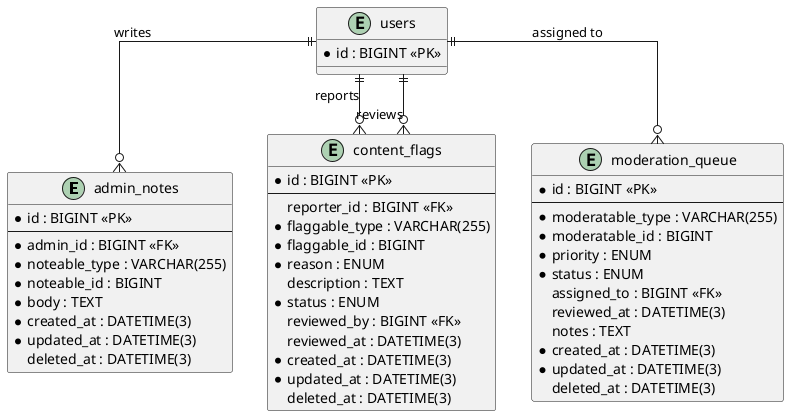

# 06.100 - Admin

**Project:** GsmUi
**Domain:** Admin
**Version:** 1.0.0

---

# Purpose

This document defines the database schema for the admin platform: internal notes, content flags/moderation, and the moderation queue.

---

# Tables

## admin_notes

**Purpose:** Internal notes left by admins on users, products, orders, or any entity.

**Business Rules:**
- Polymorphic — notes can attach to any model
- Only admins create notes
- Soft-deletable

**Columns:**

| Column | Type | Nullable | Default | Notes |
|---|---|---|---|---|
| id | BIGINT UNSIGNED | NO | AUTO_INCREMENT | PK |
| admin_id | BIGINT UNSIGNED | NO | — | FK → users.id |
| noteable_type | VARCHAR(255) | NO | — | Morph type |
| noteable_id | BIGINT UNSIGNED | NO | — | Morph ID |
| body | TEXT | NO | — | Note content |
| created_at | DATETIME(3) | NO | CURRENT_TIMESTAMP(3) | |
| updated_at | DATETIME(3) | NO | CURRENT_TIMESTAMP(3) | ON UPDATE |
| deleted_at | DATETIME(3) | YES | NULL | Soft delete |

**Indexes:**

```
PRIMARY: id
INDEX: admin_notes_admin_id_index (admin_id)
INDEX: admin_notes_noteable_type_noteable_id_index (noteable_type, noteable_id)
```

**Relationships:**
- belongsTo: User (admin)
- morphTo: noteable

**Migration:**

```php
Schema::create('admin_notes', function (Blueprint $table) {
    $table->id();
    $table->foreignId('admin_id')->constrained('users');
    $table->string('noteable_type');
    $table->unsignedBigInteger('noteable_id');
    $table->text('body');
    $table->timestamps();
    $table->softDeletes();
    $table->index(['noteable_type', 'noteable_id']);
});
```

---

## content_flags

**Purpose:** User-reported or system-detected flags on content (abuse, spam, copyright).

**Business Rules:**
- `reporter_id` is nullable for system-generated flags
- Status workflow: `pending` → `reviewed` → `dismissed`
- `reviewed_by` set when admin resolves
- Soft-deletable

**Columns:**

| Column | Type | Nullable | Default | Notes |
|---|---|---|---|---|
| id | BIGINT UNSIGNED | NO | AUTO_INCREMENT | PK |
| reporter_id | BIGINT UNSIGNED | YES | NULL | FK → users.id |
| flaggable_type | VARCHAR(255) | NO | — | Morph type |
| flaggable_id | BIGINT UNSIGNED | NO | — | Morph ID |
| reason | ENUM('spam','abuse','copyright','inappropriate','other') | NO | 'other' | Flag reason |
| description | TEXT | YES | NULL | Optional details |
| status | ENUM('pending','reviewed','dismissed') | NO | 'pending' | Resolution state |
| reviewed_by | BIGINT UNSIGNED | YES | NULL | FK → users.id |
| reviewed_at | DATETIME(3) | YES | NULL | Resolution time |
| created_at | DATETIME(3) | NO | CURRENT_TIMESTAMP(3) | |
| updated_at | DATETIME(3) | NO | CURRENT_TIMESTAMP(3) | ON UPDATE |
| deleted_at | DATETIME(3) | YES | NULL | Soft delete |

**Indexes:**

```
PRIMARY: id
INDEX: content_flags_reporter_id_index (reporter_id)
INDEX: content_flags_flaggable_type_flaggable_id_index (flaggable_type, flaggable_id)
INDEX: content_flags_status_index (status)
```

**Migration:**

```php
Schema::create('content_flags', function (Blueprint $table) {
    $table->id();
    $table->foreignId('reporter_id')->nullable()->constrained('users')->nullOnDelete();
    $table->string('flaggable_type');
    $table->unsignedBigInteger('flaggable_id');
    $table->enum('reason', ['spam', 'abuse', 'copyright', 'inappropriate', 'other'])->default('other');
    $table->text('description')->nullable();
    $table->enum('status', ['pending', 'reviewed', 'dismissed'])->default('pending');
    $table->foreignId('reviewed_by')->nullable()->constrained('users')->nullOnDelete();
    $table->timestamp('reviewed_at')->nullable();
    $table->timestamps();
    $table->softDeletes();
    $table->index(['flaggable_type', 'flaggable_id']);
});
```

---

## moderation_queue

**Purpose:** Queue of items pending moderation review (products, content, comments).

**Business Rules:**
- Priority: `low` < `normal` < `high` < `urgent`
- `assigned_to` for workload distribution among admins
- Soft-deletable

**Columns:**

| Column | Type | Nullable | Default | Notes |
|---|---|---|---|---|
| id | BIGINT UNSIGNED | NO | AUTO_INCREMENT | PK |
| moderatable_type | VARCHAR(255) | NO | — | Morph type |
| moderatable_id | BIGINT UNSIGNED | NO | — | Morph ID |
| priority | ENUM('low','normal','high','urgent') | NO | 'normal' | Review priority |
| status | ENUM('pending','in_review','approved','rejected') | NO | 'pending' | Review state |
| assigned_to | BIGINT UNSIGNED | YES | NULL | FK → users.id |
| reviewed_at | DATETIME(3) | YES | NULL | Review completion time |
| notes | TEXT | YES | NULL | Admin review notes |
| created_at | DATETIME(3) | NO | CURRENT_TIMESTAMP(3) | |
| updated_at | DATETIME(3) | NO | CURRENT_TIMESTAMP(3) | ON UPDATE |
| deleted_at | DATETIME(3) | YES | NULL | Soft delete |

**Indexes:**

```
PRIMARY: id
INDEX: moderation_queue_moderatable_type_moderatable_id_index (moderatable_type, moderatable_id)
INDEX: moderation_queue_status_index (status)
INDEX: moderation_queue_assigned_to_index (assigned_to)
INDEX: moderation_queue_priority_index (priority)
```

**Migration:**

```php
Schema::create('moderation_queue', function (Blueprint $table) {
    $table->id();
    $table->string('moderatable_type');
    $table->unsignedBigInteger('moderatable_id');
    $table->enum('priority', ['low', 'normal', 'high', 'urgent'])->default('normal');
    $table->enum('status', ['pending', 'in_review', 'approved', 'rejected'])->default('pending');
    $table->foreignId('assigned_to')->nullable()->constrained('users')->nullOnDelete();
    $table->timestamp('reviewed_at')->nullable();
    $table->text('notes')->nullable();
    $table->timestamps();
    $table->softDeletes();
    $table->index(['moderatable_type', 'moderatable_id']);
});
```

---

# PlantUML ERD



---

# Next Document

**06.101 - Settings** defines the platform settings schema: setting groups, key-value settings, and scoped overrides.

---

## Detailed Business Rules

### Admin Notes Management

**Note Lifecycle:**
```
Created → Updated → Soft Deleted
```

**Note Creation Rules:**
- Only authenticated admin users can create notes
- `admin_id` is set to the creating admin's user ID
- `noteable_type` + `noteable_id` must reference an existing model (polymorphic morph)
- `body` is required and must be non-empty
- Maximum body length: 10,000 characters
- Notes are immutable after creation at the database level but editable via application

**Polymorphic Supported Models:**

| Model | Table | Description |
|-------|-------|-------------|
| `User` | `users` | Customer/user accounts |
| `Product` | `products` | Marketplace products |
| `Order` | `orders` | Customer orders |
| `Subscription` | `subscriptions` | Active subscriptions |
| `Coupon` | `coupons` | Discount coupons |
| `Team` | `teams` | Organization teams |
| `PlaygroundProject` | `playground_projects` | Playground workspaces |
| `Snippet` | `snippets` | Code snippets |
| `BlogPost` | `content_entries` | Blog posts |
| `SupportTicket` | `support_tickets` | Support tickets |

**Note Querying:**
- Notes are queried by `noteable_type` + `noteable_id` for display on entity detail pages
- Notes are ordered by `created_at` descending (newest first)
- Notes support soft-delete (can be restored)
- Admin notes are included in admin audit logs

**Note Editing Rules:**
- Only the original author (`admin_id`) can edit a note
- Only admins can view notes (notes are never exposed to customers)
- Notes cannot be edited after 30 days (freeze period for audit)

### Content Flags / Moderation

**Flag Lifecycle:**
```
Submitted → Pending → Reviewed → Resolved (or Dismissed)
```

**Flag Submission Rules:**
- Authenticated users can submit flags on public content
- `reporter_id` is set to the submitting user's ID
- System-generated flags (automated spam detection) have `reporter_id = NULL`
- One flag per user per content item (application layer enforcement)
- Maximum 3 flags per user per 24-hour period (rate limiting)

**Flag Reasons:**

| Reason | Description | Auto-Action |
|--------|-------------|-------------|
| `spam` | Unsolicited commercial content | Auto-hide if 3+ spam flags |
| `abuse` | Harassment, threats, hate speech | Auto-hide if 2+ abuse flags |
| `copyright` | Intellectual property violation | Notify alleged infringer |
| `inappropriate` | NSFW, graphic, disturbing content | Auto-blur until reviewed |
| `other` | Doesn't fit other categories | Manual review required |

**Flag Review Process:**
1. Admin receives notification of new pending flag
2. Admin reviews flagged content
3. Admin decides: resolve (take action) or dismiss (no action needed)
4. `reviewed_by` set to reviewing admin's user ID
5. `reviewed_at` set to resolution timestamp
6. Status updated: `pending` → `reviewed` or `dismissed`
7. Action taken on the flagged content (hide, warn, remove, etc.)

**Auto-Moderation Rules:**
- Content with 3+ spam flags from unique users: auto-hide
- Content with 2+ abuse flags from unique users: auto-hide
- Content with 1 copyright flag: auto-notify alleged infringer
- Auto-hidden content requires admin review before restoration
- Auto-actions are logged in `audit_logs` table

**Duplicate Flag Prevention:**
- Same user cannot flag the same content twice
- Same user cannot flag the same content with the same reason after dismissal
- Application layer enforces uniqueness; database does not have unique constraint (allows multiple reasons)

### Moderation Queue

**Queue Lifecycle:**
```
Created → Pending → In Review → Approved/Rejected
```

**Priority Levels:**

| Priority | SLA (Response) | SLA (Resolution) | Description |
|----------|---------------|-------------------|-------------|
| `urgent` | 1 hour | 4 hours | Legal issues, safety concerns |
| `high` | 4 hours | 24 hours | Revenue impact, brand risk |
| `normal` | 24 hours | 72 hours | Standard content review |
| `low` | 72 hours | 7 days | Minor issues, cosmetic |

**Queue Assignment Rules:**
- New items are assigned to the admin with the least active items
- `urgent` priority items are assigned to senior moderators only
- Admins can claim unassigned items from the queue
- Admins can transfer items to other admins with a note
- Each admin has a maximum of 20 active items in the queue

**Queue Item Resolution:**
- `approved`: Content is cleared and published/visible
- `rejected`: Content is removed or hidden
- `notes`: Admin must provide review notes before resolution
- Resolution triggers notification to the content author

**Auto-Assignment Rules:**
- New moderation items are auto-assigned within 5 minutes of creation
- If no admin is available, item remains unassigned with `normal` priority
- `urgent` items trigger Slack notification to all moderators

---

## State Machine

```
┌─────────────────────────────────────────────────┐
│                 CONTENT_FLAG                     │
│                                                  │
│  ┌─────────┐  review  ┌──────────┐              │
│  │ pending  │──────────►│ reviewed │              │
│  └─────────┘            └──────────┘             │
│       │                                           │
│       │ dismiss                                   │
│       ▼                                           │
│  ┌──────────┐                                    │
│  │ dismissed │                                   │
│  └──────────┘                                    │
└─────────────────────────────────────────────────┘

┌─────────────────────────────────────────────────┐
│              MODERATION_QUEUE                    │
│                                                  │
│  ┌─────────┐  claim   ┌───────────┐             │
│  │ pending  │─────────►│ in_review │             │
│  └─────────┘           └─────┬─────┘             │
│                              │                    │
│                    ┌─────────┴─────────┐         │
│                    ▼                   ▼         │
│              ┌──────────┐      ┌──────────┐     │
│              │ approved │      │ rejected │     │
│              └──────────┘      └──────────┘     │
└─────────────────────────────────────────────────┘

┌─────────────────────────────────────────────────┐
│                 ADMIN_NOTE                       │
│                                                  │
│  (No state transitions)                         │
│  Created → Soft Deleted                          │
└─────────────────────────────────────────────────┘
```

---

## API Contracts

### POST /api/admin/notes

**Purpose:** Create an admin note on any entity.

**Request:**
```json
{
  "noteable_type": "App\\Models\\User",
  "noteable_id": 42,
  "body": "Customer requested refund for order #789. Approved by manager."
}
```

**Response (201 Created):**
```json
{
  "id": 123,
  "admin_id": 5,
  "noteable_type": "App\\Models\\User",
  "noteable_id": 42,
  "body": "Customer requested refund for order #789. Approved by manager.",
  "created_at": "2024-06-30T10:30:00Z"
}
```

### GET /api/admin/notes?noteable_type=User&noteable_id=42

**Purpose:** List notes for an entity.

**Response (200 OK):**
```json
{
  "data": [
    {
      "id": 123,
      "admin": { "id": 5, "name": "Jane Admin" },
      "body": "Customer requested refund...",
      "created_at": "2024-06-30T10:30:00Z"
    }
  ],
  "meta": { "total": 5 }
}
```

### POST /api/admin/flags

**Purpose:** Submit a content flag.

**Request:**
```json
{
  "flaggable_type": "App\\Models\\Snippet",
  "flaggable_id": 42,
  "reason": "spam",
  "description": "This snippet contains affiliate links"
}
```

**Response (201 Created):**
```json
{
  "id": 78,
  "status": "pending",
  "created_at": "2024-06-30T10:30:00Z"
}
```

### PUT /api/admin/flags/{id}/resolve

**Purpose:** Resolve a content flag.

**Request:**
```json
{
  "status": "reviewed",
  "action": "hide_content",
  "notes": "Content violates spam policy. Snippet hidden."
}
```

**Response (200 OK):**
```json
{
  "id": 78,
  "status": "reviewed",
  "reviewed_by": 5,
  "reviewed_at": "2024-06-30T10:35:00Z"
}
```

### GET /api/admin/moderation-queue

**Purpose:** List moderation queue items.

**Query Parameters:**
- `status` (optional): Filter by status
- `priority` (optional): Filter by priority
- `assigned_to` (optional): Filter by assigned admin
- `moderatable_type` (optional): Filter by content type
- `page` (optional): Page number

**Response (200 OK):**
```json
{
  "data": [
    {
      "id": 45,
      "moderatable_type": "App\\Models\\Product",
      "moderatable_id": 12,
      "priority": "high",
      "status": "pending",
      "assigned_to": { "id": 5, "name": "Jane Admin" },
      "created_at": "2024-06-30T08:00:00Z"
    }
  ],
  "meta": { "total": 23, "urgent_count": 2, "high_count": 5 }
}
```

### PUT /api/admin/moderation-queue/{id}/claim

**Purpose:** Claim a moderation item.

**Response (200 OK):**
```json
{
  "id": 45,
  "status": "in_review",
  "assigned_to": 5
}
```

### PUT /api/admin/moderation-queue/{id}/resolve

**Purpose:** Resolve a moderation item.

**Request:**
```json
{
  "status": "approved",
  "notes": "Content reviewed and approved. No policy violations found."
}
```

**Response (200 OK):**
```json
{
  "id": 45,
  "status": "approved",
  "reviewed_at": "2024-06-30T10:35:00Z"
}
```

---

## Security Considerations

### Access Control

| Action | Permission Required |
|--------|-------------------|
| Create note | Admin |
| View notes | Admin |
| Edit own note | Admin (original author) |
| Delete note | Admin (original author or super-admin) |
| Submit flag | Authenticated user |
| View flags | Admin |
| Resolve flag | Admin |
| View moderation queue | Admin |
| Claim moderation item | Admin |
| Resolve moderation item | Admin |

### Content Security

- Admin notes: no executable scripts in body text
- Flag descriptions: sanitized, maximum 1,000 characters
- Moderation notes: sanitized, maximum 5,000 characters
- Polymorphic references: validated at application layer (must reference existing model)

### Rate Limiting

| Endpoint | Limit | Window |
|----------|-------|--------|
| `POST /admin/notes` | 60 | 1 hour |
| `POST /admin/flags` | 5 | 24 hours |
| `PUT /admin/flags/{id}/resolve` | 30 | 1 hour |
| `PUT /admin/moderation-queue/{id}/claim` | 30 | 1 hour |

### Fraud Prevention

- Flag abuse: same user cannot flag same content twice
- Flag rate limiting: 5 flags per user per 24 hours
- Auto-hide threshold: 3 spam flags from unique users
- Auto-hide threshold: 2 abuse flags from unique users
- Moderation queue: maximum 20 active items per admin

---

## Event Hooks

### Laravel Events

| Event | Fired When | Payload |
|-------|------------|---------|
| `AdminNoteCreated` | New note created | `AdminNote $note` |
| `AdminNoteUpdated` | Note edited | `AdminNote $note` |
| `AdminNoteDeleted` | Note soft-deleted | `AdminNote $note` |
| `ContentFlagSubmitted` | New flag submitted | `ContentFlag $flag` |
| `ContentFlagResolved` | Flag reviewed/dismissed | `ContentFlag $flag` |
| `ContentFlagAutoHidden` | Auto-hide triggered | `ContentFlag $flag, string $reason` |
| `ModerationQueueItemCreated` | New item in queue | `ModerationQueue $item` |
| `ModerationQueueItemClaimed` | Admin claimed item | `ModerationQueue $item` |
| `ModerationQueueItemResolved` | Item approved/rejected | `ModerationQueue $item` |

### Webhook Integration

- `ContentFlagSubmitted` triggers webhook to moderation notification system
- `ContentFlagAutoHidden` triggers webhook to content management system
- `ModerationQueueItemCreated` triggers webhook to Slack/Teams notification
- `ModerationQueueItemResolved` triggers webhook to content author notification

---

## Query Patterns

### List Notes for Entity

```php
AdminNote::where('noteable_type', $modelClass)
    ->where('noteable_id', $modelId)
    ->with('admin:id,name')
    ->orderByDesc('created_at')
    ->paginate(20);
```

### Pending Flags Count

```php
ContentFlag::where('status', 'pending')
    ->count();
```

### Flags by Content Type

```php
ContentFlag::where('flaggable_type', $modelClass)
    ->where('status', 'pending')
    ->orderByDesc('created_at')
    ->paginate(20);
```

### Moderation Queue by Priority

```php
ModerationQueue::where('status', 'pending')
    ->orderByRaw("FIELD(priority, 'urgent', 'high', 'normal', 'low')")
    ->with('assignedTo:id,name')
    ->paginate(20);
```

### Admin Workload

```php
ModerationQueue::where('assigned_to', $adminId)
    ->where('status', 'in_review')
    ->count();
```

### Flag History for Content

```php
ContentFlag::where('flaggable_type', $modelClass)
    ->where('flaggable_id', $modelId)
    ->with('reporter:id,name', 'reviewer:id,name')
    ->orderByDesc('created_at')
    ->get();
```

### Auto-Moderation Candidates

```php
// Find content with enough flags to trigger auto-hide
ContentFlag::select('flaggable_type', 'flaggable_id')
    ->where('status', 'pending')
    ->where('reason', 'spam')
    ->groupBy('flaggable_type', 'flaggable_id')
    ->havingRaw('COUNT(DISTINCT reporter_id) >= 3')
    ->get();
```

---

## Caching Strategy

### Cached Values

| Key Pattern | Value | TTL | Invalidation |
|-------------|-------|-----|-------------|
| `admin:notes:{type}:{id}` | Notes for entity | 5 minutes | On note create/update/delete |
| `admin:flags:pending` | Pending flags count | 1 minute | On flag submit/resolve |
| `admin:queue:count` | Queue item counts | 1 minute | On queue create/claim/resolve |
| `admin:queue:{admin_id}:workload` | Admin workload | 1 minute | On queue claim/resolve |

### Cache Invalidation Rules

- On note create/update/delete: invalidate entity notes cache
- On flag submit/resolve: invalidate pending flags count
- On queue create/claim/resolve: invalidate queue counts and workload cache
- On auto-hide: invalidate content visibility cache

---

## Artisan Commands

### `admin:moderation-reminder`

**Purpose:** Send reminders for overdue moderation items.

**Schedule:** Daily at 09:00 UTC.

**Logic:**
```php
ModerationQueue::where('status', 'in_review')
    ->where('updated_at', '<', now()->subHours(24))
    ->chunkById(100, function ($items) {
        foreach ($items as $item) {
            Notification::send(
                $item->assignedTo,
                new ModerationOverdueNotification($item)
            );
        }
    });
```

### `admin:flag-digest`

**Purpose:** Send daily digest of new flags to admin team.

**Schedule:** Daily at 08:00 UTC.

**Logic:**
```php
$newFlags = ContentFlag::where('status', 'pending')
    ->where('created_at', '>=', now()->subDay())
    ->count();

if ($newFlags > 0) {
    Notification::send(
        User::where('is_admin', true)->get(),
        new FlagDigestNotification($newFlags)
    );
}
```

### `admin:cleanup-resolved-flags`

**Purpose:** Archive old resolved flags.

**Schedule:** Monthly on 1st at 04:00 UTC.

**Logic:**
```php
ContentFlag::where('status', 'reviewed')
    ->where('reviewed_at', '<', now()->subMonths(6))
    ->delete();
```

---

## Testing Scenarios

### Unit Tests

| Test Case | Expected Result |
|-----------|-----------------|
| Create admin note | Note created with correct admin_id |
| Submit content flag | Flag created with pending status |
| Resolve content flag | Status updated, reviewed_by set |
| Claim moderation item | Status → in_review, assigned_to set |
| Auto-hide on 3 spam flags | Content hidden automatically |
| Duplicate flag prevention | Rejected at application layer |

### Integration Tests

| Test Case | Expected Result |
|-----------|-----------------|
| Flag triggers auto-hide | Content hidden after threshold |
| Resolution sends notification | Author notified of action |
| Moderation queue assignment | Assigned to admin with fewest items |
| Rate limit on flag submission | 6th flag in 24h rejected |

### Edge Cases

| Scenario | Behavior |
|----------|----------|
| Flag on deleted content | Flag preserved, content reference invalid |
| Two admins claim same item | Last-write-wins with optimistic locking |
| Auto-hide on already hidden content | No duplicate action |
| Flag on self-owned content | Allowed (user can flag their own content) |

---

## Performance Considerations

### Index Usage

| Query Pattern | Index Used | Estimated Rows Scanned |
|---------------|-----------|----------------------|
| Notes by entity | `noteable_type + noteable_id` | ~5 per entity |
| Pending flags | `status` index | Proportional to pending count |
| Queue by priority | `priority + status` composite | ~20 |
| Admin workload | `assigned_to + status` | ~5 per admin |

### Table Growth Projections

| Table | Year 1 | Year 3 | Year 5 |
|-------|--------|--------|--------|
| `admin_notes` | 2K | 10K | 25K |
| `content_flags` | 5K | 25K | 75K |
| `moderation_queue` | 3K | 15K | 40K |

### Partitioning Strategy

- `content_flags`: partition by `created_at` (yearly) after 100K rows
- `moderation_queue`: partition by `created_at` (yearly) after 100K rows
- `admin_notes`: no partitioning (small table)

---

## Data Retention

### Retention Policies

| Table | Retention | Action |
|-------|-----------|--------|
| `admin_notes` | Indefinite | Soft-deleted retained for audit |
| `content_flags` | 6 months after resolution | Delete resolved flags |
| `moderation_queue` | Indefinite | Soft-deleted retained for audit |

### GDPR Compliance

- Admin notes may contain personal data (customer communications)
- Content flags contain reporter PII (user_id)
- User deletion: anonymize reporter_id on content_flags
- Moderation notes may reference personal data (anonymize on request)

---

## Database Constraints

### Foreign Key Constraints

```sql
ALTER TABLE admin_notes
  ADD CONSTRAINT fk_admin_notes_admin
    FOREIGN KEY (admin_id) REFERENCES users(id) ON DELETE CASCADE;

ALTER TABLE content_flags
  ADD CONSTRAINT fk_content_flags_reporter
    FOREIGN KEY (reporter_id) REFERENCES users(id) ON DELETE SET NULL,
  ADD CONSTRAINT fk_content_flags_reviewer
    FOREIGN KEY (reviewed_by) REFERENCES users(id) ON DELETE SET NULL;

ALTER TABLE moderation_queue
  ADD CONSTRAINT fk_moderation_queue_assigned
    FOREIGN KEY (assigned_to) REFERENCES users(id) ON DELETE SET NULL;
```

### Check Constraints

```sql
ALTER TABLE admin_notes
  ADD CONSTRAINT chk_admin_notes_body_not_empty
    CHECK (LENGTH(body) > 0);

ALTER TABLE content_flags
  ADD CONSTRAINT chk_content_flags_description_length
    CHECK (description IS NULL OR LENGTH(description) <= 1000);

ALTER TABLE moderation_queue
  ADD CONSTRAINT chk_moderation_queue_notes_length
    CHECK (notes IS NULL OR LENGTH(notes) <= 5000);
```

---

## Stored Procedures

### sp_submit_content_flag

```sql
DELIMITER //
CREATE PROCEDURE sp_submit_content_flag(
  IN p_reporter_id BIGINT,
  IN p_flaggable_type VARCHAR(255),
  IN p_flaggable_id BIGINT,
  IN p_reason VARCHAR(20),
  IN p_description TEXT,
  OUT p_flag_id BIGINT,
  OUT p_status VARCHAR(50)
)
BEGIN
  DECLARE v_existing_flag INT;
  DECLARE v_user_flag_count INT;

  -- Check for duplicate flag
  SELECT COUNT(*) INTO v_existing_flag
  FROM content_flags
  WHERE reporter_id = p_reporter_id
    AND flaggable_type = p_flaggable_type
    AND flaggable_id = p_flaggable_id
    AND status = 'pending';

  IF v_existing_flag > 0 THEN
    SET p_status = 'already_flagged';
  ELSE
    -- Check rate limit (5 flags per 24 hours)
    SELECT COUNT(*) INTO v_user_flag_count
    FROM content_flags
    WHERE reporter_id = p_reporter_id
      AND created_at >= DATE_SUB(NOW(), INTERVAL 24 HOUR);

    IF v_user_flag_count >= 5 THEN
      SET p_status = 'rate_limit_exceeded';
    ELSE
      INSERT INTO content_flags (reporter_id, flaggable_type, flaggable_id, reason, description, status, created_at, updated_at)
      VALUES (p_reporter_id, p_flaggable_type, p_flaggable_id, p_reason, p_description, 'pending', NOW(), NOW());

      SET p_flag_id = LAST_INSERT_ID();
      SET p_status = 'submitted';
    END IF;
  END IF;
END //
DELIMITER ;
```

### sp_resolve_content_flag

```sql
DELIMITER //
CREATE PROCEDURE sp_resolve_content_flag(
  IN p_flag_id BIGINT,
  IN p_reviewed_by BIGINT,
  IN p_status VARCHAR(20),
  OUT p_result VARCHAR(50)
)
BEGIN
  DECLARE v_current_status VARCHAR(20);
  DECLARE v_flaggable_type VARCHAR(255);
  DECLARE v_flaggable_id BIGINT;
  DECLARE v_flag_count INT;

  SELECT status, flaggable_type, flaggable_id
  INTO v_current_status, v_flaggable_type, v_flaggable_id
  FROM content_flags
  WHERE id = p_flag_id AND deleted_at IS NULL;

  IF v_current_status IS NULL THEN
    SET p_result = 'flag_not_found';
  ELSEIF v_current_status != 'pending' THEN
    SET p_result = 'already_resolved';
  ELSE
    UPDATE content_flags
    SET status = p_status,
        reviewed_by = p_reviewed_by,
        reviewed_at = NOW(),
        updated_at = NOW()
    WHERE id = p_flag_id;

    SET p_result = 'resolved';
  END IF;
END //
DELIMITER ;
```

### sp_auto_moderate_content

```sql
DELIMITER //
CREATE PROCEDURE sp_auto_moderate_content(
  IN p_flaggable_type VARCHAR(255),
  IN p_flaggable_id BIGINT,
  OUT p_action_taken VARCHAR(50)
)
BEGIN
  DECLARE v_spam_count INT;
  DECLARE v_abuse_count INT;

  -- Count spam flags from unique users
  SELECT COUNT(DISTINCT reporter_id) INTO v_spam_count
  FROM content_flags
  WHERE flaggable_type = p_flaggable_type
    AND flaggable_id = p_flaggable_id
    AND reason = 'spam'
    AND status = 'pending'
    AND reporter_id IS NOT NULL;

  -- Count abuse flags from unique users
  SELECT COUNT(DISTINCT reporter_id) INTO v_abuse_count
  FROM content_flags
  WHERE flaggable_type = p_flaggable_type
    AND flaggable_id = p_flaggable_id
    AND reason = 'abuse'
    AND status = 'pending'
    AND reporter_id IS NOT NULL;

  IF v_spam_count >= 3 THEN
    SET p_action_taken = 'auto_hidden_spam';
  ELSEIF v_abuse_count >= 2 THEN
    SET p_action_taken = 'auto_hidden_abuse';
  ELSE
    SET p_action_taken = 'no_action';
  END IF;
END //
DELIMITER ;
```

---

## Triggers

### trg_content_flags_before_insert

```sql
DELIMITER //
CREATE TRIGGER trg_content_flags_before_insert
BEFORE INSERT ON content_flags
FOR EACH ROW
BEGIN
  -- Validate description length
  IF NEW.description IS NOT NULL AND LENGTH(NEW.description) > 1000 THEN
    SIGNAL SQLSTATE '45000' SET MESSAGE_TEXT = 'Description cannot exceed 1000 characters';
  END IF;

  -- Set default status
  IF NEW.status IS NULL THEN
    SET NEW.status = 'pending';
  END IF;
END //
DELIMITER ;
```

### trg_moderation_queue_before_update

```sql
DELIMITER //
CREATE TRIGGER trg_moderation_queue_before_update
BEFORE UPDATE ON moderation_queue
FOR EACH ROW
BEGIN
  -- Auto-set reviewed_at on resolution
  IF NEW.status IN ('approved', 'rejected') AND OLD.status != NEW.status AND NEW.reviewed_at IS NULL THEN
    SET NEW.reviewed_at = NOW();
  END IF;

  -- Validate notes length
  IF NEW.notes IS NOT NULL AND LENGTH(NEW.notes) > 5000 THEN
    SIGNAL SQLSTATE '45000' SET MESSAGE_TEXT = 'Notes cannot exceed 5000 characters';
  END IF;
END //
DELIMITER ;
```

### trg_content_flags_after_insert

```sql
DELIMITER //
CREATE TRIGGER trg_content_flags_after_insert
AFTER INSERT ON content_flags
FOR EACH ROW
BEGIN
  -- Auto-create moderation queue item if threshold reached
  -- (Simplified: actual implementation would check counts)
  IF NEW.reason IN ('spam', 'abuse', 'copyright') THEN
    INSERT INTO moderation_queue (moderatable_type, moderatable_id, priority, status, created_at, updated_at)
    VALUES (NEW.flaggable_type, NEW.flaggable_id,
            CASE WHEN NEW.reason = 'copyright' THEN 'high' ELSE 'normal' END,
            'pending', NOW(), NOW());
  END IF;
END //
DELIMITER ;
```

---

## Views

### vw_pending_flags_summary

```sql
CREATE VIEW vw_pending_flags_summary AS
SELECT
  cf.flaggable_type,
  cf.flaggable_id,
  COUNT(*) AS flag_count,
  COUNT(DISTINCT cf.reporter_id) AS unique_reporters,
  GROUP_CONCAT(DISTINCT cf.reason) AS reasons,
  MIN(cf.created_at) AS earliest_flag,
  MAX(cf.created_at) AS latest_flag
FROM content_flags cf
WHERE cf.status = 'pending' AND cf.deleted_at IS NULL
GROUP BY cf.flaggable_type, cf.flaggable_id
HAVING flag_count >= 1
ORDER BY flag_count DESC;
```

### vw_moderation_queue_summary

```sql
CREATE VIEW vw_moderation_queue_summary AS
SELECT
  mq.id,
  mq.moderatable_type,
  mq.moderatable_id,
  mq.priority,
  mq.status,
  mq.assigned_to,
  mq.reviewed_at,
  mq.created_at,
  u.name AS assigned_to_name,
  TIMESTAMPDIFF(HOUR, mq.created_at, COALESCE(mq.reviewed_at, NOW())) AS hours_in_queue,
  CASE
    WHEN mq.status = 'pending' AND TIMESTAMPDIFF(HOUR, mq.created_at, NOW()) > 24 THEN 'overdue'
    WHEN mq.status = 'in_review' AND TIMESTAMPDIFF(HOUR, mq.updated_at, NOW()) > 12 THEN 'stale'
    ELSE 'on_track'
  END AS sla_status
FROM moderation_queue mq
LEFT JOIN users u ON mq.assigned_to = u.id
WHERE mq.deleted_at IS NULL;
```

### vw_admin_workload

```sql
CREATE VIEW vw_admin_workload AS
SELECT
  u.id AS admin_id,
  u.name AS admin_name,
  COUNT(CASE WHEN mq.status = 'in_review' THEN 1 END) AS active_items,
  COUNT(CASE WHEN mq.status = 'pending' AND mq.assigned_to = u.id THEN 1 END) AS assigned_pending,
  COUNT(CASE WHEN mq.reviewed_at >= DATE_SUB(NOW(), INTERVAL 7 DAY) THEN 1 END) AS resolved_last_7d,
  AVG(TIMESTAMPDIFF(HOUR, mq.created_at, mq.reviewed_at)) AS avg_resolution_hours
FROM users u
LEFT JOIN moderation_queue mq ON u.id = mq.assigned_to AND mq.deleted_at IS NULL
WHERE u.is_admin = TRUE
GROUP BY u.id, u.name;
```

---

## Index Optimization

### Composite Indexes for Common Queries

```sql
-- Notes by entity
CREATE INDEX idx_admin_notes_noteable ON admin_notes (noteable_type, noteable_id, created_at DESC, deleted_at);

-- Notes by admin
CREATE INDEX idx_admin_notes_admin_created ON admin_notes (admin_id, created_at DESC, deleted_at);

-- Flags by status and content
CREATE INDEX idx_content_flags_status_type ON content_flags (status, flaggable_type, flaggable_id, deleted_at);

-- Flags by reporter
CREATE INDEX idx_content_flags_reporter_created ON content_flags (reporter_id, created_at DESC);

-- Flags for auto-moderation
CREATE INDEX idx_content_flags_auto_moderate ON content_flags (flaggable_type, flaggable_id, reason, status, reporter_id);

-- Queue by priority and status
CREATE INDEX idx_moderation_queue_priority_status ON moderation_queue (priority, status, created_at, deleted_at);

-- Queue by admin
CREATE INDEX idx_moderation_queue_admin_status ON moderation_queue (assigned_to, status, updated_at, deleted_at);

-- Queue SLA monitoring
CREATE INDEX idx_moderation_queue_sla ON moderation_queue (status, created_at, updated_at, deleted_at);
```

### Index Usage Monitoring

```sql
-- Find unused indexes on admin tables
SELECT
  object_schema,
  object_name,
  index_name
FROM performance_schema.table_io_waits_summary_by_index_usage
WHERE object_schema = 'gsmui'
  AND index_name IS NOT NULL
  AND count_star = 0
  AND (object_name IN ('admin_notes', 'content_flags', 'moderation_queue'));

-- Find slow queries on admin tables
SELECT
  query_time,
  lock_time,
  rows_examined,
  sql_text
FROM mysql.slow_log
WHERE sql_text LIKE '%admin_notes%'
   OR sql_text LIKE '%content_flags%'
   OR sql_text LIKE '%moderation_queue%'
ORDER BY query_time DESC
LIMIT 10;
```

---

## Backup and Recovery

### Backup Strategy

| Table | Backup Frequency | Retention | Method |
|-------|-----------------|-----------|--------|
| `admin_notes` | Daily | 90 days | Full + incremental |
| `content_flags` | Daily | 90 days | Full + incremental |
| `moderation_queue` | Daily | 90 days | Full + incremental |

### Recovery Procedures

**Scenario: Accidental flag resolution**
```sql
-- 1. Identify incorrectly resolved flags
SELECT id, flaggable_type, flaggable_id, status, reviewed_by, reviewed_at
FROM content_flags
WHERE reviewed_at >= DATE_SUB(NOW(), INTERVAL 1 HOUR)
  AND status = 'dismissed';

-- 2. Revert to pending
UPDATE content_flags
SET status = 'pending', reviewed_by = NULL, reviewed_at = NULL, updated_at = NOW()
WHERE id IN (1, 2, 3);

-- 3. Log the correction
INSERT INTO admin_notes (admin_id, noteable_type, noteable_id, body, created_at, updated_at)
VALUES (1, 'App\\Models\\ContentFlag', 1, 'Reverted incorrect dismissal', NOW(), NOW());
```

**Scenario: Moderation queue overload**
```sql
-- 1. Identify overdue items
SELECT id, moderatable_type, moderatable_id, priority, assigned_to, created_at
FROM moderation_queue
WHERE status = 'in_review'
  AND updated_at < DATE_SUB(NOW(), INTERVAL 24 HOUR);

-- 2. Reassign to available admins
UPDATE moderation_queue
SET assigned_to = (
    SELECT id FROM users WHERE is_admin = TRUE AND id != assigned_to
    ORDER BY (SELECT COUNT(*) FROM moderation_queue WHERE assigned_to = users.id AND status = 'in_review')
    LIMIT 1
  ),
  updated_at = NOW()
WHERE status = 'in_review'
  AND updated_at < DATE_SUB(NOW(), INTERVAL 24 HOUR);
```

---

## Monitoring Queries

### Daily Health Check

```sql
-- Admin platform health overview
SELECT
  (SELECT COUNT(*) FROM admin_notes WHERE deleted_at IS NULL) AS total_notes,
  (SELECT COUNT(*) FROM admin_notes WHERE created_at >= DATE_SUB(NOW(), INTERVAL 24 HOUR)) AS notes_last_24h,
  (SELECT COUNT(*) FROM content_flags WHERE status = 'pending' AND deleted_at IS NULL) AS pending_flags,
  (SELECT COUNT(*) FROM content_flags WHERE created_at >= DATE_SUB(NOW(), INTERVAL 24 HOUR)) AS flags_last_24h,
  (SELECT COUNT(*) FROM moderation_queue WHERE status = 'pending' AND deleted_at IS NULL) AS pending_moderation,
  (SELECT COUNT(*) FROM moderation_queue WHERE status = 'in_review' AND deleted_at IS NULL) AS in_review_moderation;

-- Flag resolution metrics
SELECT
  DATE(reviewed_at) AS day,
  COUNT(*) AS resolved,
  COUNT(CASE WHEN status = 'reviewed' THEN 1 END) AS actioned,
  COUNT(CASE WHEN status = 'dismissed' THEN 1 END) AS dismissed,
  AVG(TIMESTAMPDIFF(HOUR, created_at, reviewed_at)) AS avg_resolution_hours
FROM content_flags
WHERE reviewed_at >= DATE_SUB(NOW(), INTERVAL 7 DAY)
GROUP BY DATE(reviewed_at)
ORDER BY day DESC;

-- Moderation SLA compliance
SELECT
  priority,
  COUNT(*) AS total_items,
  COUNT(CASE WHEN reviewed_at IS NOT NULL AND TIMESTAMPDIFF(HOUR, created_at, reviewed_at) <= 24 THEN 1 END) AS within_sla,
  AVG(TIMESTAMPDIFF(HOUR, created_at, COALESCE(reviewed_at, NOW()))) AS avg_hours
FROM moderation_queue
WHERE created_at >= DATE_SUB(NOW(), INTERVAL 7 DAY)
GROUP BY priority
ORDER BY FIELD(priority, 'urgent', 'high', 'normal', 'low');
```

### Abuse Detection

```sql
-- Users with excessive flag submissions
SELECT
  reporter_id,
  COUNT(*) as flag_count,
  COUNT(DISTINCT flaggable_type) as content_types
FROM content_flags
WHERE created_at >= DATE_SUB(NOW(), INTERVAL 30 DAY)
  AND reporter_id IS NOT NULL
GROUP BY reporter_id
HAVING flag_count > 20
ORDER BY flag_count DESC;

-- Content with highest flag density
SELECT
  flaggable_type,
  flaggable_id,
  COUNT(*) as total_flags,
  COUNT(DISTINCT reporter_id) as unique_reporters,
  COUNT(DISTINCT reason) as different_reasons
FROM content_flags
WHERE created_at >= DATE_SUB(NOW(), INTERVAL 30 DAY)
GROUP BY flaggable_type, flaggable_id
HAVING total_flags >= 3
ORDER BY total_flags DESC;
```

---

## Advanced Query Patterns

### Complex Admin Analytics

```php
// Flag resolution performance
$flagPerformance = ContentFlag::selectRaw('
    DATE(reviewed_at) as day,
    COUNT(*) as resolved,
    COUNT(CASE WHEN status = "reviewed" THEN 1 END) as actioned,
    COUNT(CASE WHEN status = "dismissed" THEN 1 END) as dismissed,
    AVG(TIMESTAMPDIFF(HOUR, created_at, reviewed_at)) as avg_resolution_hours,
    MAX(TIMESTAMPDIFF(HOUR, created_at, reviewed_at)) as max_resolution_hours
')
->where('reviewed_at', '>=', now()->subDays(30))
->groupBy('day')
->orderByDesc('day')
->get();

// Moderation queue workload distribution
$workload = DB::select('
    SELECT
        u.id as admin_id,
        u.name as admin_name,
        COUNT(CASE WHEN mq.status = "in_review" THEN 1 END) as active_items,
        COUNT(CASE WHEN mq.reviewed_at >= DATE_SUB(NOW(), INTERVAL 7 DAY) THEN 1 END) as resolved_7d,
        AVG(TIMESTAMPDIFF(HOUR, mq.created_at, mq.reviewed_at)) as avg_resolution_hours
    FROM users u
    LEFT JOIN moderation_queue mq ON u.id = mq.assigned_to AND mq.deleted_at IS NULL
    WHERE u.is_admin = TRUE
    GROUP BY u.id, u.name
    ORDER BY active_items DESC
');

// Content flag trends
$flagTrends = ContentFlag::selectRaw('
    reason,
    DATE_FORMAT(created_at, "%Y-%m") as month,
    COUNT(*) as flag_count,
    COUNT(CASE WHEN status = "reviewed" THEN 1 END) as resolved_count,
    ROUND(COUNT(CASE WHEN status = "reviewed" THEN 1 END) * 100.0 / COUNT(*), 2) as resolution_rate
')
->where('created_at', '>=', now()->subMonths(6))
->groupBy('reason', 'month')
->orderBy('month')
->get();
```

### Admin Health Dashboard Queries

```php
// Admin platform health score
$health = DB::selectOne('
    SELECT
        (SELECT COUNT(*) FROM admin_notes WHERE deleted_at IS NULL) as total_notes,
        (SELECT COUNT(*) FROM content_flags WHERE status = "pending" AND deleted_at IS NULL) as pending_flags,
        (SELECT COUNT(*) FROM moderation_queue WHERE status = "pending" AND deleted_at IS NULL) as pending_moderation,
        (SELECT COUNT(*) FROM moderation_queue WHERE status = "in_review" AND deleted_at IS NULL) as in_review,
        (SELECT COUNT(*) FROM moderation_queue WHERE reviewed_at >= DATE_SUB(NOW(), INTERVAL 24 HOUR)) as resolved_24h
');

// Moderation efficiency
$efficiency = DB::selectOne('
    SELECT
        AVG(TIMESTAMPDIFF(HOUR, created_at, reviewed_at)) as avg_resolution_hours,
        COUNT(CASE WHEN TIMESTAMPDIFF(HOUR, created_at, reviewed_at) <= 24 THEN 1 END) * 100.0 / COUNT(*) as sla_compliance_pct,
        COUNT(CASE WHEN status = "in_review" AND updated_at < DATE_SUB(NOW(), INTERVAL 24 HOUR) THEN 1 END) as stale_items
    FROM moderation_queue
    WHERE created_at >= DATE_SUB(NOW(), INTERVAL 7 DAY)
      AND deleted_at IS NULL
');
```

---

## Integration Patterns

### Webhook Payload Structure

```json
{
  "event": "admin.content_flag.submitted",
  "timestamp": "2024-06-30T10:30:00Z",
  "data": {
    "flag_id": 78,
    "flaggable_type": "App\\Models\\Snippet",
    "flaggable_id": 42,
    "reason": "spam",
    "reporter_id": 5,
    "auto_hide_eligible": true
  }
}
```

### Event Listeners

```php
// App\Listeners\AutoModerateOnFlag
class AutoModerateOnFlag
{
    public function handle(ContentFlagSubmitted $event): void
    {
        $flag = $event->flag;
        $flagCount = ContentFlag::where('flaggable_type', $flag->flaggable_type)
            ->where('flaggable_id', $flag->flaggable_id)
            ->where('status', 'pending')
            ->where('reason', $flag->reason)
            ->whereNotNull('reporter_id')
            ->distinct('reporter_id')
            ->count('reporter_id');

        $threshold = $flag->reason === 'spam' ? 3 : 2;

        if ($flagCount >= $threshold) {
            event(new ContentFlagAutoHidden($flag, $flag->reason));
        }
    }
}

// App\Listeners\NotifyModeratorsOfUrgent
class NotifyModeratorsOfUrgent
{
    public function handle(ModerationQueueItemCreated $event): void
    {
        if ($event->item->priority === 'urgent') {
            Notification::send(
                User::where('is_admin', true)->where('is_senior_moderator', true)->get(),
                new UrgentModerationNotification($event->item)
            );
        }
    }
}
```

### API Response Transformers

```php
// App\Transformers\AdminNoteTransformer
class AdminNoteTransformer
{
    public function transform(AdminNote $note): array
    {
        return [
            'id' => $note->id,
            'admin' => [
                'id' => $note->admin->id,
                'name' => $note->admin->name,
                'avatar' => $note->admin->avatar,
            ],
            'noteable_type' => $note->noteable_type,
            'noteable_id' => $note->noteable_id,
            'body' => $note->body,
            'created_at' => $note->created_at->toIso8601String(),
            'updated_at' => $note->updated_at->toIso8601String(),
        ];
    }
}

// App\Transformers\ContentFlagTransformer
class ContentFlagTransformer
{
    public function transform(ContentFlag $flag): array
    {
        return [
            'id' => $flag->id,
            'flaggable_type' => $flag->flaggable_type,
            'flaggable_id' => $flag->flaggable_id,
            'reason' => $flag->reason,
            'description' => $flag->description,
            'status' => $flag->status,
            'reporter' => $flag->reporter ? [
                'id' => $flag->reporter->id,
                'name' => $flag->reporter->name,
            ] : null,
            'reviewer' => $flag->reviewer ? [
                'id' => $flag->reviewer->id,
                'name' => $flag->reviewer->name,
            ] : null,
            'reviewed_at' => $flag->reviewed_at?->toIso8601String(),
            'created_at' => $flag->created_at->toIso8601String(),
        ];
    }
}
```

---

## Performance Benchmarks

### Target Response Times

| Operation | Target | Max | Notes |
|-----------|--------|-----|-------|
| Create note | 50ms | 200ms | Simple insert |
| Submit flag | 100ms | 500ms | Includes duplicate check |
| Resolve flag | 100ms | 300ms | Includes status update |
| List queue | 100ms | 300ms | Paginated |
| Claim item | 100ms | 300ms | Includes assignment |
| Auto-moderate | 200ms | 1s | Includes threshold check |

### Load Testing Scenarios

```php
// Concurrent flag submission test
$users = factory(User::class, 50)->create();
$content = factory(Snippet::class, 10)->create(['status' => 'published']);

$startTime = microtime(true);
$promises = [];

foreach ($users as $user) {
    $item = $content->random();
    $promises[] = Http::asJson()->post('http://localhost:8000/api/admin/flags', [
        'flaggable_type' => 'App\\Models\\Snippet',
        'flaggable_id' => $item->id,
        'reason' => 'spam',
    ], ['Authorization' => 'Bearer ' . $user->createToken('test')->plainTextToken]);
}

$responses = Pool::promise($promises)->wait();
$elapsed = microtime(true) - $startTime;

Log::info("50 concurrent flag submissions completed in {$elapsed}s");
```

### Database Performance Metrics

```sql
-- Query execution time distribution
SELECT
  query_time,
  COUNT(*) as count
FROM performance_schema.events_statements_summary_by_digest
WHERE digest_text LIKE '%admin_notes%'
   OR digest_text LIKE '%content_flags%'
   OR digest_text LIKE '%moderation_queue%'
GROUP BY query_time
ORDER BY query_time;

-- Index hit ratio
SELECT
  object_name,
  index_name,
  count_read,
  count_fetch,
  ROUND(count_fetch * 100.0 / NULLIF(count_read, 0), 2) as hit_ratio
FROM performance_schema.table_io_waits_summary_by_index_usage
WHERE object_schema = 'gsmui'
  AND object_name IN ('admin_notes', 'content_flags', 'moderation_queue');
```

---

## Security Audit Checklist

### Pre-Launch Security Review

- [ ] Admin notes restricted to admin users only
- [ ] Content flags restricted to authenticated users
- [ ] Flag submission rate limiting enforced
- [ ] Duplicate flag prevention enforced
- [ ] Auto-moderation thresholds configured
- [ ] Moderation queue SLA monitoring active
- [ ] Admin workload limits enforced (max 20 items)
- [ ] Content sanitization on all text fields
- [ ] Audit trail for all admin actions

### Ongoing Security Monitoring

```sql
-- Suspicious flag patterns
SELECT
  reporter_id,
  COUNT(*) as flag_count,
  COUNT(DISTINCT flaggable_type) as content_types,
  COUNT(DISTINCT reason) as reasons
FROM content_flags
WHERE created_at >= DATE_SUB(NOW(), INTERVAL 7 DAY)
  AND reporter_id IS NOT NULL
GROUP BY reporter_id
HAVING flag_count > 10
ORDER BY flag_count DESC;

-- Moderation queue SLA breaches
SELECT
  id,
  moderatable_type,
  moderatable_id,
  priority,
  status,
  assigned_to,
  TIMESTAMPDIFF(HOUR, created_at, NOW()) as hours_open
FROM moderation_queue
WHERE status IN ('pending', 'in_review')
  AND (
    (priority = 'urgent' AND TIMESTAMPDIFF(HOUR, created_at, NOW()) > 4)
    OR (priority = 'high' AND TIMESTAMPDIFF(HOUR, created_at, NOW()) > 24)
    OR (priority = 'normal' AND TIMESTAMPDIFF(HOUR, created_at, NOW()) > 72)
  )
ORDER BY priority, created_at;
```

---

## API Versioning

### Version Strategy

- API version included in URL: `/api/v1/admin/notes`
- Current version: v1
- Deprecation notice: 6 months before removal
- Backward compatibility: maintained within major version

---

## Deployment Considerations

### Migration Rollback Strategy

```php
// Always test rollback before deploying
Schema::dropIfExists('moderation_queue');
Schema::dropIfExists('content_flags');
Schema::dropIfExists('admin_notes');
```

### Zero-Downtime Deployment

1. Add new columns with defaults (nullable if needed)
2. Deploy application code that writes to new columns
3. Backfill existing rows in chunks
4. Add NOT NULL constraint after backfill
5. Remove old columns in next deployment

---

# Raw SQL DDL Reference

MySQL 8.0+ DDL for DBA review, mirroring the Laravel migrations.

## admin_notes

```sql
CREATE TABLE `admin_notes` (
  `id` BIGINT UNSIGNED NOT NULL AUTO_INCREMENT,
  `user_id` BIGINT UNSIGNED NULL COMMENT 'author',
  `noteable_type` VARCHAR(255) NOT NULL,
  `noteable_id` BIGINT UNSIGNED NOT NULL,
  `body` TEXT NOT NULL,
  `is_pinned` TINYINT(1) NOT NULL DEFAULT 0,
  `created_at` DATETIME(3) NOT NULL DEFAULT CURRENT_TIMESTAMP(3),
  `updated_at` DATETIME(3) NOT NULL DEFAULT CURRENT_TIMESTAMP(3)
    ON UPDATE CURRENT_TIMESTAMP(3),
  PRIMARY KEY (`id`),
  KEY `idx_admin_notes_noteable` (`noteable_type`, `noteable_id`),
  KEY `idx_admin_notes_user_created` (`user_id`, `created_at`),
  CONSTRAINT `fk_admin_notes_user`
    FOREIGN KEY (`user_id`) REFERENCES `users` (`id`) ON DELETE SET NULL,
  CONSTRAINT `chk_admin_notes_body_not_empty`
    CHECK (CHAR_LENGTH(`body`) > 0)
) ENGINE=InnoDB DEFAULT CHARSET=utf8mb4 COLLATE=utf8mb4_unicode_ci;
```

## content_flags

```sql
CREATE TABLE `content_flags` (
  `id` BIGINT UNSIGNED NOT NULL AUTO_INCREMENT,
  `user_id` BIGINT UNSIGNED NULL COMMENT 'reporter',
  `flaggable_type` VARCHAR(255) NOT NULL,
  `flaggable_id` BIGINT UNSIGNED NOT NULL,
  `reason` VARCHAR(50) NOT NULL,
  `details` TEXT NULL,
  `status` ENUM('pending','reviewing','resolved','dismissed') NOT NULL DEFAULT 'pending',
  `resolved_by` BIGINT UNSIGNED NULL,
  `resolution` VARCHAR(50) NULL,
  `resolved_at` DATETIME(3) NULL,
  `ip_address` VARCHAR(45) NOT NULL,
  `created_at` DATETIME(3) NOT NULL DEFAULT CURRENT_TIMESTAMP(3),
  `updated_at` DATETIME(3) NOT NULL DEFAULT CURRENT_TIMESTAMP(3)
    ON UPDATE CURRENT_TIMESTAMP(3),
  PRIMARY KEY (`id`),
  KEY `idx_content_flags_flaggable` (`flaggable_type`, `flaggable_id`),
  KEY `idx_content_flags_status` (`status`),
  KEY `idx_content_flags_status_created` (`status`, `created_at`),
  KEY `idx_content_flags_user` (`user_id`),
  CONSTRAINT `fk_content_flags_user`
    FOREIGN KEY (`user_id`) REFERENCES `users` (`id`) ON DELETE SET NULL,
  CONSTRAINT `fk_content_flags_resolver`
    FOREIGN KEY (`resolved_by`) REFERENCES `users` (`id`) ON DELETE SET NULL,
  CONSTRAINT `chk_content_flags_resolution`
    CHECK (`status` <> 'resolved' OR `resolution` IS NOT NULL)
) ENGINE=InnoDB DEFAULT CHARSET=utf8mb4 COLLATE=utf8mb4_unicode_ci;
```

## moderation_queue

```sql
CREATE TABLE `moderation_queue` (
  `id` BIGINT UNSIGNED NOT NULL AUTO_INCREMENT,
  `moderatable_type` VARCHAR(255) NOT NULL,
  `moderatable_id` BIGINT UNSIGNED NOT NULL,
  `source_flag_id` BIGINT UNSIGNED NULL,
  `priority` ENUM('low','normal','high','urgent') NOT NULL DEFAULT 'normal',
  `status` ENUM('queued','claimed','resolved','escalated') NOT NULL DEFAULT 'queued',
  `assigned_admin_id` BIGINT UNSIGNED NULL,
  `claimed_at` DATETIME(3) NULL,
  `decision` VARCHAR(50) NULL,
  `decision_notes` TEXT NULL,
  `decided_at` DATETIME(3) NULL,
  `created_at` DATETIME(3) NOT NULL DEFAULT CURRENT_TIMESTAMP(3),
  `updated_at` DATETIME(3) NOT NULL DEFAULT CURRENT_TIMESTAMP(3)
    ON UPDATE CURRENT_TIMESTAMP(3),
  PRIMARY KEY (`id`),
  KEY `idx_moderation_queue_status_priority` (`status`, `priority`, `created_at`),
  KEY `idx_moderation_queue_moderatable` (`moderatable_type`, `moderatable_id`),
  KEY `idx_moderation_queue_assigned` (`assigned_admin_id`),
  CONSTRAINT `fk_moderation_queue_flag`
    FOREIGN KEY (`source_flag_id`) REFERENCES `content_flags` (`id`) ON DELETE SET NULL,
  CONSTRAINT `fk_moderation_queue_admin`
    FOREIGN KEY (`assigned_admin_id`) REFERENCES `users` (`id`) ON DELETE SET NULL,
  CONSTRAINT `chk_moderation_queue_claimed`
    CHECK (`status` <> 'claimed' OR `claimed_at` IS NOT NULL)
) ENGINE=InnoDB DEFAULT CHARSET=utf8mb4 COLLATE=utf8mb4_unicode_ci;
```

---

# Views (Extended)

## vw_flag_velocity

Flags opened vs resolved per day — detects moderation backlog growth.

```sql
CREATE VIEW vw_flag_velocity AS
SELECT
  d.day,
  COALESCE(opened.cnt, 0) AS flags_opened,
  COALESCE(resolved.cnt, 0) AS flags_resolved,
  COALESCE(opened.cnt, 0) - COALESCE(resolved.cnt, 0) AS net_growth
FROM (
  SELECT DISTINCT DATE(created_at) AS day FROM content_flags
  WHERE created_at >= NOW() - INTERVAL 30 DAY
) d
LEFT JOIN (
  SELECT DATE(created_at) AS day, COUNT(*) AS cnt
  FROM content_flags GROUP BY DATE(created_at)
) opened ON opened.day = d.day
LEFT JOIN (
  SELECT DATE(resolved_at) AS day, COUNT(*) AS cnt
  FROM content_flags WHERE resolved_at IS NOT NULL GROUP BY DATE(resolved_at)
) resolved ON resolved.day = d.day
ORDER BY d.day DESC;
```

## vw_repeat_flagged_content

Content flagged by multiple distinct users — escalation candidates.

```sql
CREATE VIEW vw_repeat_flagged_content AS
SELECT
  flaggable_type,
  flaggable_id,
  COUNT(*) AS flag_count,
  COUNT(DISTINCT user_id) AS distinct_reporters,
  GROUP_CONCAT(DISTINCT reason) AS reasons,
  MAX(created_at) AS last_flagged_at
FROM content_flags
WHERE status IN ('pending', 'reviewing')
GROUP BY flaggable_type, flaggable_id
HAVING flag_count >= 3
ORDER BY flag_count DESC;
```

---

# Triggers

## trg_moderation_queue_before_claim

Enforces claim invariants at the DB layer.

```sql
DELIMITER //
CREATE TRIGGER trg_moderation_queue_before_claim
BEFORE UPDATE ON moderation_queue
FOR EACH ROW
BEGIN
  IF NEW.status = 'claimed' AND OLD.status = 'queued' THEN
    IF NEW.assigned_admin_id IS NULL THEN
      SIGNAL SQLSTATE '45000'
        SET MESSAGE_TEXT = 'claimed items require assigned_admin_id';
    END IF;
    IF NEW.claimed_at IS NULL THEN
      SET NEW.claimed_at = NOW(3);
    END IF;
  END IF;

  IF NEW.status = 'resolved' AND OLD.status <> 'resolved' THEN
    IF NEW.decision IS NULL THEN
      SIGNAL SQLSTATE '45000'
        SET MESSAGE_TEXT = 'resolved items require a decision';
    END IF;
    IF NEW.decided_at IS NULL THEN
      SET NEW.decided_at = NOW(3);
    END IF;
  END IF;
END //
DELIMITER ;
```

---

# Stored Procedures

## sp_escalate_flagged_content

Converts a repeat-flagged content item into an urgent moderation queue entry.

```sql
DELIMITER //
CREATE PROCEDURE sp_escalate_flagged_content(
  IN p_flaggable_type VARCHAR(255),
  IN p_flaggable_id BIGINT UNSIGNED,
  OUT p_status VARCHAR(50)
)
BEGIN
  DECLARE v_flags INT DEFAULT 0;
  DECLARE v_exists INT DEFAULT 0;

  SELECT COUNT(*) INTO v_flags
  FROM content_flags
  WHERE flaggable_type = p_flaggable_type
    AND flaggable_id = p_flaggable_id
    AND status IN ('pending', 'reviewing');

  IF v_flags < 3 THEN
    SET p_status = 'below_threshold';
  ELSE
    SELECT COUNT(*) INTO v_exists
    FROM moderation_queue
    WHERE moderatable_type = p_flaggable_type
      AND moderatable_id = p_flaggable_id
      AND status IN ('queued', 'claimed');

    IF v_exists > 0 THEN
      SET p_status = 'already_queued';
    ELSE
      INSERT INTO moderation_queue
        (moderatable_type, moderatable_id, priority, status, created_at, updated_at)
      VALUES
        (p_flaggable_type, p_flaggable_id, 'urgent', 'queued', NOW(3), NOW(3));
      SET p_status = 'escalated';
    END IF;
  END IF;
END //
DELIMITER ;
```

---

# Seeding Strategy

## Seed Reason Vocabularies

```php
class ModerationReasonSeeder extends Seeder
{
    public function run(): void
    {
        // Flag reasons drive the report form dropdown and analytics grouping
        $reasons = [
            'spam'          => 'Unsolicited promotional content',
            'harassment'    => 'Targeted abuse or harassment',
            'illegal'       => 'Illegal content or activity',
            'plagiarism'    => 'Stolen or copied content',
            'malicious'     => 'Malicious code or payload',
            'nsfw'          => 'Not safe for work material',
            'offtopic'      => 'Off-topic or misleading',
            'other'         => 'Other (requires details)',
        ];

        foreach ($reasons as $key => $label) {
            Setting::updateOrCreate(
                ['key' => "moderation.reason.{$key}"],
                ['value' => $label, 'group_id' => $this->moderationGroupId()],
            );
        }
    }
}
```

## Factory for Queue Simulation

```php
class ContentFlagFactory extends Factory
{
    protected $model = ContentFlag::class;

    public function definition(): array
    {
        return [
            'user_id'        => User::factory(),
            'flaggable_type' => $this->faker->randomElement([
                'snippet', 'playground_project', 'review',
            ]),
            'flaggable_id'   => $this->faker->numberBetween(1, 5000),
            'reason'         => $this->faker->randomElement([
                'spam', 'harassment', 'plagiarism', 'other',
            ]),
            'status'         => 'pending',
            'ip_address'     => $this->faker->ipv4(),
        ];
    }

    public function resolved(): static
    {
        return $this->state([
            'status' => 'resolved',
            'resolution' => 'removed',
            'resolved_by' => User::factory()->admin(),
            'resolved_at' => now(),
        ]);
    }
}
```

---

# Data Retention

| Table | Retention | Action |
|---|---|---|
| `admin_notes` | Indefinite | Part of institutional record; no soft delete needed |
| `content_flags` | 2 years after resolution | Purge resolved/dismissed older than 2 years |
| `moderation_queue` | 1 year after decision | Purge resolved older than 1 year |

Purge command:

```php
// admin:purge-resolved
ContentFlag::where('status', 'in', ['resolved', 'dismissed'])
    ->where('resolved_at', '<', now()->subYears(2))
    ->chunkById(500, fn ($c) => $c->each->delete());

ModerationQueue::where('status', 'resolved')
    ->where('decided_at', '<', now()->subYear())
    ->chunkById(500, fn ($c) => $c->each->delete());
```

---

# Performance Benchmarks

| Operation | Target | Max | Notes |
|---|---|---|---|
| List pending flags | < 50ms p95 | 200ms | Composite (status, created_at) |
| Claim queue item | < 30ms p95 | 100ms | Single-row update |
| Flag content | < 100ms p95 | 400ms | Includes rate limit check |
| Workload dashboard | < 300ms p95 | 1s | Aggregation over 30 days |

---

# Glossary

| Term | Definition |
|---|---|
| **Flag** | A user-submitted report against content |
| **Moderation Item** | A work item in the admin moderation queue |
| **Claim** | Assigning a queued item to an admin for review |
| **Escalation** | Promoting repeat-flagged content to urgent priority |
| **Resolution** | Final outcome of a flag (removed, kept, warned, etc.) |
| **Repeat-Flagged** | Content flagged by 3+ distinct reporters |

---

# Related Documents

- **06.101** - Settings (platform configuration)
- **06.102** - Feature Flags (feature toggles)
- **06.111** - Activity Log (admin actions emit audit events)
- **06.01** - Design Principles (soft delete policy, timestamp conventions)
- **06.02** - Naming Conventions (table, column, index naming)
- **06.03** - Common Columns (slug, status, timestamps)
- **06.04** - Relationships (cascade behavior)

---

**Next Document:** [06.101 - Settings](06.101-settings.md)
