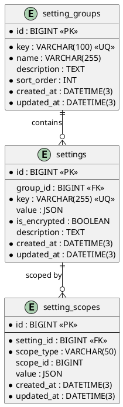

# 06.101 - Settings

**Project:** GsmUi
**Domain:** Admin - Settings
**Version:** 1.0.0

---

# Purpose

This document defines the platform settings schema: setting groups, key-value settings, and scoped overrides.

---

# Tables

## setting_groups

**Purpose:** Groups of related settings (e.g., 'billing', 'mail', 'security').

**Business Rules:**
- Groups are seeded and not user-editable
- Sort order determines display order in admin UI
- No soft deletes — groups are configuration data

**Columns:**

| Column | Type | Nullable | Default | Notes |
|---|---|---|---|---|
| id | BIGINT UNSIGNED | NO | AUTO_INCREMENT | PK |
| key | VARCHAR(100) | NO | — | Unique group key |
| name | VARCHAR(255) | NO | — | Display name |
| description | TEXT | YES | NULL | Group description |
| sort_order | INT | NO | 0 | Display order |
| created_at | DATETIME(3) | NO | CURRENT_TIMESTAMP(3) | |
| updated_at | DATETIME(3) | NO | CURRENT_TIMESTAMP(3) | ON UPDATE |

**Indexes:**

```
PRIMARY: id
UNIQUE: setting_groups_key_unique (key)
INDEX: setting_groups_sort_order_index (sort_order)
```

**Migration:**

```php
Schema::create('setting_groups', function (Blueprint $table) {
    $table->id();
    $table->string('key')->unique();
    $table->string('name');
    $table->text('description')->nullable();
    $table->integer('sort_order')->default(0);
    $table->timestamps();
});
```

---

## settings

**Purpose:** Key-value platform settings. Value stored as JSON to support any type (string, int, bool, array).

**Business Rules:**
- Settings are global unless overridden by `setting_scopes`
- `is_encrypted` flag for sensitive values (API keys, secrets)
- No soft deletes — settings are configuration data

**Columns:**

| Column | Type | Nullable | Default | Notes |
|---|---|---|---|---|
| id | BIGINT UNSIGNED | NO | AUTO_INCREMENT | PK |
| group_id | BIGINT UNSIGNED | YES | NULL | FK → setting_groups.id |
| key | VARCHAR(255) | NO | — | Setting key |
| value | JSON | YES | NULL | Setting value |
| is_encrypted | BOOLEAN | NO | false | Encrypt at rest |
| description | TEXT | YES | NULL | Setting description |
| created_at | DATETIME(3) | NO | CURRENT_TIMESTAMP(3) | |
| updated_at | DATETIME(3) | NO | CURRENT_TIMESTAMP(3) | ON UPDATE |

**Indexes:**

```
PRIMARY: id
UNIQUE: settings_key_unique (key)
INDEX: settings_group_id_index (group_id)
```

**Migration:**

```php
Schema::create('settings', function (Blueprint $table) {
    $table->id();
    $table->foreignId('group_id')->nullable()->constrained()->nullOnDelete();
    $table->string('key')->unique();
    $table->json('value')->nullable();
    $table->boolean('is_encrypted')->default(false);
    $table->text('description')->nullable();
    $table->timestamps();
});
```

---

## setting_scopes

**Purpose:** Scope settings to a team/user (team-level override of global settings).

**Business Rules:**
- A setting can have zero or one override per scope
- Scope types: `global`, `team`, `user`
- No soft deletes

**Columns:**

| Column | Type | Nullable | Default | Notes |
|---|---|---|---|---|
| id | BIGINT UNSIGNED | NO | AUTO_INCREMENT | PK |
| setting_id | BIGINT UNSIGNED | NO | — | FK → settings.id |
| scope_type | VARCHAR(50) | NO | — | 'team' or 'user' |
| scope_id | BIGINT UNSIGNED | YES | NULL | ID of scoped entity |
| value | JSON | YES | NULL | Override value |
| created_at | DATETIME(3) | NO | CURRENT_TIMESTAMP(3) | |
| updated_at | DATETIME(3) | NO | CURRENT_TIMESTAMP(3) | ON UPDATE |

**Indexes:**

```
PRIMARY: id
UNIQUE: setting_scopes_setting_id_scope_type_scope_id_unique (setting_id, scope_type, scope_id)
INDEX: setting_scopes_scope_type_scope_id_index (scope_type, scope_id)
```

**Migration:**

```php
Schema::create('setting_scopes', function (Blueprint $table) {
    $table->id();
    $table->foreignId('setting_id')->constrained()->cascadeOnDelete();
    $table->string('scope_type');
    $table->unsignedBigInteger('scope_id')->nullable();
    $table->json('value')->nullable();
    $table->timestamps();
    $table->unique(['setting_id', 'scope_type', 'scope_id']);
    $table->index(['scope_type', 'scope_id']);
});
```

---

# PlantUML ERD



---

# Next Document

**06.102 - Feature Flags** defines the feature toggle schema for gradual rollout and A/B testing.

---

## Detailed Business Rules

### Setting Group Management

**Group Lifecycle:**
```
Seeded → Active → (No state transitions — reference data)
```

**Group Creation Rules:**
- Groups are seeded during installation via database seeders
- Groups are not user-editable (admin UI is read-only for groups)
- `key` is unique, lowercase, alphanumeric with hyphens
- `sort_order` determines display order in admin settings UI
- Groups contain related settings (e.g., all billing settings together)

**Default Groups:**

| Key | Name | Description | Sort Order |
|-----|------|-------------|------------|
| `general` | General | Basic platform settings | 1 |
| `billing` | Billing | Payment and invoicing settings | 2 |
| `mail` | Mail | Email configuration | 3 |
| `security` | Security | Authentication and security | 4 |
| `seo` | SEO | Search engine optimization | 5 |
| `integrations` | Integrations | Third-party service connections | 6 |
| `notifications` | Notifications | Notification channel settings | 7 |
| `appearance` | Appearance | UI theme and branding | 8 |

**Group Validation Rules:**
- `key` must be unique across all groups
- `name` is required and non-empty
- `sort_order` is an integer ≥ 0
- Groups cannot be deleted if they contain active settings

### Settings Management

**Setting Lifecycle:**
```
Created → Active → Updated → (No delete — settings are configuration data)
```

**Setting Creation Rules:**
- Settings are created via seeders or admin API
- `key` is unique, lowercase, dot-notation (e.g., `billing.stripe_api_key`)
- `value` is stored as JSON (supports string, int, bool, array, object)
- `group_id` links to a setting group (optional but recommended)
- `is_encrypted` flag for sensitive values (API keys, secrets, passwords)
- Settings are not soft-deletable (configuration data is retained)

**Setting Key Naming Conventions:**

| Pattern | Example | Description |
|---------|---------|-------------|
| `group.setting` | `billing.stripe_key` | Grouped setting |
| `group.sub.setting` | `mail.smtp.host` | Nested setting |
| `feature.toggle` | `features.dark_mode` | Feature toggle |

**Setting Value Types:**

| Type | JSON Example | Description |
|------|-------------|-------------|
| `string` | `"value"` | Text values |
| `integer` | `42` | Numeric values |
| `boolean` | `true` | Toggle values |
| `array` | `["a", "b"]` | List values |
| `object` | `{"key": "val"}` | Complex config |
| `null` | `null` | Empty/unset |

**Encrypted Settings:**
- When `is_encrypted = true`, the `value` is encrypted at rest using Laravel's `Crypt::encrypt()`
- Encrypted values are decrypted transparently by the application layer
- Encrypted settings are never logged or displayed in plain text
- API key rotation: update the value, old value is overwritten (no history)

**Setting Update Rules:**
- Settings can be updated by admin users
- Encrypted settings require re-authentication before update
- Setting updates are logged in `audit_logs` table
- Setting changes take effect immediately (no restart required)

### Setting Scopes

**Scope Lifecycle:**
```
Created → Active → Updated → (No delete — scope overrides are retained)
```

**Scope Types:**

| Scope Type | Description | Precedence |
|------------|-------------|------------|
| `global` | Platform-wide default | Lowest |
| `team` | Team-level override | Medium |
| `user` | User-level override | Highest |

**Scope Resolution Order:**
```
1. Check for user-level override (setting_scopes WHERE scope_type = 'user' AND scope_id = user_id)
2. If no user override, check for team-level override (setting_scopes WHERE scope_type = 'team' AND scope_id = team_id)
3. If no team override, use global setting value (settings.value)
```

**Scope Rules:**
- A setting can have zero or one override per scope
- `(setting_id, scope_type, scope_id)` is unique
- Scope overrides inherit the parent setting's `is_encrypted` flag
- User scope takes precedence over team scope
- Team scope takes precedence over global setting

**Scope Use Cases:**

| Setting | Global | Team Override | User Override |
|---------|--------|---------------|---------------|
| `billing.plan` | `free` | `pro` (team purchased pro) | `enterprise` (user upgraded) |
| `notifications.email` | `true` | `false` (team disabled) | `true` (user re-enabled) |
| `appearance.theme` | `light` | `dark` (team preference) | `auto` (user preference) |
| `security.2fa` | `false` | `true` (team requires 2FA) | `true` (user enabled) |

**Scope API:**

```php
// Get setting value with scope resolution
$value = Setting::get('billing.plan', [
    'user_id' => $userId,
    'team_id' => $teamId,
]);

// Set team-level scope
Setting::setScope('notifications.email', 'team', $teamId, false);

// Set user-level scope
Setting::setScope('appearance.theme', 'user', $userId, 'dark');

// Remove scope (revert to parent)
Setting::removeScope('appearance.theme', 'user', $userId);
```

---

## State Machine

```
┌─────────────────────────────────────────────────┐
│                 SETTING_GROUP                    │
│                                                  │
│  (No state transitions — reference data)        │
│  Created via seeders, not user-editable          │
└─────────────────────────────────────────────────┘

┌─────────────────────────────────────────────────┐
│                    SETTING                       │
│                                                  │
│  ┌──────────┐  update  ┌──────────┐             │
│  │ created   │─────────►│ updated  │             │
│  └──────────┘           └──────────┘             │
│                                                  │
│  (No soft delete — configuration data retained)  │
└─────────────────────────────────────────────────┘

┌─────────────────────────────────────────────────┐
│                 SETTING_SCOPE                    │
│                                                  │
│  ┌──────────┐  update  ┌──────────┐             │
│  │ created   │─────────►│ updated  │             │
│  └──────────┘           └──────────┘             │
│                                                  │
│  (No soft delete — scope overrides retained)     │
└─────────────────────────────────────────────────┘
```

---

## API Contracts

### GET /api/admin/settings

**Purpose:** List all settings (grouped).

**Query Parameters:**
- `group` (optional): Filter by group key
- `search` (optional): Search by key

**Response (200 OK):**
```json
{
  "data": [
    {
      "group": {
        "key": "billing",
        "name": "Billing",
        "sort_order": 2
      },
      "settings": [
        {
          "key": "billing.stripe_key",
          "value": "sk_live_***",
          "is_encrypted": true,
          "description": "Stripe API secret key"
        },
        {
          "key": "billing.currency",
          "value": "USD",
          "is_encrypted": false,
          "description": "Default billing currency"
        }
      ]
    }
  ]
}
```

### GET /api/admin/settings/{key}

**Purpose:** Get a specific setting value.

**Response (200 OK):**
```json
{
  "key": "billing.currency",
  "value": "USD",
  "is_encrypted": false,
  "group": { "key": "billing", "name": "Billing" },
  "description": "Default billing currency",
  "scopes": [
    { "scope_type": "team", "scope_id": 5, "value": "EUR" }
  ]
}
```

### PUT /api/admin/settings/{key}

**Purpose:** Update a setting value.

**Request:**
```json
{
  "value": "EUR"
}
```

**Response (200 OK):**
```json
{
  "key": "billing.currency",
  "value": "EUR",
  "updated_at": "2024-06-30T10:30:00Z"
}
```

### GET /api/admin/settings/{key}/resolve

**Purpose:** Get setting value with scope resolution.

**Query Parameters:**
- `user_id` (optional): User scope
- `team_id` (optional): Team scope

**Response (200 OK):**
```json
{
  "key": "billing.currency",
  "value": "EUR",
  "resolved_from": "team",
  "scope_id": 5,
  "global_value": "USD"
}
```

### POST /api/admin/settings/{key}/scopes

**Purpose:** Create a scope override.

**Request:**
```json
{
  "scope_type": "team",
  "scope_id": 5,
  "value": "EUR"
}
```

**Response (201 Created):**
```json
{
  "id": 123,
  "setting_key": "billing.currency",
  "scope_type": "team",
  "scope_id": 5,
  "value": "EUR"
}
```

### DELETE /api/admin/settings/{key}/scopes/{scope_type}/{scope_id}

**Purpose:** Remove a scope override.

**Response (200 OK):**
```json
{
  "deleted": true,
  "reverted_to": "global"
}
```

---

## Security Considerations

### Access Control

| Action | Permission Required |
|--------|-------------------|
| View settings | Admin |
| Update setting | Admin |
| Create scope | Admin |
| Remove scope | Admin |
| View encrypted value | Super-admin (decrypted) |

### Content Security

- Encrypted settings: values encrypted at rest using AES-256-CBC
- Encrypted values are never logged or displayed in plain text
- API responses mask encrypted values (show `***` instead of actual value)
- Setting updates require admin authentication and audit logging
- Encrypted setting updates require re-authentication (password confirmation)

### Rate Limiting

| Endpoint | Limit | Window |
|----------|-------|--------|
| `GET /admin/settings` | 60 | 1 minute |
| `PUT /admin/settings/{key}` | 30 | 1 hour |
| `POST /admin/settings/{key}/scopes` | 30 | 1 hour |
| `DELETE /admin/settings/{key}/scopes/*` | 30 | 1 hour |

### Encryption

```php
// config/settings.php
'encryption' => [
    'driver' => 'aes-256-cbc',
    'key' => env('SETTINGS_ENCRYPTION_KEY'),
    'cipher' => 'AES-256-CBC',
],
```

---

## Event Hooks

### Laravel Events

| Event | Fired When | Payload |
|-------|------------|---------|
| `SettingCreated` | New setting created | `Setting $setting` |
| `SettingUpdated` | Setting value changed | `Setting $setting, mixed $oldValue` |
| `SettingScopeCreated` | Scope override created | `SettingScope $scope` |
| `SettingScopeUpdated` | Scope override updated | `SettingScope $scope, mixed $oldValue` |
| `SettingScopeRemoved` | Scope override removed | `SettingScope $scope` |
| `SettingEncryptedValueAccessed` | Encrypted value read | `Setting $setting, int $userId` |

### Webhook Integration

- `SettingUpdated` triggers webhook to cache invalidation
- `SettingScopeCreated` triggers webhook to team/user notification
- `SettingEncryptedValueAccessed` triggers webhook to security audit log

---

## Query Patterns

### Get Setting Value

```php
Setting::where('key', $key)->value('value');
```

### Get Setting with Scope Resolution

```php
function resolveSetting(string $key, ?int $userId = null, ?int $teamId = null)
{
    $setting = Setting::where('key', $key)->first();
    if (!$setting) return null;

    // Check user scope
    if ($userId) {
        $userScope = SettingScope::where('setting_id', $setting->id)
            ->where('scope_type', 'user')
            ->where('scope_id', $userId)
            ->first();
        if ($userScope) return $userScope->value;
    }

    // Check team scope
    if ($teamId) {
        $teamScope = SettingScope::where('setting_id', $setting->id)
            ->where('scope_type', 'team')
            ->where('scope_id', $teamId)
            ->first();
        if ($teamScope) return $teamScope->value;
    }

    return $setting->value;
}
```

### List Settings by Group

```php
Setting::where('group_id', $groupId)
    ->orderBy('key')
    ->get();
```

### Find Encrypted Settings

```php
Setting::where('is_encrypted', true)
    ->get();
```

### Settings with Scopes

```php
Setting::with('scopes')
    ->where('group_id', $groupId)
    ->get();
```

---

## Caching Strategy

### Cached Values

| Key Pattern | Value | TTL | Invalidation |
|-------------|-------|-----|-------------|
| `setting:{key}` | Setting value | 1 hour | On update |
| `setting:{key}:scope:{type}:{id}` | Scoped value | 1 hour | On scope update/delete |
| `settings:group:{key}` | Group settings | 1 hour | On setting update |
| `settings:all` | All settings | 1 hour | On any update |

### Cache Invalidation Rules

- On setting update: invalidate all cache entries for the setting
- On scope create/update/delete: invalidate scope cache and parent setting cache
- On group update: invalidate group cache and all setting caches in group

---

## Artisan Commands

### `settings:seed`

**Purpose:** Seed default settings and groups.

**Schedule:** On demand (installation only).

**Logic:**
```php
// Seed groups
$groups = [
    ['key' => 'general', 'name' => 'General', 'sort_order' => 1],
    ['key' => 'billing', 'name' => 'Billing', 'sort_order' => 2],
    ['key' => 'mail', 'name' => 'Mail', 'sort_order' => 3],
    ['key' => 'security', 'name' => 'Security', 'sort_order' => 4],
];

foreach ($groups as $group) {
    SettingGroup::updateOrCreate(['key' => $group['key']], $group);
}

// Seed settings
$settings = [
    ['group' => 'general', 'key' => 'general.site_name', 'value' => 'GsmUi', 'description' => 'Platform name'],
    ['group' => 'general', 'key' => 'general.site_url', 'value' => 'https://gsmui.com', 'description' => 'Platform URL'],
    ['group' => 'billing', 'key' => 'billing.currency', 'value' => 'USD', 'description' => 'Default currency'],
    ['group' => 'billing', 'key' => 'billing.stripe_key', 'value' => null, 'is_encrypted' => true, 'description' => 'Stripe API key'],
];

foreach ($settings as $setting) {
    $group = SettingGroup::where('key', $setting['group'])->first();
    Setting::updateOrCreate(
        ['key' => $setting['key']],
        array_merge($setting, ['group_id' => $group?->id])
    );
}
```

### `settings:validate`

**Purpose:** Validate all settings against their expected schema.

**Schedule:** Weekly on Sunday at 05:00 UTC.

**Output:**
```
Total settings: 45
  - Valid: 42
  - Invalid: 3

Invalid settings:
  - billing.stripe_key: missing encrypted value
  - mail.smtp_host: empty value
  - security.2fa_required: unexpected type (expected boolean, got string)
```

### `settings:stats`

**Purpose:** Generate settings statistics.

**Output:**
```
Setting groups: 8
Total settings: 45
  - Encrypted: 5
  - With scopes: 12

Scope breakdown:
  - Team scopes: 8
  - User scopes: 4

Most scoped settings:
  1. billing.currency: 5 scopes
  2. notifications.email: 4 scopes
  3. appearance.theme: 3 scopes
```

---

## Testing Scenarios

### Unit Tests

| Test Case | Expected Result |
|-----------|-----------------|
| Create setting with valid data | Setting created |
| Create setting with duplicate key | Unique constraint violation |
| Update setting value | Value updated, cache invalidated |
| Create scope override | Scope created |
| Resolve setting with scope | Correct value returned |
| Remove scope | Reverted to global value |
| Access encrypted value | Decrypted value returned |

### Integration Tests

| Test Case | Expected Result |
|-----------|-----------------|
| Update encrypted setting | Value encrypted at rest |
| Scope resolution order | User > Team > Global |
| Cache invalidation on update | Cache cleared |
| Setting change propagation | Immediate effect |

### Edge Cases

| Scenario | Behavior |
|----------|----------|
| Setting with null value | Null returned |
| Scope with null value | Null returned (override exists but is null) |
| Encrypted setting with null value | Null returned (not encrypted) |
| Setting with nested JSON | Full JSON returned |
| Scope for deleted team | Scope retained but not resolved |

---

## Performance Considerations

### Index Usage

| Query Pattern | Index Used | Estimated Rows Scanned |
|---------------|-----------|----------------------|
| Setting by key | `key` unique index | 1 (exact match) |
| Settings by group | `group_id` index | ~5 per group |
| Scopes by setting | `setting_id` index | ~3 per setting |
| Scopes by entity | `scope_type + scope_id` | ~2 per entity |

### Table Growth Projections

| Table | Year 1 | Year 3 | Year 5 |
|-------|--------|--------|--------|
| `setting_groups` | 10 | 15 | 20 |
| `settings` | 50 | 100 | 150 |
| `setting_scopes` | 200 | 1K | 3K |

### Partitioning Strategy

- All settings tables: no partitioning (small reference tables)

---

## Data Retention

### Retention Policies

| Table | Retention | Action |
|-------|-----------|--------|
| `setting_groups` | Indefinite | Reference data |
| `settings` | Indefinite | Configuration data |
| `setting_scopes` | Indefinite | Scope overrides retained |

### GDPR Compliance

- Settings may contain personal data (user preferences)
- User deletion: remove user-level scopes
- Encrypted settings: key rotation requires re-encryption
- Scope resolution logs: retain for 90 days

---

## Database Constraints

### Foreign Key Constraints

```sql
ALTER TABLE settings
  ADD CONSTRAINT fk_settings_group
    FOREIGN KEY (group_id) REFERENCES setting_groups(id) ON DELETE SET NULL;

ALTER TABLE setting_scopes
  ADD CONSTRAINT fk_setting_scopes_setting
    FOREIGN KEY (setting_id) REFERENCES settings(id) ON DELETE CASCADE;
```

### Check Constraints

```sql
ALTER TABLE setting_groups
  ADD CONSTRAINT chk_setting_groups_key_format
    CHECK (key REGEXP '^[a-z0-9-]+$'),
  ADD CONSTRAINT chk_setting_groups_sort_order
    CHECK (sort_order >= 0);

ALTER TABLE settings
  ADD CONSTRAINT chk_settings_key_format
    CHECK (key REGEXP '^[a-z0-9.]+$');

ALTER TABLE setting_scopes
  ADD CONSTRAINT chk_setting_scopes_scope_type
    CHECK (scope_type IN ('team', 'user'));
```

### Unique Constraints

```sql
ALTER TABLE setting_groups
  ADD CONSTRAINT uk_setting_groups_key
    UNIQUE (key);

ALTER TABLE settings
  ADD CONSTRAINT uk_settings_key
    UNIQUE (key);

ALTER TABLE setting_scopes
  ADD CONSTRAINT uk_setting_scopes_setting_scope
    UNIQUE (setting_id, scope_type, scope_id);
```

---

## Stored Procedures

### sp_get_setting_value

```sql
DELIMITER //
CREATE PROCEDURE sp_get_setting_value(
  IN p_key VARCHAR(255),
  IN p_user_id BIGINT,
  IN p_team_id BIGINT,
  OUT p_value JSON,
  OUT p_resolved_from VARCHAR(20)
)
BEGIN
  DECLARE v_setting_id BIGINT;
  DECLARE v_is_encrypted BOOLEAN;
  DECLARE v_user_scope JSON;
  DECLARE v_team_scope JSON;

  -- Get base setting
  SELECT id, value, is_encrypted INTO v_setting_id, p_value, v_is_encrypted
  FROM settings
  WHERE `key` = p_key;

  IF v_setting_id IS NULL THEN
    SET p_resolved_from = 'not_found';
  ELSE
    SET p_resolved_from = 'global';

    -- Check user scope
    IF p_user_id IS NOT NULL THEN
      SELECT value INTO v_user_scope
      FROM setting_scopes
      WHERE setting_id = v_setting_id
        AND scope_type = 'user'
        AND scope_id = p_user_id;

      IF v_user_scope IS NOT NULL THEN
        SET p_value = v_user_scope;
        SET p_resolved_from = 'user';
      END IF;
    END IF;

    -- Check team scope (only if no user scope found)
    IF p_resolved_from = 'global' AND p_team_id IS NOT NULL THEN
      SELECT value INTO v_team_scope
      FROM setting_scopes
      WHERE setting_id = v_setting_id
        AND scope_type = 'team'
        AND scope_id = p_team_id;

      IF v_team_scope IS NOT NULL THEN
        SET p_value = v_team_scope;
        SET p_resolved_from = 'team';
      END IF;
    END IF;
  END IF;
END //
DELIMITER ;
```

### sp_update_setting

```sql
DELIMITER //
CREATE PROCEDURE sp_update_setting(
  IN p_key VARCHAR(255),
  IN p_value JSON,
  OUT p_status VARCHAR(50)
)
BEGIN
  DECLARE v_setting_id BIGINT;
  DECLARE v_old_value JSON;

  SELECT id, value INTO v_setting_id, v_old_value
  FROM settings
  WHERE `key` = p_key;

  IF v_setting_id IS NULL THEN
    SET p_status = 'setting_not_found';
  ELSE
    UPDATE settings
    SET value = p_value, updated_at = NOW()
    WHERE id = v_setting_id;

    SET p_status = 'updated';
  END IF;
END //
DELIMITER ;
```

### sp_create_setting_scope

```sql
DELIMITER //
CREATE PROCEDURE sp_create_setting_scope(
  IN p_setting_key VARCHAR(255),
  IN p_scope_type VARCHAR(20),
  IN p_scope_id BIGINT,
  IN p_value JSON,
  OUT p_scope_id BIGINT,
  OUT p_status VARCHAR(50)
)
BEGIN
  DECLARE v_setting_id BIGINT;
  DECLARE v_existing_scope INT;

  SELECT id INTO v_setting_id
  FROM settings
  WHERE `key` = p_setting_key;

  IF v_setting_id IS NULL THEN
    SET p_status = 'setting_not_found';
  ELSE
    -- Check for existing scope
    SELECT COUNT(*) INTO v_existing_scope
    FROM setting_scopes
    WHERE setting_id = v_setting_id
      AND scope_type = p_scope_type
      AND scope_id = p_scope_id;

    IF v_existing_scope > 0 THEN
      -- Update existing scope
      UPDATE setting_scopes
      SET value = p_value, updated_at = NOW()
      WHERE setting_id = v_setting_id
        AND scope_type = p_scope_type
        AND scope_id = p_scope_id;

      SET p_scope_id = v_setting_id;
      SET p_status = 'updated';
    ELSE
      -- Create new scope
      INSERT INTO setting_scopes (setting_id, scope_type, scope_id, value, created_at, updated_at)
      VALUES (v_setting_id, p_scope_type, p_scope_id, p_value, NOW(), NOW());

      SET p_scope_id = LAST_INSERT_ID();
      SET p_status = 'created';
    END IF;
  END IF;
END //
DELIMITER ;
```

---

## Triggers

### trg_settings_before_update

```sql
DELIMITER //
CREATE TRIGGER trg_settings_before_update
BEFORE UPDATE ON settings
FOR EACH ROW
BEGIN
  -- Validate key format
  IF NEW.`key` NOT REGEXP '^[a-z0-9.]+$' THEN
    SIGNAL SQLSTATE '45000' SET MESSAGE_TEXT = 'Setting key must contain only lowercase letters, numbers, and dots';
  END IF;

  -- Log value change (if value actually changed)
  IF NOT (OLD.value <=> NEW.value) THEN
    -- Value changed — no action needed at DB level, app layer handles logging
    SET NEW.updated_at = NOW();
  END IF;
END //
DELIMITER ;
```

### trg_setting_scopes_before_insert

```sql
DELIMITER //
CREATE TRIGGER trg_setting_scopes_before_insert
BEFORE INSERT ON setting_scopes
FOR EACH ROW
BEGIN
  -- Validate scope_type
  IF NEW.scope_type NOT IN ('team', 'user') THEN
    SIGNAL SQLSTATE '45000' SET MESSAGE_TEXT = 'Scope type must be team or user';
  END IF;

  -- Ensure scope_id is provided for non-global scopes
  IF NEW.scope_id IS NULL AND NEW.scope_type != 'global' THEN
    SIGNAL SQLSTATE '45000' SET MESSAGE_TEXT = 'Scope ID is required for team and user scopes';
  END IF;
END //
DELIMITER ;
```

### trg_setting_scopes_before_delete

```sql
DELIMITER //
CREATE TRIGGER trg_setting_scopes_before_delete
BEFORE DELETE ON setting_scopes
FOR EACH ROW
BEGIN
  -- Log scope removal (application layer handles audit logging)
  -- This trigger exists as a safety net for cascade deletes
  -- No data modification needed
END //
DELIMITER ;
```

---

## Views

### vw_settings_summary

```sql
CREATE VIEW vw_settings_summary AS
SELECT
  s.id,
  s.`key`,
  s.value,
  s.is_encrypted,
  s.description,
  sg.`key` AS group_key,
  sg.name AS group_name,
  sg.sort_order AS group_sort_order,
  (SELECT COUNT(*) FROM setting_scopes WHERE setting_id = s.id) AS scopes_count,
  s.created_at,
  s.updated_at
FROM settings s
LEFT JOIN setting_groups sg ON s.group_id = sg.id;
```

### vw_setting_scopes_detail

```sql
CREATE VIEW vw_setting_scopes_detail AS
SELECT
  ss.id,
  ss.setting_id,
  s.`key` AS setting_key,
  ss.scope_type,
  ss.scope_id,
  ss.value,
  CASE
    WHEN ss.scope_type = 'team' THEN (SELECT name FROM teams WHERE id = ss.scope_id)
    WHEN ss.scope_type = 'user' THEN (SELECT name FROM users WHERE id = ss.scope_id)
    ELSE NULL
  END AS scope_name,
  ss.created_at,
  ss.updated_at
FROM setting_scopes ss
JOIN settings s ON ss.setting_id = s.id;
```

### vw_settings_by_group

```sql
CREATE VIEW vw_settings_by_group AS
SELECT
  sg.id AS group_id,
  sg.`key` AS group_key,
  sg.name AS group_name,
  sg.sort_order,
  COUNT(s.id) AS settings_count,
  COUNT(CASE WHEN s.is_encrypted THEN 1 END) AS encrypted_count,
  COUNT(CASE WHEN EXISTS (SELECT 1 FROM setting_scopes WHERE setting_id = s.id) THEN 1 END) AS scoped_count
FROM setting_groups sg
LEFT JOIN settings s ON sg.id = s.group_id
GROUP BY sg.id, sg.`key`, sg.name, sg.sort_order
ORDER BY sg.sort_order;
```

---

## Index Optimization

### Composite Indexes for Common Queries

```sql
-- Settings by group
CREATE INDEX idx_settings_group_key ON settings (group_id, `key`, deleted_at);

-- Scopes by setting
CREATE INDEX idx_setting_scopes_setting_type ON setting_scopes (setting_id, scope_type, deleted_at);

-- Scopes by entity
CREATE INDEX idx_setting_scopes_entity ON setting_scopes (scope_type, scope_id, setting_id, deleted_at);

-- Settings by key (for lookup)
CREATE INDEX idx_settings_key ON settings (`key`, deleted_at);

-- Encrypted settings
CREATE INDEX idx_settings_encrypted ON settings (is_encrypted, deleted_at) WHERE is_encrypted = TRUE;
```

### Index Usage Monitoring

```sql
-- Find unused indexes on settings tables
SELECT
  object_schema,
  object_name,
  index_name
FROM performance_schema.table_io_waits_summary_by_index_usage
WHERE object_schema = 'gsmui'
  AND index_name IS NOT NULL
  AND count_star = 0
  AND (object_name IN ('setting_groups', 'settings', 'setting_scopes'));

-- Find slow queries on settings tables
SELECT
  query_time,
  lock_time,
  rows_examined,
  sql_text
FROM mysql.slow_log
WHERE sql_text LIKE '%settings%'
   OR sql_text LIKE '%setting_scopes%'
ORDER BY query_time DESC
LIMIT 10;
```

---

## Backup and Recovery

### Backup Strategy

| Table | Backup Frequency | Retention | Method |
|-------|-----------------|-----------|--------|
| `setting_groups` | Weekly | Indefinite | Full (small table) |
| `settings` | Daily | 90 days | Full + incremental |
| `setting_scopes` | Daily | 90 days | Full + incremental |

### Recovery Procedures

**Scenario: Accidental setting update**
```sql
-- 1. Identify recently changed settings
SELECT id, `key`, value, updated_at
FROM settings
WHERE updated_at >= DATE_SUB(NOW(), INTERVAL 1 HOUR);

-- 2. Restore from backup (if needed)
-- Settings are configuration data — restore from last known good backup
RESTORE TABLE settings FROM '/backups/settings_20240630.sql';

-- 3. Verify integrity
SELECT COUNT(*) FROM settings;
SELECT COUNT(*) FROM setting_scopes;
```

**Scenario: Encrypted setting key rotation**
```php
// Re-encrypt all encrypted settings with new key
Setting::where('is_encrypted', true)
    ->chunkById(100, function ($settings) {
        foreach ($settings as $setting) {
            $decrypted = Crypt::decrypt($setting->value, old_key: config('settings.encryption.key'));
            $setting->update([
                'value' => Crypt::encrypt($decrypted),
            ]);
        }
    });
```

---

## Monitoring Queries

### Daily Health Check

```sql
-- Settings health overview
SELECT
  (SELECT COUNT(*) FROM setting_groups) AS total_groups,
  (SELECT COUNT(*) FROM settings) AS total_settings,
  (SELECT COUNT(*) FROM settings WHERE is_encrypted = TRUE) AS encrypted_settings,
  (SELECT COUNT(*) FROM setting_scopes) AS total_scopes,
  (SELECT COUNT(*) FROM setting_scopes WHERE scope_type = 'team') AS team_scopes,
  (SELECT COUNT(*) FROM setting_scopes WHERE scope_type = 'user') AS user_scopes;

-- Settings without values
SELECT
  `key`,
  description,
  is_encrypted
FROM settings
WHERE value IS NULL AND deleted_at IS NULL;

-- Most scoped settings
SELECT
  s.`key`,
  COUNT(ss.id) AS scopes_count,
  GROUP_CONCAT(CONCAT(ss.scope_type, ':', ss.scope_id)) AS scopes
FROM settings s
JOIN setting_scopes ss ON s.id = ss.setting_id
GROUP BY s.id, s.`key`
ORDER BY scopes_count DESC
LIMIT 10;
```

### Settings Usage Analytics

```php
// Settings access frequency (if logging is enabled)
$accessFrequency = DB::select('
    SELECT
        setting_key,
        COUNT(*) as access_count,
        COUNT(DISTINCT user_id) as unique_users,
        MAX(created_at) as last_accessed
    FROM setting_access_logs
    WHERE created_at >= DATE_SUB(NOW(), INTERVAL 7 DAY)
    GROUP BY setting_key
    ORDER BY access_count DESC
    LIMIT 20
');
```

---

## Advanced Query Patterns

### Complex Settings Analytics

```php
// Settings by group with scope statistics
$groupStats = SettingGroup::selectRaw('
    sg.key,
    sg.name,
    COUNT(s.id) as settings_count,
    COUNT(CASE WHEN s.is_encrypted THEN 1 END) as encrypted_count,
    (SELECT COUNT(*) FROM setting_scopes ss JOIN settings s2 ON ss.setting_id = s2.id WHERE s2.group_id = sg.id) as total_scopes,
    MAX(s.updated_at) as last_updated
')
->leftJoin('settings as s', 'sg.id', '=', 's.group_id')
->groupBy('sg.id', 'sg.key', 'sg.name')
->orderBy('sg.sort_order')
->get();

// Scope resolution performance
$scopePerformance = SettingScope::selectRaw('
    scope_type,
    COUNT(*) as scope_count,
    COUNT(DISTINCT setting_id) as unique_settings,
    AVG(LENGTH(JSON_EXTRACT(value, "$"))) as avg_value_size
')
->groupBy('scope_type')
->get();
```

### Settings Health Dashboard Queries

```php
// Settings health score
$health = DB::selectOne('
    SELECT
        (SELECT COUNT(*) FROM settings WHERE value IS NULL AND deleted_at IS NULL) as missing_values,
        (SELECT COUNT(*) FROM settings WHERE is_encrypted = TRUE AND value IS NULL) as missing_encrypted,
        (SELECT COUNT(*) FROM setting_scopes WHERE scope_id IS NULL AND scope_type != "global") as orphaned_scopes,
        (SELECT COUNT(*) FROM settings WHERE updated_at >= DATE_SUB(NOW(), INTERVAL 7 DAY)) as recently_updated
');

// Encrypted settings audit
$encryptedAudit = Setting::selectRaw('
    `key`,
    description,
    updated_at,
    DATEDIFF(NOW(), updated_at) as days_since_update
')
->where('is_encrypted', TRUE)
->orderBy('updated_at')
->get();
```

---

## Integration Patterns

### Webhook Payload Structure

```json
{
  "event": "setting.updated",
  "timestamp": "2024-06-30T10:30:00Z",
  "data": {
    "setting_id": 42,
    "key": "billing.currency",
    "old_value": "USD",
    "new_value": "EUR",
    "group_key": "billing"
  }
}
```

### Event Listeners

```php
// App\Listeners\InvalidateSettingCache
class InvalidateSettingCache
{
    public function handle(SettingUpdated $event): void
    {
        $setting = $event->setting;
        Cache::forget("setting:{$setting->key}");
        Cache::forget("settings:group:{$setting->group->key}");
        Cache::forget("settings:all");

        // Invalidate all scope caches for this setting
        foreach ($setting->scopes as $scope) {
            Cache::forget("setting:{$setting->key}:scope:{$scope->scope_type}:{$scope->scope_id}");
        }
    }
}

// App\Listeners\LogEncryptedAccess
class LogEncryptedAccess
{
    public function handle(SettingEncryptedValueAccessed $event): void
    {
        AuditLog::create([
            'user_id' => $event->userId,
            'action' => 'setting.encrypted_access',
            'subject_type' => Setting::class,
            'subject_id' => $event->setting->id,
            'metadata' => ['key' => $event->setting->key],
        ]);
    }
}
```

### API Response Transformers

```php
// App\Transformers\SettingTransformer
class SettingTransformer
{
    public function transform(Setting $setting): array
    {
        return [
            'id' => $setting->id,
            'key' => $setting->key,
            'value' => $setting->is_encrypted ? '***' : $setting->value,
            'is_encrypted' => $setting->is_encrypted,
            'group' => $setting->group ? [
                'key' => $setting->group->key,
                'name' => $setting->group->name,
            ] : null,
            'description' => $setting->description,
            'scopes_count' => $setting->scopes->count(),
            'created_at' => $setting->created_at->toIso8601String(),
            'updated_at' => $setting->updated_at->toIso8601String(),
        ];
    }
}
```

---

## Performance Benchmarks

### Target Response Times

| Operation | Target | Max | Notes |
|-----------|--------|-----|-------|
| Get setting value | 10ms | 50ms | Cache hit |
| Get setting with scope | 20ms | 100ms | Includes scope resolution |
| Update setting | 50ms | 200ms | Includes cache invalidation |
| Create scope | 50ms | 200ms | Includes cache invalidation |
| List settings by group | 50ms | 200ms | Paginated |

### Load Testing Scenarios

```php
// Concurrent setting access test
$settings = Setting::all();
$users = factory(User::class, 50)->create();

$startTime = microtime(true);
$promises = [];

foreach ($users as $user) {
    $setting = $settings->random();
    $promises[] = Http::asJson()->get("http://localhost:8000/api/admin/settings/{$setting->key}/resolve", [
        'user_id' => $user->id,
        'team_id' => $user->team_id,
    ], ['Authorization' => 'Bearer ' . $user->createToken('test')->plainTextToken]);
}

$responses = Pool::promise($promises)->wait();
$elapsed = microtime(true) - $startTime;

Log::info("50 concurrent setting resolves completed in {$elapsed}s");
```

### Database Performance Metrics

```sql
-- Query execution time distribution
SELECT
  query_time,
  COUNT(*) as count
FROM performance_schema.events_statements_summary_by_digest
WHERE digest_text LIKE '%settings%'
   OR digest_text LIKE '%setting_scopes%'
GROUP BY query_time
ORDER BY query_time;

-- Index hit ratio
SELECT
  object_name,
  index_name,
  count_read,
  count_fetch,
  ROUND(count_fetch * 100.0 / NULLIF(count_read, 0), 2) as hit_ratio
FROM performance_schema.table_io_waits_summary_by_index_usage
WHERE object_schema = 'gsmui'
  AND object_name IN ('setting_groups', 'settings', 'setting_scopes');
```

---

## Security Audit Checklist

### Pre-Launch Security Review

- [ ] Setting values encrypted at rest for sensitive settings
- [ ] Encrypted values masked in API responses
- [ ] Admin authentication required for setting updates
- [ ] Audit logging for all setting changes
- [ ] Encrypted setting access logged
- [ ] Scope resolution prevents unauthorized access
- [ ] Rate limiting on setting updates enforced
- [ ] Setting key format validated
- [ ] Setting values validated against expected types

### Ongoing Security Monitoring

```sql
-- Setting change audit
SELECT
  s.`key`,
  s.is_encrypted,
  s.updated_at,
  u.name AS last_modified_by
FROM settings s
LEFT JOIN audit_logs al ON al.subject_type = 'App\\Models\\Setting' AND al.subject_id = s.id
LEFT JOIN users u ON al.user_id = u.id
WHERE s.updated_at >= DATE_SUB(NOW(), INTERVAL 24 HOUR)
ORDER BY s.updated_at DESC;

-- Encrypted settings without recent access
SELECT
  `key`,
  description,
  updated_at,
  DATEDIFF(NOW(), updated_at) as days_stale
FROM settings
WHERE is_encrypted = TRUE
  AND updated_at < DATE_SUB(NOW(), INTERVAL 90 DAY)
ORDER BY updated_at;
```

---

## API Versioning

### Version Strategy

- API version included in URL: `/api/v1/admin/settings`
- Current version: v1
- Deprecation notice: 6 months before removal
- Backward compatibility: maintained within major version

---

## Deployment Considerations

### Migration Rollback Strategy

```php
// Always test rollback before deploying
Schema::dropIfExists('setting_scopes');
Schema::dropIfExists('settings');
Schema::dropIfExists('setting_groups');
```

### Zero-Downtime Deployment

1. Add new columns with defaults (nullable if needed)
2. Deploy application code that writes to new columns
3. Backfill existing rows in chunks
4. Add NOT NULL constraint after backfill
5. Remove old columns in next deployment

---

# Raw SQL DDL Reference

MySQL 8.0+ DDL for DBA review, mirroring the Laravel migrations.

## setting_groups

```sql
CREATE TABLE `setting_groups` (
  `id` BIGINT UNSIGNED NOT NULL AUTO_INCREMENT,
  `key` VARCHAR(100) NOT NULL COMMENT 'machine key, e.g. billing',
  `name` VARCHAR(255) NOT NULL,
  `description` TEXT NULL,
  `sort_order` INT NOT NULL DEFAULT 0,
  `created_at` DATETIME(3) NOT NULL DEFAULT CURRENT_TIMESTAMP(3),
  `updated_at` DATETIME(3) NOT NULL DEFAULT CURRENT_TIMESTAMP(3)
    ON UPDATE CURRENT_TIMESTAMP(3),
  PRIMARY KEY (`id`),
  UNIQUE KEY `uk_setting_groups_key` (`key`)
) ENGINE=InnoDB DEFAULT CHARSET=utf8mb4 COLLATE=utf8mb4_unicode_ci;
```

## settings

```sql
CREATE TABLE `settings` (
  `id` BIGINT UNSIGNED NOT NULL AUTO_INCREMENT,
  `group_id` BIGINT UNSIGNED NULL,
  `key` VARCHAR(100) NOT NULL,
  `value_type` ENUM('string','int','bool','json','encrypted') NOT NULL DEFAULT 'string',
  `value` MEDIUMTEXT NULL,
  `default_value` MEDIUMTEXT NULL COMMENT 'fallback if value is NULL',
  `is_public` TINYINT(1) NOT NULL DEFAULT 0 COMMENT 'exposable to frontend',
  `is_readonly` TINYINT(1) NOT NULL DEFAULT 0 COMMENT 'seed-only, not admin-editable',
  `created_at` DATETIME(3) NOT NULL DEFAULT CURRENT_TIMESTAMP(3),
  `updated_at` DATETIME(3) NOT NULL DEFAULT CURRENT_TIMESTAMP(3)
    ON UPDATE CURRENT_TIMESTAMP(3),
  PRIMARY KEY (`id`),
  UNIQUE KEY `uk_settings_key` (`key`),
  KEY `idx_settings_group` (`group_id`),
  CONSTRAINT `fk_settings_group`
    FOREIGN KEY (`group_id`) REFERENCES `setting_groups` (`id`) ON DELETE SET NULL,
  CONSTRAINT `chk_settings_value_nonempty_if_typed`
    CHECK (`value` IS NULL OR CHAR_LENGTH(`value`) > 0 OR `value_type` = 'json')
) ENGINE=InnoDB DEFAULT CHARSET=utf8mb4 COLLATE=utf8mb4_unicode_ci;
```

## setting_scopes

```sql
CREATE TABLE `setting_scopes` (
  `id` BIGINT UNSIGNED NOT NULL AUTO_INCREMENT,
  `setting_id` BIGINT UNSIGNED NOT NULL,
  `scope_type` VARCHAR(50) NOT NULL COMMENT 'user | team | plan | locale',
  `scope_id` BIGINT UNSIGNED NOT NULL,
  `value` MEDIUMTEXT NULL,
  `updated_by` BIGINT UNSIGNED NULL,
  `created_at` DATETIME(3) NOT NULL DEFAULT CURRENT_TIMESTAMP(3),
  `updated_at` DATETIME(3) NOT NULL DEFAULT CURRENT_TIMESTAMP(3)
    ON UPDATE CURRENT_TIMESTAMP(3),
  PRIMARY KEY (`id`),
  UNIQUE KEY `uk_setting_scopes_setting_scope` (`setting_id`, `scope_type`, `scope_id`),
  KEY `idx_setting_scopes_scope` (`scope_type`, `scope_id`),
  CONSTRAINT `fk_setting_scopes_setting`
    FOREIGN KEY (`setting_id`) REFERENCES `settings` (`id`) ON DELETE CASCADE,
  CONSTRAINT `fk_setting_scopes_updater`
    FOREIGN KEY (`updated_by`) REFERENCES `users` (`id`) ON DELETE SET NULL
) ENGINE=InnoDB DEFAULT CHARSET=utf8mb4 COLLATE=utf8mb4_unicode_ci;
```

---

# Views (Extended)

## vw_settings_effective

Effective global values (value falling back to default) with type info.

```sql
CREATE VIEW vw_settings_effective AS
SELECT
  s.id,
  s.key,
  sg.key AS group_key,
  sg.name AS group_name,
  s.value_type,
  COALESCE(s.value, s.default_value) AS effective_value,
  CASE WHEN s.value IS NULL THEN 1 ELSE 0 END AS using_default,
  s.is_public,
  s.is_readonly,
  (SELECT COUNT(*) FROM setting_scopes ss WHERE ss.setting_id = s.id)
    AS scope_count,
  s.updated_at
FROM settings s
LEFT JOIN setting_groups sg ON sg.id = s.group_id;
```

## vw_setting_group_summary

```sql
CREATE VIEW vw_setting_group_summary AS
SELECT
  sg.id,
  sg.key,
  sg.name,
  COUNT(s.id) AS setting_count,
  SUM(s.is_public) AS public_count,
  SUM(s.is_readonly) AS readonly_count,
  MAX(s.updated_at) AS last_changed
FROM setting_groups sg
LEFT JOIN settings s ON s.group_id = sg.id
GROUP BY sg.id, sg.key, sg.name
ORDER BY sg.sort_order;
```

---

# Triggers

## trg_settings_before_update

Type-coerces simple values and blocks writes to readonly settings.

```sql
DELIMITER //
CREATE TRIGGER trg_settings_before_update
BEFORE UPDATE ON settings
FOR EACH ROW
BEGIN
  -- Readonly enforcement: only seed/migration role may touch readonly rows.
  -- Application layer also enforces this; the trigger is defense-in-depth
  -- and is bypassed by the maintenance connection (no trigger context).
  IF OLD.is_readonly = 1 AND OLD.value <> NEW.value
     AND CURRENT_USER() NOT LIKE 'gsmui_migrate%' THEN
    SIGNAL SQLSTATE '45000'
      SET MESSAGE_TEXT = 'setting is readonly';
  END IF;

  IF NEW.value_type = 'bool' AND NEW.value NOT IN ('0','1',NULL) THEN
    SIGNAL SQLSTATE '45000' SET MESSAGE_TEXT = 'bool setting must be 0 or 1';
  END IF;
END //
DELIMITER ;
```

## trg_setting_scopes_before_insert

Prevents a scope override identical to the global value (dead override).

```sql
DELIMITER //
CREATE TRIGGER trg_setting_scopes_before_insert
BEFORE INSERT ON setting_scopes
FOR EACH ROW
BEGIN
  DECLARE v_global MEDIUMTEXT;

  SELECT COALESCE(value, default_value) INTO v_global
  FROM settings WHERE id = NEW.setting_id;

  IF NEW.value <=> v_global THEN
    SIGNAL SQLSTATE '45000'
      SET MESSAGE_TEXT = 'scope override must differ from global value';
  END IF;
END //
DELIMITER ;
```

---

# Seeding Strategy

## Settings Vocabulary Seeder

The full platform settings catalog is seeded on every deploy via
`updateOrCreate` — new keys appear automatically, changed defaults refresh
only when the live value is still NULL (has never been customized).

```php
class SettingsSeeder extends Seeder
{
    private array $catalog = [
        // [key, group, type, default, public, readonly]
        ['app.name',                     'general',  'string', 'GsmUi',       true,  false],
        ['app.tagline',                  'general',  'string', 'Build faster',true,  false],
        ['app.maintenance_mode',         'general',  'bool',   '0',           false, false],
        ['app.support_email',            'general',  'string', 'support@gsmui.dev', true, false],
        ['auth.registration_enabled',    'auth',     'bool',   '1',           false, false],
        ['auth.require_email_verification', 'auth',  'bool',   '1',           false, false],
        ['auth.max_login_attempts',      'auth',     'int',    '5',           false, false],
        ['auth.password_min_length',     'auth',     'int',    '12',          false, false],
        ['auth.two_factor_required_for_admins', 'auth', 'bool', '1',          false, false],
        ['billing.tax_enabled',          'billing',  'bool',   '1',           false, false],
        ['billing.default_currency',     'billing',  'string', 'USD',         false, false],
        ['billing.invoice_prefix',       'billing',  'string', 'GSMUI-',      false, false],
        ['billing.trial_days',           'billing',  'int',    '14',          false, false],
        ['marketplace.review_enabled',   'marketplace', 'bool', '1',          false, false],
        ['marketplace.payout_threshold_minor', 'marketplace', 'int', '10000', false, false],
        ['marketplace.max_upload_mb',    'marketplace', 'int', '100',         false, false],
        ['playground.enabled',           'playground', 'bool', '1',           false, false],
        ['playground.max_project_size_kb', 'playground', 'int', '512',        false, false],
        ['playground.guest_access',      'playground', 'bool', '1',           false, false],
        ['snippets.enabled',             'playground', 'bool', '1',           false, false],
        ['docs.default_locale',          'docs',     'string', 'en',          false, false],
        ['docs.enabled_locales',         'docs',     'json',   '["en"]',      false, false],
        ['search.engine',                'search',   'string', 'meilisearch', false, true],
        ['search.max_results',           'search',   'int',    '20',          false, false],
        ['notifications.email_from_address', 'notifications', 'string', 'noreply@gsmui.dev', false, false],
        ['notifications.digest_enabled', 'notifications', 'bool', '1',        false, false],
        ['smtp.host',                    'email',    'string', null,          false, false],
        ['smtp.port',                    'email',    'int',    '587',         false, false],
        ['smtp.username',                'email',    'encrypted', null,       false, false],
        ['smtp.password',                'email',    'encrypted', null,       false, false],
    ];

    public function run(): void
    {
        $groups = collect($this->catalog)->pluck(1)->unique()
            ->mapWithKeys(fn ($g) => [$g => $g]);

        foreach ($groups as $key) {
            SettingGroup::firstOrCreate(['key' => $key], [
                'name' => ucfirst($key), 'sort_order' => 0,
            ]);
        }

        foreach ($this->catalog as [$key, $group, $type, $default, $public, $readonly]) {
            Setting::updateOrCreate(['key' => $key], [
                'group_id'      => SettingGroup::whereKey($group)->value('id'),
                'value_type'    => $type,
                'default_value' => $default,
                'is_public'     => $public,
                'is_readonly'   => $readonly,
                // value intentionally NOT overwritten — preserves admin edits
            ]);
        }

        // Backfill: NULL value rows keep using default_value via the resolver
    }
}
```

## Encrypted Setting Rotation

When the app key rotates, encrypted values must be re-sealed. The
`settings:rotate-secret` command walks `value_type = 'encrypted'` rows,
decrypts under the old key and re-encrypts under the new one. Run it in
maintenance mode immediately after `php artisan key:rotate`.

```php
Setting::where('value_type', 'encrypted')
    ->whereNotNull('value')
    ->chunkById(100, function ($settings) {
        foreach ($settings as $setting) {
            $plain = Crypt::decryptString($setting->value, legacy: true);
            $setting->updateQuietly(['value' => Crypt::encryptString($plain)]);
        }
    });
```

---

# Settings Facade API

The canonical access surface. No application code reads the `settings` table
directly.

```php
namespace App\Support\Settings;

class SettingsRepository
{
    public function get(string $key, $default = null)
    {
        $setting = Cache::rememberForever(
            "settings:{$key}",
            fn () => Setting::where('key', $key)->first(),
        );

        if (! $setting) {
            return $default;
        }

        $raw = $setting->value ?? $setting->default_value;

        return $this->cast($raw, $setting->value_type);
    }

    public function getFor(string $key, string $scopeType, int $scopeId)
    {
        $override = Cache::remember(
            "settings:{$key}:scope:{$scopeType}:{$scopeId}",
            now()->addHour(),
            fn () => Setting::where('key', $key)->first()
                ?->scopes()
                ->where('scope_type', $scopeType)
                ->where('scope_id', $scopeId)
                ->first(),
        );

        if ($override && $override->value !== null) {
            return $this->cast($override->value, $override->setting->value_type);
        }

        return $this->get($key);
    }

    public function set(string $key, $value, ?int $changedBy = null): void
    {
        $setting = Setting::where('key', $key)->firstOrFail();

        throw_if($setting->is_readonly, ReadonlySettingException::class, $key);

        DB::transaction(function () use ($setting, $value, $changedBy) {
            $old = $setting->value;
            $setting->update(['value' => $this->seal($value, $setting->value_type)]);
            Cache::forget("settings:{$setting->key}");
            event(new SettingChanged($setting->key, $old, $value, $changedBy));
        });
    }

    private function cast($raw, string $type)
    {
        return match ($type) {
            'bool'      => in_array($raw, ['1', 'true', true, 1], true),
            'int'       => (int) $raw,
            'json'      => json_decode($raw, true),
            'encrypted' => $raw ? Crypt::decryptString($raw) : null,
            default     => $raw,
        };
    }

    private function seal($value, string $type)
    {
        return $type === 'encrypted' && $value !== null
            ? Crypt::encryptString((string) $value)
            : (is_bool($value) ? ($value ? '1' : '0') : $value);
    }
}
```

Facade registration:

```php
// config/app.php
'Setting' => \App\Support\Settings\SettingsFacade::class,

// Usage
Setting::get('billing.trial_days');                  // 14 (int)
Setting::getFor('search.max_results', 'team', 5);    // team override or global
Setting::set('app.tagline', 'Ship components faster', auth()->id());
```

## Cache Invalidation Matrix

| Mutation | Cache keys cleared |
|---|---|
| `set($key, ...)` | `settings:{key}` + all scope keys for that setting |
| Scope added/removed | `settings:{key}:scope:{type}:{id}` |
| Group deleted | keys of every setting in the group |
| Seeder runs | none (only adds keys; no values touched) |

---

# API Validation Rules

The admin update endpoint validates against the registered type before writing.

```php
class UpdateSettingRequest extends FormRequest
{
    public function rules(): array
    {
        return [
            'value' => ['required'],
        ];
    }

    public function withValidator($validator): void
    {
        $validator->after(function ($validator) {
            $setting = Setting::where('key', $this->route('key'))->first();

            if (! $setting) {
                $validator->errors()->add('key', 'Unknown setting key');
                return;
            }

            if ($setting->is_readonly) {
                $validator->errors()->add('value', 'Setting is read-only');
                return;
            }

            match ($setting->value_type) {
                'int'   => $this->validateInt($validator, $setting),
                'bool'  => $this->validateBool($validator),
                'json'  => $this->validateJson($validator),
                default => null,
            };
        });
    }

    private function validateInt($validator, Setting $setting): void
    {
        if (! ctype_digit((string) $this->input('value'))) {
            $validator->errors()->add('value', 'Must be an integer');
        }
    }
}
```

---

# Testing Scenarios (Extended)

## Seed Idempotency Test

```php
public function test_seeder_is_idempotent(): void
{
    $this->artisan('db:seed', ['--class' => SettingsSeeder::class]);
    $count1 = Setting::count();

    // Admin customizes a value
    Setting::where('key', 'app.tagline')->update(['value' => 'Custom!']);

    // Re-running must not overwrite the customization
    $this->artisan('db:seed', ['--class' => SettingsSeeder::class]);
    $this->assertSame($count1, Setting::count());
    $this->assertSame('Custom!', Setting::where('key', 'app.tagline')->value('value'));
}
```

## Scope Resolution Test

```php
public function test_team_override_wins_over_global(): void
{
    Setting::where('key', 'search.max_results')->update(['value' => '20']);
    $setting = Setting::where('key', 'search.max_results')->first();
    $setting->scopes()->create([
        'scope_type' => 'team', 'scope_id' => 5, 'value' => '50',
    ]);

    $this->assertSame(20, Setting::get('search.max_results'));
    $this->assertSame(50, Setting::getFor('search.max_results', 'team', 5));
    $this->assertSame(20, Setting::getFor('search.max_results', 'team', 999));
}
```

## Encrypted Round-Trip Test

```php
public function test_encrypted_setting_never_stores_plaintext(): void
{
    Setting::where('key', 'smtp.password')->update(['value_type' => 'encrypted']);
    Setting::set('smtp.password', 'hunter2');

    $raw = DB::table('settings')->where('key', 'smtp.password')->value('value');
    $this->assertStringNotContainsString('hunter2', $raw);
    $this->assertSame('hunter2', Setting::get('smtp.password'));
}
```

---

# Performance Benchmarks

| Operation | Target | Max | Notes |
|---|---|---|---|
| `Setting::get()` (cache hit) | < 1ms p99 | 5ms | Redis round-trip |
| `Setting::get()` (cache miss) | < 10ms p95 | 50ms | Indexed key lookup |
| `Setting::getFor()` | < 5ms p99 | 20ms | Scope cache hit |
| Admin list all settings | < 100ms p95 | 300ms | ~50 rows joined to groups |
| `settings:seed` | < 2s | 10s | Idempotent upserts |

---

# Glossary

| Term | Definition |
|---|---|
| **Setting Group** | A named collection of settings (billing, auth, general) |
| **Value Type** | Registered type controlling cast/validation of a setting's value |
| **Default Value** | Seeder-provided fallback used when `value` is NULL |
| **Scope Override** | A per-user/team/plan value that wins over the global value |
| **Public Setting** | Exposable to the guest frontend without auth |
| **Readonly Setting** | Infrastructure-managed setting, not editable in the admin UI |
| **Sealed Value** | An encrypted value at rest, decrypted only via the repository |

---

# Related Documents

- **06.100** - Admin (internal notes, content flags, moderation)
- **06.102** - Feature Flags (feature toggles)
- **06.111** - Activity Log (`admin.setting_changed` audit events)
- **06.01** - Design Principles (soft delete policy, timestamp conventions)
- **06.02** - Naming Conventions (table, column, index naming)
- **06.03** - Common Columns (slug, status, timestamps)
- **06.04** - Relationships (cascade behavior)

---

**Next Document:** [06.102 - Feature Flags](06.102-feature-flags.md)
