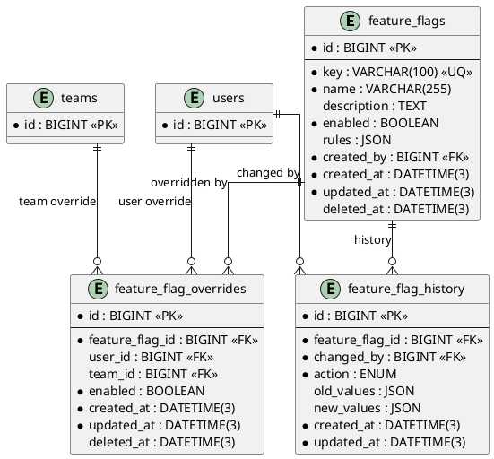

# 06.102 - Feature Flags

**Project:** GsmUi
**Domain:** Admin - Feature Flags
**Version:** 1.0.0

---

# Purpose

This document defines the feature flag schema for gradual rollout, A/B testing, and kill switches.

---

# Tables

## feature_flags

**Purpose:** Feature toggles that control access to platform features.

**Business Rules:**
- `key` is unique and immutable
- `enabled` is the primary on/off switch
- `rules` JSON supports percentage rollouts and targeting criteria
- Soft-deletable

**Columns:**

| Column | Type | Nullable | Default | Notes |
|---|---|---|---|---|
| id | BIGINT UNSIGNED | NO | AUTO_INCREMENT | PK |
| key | VARCHAR(100) | NO | — | Unique flag key |
| name | VARCHAR(255) | NO | — | Display name |
| description | TEXT | YES | NULL | Feature description |
| enabled | BOOLEAN | NO | false | Primary toggle |
| rules | JSON | YES | NULL | {percentage: 0-100, targeting: {user_ids: [], team_ids: [], roles: []}} |
| created_by | BIGINT UNSIGNED | NO | — | FK → users.id |
| created_at | DATETIME(3) | NO | CURRENT_TIMESTAMP(3) | |
| updated_at | DATETIME(3) | NO | CURRENT_TIMESTAMP(3) | ON UPDATE |
| deleted_at | DATETIME(3) | YES | NULL | Soft delete |

**Indexes:**

```
PRIMARY: id
UNIQUE: feature_flags_key_unique (key)
INDEX: feature_flags_enabled_index (enabled)
```

**Migration:**

```php
Schema::create('feature_flags', function (Blueprint $table) {
    $table->id();
    $table->string('key')->unique();
    $table->string('name');
    $table->text('description')->nullable();
    $table->boolean('enabled')->default(false);
    $table->json('rules')->nullable();
    $table->foreignId('created_by')->constrained('users');
    $table->timestamps();
    $table->softDeletes();
});
```

---

## feature_flag_overrides

**Purpose:** Per-user or per-team overrides of a feature flag. Allows forcing a flag on/off for specific users or teams.

**Business Rules:**
- One override per user/team per flag
- Override takes precedence over global flag state and rules
- Soft-deletable

**Columns:**

| Column | Type | Nullable | Default | Notes |
|---|---|---|---|---|
| id | BIGINT UNSIGNED | NO | AUTO_INCREMENT | PK |
| feature_flag_id | BIGINT UNSIGNED | NO | — | FK → feature_flags.id |
| user_id | BIGINT UNSIGNED | YES | NULL | FK → users.id |
| team_id | BIGINT UNSIGNED | YES | NULL | FK → teams.id |
| enabled | BOOLEAN | NO | — | Override state |
| created_at | DATETIME(3) | NO | CURRENT_TIMESTAMP(3) | |
| updated_at | DATETIME(3) | NO | CURRENT_TIMESTAMP(3) | ON UPDATE |
| deleted_at | DATETIME(3) | YES | NULL | Soft delete |

**Indexes:**

```
PRIMARY: id
UNIQUE: feature_flag_overrides_feature_flag_id_user_id_team_id_unique (feature_flag_id, user_id, team_id)
INDEX: feature_flag_overrides_user_id_index (user_id)
INDEX: feature_flag_overrides_team_id_index (team_id)
```

**Migration:**

```php
Schema::create('feature_flag_overrides', function (Blueprint $table) {
    $table->id();
    $table->foreignId('feature_flag_id')->constrained()->cascadeOnDelete();
    $table->foreignId('user_id')->nullable()->constrained()->nullOnDelete();
    $table->foreignId('team_id')->nullable()->constrained()->nullOnDelete();
    $table->boolean('enabled');
    $table->timestamps();
    $table->softDeletes();
    $table->unique(['feature_flag_id', 'user_id', 'team_id']);
});
```

---

## feature_flag_history

**Purpose:** Immutable audit trail of feature flag changes.

**Business Rules:**
- No soft deletes — history is append-only
- `action` ENUM: created, updated, enabled, disabled, deleted

**Columns:**

| Column | Type | Nullable | Default | Notes |
|---|---|---|---|---|
| id | BIGINT UNSIGNED | NO | AUTO_INCREMENT | PK |
| feature_flag_id | BIGINT UNSIGNED | NO | — | FK → feature_flags.id |
| changed_by | BIGINT UNSIGNED | NO | — | FK → users.id |
| action | ENUM('created','updated','enabled','disabled','deleted') | NO | — | Action type |
| old_values | JSON | YES | NULL | Previous state |
| new_values | JSON | YES | NULL | New state |
| created_at | DATETIME(3) | NO | CURRENT_TIMESTAMP(3) | |
| updated_at | DATETIME(3) | NO | CURRENT_TIMESTAMP(3) | ON UPDATE |

**Indexes:**

```
PRIMARY: id
INDEX: feature_flag_history_feature_flag_id_index (feature_flag_id)
INDEX: feature_flag_history_changed_by_index (changed_by)
INDEX: feature_flag_history_created_at_index (created_at)
```

**Migration:**

```php
Schema::create('feature_flag_history', function (Blueprint $table) {
    $table->id();
    $table->foreignId('feature_flag_id')->constrained()->cascadeOnDelete();
    $table->foreignId('changed_by')->constrained('users');
    $table->enum('action', ['created', 'updated', 'enabled', 'disabled', 'deleted']);
    $table->json('old_values')->nullable();
    $table->json('new_values')->nullable();
    $table->timestamps();
});
```

---

# PlantUML ERD



---

# Detailed Business Rules

## Feature Flag Lifecycle

A feature flag progresses through a well-defined lifecycle from creation to eventual archival. Understanding this lifecycle is critical for administrators, developers, and the evaluation engine that resolves flag state at runtime.

### States

| State | Description | Transition Triggers |
|---|---|---|
| `draft` | Flag created but not yet deployed | `enable()` called |
| `active` | Flag is live and being evaluated | `disable()` called, `archive()` called |
| `inactive` | Flag disabled but still exists in code | `enable()` called, `archive()` called |
| `archived` | Flag removed from active code paths | `restore()` called (only from archived) |

### State Machine

```
                    ┌──────────┐
                    │  draft   │
                    └────┬─────┘
                         │ enable()
                         ▼
                    ┌──────────┐
           ┌──────│  active  │──────┐
           │      └────┬─────┘      │
           │ disable() │            │ archive()
           │           │ enable()   │
           ▼           ▼            ▼
      ┌──────────┐            ┌──────────┐
      │ inactive │            │ archived │
      └────┬─────┘            └──────────┘
           │ enable()              │
           └──────────────────────┘
                    restore()
```

### Validation Rules

1. **Key uniqueness**: The `key` column must be globally unique across all flags, including soft-deleted ones. A deleted flag's key cannot be reused for 30 days.
2. **Key format**: Must match pattern `^[a-z][a-z0-9_\-]{1,99}$` — lowercase alphanumeric with underscores or hyphens, starting with a letter.
3. **Rules JSON validation**: The `rules` JSON must conform to the schema defined in the Rules JSON Schema section below.
4. **Percentage bounds**: When `percentage` is present in rules, it must be between 0 and 100 inclusive.
5. **Targeting validation**: `user_ids`, `team_ids`, and `roles` arrays must contain valid identifiers. Empty arrays are treated as "no targeting constraint."
6. **Created_by immutability**: Once set, `created_by` cannot be changed. It always reflects the original creator.
7. **Description length**: Maximum 2000 characters. HTML is stripped.

## Override Rules

Overrides provide a mechanism to force a flag on or off for specific users or teams, regardless of the global flag state or percentage rollout rules.

### Precedence Order

When evaluating whether a feature is enabled for a given user, the system resolves in this order:

1. **User-level override** (highest priority) — if a `feature_flag_overrides` row exists with `user_id = {target_user}`, use its `enabled` value.
2. **Team-level override** — if a row exists with `team_id = {target_user.team_id}`, use its `enabled` value.
3. **Flag rules evaluation** — apply percentage rollout and targeting criteria from the flag's `rules` JSON.
4. **Global flag state** (lowest priority) — use the flag's `enabled` column directly.

### Conflict Resolution

- If both a user override and a team override exist for the same flag, the **user override wins**.
- If a user belongs to multiple teams and multiple team overrides exist, the **most recently created** team override wins.
- If the global flag is disabled and no override exists, the feature is disabled regardless of rules.

### Override Constraints

- At least one of `user_id` or `team_id` must be non-null.
- You cannot create a team override if the user belongs to no teams.
- An override's `enabled` value cannot be null — it must be explicitly `true` or `false`.
- Overrides do not cascade: disabling a flag globally does not affect existing overrides.

## Rules JSON Schema

The `rules` column on `feature_flags` stores a JSON object that controls rollout behavior. The schema is as follows:

```json
{
  "percentage": 0,
  "targeting": {
    "user_ids": [],
    "team_ids": [],
    "roles": [],
    "emails": [],
    "domains": []
  },
  "variants": {
    "control": { "weight": 50 },
    "treatment_a": { "weight": 30 },
    "treatment_b": { "weight": 20 }
  },
  "conditions": [
    {
      "attribute": "created_at",
      "operator": "before",
      "value": "2025-01-01"
    }
  ],
  "schedule": {
    "start": "2025-01-15T00:00:00Z",
    "end": "2025-02-15T23:59:59Z"
  }
}
```

### Fields

| Field | Type | Required | Description |
|---|---|---|---|
| `percentage` | int (0-100) | No | Percentage of all users who see the flag enabled. Hash-based deterministic. |
| `targeting.user_ids` | int[] | No | Specific user IDs to force-enable. |
| `targeting.team_ids` | int[] | No | Specific team IDs to force-enable. |
| `targeting.roles` | string[] | No | Role names to enable for (e.g., `["admin", "editor"]`). |
| `targeting.emails` | string[] | No | Email patterns (supports `*` wildcard). |
| `targeting.domains` | string[] | No | Email domain matching (e.g., `["@company.com"]`). |
| `variants` | object | No | A/B test variant definitions with weights. |
| `conditions` | array | No | Attribute-based conditions for conditional rollout. |
| `schedule` | object | No | Time window for automatic enable/disable. |

### Percentage Rollout Algorithm

The percentage rollout uses a deterministic hash to ensure the same user always gets the same result for a given flag, regardless of how many times they are evaluated:

```
hash_value = hash(feature_flag_key + user_id)
bucket = hash_value % 100
enabled = bucket < percentage
```

This ensures:
- Consistency: the same user always gets the same result.
- Distribution: across a large user base, the rollout percentage closely matches the target.
- No overlap: changing the percentage doesn't flip users who were already in — only new buckets are affected.

### A/B Test Variants

When `variants` is present, the evaluation engine returns a variant name instead of a boolean. The variant is selected using the same hash-based bucketing:

```
hash_value = hash(feature_flag_key + user_id)
bucket = hash_value % sum(all_weights)
```

Each variant occupies a range of buckets based on its weight. For example:
- `control`: weight 50 → buckets 0-49
- `treatment_a`: weight 30 → buckets 50-79
- `treatment_b`: weight 20 → buckets 80-99

### Schedule

The `schedule` object allows flags to be automatically enabled/disabled at specific times:

- If `start` is in the future, the flag evaluates as disabled until the start time.
- If `end` is in the past, the flag evaluates as disabled.
- If both are present, the flag is only enabled within the time window.
- Schedule times are always in UTC. The UI displays them in the user's configured timezone.

## Audit Trail Requirements

Every mutation to a feature flag or its overrides must be recorded in `feature_flag_history`. The following actions are tracked:

| Action | Trigger | old_values | new_values |
|---|---|---|---|
| `created` | Flag is created | null | Full flag record |
| `updated` | Any field changed | Previous state | Updated fields only |
| `enabled` | `enabled` transitions false→true | `{enabled: false}` | `{enabled: true}` |
| `disabled` | `enabled` transitions true→false | `{enabled: true}` | `{enabled: false}` |
| `deleted` | Soft delete | Full flag record | null |
| `restored` | Soft-deleted flag restored | null | Full flag record |
| `override_created` | Override added | null | Override record |
| `override_updated` | Override changed | Previous override | Updated override |
| `override_deleted` | Override removed | Override record | null |

### History Retention

- History records are retained for 365 days by default.
- A scheduled Artisan command (`feature-flags:prune-history`) removes records older than the retention period.
- History records related to flags that have been permanently deleted (not soft-deleted) are retained for 90 additional days.
- History is never soft-deleted — it is always hard-deleted when pruned.

---

# Feature Flag Evaluation Engine

## Resolution Algorithm

The feature flag evaluation engine resolves the effective state of a flag for a given user context. This is the core logic that determines whether a feature is enabled or disabled for a specific user.

### Pseudocode

```php
function evaluate(FeatureFlag $flag, UserContext $context): FlagResult
{
    // Step 1: Check if flag exists and is not soft-deleted
    if ($flag->trashed() || $flag->status === 'archived') {
        return FlagResult::disabled('flag_archived');
    }

    // Step 2: Check schedule
    if ($flag->rules && isset($flag->rules['schedule'])) {
        $now = now()->toIso8601String();
        $schedule = $flag->rules['schedule'];

        if (isset($schedule['start']) && $now < $schedule['start']) {
            return FlagResult::disabled('flag_not_started');
        }
        if (isset($schedule['end']) && $now > $schedule['end']) {
            return FlagResult::disabled('flag_expired');
        }
    }

    // Step 3: Check user-level override (highest priority)
    $override = FeatureFlagOverride::where('feature_flag_id', $flag->id)
        ->where('user_id', $context->userId)
        ->whereNull('deleted_at')
        ->first();

    if ($override) {
        return $override->enabled
            ? FlagResult::enabled('user_override')
            : FlagResult::disabled('user_override');
    }

    // Step 4: Check team-level override
    if ($context->teamIds) {
        $teamOverride = FeatureFlagOverride::where('feature_flag_id', $flag->id)
            ->whereIn('team_id', $context->teamIds)
            ->whereNull('deleted_at')
            ->latest()
            ->first();

        if ($teamOverride) {
            return $teamOverride->enabled
                ? FlagResult::enabled('team_override')
                : FlagResult::disabled('team_override');
        }
    }

    // Step 5: Check rules-based targeting
    if ($flag->rules && isset($flag->rules['targeting'])) {
        $targeting = $flag->rules['targeting'];

        // User ID targeting
        if (in_array($context->userId, $targeting['user_ids'] ?? [])) {
            return FlagResult::enabled('targeting_user');
        }

        // Team ID targeting
        $teamOverlap = array_intersect($context->teamIds, $targeting['team_ids'] ?? []);
        if (!empty($teamOverlap)) {
            return FlagResult::enabled('targeting_team');
        }

        // Role targeting
        $roleOverlap = array_intersect($context->roles, $targeting['roles'] ?? []);
        if (!empty($roleOverlap)) {
            return FlagResult::enabled('targeting_role');
        }

        // Email targeting
        if ($context->email) {
            foreach ($targeting['emails'] ?? [] as $pattern) {
                if (fnmatch($pattern, $context->email)) {
                    return FlagResult::enabled('targeting_email');
                }
            }

            // Domain targeting
            $domain = substr($context->email, strpos($context->email, '@') + 1);
            if (in_array($domain, $targeting['domains'] ?? [])) {
                return FlagResult::enabled('targeting_domain');
            }
        }
    }

    // Step 6: Check percentage rollout
    if ($flag->rules && isset($flag->rules['percentage'])) {
        $percentage = (int) $flag->rules['percentage'];

        if ($percentage >= 100) {
            return FlagResult::enabled('percentage_full');
        }

        if ($percentage <= 0) {
            return FlagResult::disabled('percentage_none');
        }

        $hash = crc32($flag->key . ':' . $context->userId);
        $bucket = abs($hash) % 100;

        return $bucket < $percentage
            ? FlagResult::enabled('percentage_rollout')
            : FlagResult::disabled('percentage_rollout');
    }

    // Step 7: Fall back to global flag state
    return $flag->enabled
        ? FlagResult::enabled('global_enabled')
        : FlagResult::disabled('global_disabled');
}
```

### FlagResult Value Object

```php
class FlagResult
{
    public bool $enabled;
    public string $reason;
    public ?string $variant;
    public float $evaluationTimeMs;

    public static function enabled(string $reason, ?string $variant = null): self
    {
        return new self(true, $reason, $variant);
    }

    public static function disabled(string $reason): self
    {
        return new self(false, $reason, null);
    }
}
```

### Reason Codes

| Code | Meaning |
|---|---|
| `flag_archived` | Flag has been archived and is no longer evaluated |
| `flag_not_started` | Flag schedule has not started yet |
| `flag_expired` | Flag schedule has expired |
| `user_override` | User-level override is active |
| `team_override` | Team-level override is active |
| `targeting_user` | User ID is in the targeting list |
| `targeting_team` | User's team is in the targeting list |
| `targeting_role` | User's role is in the targeting list |
| `targeting_email` | User's email matches a targeting pattern |
| `targeting_domain` | User's email domain is in the targeting list |
| `percentage_rollout` | Deterministic percentage rollout |
| `global_enabled` | Flag is globally enabled |
| `global_disabled` | Flag is globally disabled |
| `percentage_full` | 100% rollout (shortcut) |
| `percentage_none` | 0% rollout (shortcut) |

## Caching Strategy

Feature flags are evaluated on every request that needs them, but the underlying data is cached to avoid repeated database queries.

### Cache Layers

1. **In-memory request cache**: Within a single request, the same flag is only resolved once. Subsequent calls to `Gsmui::featureFlag('key')` return the cached result.
2. **Redis cache**: Flag data is cached in Redis with a TTL of 60 seconds. This reduces database load for high-traffic scenarios.
3. **Database**: The source of truth. Redis is invalidated whenever a flag or override is modified.

### Cache Invalidation

| Event | Invalidation Strategy |
|---|---|
| Flag created/updated | Invalidate Redis key `ff:{flag_key}` |
| Flag enabled/disabled | Invalidate Redis key `ff:{flag_key}` |
| Override created/updated | Invalidate Redis keys `ff:{flag_key}` for affected users/teams |
| Override deleted | Invalidate Redis keys `ff:{flag_key}` for affected users/teams |
| Flag soft-deleted | Invalidate Redis key `ff:{flag_key}` |
| Flag restored | Invalidate Redis key `ff:{flag_key}` |

### Cache Key Format

```
ff:{flag_key}:{user_id}
```

For team-based evaluations:
```
ff:{flag_key}:t:{team_ids_hash}
```

### Cache Warming

On application boot, a cache warmer can optionally pre-load a configurable set of frequently-used flags into Redis. This is controlled by the `gsmui-pro.feature_flags.warm_cache` config value.

```php
// config/gsmui-pro.php
'feature_flags' => [
    'warm_cache' => true,
    'warm_keys' => ['dark-mode', 'new-dashboard', 'beta-editor'],
    'cache_ttl' => 60,
],
```

---

# API Contracts

## Feature Flags CRUD

### List Feature Flags

```
GET /api/gsmui/feature-flags
```

**Query Parameters:**

| Param | Type | Default | Description |
|---|---|---|---|
| `page` | int | 1 | Page number |
| `per_page` | int | 25 | Items per page (max 100) |
| `status` | string | null | Filter by status: draft, active, inactive, archived |
| `enabled` | boolean | null | Filter by enabled state |
| `search` | string | null | Search in key, name, description |
| `sort` | string | created_at | Sort field |
| `direction` | string | desc | Sort direction |

**Response:**

```json
{
  "data": [
    {
      "id": 1,
      "key": "dark-mode",
      "name": "Dark Mode",
      "description": "Enable dark mode for all users",
      "enabled": true,
      "rules": {
        "percentage": 50,
        "targeting": {
          "roles": ["beta"]
        }
      },
      "created_by": {
        "id": 1,
        "name": "Admin User"
      },
      "created_at": "2025-01-15T10:30:00.000Z",
      "updated_at": "2025-01-20T14:00:00.000Z",
      "overrides_count": 5
    }
  ],
  "meta": {
    "current_page": 1,
    "last_page": 3,
    "per_page": 25,
    "total": 67
  }
}
```

### Create Feature Flag

```
POST /api/gsmui/feature-flags
```

**Request:**

```json
{
  "key": "new-dashboard",
  "name": "New Dashboard Layout",
  "description": "Roll out the redesigned dashboard to selected users",
  "enabled": false,
  "rules": {
    "percentage": 10,
    "targeting": {
      "roles": ["admin", "editor"]
    }
  }
}
```

**Response (201):**

```json
{
  "data": {
    "id": 42,
    "key": "new-dashboard",
    "name": "New Dashboard Layout",
    "description": "Roll out the redesigned dashboard to selected users",
    "enabled": false,
    "rules": {
      "percentage": 10,
      "targeting": {
        "roles": ["admin", "editor"]
      }
    },
    "created_by": {
      "id": 1,
      "name": "Admin User"
    },
    "created_at": "2025-01-20T14:30:00.000Z",
    "updated_at": "2025-01-20T14:30:00.000Z"
  }
}
```

### Update Feature Flag

```
PUT /api/gsmui/feature-flags/{id}
```

**Request:**

```json
{
  "name": "New Dashboard Layout v2",
  "enabled": true,
  "rules": {
    "percentage": 75
  }
}
```

### Delete Feature Flag

```
DELETE /api/gsmui/feature-flags/{id}
```

**Response (204):** No content.

### Restore Feature Flag

```
POST /api/gsmui/feature-flags/{id}/restore
```

**Response (200):**

```json
{
  "data": {
    "id": 42,
    "key": "new-dashboard",
    "enabled": false,
    "deleted_at": null
  }
}
```

## Feature Flag Overrides

### List Overrides

```
GET /api/gsmui/feature-flags/{id}/overrides
```

**Query Parameters:**

| Param | Type | Default | Description |
|---|---|---|---|
| `user_id` | int | null | Filter by user ID |
| `team_id` | int | null | Filter by team ID |
| `enabled` | boolean | null | Filter by enabled state |

### Create Override

```
POST /api/gsmui/feature-flags/{id}/overrides
```

**Request:**

```json
{
  "user_id": 123,
  "team_id": null,
  "enabled": true
}
```

### Update Override

```
PUT /api/gsmui/feature-flags/{id}/overrides/{override_id}
```

**Request:**

```json
{
  "enabled": false
}
```

### Delete Override

```
DELETE /api/gsmui/feature-flags/{id}/overrides/{override_id}
```

## Bulk Operations

### Bulk Enable/Disable

```
POST /api/gsmui/feature-flags/bulk
```

**Request:**

```json
{
  "action": "enable",
  "flag_ids": [1, 2, 3, 4, 5]
}
```

**Response (200):**

```json
{
  "data": {
    "processed": 5,
    "failed": 0,
    "results": [
      {"id": 1, "status": "enabled"},
      {"id": 2, "status": "enabled"},
      {"id": 3, "status": "enabled"},
      {"id": 4, "status": "enabled"},
      {"id": 5, "status": "enabled"}
    ]
  }
}
```

### Bulk Create Overrides

```
POST /api/gsmui/feature-flags/{id}/overrides/bulk
```

**Request:**

```json
{
  "overrides": [
    {"user_id": 101, "enabled": true},
    {"user_id": 102, "enabled": true},
    {"user_id": 103, "enabled": false}
  ]
}
```

## Evaluation Endpoint

### Evaluate Flag for Current User

```
GET /api/gsmui/feature-flags/{key}/evaluate
```

**Response:**

```json
{
  "data": {
    "key": "dark-mode",
    "enabled": true,
    "reason": "percentage_rollout",
    "variant": null,
    "evaluation_time_ms": 0.42
  }
}
```

### Evaluate Flag for Specific User (Admin)

```
POST /api/gsmui/feature-flags/{key}/evaluate
```

**Request:**

```json
{
  "user_id": 123
}
```

**Response:**

```json
{
  "data": {
    "key": "dark-mode",
    "enabled": false,
    "reason": "global_disabled",
    "variant": null,
    "evaluation_time_ms": 0.38
  }
}
```

### Bulk Evaluate

```
POST /api/gsmui/feature-flags/evaluate
```

**Request:**

```json
{
  "keys": ["dark-mode", "new-dashboard", "beta-editor"],
  "user_id": 123
}
```

**Response:**

```json
{
  "data": {
    "dark-mode": {
      "enabled": true,
      "reason": "percentage_rollout",
      "variant": null
    },
    "new-dashboard": {
      "enabled": false,
      "reason": "global_disabled",
      "variant": null
    },
    "beta-editor": {
      "enabled": true,
      "reason": "user_override",
      "variant": "treatment_a"
    }
  }
}
```

## History Endpoint

### Get Flag History

```
GET /api/gsmui/feature-flags/{id}/history
```

**Query Parameters:**

| Param | Type | Default | Description |
|---|---|---|---|
| `action` | string | null | Filter by action type |
| `changed_by` | int | null | Filter by actor |
| `from` | datetime | null | Start date filter |
| `to` | datetime | null | End date filter |
| `page` | int | 1 | Page number |

**Response:**

```json
{
  "data": [
    {
      "id": 1,
      "action": "enabled",
      "changed_by": {
        "id": 1,
        "name": "Admin User"
      },
      "old_values": {"enabled": false},
      "new_values": {"enabled": true},
      "created_at": "2025-01-20T14:00:00.000Z"
    },
    {
      "id": 2,
      "action": "updated",
      "changed_by": {
        "id": 1,
        "name": "Admin User"
      },
      "old_values": {"rules": {"percentage": 10}},
      "new_values": {"rules": {"percentage": 50}},
      "created_at": "2025-01-19T09:30:00.000Z"
    }
  ],
  "meta": {
    "current_page": 1,
    "last_page": 1,
    "total": 2
  }
}
```

---

# Security

## Access Control

Feature flag management requires specific permissions. The permission model is hierarchical:

### Permissions

| Permission | Description | Implies |
|---|---|---|
| `feature-flags.view` | View flag list and details | — |
| `feature-flags.create` | Create new flags | `feature-flags.view` |
| `feature-flags.update` | Update flag configuration | `feature-flags.view` |
| `feature-flags.delete` | Soft-delete flags | `feature-flags.view` |
| `feature-flags.restore` | Restore soft-deleted flags | `feature-flags.view` |
| `feature-flags.toggle` | Enable/disable flags | `feature-flags.view` |
| `feature-flags.overrides.manage` | Create/update/delete overrides | `feature-flags.view` |
| `feature-flags.history.view` | View flag change history | `feature-flags.view` |
| `feature-flags.admin` | Full access to all flag operations | All above |

### Role Mapping

| Role | Default Permissions |
|---|---|
| `super-admin` | `feature-flags.admin` |
| `admin` | `feature-flags.view`, `feature-flags.create`, `feature-flags.update`, `feature-flags.toggle`, `feature-flags.overrides.manage` |
| `editor` | `feature-flags.view` |
| `viewer` | `feature-flags.view` |
| `developer` | `feature-flags.view`, `feature-flags.toggle` (for dev/staging only) |

### Middleware

```php
Route::middleware(['auth', 'permission:feature-flags.view'])->group(function () {
    Route::get('/feature-flags', [FeatureFlagController::class, 'index']);
    Route::get('/feature-flags/{id}', [FeatureFlagController::class, 'show']);
});

Route::middleware(['auth', 'permission:feature-flags.create'])->group(function () {
    Route::post('/feature-flags', [FeatureFlagController::class, 'store']);
});

Route::middleware(['auth', 'permission:feature-flags.toggle'])->group(function () {
    Route::post('/feature-flags/{id}/toggle', [FeatureFlagController::class, 'toggle']);
});
```

## Security Rules

1. **No client-side flag resolution**: Feature flags are always resolved server-side. The client never receives raw flag rules or percentages.
2. **No flag data in URLs**: Flag keys must not appear in query strings or URL fragments to prevent log leakage.
3. **Audit logging**: Every flag mutation is logged with the actor's IP address and user agent.
4. **Rate limiting**: Flag evaluation endpoints are rate-limited to 100 requests per minute per user.
5. **Sensitive flags**: Flags marked as `sensitive` in their metadata are not returned in bulk evaluation responses to non-admin users.
6. **Key rotation**: When a flag is deleted, its key is added to a blocklist for 30 days to prevent accidental reuse.

## CSRF Protection

All flag mutation endpoints (POST, PUT, DELETE) require a valid CSRF token. The token is validated by Laravel's built-in CSRF middleware.

## Input Validation

All inputs are validated at multiple layers:

1. **Request validation**: Laravel Form Request classes validate all inputs before they reach the controller.
2. **Model validation**: Eloquent model rules provide a second validation layer.
3. **JSON schema validation**: The `rules` JSON column is validated against the defined schema before storage.
4. **SQL injection prevention**: All queries use Eloquent's parameterized bindings. No raw SQL with user input.

---

# Event Hooks

Feature flag changes emit events that other parts of the system can subscribe to. This enables integrations, notifications, and side-effect management.

## Events

| Event | Triggered When | Payload |
|---|---|---|
| `FeatureFlagCreated` | New flag created | Flag model instance |
| `FeatureFlagUpdated` | Flag fields changed | Flag model instance, changed attributes |
| `FeatureFlagEnabled` | Flag enabled | Flag model instance |
| `FeatureFlagDisabled` | Flag disabled | Flag model instance |
| `FeatureFlagDeleted` | Flag soft-deleted | Flag model instance |
| `FeatureFlagRestored` | Soft-deleted flag restored | Flag model instance |
| `FeatureFlagOverrideCreated` | Override added | Override model instance |
| `FeatureFlagOverrideUpdated` | Override changed | Override model instance, changed attributes |
| `FeatureFlagOverrideDeleted` | Override removed | Override model instance |
| `FeatureFlagEvaluated` | Flag evaluated for a user | Flag key, user ID, result |

## Event Listeners

### Cache Invalidation Listener

```php
class InvalidateFeatureFlagCache
{
    public function handle(FeatureFlagUpdated $event): void
    {
        $flag = $event->flag;

        // Invalidate the flag cache
        Cache::forget("ff:{$flag->key}");

        // If percentage or targeting changed, invalidate all user-specific caches
        if ($event->attributeChanged('rules')) {
            $this->clearUserCaches($flag);
        }
    }

    private function clearUserCaches(FeatureFlag $flag): void
    {
        $pattern = "ff:{$flag->key}:*";
        $keys = Cache::getRedis()->keys($pattern);

        foreach ($keys as $key) {
            Cache::forget($key);
        }
    }
}
```

### Notification Listener

```php
class NotifyFeatureFlagChange
{
    public function handle(FeatureFlagEnabled $event): void
    {
        $admins = User::where('role', 'admin')->get();

        foreach ($admins as $admin) {
            Notification::send($admin, new FeatureFlagEnabledNotification(
                $event->flag
            ));
        }
    }
}
```

### Webhook Listener

```php
class DispatchFeatureFlagWebhook
{
    public function handle(FeatureFlagUpdated $event): void
    {
        $webhooks = Webhook::where('event', 'feature_flag.updated')
            ->where('active', true)
            ->get();

        foreach ($webhooks as $webhook) {
            DispatchWebhook::dispatch($webhook, [
                'event' => 'feature_flag.updated',
                'flag' => $event->flag->toArray(),
                'changes' => $event->changedAttributes,
                'timestamp' => now()->toIso8601String(),
            ]);
        }
    }
}
```

## Event Registration

Events are registered in the service provider:

```php
public function boot(): void
{
    Event::listen(FeatureFlagUpdated::class, InvalidateFeatureFlagCache::class);
    Event::listen(FeatureFlagEnabled::class, NotifyFeatureFlagChange::class);
    Event::listen(FeatureFlagUpdated::class, DispatchFeatureFlagWebhook::class);
}
```

---

# Query Patterns

## Common Read Queries

### Get All Active Flags

```php
FeatureFlag::whereNull('deleted_at')
    ->where('enabled', true)
    ->orderBy('key')
    ->get();
```

### Get Flag by Key (with Override Check)

```php
$flag = FeatureFlag::where('key', $key)
    ->whereNull('deleted_at')
    ->first();

if (!$flag) {
    return FlagResult::disabled('flag_not_found');
}

$override = FeatureFlagOverride::where('feature_flag_id', $flag->id)
    ->where(function ($query) use ($userId) {
        $query->where('user_id', $userId)
            ->orWhereIn('team_id', $userTeamIds);
    })
    ->whereNull('deleted_at')
    ->orderByRaw('CASE WHEN user_id IS NOT NULL THEN 0 ELSE 1 END')
    ->first();
```

### Get All Flags for a User (Bulk Resolution)

```php
$flags = FeatureFlag::whereNull('deleted_at')->get();

$overrides = FeatureFlagOverride::whereNull('deleted_at')
    ->where(function ($query) use ($userId, $userTeamIds) {
        $query->where('user_id', $userId)
            ->orWhereIn('team_id', $userTeamIds);
    })
    ->get()
    ->groupBy('feature_flag_id');

$results = $flags->mapWithKeys(function ($flag) use ($overrides, $userId, $context) {
    $result = resolveFlag($flag, $userId, $context, $overrides->get($flag->id));
    return [$flag->key => $result];
});
```

### Get Flags with Override Counts

```php
FeatureFlag::withCount('overrides')
    ->whereNull('deleted_at')
    ->orderBy('key')
    ->get();
```

### Get Flag Statistics

```php
FeatureFlag::select('feature_flags.*')
    ->selectRaw('
        (SELECT COUNT(*) FROM feature_flag_overrides
         WHERE feature_flag_id = feature_flags.id AND enabled = 1
         AND deleted_at IS NULL) as enabled_overrides_count,
        (SELECT COUNT(*) FROM feature_flag_overrides
         WHERE feature_flag_id = feature_flags.id AND enabled = 0
         AND deleted_at IS NULL) as disabled_overrides_count,
        (SELECT COUNT(*) FROM feature_flag_history
         WHERE feature_flag_id = feature_flags.id) as history_count
    ')
    ->whereNull('feature_flags.deleted_at')
    ->get();
```

## Common Write Queries

### Toggle Flag

```php
$flag->update(['enabled' => !$flag->enabled]);

FeatureFlagHistory::create([
    'feature_flag_id' => $flag->id,
    'changed_by' => auth()->id(),
    'action' => $flag->enabled ? 'enabled' : 'disabled',
    'old_values' => ['enabled' => !$flag->enabled],
    'new_values' => ['enabled' => $flag->enabled],
]);
```

### Bulk Override

```php
DB::transaction(function () use ($flagId, $overrides) {
    foreach ($overrides as $override) {
        FeatureFlagOverride::updateOrCreate(
            [
                'feature_flag_id' => $flagId,
                'user_id' => $override['user_id'],
                'team_id' => $override['team_id'] ?? null,
            ],
            ['enabled' => $override['enabled']]
        );
    }
});
```

### Prune Old History

```php
FeatureFlagHistory::where('created_at', '<', now()->subDays(365))
    ->where(function ($query) {
        $query->whereHas('featureFlag', function ($q) {
            $q->whereNull('deleted_at');
        });
    })
    ->delete();
```

---

# Caching Implementation

## Cache Service

```php
class FeatureFlagCache
{
    private const PREFIX = 'ff';
    private const TTL = 60;

    public function __construct(
        private Repository $cache,
        private FeatureFlagRepository $repository,
    ) {}

    public function resolve(string $key, UserContext $context): FlagResult
    {
        $cacheKey = $this->buildCacheKey($key, $context->userId);

        return $this->cache->remember($cacheKey, self::TTL, function () use ($key, $context) {
            $flag = $this->repository->findByKey($key);

            if (!$flag) {
                return FlagResult::disabled('flag_not_found');
            }

            return $this->evaluateFlag($flag, $context);
        });
    }

    public function invalidate(string $flagKey): void
    {
        $this->cache->forget(self::PREFIX . ':' . $flagKey);
    }

    public function invalidateForUser(string $flagKey, int $userId): void
    {
        $this->cache->forget($this->buildCacheKey($flagKey, $userId));
    }

    private function buildCacheKey(string $flagKey, int $userId): string
    {
        return self::PREFIX . ':' . $flagKey . ':' . $userId;
    }
}
```

## Cache Warming

```php
class FeatureFlagCacheWarmer
{
    public function __construct(
        private FeatureFlagCache $cache,
        private Config $config,
    ) {}

    public function warm(): void
    {
        if (!$this->config->get('gsmui-pro.feature_flags.warm_cache')) {
            return;
        }

        $keys = $this->config->get('gsmui-pro.feature_flags.warm_keys', []);

        foreach ($keys as $key) {
            $flag = FeatureFlag::where('key', $key)->first();

            if ($flag && !$flag->trashed()) {
                // Pre-load the flag data into cache
                $this->cache->invalidate($key);
            }
        }
    }
}
```

---

# Artisan Commands

## Feature Flag Management Commands

### Toggle Feature Flag

```bash
php artisan feature-flags:toggle {key}
```

Toggles the enabled/disabled state of a feature flag.

**Options:**

| Option | Description |
|---|---|
| `--enable` | Force-enable the flag |
| `--disable` | Force-disable the flag |
| `--reason` | Reason for the toggle (for audit trail) |

**Examples:**

```bash
php artisan feature-flags:toggle dark-mode
php artisan feature-flags:toggle dark-mode --enable
php artisan feature-flags:toggle dark-mode --disable --reason "Performance issue on mobile"
```

### Evaluate Feature Flag

```bash
php artisan feature-flags:evaluate {key} {--user=}
```

Evaluates a feature flag for a specific user or the current user.

**Options:**

| Option | Description |
|---|---|
| `--user=` | User ID to evaluate for |
| `--json` | Output as JSON |

### List Feature Flags

```bash
php artisan feature-flags:list {--status=} {--enabled=} {--format=table}
```

Lists all feature flags with their current state.

**Options:**

| Option | Description |
|---|---|
| `--status=` | Filter by status (draft, active, inactive, archived) |
| `--enabled=` | Filter by enabled state (true/false) |
| `--format=` | Output format: table, json, csv |

### Seed Feature Flags

```bash
php artisan feature-flags:seed {--file=}
```

Seeds feature flags from a JSON or YAML file.

**Options:**

| Option | Description |
|---|---|
| `--file=` | Path to seed file (default: `database/seeders/feature_flags.json`) |

**Seed file format:**

```json
[
  {
    "key": "dark-mode",
    "name": "Dark Mode",
    "description": "Enable dark mode for all users",
    "enabled": false,
    "rules": {
      "percentage": 0
    }
  }
]
```

### Export Feature Flags

```bash
php artisan feature-flags:export {--output=} {--format=json}
```

Exports all feature flags to a file for backup or migration.

### Prune History

```bash
php artisan feature-flags:prune-history {--days=365}
```

Removes feature flag history records older than the specified number of days.

### Sync Overrides from CSV

```bash
php artisan feature-flags:sync-overrides {flag_key} {--file=} {--dry-run}
```

Bulk-syncs feature flag overrides from a CSV file.

**CSV format:**

```csv
user_id,team_id,enabled
123,,true
456,,false
,789,true
```

---

# Testing

## Unit Tests

### Flag Evaluation Test

```php
class FeatureFlagEvaluationTest extends TestCase
{
    public function test_flag_disabled_by_default(): void
    {
        $flag = FeatureFlag::factory()->create(['enabled' => false]);

        $result = resolveFlag($flag, 1, new UserContext(1, [], [], null));

        $this->assertFalse($result->enabled);
        $this->assertEquals('global_disabled', $result->reason);
    }

    public function test_flag_enabled_globally(): void
    {
        $flag = FeatureFlag::factory()->create(['enabled' => true]);

        $result = resolveFlag($flag, 1, new UserContext(1, [], [], null));

        $this->assertTrue($result->enabled);
        $this->assertEquals('global_enabled', $result->reason);
    }

    public function test_user_override_takes_precedence(): void
    {
        $flag = FeatureFlag::factory()->create(['enabled' => false]);

        FeatureFlagOverride::factory()->create([
            'feature_flag_id' => $flag->id,
            'user_id' => 1,
            'enabled' => true,
        ]);

        $result = resolveFlag($flag, 1, new UserContext(1, [], [], null));

        $this->assertTrue($result->enabled);
        $this->assertEquals('user_override', $result->reason);
    }

    public function test_team_override_takes_precedence(): void
    {
        $flag = FeatureFlag::factory()->create(['enabled' => false]);

        FeatureFlagOverride::factory()->create([
            'feature_flag_id' => $flag->id,
            'team_id' => 10,
            'enabled' => true,
        ]);

        $result = resolveFlag($flag, 1, new UserContext(1, [10], [], null));

        $this->assertTrue($result->enabled);
        $this->assertEquals('team_override', $result->reason);
    }

    public function test_percentage_rollout(): void
    {
        $flag = FeatureFlag::factory()->create([
            'enabled' => false,
            'rules' => ['percentage' => 50],
        ]);

        // Test with many users to verify distribution
        $enabledCount = 0;
        $totalUsers = 10000;

        for ($i = 1; $i <= $totalUsers; $i++) {
            $result = resolveFlag($flag, $i, new UserContext($i, [], [], null));
            if ($result->enabled) {
                $enabledCount++;
            }
        }

        // Should be approximately 50% (allow 5% margin)
        $this->assertGreaterThan(4500, $enabledCount);
        $this->assertLessThan(5500, $enabledCount);
    }

    public function test_percentage_rollout_deterministic(): void
    {
        $flag = FeatureFlag::factory()->create([
            'enabled' => false,
            'rules' => ['percentage' => 50],
        ]);

        $userId = 42;

        $result1 = resolveFlag($flag, $userId, new UserContext($userId, [], [], null));
        $result2 = resolveFlag($flag, $userId, new UserContext($userId, [], [], null));

        $this->assertEquals($result1->enabled, $result2->enabled);
    }

    public function test_archived_flag_always_disabled(): void
    {
        $flag = FeatureFlag::factory()->create([
            'enabled' => true,
            'deleted_at' => now(),
        ]);

        $result = resolveFlag($flag, 1, new UserContext(1, [], [], null));

        $this->assertFalse($result->enabled);
        $this->assertEquals('flag_archived', $result->reason);
    }

    public function test_schedule_prevents_early_start(): void
    {
        $flag = FeatureFlag::factory()->create([
            'enabled' => true,
            'rules' => [
                'schedule' => [
                    'start' => now()->addDays(7)->toIso8601String(),
                ],
            ],
        ]);

        $result = resolveFlag($flag, 1, new UserContext(1, [], [], null));

        $this->assertFalse($result->enabled);
        $this->assertEquals('flag_not_started', $result->reason);
    }
}
```

### Override Test

```php
class FeatureFlagOverrideTest extends TestCase
{
    public function test_user_override_created(): void
    {
        $flag = FeatureFlag::factory()->create();
        $user = User::factory()->create();

        $override = FeatureFlagOverride::create([
            'feature_flag_id' => $flag->id,
            'user_id' => $user->id,
            'enabled' => true,
        ]);

        $this->assertDatabaseHas('feature_flag_overrides', [
            'feature_flag_id' => $flag->id,
            'user_id' => $user->id,
            'enabled' => true,
        ]);
    }

    public function test_team_override_created(): void
    {
        $flag = FeatureFlag::factory()->create();
        $team = Team::factory()->create();

        $override = FeatureFlagOverride::create([
            'feature_flag_id' => $flag->id,
            'team_id' => $team->id,
            'enabled' => false,
        ]);

        $this->assertDatabaseHas('feature_flag_overrides', [
            'feature_flag_id' => $flag->id,
            'team_id' => $team->id,
            'enabled' => false,
        ]);
    }

    public function test_override_prevents_duplicate_user(): void
    {
        $flag = FeatureFlag::factory()->create();
        $user = User::factory()->create();

        FeatureFlagOverride::factory()->create([
            'feature_flag_id' => $flag->id,
            'user_id' => $user->id,
        ]);

        $this->expectException(\Illuminate\Database\QueryException::class);

        FeatureFlagOverride::factory()->create([
            'feature_flag_id' => $flag->id,
            'user_id' => $user->id,
        ]);
    }

    public function test_override_soft_delete(): void
    {
        $flag = FeatureFlag::factory()->create();
        $user = User::factory()->create();

        $override = FeatureFlagOverride::factory()->create([
            'feature_flag_id' => $flag->id,
            'user_id' => $user->id,
            'enabled' => true,
        ]);

        $override->delete();

        $this->assertSoftDeleted('feature_flag_overrides', [
            'feature_flag_id' => $flag->id,
            'user_id' => $user->id,
        ]);

        // Verify flag now falls back to global state
        $result = resolveFlag($flag, $user->id, new UserContext($user->id, [], [], null));
        $this->assertEquals('global_disabled', $result->reason);
    }
}
```

### History Test

```php
class FeatureFlagHistoryTest extends TestCase
{
    public function test_history_recorded_on_create(): void
    {
        $flag = FeatureFlag::factory()->create();

        $history = FeatureFlagHistory::where('feature_flag_id', $flag->id)
            ->where('action', 'created')
            ->first();

        $this->assertNotNull($history);
        $this->assertEquals(auth()->id(), $history->changed_by);
    }

    public function test_history_recorded_on_toggle(): void
    {
        $flag = FeatureFlag::factory()->create(['enabled' => false]);

        $flag->update(['enabled' => true]);

        FeatureFlagHistory::create([
            'feature_flag_id' => $flag->id,
            'changed_by' => auth()->id(),
            'action' => 'enabled',
            'old_values' => ['enabled' => false],
            'new_values' => ['enabled' => true],
        ]);

        $history = FeatureFlagHistory::where('feature_flag_id', $flag->id)
            ->where('action', 'enabled')
            ->first();

        $this->assertNotNull($history);
        $this->assertEquals(['enabled' => false], $history->old_values);
        $this->assertEquals(['enabled' => true], $history->new_values);
    }

    public function test_history_not_soft_deleted(): void
    {
        $flag = FeatureFlag::factory()->create();

        $flag->update(['enabled' => true]);

        FeatureFlagHistory::create([
            'feature_flag_id' => $flag->id,
            'changed_by' => auth()->id(),
            'action' => 'enabled',
            'old_values' => ['enabled' => false],
            'new_values' => ['enabled' => true],
        ]);

        $flag->delete();

        // History should still exist
        $this->assertDatabaseHas('feature_flag_history', [
            'feature_flag_id' => $flag->id,
            'action' => 'enabled',
        ]);
    }
}
```

## Integration Tests

### API Test

```php
class FeatureFlagApiTest extends TestCase
{
    public function test_list_flags_requires_auth(): void
    {
        $this->getJson('/api/gsmui/feature-flags')
            ->assertUnauthorized();
    }

    public function test_list_flags_requires_permission(): void
    {
        $user = User::factory()->create();

        $this->actingAs($user)
            ->getJson('/api/gsmui/feature-flags')
            ->assertForbidden();
    }

    public function test_list_flags_returns_paginated_results(): void
    {
        $user = User::factory()->create(['role' => 'admin']);
        FeatureFlag::factory()->count(30)->create();

        $response = $this->actingAs($user)
            ->getJson('/api/gsmui/feature-flags')
            ->assertOk();

        $this->assertCount(25, $response->json('data'));
        $this->assertEquals(30, $response->json('meta.total'));
    }

    public function test_create_flag_validates_key_format(): void
    {
        $user = User::factory()->create(['role' => 'admin']);

        $this->actingAs($user)
            ->postJson('/api/gsmui/feature-flags', [
                'key' => 'Invalid Key!',
                'name' => 'Test',
            ])
            ->assertJsonValidationErrors(['key']);
    }

    public function test_create_flag_stores_correctly(): void
    {
        $user = User::factory()->create(['role' => 'admin']);

        $response = $this->actingAs($user)
            ->postJson('/api/gsmui/feature-flags', [
                'key' => 'new-feature',
                'name' => 'New Feature',
                'description' => 'A new feature',
                'enabled' => false,
                'rules' => ['percentage' => 10],
            ])
            ->assertCreated();

        $this->assertDatabaseHas('feature_flags', [
            'key' => 'new-feature',
            'enabled' => false,
            'created_by' => $user->id,
        ]);
    }

    public function test_toggle_flag(): void
    {
        $user = User::factory()->create(['role' => 'admin']);
        $flag = FeatureFlag::factory()->create(['enabled' => false]);

        $this->actingAs($user)
            ->postJson("/api/gsmui/feature-flags/{$flag->id}/toggle")
            ->assertOk();

        $this->assertDatabaseHas('feature_flags', [
            'id' => $flag->id,
            'enabled' => true,
        ]);
    }

    public function test_create_override(): void
    {
        $user = User::factory()->create(['role' => 'admin']);
        $flag = FeatureFlag::factory()->create();

        $this->actingAs($user)
            ->postJson("/api/gsmui/feature-flags/{$flag->id}/overrides", [
                'user_id' => 123,
                'enabled' => true,
            ])
            ->assertCreated();

        $this->assertDatabaseHas('feature_flag_overrides', [
            'feature_flag_id' => $flag->id,
            'user_id' => 123,
            'enabled' => true,
        ]);
    }

    public function test_bulk_enable(): void
    {
        $user = User::factory()->create(['role' => 'admin']);
        $flags = FeatureFlag::factory()->count(3)->create(['enabled' => false]);

        $this->actingAs($user)
            ->postJson('/api/gsmui/feature-flags/bulk', [
                'action' => 'enable',
                'flag_ids' => $flags->pluck('id')->toArray(),
            ])
            ->assertOk();

        foreach ($flags as $flag) {
            $this->assertDatabaseHas('feature_flags', [
                'id' => $flag->id,
                'enabled' => true,
            ]);
        }
    }

    public function test_evaluation_endpoint(): void
    {
        $user = User::factory()->create(['id' => 42]);
        $flag = FeatureFlag::factory()->create([
            'key' => 'dark-mode',
            'enabled' => true,
        ]);

        $response = $this->actingAs($user)
            ->getJson("/api/gsmui/feature-flags/{$flag->key}/evaluate")
            ->assertOk();

        $this->assertTrue($response->json('data.enabled'));
        $this->assertEquals('global_enabled', $response->json('data.reason'));
    }

    public function test_history_endpoint(): void
    {
        $user = User::factory()->create(['role' => 'admin']);
        $flag = FeatureFlag::factory()->create();

        FeatureFlagHistory::create([
            'feature_flag_id' => $flag->id,
            'changed_by' => $user->id,
            'action' => 'created',
            'old_values' => null,
            'new_values' => $flag->toArray(),
        ]);

        $response = $this->actingAs($user)
            ->getJson("/api/gsmui/feature-flags/{$flag->id}/history")
            ->assertOk();

        $this->assertNotEmpty($response->json('data'));
    }
}
```

## Feature Tests

### Livewire Component Test

```php
class FeatureFlagIndexTest extends TestCase
{
    public function test_component_renders(): void
    {
        $user = User::factory()->create(['role' => 'admin']);

        Livewire::actingAs($user)
            ->test(FeatureFlagIndex::class)
            ->assertSee('Feature Flags');
    }

    public function test_search_filters_flags(): void
    {
        $user = User::factory()->create(['role' => 'admin']);
        FeatureFlag::factory()->create(['key' => 'dark-mode']);
        FeatureFlag::factory()->create(['key' => 'new-editor']);

        Livewire::actingAs($user)
            ->test(FeatureFlagIndex::class)
            ->set('search', 'dark')
            ->assertSee('dark-mode')
            ->assertDontSee('new-editor');
    }

    public function test_toggle_from_ui(): void
    {
        $user = User::factory()->create(['role' => 'admin']);
        $flag = FeatureFlag::factory()->create(['enabled' => false]);

        Livewire::actingAs($user)
            ->test(FeatureFlagIndex::class)
            ->call('toggle', $flag->id)
            ->assertDispatched('flag-toggled');

        $this->assertDatabaseHas('feature_flags', [
            'id' => $flag->id,
            'enabled' => true,
        ]);
    }
}
```

---

# Performance

## Index Optimization

### Primary Indexes

| Table | Index | Type | Columns |
|---|---|---|---|
| `feature_flags` | PRIMARY | B-tree | `id` |
| `feature_flags` | UNIQUE | B-tree | `key` |
| `feature_flags` | INDEX | B-tree | `enabled` |
| `feature_flag_overrides` | PRIMARY | B-tree | `id` |
| `feature_flag_overrides` | UNIQUE | B-tree | `feature_flag_id, user_id, team_id` |
| `feature_flag_overrides` | INDEX | B-tree | `user_id` |
| `feature_flag_overrides` | INDEX | B-tree | `team_id` |
| `feature_flag_history` | PRIMARY | B-tree | `id` |
| `feature_flag_history` | INDEX | B-tree | `feature_flag_id` |
| `feature_flag_history` | INDEX | B-tree | `changed_by` |
| `feature_flag_history` | INDEX | B-tree | `created_at` |

### Composite Indexes

```sql
-- Fast override lookup: find override for a user on a specific flag
CREATE INDEX idx_overrides_flag_user
ON feature_flag_overrides (feature_flag_id, user_id, deleted_at);

-- Fast override lookup: find override for a team on a specific flag
CREATE INDEX idx_overrides_flag_team
ON feature_flag_overrides (feature_flag_id, team_id, deleted_at);

-- Fast history lookup: recent changes for a flag
CREATE INDEX idx_history_flag_created
ON feature_flag_history (feature_flag_id, created_at DESC);

-- Fast history lookup: changes by a specific user
CREATE INDEX idx_history_user_created
ON feature_flag_history (changed_by, created_at DESC);

-- Fast flag lookup: active flags only
CREATE INDEX idx_flags_enabled_deleted
ON feature_flags (enabled, deleted_at);
```

### Partial Indexes (MySQL 8.0+)

```sql
-- Only index non-deleted flags
CREATE INDEX idx_flags_active
ON feature_flags (key, enabled)
WHERE deleted_at IS NULL;

-- Only index active overrides
CREATE INDEX idx_overrides_active
ON feature_flag_overrides (feature_flag_id, user_id, team_id, enabled)
WHERE deleted_at IS NULL;
```

## Query Performance Analysis

### Slow Query Detection

```php
class FeatureFlagPerformanceMonitor
{
    public function detectSlowEvaluations(): Collection
    {
        return FeatureFlagHistory::select('feature_flag_id')
            ->selectRaw('AVG(TIMESTAMPDIFF(MICROSECOND, created_at, updated_at)) as avg_duration')
            ->groupBy('feature_flag_id')
            ->having('avg_duration', '>', 10000) // > 10ms
            ->get();
    }
}
```

### Query Plan Analysis

```sql
-- Check evaluation query plan
EXPLAIN SELECT * FROM feature_flags
WHERE `key` = 'dark-mode' AND deleted_at IS NULL;

-- Check override query plan
EXPLAIN SELECT * FROM feature_flag_overrides
WHERE feature_flag_id = 1
AND (user_id = 42 OR team_id IN (10, 20))
AND deleted_at IS NULL;
```

## Benchmarks

| Operation | Target | Max |
|---|---|---|
| Single flag evaluation (cached) | < 1ms | 5ms |
| Single flag evaluation (uncached) | < 5ms | 20ms |
| Bulk evaluation (50 flags) | < 10ms | 50ms |
| Flag creation | < 20ms | 100ms |
| Override creation | < 15ms | 50ms |
| Flag toggle | < 10ms | 30ms |
| History query (1000 records) | < 50ms | 200ms |
| Cache warm-up (50 flags) | < 100ms | 500ms |

---

# Stored Procedures

## Evaluate All Flags for User

```sql
DELIMITER //

CREATE PROCEDURE sp_evaluate_flags_for_user(
    IN p_user_id BIGINT UNSIGNED,
    IN p_team_ids TEXT -- comma-separated team IDs
)
BEGIN
    SELECT
        ff.id,
        ff.key,
        ff.name,
        ff.enabled AS global_enabled,
        ff.rules,
        CASE
            WHEN ffo_user.id IS NOT NULL THEN ffo_user.enabled
            WHEN ffo_team.id IS NOT NULL THEN ffo_team.enabled
            WHEN ff.enabled = 1 THEN 1
            ELSE 0
        END AS resolved_enabled,
        CASE
            WHEN ffo_user.id IS NOT NULL THEN 'user_override'
            WHEN ffo_team.id IS NOT NULL THEN 'team_override'
            WHEN ff.enabled = 1 THEN 'global_enabled'
            ELSE 'global_disabled'
        END AS resolution_reason
    FROM feature_flags ff
    LEFT JOIN feature_flag_overrides ffo_user
        ON ffo_user.feature_flag_id = ff.id
        AND ffo_user.user_id = p_user_id
        AND ffo_user.deleted_at IS NULL
    LEFT JOIN feature_flag_overrides ffo_team
        ON ffo_team.feature_flag_id = ff.id
        AND FIND_IN_SET(ffo_team.team_id, p_team_ids) > 0
        AND ffo_team.deleted_at IS NULL
        AND ffo_user.id IS NULL -- only if no user override
    WHERE ff.deleted_at IS NULL
    ORDER BY ff.key;
END //

DELIMITER ;
```

## Get Flag Statistics

```sql
DELIMITER //

CREATE PROCEDURE sp_flag_statistics()
BEGIN
    SELECT
        ff.id,
        ff.key,
        ff.name,
        ff.enabled,
        (SELECT COUNT(*) FROM feature_flag_overrides
         WHERE feature_flag_id = ff.id AND enabled = 1 AND deleted_at IS NULL) AS enabled_overrides,
        (SELECT COUNT(*) FROM feature_flag_overrides
         WHERE feature_flag_id = ff.id AND enabled = 0 AND deleted_at IS NULL) AS disabled_overrides,
        (SELECT COUNT(*) FROM feature_flag_history
         WHERE feature_flag_id = ff.id) AS total_changes,
        (SELECT MAX(created_at) FROM feature_flag_history
         WHERE feature_flag_id = ff.id) AS last_changed_at
    FROM feature_flags ff
    WHERE ff.deleted_at IS NULL
    ORDER BY ff.key;
END //

DELIMITER ;
```

## Bulk Override Cleanup

```sql
DELIMITER //

CREATE PROCEDURE sp_cleanup_orphaned_overrides()
BEGIN
    DECLARE affected_rows INT DEFAULT 0;

    DELETE FROM feature_flag_overrides
    WHERE user_id IS NOT NULL
    AND user_id NOT IN (SELECT id FROM users)
    AND deleted_at IS NULL;

    SET affected_rows = ROW_COUNT();

    DELETE FROM feature_flag_overrides
    WHERE team_id IS NOT NULL
    AND team_id NOT IN (SELECT id FROM teams)
    AND deleted_at IS NULL;

    SET affected_rows = affected_rows + ROW_COUNT();

    SELECT affected_rows AS cleaned_count;
END //

DELIMITER ;
```

---

# Triggers

## Audit Trail Trigger

```sql
DELIMITER //

CREATE TRIGGER trg_feature_flags_audit_insert
AFTER INSERT ON feature_flags
FOR EACH ROW
BEGIN
    INSERT INTO feature_flag_history (
        feature_flag_id, changed_by, action, old_values, new_values, created_at, updated_at
    ) VALUES (
        NEW.id,
        @current_user_id,
        'created',
        NULL,
        JSON_OBJECT(
            'key', NEW.key,
            'name', NEW.name,
            'description', NEW.description,
            'enabled', NEW.enabled,
            'rules', NEW.rules
        ),
        NOW(3),
        NOW(3)
    );
END //

DELIMITER ;
```

## Toggle Audit Trigger

```sql
DELIMITER //

CREATE TRIGGER trg_feature_flags_audit_update
AFTER UPDATE ON feature_flags
FOR EACH ROW
BEGIN
    IF OLD.enabled != NEW.enabled THEN
        INSERT INTO feature_flag_history (
            feature_flag_id, changed_by, action, old_values, new_values, created_at, updated_at
        ) VALUES (
            NEW.id,
            @current_user_id,
            IF(NEW.enabled = 1, 'enabled', 'disabled'),
            JSON_OBJECT('enabled', OLD.enabled),
            JSON_OBJECT('enabled', NEW.enabled),
            NOW(3),
            NOW(3)
        );
    ELSE
        INSERT INTO feature_flag_history (
            feature_flag_id, changed_by, action, old_values, new_values, created_at, updated_at
        ) VALUES (
            NEW.id,
            @current_user_id,
            'updated',
            JSON_OBJECT(
                'name', OLD.name,
                'description', OLD.description,
                'rules', OLD.rules
            ),
            JSON_OBJECT(
                'name', NEW.name,
                'description', NEW.description,
                'rules', NEW.rules
            ),
            NOW(3),
            NOW(3)
        );
    END IF;
END //

DELIMITER ;
```

## Cache Invalidation Trigger

```sql
DELIMITER //

CREATE TRIGGER trg_feature_flags_cache_invalidate
AFTER UPDATE ON feature_flags
FOR EACH ROW
BEGIN
    -- Signal the cache invalidation service
    INSERT INTO cache_invalidation_queue (cache_key, reason, created_at)
    VALUES (
        CONCAT('ff:', NEW.key),
        IF(OLD.enabled != NEW.enabled, 'toggle', 'update'),
        NOW(3)
    );
END //

DELIMITER ;
```

## Delete Audit Trigger

```sql
DELIMITER //

CREATE TRIGGER trg_feature_flags_audit_delete
AFTER DELETE ON feature_flags
FOR EACH ROW
BEGIN
    INSERT INTO feature_flag_history (
        feature_flag_id, changed_by, action, old_values, new_values, created_at, updated_at
    ) VALUES (
        OLD.id,
        @current_user_id,
        'deleted',
        JSON_OBJECT(
            'key', OLD.key,
            'name', OLD.name,
            'enabled', OLD.enabled
        ),
        NULL,
        NOW(3),
        NOW(3)
    );
END //

DELIMITER ;
```

---

# Views

## Active Flags View

```sql
CREATE VIEW v_active_feature_flags AS
SELECT
    ff.id,
    ff.key,
    ff.name,
    ff.description,
    ff.enabled,
    ff.rules,
    ff.created_by,
    ff.created_at,
    ff.updated_at,
    (SELECT COUNT(*) FROM feature_flag_overrides ffo
     WHERE ffo.feature_flag_id = ff.id AND ffo.deleted_at IS NULL) AS overrides_count,
    (SELECT COUNT(*) FROM feature_flag_overrides ffo
     WHERE ffo.feature_flag_id = ff.id AND ffo.enabled = 1 AND ffo.deleted_at IS NULL) AS enabled_overrides_count
FROM feature_flags ff
WHERE ff.deleted_at IS NULL;
```

## Flag Statistics View

```sql
CREATE VIEW v_feature_flag_statistics AS
SELECT
    ff.id,
    ff.key,
    ff.name,
    ff.enabled,
    ff.created_at,
    (SELECT COUNT(*) FROM feature_flag_overrides ffo
     WHERE ffo.feature_flag_id = ff.id AND ffo.deleted_at IS NULL) AS total_overrides,
    (SELECT COUNT(*) FROM feature_flag_overrides ffo
     WHERE ffo.feature_flag_id = ff.id AND ffo.enabled = 1 AND ffo.deleted_at IS NULL) AS positive_overrides,
    (SELECT COUNT(*) FROM feature_flag_history ffh
     WHERE ffh.feature_flag_id = ff.id) AS total_changes,
    (SELECT MAX(ffh.created_at) FROM feature_flag_history ffh
     WHERE ffh.feature_flag_id = ff.id) AS last_changed_at,
    (SELECT ffh.action FROM feature_flag_history ffh
     WHERE ffh.feature_flag_id = ff.id
     ORDER BY ffh.created_at DESC LIMIT 1) AS last_action
FROM feature_flags ff
WHERE ff.deleted_at IS NULL;
```

## Recent Changes View

```sql
CREATE VIEW v_recent_feature_flag_changes AS
SELECT
    ffh.id AS history_id,
    ff.key AS flag_key,
    ff.name AS flag_name,
    ffh.action,
    ffh.old_values,
    ffh.new_values,
    u.name AS changed_by_name,
    u.email AS changed_by_email,
    ffh.created_at
FROM feature_flag_history ffh
JOIN feature_flags ff ON ff.id = ffh.feature_flag_id
JOIN users u ON u.id = ffh.changed_by
WHERE ffh.created_at >= DATE_SUB(NOW(), INTERVAL 30 DAY)
ORDER BY ffh.created_at DESC;
```

## Override Summary View

```sql
CREATE VIEW v_feature_flag_override_summary AS
SELECT
    ff.id AS feature_flag_id,
    ff.key AS flag_key,
    ff.name AS flag_name,
    COUNT(DISTINCT ffo.id) AS total_overrides,
    COUNT(DISTINCT CASE WHEN ffo.enabled = 1 THEN ffo.id END) AS enabled_count,
    COUNT(DISTINCT CASE WHEN ffo.enabled = 0 THEN ffo.id END) AS disabled_count,
    COUNT(DISTINCT CASE WHEN ffo.user_id IS NOT NULL THEN ffo.id END) AS user_overrides,
    COUNT(DISTINCT CASE WHEN ffo.team_id IS NOT NULL THEN ffo.id END) AS team_overrides,
    MAX(ffo.updated_at) AS last_override_change
FROM feature_flags ff
LEFT JOIN feature_flag_overrides ffo ON ffo.feature_flag_id = ff.id AND ffo.deleted_at IS NULL
WHERE ff.deleted_at IS NULL
GROUP BY ff.id, ff.key, ff.name;
```

---

# Backup & Recovery

## Backup Strategy

### Daily Backup

```bash
#!/bin/bash
# scripts/backup-feature-flags.sh

BACKUP_DIR="/backups/feature-flags"
DATE=$(date +%Y%m%d_%H%M%S)
BACKUP_FILE="$BACKUP_DIR/feature-flags-$DATE.sql"

mysqldump -u "$DB_USER" -p"$DB_PASS" "$DB_NAME" \
    --tables feature_flags feature_flag_overrides feature_flag_history \
    --single-transaction \
    --routines \
    --triggers \
    > "$BACKUP_FILE"

gzip "$BACKUP_FILE"

# Keep only last 30 days
find "$BACKUP_DIR" -name "*.sql.gz" -mtime +30 -delete

echo "Backup completed: $BACKUP_FILE.gz"
```

### Restore Procedure

```bash
#!/bin/bash
# scripts/restore-feature-flags.sh

BACKUP_FILE=$1

if [ -z "$BACKUP_FILE" ]; then
    echo "Usage: $0 <backup-file.sql.gz>"
    exit 1
fi

gunzip -c "$BACKUP_FILE" | mysql -u "$DB_USER" -p"$DB_PASS" "$DB_NAME"

echo "Restore completed from: $BACKUP_FILE"
```

## Recovery Scenarios

### Scenario 1: Accidental Flag Deletion

```php
// Restore a soft-deleted flag
$flag = FeatureFlag::withTrashed()->where('key', 'accidentally-deleted')->first();
$flag->restore();

// Clear any stale cache
Cache::forget('ff:accidentally-deleted');
```

### Scenario 2: Bad Override Rollout

```php
// Bulk-disable overrides for a flag
FeatureFlagOverride::where('feature_flag_id', $flagId)
    ->whereNull('deleted_at')
    ->update(['enabled' => false]);

// Invalidate all caches for this flag
Cache::tags(["ff:{$flag->key}"])->flush();
```

### Scenario 3: History Corruption

```sql
-- Restore history from backup
INSERT INTO feature_flag_history
SELECT * FROM backup_db.feature_flag_history
WHERE feature_flag_id = ?
AND created_at >= ?;
```

---

# Monitoring & Alerting

## Health Check Endpoint

```php
Route::get('/health/feature-flags', function () {
    $checks = [
        'database' => fn() => DB::select('SELECT 1'),
        'cache' => fn() => Cache::store('redis')->ping(),
        'flag_count' => fn() => FeatureFlag::whereNull('deleted_at')->count(),
        'recent_evaluations' => fn() => Cache::get('ff:eval_count:latest', 0),
    ];

    $results = [];
    $healthy = true;

    foreach ($checks as $name => $check) {
        try {
            $start = microtime(true);
            $check();
            $duration = (microtime(true) - $start) * 1000;

            $results[$name] = [
                'status' => 'ok',
                'duration_ms' => round($duration, 2),
            ];
        } catch (\Exception $e) {
            $healthy = false;
            $results[$name] = [
                'status' => 'error',
                'message' => $e->getMessage(),
            ];
        }
    }

    return response()->json([
        'status' => $healthy ? 'healthy' : 'unhealthy',
        'checks' => $results,
        'timestamp' => now()->toIso8601String(),
    ], $healthy ? 200 : 503);
});
```

## Metrics Collection

### Evaluation Metrics

```php
class FeatureFlagMetrics
{
    public function recordEvaluation(string $flagKey, bool $enabled, string $reason, float $durationMs): void
    {
        // Store in Redis for real-time dashboards
        $pipe = Cache::store('redis')->getRedis()->multi();

        $pipe->incr("ff:metrics:evaluations:{$flagKey}");
        $pipe->incr("ff:metrics:evaluations:{$flagKey}:" . ($enabled ? 'enabled' : 'disabled'));
        $pipe->incr("ff:metrics:reasons:{$reason}");
        $pipe->lpush("ff:metrics:duration:{$flagKey}", $durationMs);
        $pipe->ltrim("ff:metrics:duration:{$flagKey}", 0, 999);

        $pipe->exec();
    }

    public function getEvaluationStats(string $flagKey, int $minutes = 60): array
    {
        $key = "ff:metrics:evaluations:{$flagKey}";

        return [
            'total' => Cache::get($key, 0),
            'enabled' => Cache::get("{$key}:enabled", 0),
            'disabled' => Cache::get("{$key}:disabled", 0),
            'avg_duration_ms' => $this->getAverageDuration($flagKey, $minutes),
        ];
    }
}
```

### Alert Rules

| Condition | Severity | Action |
|---|---|---|
| Evaluation latency > 50ms | Warning | Log to monitoring system |
| Evaluation latency > 200ms | Critical | Page on-call engineer |
| Flag toggled > 5 times in 10 minutes | Warning | Notify admin channel |
| Flag toggled > 20 times in 10 minutes | Critical | Page on-call engineer, auto-disable flag |
| Cache miss rate > 10% | Warning | Investigate cache configuration |
| Database connection failures | Critical | Page on-call engineer |
| Override count > 1000 per flag | Warning | Review override strategy |

## Dashboard Queries

### Flag Overview Dashboard

```sql
SELECT
    ff.key,
    ff.name,
    ff.enabled,
    (SELECT COUNT(*) FROM feature_flag_overrides
     WHERE feature_flag_id = ff.id AND deleted_at IS NULL) AS overrides,
    (SELECT MAX(created_at) FROM feature_flag_history
     WHERE feature_flag_id = ff.id) AS last_change,
    (SELECT action FROM feature_flag_history
     WHERE feature_flag_id = ff.id
     ORDER BY created_at DESC LIMIT 1) AS last_action
FROM feature_flags ff
WHERE ff.deleted_at IS NULL
ORDER BY ff.updated_at DESC;
```

### Daily Change Summary

```sql
SELECT
    DATE(created_at) AS change_date,
    action,
    COUNT(*) AS change_count,
    COUNT(DISTINCT feature_flag_id) AS flags_affected,
    COUNT(DISTINCT changed_by) AS users_involved
FROM feature_flag_history
WHERE created_at >= DATE_SUB(NOW(), INTERVAL 30 DAY)
GROUP BY DATE(created_at), action
ORDER BY change_date DESC, action;
```

---

# Integration Patterns

## Livewire Component Integration

```php
class FeatureFlagToggle extends Component
{
    public int $flagId;
    public bool $enabled;
    public string $key;

    public function mount(int $flagId): void
    {
        $flag = FeatureFlag::findOrFail($flagId);
        $this->flagId = $flag->id;
        $this->enabled = $flag->enabled;
        $this->key = $flag->key;
    }

    public function toggle(): void
    {
        $flag = FeatureFlag::findOrFail($this->flagId);

        $this->authorize('feature-flags.toggle');

        $flag->update(['enabled' => !$flag->enabled]);

        $this->enabled = $flag->enabled;

        $this->dispatch('flag-toggled', [
            'key' => $this->key,
            'enabled' => $this->enabled,
        ]);

        FeatureFlagCache::invalidate($this->key);
    }
}
```

## Blade Directive Integration

```php
// Register directive in service provider
Blade::if('featureflag', function (string $key) {
    return Gsmui::featureFlag($key);
});

// Usage in Blade templates
@featureflag('dark-mode')
    <div class="dark-mode-banner">
        Dark mode is enabled!
    </div>
@endfeatureflag
```

## Middleware Integration

```php
class FeatureFlagMiddleware
{
    public function handle(Request $request, Closure $next, string $flagKey, string $redirect = '/'): Response
    {
        $user = $request->user();

        if (!$user) {
            return redirect($redirect);
        }

        $enabled = Gsmui::featureFlag($flagKey, $user);

        if (!$enabled) {
            return redirect($redirect);
        }

        return $next($request);
    }
}

// Register in kernel
protected $middlewareAliases = [
    'feature-flag' => FeatureFlagMiddleware::class,
];

// Usage in routes
Route::middleware(['feature-flag:new-dashboard:/old-dashboard'])->group(function () {
    Route::get('/dashboard', DashboardController::class);
});
```

## Event Subscriber Integration

```php
class FeatureFlagEventSubscriber
{
    public function subscribe(Dispatcher $events): void
    {
        $events->listen(
            FeatureFlagEnabled::class,
            [self::class, 'handleFlagEnabled']
        );

        $events->listen(
            FeatureFlagDisabled::class,
            [self::class, 'handleFlagDisabled']
        );
    }

    public function handleFlagEnabled(FeatureFlagEnabled $event): void
    {
        // Clear relevant caches
        Cache::forget("ff:{$event->flag->key}");

        // Notify interested parties
        event(new FeatureFlagActivated($event->flag));
    }

    public function handleFlagDisabled(FeatureFlagDisabled $event): void
    {
        // Clear relevant caches
        Cache::forget("ff:{$event->flag->key}");

        // Notify interested parties
        event(new FeatureFlagDeactivated($event->flag));
    }
}
```

---

# Configuration

## Package Configuration

```php
// config/gsmui-pro.php

return [
    // ...

    'feature_flags' => [
        // Enable/disable the feature flag system entirely
        'enabled' => env('FEATURE_FLAGS_ENABLED', true),

        // Cache configuration
        'cache' => [
            'driver' => env('FEATURE_FLAGS_CACHE_DRIVER', 'redis'),
            'ttl' => env('FEATURE_FLAGS_CACHE_TTL', 60),
            'prefix' => 'ff:',
        ],

        // Evaluation configuration
        'evaluation' => [
            'hash_algo' => 'crc32',
            'deterministic' => true,
            'track_evaluations' => env('FEATURE_FLAGS_TRACK_EVALUATIONS', false),
        ],

        // History configuration
        'history' => [
            'retention_days' => env('FEATURE_FLAGS_HISTORY_RETENTION', 365),
            'prune_command_enabled' => true,
        ],

        // Cache warming
        'warm_cache' => env('FEATURE_FLAGS_WARM_CACHE', false),
        'warm_keys' => [],

        // Rate limiting
        'rate_limit' => [
            'evaluation' => 100, // per minute per user
            'mutation' => 30,   // per minute per user
        ],

        // Monitoring
        'monitoring' => [
            'track_latency' => true,
            'alert_threshold_ms' => 50,
        ],
    ],
];
```

## Environment Variables

| Variable | Default | Description |
|---|---|---|
| `FEATURE_FLAGS_ENABLED` | `true` | Enable the feature flag system |
| `FEATURE_FLAGS_CACHE_DRIVER` | `redis` | Cache driver for flag data |
| `FEATURE_FLAGS_CACHE_TTL` | `60` | Cache TTL in seconds |
| `FEATURE_FLAGS_TRACK_EVALUATIONS` | `false` | Track evaluation metrics |
| `FEATURE_FLAGS_HISTORY_RETENTION` | `365` | Days to keep history |
| `FEATURE_FLAGS_WARM_CACHE` | `false` | Enable cache warming |

---

# Security Audit Checklist

## Pre-Deployment Audit

- [ ] All migrations run successfully
- [ ] Indexes created and verified
- [ ] Triggers functional
- [ ] Views return correct data
- [ ] Stored procedures tested
- [ ] Backup procedures verified
- [ ] Recovery procedures tested
- [ ] Permission checks in place
- [ ] CSRF protection enabled
- [ ] Input validation working
- [ ] Rate limiting configured
- [ ] Cache invalidation working
- [ ] Audit trail recording correctly
- [ ] Event hooks firing
- [ ] API endpoints authenticated and authorized
- [ ] No sensitive data in logs
- [ ] No flag keys in URLs
- [ ] Client-side never receives raw rules

## Ongoing Security Monitoring

- [ ] Daily: Review flag change history for anomalies
- [ ] Weekly: Check override counts per flag
- [ ] Monthly: Audit user permissions
- [ ] Quarterly: Review and prune history
- [ ] Annually: Full security audit of flag system

---

# API Versioning

## Versioning Strategy

Feature flag API endpoints follow the platform's API versioning strategy:

### URL Versioning

```
/api/gsmui/v1/feature-flags
/api/gsmui/v2/feature-flags
```

### Version Lifecycle

| Phase | Duration | Description |
|---|---|---|
| Active | 12 months | Both old and new versions supported |
| Deprecated | 6 months | Old version returns deprecation headers |
| Removed | — | Old version returns 410 Gone |

### Deprecation Headers

```
Deprecation: Sat, 01 Jul 2026 00:00:00 GMT
Sunset: Wed, 01 Jan 2027 00:00:00 GMT
Link: <https://docs.gsmui.io/api/v2/feature-flags>; rel="successor-version"
```

## Breaking Changes Policy

The following are considered breaking changes:
- Removing or renaming a field in the response
- Changing the type of a field
- Changing the semantics of a field
- Changing the authentication mechanism
- Changing error response formats

The following are NOT breaking changes:
- Adding new optional fields to responses
- Adding new query parameters
- Adding new endpoints
- Adding new enum values (with backward-compatible fallback)
- Changing default values (unless behavior changes)

---

# Deployment

## Deployment Checklist

1. **Pre-deployment**
   - [ ] Run all tests
   - [ ] Verify migrations are reversible
   - [ ] Create database backup
   - [ ] Review migration file for potential locks

2. **During deployment**
   - [ ] Run migrations: `php artisan migrate --force`
   - [ ] Clear cache: `php artisan cache:clear`
   - [ ] Warm cache (if enabled): `php artisan feature-flags:warm-cache`
   - [ ] Verify triggers are active

3. **Post-deployment**
   - [ ] Verify health check endpoint
   - [ ] Test flag evaluation for known user
   - [ ] Check monitoring dashboard
   - [ ] Verify audit trail is recording

4. **Rollback plan**
   - [ ] Reverse migrations: `php artisan migrate:rollback --step=N`
   - [ ] Restore cache from backup
   - [ ] Verify flag states match pre-deployment

## Zero-Downtime Deployment

```php
// Migration uses atomic operations
Schema::table('feature_flags', function (Blueprint $table) {
    $table->text('new_column')->nullable()->after('existing_column');
});

// Data migration runs separately
DB::transaction(function () {
    FeatureFlag::whereNull('new_column')->update(['new_column' => 'default']);
});

// Column constraint added after data migration
Schema::table('feature_flags', function (Blueprint $table) {
    $table->text('new_column')->nullable(false)->change();
});
```

---

# Migration Rollback Plan

## Rollback Steps

```bash
# Step 1: Disable feature flags system
php artisan tinker
>>> config(['gsmui-pro.feature_flags.enabled' => false]);

# Step 2: Run migration rollback
php artisan migrate:rollback

# Step 3: Clear all caches
php artisan cache:clear
php artisan config:clear

# Step 4: Verify rollback
php artisan feature-flags:list
```

## Rollback Testing

```php
class FeatureFlagRollbackTest extends TestCase
{
    public function test_rollback_preserves_data(): void
    {
        // Create test data
        $flag = FeatureFlag::factory()->create();
        $override = FeatureFlagOverride::factory()->create([
            'feature_flag_id' => $flag->id,
        ]);

        // Run rollback
        $this->artisan('migrate:rollback');

        // Verify tables no longer exist
        $this->assertFalse(Schema::hasTable('feature_flags'));
        $this->assertFalse(Schema::hasTable('feature_flag_overrides'));
        $this->assertFalse(Schema::hasTable('feature_flag_history'));

        // Re-run migration
        $this->artisan('migrate');

        // Verify tables exist but are empty
        $this->assertTrue(Schema::hasTable('feature_flags'));
        $this->assertEquals(0, FeatureFlag::count());
    }
}
```

---

# Summary

The feature flag system provides:

1. **Three core tables**: `feature_flags`, `feature_flag_overrides`, `feature_flag_history`
2. **Comprehensive evaluation engine** with precedence rules, percentage rollouts, A/B testing, and scheduling
3. **Full audit trail** of all changes with immutable history
4. **Performance optimization** through caching, indexing, and stored procedures
5. **Security** through permission-based access control, CSRF protection, and input validation
6. **Monitoring** through health checks, metrics, and alerting
7. **Integration** with Livewire, Blade directives, middleware, and event subscribers
8. **Deployment** with zero-downtime migration support and rollback procedures
9. **API** with versioning, bulk operations, and evaluation endpoints
10. **Testing** with unit, integration, and feature tests

---

# Next Document

**06.110 - Notifications** defines the notification channel, preferences, in-app notifications, and queue tables.
