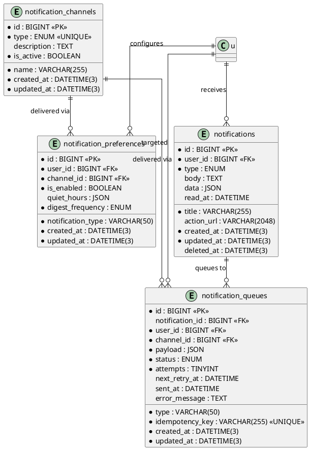

# 06.110 - Notifications

**Project:** GsmUi
**Domain:** Notifications
**Version:** 1.0.0

---

# Purpose

This document defines the database schema for the Notifications domain. The system supports multiple delivery channels (email, in-app, SMS, push, webhook), a hybrid per-user/per-channel preference model with quiet hours and digest frequency, an in-app notification inbox, and a queue-based outbound delivery pipeline processed by background workers. Email, SMS, and push are dispatched externally by workers reading the queue; in-app notifications are rendered directly from the inbox table.

---

# Tables

## notification_channels

**Purpose:** Catalog of available notification delivery channels. Channels are seeded configuration records shared across all users.

**Business Rules:**
- Channels are seeded and represent the universe of deliverable mediums.
- `type` is a fixed ENUM and is UNIQUE — each channel type has exactly one configuration row.
- `is_active` gates global availability; the queue processor skips inactive channels.
- `description` documents the channel for admin UI and onboarding.

**Columns:**

| Column | Type | Nullable | Default | Notes |
|---|---|---|---|---|
| id | BIGINT UNSIGNED | NO | AUTO_INCREMENT | PK |
| name | VARCHAR(255) | NO | — | Human-readable label (e.g. "Email") |
| type | ENUM('email','in_app','sms','push','webhook') | NO | — | Channel medium (UNIQUE) |
| description | TEXT | YES | NULL | Channel description |
| is_active | BOOLEAN | NO | TRUE | Global availability flag |
| created_at | DATETIME(3) | NO | CURRENT_TIMESTAMP(3) | |
| updated_at | DATETIME(3) | NO | CURRENT_TIMESTAMP(3) | ON UPDATE |

**Indexes:**

```
PRIMARY: id
UNIQUE: notification_channels_type_unique (type)
INDEX:  notification_channels_is_active_index (is_active)
```

**Relationships:**
- hasMany: notification_preferences (channel)
- hasMany: notification_queues (channel)

**Migration:**

```php
Schema::create('notification_channels', function (Blueprint $table) {
    $table->id();
    $table->string('name', 255);
    $table->enum('type', ['email', 'in_app', 'sms', 'push', 'webhook']);
    $table->text('description')->nullable();
    $table->boolean('is_active')->default(true);
    $table->timestamps();

    $table->unique('type');
    $table->index('is_active');
});
```

**Eloquent Model:**

```php
class NotificationChannel extends Model
{
    use HasFactory;

    protected $guarded = [];
    protected $casts = [
        'is_active' => 'boolean',
    ];
}
```

**Events:** ChannelActivated, ChannelDeactivated

---

## notification_preferences

**Purpose:** Hybrid per-user, per-channel, per-type notification preferences. Stores opt-in/out, quiet hours, and digest frequency.

**Business Rules:**
- One record per `(user_id, channel_id, notification_type)` — the unique constraint enforces this.
- `notification_type` groups related events (e.g. `billing.renewal`, `content.published`, `social.like`).
- `is_enabled` controls opt-in/opt-out for that user/channel/type combination.
- `quiet_hours` is a JSON object `{ start, end, timezone }` during which delivery is suppressed.
- `digest_frequency` controls batching: `realtime` sends immediately; `hourly`/`daily`/`weekly` batch into a digest.

**Columns:**

| Column | Type | Nullable | Default | Notes |
|---|---|---|---|---|
| id | BIGINT UNSIGNED | NO | AUTO_INCREMENT | PK |
| user_id | BIGINT UNSIGNED | NO | — | FK → users.id |
| channel_id | BIGINT UNSIGNED | NO | — | FK → notification_channels.id |
| notification_type | VARCHAR(50) | NO | — | Event group (e.g. `billing.renewal`) |
| is_enabled | BOOLEAN | NO | TRUE | Opt-in flag |
| quiet_hours | JSON | YES | NULL | `{ start, end, timezone }` |
| digest_frequency | ENUM('realtime','hourly','daily','weekly') | NO | 'realtime' | Batching cadence |
| created_at | DATETIME(3) | NO | CURRENT_TIMESTAMP(3) | |
| updated_at | DATETIME(3) | NO | CURRENT_TIMESTAMP(3) | ON UPDATE |

**Indexes:**

```
PRIMARY: id
UNIQUE: notification_preferences_user_channel_type_unique (user_id, channel_id, notification_type)
INDEX:  notification_preferences_user_id_index (user_id)
INDEX:  notification_preferences_channel_id_index (channel_id)
```

**Relationships:**
- belongsTo: User (user)
- belongsTo: NotificationChannel (channel)

**Migration:**

```php
Schema::create('notification_preferences', function (Blueprint $table) {
    $table->id();
    $table->foreignId('user_id')->constrained()->cascadeOnDelete();
    $table->foreignId('channel_id')->constrained('notification_channels')->cascadeOnDelete();
    $table->string('notification_type', 50);
    $table->boolean('is_enabled')->default(true);
    $table->json('quiet_hours')->nullable();
    $table->enum('digest_frequency', ['realtime', 'hourly', 'daily', 'weekly'])->default('realtime');
    $table->timestamps();

    $table->unique(['user_id', 'channel_id', 'notification_type']);
    $table->index('user_id');
    $table->index('channel_id');
});
```

**Eloquent Model:**

```php
class NotificationPreference extends Model
{
    use HasFactory;

    protected $guarded = [];
    protected $casts = [
        'is_enabled'      => 'boolean',
        'quiet_hours'     => 'array',
        'digest_frequency' => \App\Enums\DigestFrequency::class,
    ];
}
```

**Events:** PreferenceUpdated

---

## notifications

**Purpose:** In-app notification records rendered by the bell icon. Email/SMS/Push are handled by external services and do not land here.

**Business Rules:**
- `type` is a fixed ENUM categorizing the notification (`system`, `billing`, `content`, `social`, `admin`).
- `read_at` is NULL until the user opens the notification; it tracks read state.
- `data` is a JSON payload consumed by the UI to render the notification body.
- `action_url` is an optional deep link the user is taken to on click.
- Soft-deletable — clearing the inbox uses soft delete, not hard delete.

**Columns:**

| Column | Type | Nullable | Default | Notes |
|---|---|---|---|---|
| id | BIGINT UNSIGNED | NO | AUTO_INCREMENT | PK |
| user_id | BIGINT UNSIGNED | NO | — | FK → users.id |
| type | ENUM('system','billing','content','social','admin') | NO | — | Category |
| title | VARCHAR(255) | NO | — | Notification heading |
| body | TEXT | YES | NULL | Notification body |
| data | JSON | YES | NULL | Rendering payload |
| action_url | VARCHAR(2048) | YES | NULL | Clickthrough URL |
| read_at | DATETIME | YES | NULL | Read timestamp |
| created_at | DATETIME(3) | NO | CURRENT_TIMESTAMP(3) | |
| updated_at | DATETIME(3) | NO | CURRENT_TIMESTAMP(3) | ON UPDATE |
| deleted_at | DATETIME(3) | YES | NULL | Soft delete |

**Indexes:**

```
PRIMARY: id
INDEX:  notifications_user_id_index (user_id)
INDEX:  notifications_type_index (type)
INDEX:  notifications_read_at_index (read_at)
INDEX:  notifications_created_at_index (created_at)
```

**Relationships:**
- belongsTo: User (user)
- hasMany: NotificationQueue (queues)

**Migration:**

```php
Schema::create('notifications', function (Blueprint $table) {
    $table->id();
    $table->foreignId('user_id')->constrained()->cascadeOnDelete();
    $table->enum('type', ['system', 'billing', 'content', 'social', 'admin']);
    $table->string('title', 255);
    $table->text('body')->nullable();
    $table->json('data')->nullable();
    $table->string('action_url', 2048)->nullable();
    $table->datetime('read_at')->nullable();
    $table->timestamps();
    $table->softDeletes();

    $table->index('user_id');
    $table->index('type');
    $table->index('read_at');
    $table->index('created_at');
});
```

**Eloquent Model:**

```php
class Notification extends Model
{
    use HasFactory, SoftDeletes;

    protected $guarded = [];
    protected $casts = [
        'data'    => 'array',
        'read_at' => 'datetime',
    ];

    public function user(): BelongsTo
    {
        return $this->belongsTo(\App\Domains\Users\Models\User::class);
    }

    public function queues(): HasMany
    {
        return $this->hasMany(NotificationQueue::class);
    }
}
```

**Events:** NotificationCreated, NotificationRead

---

## notification_queues

**Purpose:** Outbound delivery queue for email/SMS/push dispatch, processed by background workers with retry support.

**Business Rules:**
- `notification_id` is NULLABLE so non-in-app notifications (e.g. pure email events) can be queued without an inbox row.
- `type` is a free-string mirroring the originating event type for worker routing.
- `status` transitions `pending` → `sending` → `sent` / `failed`.
- `attempts` counts delivery tries; `next_retry_at` schedules the next attempt after failure.
- `idempotency_key` is UNIQUE to prevent duplicate dispatch of the same logical notification.
- No soft deletes — operational records are retained for audit then pruned by retention policy.

**Columns:**

| Column | Type | Nullable | Default | Notes |
|---|---|---|---|---|
| id | BIGINT UNSIGNED | NO | AUTO_INCREMENT | PK |
| notification_id | BIGINT UNSIGNED | YES | NULL | FK → notifications.id |
| user_id | BIGINT UNSIGNED | NO | — | FK → users.id |
| channel_id | BIGINT UNSIGNED | NO | — | FK → notification_channels.id |
| type | VARCHAR(50) | NO | — | Event type for routing |
| payload | JSON | NO | — | Serialized message |
| status | ENUM('pending','sending','sent','failed') | NO | 'pending' | Delivery state |
| attempts | TINYINT UNSIGNED | NO | 0 | Retry counter |
| next_retry_at | DATETIME | YES | NULL | Next attempt schedule |
| sent_at | DATETIME | YES | NULL | Delivery timestamp |
| error_message | TEXT | YES | NULL | Last failure detail |
| idempotency_key | VARCHAR(255) | NO | — | Dedup key (UNIQUE) |
| created_at | DATETIME(3) | NO | CURRENT_TIMESTAMP(3) | |
| updated_at | DATETIME(3) | NO | CURRENT_TIMESTAMP(3) | ON UPDATE |

**Indexes:**

```
PRIMARY: id
UNIQUE: notification_queues_idempotency_key_unique (idempotency_key)
INDEX:  notification_queues_user_id_index (user_id)
INDEX:  notification_queues_channel_id_index (channel_id)
INDEX:  notification_queues_status_index (status)
INDEX:  notification_queues_next_retry_at_index (next_retry_at)
```

**Relationships:**
- belongsTo: User (user)
- belongsTo: Notification (notification)
- belongsTo: NotificationChannel (channel)

**Migration:**

```php
Schema::create('notification_queues', function (Blueprint $table) {
    $table->id();
    $table->foreignId('notification_id')->nullable()->constrained()->nullOnDelete();
    $table->foreignId('user_id')->constrained()->cascadeOnDelete();
    $table->foreignId('channel_id')->constrained('notification_channels')->cascadeOnDelete();
    $table->string('type', 50);
    $table->json('payload');
    $table->enum('status', ['pending', 'sending', 'sent', 'failed'])->default('pending');
    $table->unsignedTinyInteger('attempts')->default(0);
    $table->datetime('next_retry_at')->nullable();
    $table->datetime('sent_at')->nullable();
    $table->text('error_message')->nullable();
    $table->string('idempotency_key', 255);
    $table->timestamps();

    $table->unique('idempotency_key');
    $table->index('user_id');
    $table->index('channel_id');
    $table->index('status');
    $table->index('next_retry_at');
});
```

**Eloquent Model:**

```php
class NotificationQueue extends Model
{
    use HasFactory;

    protected $guarded = [];
    protected $casts = [
        'payload'        => 'array',
        'status'         => \App\Enums\NotificationQueueStatus::class,
        'attempts'       => 'integer',
        'next_retry_at'  => 'datetime',
        'sent_at'        => 'datetime',
    ];
}
```

**Events:** NotificationQueued, NotificationDispatched, NotificationFailed

---

# Cross-Domain Relationships

## notifications → users
In-app notifications reference the recipient. `notifications.user_id` → `users.id`. `ON DELETE CASCADE` — inbox entries are removed with the user.

## notification_preferences → users
Per-user preferences reference the owner. `notification_preferences.user_id` → `users.id`. `ON DELETE CASCADE`.

## notification_preferences → notification_channels
Preferences bind a user to a delivery channel. `notification_preferences.channel_id` → `notification_channels.id`. `ON DELETE CASCADE`.

## notification_queues → notifications
Queue entries may derive from an inbox notification. `notification_queues.notification_id` → `notifications.id`. `ON DELETE SET NULL` — the queue entry is retained for dispatch audit even if the inbox row is cleared.

## notification_queues → notification_channels
Queue entries reference the delivery channel. `notification_queues.channel_id` → `notification_channels.id`. `ON DELETE CASCADE`.

---

# PlantUML ERD



---

# Notification Domain - Complete Reference

## Schema Summary

| Table | Purpose | Rows Estimate | Soft Delete |
|---|---|---|---|
| `notification_channels` | Delivery channel catalog | 5 (seeded) | No |
| `notification_preferences` | Per-user per-channel opt-in/out | ~500K | No |
| `notifications` | In-app notification inbox | ~10M | Yes |
| `notification_queues` | Outbound delivery queue | ~50M | No |

## Migration Dependencies

```
notification_channels (no dependencies)
    └── notification_preferences (depends on notification_channels + users)
    └── notification_queues (depends on notification_channels + users)
        └── notifications (depends on users)
            └── notification_queues.notification_id (optional FK)
```

## Index Strategy

### notification_channels

```sql
-- Unique constraint on type prevents duplicate channel configs
CREATE UNIQUE INDEX notification_channels_type_unique ON notification_channels(type);

-- Index for filtering active channels in queue processor
CREATE INDEX notification_channels_is_active_index ON notification_channels(is_active);
```

### notification_preferences

```sql
-- Composite unique prevents duplicate preferences per user/channel/type
CREATE UNIQUE INDEX notification_preferences_user_channel_type_unique 
ON notification_preferences(user_id, channel_id, notification_type);

-- Query pattern: "Get all preferences for a user"
CREATE INDEX notification_preferences_user_id_index ON notification_preferences(user_id);

-- Query pattern: "Get all users who prefer channel X"
CREATE INDEX notification_preferences_channel_id_index ON notification_preferences(channel_id);

-- Composite for digest batch queries
CREATE INDEX notification_preferences_channel_digest 
ON notification_preferences(channel_id, digest_frequency, is_enabled);
```

### notifications

```sql
-- Query pattern: "Get inbox for user, newest first"
CREATE INDEX notifications_user_id_created_at 
ON notifications(user_id, created_at DESC);

-- Query pattern: "Count unread per user"
CREATE INDEX notifications_user_read_at 
ON notifications(user_id, read_at);

-- Query pattern: "Filter by notification type"
CREATE INDEX notifications_type_index ON notifications(type);
```

### notification_queues

```sql
-- Query pattern: "Get pending jobs for worker"
CREATE INDEX notification_queues_status_priority 
ON notification_queues(status, created_at ASC);

-- Query pattern: "Retry failed jobs"
CREATE INDEX notification_queues_retry 
ON notification_queues(status, next_retry_at, attempts);

-- Query pattern: "Dedup check"
CREATE UNIQUE INDEX notification_queues_idempotency_key_unique 
ON notification_queues(idempotency_key);
```

## Migration File: 2026_01_01_011001_create_notifications_tables.php

```php
<?php

use Illuminate\Database\Migrations\Migration;
use Illuminate\Database\Schema\Blueprint;
use Illuminate\Support\Facades\Schema;

return new class extends Migration
{
    public function up(): void
    {
        // Notification channels
        Schema::create('notification_channels', function (Blueprint $table) {
            $table->id();
            $table->string('name', 255);
            $table->enum('type', ['email', 'in_app', 'sms', 'push', 'webhook']);
            $table->text('description')->nullable();
            $table->boolean('is_active')->default(true);
            $table->timestamps();

            $table->unique('type');
            $table->index('is_active');
        });

        // Notification preferences
        Schema::create('notification_preferences', function (Blueprint $table) {
            $table->id();
            $table->foreignId('user_id')->constrained()->cascadeOnDelete();
            $table->foreignId('channel_id')->constrained('notification_channels')->cascadeOnDelete();
            $table->string('notification_type', 50);
            $table->boolean('is_enabled')->default(true);
            $table->json('quiet_hours')->nullable();
            $table->enum('digest_frequency', ['realtime', 'hourly', 'daily', 'weekly'])->default('realtime');
            $table->timestamps();

            $table->unique(['user_id', 'channel_id', 'notification_type']);
            $table->index('user_id');
            $table->index('channel_id');
            $table->index('digest_frequency');
        });

        // Notifications (in-app inbox)
        Schema::create('notifications', function (Blueprint $table) {
            $table->id();
            $table->foreignId('user_id')->constrained()->cascadeOnDelete();
            $table->enum('type', ['system', 'billing', 'content', 'social', 'admin']);
            $table->string('title', 255);
            $table->text('body')->nullable();
            $table->json('data')->nullable();
            $table->string('action_url', 2048)->nullable();
            $table->datetime('read_at')->nullable();
            $table->timestamps();
            $table->softDeletes();

            $table->index(['user_id', 'created_at']);
            $table->index('type');
            $table->index('read_at');
        });

        // Notification queues
        Schema::create('notification_queues', function (Blueprint $table) {
            $table->id();
            $table->foreignId('notification_id')->nullable()->constrained()->nullOnDelete();
            $table->foreignId('user_id')->constrained()->cascadeOnDelete();
            $table->foreignId('channel_id')->constrained('notification_channels')->cascadeOnDelete();
            $table->string('type', 50);
            $table->json('payload');
            $table->enum('status', ['pending', 'sending', 'sent', 'failed'])->default('pending');
            $table->unsignedTinyInteger('attempts')->default(0);
            $table->datetime('next_retry_at')->nullable();
            $table->datetime('sent_at')->nullable();
            $table->text('error_message')->nullable();
            $table->string('idempotency_key', 255);
            $table->timestamps();

            $table->unique('idempotency_key');
            $table->index(['status', 'created_at']);
            $table->index(['status', 'next_retry_at']);
            $table->index('user_id');
            $table->index('channel_id');
        });

        // Seed notification channels
        DB::table('notification_channels')->insert([
            ['name' => 'Email', 'type' => 'email', 'is_active' => true, 'created_at' => now(), 'updated_at' => now()],
            ['name' => 'In-App', 'type' => 'in_app', 'is_active' => true, 'created_at' => now(), 'updated_at' => now()],
            ['name' => 'SMS', 'type' => 'sms', 'is_active' => true, 'created_at' => now(), 'updated_at' => now()],
            ['name' => 'Push', 'type' => 'push', 'is_active' => true, 'created_at' => now(), 'updated_at' => now()],
            ['name' => 'Webhook', 'type' => 'webhook', 'is_active' => true, 'created_at' => now(), 'updated_at' => now()],
        ]);
    }

    public function down(): void
    {
        Schema::dropIfExists('notification_queues');
        Schema::dropIfExists('notifications');
        Schema::dropIfExists('notification_preferences');
        Schema::dropIfExists('notification_channels');
    }
};
```

## Data Access Patterns

### User Inbox Query

```php
// Get paginated inbox for user
$notifications = Notification::where('user_id', $userId)
    ->whereNull('deleted_at')
    ->orderBy('created_at', 'desc')
    ->paginate(20);

// Count unread notifications
$unreadCount = Notification::where('user_id', $userId)
    ->whereNull('read_at')
    ->count();
```

### Digest Batch Query

```php
// Get users due for digest
$preferences = NotificationPreference::where('channel_id', $channelId)
    ->where('digest_frequency', $frequency)
    ->where('is_enabled', true)
    ->where('quiet_hours', null)
    ->get();

// Get queued notifications for digest
$notifications = NotificationQueue::where('channel_id', $channelId)
    ->where('status', 'pending')
    ->where('created_at', '<', now()->subHour())
    ->whereIn('user_id', $preferences->pluck('user_id'))
    ->get();
```

### Quiet Hours Check

```php
function isInQuietHours(?array $quietHours): bool
{
    if (! $quietHours || ! isset($quietHours['start'], $quietHours['end'], $quietHours['timezone'])) {
        return false;
    }

    $now = now()->timezone($quietHours['timezone']);
    $start = Carbon::parse($quietHours['start'])->timezone($quietHours['timezone']);
    $end = Carbon::parse($quietHours['end'])->timezone($quietHours['timezone']);

    if ($start->lessThan($end)) {
        return $now->between($start, $end);
    }

    // Overnight quiet hours (e.g., 22:00 to 07:00)
    return $now->greaterThanOrEqualTo($start) || $now->lessThanOrEqualTo($end);
}
```

## Observer: NotificationObserver

```php
<?php

namespace App\Domains\Notifications\Observers;

use App\Domains\Notifications\Models\Notification;
use App\Domains\Notifications\Jobs\DispatchNotification;

class NotificationObserver
{
    public function created(Notification $notification): void
    {
        // Queue delivery for all applicable channels
        $channels = NotificationChannel::where('is_active', true)->get();

        foreach ($channels as $channel) {
            $preference = NotificationPreference::where('user_id', $notification->user_id)
                ->where('channel_id', $channel->id)
                ->where('notification_type', $notification->type)
                ->first();

            // Skip if user opted out
            if ($preference && ! $preference->is_enabled) {
                continue;
            }

            // Queue the delivery
            DispatchNotification::dispatch(
                $notification,
                $channel,
                $preference
            );
        }
    }

    public function updated(Notification $notification): void
    {
        if ($notification->isDirty('read_at') && $notification->read_at !== null) {
            event(new NotificationRead($notification));
        }
    }

    public function deleted(Notification $notification): void
    {
        // Cancel any pending queue entries
        NotificationQueue::where('notification_id', $notification->id)
            ->where('status', 'pending')
            ->update(['status' => 'failed', 'error_message' => 'Notification deleted']);
    }
}
```

## Job: DispatchNotification

```php
<?php

namespace App\Domains\Notifications\Jobs;

use App\Domains\Notifications\Models\Notification;
use App\Domains\Notifications\Models\NotificationChannel;
use App\Domains\Notifications\Models\NotificationPreference;
use App\Domains\Notifications\Models\NotificationQueue;
use App\Domains\Notifications\Services\EmailService;
use App\Domains\Notifications\Services\SmsService;
use App\Domains\Notifications\Services\PushService;
use App\Domains\Notifications\Services\WebhookService;
use Illuminate\Bus\Queueable;
use Illuminate\Contracts\Queue\ShouldQueue;
use Illuminate\Foundation\Bus\Dispatchable;
use Illuminate\Queue\InteractsWithQueue;

class DispatchNotification implements ShouldQueue
{
    use Dispatchable, InteractsWithQueue, Queueable;

    public int $tries = 5;
    public int $backoff = 60;

    public function __construct(
        private Notification $notification,
        private NotificationChannel $channel,
        private ?NotificationPreference $preference,
    ) {}

    public function handle(): void
    {
        // Check quiet hours
        if ($this->preference && $this->preference->quiet_hours) {
            if ($this->isInQuietHours($this->preference->quiet_hours)) {
                $this->release(now()->addMinutes(30));
                return;
            }
        }

        $queueEntry = NotificationQueue::create([
            'notification_id' => $this->notification->id,
            'user_id' => $this->notification->user_id,
            'channel_id' => $this->channel->id,
            'type' => $this->notification->type,
            'payload' => [
                'title' => $this->notification->title,
                'body' => $this->notification->body,
                'data' => $this->notification->data,
                'action_url' => $this->notification->action_url,
            ],
            'idempotency_key' => $this->generateIdempotencyKey(),
        ]);

        $queueEntry->update(['status' => 'sending']);

        match ($this->channel->type) {
            'email' => app(EmailService::class)->send($queueEntry),
            'sms' => app(SmsService::class)->send($queueEntry),
            'push' => app(PushService::class)->send($queueEntry),
            'webhook' => app(WebhookService::class)->send($queueEntry),
            default => null,
        };

        $queueEntry->update(['status' => 'sent', 'sent_at' => now()]);
    }

    public function failed(\Throwable $exception): void
    {
        NotificationQueue::where('notification_id', $this->notification->id)
            ->where('channel_id', $this->channel->id)
            ->where('status', 'sending')
            ->update([
                'status' => 'failed',
                'error_message' => $exception->getMessage(),
            ]);
    }

    private function generateIdempotencyKey(): string
    {
        return hash('sha256', implode(':', [
            $this->notification->id,
            $this->channel->id,
            $this->notification->user_id,
        ]));
    }
}
```

## Event Definitions

```php
<?php

namespace App\Domains\Notifications\Events;

use App\Domains\Notifications\Models\Notification;

class NotificationCreated
{
    public function __construct(
        public Notification $notification,
    ) {}
}

class NotificationRead
{
    public function __construct(
        public Notification $notification,
    ) {}
}

class NotificationQueued
{
    public function __construct(
        public \App\Domains\Notifications\Models\NotificationQueue $queueEntry,
    ) {}
}

class NotificationDispatched
{
    public function __construct(
        public \App\Domains\Notifications\Models\NotificationQueue $queueEntry,
    ) {}
}

class NotificationFailed
{
    public function __construct(
        public \App\Domains\Notifications\Models\NotificationQueue $queueEntry,
        public \Throwable $error,
    ) {}
}
```

## Service: NotificationPreferenceService

```php
<?php

namespace App\Domains\Notifications\Services;

use App\Domains\Notifications\Models\NotificationPreference;
use App\Domains\Users\Models\User;

class NotificationPreferenceService
{
    public function getPreferences(User $user): \Illuminate\Support\Collection
    {
        return NotificationPreference::where('user_id', $user->id)
            ->with('channel')
            ->get()
            ->groupBy('notification_type');
    }

    public function updatePreference(
        User $user,
        string $channelType,
        string $notificationType,
        bool $isEnabled,
        ?array $quietHours = null,
        ?string $digestFrequency = null,
    ): NotificationPreference {
        $channel = \App\Domains\Notifications\Models\NotificationChannel::where('type', $channelType)->firstOrFail();

        return NotificationPreference::updateOrCreate(
            [
                'user_id' => $user->id,
                'channel_id' => $channel->id,
                'notification_type' => $notificationType,
            ],
            array_filter([
                'is_enabled' => $isEnabled,
                'quiet_hours' => $quietHours,
                'digest_frequency' => $digestFrequency,
            ], fn ($v) => $v !== null)
        );
    }

    public function bulkUpdate(User $user, array $preferences): void
    {
        foreach ($preferences as $pref) {
            $this->updatePreference(
                $user,
                $pref['channel'],
                $pref['type'],
                $pref['enabled'],
                $pref['quiet_hours'] ?? null,
                $pref['digest_frequency'] ?? null,
            );
        }
    }

    public function shouldNotify(User $user, string $type, string $channelType): bool
    {
        $channel = \App\Domains\Notifications\Models\NotificationChannel::where('type', $channelType)->first();
        if (! $channel || ! $channel->is_active) {
            return false;
        }

        $preference = NotificationPreference::where('user_id', $user->id)
            ->where('channel_id', $channel->id)
            ->where('notification_type', $type)
            ->first();

        // Default to enabled if no preference set
        if (! $preference) {
            return true;
        }

        if (! $preference->is_enabled) {
            return false;
        }

        if ($preference->quiet_hours && $this->isInQuietHours($preference->quiet_hours)) {
            return false;
        }

        return true;
    }
}
```

## Testing Patterns

```php
<?php

namespace Tests\Domains\Notifications;

use App\Domains\Notifications\Models\Notification;
use App\Domains\Notifications\Models\NotificationChannel;
use App\Domains\Notifications\Models\NotificationPreference;
use App\Domains\Users\Models\User;
use Illuminate\Foundation\Testing\RefreshDatabase;
use Tests\TestCase;

class NotificationTest extends TestCase
{
    use RefreshDatabase;

    public function test_notification_created_dispatches_jobs(): void
    {
        Notification::fake();
        $user = User::factory()->create();
        $channel = NotificationChannel::factory()->email()->create();

        $notification = Notification::create([
            'user_id' => $user->id,
            'type' => 'billing',
            'title' => 'Payment received',
            'body' => 'Your payment of $10.00 has been processed.',
        ]);

        Notification::assertSentTo($user, 'billing');
    }

    public function test_mark_notification_as_read(): void
    {
        $user = User::factory()->create();
        $notification = Notification::create([
            'user_id' => $user->id,
            'type' => 'system',
            'title' => 'System update',
        ]);

        $this->assertNull($notification->read_at);

        $notification->markAsRead();

        $this->assertNotNull($notification->read_at);
    }

    public function test_preference_respects_opt_out(): void
    {
        $user = User::factory()->create();
        $channel = NotificationChannel::factory()->email()->create();

        NotificationPreference::create([
            'user_id' => $user->id,
            'channel_id' => $channel->id,
            'notification_type' => 'social',
            'is_enabled' => false,
        ]);

        $service = app(NotificationPreferenceService::class);
        $shouldNotify = $service->shouldNotify($user, 'social', 'email');

        $this->assertFalse($shouldNotify);
    }

    public function test_notification_queue_has_idempotency_key(): void
    {
        $notification = Notification::create([
            'user_id' => 1,
            'type' => 'system',
            'title' => 'Test',
        ]);

        $queueEntry = \App\Domains\Notifications\Models\NotificationQueue::create([
            'notification_id' => $notification->id,
            'user_id' => 1,
            'channel_id' => 1,
            'type' => 'system',
            'payload' => ['title' => 'Test'],
            'idempotency_key' => 'unique-key-123',
        ]);

        $this->assertEquals('unique-key-123', $queueEntry->idempotency_key);
    }

    public function test_notification_queue_retry_logic(): void
    {
        $queueEntry = \App\Domains\Notifications\Models\NotificationQueue::create([
            'user_id' => 1,
            'channel_id' => 1,
            'type' => 'system',
            'payload' => ['title' => 'Test'],
            'status' => 'failed',
            'attempts' => 3,
            'next_retry_at' => now()->addHour(),
            'idempotency_key' => 'retry-test-123',
        ]);

        $this->assertEquals('failed', $queueEntry->status);
        $this->assertEquals(3, $queueEntry->attempts);
        $this->assertNotNull($queueEntry->next_retry_at);
    }
}
```

---

# Notification Type Taxonomy

## Notification Types and Their Purposes

| Type | Description | Delivery Channels | Priority | Example |
|---|---|---|---|---|
| `system` | Platform maintenance, updates | email, in_app | high | "Scheduled maintenance on Jan 20" |
| `billing` | Payment events, invoices | email, in_app | critical | "Payment of $29.99 processed" |
| `content` | Content moderation, publishing | in_app, email | medium | "Your post has been approved" |
| `social` | Likes, comments, follows | in_app | low | "Someone commented on your post" |
| `admin` | Admin actions, security alerts | email, in_app, push | critical | "New login from unknown device" |

## Notification Type Hierarchy

```php
// Notification type definitions
NotificationTypeRegistry::register('billing.payment_success', [
    'label' => 'Payment Successful',
    'channels' => ['email', 'in_app'],
    'priority' => 'high',
    'group' => 'billing',
    'requires_preference' => true,
    'template' => 'emails.billing.payment-success',
    'data_schema' => [
        'amount' => 'integer',
        'currency' => 'string',
        'invoice_number' => 'string',
    ],
]);
```

## Quiet Hours Configuration Schema

```json
{
    "start": "22:00",
    "end": "07:00",
    "timezone": "America/New_York",
    "exceptions": [
        {
            "type": "billing",
            "override": true,
            "reason": "Critical billing notifications bypass quiet hours"
        }
    ]
}
```

## Digest Configuration Matrix

| Frequency | Batch Window | Delivery Time | Max Batch Size | Retry on Failure |
|---|---|---|---|---|
| `realtime` | 0 minutes | Immediate | 1 | Yes, 3 retries |
| `hourly` | 60 minutes | Top of hour | 100 | Yes, 2 retries |
| `daily` | 24 hours | 09:00 UTC | 500 | Yes, 1 retry |
| `weekly` | 168 hours | Monday 09:00 UTC | 1000 | Yes, 1 retry |

## Digest Batch Aggregation

```php
<?php

namespace App\Domains\Notifications\Services;

use App\Domains\Notifications\Models\Notification;
use App\Domains\Notifications\Models\NotificationQueue;
use App\Domains\Notifications\Models\NotificationPreference;
use Illuminate\Support\Collection;

class DigestAggregationService
{
    public function aggregateForUser(int $userId, string $channelType, string $frequency): array
    {
        $preferences = NotificationPreference::where('user_id', $userId)
            ->whereHas('channel', fn ($q) => $q->where('type', $channelType))
            ->where('digest_frequency', $frequency)
            ->where('is_enabled', true)
            ->pluck('notification_type')
            ->toArray();

        $window = match ($frequency) {
            'hourly' => now()->subHour(),
            'daily' => now()->subDay(),
            'weekly' => now()->subWeek(),
        };

        $notifications = Notification::where('user_id', $userId)
            ->whereIn('type', $preferences)
            ->where('created_at', '>=', $window)
            ->whereNull('read_at')
            ->orderBy('created_at', 'desc')
            ->get();

        return [
            'user_id' => $userId,
            'channel_type' => $channelType,
            'frequency' => $frequency,
            'count' => $notifications->count(),
            'notifications' => $notifications->groupBy('type')->map(function ($group) {
                return [
                    'type' => $group->first()->type,
                    'count' => $group->count(),
                    'latest' => $group->first(),
                    'items' => $group->take(5)->toArray(),
                ];
            })->toArray(),
            'window_start' => $window->toIso8601String(),
            'window_end' => now()->toIso8601String(),
        ];
    }

    public function sendDigests(string $channelType, string $frequency): int
    {
        $preferences = NotificationPreference::whereHas('channel', fn ($q) => $q->where('type', $channelType))
            ->where('digest_frequency', $frequency)
            ->where('is_enabled', true)
            ->select('user_id')
            ->distinct()
            ->get();

        $sent = 0;

        foreach ($preferences as $pref) {
            $digest = $this->aggregateForUser($pref->user_id, $channelType, $frequency);

            if ($digest['count'] > 0) {
                $this->dispatchDigest($digest);
                $sent++;
            }
        }

        return $sent;
    }

    private function dispatchDigest(array $digest): void
    {
        NotificationQueue::create([
            'user_id' => $digest['user_id'],
            'channel_id' => $this->getChannelId($digest['channel_type']),
            'type' => 'digest',
            'payload' => [
                'frequency' => $digest['frequency'],
                'count' => $digest['count'],
                'notifications' => $digest['notifications'],
            ],
            'idempotency_key' => hash('sha256', json_encode([
                'digest',
                $digest['user_id'],
                $digest['channel_type'],
                $digest['frequency'],
                $digest['window_end'],
            ])),
        ]);
    }

    private function getChannelId(string $type): int
    {
        return \App\Domains\Notifications\Models\NotificationChannel::where('type', $type)->firstOrFail()->id;
    }
}
```

## Notification Batch Processing Pipeline

```php
<?php

namespace App\Domains\Notifications\Pipelines;

use App\Domains\Notifications\Models\NotificationQueue;
use App\Domains\Notifications\Services\EmailService;
use App\Domains\Notifications\Services\SmsService;
use App\Domains\Notifications\Services\PushService;
use Illuminate\Support\Facades\Pipeline;

class NotificationPipeline
{
    public function process(NotificationQueue $queueEntry): void
    {
        $result = Pipeline::through([
            new \App\Domains\Notifications\Pipelines\ValidateChannelPipeline(),
            new \App\Domains\Notifications\Pipelines\CheckQuietHoursPipeline(),
            new \App\Domains\Notifications\Pipelines\ApplyRateLimitPipeline(),
            new \App\Domains\Notifications\Pipelines\FormatPayloadPipeline(),
            new \App\Domains\Notifications\Pipelines\DeliverNotificationPipeline(),
        ])
        ->thenReturn($queueEntry);

        if ($result) {
            $queueEntry->update(['status' => 'sent', 'sent_at' => now()]);
        }
    }
}
```

## Notification Rate Limiting

```php
<?php

namespace App\Domains\Notifications\Services;

use Illuminate\Support\Facades\Cache;

class NotificationRateLimiter
{
    private const LIMITS = [
        'email' => ['per_minute' => 10, 'per_hour' => 100, 'per_day' => 1000],
        'sms' => ['per_minute' => 2, 'per_hour' => 20, 'per_day' => 100],
        'push' => ['per_minute' => 30, 'per_hour' => 500, 'per_day' => 5000],
        'webhook' => ['per_minute' => 60, 'per_hour' => 1000, 'per_day' => 10000],
    ];

    public function isRateLimited(int $userId, string $channelType): bool
    {
        $limits = self::LIMITS[$channelType] ?? self::LIMITS['email'];

        foreach ($limits as $period => $limit) {
            $key = "notification_rate:{$userId}:{$channelType}:{$period}";
            $current = Cache::get($key, 0);

            if ($current >= $limit) {
                return true;
            }
        }

        return false;
    }

    public function incrementCounter(int $userId, string $channelType): void
    {
        $limits = self::LIMITS[$channelType] ?? self::LIMITS['email'];

        foreach ($limits as $period => $limit) {
            $key = "notification_rate:{$userId}:{$channelType}:{$period}";
            $ttl = match ($period) {
                'per_minute' => 60,
                'per_hour' => 3600,
                'per_day' => 86400,
            };

            Cache::increment($key);
            Cache::put($key, Cache::get($key), now()->addSeconds($ttl));
        }
    }

    public function getRemainingQuota(int $userId, string $channelType): array
    {
        $limits = self::LIMITS[$channelType] ?? self::LIMITS['email'];
        $remaining = [];

        foreach ($limits as $period => $limit) {
            $key = "notification_rate:{$userId}:{$channelType}:{$period}";
            $current = Cache::get($key, 0);
            $remaining[$period] = max(0, $limit - $current);
        }

        return $remaining;
    }
}
```

## Notification Template Rendering

```php
<?php

namespace App\Domains\Notifications\Services;

class NotificationTemplateRenderer
{
    private array $templates = [
        'billing.payment_success' => [
            'email' => 'emails.billing.payment-success',
            'in_app' => 'notifications.billing.payment-success',
            'sms' => 'sms.billing.payment-success',
        ],
        'content.published' => [
            'email' => 'emails.content.published',
            'in_app' => 'notifications.content.published',
        ],
        'admin.security_alert' => [
            'email' => 'emails.admin.security-alert',
            'in_app' => 'notifications.admin.security-alert',
            'push' => 'push.admin.security-alert',
        ],
    ];

    public function render(string $type, string $channel, array $data): array
    {
        $template = $this->templates[$type][$channel] ?? null;

        if (! $template) {
            return [
                'subject' => 'Notification',
                'body' => 'You have a new notification.',
                'action_url' => null,
            ];
        }

        return view($template, $data)->render();
    }

    public function getAvailableTemplates(): array
    {
        return $this->templates;
    }
}
```

## Monitoring and Metrics

### Key Metrics to Track

| Metric | Description | Alert Threshold |
|---|---|---|
| `notifications.sent` | Total notifications sent | < 100/min (sudden drop) |
| `notifications.failed` | Failed notification attempts | > 10/min |
| `notifications.delivery_rate` | Success / (Success + Failed) | < 95% |
| `notifications.queue_depth` | Pending items in notification_queues | > 1000 |
| `notifications.avg_latency` | Average time from creation to delivery | > 5s |
| `notifications.duplicate_rate` | Duplicate idempotency_key attempts | > 1% |

### Monitoring Query

```sql
-- Notification delivery performance by channel
SELECT 
    nc.type as channel,
    DATE(nq.created_at) as date,
    COUNT(*) as total_queued,
    COUNT(CASE WHEN nq.status = 'sent' THEN 1 END) as sent,
    COUNT(CASE WHEN nq.status = 'failed' THEN 1 END) as failed,
    ROUND(AVG(TIMESTAMPDIFF(SECOND, nq.created_at, nq.sent_at)), 2) as avg_delivery_seconds
FROM notification_queues nq
JOIN notification_channels nc ON nq.channel_id = nc.id
WHERE nq.created_at >= DATE_SUB(NOW(), INTERVAL 7 DAY)
GROUP BY nc.type, DATE(nq.created_at)
ORDER BY date DESC, nc.type;

-- User notification preferences breakdown
SELECT 
    nc.type as channel,
    np.digest_frequency,
    COUNT(*) as user_count
FROM notification_preferences np
JOIN notification_channels nc ON np.channel_id = nc.id
WHERE np.is_enabled = true
GROUP BY nc.type, np.digest_frequency
ORDER BY nc.type, np.digest_frequency;

-- Failed notifications requiring investigation
SELECT 
    nq.id,
    nq.type,
    nq.error_message,
    nq.attempts,
    nq.created_at,
    u.email as user_email
FROM notification_queues nq
JOIN users u ON nq.user_id = u.id
WHERE nq.status = 'failed'
  AND nq.attempts >= 3
ORDER BY nq.created_at DESC
LIMIT 50;
```

---

# Notification System Architecture

## Queue Worker Configuration

```php
<?php

// config/queue.php additions for notifications
'connections' => [
    'notifications' => [
        'driver' => 'redis',
        'connection' => 'notifications',
        'queue' => 'notifications',
        'retry_after' => 90,
        'block_for' => null,
    ],
    'notifications_email' => [
        'driver' => 'redis',
        'connection' => 'notifications',
        'queue' => 'notifications:email',
        'retry_after' => 120,
    ],
    'notifications_sms' => [
        'driver' => 'redis',
        'connection' => 'notifications',
        'queue' => 'notifications:sms',
        'retry_after' => 60,
    ],
],

'failed' => [
    'driver' => env('QUEUE_FAILED_DRIVER', 'database-uuids'),
    'database' => env('DB_CONNECTION', 'mysql'),
    'table' => 'failed_jobs',
],
```

## Notification Worker Scaling

```php
<?php

namespace App\Domains\Notifications\Jobs;

use Illuminate\Bus\Queueable;
use Illuminate\Contracts\Queue\ShouldQueue;
use Illuminate\Foundation\Bus\Dispatchable;
use Illuminate\Queue\InteractsWithQueue;

class ScaleNotificationWorkers implements ShouldQueue
{
    use Dispatchable, InteractsWithQueue, Queueable;

    public function handle(): void
    {
        $queueDepth = DB::table('notification_queues')
            ->where('status', 'pending')
            ->count();

        $workerCount = match (true) {
            $queueDepth > 1000 => 8,
            $queueDepth > 500 => 4,
            $queueDepth > 100 => 2,
            default => 1,
        };

        // Scale workers based on queue depth
        config(['queue.workers.notifications' => $workerCount]);
    }
}
```

## Notification Batching Strategy

```php
<?php

namespace App\Domains\Notifications\Services;

use App\Domains\Notifications\Models\NotificationQueue;
use Illuminate\Support\Collection;

class NotificationBatchService
{
    private int $batchSize = 50;
    private int $maxConcurrency = 10;

    public function processPendingBatches(): int
    {
        $pending = NotificationQueue::where('status', 'pending')
            ->orderBy('created_at')
            ->limit($this->batchSize)
            ->get();

        if ($pending->isEmpty()) {
            return 0;
        }

        $batches = $pending->chunk($this->maxConcurrency);
        $processed = 0;

        foreach ($batches as $batch) {
            $this->processBatch($batch);
            $processed += $batch->count();
        }

        return $processed;
    }

    private function processBatch(Collection $batch): void
    {
        foreach ($batch as $entry) {
            $entry->update(['status' => 'sending']);
            
            try {
                $this->deliverNotification($entry);
                $entry->update(['status' => 'sent', 'sent_at' => now()]);
            } catch (\Throwable $e) {
                $this->handleFailure($entry, $e);
            }
        }
    }

    private function deliverNotification(NotificationQueue $entry): void
    {
        match ($entry->channel->type) {
            'email' => $this->sendEmail($entry),
            'sms' => $this->sendSms($entry),
            'push' => $this->sendPush($entry),
            'webhook' => $this->sendWebhook($entry),
            default => null,
        };
    }

    private function handleFailure(NotificationQueue $entry, \Throwable $e): void
    {
        $attempts = $entry->attempts + 1;
        $maxAttempts = 5;

        if ($attempts >= $maxAttempts) {
            $entry->update([
                'status' => 'failed',
                'attempts' => $attempts,
                'error_message' => $e->getMessage(),
            ]);
        } else {
            $retryDelay = pow(2, $attempts) * 60; // Exponential backoff
            $entry->update([
                'status' => 'pending',
                'attempts' => $attempts,
                'next_retry_at' => now()->addSeconds($retryDelay),
                'error_message' => $e->getMessage(),
            ]);
        }
    }

    private function sendEmail(NotificationQueue $entry): void
    {
        // Email delivery implementation
    }

    private function sendSms(NotificationQueue $entry): void
    {
        // SMS delivery implementation
    }

    private function sendPush(NotificationQueue $entry): void
    {
        // Push notification implementation
    }

    private function sendWebhook(NotificationQueue $entry): void
    {
        // Webhook delivery implementation
    }
}
```

## Notification Security

```php
<?php

namespace App\Domains\Notifications\Services;

class NotificationSanitizer
{
    private array $blockedPatterns = [
        '/<script\b[^>]*>(.*?)<\/script>/is',
        '/javascript:/i',
        '/on\w+\s*=/i',
        '/data:text\/html/i',
    ];

    private array $allowedHtmlTags = ['b', 'i', 'em', 'strong', 'a', 'br', 'p'];

    public function sanitizeContent(string $content): string
    {
        // Remove potentially dangerous patterns
        foreach ($this->blockedPatterns as $pattern) {
            $content = preg_replace($pattern, '', $content);
        }

        // Strip disallowed HTML tags
        $content = strip_tags($content, '<' . implode('><', $this->allowedHtmlTags) . '>');

        // Encode special characters
        $content = htmlspecialchars($content, ENT_QUOTES, 'UTF-8');

        return $content;
    }

    public function sanitizeUrl(string $url): string
    {
        // Only allow http/https protocols
        $parsed = parse_url($url);
        
        if (! in_array($parsed['scheme'] ?? '', ['http', 'https'])) {
            return '#';
        }

        // Block javascript: and data: URIs
        if (preg_match('/^(javascript|data):/i', $url)) {
            return '#';
        }

        return $url;
    }

    public function validateNotificationPayload(array $payload): array
    {
        $errors = [];

        if (empty($payload['title'])) {
            $errors[] = 'Title is required';
        }

        if (strlen($payload['title'] ?? '') > 255) {
            $errors[] = 'Title must be less than 255 characters';
        }

        if (isset($payload['body']) && strlen($payload['body']) > 1000) {
            $errors[] = 'Body must be less than 1000 characters';
        }

        if (isset($payload['action_url'])) {
            $sanitizedUrl = $this->sanitizeUrl($payload['action_url']);
            if ($sanitizedUrl === '#') {
                $errors[] = 'Invalid action URL';
            }
        }

        return $errors;
    }
}
```

## Notification Internationalization

```php
<?php

namespace App\Domains\Notifications\Services;

use Illuminate\Support\Facades\App;

class NotificationI18nService
{
    private array $translations = [
        'en' => [
            'billing.payment_success' => [
                'title' => 'Payment Successful',
                'body' => 'Your payment of :amount has been processed successfully.',
            ],
            'billing.payment_failed' => [
                'title' => 'Payment Failed',
                'body' => 'Your payment of :amount could not be processed.',
            ],
            'content.published' => [
                'title' => 'Content Published',
                'body' => 'Your :type ":title" has been published.',
            ],
        ],
        'ar' => [
            'billing.payment_success' => [
                'title' => 'تم الدفع بنجاح',
                'body' => 'تمت معالجة دفعتك بمبلغ :amount بنجاح.',
            ],
            'billing.payment_failed' => [
                'title' => 'فشل الدفع',
                'body' => 'تعذرت معالجة دفعتك بمبلغ :amount.',
            ],
            'content.published' => [
                'title' => 'تم نشر المحتوى',
                'body' => 'تم نشر ":title" من نوع :type.',
            ],
        ],
    ];

    public function translate(string $type, string $locale = null, array $replace = []): array
    {
        $locale = $locale ?? App::getLocale();
        
        $translation = $this->translations[$locale][$type]
            ?? $this->translations['en'][$type]
            ?? ['title' => 'Notification', 'body' => 'You have a new notification.'];

        return [
            'title' => $this->replaceVars($translation['title'], $replace),
            'body' => $this->replaceVars($translation['body'], $replace),
        ];
    }

    private function replaceVars(string $text, array $replace): string
    {
        foreach ($replace as $key => $value) {
            $text = str_replace(":{$key}", $value, $text);
        }
        return $text;
    }

    public function getAvailableLocales(): array
    {
        return array_keys($this->translations);
    }
}
```

---

# Notification System Testing

## Unit Tests

```php
<?php

namespace Tests\Domains\Notifications;

use App\Domains\Notifications\Models\Notification;
use App\Domains\Notifications\Models\NotificationChannel;
use App\Domains\Notifications\Models\NotificationPreference;
use App\Domains\Notifications\Models\NotificationQueue;
use App\Domains\Notifications\Services\NotificationPreferenceService;
use App\Domains\Notifications\Services\NotificationRateLimiter;
use App\Domains\Users\Models\User;
use Illuminate\Foundation\Testing\RefreshDatabase;
use Tests\TestCase;

class NotificationServiceTest extends TestCase
{
    use RefreshDatabase;

    public function test_notification_creation(): void
    {
        $user = User::factory()->create();
        
        $notification = Notification::create([
            'user_id' => $user->id,
            'type' => 'system',
            'title' => 'System Update',
            'body' => 'System will be down for maintenance.',
        ]);

        $this->assertDatabaseHas('notifications', [
            'user_id' => $user->id,
            'type' => 'system',
            'title' => 'System Update',
        ]);
    }

    public function test_preference_opt_out(): void
    {
        $user = User::factory()->create();
        $channel = NotificationChannel::factory()->email()->create();
        
        NotificationPreference::create([
            'user_id' => $user->id,
            'channel_id' => $channel->id,
            'notification_type' => 'social',
            'is_enabled' => false,
        ]);

        $service = new NotificationPreferenceService();
        $shouldNotify = $service->shouldNotify($user, 'social', 'email');

        $this->assertFalse($shouldNotify);
    }

    public function test_rate_limiter(): void
    {
        $user = User::factory()->create();
        $limiter = new NotificationRateLimiter();

        // Should not be rate limited initially
        $this->assertFalse($limiter->isRateLimited($user->id, 'email'));

        // Simulate sending many notifications
        for ($i = 0; $i < 10; $i++) {
            $limiter->incrementCounter($user->id, 'email');
        }

        // Should still not be rate limited (limit is 10 per minute)
        $this->assertFalse($limiter->isRateLimited($user->id, 'email'));
    }

    public function test_digest_aggregation(): void
    {
        $user = User::factory()->create();
        $channel = NotificationChannel::factory()->inApp()->create();
        
        NotificationPreference::create([
            'user_id' => $user->id,
            'channel_id' => $channel->id,
            'notification_type' => 'content',
            'is_enabled' => true,
            'digest_frequency' => 'daily',
        ]);

        // Create some notifications
        for ($i = 0; $i < 5; $i++) {
            Notification::create([
                'user_id' => $user->id,
                'type' => 'content',
                'title' => "Notification {$i}",
            ]);
        }

        $service = new \App\Domains\Notifications\Services\DigestAggregationService();
        $digest = $service->aggregateForUser($user->id, 'in_app', 'daily');

        $this->assertEquals(5, $digest['count']);
    }
}
```

## Integration Tests

```php
<?php

namespace Tests\Domains\Notifications;

use App\Domains\Notifications\Jobs\DispatchNotification;
use App\Domains\Notifications\Models\Notification;
use App\Domains\Notifications\Models\NotificationChannel;
use App\Domains\Users\Models\User;
use Illuminate\Foundation\Testing\RefreshDatabase;
use Illuminate\Support\Facades\Queue;
use Tests\TestCase;

class NotificationIntegrationTest extends TestCase
{
    use RefreshDatabase;

    public function test_notification_dispatches_jobs(): void
    {
        Queue::fake();
        $user = User::factory()->create();
        $channel = NotificationChannel::factory()->email()->create();

        $notification = Notification::create([
            'user_id' => $user->id,
            'type' => 'billing',
            'title' => 'Payment received',
        ]);

        Queue::assertPushed(DispatchNotification::class);
    }

    public function test_notification_queue_processing(): void
    {
        $queueEntry = NotificationQueue::create([
            'user_id' => 1,
            'channel_id' => 1,
            'type' => 'system',
            'payload' => ['title' => 'Test'],
            'status' => 'pending',
            'idempotency_key' => 'test-key-123',
        ]);

        // Simulate processing
        $queueEntry->update(['status' => 'sending']);
        $queueEntry->update(['status' => 'sent', 'sent_at' => now()]);

        $this->assertEquals('sent', $queueEntry->fresh()->status);
        $this->assertNotNull($queueEntry->fresh()->sent_at);
    }
}
```

---

# Notification Queue Worker

## Worker Configuration

```php
<?php

namespace App\Domains\Notifications\Console;

use Illuminate\Console\Command;

class NotificationWorkerCommand extends Command
{
    protected $signature = 'notifications:work {--queue=notifications} {--tries=3} {--backoff=60}';
    protected $description = 'Process notification queue';

    public function handle(): int
    {
        $queue = $this->option('queue');
        $tries = (int) $this->option('tries');
        $backoff = (int) $this->option('backoff');

        $this->info("Processing queue: {$queue}");
        $this->info("Max tries: {$tries}");
        $this->info("Backoff: {$backoff}s");

        while (true) {
            $job = $this->getNextJob($queue);

            if (! $job) {
                sleep(1);
                continue;
            }

            try {
                $this->processJob($job);
                $this->markJobAsCompleted($job);
            } catch (\Throwable $e) {
                $this->handleJobFailure($job, $e, $tries, $backoff);
            }
        }

        return self::SUCCESS;
    }

    private function getNextJob(string $queue): ?object
    {
        return DB::table('notification_queues')
            ->where('status', 'pending')
            ->where(function ($q) {
                $q->whereNull('next_retry_at')
                  ->orWhere('next_retry_at', '<=', now());
            })
            ->orderBy('created_at')
            ->first();
    }

    private function processJob(object $job): void
    {
        $job->update(['status' => 'sending']);

        $channel = \App\Domains\Notifications\Models\NotificationChannel::find($job->channel_id);

        match ($channel->type) {
            'email' => $this->sendEmail($job),
            'sms' => $this->sendSms($job),
            'push' => $this->sendPush($job),
            'webhook' => $this->sendWebhook($job),
            default => throw new \RuntimeException("Unknown channel type: {$channel->type}"),
        };
    }

    private function markJobAsCompleted(object $job): void
    {
        $job->update([
            'status' => 'sent',
            'sent_at' => now(),
        ]);
    }

    private function handleJobFailure(object $job, \Throwable $e, int $tries, int $backoff): void
    {
        $attempts = $job->attempts + 1;

        if ($attempts >= $tries) {
            $job->update([
                'status' => 'failed',
                'attempts' => $attempts,
                'error_message' => $e->getMessage(),
            ]);
        } else {
            $retryDelay = pow(2, $attempts) * $backoff;
            $job->update([
                'status' => 'pending',
                'attempts' => $attempts,
                'next_retry_at' => now()->addSeconds($retryDelay),
                'error_message' => $e->getMessage(),
            ]);
        }
    }

    private function sendEmail(object $job): void
    {
        // Email implementation
    }

    private function sendSms(object $job): void
    {
        // SMS implementation
    }

    private function sendPush(object $job): void
    {
        // Push implementation
    }

    private function sendWebhook(object $job): void
    {
        // Webhook implementation
    }
}
```

---

# Next Document

**06.111 - Activity Log** defines the immutable centralized audit trail of all significant platform actions.
