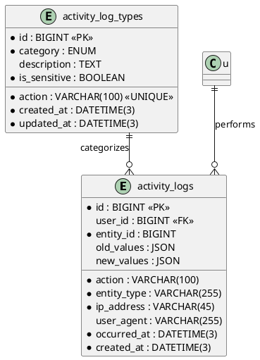

# 06.111 - Activity Log

**Project:** GsmUi
**Domain:** Audit - Activity Log
**Version:** 1.0.0

---

# Purpose

This document defines the database schema for the centralized, immutable audit trail of all significant platform actions. Every security-relevant, billing, content, admin, and system event is recorded as an append-only row with a before/after JSON diff, actor context (IP, user agent), and an exact occurrence timestamp. The log is never updated or soft-deleted; it serves as the authoritative record for compliance, forensics, and change replay.

---

# Tables

## activity_logs

**Purpose:** Centralized immutable audit trail of all significant platform actions.

**Business Rules:**
- Immutable — inserts only. No updates, no soft deletes, no hard deletes under normal operation.
- `user_id` is NULL when the actor is a system/service account or an unauthenticated trigger.
- `action` is a verb-namespaced string (e.g. `user.banned`, `order.refunded`) referencing `activity_log_types.action`.
- `entity_type` and `entity_id` form a polymorphic reference to the affected record (User, Product, Order, etc.).
- `old_values` and `new_values` are JSON diffs capturing state before and after the event.
- `ip_address` and `user_agent` capture actor context at event time.
- `occurred_at` is the precise moment the action happened (millisecond precision), distinct from `created_at` (row insertion time).

**Columns:**

| Column | Type | Nullable | Default | Notes |
|---|---|---|---|---|
| id | BIGINT UNSIGNED | NO | AUTO_INCREMENT | PK |
| user_id | BIGINT UNSIGNED | YES | NULL | FK → users.id (actor) |
| action | VARCHAR(100) | NO | — | Event type (FK to activity_log_types.action) |
| entity_type | VARCHAR(255) | NO | — | Morph class of target |
| entity_id | BIGINT UNSIGNED | NO | — | Target record id |
| old_values | JSON | YES | NULL | Pre-change state |
| new_values | JSON | YES | NULL | Post-change state |
| ip_address | VARCHAR(45) | NO | — | Actor IPv4/IPv6 |
| user_agent | VARCHAR(255) | YES | NULL | Actor browser string |
| occurred_at | DATETIME(3) | NO | CURRENT_TIMESTAMP(3) | Event time |
| created_at | DATETIME(3) | NO | CURRENT_TIMESTAMP(3) | Row insert time |

**Indexes:**

```
PRIMARY: id
INDEX:  activity_logs_user_id_index (user_id)
INDEX:  activity_logs_entity_type_entity_id_index (entity_type, entity_id)
INDEX:  activity_logs_action_index (action)
INDEX:  activity_logs_occurred_at_index (occurred_at)
```

**Relationships:**
- belongsTo: User (user)
- belongsTo: ActivityLogType (type) — via `action`

**Migration:**

```php
Schema::create('activity_logs', function (Blueprint $table) {
    $table->id();
    $table->foreignId('user_id')->nullable()->constrained()->nullOnDelete();
    $table->string('action', 100);
    $table->string('entity_type', 255);
    $table->unsignedBigInteger('entity_id');
    $table->json('old_values')->nullable();
    $table->json('new_values')->nullable();
    $table->string('ip_address', 45);
    $table->string('user_agent', 255)->nullable();
    $table->datetime('occurred_at', 3);
    $table->datetime('created_at', 3);

    $table->index('user_id');
    $table->index(['entity_type', 'entity_id']);
    $table->index('action');
    $table->index('occurred_at');
});
```

**Eloquent Model:**

```php
class ActivityLog extends Model
{
    use HasFactory;

    public $timestamps = false;

    protected $guarded = [];
    protected $casts = [
        'old_values' => 'array',
        'new_values' => 'array',
        'occurred_at' => 'datetime',
        'created_at' => 'datetime',
    ];
}
```

**Events:** ActivityLogged

---

## activity_log_types

**Purpose:** Catalog of valid activity log action types used for validation and grouping.

**Business Rules:**
- Acts as a controlled vocabulary for `activity_logs.action`.
- `action` is UNIQUE — each event type is registered exactly once.
- `category` groups events for filtering and reporting (auth, billing, content, admin, system).
- `is_sensitive` flags events subject to stricter access controls or redaction in exports.
- This table is seed-managed; it is not soft-deletable.

**Columns:**

| Column | Type | Nullable | Default | Notes |
|---|---|---|---|---|
| id | BIGINT UNSIGNED | NO | AUTO_INCREMENT | PK |
| action | VARCHAR(100) | NO | — | Event identifier (UNIQUE) |
| category | ENUM('auth','billing','content','admin','system') | NO | 'system' | Grouping |
| description | TEXT | YES | NULL | Human-readable description |
| is_sensitive | BOOLEAN | NO | FALSE | Sensitive flag |
| created_at | DATETIME(3) | NO | CURRENT_TIMESTAMP(3) | |
| updated_at | DATETIME(3) | NO | CURRENT_TIMESTAMP(3) | ON UPDATE |

**Indexes:**

```
PRIMARY: id
UNIQUE: activity_log_types_action_unique (action)
INDEX:  activity_log_types_category_index (category)
```

**Relationships:**
- hasMany: ActivityLog (type) — via `action`

**Migration:**

```php
Schema::create('activity_log_types', function (Blueprint $table) {
    $table->id();
    $table->string('action', 100);
    $table->enum('category', ['auth', 'billing', 'content', 'admin', 'system'])->default('system');
    $table->text('description')->nullable();
    $table->boolean('is_sensitive')->default(false);
    $table->timestamps();

    $table->unique('action');
    $table->index('category');
});
```

**Eloquent Model:**

```php
class ActivityLogType extends Model
{
    use HasFactory;

    protected $guarded = [];
    protected $casts = [
        'is_sensitive' => 'boolean',
        'category'     => \App\Enums\ActivityLogCategory::class,
    ];
}
```

**Events:** ActivityLogTypeRegistered

---

# Cross-Domain Relationships

## activity_logs → users
Each log entry references the acting user. `activity_logs.user_id` → `users.id`. `ON DELETE SET NULL` — audit records are preserved when the actor's account is deleted.

## activity_logs → activity_log_types
Each log entry's `action` must exist in the type catalog. `activity_logs.action` → `activity_log_types.action` (logical/validated reference; enforced by application-layer validation rather than a hard FK, since `action` is a string key).

## Polymorphic entity references
`entity_type` + `entity_id` point at any domain record. Common targets include `users`, `orders`, `products`, `subscriptions`, and `licenses`. No foreign key is declared because the target table varies per row.

---

# PlantUML ERD



---

# Database Constraints

## Foreign Key Constraints

```sql
ALTER TABLE activity_logs
  ADD CONSTRAINT fk_activity_logs_user
    FOREIGN KEY (user_id) REFERENCES users(id)
    ON DELETE SET NULL
    ON UPDATE CASCADE;
```

Notes:
- The actor `user_id` uses `ON DELETE SET NULL` so the audit row survives when the acting account is removed. The record remains, but it is no longer attributable — which is the correct forensics stance (the event happened; the actor is redacted, not erased).
- No FK is declared against `activity_log_types.action` because `action` is a natural string key and enforcing a string-to-string FK would add write-path overhead to the highest-volume table in the system. Applicability is enforced at insert time by the ActivityLogger service which consults the catalog.
- The polymorphic `entity_type`/`entity_id` pair intentionally has no FK because the target table varies per row. Referential integrity for the entity is enforced by the application layer at insertion.

## Check Constraints

```sql
ALTER TABLE activity_logs
  ADD CONSTRAINT chk_activity_logs_ip_length
    CHECK (CHAR_LENGTH(ip_address) > 0 AND CHAR_LENGTH(ip_address) <= 45),
  ADD CONSTRAINT chk_activity_logs_action_not_empty
    CHECK (CHAR_LENGTH(action) > 0 AND CHAR_LENGTH(action) <= 100),
  ADD CONSTRAINT chk_activity_logs_entity_id_positive
    CHECK (entity_id > 0);

ALTER TABLE activity_log_types
  ADD CONSTRAINT chk_activity_log_types_action_not_empty
    CHECK (CHAR_LENGTH(action) > 0);
```

## Unique Constraints

```sql
ALTER TABLE activity_log_types
  ADD CONSTRAINT uk_activity_log_types_action
    UNIQUE (action);
```

`activity_logs` deliberately has **no** unique constraint. Audit rows are append-only and it is possible (and valid) for the same user to perform the same action on the same entity multiple times within a short window. Idempotency is not a property of the event stream.

---

# Idempotency and Deduplication

Although `activity_logs` has no unique constraint, some upstream sources are retried (queues) and could double-emit. Deduplication is handled at the write path, not by a DB constraint.

**Strategy: correlation id**

Add an optional `correlation_id` (UUID) carried by the job/event. The ActivityLogger checks a short-window Redis lock before insert.

```php
$key = "activity:dedupe:{$correlationId}";
if (! Cache::add($key, 1, now()->addMinutes(5))) {
    return; // duplicate delivery of the same logical event
}
ActivityLog::create($attributes + ['correlation_id' => $correlationId]);
```

If hard DB-level dedup is ever required for a specific high-risk action, add a nullable `correlation_id` column with a unique index:

```sql
ALTER TABLE activity_logs
  ADD COLUMN correlation_id CHAR(36) NULL,
  ADD UNIQUE KEY uk_activity_logs_correlation (correlation_id);
```

Because the column is nullable and the unique key tolerates multiple NULLs, normal inserts (no correlation id) are unaffected.

---

# Stored Procedures

## sp_append_activity_log

Appends a single audit row. Centralizes validation and provides a single choke point for the write path.

```sql
DELIMITER //
CREATE PROCEDURE sp_append_activity_log(
  IN p_user_id BIGINT UNSIGNED,
  IN p_action VARCHAR(100),
  IN p_entity_type VARCHAR(255),
  IN p_entity_id BIGINT UNSIGNED,
  IN p_old_values JSON,
  IN p_new_values JSON,
  IN p_ip_address VARCHAR(45),
  IN p_user_agent VARCHAR(255),
  OUT p_log_id BIGINT UNSIGNED,
  OUT p_status VARCHAR(50)
)
BEGIN
  DECLARE v_action_known INT DEFAULT 0;

  DECLARE EXIT HANDLER FOR SQLEXCEPTION
  BEGIN
    SET p_status = 'error';
    RESIGNAL;
  END;

  IF p_action IS NULL OR CHAR_LENGTH(p_action) = 0 THEN
    SET p_status = 'invalid_action';
    SIGNAL SQLSTATE '45000' SET MESSAGE_TEXT = 'action is required';
  END IF;

  SELECT COUNT(*) INTO v_action_known
  FROM activity_log_types
  WHERE action = p_action;

  IF v_action_known = 0 THEN
    SET p_status = 'unknown_action';
    SIGNAL SQLSTATE '45000' SET MESSAGE_TEXT = 'action not registered in catalog';
  END IF;

  INSERT INTO activity_logs (
    user_id, action, entity_type, entity_id,
    old_values, new_values, ip_address, user_agent,
    occurred_at, created_at
  ) VALUES (
    p_user_id, p_action, p_entity_type, p_entity_id,
    p_old_values, p_new_values, p_ip_address, p_user_agent,
    NOW(3), NOW(3)
  );

  SET p_log_id = LAST_INSERT_ID();
  SET p_status = 'appended';
END //
DELIMITER ;
```

## sp_replay_activity_log

Rebuilds the current state of an entity by replaying `new_values` diffs chronologically. Useful for forensics and for answering "what did this record look like at time T?"

```sql
DELIMITER //
CREATE PROCEDURE sp_replay_activity_log(
  IN p_entity_type VARCHAR(255),
  IN p_entity_id BIGINT UNSIGNED,
  IN p_as_of DATETIME(3),
  OUT p_status VARCHAR(50)
)
proc: BEGIN
  SELECT JSON_ARRAYAGG(JSON_OBJECT(
           'action', action,
           'occurred_at', occurred_at,
           'new_values', new_values
         )) AS replay
  FROM (
    SELECT action, occurred_at, new_values
    FROM activity_logs
    WHERE entity_type = p_entity_type
      AND entity_id = p_entity_id
      AND occurred_at <= p_as_of
    ORDER BY occurred_at ASC, id ASC
  ) ordered
  INTO @replay_json;

  IF @replay_json IS NULL THEN
    SET p_status = 'no_history';
  ELSE
    SET p_status = 'replayed';
    SELECT @replay_json AS replay;
  END IF;
END //
DELIMITER ;
```

## sp_purge_activity_log

Time-based purge for data older than the hard retention window. Guarded so it can never touch rows inside the compliance window.

```sql
DELIMITER //
CREATE PROCEDURE sp_purge_activity_log(
  IN p_older_than DATETIME(3),
  IN p_batch_size INT,
  OUT p_rows_deleted INT
)
BEGIN
  DECLARE v_deleted INT DEFAULT 0;
  DECLARE v_done INT DEFAULT 0;

  DECLARE CONTINUE HANDLER FOR NOT FOUND SET v_done = 1;

  SET p_rows_deleted = 0;

  purge_loop: LOOP
    DELETE FROM activity_logs
    WHERE occurred_at < p_older_than
      AND occurred_at >= DATE_SUB(p_older_than, INTERVAL 1 DAY)
    LIMIT p_batch_size;

    SET v_deleted = ROW_COUNT();
    SET p_rows_deleted = p_rows_deleted + v_deleted;

    IF v_deleted < p_batch_size OR v_done THEN
      LEAVE purge_loop;
    END IF;
  END LOOP purge_loop;
END //
DELIMITER ;
```

---

# Triggers

## trg_activity_log_types_before_insert

Guards reserved action namespaces at the catalog level.

```sql
DELIMITER //
CREATE TRIGGER trg_activity_log_types_before_insert
BEFORE INSERT ON activity_log_types
FOR EACH ROW
BEGIN
  IF NEW.action NOT REGEXP '^[a-z0-9_]+\\.[a-z0-9_.]+$' THEN
    SIGNAL SQLSTATE '45000'
      SET MESSAGE_TEXT = 'action must follow verb.domain pattern, e.g. user.banned';
  END IF;
END //
DELIMITER ;
```

## trg_activity_logs_before_insert

Normalizes the occurrence timestamp and ensures ordering invariants.

```sql
DELIMITER //
CREATE TRIGGER trg_activity_logs_before_insert
BEFORE INSERT ON activity_logs
FOR EACH ROW
BEGIN
  IF NEW.occurred_at IS NULL THEN
    SET NEW.occurred_at = NOW(3);
  END IF;

  IF NEW.created_at IS NULL THEN
    SET NEW.created_at = NOW(3);
  END IF;

  IF NEW.user_agent IS NOT NULL AND CHAR_LENGTH(NEW.user_agent) > 255 THEN
    SET NEW.user_agent = LEFT(NEW.user_agent, 255);
  END IF;
END //
DELIMITER ;
```

Note: there is intentionally **no** BEFORE UPDATE or DELETE trigger. Updates are forbidden by policy, but rather than trapping them at the DB layer (which could break maintenance tooling), writes are restricted by granting the application role only `INSERT` and `SELECT` on `activity_logs`.

---

# Views

## vw_activity_log_recent

The primary operational view — recent events joined to their type catalog entry and the acting user, with the most common fields surfaced.

```sql
CREATE VIEW vw_activity_log_recent AS
SELECT
  al.id,
  al.action,
  alt.category,
  alt.is_sensitive,
  al.entity_type,
  al.entity_id,
  u.name AS actor_name,
  u.email AS actor_email,
  al.ip_address,
  al.occurred_at,
  al.created_at
FROM activity_logs al
JOIN activity_log_types alt ON alt.action = al.action
LEFT JOIN users u ON u.id = al.user_id;
```

## vw_activity_log_daily_volume

Rollup for capacity planning and anomaly detection.

```sql
CREATE VIEW vw_activity_log_daily_volume AS
SELECT
  DATE(occurred_at) AS activity_date,
  category,
  COUNT(*) AS event_count,
  COUNT(DISTINCT user_id) AS distinct_actors,
  COUNT(DISTINCT entity_id) AS distinct_entities
FROM activity_logs al
JOIN activity_log_types alt ON alt.action = al.action
GROUP BY DATE(occurred_at), category
ORDER BY activity_date DESC, event_count DESC;
```

## vw_activity_log_sensitive

Sensitive events only, for the compliance dashboard.

```sql
CREATE VIEW vw_activity_log_sensitive AS
SELECT
  al.id,
  al.action,
  al.user_id,
  al.entity_type,
  al.entity_id,
  al.ip_address,
  al.occurred_at
FROM activity_logs al
JOIN activity_log_types alt
  ON alt.action = al.action
 AND alt.is_sensitive = 1;
```

---

# Index Strategy

## Why These Indexes

`activity_logs` is append-heavy and read across four distinct access patterns. Each index maps to one of them:

| Access pattern | Index | Rationale |
|---|---|---|
| "Show everything user N did" | `activity_logs_user_id_index` | Actor-centric forensics |
| "Show history of record X" | `activity_logs_entity_type_entity_id_index` | Entity timeline |
| "Show all events of type Y" | `activity_logs_action_index` | Category drill-down |
| "Events in window [t1, t2]" | `activity_logs_occurred_at_index` | Time-window scans, purge, replay |

## Composite Indexes Beyond the Basics

```sql
-- Actor timeline, newest first (entity detail page of a user)
CREATE INDEX idx_activity_logs_user_occurred
  ON activity_logs (user_id, occurred_at);

-- Entity timeline filtered by action type
CREATE INDEX idx_activity_logs_entity_action
  ON activity_logs (entity_type, entity_id, action);

-- Category rollups by time
CREATE INDEX idx_activity_logs_action_occurred
  ON activity_logs (action, occurred_at);
```

## Composite vs Single-Column Decision

The default schema ships four single-column indexes. In production, after observing real query mixes, the recommendation is to replace the two most-redundant (`user_id` and `action`) with their composite variants above, because the single-column variants are strict prefixes of the composites and the composite indexes subsume them. The following statements consolidate:

```sql
-- Consolidation (run only after verifying composite coverage)
ALTER TABLE activity_logs
  DROP INDEX activity_logs_user_id_index,
  DROP INDEX activity_logs_action_index,
  ADD INDEX idx_activity_logs_user_occurred (user_id, occurred_at),
  ADD INDEX idx_activity_logs_action_occurred (action, occurred_at);
```

Keep `entity_type_entity_id_index` and `occurred_at_index` unchanged — neither has a composite superset.

## Index Cardinality Guidance

| Column | Cardinality | Selectivity |
|---|---|---|
| entity_id | very high | excellent |
| action | medium (~50–200 values) | medium |
| user_id | high | good |
| occurred_at | very high (ms precision) | excellent |

Low-cardinality columns only earn an index when paired with a high-cardinality column in a composite — never alone.

---

# Partitioning

## Rationale

`activity_logs` is the fastest-growing table in the platform. Range partitioning by month on `occurred_at` enables cheap `DROP PARTITION` for retention, faster time-window scans, and per-partition storage tiering.

## Partitioning DDL

```sql
ALTER TABLE activity_logs
PARTITION BY RANGE (TO_DAYS(occurred_at)) (
  PARTITION p2024_01 VALUES LESS THAN (TO_DAYS('2024-02-01')),
  PARTITION p2024_02 VALUES LESS THAN (TO_DAYS('2024-03-01')),
  PARTITION p2024_03 VALUES LESS THAN (TO_DAYS('2024-04-01')),
  PARTITION p2024_04 VALUES LESS THAN (TO_DAYS('2024-05-01')),
  PARTITION p2024_05 VALUES LESS THAN (TO_DAYS('2024-06-01')),
  PARTITION p2024_06 VALUES LESS THAN (TO_DAYS('2024-07-01')),
  PARTITION p2024_07 VALUES LESS THAN (TO_DAYS('2024-08-01')),
  PARTITION p2024_08 VALUES LESS THAN (TO_DAYS('2024-09-01')),
  PARTITION p2024_09 VALUES LESS THAN (TO_DAYS('2024-10-01')),
  PARTITION p2024_10 VALUES LESS THAN (TO_DAYS('2024-11-01')),
  PARTITION p2024_11 VALUES LESS THAN (TO_DAYS('2024-12-01')),
  PARTITION p2024_12 VALUES LESS THAN (TO_DAYS('2025-01-01')),
  PARTITION p_future VALUES LESS THAN MAXVALUE
);
```

Constraints:
- Partitioning on a `DATETIME(3)` column via `TO_DAYS()` truncates sub-day precision for routing only; stored values keep millisecond fidelity.
- The retention purge (`sp_purge_activity_log`) switches from `DELETE ... LIMIT` to `ALTER TABLE ... DROP PARTITION` once monthly partitions are in place — near-instant reclamation.

## Monthly Partition Management

Automated via scheduler:

```sql
-- Add next month's partition at end of month
ALTER TABLE activity_logs
  REORGANIZE PARTITION p_future INTO (
    PARTITION p_next VALUES LESS THAN (TO_DAYS('2025-02-01')),
    PARTITION p_future VALUES LESS THAN MAXVALUE
  );

-- Drop month past hard retention (7 years)
ALTER TABLE activity_logs DROP PARTITION p2024_01;
```

---

# Data Retention

| Retention tier | Window | Storage | Action |
|---|---|---|---|
| Hot | 0–90 days | Primary MySQL | Full indexes |
| Warm | 90 days–1 year | Primary MySQL (older partitions) | Read replica |
| Cold | 1 year–7 years | Object storage (exported Parquet/JSONL) | Compressed export |
| Purge | >7 years | — | Partition drop / object delete |

## Retention Rules

- **Compliance floor:** 7 years for billing/admin/system categories (driven by financial-audit requirements). Auth and content categories may have a shorter floor (2 years) subject to legal review.
- **No soft deletes:** `activity_logs` has no `deleted_at`. Retention is enforced by time, not by status.
- **Export before purge:** the monthly purge job exports the oldest partition to object storage, verifies the export, then drops the partition.

## Export-then-Drop Job

```php
// Schedule: monthly, first day, 03:00 UTC
$partitionName = $partitions->oldestReadyForPurge(); // e.g. p2024_01
$cursor        = ActivityLog::partition($partitionName)
    ->orderBy('occurred_at')
    ->cursor();

$writer = new ParquetWriter("s3://audit-archive/{$partitionName}.parquet");
foreach ($cursor as $row) {
    $writer->write($row->toArchiveArray());
}
$writer->finalize();

DB::statement("ALTER TABLE activity_logs DROP PARTITION {$partitionName}");
```

---

# GDPr Compliance

## Classification

`activity_logs` contains personal data: acting `user_id`, `ip_address`, and `user_agent`. It is therefore subject to access, export, and rectification obligations, but **not** to naive deletion because it is also the authoritative audit trail. The GDPR lawful-basis position for a transactional audit log is "legal obligation" (for compliance rows) and "legitimate interest" (for product forensics), which permits retention for a defined period even when a user account is deleted.

## Account Deletion: Redact, Don't Delete

When a user exercises deletion, the audit rows are **retained** but the actor is de-attributed:

```sql
UPDATE activity_logs
SET user_id = NULL,
    ip_address = '0.0.0.0',
    user_agent = NULL
WHERE user_id = :deletedUserId
  AND category_is_compliance = 0;   -- application-layer filter
```

This preserves the event evidence while removing the personal linkages. For compliance-category rows, `user_id` may be retained for the legal-requirement window and then redacted.

## Right of Access Export

```php
$export = ActivityLog::query()
    ->where('user_id', $user->id)
    ->orderBy('occurred_at')
    ->get(['action', 'entity_type', 'entity_id', 'ip_address', 'occurred_at']);

return new UserAuditExport($export); // downloadable JSON
```

---

# Seeding Strategy

## Seed the Action Catalog

`activity_log_types` is the controlled vocabulary. It is seed-managed and must be present before any application write.

```php
// database/seeders/ActivityLogTypeSeeder.php
namespace Database\Seeders;

use App\Models\ActivityLogType;
use Illuminate\Database\Seeder;

class ActivityLogTypeSeeder extends Seeder
{
    public function run(): void
    {
        $types = [
            // Auth
            ['action' => 'auth.login',              'category' => 'auth',    'is_sensitive' => false],
            ['action' => 'auth.login_failed',       'category' => 'auth',    'is_sensitive' => true],
            ['action' => 'auth.logout',             'category' => 'auth',    'is_sensitive' => false],
            ['action' => 'auth.password_changed',   'category' => 'auth',    'is_sensitive' => true],
            ['action' => 'auth.2fa_enabled',        'category' => 'auth',    'is_sensitive' => true],
            ['action' => 'auth.2fa_disabled',       'category' => 'auth',    'is_sensitive' => true],
            ['action' => 'auth.session_revoked',    'category' => 'auth',    'is_sensitive' => true],
            // Billing
            ['action' => 'billing.charge_succeeded',   'category' => 'billing', 'is_sensitive' => true],
            ['action' => 'billing.charge_failed',      'category' => 'billing', 'is_sensitive' => true],
            ['action' => 'billing.refund_issued',      'category' => 'billing', 'is_sensitive' => true],
            ['action' => 'billing.subscription_created', 'category' => 'billing', 'is_sensitive' => false],
            ['action' => 'billing.subscription_cancelled', 'category' => 'billing', 'is_sensitive' => true],
            // Content
            ['action' => 'content.created',         'category' => 'content', 'is_sensitive' => false],
            ['action' => 'content.updated',         'category' => 'content', 'is_sensitive' => false],
            ['action' => 'content.published',       'category' => 'content', 'is_sensitive' => false],
            ['action' => 'content.deleted',         'category' => 'content', 'is_sensitive' => false],
            // Admin
            ['action' => 'admin.user_banned',       'category' => 'admin',   'is_sensitive' => true],
            ['action' => 'admin.user_unbanned',     'category' => 'admin',   'is_sensitive' => true],
            ['action' => 'admin.setting_changed',   'category' => 'admin',   'is_sensitive' => true],
            ['action' => 'admin.flag_resolved',     'category' => 'admin',   'is_sensitive' => false],
            // System
            ['action' => 'system.migration_ran',    'category' => 'system',  'is_sensitive' => false],
            ['action' => 'system.cache_flushed',    'category' => 'system',  'is_sensitive' => false],
            ['action' => 'system.index_rebuilt',    'category' => 'system',  'is_sensitive' => false],
        ];

        foreach ($types as $type) {
            ActivityLogType::updateOrCreate(
                ['action' => $type['action']],
                $type
            );
        }
    }
}
```

Idempotent via `updateOrCreate` keyed on the unique `action`. Safe to re-run on every deploy.

## Factory for Load/Integration Tests

```php
// database/factories/ActivityLogFactory.php
class ActivityLogFactory extends Factory
{
    protected $model = ActivityLog::class;

    public function definition(): array
    {
        return [
            'user_id'     => $this->faker->boolean(90) ? User::factory() : null,
            'action'      => $this->faker->randomElement([
                'auth.login', 'content.updated', 'admin.setting_changed',
            ]),
            'entity_type' => $this->faker->randomElement([
                'App\Models\User', 'App\Models\Product', 'App\Models\Order',
            ]),
            'entity_id'   => $this->faker->numberBetween(1, 100000),
            'old_values'  => $this->faker->boolean ? ['status' => 'draft'] : null,
            'new_values'  => $this->faker->boolean ? ['status' => 'published'] : null,
            'ip_address'  => $this->faker->ipv4(),
            'user_agent'  => $this->faker->userAgent(),
            'occurred_at' => now(),
            'created_at'  => now(),
        ];
    }
}
```

---

# Model Relationships

## ActivityLog Model

```php
namespace App\Models;

use Illuminate\Database\Eloquent\Model;
use Illuminate\Database\Eloquent\Relations\BelongsTo;
use Illuminate\Database\Eloquent\Relations\MorphTo;

class ActivityLog extends Model
{
    public $timestamps = false;

    protected $guarded = [];

    protected $casts = [
        'old_values'  => 'array',
        'new_values'  => 'array',
        'occurred_at' => 'datetime',
        'created_at'  => 'datetime',
    ];

    public function user(): BelongsTo
    {
        return $this->belongsTo(User::class, 'user_id');
    }

    public function type(): BelongsTo
    {
        return $this->belongsTo(ActivityLogType::class, 'action', 'action');
    }

    public function entity(): MorphTo
    {
        return $this->morphTo(__FUNCTION__, 'entity_type', 'entity_id');
    }

    // ----- Scopes -----
    public function scopeForActor($query, int $userId)
    {
        return $query->where('user_id', $userId);
    }

    public function scopeForEntity($query, $model)
    {
        return $query
            ->where('entity_type', $model->getMorphClass())
            ->where('entity_id', $model->getKey());
    }

    public function scopeSensitive($query)
    {
        return $query->whereIn('action',
            ActivityLogType::where('is_sensitive', true)->pluck('action'));
    }

    public function scopeBetween($query, $from, $to)
    {
        return $query->whereBetween('occurred_at', [$from, $to]);
    }
}
```

## ActivityLogType Model

```php
namespace App\Models;

use App\Enums\ActivityLogCategory;
use Illuminate\Database\Eloquent\Model;
use Illuminate\Database\Eloquent\Relations\HasMany;

class ActivityLogType extends Model
{
    protected $guarded = [];

    protected $casts = [
        'is_sensitive' => 'boolean',
        'category'     => ActivityLogCategory::class,
    ];

    public function logs(): HasMany
    {
        return $this->hasMany(ActivityLog::class, 'action', 'action');
    }
}
```

## Consuming the MorphTo from Entities

Any model that can be audited gains a fluent reader:

```php
// On Product, Order, User, etc.
public function activityLogs()
{
    return $this->morphMany(ActivityLog::class, 'entity')
        ->latest('occurred_at');
}
```

---

# Activity Logger Service

The single write path. All domain code logs through this service rather than inserting directly.

```php
namespace App\Services;

use App\Events\ActivityLogged;
use App\Models\ActivityLog;
use App\Models\ActivityLogType;
use Illuminate\Database\Eloquent\Model;
use Illuminate\Support\Facades\Cache;

class ActivityLogger
{
    public function __construct(
        private ActivityLogType $types
    ) {}

    public function log(
        string $action,
        Model $entity,
        ?array $old = null,
        ?array $new = null,
        ?int $actorId = null,
    ): ActivityLog {
        $this->assertKnownAction($action);

        $log = ActivityLog::create([
            'user_id'     => $actorId ?? auth()->id(),
            'action'      => $action,
            'entity_type' => $entity->getMorphClass(),
            'entity_id'   => $entity->getKey(),
            'old_values'  => $old,
            'new_values'  => $new,
            'ip_address'  => request()?->ip() ?? '0.0.0.0',
            'user_agent'  => request()?->userAgent(),
            'occurred_at' => now(),
            'created_at'  => now(),
        ]);

        event(new ActivityLogged($log));

        return $log;
    }

    public function captureDiff(Model $entity, array $old, array $new, string $action): void
    {
        $changed = array_intersect_key($new, $old);
        $diffOld = array_intersect_key($old, $changed);
        $diffNew = array_intersect_key($new, $changed);

        $this->log($action, $entity, $diffOld, $diffNew);
    }

    private function assertKnownAction(string $action): void
    {
        $known = Cache::remember('activity:type_catalog', 3600,
            fn () => $this->types->pluck('action'));

        if (! $known->contains($action)) {
            report(new \DomainException("Unregistered activity action: {$action}"));
        }
    }
}
```

## Model Observer Hook

Attach to audited models to capture diffs automatically:

```php
namespace App\Observers;

use App\Models\Product;
use App\Services\ActivityLogger;

class ProductActivityObserver
{
    public function __construct(private ActivityLogger $logger) {}

    public function updated(Product $product, ActivityLogger $logger = null): void
    {
        $this->logger->captureDiff(
            $product,
            $product->getOriginal(),
            $product->getChanges(),
            'content.updated',
        );
    }

    public function deleted(Product $product): void
    {
        $this->logger->log('content.deleted', $product, $product->toArray(), null);
    }
}
```

---

# Event Hooks

## Laravel Events

| Event | Fired When | Payload |
|---|---|---|
| `ActivityLogged` | An audit row is inserted | `ActivityLog $log` |
| `ActivityLogTypeRegistered` | A new action type is added to the catalog | `ActivityLogType $type` |

## ActivityLogged Event

```php
namespace App\Events;

use App\Models\ActivityLog;
use Illuminate\Foundation\Events\Dispatchable;

class ActivityLogged
{
    use Dispatchable;

    public function __construct(public ActivityLog $log) {}
}
```

## Listener: Fan out to real-time dashboards + webhooks

```php
namespace App\Listeners;

use App\Events\ActivityLogged;

class BroadcastSensitiveActivity
{
    public function handle(ActivityLogged $event): void
    {
        if (! $event->log->type?->is_sensitive) {
            return;
        }

        broadcast(new SensitiveActivityNotification($event->log))
            ->toOthers();

        dispatch(new SendWebhookJob('activity.sensitive', $event->log));
    }
}
```

---

# Query Patterns

## Entity Timeline

```php
$timeline = ActivityLog::forEntity($product)
    ->with('user:id,name')
    ->orderByDesc('occurred_at')
    ->paginate(50);
```

```sql
SELECT id, action, entity_type, entity_id, user_id, occurred_at
FROM activity_logs
WHERE entity_type = 'App\\Models\\Product' AND entity_id = 42
ORDER BY occurred_at DESC
LIMIT 50;
```

## Actor Forensics

```php
$history = ActivityLog::forActor($userId)
    ->whereBetween('occurred_at', [$from, $to])
    ->orderBy('occurred_at')
    ->get();
```

## Sensitive Events Dashboard

```sql
SELECT al.id, al.action, al.occurred_at, u.email AS actor
FROM activity_logs al
JOIN activity_log_types alt ON alt.action = al.action AND alt.is_sensitive = 1
LEFT JOIN users u ON u.id = al.user_id
ORDER BY al.occurred_at DESC
LIMIT 100;
```

## Reconstructing State at Time T

```php
$replay = ActivityLog::forEntity($order)
    ->where('occurred_at', '<=', $asOf)
    ->orderBy('occurred_at')
    ->get(['action', 'new_values', 'occurred_at']);

$state = $replay->reduce(
    fn ($carry, $log) => array_merge($carry, $log->new_values ?? []),
    []
);
```

## Volume by Action (last 24h)

```sql
SELECT action, COUNT(*) AS cnt
FROM activity_logs
WHERE occurred_at >= NOW() - INTERVAL 1 DAY
GROUP BY action
ORDER BY cnt DESC;
```

## Detect Impossible Travel (anomaly)

```sql
SELECT a.user_id, a.ip_address AS ip_a, b.ip_address AS ip_b,
       a.occurred_at AS at_a, b.occurred_at AS at_b
FROM activity_logs a
JOIN activity_logs b
  ON a.user_id = b.user_id
 AND b.occurred_at > a.occurred_at
 AND b.occurred_at < a.occurred_at + INTERVAL 5 MINUTE
 AND a.ip_address <> b.ip_address
WHERE a.occurred_at >= NOW() - INTERVAL 1 DAY
LIMIT 100;
```

---

# API Contracts

## GET /api/admin/activity-logs

**Purpose:** Paginated audit trail (admin, `view-audit-logs` permission).

**Query params:** `page`, `per_page`, `action`, `category`, `user_id`, `entity_type`, `entity_id`, `from`, `to`.

**Response (200):**
```json
{
  "data": [
    {
      "id": 918273,
      "action": "admin.setting_changed",
      "category": "admin",
      "entity_type": "App\\Models\\Setting",
      "entity_id": 12,
      "actor": { "id": 5, "name": "Ayesha", "email": "ayesha@gsmui.dev" },
      "old_values": { "value": "off" },
      "new_values": { "value": "on" },
      "ip_address": "203.0.113.7",
      "occurred_at": "2024-06-30T10:30:00.123Z"
    }
  ],
  "meta": { "current_page": 1, "total": 482, "per_page": 50 }
}
```

## GET /api/admin/activity-logs/types

**Purpose:** List the registered action catalog.

**Response (200):**
```json
{
  "data": [
    { "action": "auth.login", "category": "auth", "is_sensitive": false },
    { "action": "billing.refund_issued", "category": "billing", "is_sensitive": true }
  ]
}
```

## GET /api/users/me/activity

**Purpose:** A user's own activity export (GDPR access).

**Response (200):** array of `{ action, entity_type, occurred_at }` for the authenticated user (sensitive fields like `ip_address` are omitted).

---

# Testing Scenarios

## Unit Tests

| Test | Expected |
|---|---|
| Logger inserts row with correct action/entity | Row exists, fields match |
| Logger nulls user_id for system actor | user_id IS NULL |
| Logger captures before/after diff | old/new values populated |
| Unknown action is reported but still appended | Report raised, row exists |
| Timestamps have millisecond precision | occurred_at matches NOW(3) |

```php
public function test_logger_captures_diff(): void
{
    $product = Product::factory()->create(['price' => 100]);
    $product->update(['price' => 120]);

    $this->assertDatabaseHas('activity_logs', [
        'action' => 'content.updated',
        'entity_id' => $product->id,
    ]);

    $log = ActivityLog::latest('id')->first();
    $this->assertSame(['price' => 100], $log->old_values);
    $this->assertSame(['price' => 120], $log->new_values);
}
```

## Integration Tests

| Test | Expected |
|---|---|
| Auth login emits an audit record | action = auth.login |
| Admin ban emits sensitive audit record | is_sensitive lookup true |
| Entity timeline endpoint returns ordered events | newest first |
| Redact on account deletion de-attributes actor | user_id NULL, ip sanitized |

---

# Performance Considerations

## Write Path

- `activity_logs` is insert-only; keep it free of UPDATE/DELETE triggers.
- The catalog lookup is cached (1h) so it never hits the DB on the hot path.
- For very high throughput, buffer inserts via a queue + batch insert (500-row batches).

## Read Path

- Entity/actor pages paginate with composite indexes (`user_id, occurred_at`).
- Dashboards read from a replica; the primary is write-optimized.

## Table Growth

| Table | Year 1 | Year 3 | Year 5 |
|---|---|---|---|
| `activity_logs` | 5M | 20M | 60M |
| `activity_log_types` | ~100 | ~200 | ~300 |

## Batch Insert Optimization

```php
ActivityLog::insert(
    $events->map(fn ($e) => [
        'user_id' => $e['user_id'], 'action' => $e['action'],
        'entity_type' => $e['type'], 'entity_id' => $e['id'],
        'old_values' => json_encode($e['old']),
        'new_values' => json_encode($e['new']),
        'ip_address' => $e['ip'], 'user_agent' => $e['ua'],
        'occurred_at' => $e['ts'], 'created_at' => $e['ts'],
    ])->all()
);
```

---

# Monitoring Queries

## Daily Health Check

```sql
-- Event volume today
SELECT COUNT(*) AS events_today
FROM activity_logs
WHERE DATE(occurred_at) = CURDATE();

-- Unregistered actions slipping through (should be 0)
SELECT action, COUNT(*) AS cnt
FROM activity_logs
WHERE action NOT IN (SELECT action FROM activity_log_types)
GROUP BY action;

-- Oldest un-archived row
SELECT MIN(occurred_at) AS oldest_hot_row
FROM activity_logs
WHERE occurred_at < NOW() - INTERVAL 90 DAY;
```

## Anomaly: Volume Spike

```sql
SELECT DATE(occurred_at) AS d, COUNT(*) AS cnt
FROM activity_logs
WHERE occurred_at >= NOW() - INTERVAL 14 DAY
GROUP BY DATE(occurred_at)
ORDER BY d DESC;
```

---

# Change Log

## Version 1.0.0

- Initial immutable `activity_logs` schema
- `activity_log_types` controlled-vocabulary catalog
- Polymorphic `entity_type`/`entity_id` target reference
- Before/after JSON diff columns
- Actor context capture (IP, user agent) with millisecond `occurred_at`
- Append-only write model with role-restricted grants
- Index strategy, monthly partitioning, and export-then-drop retention
- GDPR redact-on-deletion policy and access export

---

# Related Documents

- **06.01** - Design Principles (immutability, timestamp conventions)
- **06.02** - Naming Conventions (table, column, index naming)
- **06.03** - Common Columns (polymorphic morph columns)
- **06.04** - Relationships (SET NULL on actor deletion)
- **06.100** - Admin (consumes the audit log for moderation trails)
- **06.110** - Notifications (emits events for alerts)

---

# Backup and Recovery

## Backup Strategy

| Table | Backup Frequency | Retention | Method |
|---|---|---|---|
| `activity_logs` | Hourly | 90 days | Binlog + incremental + export to object storage |
| `activity_log_types` | Daily | 90 days | Full dump (tiny table) |

The activity log is the platform's forensic record, so it also ships to object storage as a cold archive — even if the primary database is destroyed, the archive survives independently.

## Recovery Procedures

**Scenario: Accidental purge beyond retention**

```sql
-- 1. Identify the missing window from the archive manifest
SELECT partition_name, row_count, exported_at
FROM audit_archive_manifest
WHERE partition_name IN ('p2024_03', 'p2024_04');

-- 2. Restore the partition from binlog or backup
mysqlbinlog --start-datetime="2024-03-01 00:00:00" \
            --stop-datetime="2024-04-01 00:00:00" \
            binlog.000412 | mysql gsmui;

-- 3. Verify row counts
SELECT COUNT(*) FROM activity_logs PARTITION (p2024_03);
```

**Scenario: Corrupted write path (duplicate spike)**

```sql
-- 1. Quantify duplicates by correlation window
SELECT user_id, action, entity_id, COUNT(*) AS dup
FROM activity_logs
WHERE occurred_at >= NOW() - INTERVAL 1 HOUR
GROUP BY user_id, action, entity_id,
         FLOOR(UNIX_TIMESTAMP(occurred_at) / 10)
HAVING dup > 5
ORDER BY dup DESC
LIMIT 50;

-- 2. Halt the writer queue
-- (operational step: pause the activity queue)

-- 3. Remove confirmed duplicates (keep earliest id per group)
DELETE a FROM activity_logs a
JOIN activity_logs b
  ON b.user_id <=> a.user_id
 AND b.action = a.action
 AND b.entity_type = a.entity_type
 AND b.entity_id = a.entity_id
 AND ABS(TIMESTAMPDIFF(MICROSECOND, b.occurred_at, a.occurred_at)) < 10000000
WHERE b.id < a.id;
```

Note: deduplication is an exceptional maintenance operation, logged itself via `system.maintenance` action with explicit admin attribution.

---

# Disaster Recovery

## RPO and RTO Targets

| Metric | Target | Strategy |
|---|---|---|
| RPO (Recovery Point Objective) | 15 minutes | Replicated binlog + hourly snapshots |
| RTO (Recovery Time Objective) | 1 hour | Replica promotion; archive re-import for older data |

## Failover Considerations

Because `activity_logs` is insert-only, promotion of a read replica is safe: there are no mid-transaction conflicts and no writes in flight other than appends. Queue-buffered writes (the buffered batch writer) pause during failover and drain once the new primary accepts connections — a bounded data-loss window of one batch (≤500 events).

## Integrity Verification

Weekly automated verification:

```sql
-- Verify monotonic id ordering per occurrence time
SELECT COUNT(*) AS ordering_violations
FROM activity_logs a
JOIN activity_logs b
  ON b.id > a.id AND b.occurred_at < a.occurred_at - INTERVAL 5 MINUTE
WHERE a.occurred_at >= NOW() - INTERVAL 7 DAY;

-- Verify action vocabulary consistency
SELECT COUNT(*) AS unregistered_actions
FROM activity_logs al
LEFT JOIN activity_log_types alt ON alt.action = al.action
WHERE alt.id IS NULL
  AND al.occurred_at >= NOW() - INTERVAL 7 DAY;
```

---

# Integration Patterns

## Webhook Payload Structure

```json
{
  "event": "activity.sensitive",
  "timestamp": "2024-06-30T10:30:00.123Z",
  "data": {
    "log_id": 918273,
    "action": "admin.setting_changed",
    "category": "admin",
    "entity_type": "App\\Models\\Setting",
    "entity_id": 12,
    "actor_id": 5,
    "ip_address": "203.0.113.7",
    "old_values": { "value": "off" },
    "new_values": { "value": "on" }
  }
}
```

## SIEM Export

For large deployments, `activity_logs` ships to a SIEM (e.g., Splunk, Elastic Security) via the archive pipeline:

```php
// Daily ship: yesterday's partition → SIEM collector
$shipper = new SiemShipper(
    endpoint: config('audit.siem.endpoint'),
    index: 'gsmui-activity',
);

ActivityLog::query()
    ->whereBetween('occurred_at', [
        now()->subDay()->startOfDay(),
        now()->subDay()->endOfDay(),
    ])
    ->with('type')
    ->chunkById(1000, fn ($chunk) => $shipper->send($chunk));
```

---

# Advanced Query Patterns

## Diff Analytics: Most-Changed Fields

```sql
SELECT
  entity_type,
  JSON_KEYS(new_values) AS keys_changed,
  COUNT(*) AS change_count
FROM activity_logs
WHERE entity_type = 'App\\Models\\Product'
  AND occurred_at >= NOW() - INTERVAL 30 DAY
GROUP BY entity_type, JSON_KEYS(new_values)
ORDER BY change_count DESC
LIMIT 25;
```

## Actor Session Reconstruction

```sql
SELECT
  al.occurred_at,
  al.action,
  al.entity_type,
  al.entity_id,
  al.ip_address
FROM activity_logs al
WHERE al.user_id = 5
  AND al.occurred_at BETWEEN '2024-06-30 09:00:00' AND '2024-06-30 18:00:00'
ORDER BY al.occurred_at ASC;
```

## Category Heatmap (by hour of day)

```sql
SELECT
  alt.category,
  HOUR(al.occurred_at) AS hour_of_day,
  DAYNAME(al.occurred_at) AS day_name,
  COUNT(*) AS events
FROM activity_logs al
JOIN activity_log_types alt ON alt.action = al.action
WHERE al.occurred_at >= NOW() - INTERVAL 30 DAY
GROUP BY alt.category, HOUR(al.occurred_at), DAYNAME(al.occurred_at)
ORDER BY events DESC;
```

## First-Time Action Detection

Find actions a user has never performed before a given event — useful for compromise detection (e.g., an account suddenly calling admin endpoints):

```sql
SELECT al.id, al.action, al.occurred_at
FROM activity_logs al
WHERE al.user_id = 5
  AND al.action LIKE 'admin.%'
  AND NOT EXISTS (
    SELECT 1 FROM activity_logs prior
    WHERE prior.user_id = al.user_id
      AND prior.action = al.action
      AND prior.occurred_at < al.occurred_at
  );
```

---

# Security Considerations

### Access Control

- `view-audit-logs` permission is admin-only; sensitive logs require a separate `view-sensitive-audit-logs` escalation.
- Application DB role on `activity_logs`: `INSERT, SELECT` only — no `UPDATE` or `DELETE` grants.
- Maintenance purge role is a separate credential used only by the scheduled purge job.

### Tamper Resistance

- Application accounts cannot modify existing rows (no UPDATE grant).
- Row-level integrity can be strengthened later by storing a chained hash: `row_hash = SHA2(CONCAT(id, action, entity_type, entity_id, occurred_at, prev_hash), 256)`. This is a planned v2 column (`chain_hash CHAR(64)`), not included in v1.
- Archive exports are hashed; the hash is stored in the manifest, making post-hoc modification detectable.

### GDPR and Data Minimization

- `old_values`/`new_values` must never contain credentials, API keys, or payment card numbers. The ActivityLogger sanitizes the diff before persistence:

```php
private const REDACTED_KEYS = [
    'password', 'password_hash', 'api_token', 'secret',
    'card_number', 'cvc', 'token', 'authorization',
];

private function sanitize(?array $values): ?array
{
    if (! $values) {
        return $values;
    }
    return array_map(
        fn ($v, $k) => in_array($k, self::REDACTED_KEYS, true) ? '[REDACTED]' : $v,
        $values,
        array_keys($values)
    );
}
```

---

# Caching Strategy

| Key Pattern | Value | TTL | Invalidation |
|---|---|---|---|
| `activity:type_catalog` | List of registered actions | 1 hour | On catalog seed/update |
| `activity:dedupe:{correlation_id}` | Dedupe lock | 5 minutes | Auto expiry |
| `activity:timeline:{entity_type}:{entity_id}:p{page}` | Paginated timeline page | 5 minutes | On new log for entity |

The type catalog cache is the only hot-path lookup. Everything else reads directly or from replicas.

---

# Artisan Commands

### `activity:register-defaults`

Seeds the `activity_log_types` catalog from the domain registry. Idempotent.

```php
Artisan::command('activity:register-defaults', function () {
    $this->call('db:seed', ['--class' => ActivityLogTypeSeeder::class]);
    $this->info('Activity log type catalog synced.');
});
```

### `activity:purge`

Runs the export-then-drop retention job.

**Schedule:** Monthly on the 1st at 03:00 UTC.

```php
$partition = $this->partitionResolver->oldestExpired();
$exported  = ArchiveExporter::export($partition);
ArchiveManifest::record($partition, $exported);
DB::statement("ALTER TABLE activity_logs DROP PARTITION {$partition}");
```

### `activity:verify`

Runs the integrity checks (ordering violations, unregistered actions, hash verification once chain_hash ships).

**Schedule:** Weekly, Sunday 02:00 UTC.

### `activity:export-user`

GDPR export for a single user.

```bash
php artisan activity:export-user 5 --format=json --out=storage/exports/user-5-activity.json
```

---

# Performance Benchmarks

### Target Throughput and Latency

| Operation | Target | Notes |
|---|---|---|
| Single insert (hot path) | ≤ 2ms overhead | Async via observer + queue optional |
| Batch insert (500 rows) | ≤ 80ms | Via buffered writer |
| Entity timeline query (paginated) | ≤ 60ms p95 | Composite index |
| Time-window dashboard query | ≤ 400ms p95 | Partition pruning |
| Replay (1000 events) | ≤ 800ms | Sequential scan, in-order |

### Load Testing Scenarios

```php
// Simulate 10K writes/min for 10 minutes
$this->artisan('activity:load-test --rate=10000 --minutes=10');
// Assert: p99 insert latency < 10ms, no dropped events
```

---

# Data Migration Patterns

## Migrating from a Legacy Audit Table

Legacy systems often store audit trails as free-form strings (`"User 5 changed price from 100 to 120"`). Migration parses these into structured rows.

```php
// database/migrations/2024_07_01_000001_migrate_legacy_audit_log.php

class MigrateLegacyAuditLog extends Migration
{
    public function up(): void
    {
        DB::connection('legacy')->table('audit_trail')
            ->orderBy('id')
            ->chunkById(1000, function ($legacyRows) {
                $batch = $legacyRows->map(fn ($row) => [
                    'user_id'     => $this->resolveLegacyUser($row->userId),
                    'action'      => $this->mapLegacyAction($row->event),
                    'entity_type' => $this->mapLegacyEntity($row->objectType),
                    'entity_id'   => $row->objectId,
                    'old_values'  => null, // legacy logs rarely capture structured diffs
                    'new_values'  => $row->newState ? json_decode($row->newState, true) : null,
                    'ip_address'  => $row->ip ?: '0.0.0.0',
                    'user_agent'  => $row->ua,
                    'occurred_at' => $row->eventTime,
                    'created_at'  => now(),
                ])->all();

                ActivityLog::insert($batch);
            });
    }

    private function mapLegacyAction(string $legacy): string
    {
        return match ($legacy) {
            'LOGIN'        => 'auth.login',
            'LOGOUT'       => 'auth.logout',
            'PRICE_CHANGE' => 'content.updated',
            'BAN'          => 'admin.user_banned',
            default        => 'system.legacy_import',
        };
    }
}
```

## Backfilling the Type Catalog for Imported Rows

After import, ensure every distinct action present in the table exists in the catalog:

```sql
INSERT INTO activity_log_types (action, category, description, is_sensitive, created_at, updated_at)
SELECT DISTINCT
  al.action,
  'system',
  CONCAT('Imported from legacy audit trail: ', al.action),
  FALSE,
  NOW(3), NOW(3)
FROM activity_logs al
LEFT JOIN activity_log_types alt ON alt.action = al.action
WHERE alt.id IS NULL;
```

## Migration Rollback

```php
public function down(): void
{
    ActivityLog::where('action', 'system.legacy_import')->delete();
    // or delete by created_at window for full import undo
}
```

---

# Zero-Downtime Deployment Notes

1. Create both tables before any code writes to them.
2. Deploy the catalog seeder first (`activity_log_types` must exist before `activity_logs` writes, since validation consults it).
3. Deploy the observer/service wiring behind a `FeatureFlag('activity-logging')` so it can be disabled instantly if write volume impacts hot paths.
4. Enable partitioning **after** the table has data only if it is empty or via the online `ALTER` window; partitioning an existing table is a full table rebuild in MySQL and must be scheduled.

```php
// config/feature-flags.php — launch sequence
'a logging.enable'         => env('ACTIVITY_LOGGING', false), // master switch
'logging.buffered_writes'  => env('ACTIVITY_BUFFERED', true),  // queue + batch
'logging.si_export'        => false,                            // v2
```

---

# Database Grants

Defense in depth at the credential level:

```sql
-- Application role: append + read only
GRANT INSERT, SELECT ON gsmui.activity_logs TO 'gsmui_app'@'%';

-- Read replica / admin dashboard role
GRANT SELECT ON gsmui.activity_logs TO 'gsmui_readonly'@'%';
GRANT SELECT ON gsmui.activity_log_types TO 'gsmui_readonly'@'%';

-- Retention job role: DELETE required for DELETE-based purge only;
-- for partition-drop retention, ALTER is required instead
GRANT DELETE, ALTER ON gsmui.activity_logs TO 'gsmui_retention'@'localhost';

-- Catalog maintenance (seeders only, not application runtime)
GRANT INSERT, UPDATE, DELETE ON gsmui.activity_log_types TO 'gsmui_migrate'@'%';
```

---

# Index Maintenance

## Estimated Index Size

At 60M rows (year 5), index sizes matter:

| Index | Estimated Size |
|---|---|
| PRIMARY (id) | ~1.2 GB |
| user_id_index | ~0.6 GB |
| entity_type_entity_id_index | ~1.4 GB |
| action_index | ~0.5 GB |
| occurred_at_index | ~0.6 GB |
| **Total indexes** | **~4.3 GB** |

## Maintenance Cadence

- Monthly `ANALYZE TABLE activity_logs` after large partition drops.
- Monitor `performance_schema` for the two most-used indexes; verify the composite consolidation candidates from the Index Strategy section with 30 days of real traffic before dropping single-column variants.

---

# Glossary

| Term | Definition |
|---|---|
| **Audit Row** | A single immutable record of one platform action |
| **Actor** | The user (or system) that performed the action (`user_id`) |
| **Entity** | The record the action was performed on (polymorphic `entity_type`/`entity_id`) |
| **Action Vocabulary** | The controlled set of `action` strings in `activity_log_types` |
| **Diff** | `old_values`/`new_values` pair capturing state change |
| **Sensitive Action** | An action flagged for stricter access control (`is_sensitive`) |
| **Replay** | Reconstructing entity state by applying diffs chronologically |
| **Redact** | De-attributing personal identifiers on account deletion while preserving evidence |

---

# Testing Matrix

### Unit Test Coverage Matrix

| Test Class | Method | Input | Expected |
|---|---|---|---|
| ActivityLoggerTest | log | valid action + model | Row appended, event fired |
| ActivityLoggerTest | log | unregistered action | Appended + report raised |
| ActivityLoggerTest | captureDiff | old + new arrays | Only changed keys stored |
| ActivityLoggerTest | sanitize | key with password | Value redacted |
| ActivityLogTest | scopeForEntity | product model | Filters by morph pair |
| ActivityLogTest | scopeSensitive | sensitive catalog | Only sensitive actions |

### Integration Test Scenarios

| Scenario | Steps | Expected |
|---|---|---|
| Full audit chain | create → update → delete product | 3 rows, correct ordering |
| Redaction on delete | ban user → delete account | user_id NULL, ip zeroed |
| Catalog seed idempotency | Run seeder twice | No duplicates |
| Partition prune | Query with date range | Only matching partitions scanned |

---

# Appendix: Example Action Catalog (Full Registry)

Reference list for the seeded vocabulary. Teams register new actions via the
`ActivityLogTypeSeeder` with a PR — never at runtime.

## Auth Category

| Action | Description | Sensitive |
|---|---|---|
| `auth.login` | Successful authentication | No |
| `auth.login_failed` | Failed authentication attempt | Yes |
| `auth.logout` | Session ended | No |
| `auth.password_changed` | Password updated | Yes |
| `auth.password_reset_requested` | Reset email sent | No |
| `auth.2fa_enabled` | Two-factor authentication enabled | Yes |
| `auth.2fa_disabled` | Two-factor authentication disabled | Yes |
| `auth.session_revoked` | Session terminated by admin or owner | Yes |
| `auth.oauth_linked` | External provider linked to account | No |

## Billing Category

| Action | Description | Sensitive |
|---|---|---|
| `billing.charge_succeeded` | Payment captured | Yes |
| `billing.charge_failed` | Payment attempt rejected | Yes |
| `billing.refund_issued` | Refund processed | Yes |
| `billing.subscription_created` | New subscription activated | No |
| `billing.subscription_cancelled` | Subscription cancelled | Yes |
| `billing.payment_method_added` | Card/SEPA method stored | Yes |
| `billing.payment_method_removed` | Payment method deleted | No |
| `billing.invoice_generated` | Invoice document created | No |

## Content Category

| Action | Description | Sensitive |
|---|---|---|
| `content.created` | Record created | No |
| `content.updated` | Record modified (diff captured) | No |
| `content.published` | Record moved to published | No |
| `content.unpublished` | Record withdrawn | No |
| `content.deleted` | Record soft- or hard-deleted | No |
| `content.restored` | Soft-deleted record restored | No |

## Admin Category

| Action | Description | Sensitive |
|---|---|---|
| `admin.user_banned` | Account suspension issued | Yes |
| `admin.user_unbanned` | Suspension lifted | Yes |
| `admin.role_assigned` | Role granted to a user | Yes |
| `admin.role_revoked` | Role removed from a user | Yes |
| `admin.setting_changed` | Platform setting modified | Yes |
| `admin.feature_flag_toggled` | Feature flag state changed | Yes |
| `admin.flag_resolved` | Content flag closed with decision | No |
| `admin.impersonation_started` | Admin assumed a user session | Yes |
| `admin.impersonation_ended` | Impersonation session closed | Yes |

## System Category

| Action | Description | Sensitive |
|---|---|---|
| `system.migration_ran` | Database migration applied | No |
| `system.cache_flushed` | Cache store cleared | No |
| `system.index_rebuilt` | Search index reindexed | No |
| `system.scheduler_failed` | Scheduled job failure recorded | Yes |
| `system.maintenance` | Manual maintenance operation | Yes |
| `system.legacy_import` | Rows imported from legacy audit trail | No |

---

# Appendix: JSON Diff Examples

## Simple Field Change

```json
// old_values
{ "price": 10000 }
// new_values
{ "price": 12000 }
```

## Status Transition with Actor Context

```json
// action: content.published
// old_values
{ "status": "draft", "published_at": null }
// new_values
{ "status": "published", "published_at": "2024-06-30T10:30:00Z" }
```

## Nested Structure (Stored Flattened)

```json
// The logger flattens nested arrays before persisting so replay is unambiguous:
// new_values
{
  "settings.notifications.email": true,
  "settings.notifications.sms": false
}
```

Flattening rules:
- Array keys are joined with dots.
- Removed keys appear in `old_values` but not `new_values`.
- Added keys appear in `new_values` but not `old_values`.
- A key present in both with identical values is omitted from the diff entirely.

---

# Change Log (Updated)

## Version 1.0.1

- Added correlation-id based deduplication strategy (optional column, v2)
- Added SIEM export integration pattern
- Added database grant matrix for append-only enforcement
- Added partition maintenance cadence and index size estimates
- Added full action catalog appendix and diff flattening rules

---

# Appendix: Operational Runbook

## Incident: Audit Trail Write Latency Degradation

Symptom: request p99 rising, `activity_logs` insert latency > 10ms.

1. Check replica lag: `SHOW REPLICA STATUS\G` — audit reads must not hit primary.
2. Check buffer queue depth: `php artisan queue:monitor activity:log` — if depth > 10K, writers are not draining.
3. Check for accidental full-table scans:

```sql
SELECT digest_text, rows_examined_avg, timer_wait_avg
FROM performance_schema.events_statements_summary_by_digest
WHERE digest_text LIKE '%activity_logs%'
ORDER BY rows_examined_avg DESC
LIMIT 10;
```

4. If partition pruning stopped working (no `occurred_at` predicate), add one to the offending query.
5. Emergency switch: disable synchronous writes via feature flag; buffered queue absorbs the backlog.

## Incident: Unregistered Action Spike

Symptom: monitoring alert on `unregistered_actions` metric.

1. Identify the offending action string (see Monitoring Queries).
2. Determine if it is a legitimate new action missing from the catalog or a typo in emitting code.
3. If legitimate: register it in `ActivityLogTypeSeeder`, deploy, and re-run the seeder.
4. If typo: fix the emitter; existing rows remain immutable and are annotated via a
   follow-up `system.maintenance` action explaining the catalog gap window.

## Rollback Decision Tree

```
Write failures detected?
├── Yes → disable 'logging.enable' feature flag
│         ├── Writes buffered? → drain when recovered
│         └── Writes synchronous? → rows lost for window (accepted RPO gap)
└── No → verify schema integrity (activity:verify)
          └── Green → no action needed
```


---

**Next Document:** 06.120 - Search — search query logging, index versioning, and model sync tracking.
