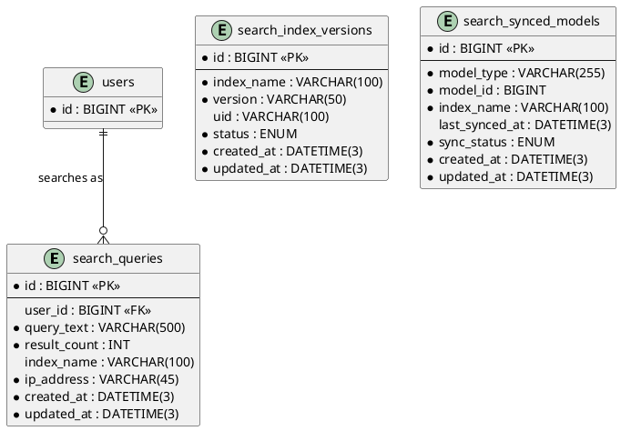

# 06.120 - Search

**Project:** GsmUi
**Domain:** Search
**Version:** 1.0.0

---

# Purpose

This document defines the search infrastructure schema: logged queries, Meilisearch index version tracking, and model sync tracking. The primary search engine is Meilisearch via Laravel Scout; these tables support analytics, debugging, and sync coordination.

---

# Tables

## search_queries

**Purpose:** Logged user search queries for analytics and autocomplete suggestions.

**Business Rules:**
- `user_id` is nullable — guest searches are tracked
- `query_text` stored as-is for analytics; Meilisearch handles the full-text index
- `result_count = 0` triggers zero-result suggestions
- No soft deletes — ephemeral analytics data

**Columns:**

| Column | Type | Nullable | Default | Notes |
|---|---|---|---|---|
| id | BIGINT UNSIGNED | NO | AUTO_INCREMENT | PK |
| user_id | BIGINT UNSIGNED | YES | NULL | FK → users.id |
| query_text | VARCHAR(500) | NO | — | Raw query |
| result_count | INT UNSIGNED | NO | 0 | Results returned |
| index_name | VARCHAR(100) | YES | NULL | Meilisearch index |
| ip_address | VARCHAR(45) | NO | — | IPv4 or IPv6 |
| created_at | DATETIME(3) | NO | CURRENT_TIMESTAMP(3) | |
| updated_at | DATETIME(3) | NO | CURRENT_TIMESTAMP(3) | ON UPDATE |

**Indexes:**

```
PRIMARY: id
INDEX: search_queries_user_id_index (user_id)
INDEX: search_queries_query_text_index (query_text(191))
INDEX: search_queries_created_at_index (created_at)
```

**Migration:**

```php
Schema::create('search_queries', function (Blueprint $table) {
    $table->id();
    $table->foreignId('user_id')->nullable()->constrained()->nullOnDelete();
    $table->string('query_text', 500);
    $table->unsignedInteger('result_count')->default(0);
    $table->string('index_name', 100)->nullable();
    $table->string('ip_address', 45);
    $table->timestamps();
    $table->index('query_text', 'search_queries_query_text_index');
});
```

---

## search_index_versions

**Purpose:** Tracks Meilisearch index versions for migration and rollback.

**Business Rules:**
- One record per index name + version combination
- `uid` is the Meilisearch index UID
- Status: `building` → `ready` or `failed`
- No soft deletes

**Columns:**

| Column | Type | Nullable | Default | Notes |
|---|---|---|---|---|
| id | BIGINT UNSIGNED | NO | AUTO_INCREMENT | PK |
| index_name | VARCHAR(100) | NO | — | Meilisearch index name |
| version | VARCHAR(50) | NO | — | Index schema version |
| uid | VARCHAR(100) | YES | NULL | Meilisearch UID |
| status | ENUM('building','ready','failed') | NO | 'building' | Build state |
| created_at | DATETIME(3) | NO | CURRENT_TIMESTAMP(3) | |
| updated_at | DATETIME(3) | NO | CURRENT_TIMESTAMP(3) | ON UPDATE |

**Indexes:**

```
PRIMARY: id
INDEX: search_index_versions_index_name_index (index_name)
INDEX: search_index_versions_status_index (status)
```

**Migration:**

```php
Schema::create('search_index_versions', function (Blueprint $table) {
    $table->id();
    $table->string('index_name', 100);
    $table->string('version', 50);
    $table->string('uid', 100)->nullable();
    $table->enum('status', ['building', 'ready', 'failed'])->default('building');
    $table->timestamps();
    $table->index('index_name');
    $table->index('status');
});
```

---

## search_synced_models

**Purpose:** Tracks which model entities are synced to Meilisearch (one record per entity).

**Business Rules:**
- One record per entity (unique on model_type + model_id)
- `sync_status` tracks pending/synced/failed
- `last_synced_at` updated on successful sync
- No soft deletes

**Columns:**

| Column | Type | Nullable | Default | Notes |
|---|---|---|---|---|
| id | BIGINT UNSIGNED | NO | AUTO_INCREMENT | PK |
| model_type | VARCHAR(255) | NO | — | Morph class |
| model_id | BIGINT UNSIGNED | NO | — | Entity ID |
| index_name | VARCHAR(100) | NO | — | Target index |
| last_synced_at | DATETIME(3) | YES | NULL | NULL = never synced |
| sync_status | ENUM('pending','synced','failed') | NO | 'pending' | Sync state |
| created_at | DATETIME(3) | NO | CURRENT_TIMESTAMP(3) | |
| updated_at | DATETIME(3) | NO | CURRENT_TIMESTAMP(3) | ON UPDATE |

**Indexes:**

```
PRIMARY: id
UNIQUE: search_synced_models_model_type_model_id_unique (model_type, model_id)
INDEX: search_synced_models_index_name_index (index_name)
INDEX: search_synced_models_sync_status_index (sync_status)
```

**Migration:**

```php
Schema::create('search_synced_models', function (Blueprint $table) {
    $table->id();
    $table->string('model_type');
    $table->unsignedBigInteger('model_id');
    $table->string('index_name', 100);
    $table->timestamp('last_synced_at')->nullable();
    $table->enum('sync_status', ['pending', 'synced', 'failed'])->default('pending');
    $table->timestamps();
    $table->unique(['model_type', 'model_id']);
    $table->index('index_name');
    $table->index('sync_status');
});
```

---

# PlantUML ERD



# Database Constraints

## Foreign Key Constraints

```sql
ALTER TABLE search_queries
  ADD CONSTRAINT fk_search_queries_user
    FOREIGN KEY (user_id) REFERENCES users(id)
    ON DELETE SET NULL
    ON UPDATE CASCADE;
```

Notes:
- `search_index_versions` and `search_synced_models` have no foreign keys: the index name is a Meilisearch-side resource, and synced models are polymorphic by design.
- `search_queries.user_id` uses `ON DELETE SET NULL` so analytics history survives account deletion (query text itself contains no personal data beyond the recorded raw string).

## Check Constraints

```sql
ALTER TABLE search_queries
  ADD CONSTRAINT chk_search_queries_text_not_empty
    CHECK (CHAR_LENGTH(query_text) > 0),
  ADD CONSTRAINT chk_search_queries_result_count
    CHECK (result_count >= 0);
```

## Unique Constraints

```sql
ALTER TABLE search_index_versions
  ADD CONSTRAINT uk_search_index_versions_name_version
    UNIQUE (index_name, version);

ALTER TABLE search_synced_models
  ADD CONSTRAINT uk_search_synced_models_model
    UNIQUE (model_type, model_id);
```

---

# Eloquent Models

## SearchQuery

```php
namespace App\Models;

use Illuminate\Database\Eloquent\Model;
use Illuminate\Database\Eloquent\Relations\BelongsTo;

class SearchQuery extends Model
{
    protected $guarded = [];

    protected $casts = [
        'result_count' => 'integer',
    ];

    public function user(): BelongsTo
    {
        return $this->belongsTo(User::class);
    }

    public function scopeZeroResults($query)
    {
        return $query->where('result_count', 0);
    }

    public function scopeRecent($query, int $days = 30)
    {
        return $query->where('created_at', '>=', now()->subDays($days));
    }
}
```

## SearchIndexVersion

```php
namespace App\Models;

use Illuminate\Database\Eloquent\Model;

class SearchIndexVersion extends Model
{
    protected $guarded = [];

    protected $casts = [
        'status' => \App\Enums\SearchIndexStatus::class,
    ];

    public function scopeReady($query)
    {
        return $query->where('status', 'ready');
    }

    public function isActive(): bool
    {
        return $this->status->value === 'ready'
            && $this->id === static::query()
                ->where('index_name', $this->index_name)
                ->where('status', 'ready')
                ->max('id');
    }
}
```

## SearchSyncedModel

```php
namespace App\Models;

use Illuminate\Database\Eloquent\Model;
use Illuminate\Database\Eloquent\Relations\MorphTo;

class SearchSyncedModel extends Model
{
    protected $guarded = [];

    public function model(): MorphTo
    {
        return $this->morphTo(__FUNCTION__, 'model_type', 'model_id');
    }

    public function scopePending($query)
    {
        return $query->where('sync_status', 'pending');
    }

    public function scopeFailed($query)
    {
        return $query->where('sync_status', 'failed');
    }

    public function scopeStale($query, int $minutes = 30)
    {
        return $query->where(function ($q) use ($minutes) {
            $q->whereNull('last_synced_at')
              ->orWhere('last_synced_at', '<', now()->subMinutes($minutes));
        });
    }
}
```

---

# Meilisearch Index Definitions

Meilisearch is the primary search engine, reached through Laravel Scout. Each
indexible domain model maps to a named index with explicit settings. Settings
are versioned: when settings change, a new `search_index_versions` row is
created with a new `version` tag and the index is rebuilt.

## Index Inventory

| Index Name | Source Model | Purpose |
|---|---|---|
| `components` | Component | Component search (docs, marketplace) |
| `products` | Product | Marketplace product search |
| `snippets` | Snippet | Code snippet search |
| `playground_projects` | PlaygroundProject | Gallery search |
| `doc_pages` | DocPage | Documentation search |
| `templates` | Template | Template marketplace search |
| `themes` | Theme | Theme marketplace search |
| `blog_posts` | ContentEntry (type=blog) | Blog search |
| `users_admin` | User (admin-only) | Admin user lookup |

## Index Settings: components

```php
// app/Search/Indexes/ComponentsIndex.php
class ComponentsIndex implements SearchIndexDefinition
{
    public const NAME = 'components';
    public const VERSION = 'v3';

    public function settings(): array
    {
        return [
            'searchableAttributes' => [
                'name',
                'slug',
                'description',
                'tag_names',
                'category_name',
            ],
            'filterableAttributes' => [
                'category_id',
                'is_pro',
                'version_status',
                'tag_ids',
            ],
            'sortableAttributes' => [
                'name',
                'view_count',
                'created_at',
            ],
            'rankingRules' => [
                'words',
                'typo',
                'proximity',
                'attribute',
                'sort',
                'exactness',
                'view_count:desc',
            ],
        ];
    }

    public function searchablePayload(Component $component): array
    {
        return [
            'id'            => $component->id,
            'name'          => $component->name,
            'slug'          => $component->slug,
            'description'   => $component->description,
            'category_id'   => $component->category_id,
            'category_name' => $component->category?->name,
            'tag_ids'       => $component->tags->pluck('id'),
            'tag_names'     => $component->tags->pluck('name')->implode(' '),
            'is_pro'        => $component->is_pro,
            'version_status'=> $component->version_status,
            'view_count'    => $component->view_count,
            'created_at'    => $component->created_at->timestamp,
        ];
    }
}
```

## Index Settings: products

```php
class ProductsIndex implements SearchIndexDefinition
{
    public const NAME = 'products';
    public const VERSION = 'v2';

    public function settings(): array
    {
        return [
            'searchableAttributes' => [
                'name', 'slug', 'short_description', 'author_name', 'tag_names',
            ],
            'filterableAttributes' => [
                'category_id', 'price_minor', 'is_free', 'avg_rating', 'gsmui_compat',
            ],
            'sortableAttributes' => [
                'price_minor', 'avg_rating', 'sales_count', 'created_at',
            ],
            'typoTolerance' => [
                'enabled' => true,
                'minWordSizeForTypos' => ['oneTypo' => 5, 'twoTypos' => 9],
            ],
        ];
    }
}
```

## Index Settings: doc_pages

```php
class DocPagesIndex implements SearchIndexDefinition
{
    public const NAME = 'doc_pages';
    public const VERSION = 'v2';

    public function settings(): array
    {
        return [
            'searchableAttributes' => ['title', 'headings', 'body_text'],
            'filterableAttributes' => ['space_id', 'version', 'locale'],
            'sortableAttributes' => ['sort_order'],
            'distinctAttribute' => null,
            'pagination' => ['maxTotalHits' => 1000],
        ];
    }
}
```

## Index Settings: snippets

```php
class SnippetsIndex implements SearchIndexDefinition
{
    public const NAME = 'snippets';
    public const VERSION = 'v1';

    public function settings(): array
    {
        return [
            'searchableAttributes' => ['title', 'description', 'tag_names', 'language'],
            'filterableAttributes' => ['language', 'category_id', 'tag_ids'],
            'sortableAttributes' => ['copy_count', 'view_count', 'created_at'],
        ];
    }
}
```

## Index Settings: users_admin (restricted)

Admin search never exposes this index to public-facing code paths. Access is
guarded by both application policy and a dedicated Meilisearch API key scoped
to this index only.

```php
class UsersAdminIndex implements SearchIndexDefinition
{
    public const NAME = 'users_admin';
    public const VERSION = 'v1';

    public function settings(): array
    {
        return [
            'searchableAttributes' => ['name', 'email', 'username'],
            'filterableAttributes' => ['role', 'status', 'created_at'],
            'sortableAttributes' => ['created_at', 'last_login_at'],
        ];
    }
}
```

---

# Scout Model Integration

All searchable models use the `Searchable` trait plus an explicit
`toSearchableArray()` and index mapping. The trait is wired globally in
`AppServiceProvider`.

```php
// app/Providers/AppServiceProvider.php
use Laravel\Scout\EngineManager;
use Meilisearch\Meilisearch;

public function boot(): void
{
    resolve(EngineManager::class)->extend('meilisearch', function () {
        return new MeilisearchEngine(
            new \Meilisearch\Client($this->app['meilisearch']),
            softDelete: true
        );
    });
}
```

## Component Model (Searchable)

```php
namespace App\Models;

use Laravel\Scout\Searchable;

class Component extends Model
{
    use Searchable;

    public function searchableAs(): string
    {
        return ComponentsIndex::NAME;
    }

    public function shouldBeSearchable(): bool
    {
        return $this->version_status === 'published';
    }

    public function toSearchableArray(): array
    {
        return app(ComponentsIndex::class)->searchablePayload($this);
    }

    /**
     * Mark this model for sync tracking when it is queued for indexing.
     */
    public function searchableUsingSyncTracker(): void
    {
        SearchSyncedModel::updateOrCreate(
            ['model_type' => static::class, 'model_id' => $this->id],
            ['index_name' => $this->searchableAs(), 'sync_status' => 'pending'],
        );
    }
}
```

## Product Model (Searchable)

```php
class Product extends Model
{
    use Searchable;

    public function searchableAs(): string
    {
        return ProductsIndex::NAME;
    }

    public function shouldBeSearchable(): bool
    {
        return $this->status === 'published' && $this->is_approved;
    }

    public function toSearchableArray(): array
    {
        return [
            'id'              => $this->id,
            'name'            => $this->name,
            'slug'            => $this->slug,
            'short_description' => $this->short_description,
            'author_name'     => $this->owner->name,
            'category_id'     => $this->category_id,
            'price_minor'     => (int) $this->currentPrice()?->amount ?? 0,
            'is_free'         => $this->is_free,
            'avg_rating'      => (float) $this->avg_rating,
            'sales_count'     => (int) $this->sales_count,
            'gsmui_compat'    => $this->max_compatible_version,
            'tag_names'       => $this->tags->pluck('name')->implode(' '),
            'created_at'      => $this->created_at->timestamp,
        ];
    }
}
```

## DocPage Model (Searchable)

```php
class DocPage extends Model
{
    use Searchable;

    public function searchableAs(): string
    {
        return DocPagesIndex::NAME;
    }

    public function shouldBeSearchable(): bool
    {
        return $this->status === 'published'
            && $this->version->is_default;
    }

    public function toSearchableArray(): array
    {
        $blocks = $this->blocks()
            ->where('type', 'text')
            ->pluck('content')
            ->map(fn ($md) => strip_tags(markdown_to_html($md)))
            ->implode(' ');

        return [
            'id'         => $this->id,
            'title'      => $this->title,
            'headings'   => $this->extractHeadings(),
            'body_text'  => $blocks,
            'space_id'   => $this->doc_space_id,
            'version'    => $this->version->version,
            'locale'     => $this->locale->code,
            'sort_order' => $this->sort_order,
        ];
    }
}
```

## SearchSync Tracker Observer

Rather than decorating every model, one observer keeps the sync tracker table
authoritative:

```php
namespace App\Observers;

use App\Models\SearchSyncedModel;
use Illuminate\Database\Eloquent\Model;

class SearchableSyncObserver
{
    public function saved(Model $model): void
    {
        if (! in_array(Searchable::class, class_uses_recursive($model))) {
            return;
        }

        SearchSyncedModel::updateOrCreate(
            ['model_type' => $model->getMorphClass(), 'model_id' => $model->getKey()],
            [
                'index_name' => $model->searchableAs(),
                'sync_status' => 'pending',
            ],
        );
    }

    public function deleted(Model $model): void
    {
        if (! in_array(Searchable::class, class_uses_recursive($model))) {
            return;
        }

        $model->unsearchable();

        SearchSyncedModel::where([
            'model_type' => $model->getMorphClass(),
            'model_id'   => $model->getKey(),
        ])->delete();
    }
}
```

Registration per-model in `AppServiceProvider`:

```php
Component::observe(SearchableSyncObserver::class);
Product::observe(SearchableSyncObserver::class);
DocPage::observe(SearchableSyncObserver::class);
Snippet::observe(SearchableSyncObserver::class);
PlaygroundProject::observe(SearchableSyncObserver::class);
```

---

# Index Versioning and Blue/Green Rebuilds

## Why Version Indexes

Index settings and payload shapes change over time (new searchable attribute,
typo tolerance tuning, payload field rename). A blue/green rebuild avoids
partial-state indexes during a reindex and lets us roll back by switching the
read alias back to the previous version.

## Version Lifecycle

```
                 register()
                     │
                     ▼
 ┌───────────┐   build    ┌───────────┐
 │ building  │───────────►│   ready   │
 └───────────┘            └───────────┘
       │                        │
       │ failed                 │ superseded
       ▼                        ▼
 ┌───────────┐            ┌───────────┐
 │  failed   │            │ retired   │ (kept for rollback)
 └───────────┘            └───────────┘
```

## Rebuild Job

```php
namespace App\Jobs;

use App\Models\SearchIndexVersion;
use Illuminate\Contracts\Queue\ShouldQueue;
use Laravel\Scout\Builder;

class RebuildSearchIndex implements ShouldQueue
{
    public int $tries = 1;
    public int $timeout = 3600;

    public function __construct(
        public string $indexName,
        public string $version,
    ) {}

    public function handle(SearchIndexDefinitionRegistry $registry): void
    {
        $definition = $registry->resolve($this->indexName);
        $stagingUid = "{$this->indexName}_{$this->version}_staging";

        $record = SearchIndexVersion::firstOrCreate(
            ['index_name' => $this->indexName, 'version' => $this->version],
            ['uid' => $stagingUid, 'status' => 'building'],
        );

        try {
            $client = app('meilisearch');
            $client->createIndex($stagingUid, ['primaryKey' => 'id']);
            $client->index($stagingUid)->updateSettings($definition->settings());

            // Bulk import in chunks
            $definition->modelClass()::query()
                ->searchable() // triggers Scout import
                ->when(method_exists($definition, 'importScope'),
                    fn ($q) => $definition->importScope($q))
                ->chunkByScout(500, function ($models) use ($stagingUid) {
                    // Scout handles batching via engine
                });

            // Wait for Meilisearch tasks to complete
            $client->waitForTasks(collect($client->getTasks())
                ->pluck('taskUid')->all());

            // Swap the alias atomically
            $client->swapIndexes([
                ['indexes' => [$this->indexName, $stagingUid]],
            ]);

            $record->update(['status' => 'ready', 'uid' => $this->indexName]);

            // Retire superseded versions
            SearchIndexVersion::where('index_name', $this->indexName)
                ->where('status', 'ready')
                ->where('id', '!=', $record->id)
                ->update(['status' => 'retired']);

        } catch (\Throwable $e) {
            $record->update(['status' => 'failed']);
            report($e);
            throw $e;
        }
    }
}
```

## Rollback Command

```bash
php artisan search:rollback components --to=v2
```

```php
// Swaps the live index back to a previously ready version
$target = SearchIndexVersion::where('index_name', 'components')
    ->where('version', 'v2')
    ->where('status', 'ready')
    ->firstOrFail();

app('meilisearch')->swapIndexes([
    ['indexes' => ['components', $target->uid]],
]);
```

---

# Sync Coordination

## Pending Sync Sweep Job

Runs every minute; picks up any model marked `pending` but not yet confirmed
synced by the engine round-trip.

```php
namespace App\Jobs;

use App\Models\SearchSyncedModel;

class SweepPendingSyncs implements ShouldQueue
{
    public function handle(): void
    {
        SearchSyncedModel::query()
            ->pending()
            ->stale(minutes: 5)
            ->orderBy('updated_at')
            ->limit(2000)
            ->get()
            ->groupBy('index_name')
            ->each(function ($group, $indexName) {
                $group->each(function ($tracker) {
                    $entity = $tracker->model;

                    if (! $entity) {
                        $tracker->delete(); // source row gone
                        return;
                    }

                    try {
                        $entity->searchable();
                        $tracker->update([
                            'sync_status' => 'synced',
                            'last_synced_at' => now(),
                        ]);
                    } catch (\Throwable $e) {
                        $tracker->update(['sync_status' => 'failed']);
                        report($e);
                    }
                });
            });
    }
}
```

Scheduler registration:

```php
// routes/console.php
Schedule::job(new SweepPendingSyncs)->everyMinute()->withoutOverlapping();
```

## Failure Retry with Backoff

```php
Schedule::job(new RetryFailedSyncs)
    ->everyFiveMinutes()
    ->withoutOverlapping();

// RetryFailedSyncs handles sync_status='failed' with exponential backoff
// tracked via updated_at spacing:
//   attempt 1: immediate, attempt 2: +5m, attempt 3: +25m, attempt 4: +2h
//   after attempt 4: alert on-call, mark as dead-letter via note
```

---

# Artisan Commands

### `search:reindex {index}`

Full rebuild of one index through the blue/green pipeline.

```bash
php artisan search:reindex components
php artisan search:reindex --all
```

```php
Artisan::command('search:reindex {index?}', function (?string $index) {
    $targets = $index
        ? [$index]
        : resolve(SearchIndexDefinitionRegistry::class)->names();

    foreach ($targets as $name) {
        $version = $this->resolveNextVersion($name);
        dispatch(new RebuildSearchIndex($name, $version));
        $this->line("Queued rebuild: {$name} → {$version}");
    }
});
```

### `search:sync-pending`

Manually triggers the pending sweep (same logic as the scheduled job).

### `search:stats`

Reports index health.

```bash
$ php artisan search:stats
Index                Version   Status   Entities   Pending   Failed
components           v3        ready    1,204      3         0
products             v2        ready    8,455      12        1
snippets             v1        ready    2,311      0         0
doc_pages            v2        ready    4,002      0         0
playground_projects  v1        ready    977        0         0

Queries today: 14,203   Zero-result rate: 4.2%
```

### `search:prune-queries`

Deletes `search_queries` rows older than the retention window.

```bash
php artisan search:prune-queries --days=180
```

---

# Query Patterns

## Log a Search

```php
SearchQuery::create([
    'user_id'      => auth()->id(),
    'query_text'   => $query,
    'result_count' => $results->total(),
    'index_name'   => $index,
    'ip_address'   => request()->ip(),
]);
```

Logging is fire-and-forget via an `after` search hook so it never blocks the
response:

```php
// app/Search/SearchService.php
public function search(string $index, string $query, array $filters = []): SearchResult
{
    $t0 = microtime(true);
    $results = app('meilisearch')->index($index)->search($query, [
        'filter' => $filters,
        'limit'  => 20,
    ]);
    $latencyMs = (int) round((microtime(true) - $t0) * 1000);

    dispatch(new LogSearchQuery(
        query: $query,
        index: $index,
        count: $results->getEstimatedTotalHits(),
        latencyMs: $latencyMs,
    ))->afterResponse();

    return SearchResult::fromMeili($results);
}
```

## Top Queries (Analytics)

```sql
SELECT
  LOWER(TRIM(query_text)) AS q,
  COUNT(*) AS searches,
  ROUND(AVG(result_count), 1) AS avg_results,
  SUM(CASE WHEN result_count = 0 THEN 1 ELSE 0 END) AS zero_results
FROM search_queries
WHERE created_at >= NOW() - INTERVAL 30 DAY
GROUP BY q
ORDER BY searches DESC
LIMIT 50;
```

```php
SearchQuery::selectRaw('LOWER(TRIM(query_text)) as q, COUNT(*) as searches')
    ->recent(30)
    ->groupBy('q')
    ->orderByDesc('searches')
    ->limit(50)
    ->get();
```

## Zero-Result Analysis

Drives the "did you mean" / synonym gap backlog:

```sql
SELECT query_text, COUNT(*) AS misses
FROM search_queries
WHERE result_count = 0
  AND created_at >= NOW() - INTERVAL 7 DAY
  AND CHAR_LENGTH(query_text) >= 3
GROUP BY query_text
ORDER BY misses DESC
LIMIT 100;
```

## Autocomplete Suggestions

Suggestions come from the top-query cache rather than a live scan:

```php
$suggestions = Cache::remember('search:suggestions', 3600, function () {
    return DB::table('search_queries')
        ->where('created_at', '>=', now()->subDays(30))
        ->where('result_count', '>', 0)
        ->selectRaw('LOWER(TRIM(query_text)) as q')
        ->groupBy('q')
        ->havingRaw('COUNT(*) >= 5')
        ->orderByRaw('COUNT(*) DESC')
        ->limit(500)
        ->pluck('q');
});
```

## Stale Sync Detection

```sql
SELECT model_type, COUNT(*) AS stale_count
FROM search_synced_models
WHERE sync_status = 'pending'
  AND (last_synced_at IS NULL OR last_synced_at < NOW() - INTERVAL 10 MINUTE)
GROUP BY model_type;
```

## Sync Coverage Audit

```sql
SELECT
  index_name,
  SUM(sync_status = 'synced') AS synced,
  SUM(sync_status = 'pending') AS pending,
  SUM(sync_status = 'failed') AS failed,
  COUNT(*) AS total
FROM search_synced_models
GROUP BY index_name;
```

---

# Caching Strategy

| Key | Value | TTL | Invalidation |
|---|---|---|---|
| `search:suggestions` | Top query strings | 1 hour | Time-based |
| `search:index_settings:{index}` | Effective index settings | 24 hours | On reindex complete |
| `search:latency:{index}` | Rolling p95 latency | 5 minutes | Time-based |
| `search:zero_rate:{index}` | Zero-result rate | 1 hour | Time-based |

Zero-result rate drives an alert threshold: if `search:zero_rate:*` exceeds 15%
for any index over 1 hour, the on-call channel is notified (synonym gap or
broken index).

---

# Seeding Strategy

## Seed Known Synonym Backlog from Zero-Result Queries

```php
class SearchQuerySeeder extends Seeder
{
    public function run(): void
    {
        $samples = [
            ['query_text' => 'date picker', 'result_count' => 12, 'index_name' => 'components'],
            ['query_text' => 'datepicker',  'result_count' => 12, 'index_name' => 'components'],
            ['query_text' => 'select',      'result_count' => 25, 'index_name' => 'components'],
            ['query_text' => 'dropdown',    'result_count' => 0,  'index_name' => 'components'],
            ['query_text' => 'modal',       'result_count' => 8,  'index_name' => 'components'],
            ['query_text' => 'dialog',      'result_count' => 8,  'index_name' => 'components'],
        ];

        foreach ($samples as $s) {
            SearchQuery::create($s + ['ip_address' => '0.0.0.0']);
        }
    }
}
```

## Factory

```php
class SearchQueryFactory extends Factory
{
    protected $model = SearchQuery::class;

    public function definition(): array
    {
        return [
            'user_id'      => $this->faker->boolean(70) ? User::factory() : null,
            'query_text'   => $this->faker->randomElement([
                'date picker', 'button', 'card layout', 'dark mode',
                'typography', 'navbar', 'sidebar', 'form validation',
            ]),
            'result_count' => $this->faker->numberBetween(0, 40),
            'index_name'   => $this->faker->randomElement([
                'components', 'products', 'doc_pages', 'snippets',
            ]),
            'ip_address'   => $this->faker->ipv4(),
        ];
    }

    public function zeroResult(): static
    {
        return $this->state(['result_count' => 0]);
    }
}
```

---

# API Contracts

## GET /api/search?q={query}&index={index}

**Purpose:** Public search endpoint with logging.

**Response (200):**

```json
{
  "query": "date picker",
  "index": "components",
  "hits": [
    { "id": 42, "name": "Date Picker", "slug": "date-picker", "rank": 1 },
    { "id": 87, "name": "Date Range Picker", "slug": "date-range-picker", "rank": 2 }
  ],
  "total": 12,
  "processing_time_ms": 3
}
```

## GET /api/search/suggest?q={prefix}

**Purpose:** Autocomplete typeahead backed by the suggestions cache.

**Response (200):**

```json
{
  "suggestions": ["date picker", "date range picker", "date format"]
}
```

## GET /api/admin/search/analytics

**Purpose:** Admin analytics on query volume and zero-result rate.

**Response (200):**

```json
{
  "period": "30d",
  "total_queries": 142030,
  "zero_result_rate": 0.042,
  "top_queries": [
    { "query": "select", "searches": 4211, "avg_results": 25.1 },
    { "query": "button", "searches": 3872, "avg_results": 18.4 }
  ],
  "top_zero_result": [
    { "query": "dropdown", "misses": 412 }
  ]
}
```

---

# Testing Scenarios

## Unit Tests

| Test | Expected |
|---|---|
| Log search with guest user | user_id NULL, row created |
| Zero result scope filters correctly | Only result_count=0 rows |
| Index version isActive logic | Highest ready version wins |
| Searchable shouldBeSearchable gate | Unpublished excluded |
| Sync tracker marks pending on save | Row created with pending status |

```php
public function test_search_logging_records_zero_results(): void
{
    SearchQuery::create([
        'query_text' => 'nonexistent widget',
        'result_count' => 0,
        'index_name' => 'components',
        'ip_address' => '127.0.0.1',
    ]);

    $this->assertSame(1, SearchQuery::zeroResults()->count());
}
```

## Integration Tests

| Test | Expected |
|---|---|
| Full reindex swaps index atomically | search_index_versions status transitions building → ready |
| Sweep pending marks synced | sync_status + last_synced_at updated |
| Failed sync retries with backoff | Attempt counts increase, alert after 4 |
| Autocomplete returns cached suggestions | <5ms, correct results |
| Search latency logged | processing_time_ms captured |

```php
public function test_sweep_syncs_pending_models(): void
{
    $component = Component::factory()->published()->create();
    SearchSyncedModel::create([
        'model_type' => Component::class,
        'model_id' => $component->id,
        'index_name' => 'components',
        'sync_status' => 'pending',
    ]);

    (new SweepPendingSyncs)->handle();

    $this->assertDatabaseHas('search_synced_models', [
        'model_id' => $component->id,
        'sync_status' => 'synced',
    ]);
}
```

---

# Performance Considerations

## Index Usage

| Query | Index Used |
|---|---|
| Top queries aggregation | `search_queries_created_at_index` (range) + prefix scan on query_text |
| Zero-result analysis | `search_queries_created_at_index` |
| Stale sync detection | `search_synced_models_sync_status_index` |
| Synced model lookup | `search_synced_models_model_type_model_id_unique` |

## Table Growth Projections

| Table | Year 1 | Year 3 | Year 5 |
|---|---|---|---|
| `search_queries` | 1M | 5M | 12M |
| `search_index_versions` | ~50 | ~150 | ~300 |
| `search_synced_models` | 15K | 40K | 80K |

## Partitioning

`search_queries` is the only candidate — partition by month on `created_at`
once it exceeds ~2M rows, mirroring the activity_logs pattern:

```sql
ALTER TABLE search_queries
PARTITION BY RANGE (TO_DAYS(created_at)) (
  PARTITION p2024_01 VALUES LESS THAN (TO_DAYS('2024-02-01')),
  PARTITION p2024_02 VALUES LESS THAN (TO_DAYS('2024-03-01')),
  PARTITION p2024_03 VALUES LESS THAN (TO_DAYS('2024-04-01')),
  PARTITION p_future VALUES LESS THAN MAXVALUE
);
```

Retention drops partitions rather than DELETE-scanning millions of rows.

## Batch Write Optimization

Search logging is batched via `afterResponse()` dispatch to avoid serializing it
in the request path. Under load, LogSearchQuery jobs are queued and bulk-inserted:

```php
SearchQuery::insert($batch); // up to 500 rows per insert
```

---

# Monitoring Queries

## Daily Health Check

```sql
-- Search volume and zero-result rate
SELECT
  DATE(created_at) AS day,
  COUNT(*) AS queries,
  SUM(result_count = 0) AS zero_results,
  ROUND(SUM(result_count = 0) * 100.0 / COUNT(*), 2) AS zero_rate_pct
FROM search_queries
WHERE created_at >= NOW() - INTERVAL 7 DAY
GROUP BY DATE(created_at)
ORDER BY day DESC;

-- Sync backlog by index
SELECT index_name, sync_status, COUNT(*) AS cnt
FROM search_synced_models
GROUP BY index_name, sync_status;

-- Index version freshness
SELECT index_name, version, status, updated_at
FROM search_index_versions
ORDER BY index_name, id DESC;
```

## Alert Conditions

| Metric | Threshold | Action |
|---|---|---|
| Zero-result rate (1h window) | > 15% | Page on-call: synonym gap or broken index |
| Sync pending (>10 min) | > 500 models | Page on-call: queue stall |
| Sync failed (>1h) | > 100 models | Page on-call: engine outage |
| Reindex stuck in building | > 2 hours | Inspect RebuildSearchIndex job |

---

# GDPR Compliance

- `search_queries.user_id` is personal data: redacted (`SET NULL`) on account deletion.
- `query_text` itself is treated as potentially personal (users may search their
  own names or emails). Retention is capped at 180 days via `search:prune-queries`.
- The admin users index (`users_admin`) contains email addresses and is
  restricted to holders of `search:admin` permission; it is excluded from
  any export or webhook integration.

```sql
UPDATE search_queries SET user_id = NULL WHERE user_id = :deletedUserId;
```

---

# Backup and Recovery

| Table | Backup Frequency | Retention | Method |
|---|---|---|---|
| `search_queries` | Daily | 30 days | Incremental + partition drop beyond 180d |
| `search_index_versions` | Daily | 90 days | Full dump (tiny) |
| `search_synced_models` | Daily | 90 days | Full dump; rebuilt by reindex if lost |

`search_synced_models` is regenerable: a full reindex of every index rebuilds
the tracker table. It is therefore the lowest-priority table to restore.

**Scenario: Meilisearch data loss**

1. `search:reindex --all` — rebuilds every index from the database source of truth.
2. Reset tracker: `UPDATE search_synced_models SET sync_status='pending';`
3. Sweep runs and confirms every entity synced.

The database remains the source of truth; Meilisearch is a derived replica.

---

# Disaster Recovery

| Metric | Target | Strategy |
|---|---|---|
| RPO | 15 minutes | Meilisearch is derived; MySQL binlog covers source tables |
| RTO | 30 minutes | Full reindex from database for affected indexes |

Search is degraded gracefully: if the engine is unreachable, the application
falls back to database `LIKE` queries against indexed columns (slower, lower
quality, but functional). The fallback is logged and alerted on.

---

# Integration Patterns

## Webhook Payload

```json
{
  "event": "search.zero_result_spike",
  "timestamp": "2024-06-30T10:30:00Z",
  "data": {
    "index": "components",
    "window": "1h",
    "zero_result_rate": 0.18,
    "top_missed_queries": ["dropdown", "combobox", "multiselect"]
  }
}
```

## Event Listener

```php
class AlertOnZeroResultSpike
{
    public function handle(): void
    {
        $rate = Cache::get('search:zero_rate:components');
        if ($rate > 0.15) {
            Notification::route('slack', config('alerts.slack.webhook'))
                ->notify(new ZeroResultSpikeNotification('components', $rate));
        }
    }
}
```

---

# Security Considerations

### Access Control

- Public search: rate-limited 60 req/min per IP (throttle:search middleware).
- Admin user index: separate Meilisearch API key scoped to `users_admin` only;
  application enforces `Gate::allows('search-admin')`.
- Search logging never stores auth headers or tokens.

### Input Sanitization

- `query_text` is stored as-is for analytics but truncated to 500 chars on ingest.
- Query text is never interpolated into Meilisearch filter syntax; filters are
  parameterized by the application, not by user input.
- Reflected XSS risk: search terms rendered back to the page are escaped by Blade.

### Abuse Prevention

| Pattern | Detection | Response |
|---|---|---|
| Query flooding | >60 req/min per IP | 429 + temporary block |
| Index enumeration via filter fuzzing | Unusual filter param volume | Alert + block |
| PII harvesting via admin index | Non-admin access attempt | 403 + audit log |

---

# Event Hooks

| Event | Fired When | Payload |
|---|---|---|
| `SearchIndexBuilt` | Rebuild reaches `ready` | `SearchIndexVersion $version` |
| `SearchIndexFailed` | Rebuild reaches `failed` | `SearchIndexVersion $version` |
| `SearchSyncStalled` | Pending sweep finds >500 stale | `int $count, string $index` |
| `ZeroResultSpike` | Alert threshold exceeded | `string $index, float $rate` |

---

# Performance Benchmarks

| Operation | Target | Max | Notes |
|---|---|---|---|
| Public search query (Meilisearch) | ≤ 20ms p95 | 100ms | Engine-side |
| Search logging overhead (async) | ≤ 1ms p95 | 10ms | afterResponse dispatch |
| Autocomplete suggest | ≤ 5ms p95 | 50ms | Cache hit |
| Full reindex (10K entities) | ≤ 10 min | 30 min | Blue/green |
| Pending sweep (per run) | ≤ 30s | 2 min | 2000-row cap |

---

# Testing Matrix

| Test Class | Method | Input | Expected |
|---|---|---|---|
| SearchQueryTest | log | valid query | row created |
| SearchQueryTest | zero scope | mixed results | filtered |
| SearchIndexVersionTest | isActive | multiple versions | latest ready wins |
| SearchSyncedModelTest | stale scope | old timestamps | filtered |
| RebuildSearchIndexTest | handle | valid settings | building→ready transition |
| SweepPendingSyncsTest | handle | pending rows | synced updates |

---

# Change Log

## Version 1.0.0

- Initial `search_queries`, `search_index_versions`, `search_synced_models` schema
- Meilisearch index definitions with versioned settings
- Scout integration with per-model searchable payloads
- Blue/green index rebuild pipeline with atomic alias swap
- Pending/failed sync sweep jobs with backoff retry
- Query analytics: top queries, zero-result analysis, autocomplete
- GDPR redaction and 180-day query retention
- Partitioning strategy for `search_queries`

---

# Raw SQL DDL Reference

MySQL 8.0+ DDL as implemented by the Laravel migrations (for DBA review and
cross-tooling parity).

## search_queries

```sql
CREATE TABLE `search_queries` (
  `id` BIGINT UNSIGNED NOT NULL AUTO_INCREMENT,
  `user_id` BIGINT UNSIGNED NULL,
  `query_text` VARCHAR(500) NOT NULL,
  `result_count` INT UNSIGNED NOT NULL DEFAULT 0,
  `index_name` VARCHAR(100) NULL,
  `ip_address` VARCHAR(45) NOT NULL,
  `created_at` DATETIME(3) NOT NULL DEFAULT CURRENT_TIMESTAMP(3),
  `updated_at` DATETIME(3) NOT NULL DEFAULT CURRENT_TIMESTAMP(3)
    ON UPDATE CURRENT_TIMESTAMP(3),
  PRIMARY KEY (`id`),
  KEY `search_queries_user_id_index` (`user_id`),
  KEY `search_queries_query_text_index` (`query_text`(191)),
  KEY `search_queries_created_at_index` (`created_at`),
  KEY `idx_search_queries_index_created` (`index_name`, `created_at`),
  CONSTRAINT `fk_search_queries_user`
    FOREIGN KEY (`user_id`) REFERENCES `users` (`id`) ON DELETE SET NULL,
  CONSTRAINT `chk_search_queries_text_not_empty`
    CHECK (CHAR_LENGTH(`query_text`) > 0)
) ENGINE=InnoDB DEFAULT CHARSET=utf8mb4 COLLATE=utf8mb4_unicode_ci
  ROW_FORMAT=DYNAMIC;
```

## search_index_versions

```sql
CREATE TABLE `search_index_versions` (
  `id` BIGINT UNSIGNED NOT NULL AUTO_INCREMENT,
  `index_name` VARCHAR(100) NOT NULL,
  `version` VARCHAR(50) NOT NULL,
  `uid` VARCHAR(100) NULL,
  `status` ENUM('building','ready','failed') NOT NULL DEFAULT 'building',
  `created_at` DATETIME(3) NOT NULL DEFAULT CURRENT_TIMESTAMP(3),
  `updated_at` DATETIME(3) NOT NULL DEFAULT CURRENT_TIMESTAMP(3)
    ON UPDATE CURRENT_TIMESTAMP(3),
  PRIMARY KEY (`id`),
  UNIQUE KEY `uk_search_index_versions_name_version` (`index_name`, `version`),
  KEY `search_index_versions_index_name_index` (`index_name`),
  KEY `search_index_versions_status_index` (`status`)
) ENGINE=InnoDB DEFAULT CHARSET=utf8mb4 COLLATE=utf8mb4_unicode_ci;
```

Note: the migration enumerates `building|ready|failed`; the blue/green pipeline
also writes `retired` for superseded versions. The enum must include it:
`ENUM('building','ready','failed','retired')`. The v1.0.1 migration applies:

```sql
ALTER TABLE search_index_versions
  MODIFY status ENUM('building','ready','failed','retired') NOT NULL DEFAULT 'building';
```

## search_synced_models

```sql
CREATE TABLE `search_synced_models` (
  `id` BIGINT UNSIGNED NOT NULL AUTO_INCREMENT,
  `model_type` VARCHAR(255) NOT NULL,
  `model_id` BIGINT UNSIGNED NOT NULL,
  `index_name` VARCHAR(100) NOT NULL,
  `last_synced_at` DATETIME(3) NULL,
  `sync_status` ENUM('pending','synced','failed') NOT NULL DEFAULT 'pending',
  `attempt_count` TINYINT UNSIGNED NOT NULL DEFAULT 0,
  `created_at` DATETIME(3) NOT NULL DEFAULT CURRENT_TIMESTAMP(3),
  `updated_at` DATETIME(3) NOT NULL DEFAULT CURRENT_TIMESTAMP(3)
    ON UPDATE CURRENT_TIMESTAMP(3),
  PRIMARY KEY (`id`),
  UNIQUE KEY `uk_search_synced_models_model` (`model_type`, `model_id`),
  KEY `search_synced_models_index_name_index` (`index_name`),
  KEY `search_synced_models_sync_status_index` (`sync_status`),
  KEY `idx_search_synced_models_status_updated` (`sync_status`, `updated_at`)
) ENGINE=InnoDB DEFAULT CHARSET=utf8mb4 COLLATE=utf8mb4_unicode_ci;
```

`attempt_count` supports the exponential backoff policy described in the Sync
Coordination section (v1.0.1 addition).

---

# Views

## vw_search_query_stats

Daily rollup used by the admin analytics dashboard.

```sql
CREATE VIEW vw_search_query_stats AS
SELECT
  DATE(created_at) AS day,
  COALESCE(index_name, 'unknown') AS index_name,
  COUNT(*) AS queries,
  SUM(result_count = 0) AS zero_results,
  ROUND(SUM(result_count = 0) * 100.0 / COUNT(*), 2) AS zero_rate_pct,
  ROUND(AVG(result_count), 1) AS avg_results,
  COUNT(DISTINCT user_id) AS distinct_users
FROM search_queries
GROUP BY DATE(created_at), COALESCE(index_name, 'unknown')
ORDER BY day DESC;
```

## vw_search_top_queries

Materialized-style view for the top-queries widget (cheap enough to query live
against the 30-day window; for larger windows use the cache).

```sql
CREATE VIEW vw_search_top_queries AS
SELECT
  LOWER(TRIM(query_text)) AS q,
  COALESCE(index_name, 'unknown') AS index_name,
  COUNT(*) AS searches,
  ROUND(AVG(result_count), 1) AS avg_results,
  SUM(result_count = 0) AS zero_results
FROM search_queries
WHERE created_at >= NOW() - INTERVAL 30 DAY
GROUP BY LOWER(TRIM(query_text)), COALESCE(index_name, 'unknown');
```

## vw_index_health

One row per index with live sync and version health for the status page.

```sql
CREATE VIEW vw_index_health AS
SELECT
  siv.index_name,
  MAX(CASE WHEN siv.status = 'ready' THEN siv.version END) AS active_version,
  MAX(CASE WHEN siv.status = 'building' THEN 1 ELSE 0 END) AS rebuild_in_progress,
  (SELECT COUNT(*) FROM search_synced_models ssm
    WHERE ssm.index_name = siv.index_name AND ssm.sync_status = 'pending') AS pending_syncs,
  (SELECT COUNT(*) FROM search_synced_models ssm
    WHERE ssm.index_name = siv.index_name AND ssm.sync_status = 'failed') AS failed_syncs,
  (SELECT COUNT(*) FROM search_synced_models ssm
    WHERE ssm.index_name = siv.index_name) AS tracked_entities
FROM search_index_versions siv
GROUP BY siv.index_name;
```

---

# Triggers

## trg_search_queries_before_insert

Caps query length and sanitizes whitespace-only payloads early (defense in
depth alongside the CHECK constraint).

```sql
DELIMITER //
CREATE TRIGGER trg_search_queries_before_insert
BEFORE INSERT ON search_queries
FOR EACH ROW
BEGIN
  SET NEW.query_text = TRIM(NEW.query_text);

  IF CHAR_LENGTH(NEW.query_text) = 0 THEN
    SIGNAL SQLSTATE '45000' SET MESSAGE_TEXT = 'query_text must not be empty';
  END IF;

  IF CHAR_LENGTH(NEW.query_text) > 500 THEN
    SET NEW.query_text = LEFT(NEW.query_text, 500);
  END IF;

  IF NEW.ip_address IS NULL OR CHAR_LENGTH(NEW.ip_address) = 0 THEN
    SET NEW.ip_address = '0.0.0.0';
  END IF;
END //
DELIMITER ;
```

## trg_search_synced_models_before_update

Guards backoff state transitions: `attempt_count` never decreases except when
status returns to `pending` (fresh attempt cycle).

```sql
DELIMITER //
CREATE TRIGGER trg_search_synced_models_before_update
BEFORE UPDATE ON search_synced_models
FOR EACH ROW
BEGIN
  IF NEW.sync_status = 'pending' AND OLD.sync_status <> 'pending' THEN
    SET NEW.last_synced_at = NULL;
    SET NEW.attempt_count = 0;
  END IF;

  IF NEW.sync_status = 'failed' AND NEW.attempt_count = OLD.attempt_count THEN
    SET NEW.attempt_count = OLD.attempt_count + 1;
  END IF;
END //
DELIMITER ;
```

---

# Stored Procedures

## sp_log_search_query

Insert helper used by the logging job with light-weight validation.

```sql
DELIMITER //
CREATE PROCEDURE sp_log_search_query(
  IN p_user_id BIGINT UNSIGNED,
  IN p_query_text VARCHAR(500),
  IN p_result_count INT UNSIGNED,
  IN p_index_name VARCHAR(100),
  IN p_ip_address VARCHAR(45)
)
BEGIN
  DECLARE t VARCHAR(500);

  SET t = TRIM(p_query_text);

  IF CHAR_LENGTH(t) = 0 THEN
    SIGNAL SQLSTATE '45000' SET MESSAGE_TEXT = 'query_text required';
  END IF;

  INSERT INTO search_queries
    (user_id, query_text, result_count, index_name, ip_address, created_at, updated_at)
  VALUES
    (p_user_id, LEFT(t, 500), p_result_count, p_index_name, p_ip_address, NOW(3), NOW(3));
END //
DELIMITER ;
```

## sp_register_index_version

Registers a new index version and retires prior ready versions atomically.

```sql
DELIMITER //
CREATE PROCEDURE sp_register_index_version(
  IN p_index_name VARCHAR(100),
  IN p_version VARCHAR(50),
  IN p_uid VARCHAR(100),
  OUT p_status VARCHAR(50)
)
BEGIN
  DECLARE v_existing INT DEFAULT 0;

  DECLARE EXIT HANDLER FOR SQLEXCEPTION
  BEGIN
    ROLLBACK;
    SET p_status = 'error';
    RESIGNAL;
  END;

  SELECT COUNT(*) INTO v_existing
  FROM search_index_versions
  WHERE index_name = p_index_name AND version = p_version;

  IF v_existing > 0 THEN
    SET p_status = 'version_exists';
  ELSE
    START TRANSACTION;

    UPDATE search_index_versions
    SET status = 'retired', updated_at = NOW(3)
    WHERE index_name = p_index_name AND status = 'ready';

    INSERT INTO search_index_versions
      (index_name, version, uid, status, created_at, updated_at)
    VALUES
      (p_index_name, p_version, p_uid, 'ready', NOW(3), NOW(3));

    COMMIT;
    SET p_status = 'registered';
  END IF;
END //
DELIMITER ;
```

## sp_retry_failed_syncs

Claims a batch of failed sync trackers for retry with backoff spacing.

```sql
DELIMITER //
CREATE PROCEDURE sp_retry_failed_syncs(
  IN p_limit INT,
  OUT p_claimed INT
)
BEGIN
  SELECT COUNT(*) INTO p_claimed
  FROM search_synced_models
  WHERE sync_status = 'failed'
    AND attempt_count < 4
    AND updated_at < DATE_SUB(NOW(3),
          INTERVAL POW(5, attempt_count) MINUTE)
  LIMIT p_limit;

  UPDATE search_synced_models
  SET sync_status = 'pending', updated_at = NOW(3)
  WHERE sync_status = 'failed'
    AND attempt_count < 4
    AND updated_at < DATE_SUB(NOW(3),
          INTERVAL POW(5, attempt_count) MINUTE)
  LIMIT p_limit;
END //
DELIMITER ;
```

Backoff intervals by attempt: 1 → 5 min, 2 → 25 min, 3 → 125 min (~2h).
`attempt_count` ≥ 4 rows are dead-lettered and surface in the alert query.

---

# Meilisearch Settings JSON Reference

Canonical settings payloads applied during index builds. These mirror the PHP
index definition classes and are stored here for operational reference (e.g.,
manual rebuild via the Meilisearch dashboard).

## components

```json
{
  "searchableAttributes": ["name", "slug", "description", "tag_names", "category_name"],
  "filterableAttributes": ["category_id", "is_pro", "version_status", "tag_ids"],
  "sortableAttributes": ["name", "view_count", "created_at"],
  "rankingRules": [
    "words", "typo", "proximity", "attribute", "sort", "exactness", "view_count:desc"
  ],
  "typoTolerance": {
    "enabled": true,
    "minWordSizeForTypos": { "oneTypo": 4, "twoTypos": 8 }
  },
  "faceting": { "maxValuesPerFacet": 200 },
  "pagination": { "maxTotalHits": 1000 }
}
```

## products

```json
{
  "searchableAttributes": ["name", "slug", "short_description", "author_name", "tag_names"],
  "filterableAttributes": ["category_id", "price_minor", "is_free", "avg_rating", "gsmui_compat"],
  "sortableAttributes": ["price_minor", "avg_rating", "sales_count", "created_at"],
  "typoTolerance": {
    "enabled": true,
    "minWordSizeForTypos": { "oneTypo": 5, "twoTypos": 9 }
  }
}
```

## doc_pages

```json
{
  "searchableAttributes": ["title", "headings", "body_text"],
  "filterableAttributes": ["space_id", "version", "locale"],
  "sortableAttributes": ["sort_order"],
  "pagination": { "maxTotalHits": 1000 },
  "stopWords": ["the", "a", "an", "of", "to", "in", "on", "for", "with"]
}
```

## snippets

```json
{
  "searchableAttributes": ["title", "description", "tag_names", "language"],
  "filterableAttributes": ["language", "category_id", "tag_ids"],
  "sortableAttributes": ["copy_count", "view_count", "created_at"]
}
```

## users_admin

```json
{
  "searchableAttributes": ["name", "email", "username"],
  "filterableAttributes": ["role", "status", "created_at"],
  "sortableAttributes": ["created_at", "last_login_at"]
}
```

---

# Synonym Management

Synonyms are applied at index build time from a curated map. The zero-result
backlog query (above) feeds this map.

```php
// app/Search/Synonyms.php
class Synonyms
{
    public static function map(): array
    {
        return [
            'dropdown'   => ['select'],
            'combobox'   => ['select'],
            'multiselect'=> ['select'],
            'datepicker' => ['date picker', 'date-picker'],
            'modal'      => ['dialog', 'popup'],
            'popup'      => ['dialog', 'modal'],
            'navbar'     => ['navigation', 'nav'],
            'sidebar'    => ['navigation'],
            'toggle'     => ['switch'],
            'spinner'    => ['loading', 'loader'],
        ];
    }
}
```

Applied during rebuild:

```php
$client->index($indexName)->updateSynonyms(Synonyms::map());
```

---

# Data Migration Patterns

## Migrating from Algolia

```php
// 1. Register initial index versions for all indexes
foreach (resolve(SearchIndexDefinitionRegistry::class)->all() as $def) {
    SearchIndexVersion::create([
        'index_name' => $def::NAME,
        'version'    => $def::VERSION,
        'uid'        => $def::NAME,
        'status'     => 'building',
    ]);
}

// 2. Import all entities from source of truth (database)
$this->call('search:reindex', ['--all' => true]);

// 3. Backfill search_queries from legacy analytics export (CSV)
foreach (Csv::rows(storage_path('legacy/algo_queries.csv')) as $row) {
    SearchQuery::create([
        'query_text'   => $row['query'],
        'result_count' => (int) $row['hits'],
        'index_name'   => $row['index'],
        'ip_address'   => '0.0.0.0', // legacy exports carried no IPs
        'created_at'   => $row['timestamp'],
    ]);
}

// 4. Mark versions ready once Meilisearch tasks confirm completion
```

## Backfilling search_synced_models After Reindex

```php
Component::where('version_status', 'published')
    ->chunkById(1000, function ($batch) {
        SearchSyncedModel::upsert(
            $batch->map(fn ($m) => [
                'model_type' => Component::class,
                'model_id' => $m->id,
                'index_name' => 'components',
                'sync_status' => 'synced',
                'last_synced_at' => now(),
            ])->all(),
            ['model_type', 'model_id'],
            ['sync_status', 'last_synced_at'],
        );
    });
```

Repeat per searchable model class. The sweep job then reconciles drift.

---

# Advanced Query Patterns

## Query Session Analysis

Identify abandoned search sessions (search → zero results → no follow-up):

```sql
SELECT
  sq1.user_id,
  sq1.query_text AS failed_query,
  sq1.created_at AS failed_at
FROM search_queries sq1
WHERE sq1.result_count = 0
  AND sq1.created_at >= NOW() - INTERVAL 7 DAY
  AND NOT EXISTS (
    SELECT 1 FROM search_queries sq2
    WHERE sq2.user_id <=> sq1.user_id
      AND sq2.ip_address = sq1.ip_address
      AND sq2.created_at > sq1.created_at
      AND sq2.created_at < sq1.created_at + INTERVAL 5 MINUTE
  );
```

## Index Popularity vs Quality

```sql
SELECT
  index_name,
  COUNT(*) AS queries,
  ROUND(AVG(result_count), 1) AS avg_results,
  ROUND(SUM(result_count = 0) * 100.0 / COUNT(*), 2) AS zero_rate
FROM search_queries
WHERE created_at >= NOW() - INTERVAL 30 DAY
GROUP BY index_name
ORDER BY queries DESC;
```

## Failed Syncs by Retry Attempt

```sql
SELECT attempt_count, COUNT(*) AS backlog
FROM search_synced_models
WHERE sync_status = 'failed'
GROUP BY attempt_count
ORDER BY attempt_count;
```

---

# Data Retention

| Table | Retention | Action |
|---|---|---|
| `search_queries` | 180 days | Monthly partition drop / `search:prune-queries` |
| `search_index_versions` | Indefinite | Small table; audit of index evolution |
| `search_synced_models` | Indefinite | State table, not historical |

Guest query rows (`user_id IS NULL`) are not personal data and may be retained
for the full window; the 180-day cap exists to bound table growth, not for
GDPR reasons (which is covered separately by user_id redaction).

---

# Glossary

| Term | Definition |
|---|---|
| **Index** | A named Meilisearch collection holding searchable documents |
| **Index Version** | A tagged build of an index with a specific settings/payload schema |
| **Blue/Green Rebuild** | Building a staging index and swapping it in atomically |
| **Sync Tracker** | A `search_synced_models` row tracking one entity's sync state |
| **Sweep** | The scheduled job reconciling pending/failed sync trackers |
| **Zero-Result Query** | A search returning no hits — signals synonym or content gaps |
| **Suggestion Cache** | Top-query-derived autocomplete source, rebuilt hourly |
| **Derived Replica** | Meilisearch holds a projection of database data; DB is source of truth |

---

# Change Log (Updated)

## Version 1.0.1

- Added `retired` to `search_index_versions.status` enum
- Added `attempt_count` to `search_synced_models` for backoff tracking
- Added composite indexes (`index_name, created_at`), (`sync_status, updated_at`)

---

# Related Documents

- **06.121** - Analytics (search funnel events feed analytics)
- **06.111** - Activity Log (admin index access is audited)
- **06.01** - Design Principles (derived-data patterns, timestamps)
- **06.02** - Naming Conventions (table, column, index naming)
- **06.70** - Documentation (doc_pages index source)
- **06.81** - Snippets (snippets index source)

---

# Next Document

**06.121 - Analytics** defines the analytics event, session, page view, goals, and funnels tables.

