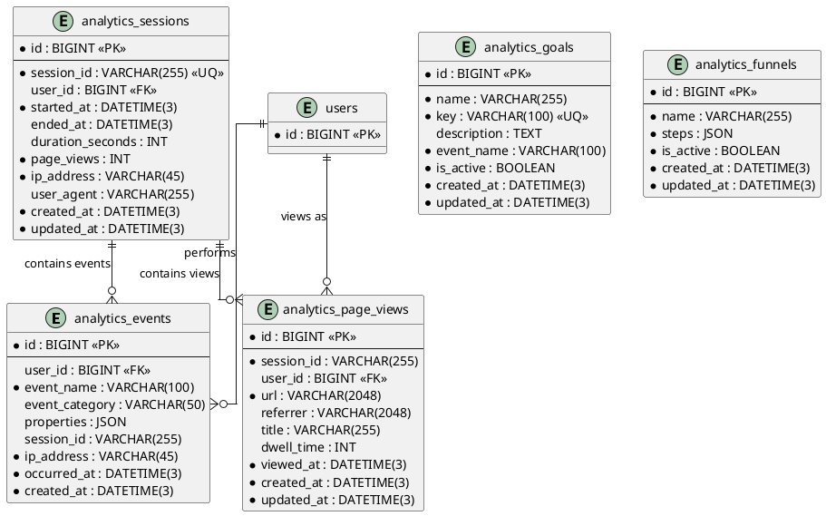

# 06.121 - Analytics

**Project:** GsmUi
**Domain:** Analytics
**Version:** 1.0.0

---

# Purpose

This document defines the analytics schema: raw event stream, user sessions, page views, conversion goals, and funnels. Analytics tables are high-volume append-only data.

---

# Tables

## analytics_events

**Purpose:** Raw event stream — the backbone of GsmUi analytics.

**Business Rules:**
- High-volume table — application layer partitions by date
- `user_id` is nullable — guest events tracked via `session_id`
- `event_name` from a fixed vocabulary; `properties` is JSON for arbitrary dimensions
- No soft deletes

**Columns:**

| Column | Type | Nullable | Default | Notes |
|---|---|---|---|---|
| id | BIGINT UNSIGNED | NO | AUTO_INCREMENT | PK |
| user_id | BIGINT UNSIGNED | YES | NULL | FK → users.id |
| event_name | VARCHAR(100) | NO | — | Event identifier |
| event_category | VARCHAR(50) | YES | NULL | page_view, click, download, purchase |
| properties | JSON | YES | NULL | Event dimensions |
| session_id | VARCHAR(255) | YES | NULL | Analytics session |
| ip_address | VARCHAR(45) | NO | — | IPv4 or IPv6 |
| occurred_at | DATETIME(3) | NO | — | Event timestamp |
| created_at | DATETIME(3) | NO | CURRENT_TIMESTAMP(3) | Insert time |

**Indexes:**

```
PRIMARY: id
INDEX: analytics_events_user_id_index (user_id)
INDEX: analytics_events_event_name_index (event_name)
INDEX: analytics_events_occurred_at_index (occurred_at)
INDEX: analytics_events_session_id_index (session_id)
```

**Migration:**

```php
Schema::create('analytics_events', function (Blueprint $table) {
    $table->id();
    $table->foreignId('user_id')->nullable()->constrained()->nullOnDelete();
    $table->string('event_name', 100);
    $table->string('event_category', 50)->nullable();
    $table->json('properties')->nullable();
    $table->string('session_id', 255)->nullable();
    $table->string('ip_address', 45);
    $table->dateTime('occurred_at', 3);
    $table->dateTime('created_at', 3);
    $table->index('user_id');
    $table->index('event_name');
    $table->index('occurred_at');
    $table->index('session_id');
});
```

---

## analytics_sessions

**Purpose:** User sessions for analytics. Distinct from auth sessions.

**Business Rules:**
- `session_id` is a UUID string (not the auth session ID)
- `duration_seconds` computed on session end
- No soft deletes

**Columns:**

| Column | Type | Nullable | Default | Notes |
|---|---|---|---|---|
| id | BIGINT UNSIGNED | NO | AUTO_INCREMENT | PK |
| session_id | VARCHAR(255) | NO | — | Unique session UUID |
| user_id | BIGINT UNSIGNED | YES | NULL | FK → users.id |
| started_at | DATETIME(3) | NO | — | Session start |
| ended_at | DATETIME(3) | YES | NULL | NULL = active |
| duration_seconds | INT UNSIGNED | YES | NULL | Computed on end |
| page_views | INT UNSIGNED | NO | 0 | View count |
| ip_address | VARCHAR(45) | NO | — | IPv4 or IPv6 |
| user_agent | VARCHAR(255) | YES | NULL | Browser string |
| created_at | DATETIME(3) | NO | CURRENT_TIMESTAMP(3) | |
| updated_at | DATETIME(3) | NO | CURRENT_TIMESTAMP(3) | ON UPDATE |

**Indexes:**

```
PRIMARY: id
UNIQUE: analytics_sessions_session_id_unique (session_id)
INDEX: analytics_sessions_user_id_index (user_id)
INDEX: analytics_sessions_started_at_index (started_at)
```

**Migration:**

```php
Schema::create('analytics_sessions', function (Blueprint $table) {
    $table->id();
    $table->string('session_id', 255)->unique();
    $table->foreignId('user_id')->nullable()->constrained()->nullOnDelete();
    $table->dateTime('started_at', 3);
    $table->dateTime('ended_at', 3)->nullable();
    $table->unsignedInteger('duration_seconds')->nullable();
    $table->unsignedInteger('page_views')->default(0);
    $table->string('ip_address', 45);
    $table->string('user_agent', 255)->nullable();
    $table->timestamps();
    $table->index('user_id');
    $table->index('started_at');
});
```

---

## analytics_page_views

**Purpose:** Detailed page view records.

**Business Rules:**
- Linked to an analytics session
- `dwell_time` in seconds, computed on page exit
- No soft deletes

**Columns:**

| Column | Type | Nullable | Default | Notes |
|---|---|---|---|---|
| id | BIGINT UNSIGNED | NO | AUTO_INCREMENT | PK |
| session_id | VARCHAR(255) | NO | — | FK → analytics_sessions.session_id |
| user_id | BIGINT UNSIGNED | YES | NULL | FK → users.id |
| url | VARCHAR(2048) | NO | — | Full URL |
| referrer | VARCHAR(2048) | YES | NULL | Referring URL |
| title | VARCHAR(255) | YES | NULL | Page title |
| dwell_time | INT UNSIGNED | YES | NULL | Seconds on page |
| viewed_at | DATETIME(3) | NO | — | View timestamp |
| created_at | DATETIME(3) | NO | CURRENT_TIMESTAMP(3) | |
| updated_at | DATETIME(3) | NO | CURRENT_TIMESTAMP(3) | ON UPDATE |

**Indexes:**

```
PRIMARY: id
INDEX: analytics_page_views_session_id_index (session_id)
INDEX: analytics_page_views_user_id_index (user_id)
INDEX: analytics_page_views_url_index (url(191))
INDEX: analytics_page_views_viewed_at_index (viewed_at)
```

**Migration:**

```php
Schema::create('analytics_page_views', function (Blueprint $table) {
    $table->id();
    $table->string('session_id', 255);
    $table->foreignId('user_id')->nullable()->constrained()->nullOnDelete();
    $table->string('url', 2048);
    $table->string('referrer', 2048)->nullable();
    $table->string('title', 255)->nullable();
    $table->unsignedInteger('dwell_time')->nullable();
    $table->dateTime('viewed_at', 3);
    $table->timestamps();
    $table->index('session_id');
    $table->index('user_id');
    $table->index('url', 'analytics_page_views_url_index');
    $table->index('viewed_at');
});
```

---

## analytics_goals

**Purpose:** Conversion goals (e.g., 'purchase', 'signup', 'download').

**Business Rules:**
- `key` is unique and URL-safe
- `event_name` links to `analytics_events.event_name`
- No soft deletes

**Columns:**

| Column | Type | Nullable | Default | Notes |
|---|---|---|---|---|
| id | BIGINT UNSIGNED | NO | AUTO_INCREMENT | PK |
| name | VARCHAR(255) | NO | — | Goal display name |
| key | VARCHAR(100) | NO | — | Unique key |
| description | TEXT | YES | NULL | Goal description |
| event_name | VARCHAR(100) | NO | — | Target event |
| is_active | BOOLEAN | NO | true | Active flag |
| created_at | DATETIME(3) | NO | CURRENT_TIMESTAMP(3) | |
| updated_at | DATETIME(3) | NO | CURRENT_TIMESTAMP(3) | ON UPDATE |

**Indexes:**

```
PRIMARY: id
UNIQUE: analytics_goals_key_unique (key)
INDEX: analytics_goals_is_active_index (is_active)
```

**Migration:**

```php
Schema::create('analytics_goals', function (Blueprint $table) {
    $table->id();
    $table->string('name');
    $table->string('key', 100)->unique();
    $table->text('description')->nullable();
    $table->string('event_name', 100);
    $table->boolean('is_active')->default(true);
    $table->timestamps();
});
```

---

## analytics_funnels

**Purpose:** Conversion funnels — ordered sequences of steps toward a goal.

**Business Rules:**
- `steps` JSON array: `[{event: 'page_view', label: 'Visit'}, {event: 'signup', label: 'Sign Up'}]`
- No soft deletes

**Columns:**

| Column | Type | Nullable | Default | Notes |
|---|---|---|---|---|
| id | BIGINT UNSIGNED | NO | AUTO_INCREMENT | PK |
| name | VARCHAR(255) | NO | — | Funnel name |
| steps | JSON | NO | — | Ordered step definitions |
| is_active | BOOLEAN | NO | true | Active flag |
| created_at | DATETIME(3) | NO | CURRENT_TIMESTAMP(3) | |
| updated_at | DATETIME(3) | NO | CURRENT_TIMESTAMP(3) | ON UPDATE |

**Indexes:**

```
PRIMARY: id
INDEX: analytics_funnels_is_active_index (is_active)
```

**Migration:**

```php
Schema::create('analytics_funnels', function (Blueprint $table) {
    $table->id();
    $table->string('name');
    $table->json('steps');
    $table->boolean('is_active')->default(true);
    $table->timestamps();
});
```

---

# PlantUML ERD



---

# Analytics Domain - Complete Reference

## Schema Summary

| Table | Purpose | Rows Estimate | Soft Delete |
|---|---|---|---|
| `analytics_events` | Raw event stream | ~100M+ | No |
| `analytics_sessions` | User session tracking | ~20M | No |
| `analytics_page_views` | Page view records | ~50M | No |
| `analytics_goals` | Conversion goal definitions | ~50 | No |
| `analytics_funnels` | Funnel step definitions | ~20 | No |

## Data Volume and Partitioning Strategy

### analytics_events Table

This is the highest-volume table in the system. Partitioning by month is mandatory.

```sql
-- Partition by month for analytics_events
ALTER TABLE analytics_events PARTITION BY RANGE (TO_DAYS(occurred_at)) (
    PARTITION p202601 VALUES LESS THAN (TO_DAYS('2026-02-01')),
    PARTITION p202602 VALUES LESS THAN (TO_DAYS('2026-03-01')),
    PARTITION p202603 VALUES LESS THAN (TO_DAYS('2026-04-01')),
    PARTITION p_future VALUES LESS THAN MAXVALUE
);
```

### analytics_page_views Table

Also high-volume, partition alongside events for correlated queries:

```sql
ALTER TABLE analytics_page_views PARTITION BY RANGE (TO_DAYS(viewed_at)) (
    PARTITION p202601 VALUES LESS THAN (TO_DAYS('2026-02-01')),
    PARTITION p202602 VALUES LESS THAN (TO_DAYS('2026-03-01')),
    PARTITION p_future VALUES LESS THAN MAXVALUE
);
```

## Index Strategy

### analytics_events

```sql
-- Query pattern: "Events for a user in time range"
CREATE INDEX analytics_events_user_occurred 
ON analytics_events(user_id, occurred_at DESC);

-- Query pattern: "Events by type in time range"
CREATE INDEX analytics_events_name_occurred 
ON analytics_events(event_name, occurred_at DESC);

-- Query pattern: "Session events"
CREATE INDEX analytics_events_session_occurred 
ON analytics_events(session_id, occurred_at DESC);

-- Query pattern: "Event category analysis"
CREATE INDEX analytics_events_category_occurred 
ON analytics_events(event_category, occurred_at DESC);
```

### analytics_sessions

```sql
-- Query pattern: "Active sessions for user"
CREATE INDEX analytics_sessions_user_started 
ON analytics_sessions(user_id, started_at DESC);

-- Query pattern: "Long sessions analysis"
CREATE INDEX analytics_sessions_duration 
ON analytics_sessions(duration_seconds DESC);

-- Query pattern: "Sessions by date"
CREATE INDEX analytics_sessions_date 
ON analytics_sessions(DATE(started_at));
```

### analytics_page_views

```sql
-- Query pattern: "Page views for session"
CREATE INDEX analytics_page_views_session_viewed 
ON analytics_page_views(session_id, viewed_at DESC);

-- Query pattern: "Page views for URL analysis"
CREATE INDEX analytics_page_views_url_viewed 
ON analytics_page_views(url(191), viewed_at DESC);

-- Query pattern: "Referrer analysis"
CREATE INDEX analytics_page_views_referrer 
ON analytics_page_views(referrer(191), viewed_at DESC);

-- Query pattern: "Dwell time analysis"
CREATE INDEX analytics_page_views_dwell 
ON analytics_page_views(dwell_time DESC, viewed_at DESC);
```

## Migration File: 2026_01_01_012101_create_analytics_tables.php

```php
<?php

use Illuminate\Database\Migrations\Migration;
use Illuminate\Database\Schema\Blueprint;
use Illuminate\Support\Facades\Schema;

return new class extends Migration
{
    public function up(): void
    {
        Schema::create('analytics_events', function (Blueprint $table) {
            $table->id();
            $table->foreignId('user_id')->nullable()->constrained()->nullOnDelete();
            $table->string('event_name', 100);
            $table->string('event_category', 50)->nullable();
            $table->json('properties')->nullable();
            $table->string('session_id', 255)->nullable();
            $table->string('ip_address', 45);
            $table->dateTime('occurred_at', 3);
            $table->dateTime('created_at', 3);

            $table->index('user_id');
            $table->index('event_name');
            $table->index('occurred_at');
            $table->index('session_id');
            $table->index(['event_name', 'occurred_at']);
            $table->index(['user_id', 'event_name', 'occurred_at']);
        });

        Schema::create('analytics_sessions', function (Blueprint $table) {
            $table->id();
            $table->string('session_id', 255)->unique();
            $table->foreignId('user_id')->nullable()->constrained()->nullOnDelete();
            $table->dateTime('started_at', 3);
            $table->dateTime('ended_at', 3)->nullable();
            $table->unsignedInteger('duration_seconds')->nullable();
            $table->unsignedInteger('page_views')->default(0);
            $table->string('ip_address', 45);
            $table->string('user_agent', 255)->nullable();
            $table->timestamps();

            $table->index('user_id');
            $table->index('started_at');
        });

        Schema::create('analytics_page_views', function (Blueprint $table) {
            $table->id();
            $table->string('session_id', 255);
            $table->foreignId('user_id')->nullable()->constrained()->nullOnDelete();
            $table->string('url', 2048);
            $table->string('referrer', 2048)->nullable();
            $table->string('title', 255)->nullable();
            $table->unsignedInteger('dwell_time')->nullable();
            $table->dateTime('viewed_at', 3);
            $table->timestamps();

            $table->index('session_id');
            $table->index('user_id');
            $table->index('url', 'analytics_page_views_url_index');
            $table->index('viewed_at');
            $table->index(['session_id', 'viewed_at']);
        });

        Schema::create('analytics_goals', function (Blueprint $table) {
            $table->id();
            $table->string('name');
            $table->string('key', 100)->unique();
            $table->text('description')->nullable();
            $table->string('event_name', 100);
            $table->boolean('is_active')->default(true);
            $table->timestamps();

            $table->index('is_active');
            $table->index('event_name');
        });

        Schema::create('analytics_funnels', function (Blueprint $table) {
            $table->id();
            $table->string('name');
            $table->json('steps');
            $table->boolean('is_active')->default(true);
            $table->timestamps();

            $table->index('is_active');
        });
    }

    public function down(): void
    {
        Schema::dropIfExists('analytics_funnels');
        Schema::dropIfExists('analytics_goals');
        Schema::dropIfExists('analytics_page_views');
        Schema::dropIfExists('analytics_sessions');
        Schema::dropIfExists('analytics_events');
    }
};
```

## Data Access Patterns

### Session Management

```php
<?php

namespace App\Domains\Analytics\Services;

use App\Domains\Analytics\Models\AnalyticsSession;
use App\Domains\Analytics\Models\AnalyticsPageView;
use Illuminate\Support\Str;

class SessionService
{
    public function startSession(array $data): AnalyticsSession
    {
        return AnalyticsSession::create([
            'session_id' => $data['session_id'] ?? Str::uuid()->toString(),
            'user_id' => $data['user_id'] ?? null,
            'started_at' => now(),
            'ip_address' => $data['ip_address'],
            'user_agent' => $data['user_agent'] ?? null,
        ]);
    }

    public function endSession(AnalyticsSession $session): void
    {
        $session->update([
            'ended_at' => now(),
            'duration_seconds' => $session->started_at->diffInSeconds(now()),
        ]);
    }

    public function trackPageView(AnalyticsSession $session, array $data): AnalyticsPageView
    {
        $session->increment('page_views');

        return AnalyticsPageView::create([
            'session_id' => $session->session_id,
            'user_id' => $session->user_id,
            'url' => $data['url'],
            'referrer' => $data['referrer'] ?? null,
            'title' => $data['title'] ?? null,
            'viewed_at' => now(),
        ]);
    }

    public function calculateDwellTime(AnalyticsPageView $view): void
    {
        // Called when user navigates away from page
        $nextView = AnalyticsPageView::where('session_id', $view->session_id)
            ->where('viewed_at', '>', $view->viewed_at)
            ->orderBy('viewed_at')
            ->first();

        $exitTime = $nextView ? $nextView->viewed_at : now();
        $dwellSeconds = $view->viewed_at->diffInSeconds($exitTime);

        $view->update(['dwell_time' => min($dwellSeconds, 3600)]); // Cap at 1 hour
    }
}
```

### Event Tracking

```php
<?php

namespace App\Domains\Analytics\Services;

use App\Domains\Analytics\Models\AnalyticsEvent;
use Illuminate\Support\Facades\Request;

class EventTrackingService
{
    public function track(string $eventName, ?string $category = null, ?array $properties = null): AnalyticsEvent
    {
        return AnalyticsEvent::create([
            'user_id' => auth()->id(),
            'event_name' => $eventName,
            'event_category' => $category,
            'properties' => $properties,
            'session_id' => session('analytics_session_id'),
            'ip_address' => Request::ip(),
            'occurred_at' => now(),
        ]);
    }

    public function trackPageView(string $url, string $title): void
    {
        $this->track('page_view', 'page_view', [
            'url' => $url,
            'title' => $title,
            'referrer' => Request::header('referer'),
        ]);
    }

    public function trackConversion(string $goalKey, ?float $value = null): void
    {
        $goal = AnalyticsGoal::where('key', $goalKey)->where('is_active', true)->first();
        if (! $goal) {
            return;
        }

        $this->track($goal->event_name, 'conversion', [
            'goal_key' => $goalKey,
            'goal_name' => $goal->name,
            'value' => $value,
        ]);
    }
}
```

### Funnel Analysis

```php
<?php

namespace App\Domains\Analytics\Services;

use App\Domains\Analytics\Models\AnalyticsFunnel;
use App\Domains\Analytics\Models\AnalyticsEvent;
use Illuminate\Support\Collection;

class FunnelAnalysisService
{
    public function analyze(AnalyticsFunnel $funnel, int $days = 30): Collection
    {
        $steps = collect($funnel->steps);
        $startDate = now()->subDays($days);

        // Get users who completed each step
        $userPaths = collect();
        
        foreach ($steps as $index => $step) {
            $events = AnalyticsEvent::where('event_name', $step['event'])
                ->where('occurred_at', '>=', $startDate)
                ->select('user_id', DB::raw('MIN(occurred_at) as first_occurred'))
                ->groupBy('user_id')
                ->get();

            $userPaths->push([
                'step' => $index,
                'label' => $step['label'] ?? $step['event'],
                'users' => $events->pluck('user_id'),
                'count' => $events->count(),
            ]);
        }

        // Calculate conversion rates
        $totalUsers = $userPaths->first()['count'] ?? 0;
        
        return $userPaths->map(function ($step, $index) use ($totalUsers) {
            return [
                'step' => $index,
                'label' => $step['label'],
                'count' => $step['count'],
                'conversion_rate' => $totalUsers > 0 
                    ? round(($step['count'] / $totalUsers) * 100, 2) 
                    : 0,
                'drop_off_rate' => $index > 0 
                    ? round((1 - ($step['count'] / ($userPaths[$index - 1]['count'] ?? 1))) * 100, 2)
                    : 0,
            ];
        });
    }
}
```

### Analytics Query Builder

```php
<?php

namespace App\Domains\Analytics\Queries;

use Illuminate\Database\Query\Builder;

class AnalyticsQueryBuilder
{
    public function dateRange(Builder $query, string $start, string $end): Builder
    {
        return $query->whereBetween('occurred_at', [$start, $end]);
    }

    public function forUser(Builder $query, int $userId): Builder
    {
        return $query->where('user_id', $userId);
    }

    public function forEvent(Builder $query, string $eventName): Builder
    {
        return $query->where('event_name', $eventName);
    }

    public function uniqueUsers(Builder $query): Builder
    {
        return $query->selectRaw('COUNT(DISTINCT user_id) as unique_users');
    }

    public function dailyAggregation(Builder $query): Builder
    {
        return $query->selectRaw('
            DATE(occurred_at) as date,
            COUNT(*) as total_events,
            COUNT(DISTINCT user_id) as unique_users,
            COUNT(DISTINCT session_id) as unique_sessions
        ')->groupBy('date');
    }
}
```

## Reporting Queries

### Daily Active Users

```sql
SELECT 
    DATE(occurred_at) as date,
    COUNT(DISTINCT user_id) as dau
FROM analytics_events
WHERE occurred_at >= DATE_SUB(CURDATE(), INTERVAL 30 DAY)
GROUP BY DATE(occurred_at)
ORDER BY date;
```

### Top Pages by Views

```sql
SELECT 
    url,
    title,
    COUNT(*) as view_count,
    AVG(dwell_time) as avg_dwell_seconds,
    COUNT(DISTINCT session_id) as unique_sessions
FROM analytics_page_views
WHERE viewed_at >= DATE_SUB(NOW(), INTERVAL 7 DAY)
GROUP BY url, title
ORDER BY view_count DESC
LIMIT 50;
```

### Referrer Analysis

```sql
SELECT 
    referrer,
    COUNT(*) as visits,
    COUNT(DISTINCT session_id) as unique_sessions,
    AVG(dwell_time) as avg_dwell_time
FROM analytics_page_views
WHERE referrer IS NOT NULL
  AND viewed_at >= DATE_SUB(NOW(), INTERVAL 30 DAY)
GROUP BY referrer
ORDER BY visits DESC
LIMIT 20;
```

### Conversion Rate by Source

```sql
SELECT 
    e.event_category as source,
    COUNT(DISTINCT CASE WHEN e.event_name = 'signup' THEN e.user_id END) as signups,
    COUNT(DISTINCT CASE WHEN e.event_name = 'purchase' THEN e.user_id END) as purchases,
    ROUND(
        COUNT(DISTINCT CASE WHEN e.event_name = 'purchase' THEN e.user_id END) * 100.0 /
        NULLIF(COUNT(DISTINCT CASE WHEN e.event_name = 'signup' THEN e.user_id END), 0),
        2
    ) as conversion_rate
FROM analytics_events e
WHERE e.occurred_at >= DATE_SUB(NOW(), INTERVAL 30 DAY)
  AND e.event_category IN ('signup', 'purchase')
GROUP BY e.event_category
ORDER BY conversion_rate DESC;
```

## Observer: AnalyticsEventObserver

```php
<?php

namespace App\Domains\Analytics\Observers;

use App\Domains\Analytics\Models\AnalyticsEvent;

class AnalyticsEventObserver
{
    public function creating(AnalyticsEvent $event): void
    {
        // Auto-enrich event with IP geolocation
        if (! isset($event->properties['geo']) && $event->ip_address) {
            $event->properties = array_merge($event->properties ?? [], [
                'geo' => $this->getGeoFromIp($event->ip_address),
            ]);
        }
    }

    private function getGeoFromIp(string $ip): ?array
    {
        // Use MaxMind GeoIP2 or similar service
        // Returns ['country' => 'US', 'city' => 'New York', ...]
        return null; // Placeholder
    }
}
```

## Job: AggregateDailyAnalytics

```php
<?php

namespace App\Domains\Analytics\Jobs;

use Illuminate\Bus\Queueable;
use Illuminate\Contracts\Queue\ShouldQueue;
use Illuminate\Foundation\Bus\Dispatchable;
use Illuminate\Queue\InteractsWithQueue;
use Illuminate\Support\Facades\DB;

class AggregateDailyAnalytics implements ShouldQueue
{
    use Dispatchable, InteractsWithQueue, Queueable;

    public function handle(): void
    {
        $yesterday = now()->subDay()->toDateString();

        // Aggregate page views
        $pageViewStats = DB::table('analytics_page_views')
            ->whereDate('viewed_at', $yesterday)
            ->selectRaw('
                url,
                title,
                COUNT(*) as views,
                COUNT(DISTINCT session_id) as unique_sessions,
                AVG(dwell_time) as avg_dwell_time,
                MAX(viewed_at) as last_viewed
            ')
            ->groupBy('url', 'title')
            ->get();

        // Store aggregated results (create analytics_daily_summaries table)
        foreach ($pageViewStats as $stat) {
            DB::table('analytics_daily_summaries')->updateOrInsert(
                ['date' => $yesterday, 'url' => $stat->url],
                [
                    'views' => $stat->views,
                    'unique_sessions' => $stat->unique_sessions,
                    'avg_dwell_time' => $stat->avg_dwell_time,
                    'created_at' => now(),
                    'updated_at' => now(),
                ]
            );
        }
    }
}
```

## Testing Patterns

```php
<?php

namespace Tests\Domains\Analytics;

use App\Domains\Analytics\Models\AnalyticsEvent;
use App\Domains\Analytics\Models\AnalyticsSession;
use App\Domains\Analytics\Models\AnalyticsPageView;
use App\Domains\Analytics\Models\AnalyticsGoal;
use App\Domains\Analytics\Services\EventTrackingService;
use App\Domains\Analytics\Services\SessionService;
use Illuminate\Foundation\Testing\RefreshDatabase;
use Tests\TestCase;

class AnalyticsTest extends TestCase
{
    use RefreshDatabase;

    public function test_event_creation(): void
    {
        $event = AnalyticsEvent::create([
            'user_id' => 1,
            'event_name' => 'page_view',
            'event_category' => 'page_view',
            'properties' => ['url' => '/dashboard'],
            'ip_address' => '127.0.0.1',
            'occurred_at' => now(),
        ]);

        $this->assertDatabaseHas('analytics_events', [
            'event_name' => 'page_view',
            'user_id' => 1,
        ]);
    }

    public function test_session_tracking(): void
    {
        $service = new SessionService();
        
        $session = $service->startSession([
            'user_id' => 1,
            'ip_address' => '127.0.0.1',
            'user_agent' => 'Mozilla/5.0',
        ]);

        $this->assertNotNull($session->session_id);
        $this->assertNull($session->ended_at);

        $service->endSession($session);

        $this->assertNotNull($session->fresh()->ended_at);
        $this->assertNotNull($session->fresh()->duration_seconds);
    }

    public function test_page_view_tracking(): void
    {
        $session = AnalyticsSession::create([
            'session_id' => 'test-session-123',
            'started_at' => now(),
            'ip_address' => '127.0.0.1',
            'page_views' => 0,
        ]);

        $service = new SessionService();
        $view = $service->trackPageView($session, [
            'url' => '/products',
            'title' => 'Products',
        ]);

        $this->assertEquals('/products', $view->url);
        $this->assertEquals(1, $session->fresh()->page_views);
    }

    public function test_goal_conversion(): void
    {
        AnalyticsGoal::create([
            'name' => 'Signup',
            'key' => 'signup',
            'event_name' => 'user_signup',
            'is_active' => true,
        ]);

        $service = new EventTrackingService();
        $service->trackConversion('signup');

        $this->assertDatabaseHas('analytics_events', [
            'event_name' => 'user_signup',
            'event_category' => 'conversion',
        ]);
    }

    public function test_funnel_analysis(): void
    {
        $funnel = AnalyticsFunnel::create([
            'name' => 'Signup Funnel',
            'steps' => [
                ['event' => 'page_view', 'label' => 'Visit'],
                ['event' => 'signup_start', 'label' => 'Start Signup'],
                ['event' => 'signup_complete', 'label' => 'Complete Signup'],
            ],
            'is_active' => true,
        ]);

        // Create events for funnel
        $userId = 1;
        AnalyticsEvent::create([
            'user_id' => $userId,
            'event_name' => 'page_view',
            'ip_address' => '127.0.0.1',
            'occurred_at' => now(),
        ]);

        AnalyticsEvent::create([
            'user_id' => $userId,
            'event_name' => 'signup_start',
            'ip_address' => '127.0.0.1',
            'occurred_at' => now(),
        ]);

        $service = new \App\Domains\Analytics\Services\FunnelAnalysisService();
        $results = $service->analyze($funnel, 7);

        $this->assertCount(3, $results);
    }
}
```

---

# Analytics Event Vocabulary

## Standard Event Names

| Event Name | Category | Description | Properties |
|---|---|---|---|
| `page_view` | page_view | User views a page | url, title, referrer |
| `click` | click | User clicks an element | element, url, text |
| `signup` | conversion | User creates account | method, referral_source |
| `purchase` | conversion | User completes purchase | amount, currency, product_id |
| `download` | engagement | User downloads a file | file_name, file_type, file_size |
| `search` | engagement | User performs a search | query, results_count, filters |
| `share` | social | User shares content | platform, content_type, content_id |
| `comment` | social | User leaves a comment | content_type, content_id, parent_id |
| `like` | social | User likes content | content_type, content_id |
| `feature_use` | product | User uses a feature | feature_name, context |
| `error` | system | Error occurs | error_code, error_message, stack_trace |
| `api_call` | system | External API call | endpoint, method, status_code, duration_ms |

## Event Property Standards

```php
<?php

namespace App\Domains\Analytics\Standards;

class EventPropertySchema
{
    private const SCHEMAS = [
        'page_view' => [
            'url' => ['type' => 'string', 'required' => true],
            'title' => ['type' => 'string', 'required' => false],
            'referrer' => ['type' => 'string', 'required' => false],
            'load_time_ms' => ['type' => 'integer', 'required' => false],
            'viewport_width' => ['type' => 'integer', 'required' => false],
            'viewport_height' => ['type' => 'integer', 'required' => false],
        ],
        'purchase' => [
            'amount' => ['type' => 'integer', 'required' => true, 'description' => 'Amount in minor units'],
            'currency' => ['type' => 'string', 'required' => true, 'description' => 'ISO 4217'],
            'product_id' => ['type' => 'integer', 'required' => true],
            'product_name' => ['type' => 'string', 'required' => false],
            'payment_method' => ['type' => 'string', 'required' => false],
            'discount_code' => ['type' => 'string', 'required' => false],
        ],
        'search' => [
            'query' => ['type' => 'string', 'required' => true],
            'results_count' => ['type' => 'integer', 'required' => true],
            'filters' => ['type' => 'object', 'required' => false],
            'sort_by' => ['type' => 'string', 'required' => false],
        ],
    ];

    public function validate(string $eventName, array $properties): array
    {
        $schema = self::SCHEMAS[$eventName] ?? [];
        $errors = [];

        foreach ($schema as $field => $rules) {
            if ($rules['required'] && ! isset($properties[$field])) {
                $errors[] = "Missing required property: {$field}";
            }
        }

        return $errors;
    }

    public function getSchema(string $eventName): array
    {
        return self::SCHEMAS[$eventName] ?? [];
    }
}
```

## A/B Testing Integration

```php
<?php

namespace App\Domains\Analytics\Services;

use App\Domains\Analytics\Models\AnalyticsEvent;

class ABTestingService
{
    public function assignVariant(int $userId, string $experimentId): string
    {
        $hash = hash('sha256', "{$userId}:{$experimentId}");
        $bucket = hexdec(substr($hash, 0, 8)) % 100;

        $variant = match (true) {
            $bucket < 50 => 'control',
            $bucket < 75 => 'variant_a',
            $bucket < 90 => 'variant_b',
            default => 'variant_c',
        };

        AnalyticsEvent::create([
            'user_id' => $userId,
            'event_name' => 'experiment_assigned',
            'event_category' => 'experiment',
            'properties' => [
                'experiment_id' => $experimentId,
                'variant' => $variant,
                'bucket' => $bucket,
            ],
            'ip_address' => '0.0.0.0',
            'occurred_at' => now(),
        ]);

        return $variant;
    }

    public function trackConversion(int $userId, string $experimentId, string $metric, float $value = 1.0): void
    {
        AnalyticsEvent::create([
            'user_id' => $userId,
            'event_name' => 'experiment_conversion',
            'event_category' => 'experiment',
            'properties' => [
                'experiment_id' => $experimentId,
                'metric' => $metric,
                'value' => $value,
            ],
            'ip_address' => '0.0.0.0',
            'occurred_at' => now(),
        ]);
    }

    public function getResults(string $experimentId): array
    {
        $assignments = AnalyticsEvent::where('event_name', 'experiment_assigned')
            ->where('properties->experiment_id', $experimentId)
            ->get()
            ->groupBy(fn ($e) => $e->properties['variant']);

        $conversions = AnalyticsEvent::where('event_name', 'experiment_conversion')
            ->where('properties->experiment_id', $experimentId)
            ->get()
            ->groupBy(fn ($e) => $e->properties['metric']);

        $results = [];
        foreach ($assignments as $variant => $events) {
            $userIds = $events->pluck('user_id')->toArray();
            $variantConversions = $conversions->map(fn ($metricEvents) =>
                $metricEvents->whereIn('user_id', $userIds)->count()
            );

            $results[$variant] = [
                'users' => count($userIds),
                'conversions' => $variantConversions->toArray(),
            ];
        }

        return $results;
    }
}
```

## Cohort Analysis

```php
<?php

namespace App\Domains\Analytics\Services;

use Illuminate\Support\Facades\DB;

class CohortAnalysisService
{
    public function retentionCohorts(int $weeks = 12): array
    {
        $cohorts = DB::table('analytics_sessions')
            ->selectRaw('
                DATE(MIN(started_at)) as cohort_date,
                COUNT(DISTINCT user_id) as cohort_size
            ')
            ->where('started_at', '>=', now()->subWeeks($weeks))
            ->whereNotNull('user_id')
            ->groupBy(DB::raw('YEARWEEK(started_at)'))
            ->get();

        $retention = [];
        foreach ($cohorts as $cohort) {
            $cohortDate = $cohort->cohort_date;
            $cohortUsers = DB::table('analytics_sessions')
                ->where('started_at', '>=', $cohortDate)
                ->where('started_at', '<', $cohortDate)
                ->whereNotNull('user_id')
                ->pluck('user_id')
                ->unique();

            $retention[$cohortDate] = [
                'cohort_size' => $cohort->cohort_size,
                'weeks' => [],
            ];

            for ($week = 0; $week < $weeks; $week++) {
                $weekStart = Carbon::parse($cohortDate)->addWeeks($week);
                $weekEnd = $weekStart->copy()->addWeek();

                $activeUsers = DB::table('analytics_sessions')
                    ->where('started_at', '>=', $weekStart)
                    ->where('started_at', '<', $weekEnd)
                    ->whereIn('user_id', $cohortUsers)
                    ->count('user_id');

                $retention[$cohortDate]['weeks'][$week] = [
                    'active_users' => $activeUsers,
                    'retention_rate' => $cohort->cohort_size > 0
                        ? round(($activeUsers / $cohort->cohort_size) * 100, 2)
                        : 0,
                ];
            }
        }

        return $retention;
    }

    public function revenueCohorts(int $months = 12): array
    {
        return DB::table('invoices')
            ->selectRaw('
                DATE_FORMAT(created_at, "%Y-%m") as cohort_month,
                billable_id,
                SUM(total) as total_revenue
            ')
            ->where('created_at', '>=', now()->subMonths($months))
            ->where('status', 'paid')
            ->groupBy('cohort_month', 'billable_id')
            ->get()
            ->groupBy('cohort_month')
            ->map(fn ($group) => [
                'revenue' => $group->sum('total_revenue'),
                'customers' => $group->count(),
                'avg_revenue_per_customer' => $group->avg('total_revenue'),
            ])
            ->toArray();
    }
}
```

## Real-time Analytics Dashboard

```php
<?php

namespace App\Domains\Analytics\Services;

use Illuminate\Support\Facades\Cache;
use Illuminate\Support\Facades\DB;

class RealtimeAnalyticsService
{
    public function getCurrentVisitors(): int
    {
        return Cache::remember('realtime:active_visitors', 30, function () {
            return DB::table('analytics_sessions')
                ->where('started_at', '>=', now()->subMinutes(5))
                ->whereNull('ended_at')
                ->count();
        });
    }

    public function getRecentPageViews(int $minutes = 5): array
    {
        return DB::table('analytics_page_views')
            ->where('viewed_at', '>=', now()->subMinutes($minutes))
            ->selectRaw('
                url,
                COUNT(*) as views,
                COUNT(DISTINCT session_id) as unique_visitors
            ')
            ->groupBy('url')
            ->orderBy('views', 'desc')
            ->limit(20)
            ->get()
            ->toArray();
    }

    public function getTrafficSources(int $minutes = 60): array
    {
        return DB::table('analytics_page_views')
            ->where('viewed_at', '>=', now()->subMinutes($minutes))
            ->selectRaw('
                CASE 
                    WHEN referrer IS NULL OR referrer = "" THEN "Direct"
                    WHEN referrer LIKE "%google%" THEN "Google"
                    WHEN referrer LIKE "%twitter%" OR referrer LIKE "%t.co%" THEN "Twitter"
                    WHEN referrer LIKE "%github%" THEN "GitHub"
                    ELSE "Other"
                END as source,
                COUNT(*) as visits,
                COUNT(DISTINCT session_id) as unique_sessions
            ')
            ->groupBy('source')
            ->orderBy('visits', 'desc')
            ->get()
            ->toArray();
    }

    public function getLiveEvents(int $limit = 50): array
    {
        return DB::table('analytics_events')
            ->where('occurred_at', '>=', now()->subMinutes(5))
            ->orderBy('occurred_at', 'desc')
            ->limit($limit)
            ->get()
            ->toArray();
    }
}
```

---

# Analytics Privacy and Compliance

## GDPR Compliant Analytics

```php
<?php

namespace App\Domains\Analytics\Services;

class AnalyticsPrivacyService
{
    public function anonymizeUserData(int $userId): void
    {
        // Anonymize session data
        DB::table('analytics_sessions')
            ->where('user_id', $userId)
            ->update([
                'user_id' => null,
                'ip_address' => '0.0.0.0',
                'user_agent' => null,
            ]);

        // Anonymize page views
        DB::table('analytics_page_views')
            ->where('user_id', $userId)
            ->update([
                'user_id' => null,
                'ip_address' => '0.0.0.0',
            ]);

        // Anonymize events
        DB::table('analytics_events')
            ->where('user_id', $userId)
            ->update([
                'user_id' => null,
                'ip_address' => '0.0.0.0',
            ]);
    }

    public function exportUserData(int $userId): array
    {
        return [
            'sessions' => DB::table('analytics_sessions')
                ->where('user_id', $userId)
                ->get()
                ->toArray(),
            'page_views' => DB::table('analytics_page_views')
                ->where('user_id', $userId)
                ->get()
                ->toArray(),
            'events' => DB::table('analytics_events')
                ->where('user_id', $userId)
                ->get()
                ->toArray(),
        ];
    }

    public function deleteUserData(int $userId): void
    {
        DB::table('analytics_events')->where('user_id', $userId)->delete();
        DB::table('analytics_page_views')->where('user_id', $userId)->delete();
        DB::table('analytics_sessions')->where('user_id', $userId)->delete();
    }

    public function getCookieConsentSettings(): array
    {
        return [
            'required' => ['session_id'],
            'optional' => ['user_id', 'ip_address', 'user_agent'],
            'retention_days' => [
                'sessions' => 365,
                'page_views' => 90,
                'events' => 90,
            ],
        ];
    }
}
```

## Analytics Data Export

```php
<?php

namespace App\Domains\Analytics\Services;

use Illuminate\Support\Facades\Storage;

class AnalyticsExportService
{
    public function exportToCsv(string $type, array $filters, string $dateRange): string
    {
        $query = match ($type) {
            'events' => DB::table('analytics_events'),
            'sessions' => DB::table('analytics_sessions'),
            'page_views' => DB::table('analytics_page_views'),
        };

        $query = $this->applyFilters($query, $filters, $dateRange);
        $data = $query->get();

        $filename = "exports/analytics_{$type}_" . now()->format('Y-m-d_His') . '.csv';
        
        $headers = $this->getHeaders($type);
        $csv = $this->arrayToCsv($headers, $data->toArray());

        Storage::disk('local')->put($filename, $csv);

        return $filename;
    }

    private function applyFilters($query, array $filters, string $dateRange): $query
    {
        [$start, $end] = explode(' to ', $dateRange);
        
        $query->whereBetween('created_at', [$start, $end]);

        if (isset($filters['user_id'])) {
            $query->where('user_id', $filters['user_id']);
        }

        if (isset($filters['event_name'])) {
            $query->where('event_name', $filters['event_name']);
        }

        return $query;
    }

    private function getHeaders(string $type): array
    {
        return match ($type) {
            'events' => ['ID', 'User ID', 'Event Name', 'Category', 'Properties', 'IP Address', 'Occurred At'],
            'sessions' => ['ID', 'Session ID', 'User ID', 'Started At', 'Ended At', 'Duration', 'Page Views'],
            'page_views' => ['ID', 'Session ID', 'User ID', 'URL', 'Referrer', 'Title', 'Dwell Time', 'Viewed At'],
        };
    }

    private function arrayToCsv(array $headers, array $data): string
    {
        $output = fopen('php://temp', 'r+');
        fputcsv($output, $headers);

        foreach ($data as $row) {
            fputcsv($output, (array) $row);
        }

        rewind($output);
        return stream_get_contents($output);
    }
}
```

## Analytics Dashboard Widgets

```php
<?php

namespace App\Domains\Analytics\Widgets;

use Illuminate\Support\Facades\DB;

class AnalyticsWidgetService
{
    public function getVisitorStats(int $days = 30): array
    {
        return [
            'total_visitors' => DB::table('analytics_sessions')
                ->where('started_at', '>=', now()->subDays($days))
                ->count('user_id'),
            'new_visitors' => DB::table('analytics_sessions')
                ->where('started_at', '>=', now()->subDays($days))
                ->where('user_id', '>', 0)
                ->groupBy('user_id')
                ->havingRaw('MIN(started_at) >= ?', [now()->subDays($days)])
                ->count(),
            'returning_visitors' => DB::table('analytics_sessions')
                ->where('started_at', '>=', now()->subDays($days))
                ->where('user_id', '>', 0)
                ->groupBy('user_id')
                ->havingRaw('MIN(started_at) < ?', [now()->subDays($days)])
                ->count(),
        ];
    }

    public function getTrafficChart(int $days = 30): array
    {
        return DB::table('analytics_sessions')
            ->where('started_at', '>=', now()->subDays($days))
            ->selectRaw('
                DATE(started_at) as date,
                COUNT(*) as sessions,
                COUNT(DISTINCT user_id) as users
            ')
            ->groupBy('date')
            ->orderBy('date')
            ->get()
            ->toArray();
    }

    public function getTopPages(int $limit = 10, int $days = 7): array
    {
        return DB::table('analytics_page_views')
            ->where('viewed_at', '>=', now()->subDays($days))
            ->selectRaw('
                url,
                title,
                COUNT(*) as views,
                COUNT(DISTINCT session_id) as unique_visitors,
                AVG(dwell_time) as avg_dwell_time
            ')
            ->groupBy('url', 'title')
            ->orderBy('views', 'desc')
            ->limit($limit)
            ->get()
            ->toArray();
    }

    public function getConversionFunnel(): array
    {
        return [
            'visitors' => DB::table('analytics_sessions')
                ->where('started_at', '>=', now()->subDays(30))
                ->count(),
            'signups' => DB::table('analytics_events')
                ->where('event_name', 'signup')
                ->where('occurred_at', '>=', now()->subDays(30))
                ->count(),
            'purchases' => DB::table('analytics_events')
                ->where('event_name', 'purchase')
                ->where('occurred_at', '>=', now()->subDays(30))
                ->count(),
        ];
    }
}
```

## Analytics Data Retention

```php
<?php

namespace App\Domains\Analytics\Jobs;

use Illuminate\Bus\Queueable;
use Illuminate\Contracts\Queue\ShouldQueue;
use Illuminate\Foundation\Bus\Dispatchable;
use Illuminate\Queue\InteractsWithQueue;

class EnforceAnalyticsRetention implements ShouldQueue
{
    use Dispatchable, InteractsWithQueue, Queueable;

    private array $retentionPolicies = [
        'analytics_events' => ['days' => 90, 'archive' => true],
        'analytics_page_views' => ['days' => 90, 'archive' => true],
        'analytics_sessions' => ['days' => 365, 'archive' => false],
    ];

    public function handle(): void
    {
        foreach ($this->retentionPolicies as $table => $policy) {
            $cutoff = now()->subDays($policy['days']);

            if ($policy['archive']) {
                $this->archiveTable($table, $cutoff);
            }

            DB::table($table)
                ->where('created_at', '<', $cutoff)
                ->delete();
        }
    }

    private function archiveTable(string $table, $cutoff): void
    {
        $filename = "analytics/archives/{$table}_" . $cutoff->format('Y-m-d') . '.json';
        
        $data = DB::table($table)
            ->where('created_at', '<', $cutoff)
            ->get();

        Storage::disk('archive')->put($filename, $data->toJson());
    }
}
```

---

# Analytics Testing

## Unit Tests

```php
<?php

namespace Tests\Domains\Analytics;

use App\Domains\Analytics\Models\AnalyticsEvent;
use App\Domains\Analytics\Models\AnalyticsSession;
use App\Domains\Analytics\Models\AnalyticsPageView;
use App\Domains\Analytics\Models\AnalyticsGoal;
use App\Domains\Analytics\Services\EventTrackingService;
use App\Domains\Analytics\Services\SessionService;
use App\Domains\Analytics\Services\FunnelAnalysisService;
use App\Domains\Analytics\Services\RealtimeAnalyticsService;
use Illuminate\Foundation\Testing\RefreshDatabase;
use Tests\TestCase;

class AnalyticsServiceTest extends TestCase
{
    use RefreshDatabase;

    public function test_event_tracking(): void
    {
        $service = new EventTrackingService();
        
        $event = AnalyticsEvent::create([
            'user_id' => 1,
            'event_name' => 'page_view',
            'event_category' => 'page_view',
            'properties' => ['url' => '/dashboard'],
            'ip_address' => '127.0.0.1',
            'occurred_at' => now(),
        ]);

        $this->assertDatabaseHas('analytics_events', [
            'event_name' => 'page_view',
            'user_id' => 1,
        ]);
    }

    public function test_session_tracking(): void
    {
        $service = new SessionService();
        
        $session = $service->startSession([
            'user_id' => 1,
            'ip_address' => '127.0.0.1',
            'user_agent' => 'Mozilla/5.0',
        ]);

        $this->assertNotNull($session->session_id);
        $this->assertNull($session->ended_at);

        $service->endSession($session);

        $this->assertNotNull($session->fresh()->ended_at);
        $this->assertNotNull($session->fresh()->duration_seconds);
    }

    public function test_page_view_tracking(): void
    {
        $session = AnalyticsSession::create([
            'session_id' => 'test-session-123',
            'started_at' => now(),
            'ip_address' => '127.0.0.1',
            'page_views' => 0,
        ]);

        $service = new SessionService();
        $view = $service->trackPageView($session, [
            'url' => '/products',
            'title' => 'Products',
        ]);

        $this->assertEquals('/products', $view->url);
        $this->assertEquals(1, $session->fresh()->page_views);
    }

    public function test_goal_conversion(): void
    {
        AnalyticsGoal::create([
            'name' => 'Signup',
            'key' => 'signup',
            'event_name' => 'user_signup',
            'is_active' => true,
        ]);

        $service = new EventTrackingService();
        $service->trackConversion('signup');

        $this->assertDatabaseHas('analytics_events', [
            'event_name' => 'user_signup',
            'event_category' => 'conversion',
        ]);
    }

    public function test_funnel_analysis(): void
    {
        $funnel = AnalyticsFunnel::create([
            'name' => 'Signup Funnel',
            'steps' => [
                ['event' => 'page_view', 'label' => 'Visit'],
                ['event' => 'signup_start', 'label' => 'Start Signup'],
                ['event' => 'signup_complete', 'label' => 'Complete Signup'],
            ],
            'is_active' => true,
        ]);

        $userId = 1;
        AnalyticsEvent::create([
            'user_id' => $userId,
            'event_name' => 'page_view',
            'ip_address' => '127.0.0.1',
            'occurred_at' => now(),
        ]);

        AnalyticsEvent::create([
            'user_id' => $userId,
            'event_name' => 'signup_start',
            'ip_address' => '127.0.0.1',
            'occurred_at' => now(),
        ]);

        $service = new FunnelAnalysisService();
        $results = $service->analyze($funnel, 7);

        $this->assertCount(3, $results);
    }

    public function test_realtime_analytics(): void
    {
        // Create recent session
        AnalyticsSession::create([
            'session_id' => 'realtime-test',
            'started_at' => now(),
            'ip_address' => '127.0.0.1',
        ]);

        $service = new RealtimeAnalyticsService();
        $visitors = $service->getCurrentVisitors();

        $this->assertGreaterThanOrEqual(1, $visitors);
    }
}
```

---

# Analytics Console Commands

## Command: AnalyticsSync

```php
<?php

namespace App\Domains\Analytics\Console;

use Illuminate\Console\Command;

class AnalyticsSyncCommand extends Command
{
    protected $signature = 'analytics:sync {--days=7}';
    protected $description = 'Sync analytics data and rebuild materialized views';

    public function handle(): int
    {
        $days = (int) $this->option('days');
        
        $this->info("Syncing analytics data for last {$days} days...");

        // Rebuild search vectors
        $this->call('analytics:rebuild-search-vectors');

        // Aggregate daily summaries
        $this->call('analytics:aggregate-daily');

        // Update popular pages
        $this->call('analytics:update-popular-pages');

        // Cleanup old data
        $this->call('analytics:cleanup', ['--days' => $days]);

        $this->info('Analytics sync complete.');

        return self::SUCCESS;
    }
}
```

## Command: AnalyticsReport

```php
<?php

namespace App\Domains\Analytics\Console;

use App\Domains\Analytics\Services\RealtimeAnalyticsService;
use Illuminate\Console\Command;

class AnalyticsReportCommand extends Command
{
    protected $signature = 'analytics:report {--period=7d}';
    protected $description = 'Generate analytics report';

    public function handle(): int
    {
        $period = $this->option('period');
        $days = (int) str_replace('d', '', $period);

        $service = new RealtimeAnalyticsService();

        $this->table(
            ['Metric', 'Value'],
            [
                ['Total Visitors', $service->getVisitorStats($days)['total_visitors']],
                ['Active Sessions', $service->getCurrentVisitors()],
                ['Total Events', $this->getEventCount($days)],
                ['Total Page Views', $this->getPageViewCount($days)],
            ]
        );

        $this->info("\nTop Pages:");
        $topPages = $service->getTopPages(10, $days);
        $this->table(['URL', 'Views', 'Unique Visitors'], $topPages);

        return self::SUCCESS;
    }

    private function getEventCount(int $days): int
    {
        return DB::table('analytics_events')
            ->where('occurred_at', '>=', now()->subDays($days))
            ->count();
    }

    private function getPageViewCount(int $days): int
    {
        return DB::table('analytics_page_views')
            ->where('viewed_at', '>=', now()->subDays($days))
            ->count();
    }
}
```

---

# Analytics Monitoring Dashboard

## Key Metrics Dashboard

```php
<?php

namespace App\Domains\Analytics\Widgets;

use Illuminate\Support\Facades\DB;

class AnalyticsDashboardWidget
{
    public function getOverview(int $days = 7): array
    {
        return [
            'visitors' => $this->getVisitorCount($days),
            'page_views' => $this->getPageViewCount($days),
            'bounce_rate' => $this->getBounceRate($days),
            'avg_session_duration' => $this->getAvgSessionDuration($days),
            'conversion_rate' => $this->getConversionRate($days),
        ];
    }

    private function getVisitorCount(int $days): int
    {
        return DB::table('analytics_sessions')
            ->where('started_at', '>=', now()->subDays($days))
            ->count('user_id');
    }

    private function getPageViewCount(int $days): int
    {
        return DB::table('analytics_page_views')
            ->where('viewed_at', '>=', now()->subDays($days))
            ->count();
    }

    private function getBounceRate(int $days): float
    {
        $totalSessions = DB::table('analytics_sessions')
            ->where('started_at', '>=', now()->subDays($days))
            ->count();

        $bounceSessions = DB::table('analytics_sessions')
            ->where('started_at', '>=', now()->subDays($days))
            ->where('page_views', 1)
            ->count();

        return $totalSessions > 0 ? round(($bounceSessions / $totalSessions) * 100, 2) : 0;
    }

    private function getAvgSessionDuration(int $days): float
    {
        return DB::table('analytics_sessions')
            ->where('started_at', '>=', now()->subDays($days))
            ->whereNotNull('duration_seconds')
            ->avg('duration_seconds') ?? 0;
    }

    private function getConversionRate(int $days): float
    {
        $visitors = $this->getVisitorCount($days);
        $conversions = DB::table('analytics_events')
            ->where('event_name', 'purchase')
            ->where('occurred_at', '>=', now()->subDays($days))
            ->count();

        return $visitors > 0 ? round(($conversions / $visitors) * 100, 2) : 0;
    }
}
```

---

# Analytics Data Retention

## Retention Configuration

```php
<?php

return [
    'retention' => [
        'event_raw_days' => 90,
        'page_view_raw_days' => 90,
        'session_raw_days' => 180,
        'cohort_summary_days' => 730,
        'funnel_snapshot_days' => 365,
    ],
];
```

## Retention Cleanup Command

```php
<?php

namespace App\Domains\Analytics\Console;

use Illuminate\Console\Command;
use Illuminate\Support\Facades\DB;

class AnalyticsRetentionCleanupCommand extends Command
{
    protected $signature = 'analytics:retention-cleanup';
    protected $description = 'Purge analytics data beyond retention window';

    public function handle(): int
    {
        $config = config('analytics.retention');

        $eventCutoff = now()->subDays($config['event_raw_days']);
        $pageViewCutoff = now()->subDays($config['page_view_raw_days']);
        $sessionCutoff = now()->subDays($config['session_raw_days']);

        $eventsDeleted = DB::table('analytics_events')
            ->where('occurred_at', '<', $eventCutoff)
            ->delete();

        $pageViewsDeleted = DB::table('analytics_page_views')
            ->where('viewed_at', '<', $pageViewCutoff)
            ->delete();

        $sessionsDeleted = DB::table('analytics_sessions')
            ->where('started_at', '<', $sessionCutoff)
            ->delete();

        $this->info("Purged {$eventsDeleted} events, {$pageViewsDeleted} page views, {$sessionsDeleted} sessions.");

        return self::SUCCESS;
    }
}
```

---

# Next Document

**06.130 - AI** defines the AI conversation, message, prompt template, provider config, usage log, and skills tables.
