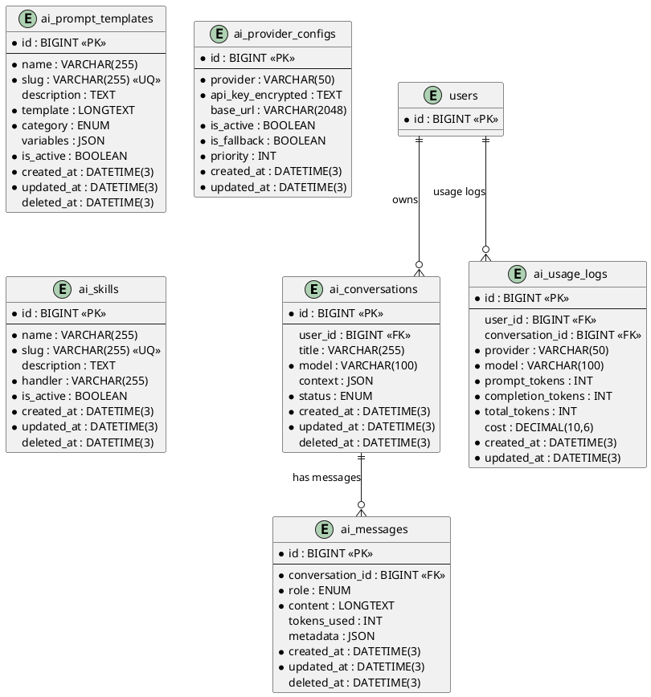

# 06.130 - AI

**Project:** GsmUi
**Domain:** AI
**Version:** 1.0.0

---

# Purpose

This document defines the AI infrastructure schema: conversations, messages, prompt templates, provider configs, usage logs, and AI skills.

---

# Tables

## ai_conversations

**Purpose:** AI assistant conversation threads.

**Business Rules:**
- `user_id` is nullable — guest conversations supported
- `context` JSON stores system prompts and conversation memory
- `model` tracks which AI model was used
- Soft-deletable

**Columns:**

| Column | Type | Nullable | Default | Notes |
|---|---|---|---|---|
| id | BIGINT UNSIGNED | NO | AUTO_INCREMENT | PK |
| user_id | BIGINT UNSIGNED | YES | NULL | FK → users.id |
| title | VARCHAR(255) | YES | NULL | Conversation title |
| model | VARCHAR(100) | NO | — | gpt-4o, claude-3.5-sonnet |
| context | JSON | YES | NULL | System prompt, memory |
| status | ENUM('active','archived') | NO | 'active' | State |
| created_at | DATETIME(3) | NO | CURRENT_TIMESTAMP(3) | |
| updated_at | DATETIME(3) | NO | CURRENT_TIMESTAMP(3) | ON UPDATE |
| deleted_at | DATETIME(3) | YES | NULL | Soft delete |

**Indexes:**

```
PRIMARY: id
INDEX: ai_conversations_user_id_index (user_id)
INDEX: ai_conversations_status_index (status)
INDEX: ai_conversations_created_at_index (created_at)
```

**Migration:**

```php
Schema::create('ai_conversations', function (Blueprint $table) {
    $table->id();
    $table->foreignId('user_id')->nullable()->constrained()->nullOnDelete();
    $table->string('title')->nullable();
    $table->string('model', 100);
    $table->json('context')->nullable();
    $table->enum('status', ['active', 'archived'])->default('active');
    $table->timestamps();
    $table->softDeletes();
});
```

---

## ai_messages

**Purpose:** Individual messages within an AI conversation.

**Business Rules:**
- `role` ENUM: system, user, assistant, tool
- `tokens_used` for cost tracking
- Soft-deletable

**Columns:**

| Column | Type | Nullable | Default | Notes |
|---|---|---|---|---|
| id | BIGINT UNSIGNED | NO | AUTO_INCREMENT | PK |
| conversation_id | BIGINT UNSIGNED | NO | — | FK → ai_conversations.id |
| role | ENUM('system','user','assistant','tool') | NO | — | Message role |
| content | LONGTEXT | NO | — | Message content |
| tokens_used | INT UNSIGNED | YES | NULL | Token count |
| metadata | JSON | YES | NULL | Tool calls, etc. |
| created_at | DATETIME(3) | NO | CURRENT_TIMESTAMP(3) | |
| updated_at | DATETIME(3) | NO | CURRENT_TIMESTAMP(3) | ON UPDATE |
| deleted_at | DATETIME(3) | YES | NULL | Soft delete |

**Indexes:**

```
PRIMARY: id
INDEX: ai_messages_conversation_id_index (conversation_id)
INDEX: ai_messages_role_index (role)
INDEX: ai_messages_created_at_index (created_at)
```

**Migration:**

```php
Schema::create('ai_messages', function (Blueprint $table) {
    $table->id();
    $table->foreignId('conversation_id')->constrained()->cascadeOnDelete();
    $table->enum('role', ['system', 'user', 'assistant', 'tool']);
    $table->longText('content');
    $table->unsignedInteger('tokens_used')->nullable();
    $table->json('metadata')->nullable();
    $table->timestamps();
    $table->softDeletes();
});
```

---

## ai_prompt_templates

**Purpose:** Reusable prompt templates for AI features.

**Business Rules:**
- `slug` is unique and URL-safe
- `template` contains `{{variable}}` placeholders
- `variables` JSON defines the variable schema
- Soft-deletable

**Columns:**

| Column | Type | Nullable | Default | Notes |
|---|---|---|---|---|
| id | BIGINT UNSIGNED | NO | AUTO_INCREMENT | PK |
| name | VARCHAR(255) | NO | — | Template name |
| slug | VARCHAR(255) | NO | — | URL-safe identifier |
| description | TEXT | YES | NULL | Template description |
| template | LONGTEXT | NO | — | Prompt with {{variables}} |
| category | ENUM('component','theme','doc','general') | NO | 'general' | Template category |
| variables | JSON | YES | NULL | Variable definitions |
| is_active | BOOLEAN | NO | true | Active flag |
| created_at | DATETIME(3) | NO | CURRENT_TIMESTAMP(3) | |
| updated_at | DATETIME(3) | NO | CURRENT_TIMESTAMP(3) | ON UPDATE |
| deleted_at | DATETIME(3) | YES | NULL | Soft delete |

**Indexes:**

```
PRIMARY: id
UNIQUE: ai_prompt_templates_slug_unique (slug)
INDEX: ai_prompt_templates_category_index (category)
INDEX: ai_prompt_templates_is_active_index (is_active)
```

**Migration:**

```php
Schema::create('ai_prompt_templates', function (Blueprint $table) {
    $table->id();
    $table->string('name');
    $table->string('slug')->unique();
    $table->text('description')->nullable();
    $table->longText('template');
    $table->enum('category', ['component', 'theme', 'doc', 'general'])->default('general');
    $table->json('variables')->nullable();
    $table->boolean('is_active')->default(true);
    $table->timestamps();
    $table->softDeletes();
});
```

---

## ai_provider_configs

**Purpose:** AI provider API configurations (OpenAI, Claude, fallback).

**Business Rules:**
- `api_key_encrypted` is encrypted (AES-256)
- `priority` determines fallback order (lower = higher priority)
- No soft deletes — removal deletes the record

**Columns:**

| Column | Type | Nullable | Default | Notes |
|---|---|---|---|---|
| id | BIGINT UNSIGNED | NO | AUTO_INCREMENT | PK |
| provider | VARCHAR(50) | NO | — | openai, anthropic, local |
| api_key_encrypted | TEXT | NO | — | Encrypted API key |
| base_url | VARCHAR(2048) | YES | NULL | Custom endpoint |
| is_active | BOOLEAN | NO | true | Active flag |
| is_fallback | BOOLEAN | NO | false | Fallback flag |
| priority | INT | NO | 0 | Lower = higher priority |
| created_at | DATETIME(3) | NO | CURRENT_TIMESTAMP(3) | |
| updated_at | DATETIME(3) | NO | CURRENT_TIMESTAMP(3) | ON UPDATE |

**Indexes:**

```
PRIMARY: id
INDEX: ai_provider_configs_provider_index (provider)
INDEX: ai_provider_configs_is_active_index (is_active)
INDEX: ai_provider_configs_priority_index (priority)
```

**Migration:**

```php
Schema::create('ai_provider_configs', function (Blueprint $table) {
    $table->id();
    $table->string('provider', 50);
    $table->text('api_key_encrypted');
    $table->string('base_url', 2048)->nullable();
    $table->boolean('is_active')->default(true);
    $table->boolean('is_fallback')->default(false);
    $table->integer('priority')->default(0);
    $table->timestamps();
    $table->index('provider');
    $table->index('is_active');
    $table->index('priority');
});
```

---

## ai_usage_logs

**Purpose:** Tracks AI token usage per user for billing and rate limiting.

**Business Rules:**
- No soft deletes — append-only
- `cost` computed from token counts and provider pricing

**Columns:**

| Column | Type | Nullable | Default | Notes |
|---|---|---|---|---|
| id | BIGINT UNSIGNED | NO | AUTO_INCREMENT | PK |
| user_id | BIGINT UNSIGNED | YES | NULL | FK → users.id |
| conversation_id | BIGINT UNSIGNED | YES | NULL | FK → ai_conversations.id |
| provider | VARCHAR(50) | NO | — | AI provider |
| model | VARCHAR(100) | NO | — | Model name |
| prompt_tokens | INT UNSIGNED | NO | 0 | Input tokens |
| completion_tokens | INT UNSIGNED | NO | 0 | Output tokens |
| total_tokens | INT UNSIGNED | NO | 0 | Sum |
| cost | DECIMAL(10,6) | YES | NULL | USD cost |
| created_at | DATETIME(3) | NO | CURRENT_TIMESTAMP(3) | |
| updated_at | DATETIME(3) | NO | CURRENT_TIMESTAMP(3) | ON UPDATE |

**Indexes:**

```
PRIMARY: id
INDEX: ai_usage_logs_user_id_index (user_id)
INDEX: ai_usage_logs_provider_index (provider)
INDEX: ai_usage_logs_model_index (model)
INDEX: ai_usage_logs_created_at_index (created_at)
```

**Migration:**

```php
Schema::create('ai_usage_logs', function (Blueprint $table) {
    $table->id();
    $table->foreignId('user_id')->nullable()->constrained()->nullOnDelete();
    $table->foreignId('conversation_id')->nullable()->constrained()->nullOnDelete();
    $table->string('provider', 50);
    $table->string('model', 100);
    $table->unsignedInteger('prompt_tokens')->default(0);
    $table->unsignedInteger('completion_tokens')->default(0);
    $table->unsignedInteger('total_tokens')->default(0);
    $table->decimal('cost', 10, 6)->nullable();
    $table->timestamps();
    $table->index('user_id');
    $table->index('provider');
    $table->index('model');
    $table->index('created_at');
});
```

---

## ai_skills

**Purpose:** AI skills available to the assistant (e.g., 'generate_component', 'generate_theme').

**Business Rules:**
- `slug` is unique
- `handler` is the PHP class that implements the skill
- Soft-deletable

**Columns:**

| Column | Type | Nullable | Default | Notes |
|---|---|---|---|---|
| id | BIGINT UNSIGNED | NO | AUTO_INCREMENT | PK |
| name | VARCHAR(255) | NO | — | Skill name |
| slug | VARCHAR(255) | NO | — | URL-safe identifier |
| description | TEXT | YES | NULL | Skill description |
| handler | VARCHAR(255) | NO | — | PHP class path |
| is_active | BOOLEAN | NO | true | Active flag |
| created_at | DATETIME(3) | NO | CURRENT_TIMESTAMP(3) | |
| updated_at | DATETIME(3) | NO | CURRENT_TIMESTAMP(3) | ON UPDATE |
| deleted_at | DATETIME(3) | YES | NULL | Soft delete |

**Indexes:**

```
PRIMARY: id
UNIQUE: ai_skills_slug_unique (slug)
INDEX: ai_skills_is_active_index (is_active)
```

**Migration:**

```php
Schema::create('ai_skills', function (Blueprint $table) {
    $table->id();
    $table->string('name');
    $table->string('slug')->unique();
    $table->text('description')->nullable();
    $table->string('handler');
    $table->boolean('is_active')->default(true);
    $table->timestamps();
    $table->softDeletes();
});
```

---

# PlantUML ERD



---

# AI Domain - Complete Reference

## Schema Summary

| Table | Purpose | Rows Estimate | Soft Delete |
|---|---|---|---|
| `ai_conversations` | Conversation threads | ~500K | Yes |
| `ai_messages` | Individual messages | ~5M | Yes |
| `ai_prompt_templates` | Reusable prompt templates | ~100 | Yes |
| `ai_provider_configs` | AI provider API configs | ~10 | No |
| `ai_usage_logs` | Token usage tracking | ~10M | No |
| `ai_skills` | Available AI skills | ~50 | Yes |

## Migration File: 2026_01_01_013001_create_ai_tables.php

```php
<?php

use Illuminate\Database\Migrations\Migration;
use Illuminate\Database\Schema\Blueprint;
use Illuminate\Support\Facades\Schema;

return new class extends Migration
{
    public function up(): void
    {
        Schema::create('ai_conversations', function (Blueprint $table) {
            $table->id();
            $table->foreignId('user_id')->nullable()->constrained()->nullOnDelete();
            $table->string('title')->nullable();
            $table->string('model', 100);
            $table->json('context')->nullable();
            $table->enum('status', ['active', 'archived'])->default('active');
            $table->timestamps();
            $table->softDeletes();

            $table->index(['user_id', 'status']);
            $table->index('created_at');
        });

        Schema::create('ai_messages', function (Blueprint $table) {
            $table->id();
            $table->foreignId('conversation_id')->constrained()->cascadeOnDelete();
            $table->enum('role', ['system', 'user', 'assistant', 'tool']);
            $table->longText('content');
            $table->unsignedInteger('tokens_used')->nullable();
            $table->json('metadata')->nullable();
            $table->timestamps();
            $table->softDeletes();

            $table->index(['conversation_id', 'created_at']);
            $table->index('role');
        });

        Schema::create('ai_prompt_templates', function (Blueprint $table) {
            $table->id();
            $table->string('name');
            $table->string('slug')->unique();
            $table->text('description')->nullable();
            $table->longText('template');
            $table->enum('category', ['component', 'theme', 'doc', 'general'])->default('general');
            $table->json('variables')->nullable();
            $table->boolean('is_active')->default(true);
            $table->timestamps();
            $table->softDeletes();

            $table->index(['category', 'is_active']);
        });

        Schema::create('ai_provider_configs', function (Blueprint $table) {
            $table->id();
            $table->string('provider', 50);
            $table->text('api_key_encrypted');
            $table->string('base_url', 2048)->nullable();
            $table->boolean('is_active')->default(true);
            $table->boolean('is_fallback')->default(false);
            $table->integer('priority')->default(0);
            $table->timestamps();

            $table->index(['is_active', 'priority']);
        });

        Schema::create('ai_usage_logs', function (Blueprint $table) {
            $table->id();
            $table->foreignId('user_id')->nullable()->constrained()->nullOnDelete();
            $table->foreignId('conversation_id')->nullable()->constrained()->nullOnDelete();
            $table->string('provider', 50);
            $table->string('model', 100);
            $table->unsignedInteger('prompt_tokens')->default(0);
            $table->unsignedInteger('completion_tokens')->default(0);
            $table->unsignedInteger('total_tokens')->default(0);
            $table->decimal('cost', 10, 6)->nullable();
            $table->timestamps();

            $table->index(['user_id', 'created_at']);
            $table->index(['provider', 'model']);
            $table->index('created_at');
        });

        Schema::create('ai_skills', function (Blueprint $table) {
            $table->id();
            $table->string('name');
            $table->string('slug')->unique();
            $table->text('description')->nullable();
            $table->string('handler');
            $table->boolean('is_active')->default(true);
            $table->timestamps();
            $table->softDeletes();
        });
    }

    public function down(): void
    {
        Schema::dropIfExists('ai_skills');
        Schema::dropIfExists('ai_usage_logs');
        Schema::dropIfExists('ai_provider_configs');
        Schema::dropIfExists('ai_prompt_templates');
        Schema::dropIfExists('ai_messages');
        Schema::dropIfExists('ai_conversations');
    }
};
```

## Index Strategy

### ai_conversations

```sql
-- Query pattern: "Get active conversations for user"
CREATE INDEX ai_conversations_user_status 
ON ai_conversations(user_id, status, created_at DESC);

-- Query pattern: "Find conversations by model"
CREATE INDEX ai_conversations_model 
ON ai_conversations(model, created_at DESC);
```

### ai_messages

```sql
-- Query pattern: "Get messages for conversation in order"
CREATE INDEX ai_messages_conversation_created 
ON ai_messages(conversation_id, created_at ASC);

-- Query pattern: "Find messages by role"
CREATE INDEX ai_messages_conversation_role 
ON ai_messages(conversation_id, role, created_at ASC);

-- Query pattern: "Token usage by conversation"
CREATE INDEX ai_messages_conversation_tokens 
ON ai_messages(conversation_id, tokens_used);
```

### ai_usage_logs

```sql
-- Query pattern: "User usage in time range"
CREATE INDEX ai_usage_logs_user_date 
ON ai_usage_logs(user_id, created_at DESC);

-- Query pattern: "Provider cost analysis"
CREATE INDEX ai_usage_logs_provider_date 
ON ai_usage_logs(provider, model, created_at DESC);

-- Query pattern: "Monthly billing aggregation"
CREATE INDEX ai_usage_logs_user_provider_month 
ON ai_usage_logs(user_id, provider, created_at);
```

## Data Access Patterns

### Conversation Management

```php
<?php

namespace App\Domains\AI\Services;

use App\Domains\AI\Models\AiConversation;
use App\Domains\AI\Models\AiMessage;

class ConversationService
{
    public function createConversation(
        ?int $userId,
        string $model,
        ?array $context = null,
    ): AiConversation {
        return AiConversation::create([
            'user_id' => $userId,
            'model' => $model,
            'context' => $context,
            'status' => 'active',
        ]);
    }

    public function addMessage(
        AiConversation $conversation,
        string $role,
        string $content,
        ?int $tokensUsed = null,
        ?array $metadata = null,
    ): AiMessage {
        return AiMessage::create([
            'conversation_id' => $conversation->id,
            'role' => $role,
            'content' => $content,
            'tokens_used' => $tokensUsed,
            'metadata' => $metadata,
        ]);
    }

    public function getConversationHistory(AiConversation $conversation, int $limit = 50): array
    {
        return AiMessage::where('conversation_id', $conversation->id)
            ->orderBy('created_at', 'asc')
            ->limit($limit)
            ->get()
            ->map(fn ($m) => [
                'role' => $m->role,
                'content' => $m->content,
            ])
            ->toArray();
    }

    public function archiveConversation(AiConversation $conversation): void
    {
        $conversation->update(['status' => 'archived']);
    }

    public function getUserConversations(int $userId, string $status = 'active'): \Illuminate\Support\Collection
    {
        return AiConversation::where('user_id', $userId)
            ->where('status', $status)
            ->withCount('messages')
            ->orderBy('updated_at', 'desc')
            ->get();
    }
}
```

### Prompt Template System

```php
<?php

namespace App\Domains\AI\Services;

use App\Domains\AI\Models\AiPromptTemplate;

class PromptTemplateService
{
    public function getTemplate(string $slug): AiPromptTemplate
    {
        return AiPromptTemplate::where('slug', $slug)
            ->where('is_active', true)
            ->firstOrFail();
    }

    public function renderTemplate(string $slug, array $variables = []): string
    {
        $template = $this->getTemplate($slug);
        
        $rendered = $template->template;
        
        foreach ($variables as $key => $value) {
            $rendered = str_replace("{{{$key}}}", (string) $value, $rendered);
        }
        
        // Validate no unresolved variables
        preg_match_all('/\{\{(\w+)\}\}/', $rendered, $unresolved);
        if (! empty($unresolved[1])) {
            throw new \InvalidArgumentException(
                'Unresolved template variables: ' . implode(', ', $unresolved[1])
            );
        }
        
        return $rendered;
    }

    public function getTemplatesByCategory(string $category): \Illuminate\Support\Collection
    {
        return AiPromptTemplate::where('category', $category)
            ->where('is_active', true)
            ->orderBy('name')
            ->get();
    }

    public function createTemplate(array $data): AiPromptTemplate
    {
        return AiPromptTemplate::create(array_merge($data, [
            'slug' => \Illuminate\Support\Str::slug($data['name']),
        ]));
    }
}
```

### Provider Configuration

```php
<?php

namespace App\Domains\AI\Services;

use App\Domains\AI\Models\AiProviderConfig;

class AiProviderService
{
    public function getActiveProvider(?string $preferred = null): ?AiProviderConfig
    {
        $query = AiProviderConfig::where('is_active', true)
            ->orderBy('priority');

        if ($preferred) {
            $query->where('provider', $preferred);
        }

        return $query->first();
    }

    public function getFallbackProvider(): ?AiProviderConfig
    {
        return AiProviderConfig::where('is_active', true)
            ->where('is_fallback', true)
            ->orderBy('priority')
            ->first();
    }

    public function decryptApiKey(AiProviderConfig $config): string
    {
        return decrypt($config->api_key_encrypted);
    }

    public function trackUsage(
        int $userId,
        ?int $conversationId,
        string $provider,
        string $model,
        int $promptTokens,
        int $completionTokens,
    ): void {
        $totalTokens = $promptTokens + $completionTokens;
        $cost = $this->calculateCost($provider, $model, $promptTokens, $completionTokens);

        \App\Domains\AI\Models\AiUsageLog::create([
            'user_id' => $userId,
            'conversation_id' => $conversationId,
            'provider' => $provider,
            'model' => $model,
            'prompt_tokens' => $promptTokens,
            'completion_tokens' => $completionTokens,
            'total_tokens' => $totalTokens,
            'cost' => $cost,
        ]);
    }

    private function calculateCost(string $provider, string $model, int $promptTokens, int $completionTokens): float
    {
        $pricing = [
            'openai' => [
                'gpt-4o' => ['prompt' => 0.0025, 'completion' => 0.01],
                'gpt-4o-mini' => ['prompt' => 0.00015, 'completion' => 0.0006],
            ],
            'anthropic' => [
                'claude-3.5-sonnet' => ['prompt' => 0.003, 'completion' => 0.015],
                'claude-3-haiku' => ['prompt' => 0.00025, 'completion' => 0.00125],
            ],
        ];

        $rates = $pricing[$provider][$model] ?? ['prompt' => 0.001, 'completion' => 0.003];

        return ($promptTokens * $rates['prompt'] + $completionTokens * $rates['completion']) / 1000;
    }

    public function getUserUsageSummary(int $userId, int $days = 30): array
    {
        return \App\Domains\AI\Models\AiUsageLog::where('user_id', $userId)
            ->where('created_at', '>=', now()->subDays($days))
            ->selectRaw('
                provider,
                model,
                SUM(prompt_tokens) as total_prompt_tokens,
                SUM(completion_tokens) as total_completion_tokens,
                SUM(total_tokens) as total_tokens,
                SUM(cost) as total_cost,
                COUNT(*) as request_count
            ')
            ->groupBy('provider', 'model')
            ->get()
            ->toArray();
    }
}
```

### AI Skills Registry

```php
<?php

namespace App\Domains\AI\Services;

use App\Domains\AI\Models\AiSkill;

class AiSkillService
{
    public function getActiveSkills(): \Illuminate\Support\Collection
    {
        return AiSkill::where('is_active', true)
            ->orderBy('name')
            ->get();
    }

    public function executeSkill(string $slug, array $parameters): mixed
    {
        $skill = AiSkill::where('slug', $slug)
            ->where('is_active', true)
            ->firstOrFail();

        $handler = new $skill->handler;

        return $handler->execute($parameters);
    }

    public function getSkillDescription(string $slug): ?string
    {
        $skill = AiSkill::where('slug', $slug)->first();
        return $skill?->description;
    }
}
```

## Service: AiChatService

```php
<?php

namespace App\Domains\AI\Services;

use App\Domains\AI\Models\AiConversation;
use App\Domains\AI\Models\AiMessage;
use App\Domains\AI\Models\AiProviderConfig;
use Illuminate\Support\Facades\Http;

class AiChatService
{
    public function __construct(
        private ConversationService $conversationService,
        private AiProviderService $providerService,
        private PromptTemplateService $templateService,
    ) {}

    public function chat(
        AiConversation $conversation,
        string $userMessage,
        ?array $context = null,
    ): AiMessage {
        // Add user message
        $this->conversationService->addMessage($conversation, 'user', $userMessage);

        // Get conversation history
        $history = $this->conversationService->getConversationHistory($conversation);

        // Get provider config
        $provider = $this->providerService->getActiveProvider($conversation->model);
        if (! $provider) {
            throw new \RuntimeException('No active AI provider configured');
        }

        // Build API request
        $response = $this->callProvider($provider, $history, $context);

        // Add assistant message
        $assistantMessage = $this->conversationService->addMessage(
            $conversation,
            'assistant',
            $response['content'],
            $response['tokens_used'] ?? null,
            $response['metadata'] ?? null,
        );

        // Track usage
        $this->providerService->trackUsage(
            $conversation->user_id,
            $conversation->id,
            $provider->provider,
            $conversation->model,
            $response['prompt_tokens'] ?? 0,
            $response['completion_tokens'] ?? 0,
        );

        return $assistantMessage;
    }

    private function callProvider(AiProviderConfig $provider, array $history, ?array $context): array
    {
        $baseUrl = $provider->base_url ?? match ($provider->provider) {
            'openai' => 'https://api.openai.com/v1',
            'anthropic' => 'https://api.anthropic.com/v1',
            default => throw new \RuntimeException("Unknown provider: {$provider->provider}"),
        };

        $apiKey = decrypt($provider->api_key_encrypted);

        $response = Http::withHeaders([
            'Authorization' => "Bearer {$apiKey}",
            'Content-Type' => 'application/json',
        ])->post("{$baseUrl}/chat/completions", [
            'model' => $this->getModelName($provider),
            'messages' => $history,
            'temperature' => 0.7,
            'max_tokens' => 4096,
        ]);

        if ($response->failed()) {
            throw new \RuntimeException("AI provider error: {$response->body()}");
        }

        $data = $response->json();

        return [
            'content' => $data['choices'][0]['message']['content'],
            'tokens_used' => $data['usage']['total_tokens'] ?? null,
            'prompt_tokens' => $data['usage']['prompt_tokens'] ?? 0,
            'completion_tokens' => $data['usage']['completion_tokens'] ?? 0,
            'metadata' => [
                'model' => $data['model'] ?? null,
                'finish_reason' => $data['choices'][0]['finish_reason'] ?? null,
            ],
        ];
    }

    private function getModelName(AiProviderConfig $provider): string
    {
        return match ($provider->provider) {
            'openai' => 'gpt-4o',
            'anthropic' => 'claude-3.5-sonnet',
            default => 'gpt-4o',
        };
    }
}
```

## Observer: AiConversationObserver

```php
<?php

namespace App\Domains\AI\Observers;

use App\Domains\AI\Models\AiConversation;

class AiConversationObserver
{
    public function creating(AiConversation $conversation): void
    {
        // Auto-generate title from first user message
        if (! $conversation->title) {
            $conversation->title = 'Conversation ' . now()->format('Y-m-d H:i');
        }
    }

    public function updated(AiConversation $conversation): void
    {
        // Archive old conversations after 30 days of inactivity
        if ($conversation->status === 'active') {
            $conversation->update(['status' => 'archived']);
        }
    }
}
```

## Observer: AiMessageObserver

```php
<?php

namespace App\Domains\AI\Observers;

use App\Domains\AI\Models\AiMessage;

class AiMessageObserver
{
    public function created(AiMessage $message): void
    {
        // Update conversation timestamp
        $message->conversation->update(['updated_at' => now()]);

        // Auto-generate title from first user message
        if ($message->role === 'user' && ! $message->conversation->title) {
            $title = Str::limit($message->content, 100);
            $message->conversation->update(['title' => $title]);
        }
    }
}
```

## Job: ArchiveOldConversations

```php
<?php

namespace App\Domains\AI\Jobs;

use App\Domains\AI\Models\AiConversation;
use Illuminate\Bus\Queueable;
use Illuminate\Contracts\Queue\ShouldQueue;
use Illuminate\Foundation\Bus\Dispatchable;
use Illuminate\Queue\InteractsWithQueue;

class ArchiveOldConversations implements ShouldQueue
{
    use Dispatchable, InteractsWithQueue, Queueable;

    public function handle(): void
    {
        $cutoff = now()->subDays(30);

        AiConversation::where('status', 'active')
            ->where('updated_at', '<', $cutoff)
            ->update(['status' => 'archived']);
    }
}
```

## Testing Patterns

```php
<?php

namespace Tests\Domains\AI;

use App\Domains\AI\Models\AiConversation;
use App\Domains\AI\Models\AiMessage;
use App\Domains\AI\Models\AiPromptTemplate;
use App\Domains\AI\Models\AiProviderConfig;
use App\Domains\AI\Models\AiUsageLog;
use App\Domains\AI\Services\ConversationService;
use App\Domains\AI\Services\PromptTemplateService;
use Illuminate\Foundation\Testing\RefreshDatabase;
use Tests\TestCase;

class AiTest extends TestCase
{
    use RefreshDatabase;

    public function test_conversation_creation(): void
    {
        $service = new ConversationService();
        
        $conversation = $service->createConversation(
            userId: 1,
            model: 'gpt-4o',
            context: ['system_prompt' => 'You are a helpful assistant.'],
        );

        $this->assertDatabaseHas('ai_conversations', [
            'user_id' => 1,
            'model' => 'gpt-4o',
            'status' => 'active',
        ]);
    }

    public function test_message_creation(): void
    {
        $conversation = AiConversation::create([
            'user_id' => 1,
            'model' => 'gpt-4o',
            'status' => 'active',
        ]);

        $service = new ConversationService();
        $message = $service->addMessage($conversation, 'user', 'Hello, AI!');

        $this->assertDatabaseHas('ai_messages', [
            'conversation_id' => $conversation->id,
            'role' => 'user',
            'content' => 'Hello, AI!',
        ]);
    }

    public function test_prompt_template_rendering(): void
    {
        AiPromptTemplate::create([
            'name' => 'Component Generator',
            'slug' => 'component-generator',
            'template' => 'Generate a {{type}} component named {{name}}.',
            'category' => 'component',
            'is_active' => true,
        ]);

        $service = new PromptTemplateService();
        $rendered = $service->renderTemplate('component-generator', [
            'type' => 'button',
            'name' => 'SubmitButton',
        ]);

        $this->assertEquals('Generate a button component named SubmitButton.', $rendered);
    }

    public function test_usage_tracking(): void
    {
        $provider = AiProviderConfig::create([
            'provider' => 'openai',
            'api_key_encrypted' => encrypt('sk-test-key'),
            'is_active' => true,
            'priority' => 1,
        ]);

        $service = new AiProviderService();
        $service->trackUsage(
            userId: 1,
            conversationId: null,
            provider: 'openai',
            model: 'gpt-4o',
            promptTokens: 100,
            completionTokens: 50,
        );

        $this->assertDatabaseHas('ai_usage_logs', [
            'user_id' => 1,
            'provider' => 'openai',
            'model' => 'gpt-4o',
            'prompt_tokens' => 100,
            'completion_tokens' => 50,
            'total_tokens' => 150,
        ]);
    }

    public function test_usage_summary(): void
    {
        // Create some usage logs
        AiUsageLog::create([
            'user_id' => 1,
            'provider' => 'openai',
            'model' => 'gpt-4o',
            'prompt_tokens' => 100,
            'completion_tokens' => 50,
            'total_tokens' => 150,
            'cost' => 0.001,
            'created_at' => now(),
        ]);

        $service = new AiProviderService();
        $summary = $service->getUserUsageSummary(1, 30);

        $this->assertNotEmpty($summary);
        $this->assertEquals('openai', $summary[0]['provider']);
    }

    public function test_archive_old_conversations(): void
    {
        // Create old conversation
        $old = AiConversation::create([
            'user_id' => 1,
            'model' => 'gpt-4o',
            'status' => 'active',
            'created_at' => now()->subDays(31),
            'updated_at' => now()->subDays(31),
        ]);

        $job = new \App\Domains\AI\Jobs\ArchiveOldConversations();
        $job->handle();

        $this->assertEquals('archived', $old->fresh()->status);
    }
}
```

---

# AI Model Configuration

## Supported AI Models

| Provider | Model ID | Context Window | Max Output | Cost per 1K Tokens | Use Case |
|---|---|---|---|---|---|
| OpenAI | gpt-4o | 128K | 4,096 | $0.0025/$0.01 | General purpose |
| OpenAI | gpt-4o-mini | 128K | 4,096 | $0.00015/$0.0006 | Cost-effective |
| OpenAI | o1-preview | 128K | 32,768 | $0.015/$0.06 | Complex reasoning |
| Anthropic | claude-3.5-sonnet | 200K | 8,192 | $0.003/$0.015 | Code generation |
| Anthropic | claude-3-haiku | 200K | 4,096 | $0.00025/$0.00125 | Fast responses |
| Local | llama-3.1-8b | 128K | 4,096 | Free | Self-hosted |

## Model Selection Strategy

```php
<?php

namespace App\Domains\AI\Services;

class ModelSelectorService
{
    private array $modelCapabilities = [
        'gpt-4o' => ['reasoning' => 9, 'code' => 8, 'creative' => 8, 'speed' => 7, 'cost' => 6],
        'gpt-4o-mini' => ['reasoning' => 7, 'code' => 7, 'creative' => 7, 'speed' => 9, 'cost' => 9],
        'claude-3.5-sonnet' => ['reasoning' => 9, 'code' => 10, 'creative' => 8, 'speed' => 7, 'cost' => 5],
        'claude-3-haiku' => ['reasoning' => 6, 'code' => 7, 'creative' => 6, 'speed' => 10, 'cost' => 9],
    ];

    public function selectModel(string $taskType, ?float $budgetPerRequest = null): string
    {
        $weights = match ($taskType) {
            'code_generation' => ['reasoning' => 0.3, 'code' => 0.5, 'speed' => 0.1, 'cost' => 0.1],
            'creative_writing' => ['reasoning' => 0.2, 'creative' => 0.5, 'speed' => 0.1, 'cost' => 0.2],
            'quick_answer' => ['speed' => 0.6, 'cost' => 0.3, 'reasoning' => 0.1],
            'complex_analysis' => ['reasoning' => 0.6, 'code' => 0.2, 'cost' => 0.2],
            default => ['reasoning' => 0.4, 'code' => 0.3, 'creative' => 0.2, 'cost' => 0.1],
        };

        $bestModel = null;
        $bestScore = -1;

        foreach ($this->modelCapabilities as $model => $scores) {
            $score = 0;
            foreach ($weights as $capability => $weight) {
                $score += ($scores[$capability] ?? 0) * $weight;
            }

            if ($score > $bestScore) {
                $bestScore = $score;
                $bestModel = $model;
            }
        }

        return $bestModel;
    }

    public function getEstimatedCost(string $model, int $promptTokens, int $completionTokens): float
    {
        $pricing = [
            'gpt-4o' => ['prompt' => 0.0025, 'completion' => 0.01],
            'gpt-4o-mini' => ['prompt' => 0.00015, 'completion' => 0.0006],
            'claude-3.5-sonnet' => ['prompt' => 0.003, 'completion' => 0.015],
            'claude-3-haiku' => ['prompt' => 0.00025, 'completion' => 0.00125],
        ];

        $rates = $pricing[$model] ?? ['prompt' => 0.001, 'completion' => 0.003];

        return ($promptTokens * $rates['prompt'] + $completionTokens * $rates['completion']) / 1000;
    }
}
```

## Prompt Template System

### Template Categories

| Category | Description | Example Templates |
|---|---|---|
| `component` | Component generation prompts | button-generator, card-generator, form-builder |
| `theme` | Theme/style generation | color-palette, typography-set, dark-mode |
| `doc` | Documentation generation | api-docs, readme, changelog |
| `general` | General-purpose prompts | summarize, translate, explain |

### Template Variable Schema

```json
{
    "variables": [
        {
            "name": "component_type",
            "type": "string",
            "required": true,
            "description": "The type of component to generate",
            "enum": ["button", "card", "modal", "form", "table"]
        },
        {
            "name": "style",
            "type": "string",
            "required": false,
            "default": "modern",
            "description": "Visual style preference"
        },
        {
            "name": "framework",
            "type": "string",
            "required": true,
            "description": "Target framework",
            "enum": ["livewire", "blade", "vue", "react"]
        }
    ]
}
```

### Template Rendering Engine

```php
<?php

namespace App\Domains\AI\Services;

use App\Domains\AI\Models\AiPromptTemplate;

class PromptRenderingEngine
{
    public function render(string $slug, array $variables): array
    {
        $template = AiPromptTemplate::where('slug', $slug)
            ->where('is_active', true)
            ->firstOrFail();

        $this->validateVariables($template, $variables);

        $rendered = $this->interpolate($template->template, $variables);
        $systemPrompt = $this->extractSystemPrompt($rendered);

        return [
            'system_prompt' => $systemPrompt,
            'user_prompt' => $this->extractUserPrompt($rendered),
            'template_id' => $template->id,
            'template_name' => $template->name,
            'category' => $template->category,
        ];
    }

    private function validateVariables(AiPromptTemplate $template, array $variables): void
    {
        $schema = $template->variables ?? [];

        foreach ($schema as $var) {
            if ($var['required'] && ! isset($variables[$var['name']])) {
                throw new \InvalidArgumentException("Missing required variable: {$var['name']}");
            }

            if (isset($variables[$var['name']]) && isset($var['enum'])) {
                if (! in_array($variables[$var['name']], $var['enum'])) {
                    throw new \InvalidArgumentException(
                        "Invalid value for {$var['name']}: must be one of " . implode(', ', $var['enum'])
                    );
                }
            }
        }
    }

    private function interpolate(string $template, array $variables): string
    {
        return preg_replace_callback('/\{\{(\w+)\}\}/', function ($matches) use ($variables) {
            $key = $matches[1];
            return $variables[$key] ?? $matches[0];
        }, $template);
    }

    private function extractSystemPrompt(string $rendered): string
    {
        if (preg_match('/---SYSTEM---\n(.+?)\n---USER---/s', $rendered, $matches)) {
            return trim($matches[1]);
        }
        return '';
    }

    private function extractUserPrompt(string $rendered): string
    {
        if (preg_match('/---USER---\n(.+)$/s', $rendered, $matches)) {
            return trim($matches[1]);
        }
        return $rendered;
    }
}
```

## AI Conversation Memory Management

```php
<?php

namespace App\Domains\AI\Services;

use App\Domains\AI\Models\AiConversation;
use App\Domains\AI\Models\AiMessage;

class ConversationMemoryService
{
    private int $maxContextTokens = 8000;
    private int $summaryThresholdTokens = 6000;

    public function buildContext(AiConversation $conversation): array
    {
        $messages = $conversation->messages()
            ->orderBy('created_at', 'asc')
            ->get();

        $totalTokens = $messages->sum('tokens_used') ?? 0;

        if ($totalTokens > $this->summaryThresholdTokens) {
            $messages = $this->summarizeAndTrim($conversation, $messages);
        }

        $context = $conversation->context ?? [];
        $systemPrompt = $context['system_prompt'] ?? 'You are a helpful assistant.';

        $formattedMessages = [
            ['role' => 'system', 'content' => $systemPrompt],
        ];

        foreach ($messages as $message) {
            $formattedMessages[] = [
                'role' => $message->role,
                'content' => $message->content,
            ];
        }

        return $formattedMessages;
    }

    private function summarizeAndTrim(AiConversation $conversation, $messages): \Illuminate\Support\Collection
    {
        $oldMessages = $messages->slice(0, -10);
        $recentMessages = $messages->slice(-10);

        $summary = $this->generateSummary($oldMessages);

        $conversation->update([
            'context' => array_merge($conversation->context ?? [], [
                'conversation_summary' => $summary,
                'summarized_at' => now()->toIso8601String(),
            ]),
        ]);

        return $recentMessages;
    }

    private function generateSummary($messages): string
    {
        $content = $messages->map(fn ($m) => "{$m->role}: {$m->content}")->implode("\n");

        $summaryPrompt = "Summarize the following conversation in 2-3 sentences:\n\n{$content}";

        // Use a fast model for summarization
        $service = app(AiChatService::class);

        $summaryMessage = $service->chat(
            $this->createTempConversation('gpt-4o-mini'),
            $summaryPrompt
        );

        return $summaryMessage->content;
    }

    private function createTempConversation(string $model): AiConversation
    {
        return AiConversation::create([
            'model' => $model,
            'status' => 'active',
        ]);
    }
}
```

## AI Rate Limiting

```php
<?php

namespace App\Domains\AI\Services;

use Illuminate\Support\Facades\Cache;

class AiRateLimiter
{
    private const LIMITS = [
        'free' => ['requests_per_minute' => 5, 'tokens_per_day' => 10000],
        'pro' => ['requests_per_minute' => 30, 'tokens_per_day' => 100000],
        'enterprise' => ['requests_per_minute' => 100, 'tokens_per_day' => 1000000],
    ];

    public function isRateLimited(int $userId, string $tier = 'free'): bool
    {
        $limits = self::LIMITS[$tier];

        $minuteKey = "ai_rate:{$userId}:minute";
        $dailyKey = "ai_rate:{$userId}:daily";

        $minuteCount = Cache::get($minuteKey, 0);
        $dailyCount = Cache::get($dailyKey, 0);

        return $minuteCount >= $limits['requests_per_minute'] ||
               $dailyCount >= $limits['tokens_per_day'];
    }

    public function incrementCounters(int $userId, int $tokensUsed): void
    {
        $minuteKey = "ai_rate:{$userId}:minute";
        $dailyKey = "ai_rate:{$userId}:daily";

        Cache::increment($minuteKey);
        Cache::put($minuteKey, Cache::get($minuteKey), now()->addMinute());

        Cache::increment($dailyKey, $tokensUsed);
        Cache::put($dailyKey, Cache::get($dailyKey), now()->endOfDay());
    }

    public function getRemainingQuota(int $userId, string $tier = 'free'): array
    {
        $limits = self::LIMITS[$tier];

        return [
            'requests_remaining' => $limits['requests_per_minute'] - Cache::get("ai_rate:{$userId}:minute", 0),
            'tokens_remaining' => $limits['tokens_per_day'] - Cache::get("ai_rate:{$userId}:daily", 0),
            'resets_at' => [
                'minute' => now()->addMinute()->toIso8601String(),
                'day' => now()->endOfDay()->toIso8601String(),
            ],
        ];
    }
}
```

## AI Response Caching

```php
<?php

namespace App\Domains\AI\Services;

use Illuminate\Support\Facades\Cache;
use Illuminate\Support\Facades\Hash;

class AiResponseCache
{
    private int $ttlSeconds = 3600;

    public function getCachedResponse(string $prompt, string $model): ?string
    {
        $cacheKey = $this->buildCacheKey($prompt, $model);

        return Cache::get($cacheKey);
    }

    public function cacheResponse(string $prompt, string $model, string $response): void
    {
        $cacheKey = $this->buildCacheKey($prompt, $model);

        Cache::put($cacheKey, $response, now()->addSeconds($this->ttlSeconds));
    }

    public function invalidateCache(string $model): int
    {
        $pattern = "ai_cache:{$model}:*";
        $keys = Cache::has($pattern) ? [$pattern] : [];

        foreach ($keys as $key) {
            Cache::forget($key);
        }

        return count($keys);
    }

    private function buildCacheKey(string $prompt, string $model): string
    {
        $hash = Hash::make($prompt . $model);
        return "ai_cache:{$model}:" . substr($hash, 0, 16);
    }
}
```

## AI Usage Analytics Queries

```sql
-- Daily AI usage summary
SELECT 
    DATE(created_at) as date,
    provider,
    model,
    COUNT(*) as request_count,
    SUM(prompt_tokens) as total_prompt_tokens,
    SUM(completion_tokens) as total_completion_tokens,
    SUM(total_tokens) as total_tokens,
    SUM(cost) as total_cost,
    AVG(duration_ms) as avg_response_time_ms
FROM ai_usage_logs
WHERE created_at >= DATE_SUB(NOW(), INTERVAL 30 DAY)
GROUP BY DATE(created_at), provider, model
ORDER BY date DESC, total_cost DESC;

-- Top users by AI usage
SELECT 
    u.id,
    u.name,
    u.email,
    COUNT(DISTINCT al.conversation_id) as conversations,
    SUM(al.total_tokens) as total_tokens,
    SUM(al.cost) as total_cost
FROM ai_usage_logs al
JOIN users u ON al.user_id = u.id
WHERE al.created_at >= DATE_SUB(NOW(), INTERVAL 30 DAY)
GROUP BY u.id, u.name, u.email
ORDER BY total_cost DESC
LIMIT 20;

-- Model performance comparison
SELECT 
    model,
    COUNT(*) as requests,
    AVG(completion_tokens) as avg_output_tokens,
    AVG(cost) as avg_cost,
    SUM(cost) as total_cost,
    COUNT(CASE WHEN cost > 0.01 THEN 1 END) as expensive_requests
FROM ai_usage_logs
WHERE created_at >= DATE_SUB(NOW(), INTERVAL 7 DAY)
GROUP BY model
ORDER BY total_cost DESC;
```

---

# AI Cost Optimization

## Token Usage Optimization

```php
<?php

namespace App\Domains\AI\Services;

class AiCostOptimizer
{
    public function optimizePrompt(string $prompt, string $model): string
    {
        // Remove excessive whitespace
        $prompt = preg_replace('/\s+/', ' ', trim($prompt));

        // Remove redundant instructions
        $prompt = str_replace(['please', 'kindly', 'if you don\'t mind'], '', $prompt);

        // Truncate very long prompts
        if (strlen($prompt) > 4000) {
            $prompt = substr($prompt, 0, 4000) . '...';
        }

        return $prompt;
    }

    public function selectCostEffectiveModel(string $taskType, int $estimatedTokens): string
    {
        if ($estimatedTokens < 1000) {
            return 'gpt-4o-mini';
        }

        return match ($taskType) {
            'simple_qa' => 'gpt-4o-mini',
            'code_review' => 'claude-3-haiku',
            'creative_writing' => 'gpt-4o',
            'complex_analysis' => 'gpt-4o',
            default => 'gpt-4o-mini',
        };
    }

    public function estimateCost(string $model, int $promptTokens, int $completionTokens): float
    {
        $pricing = [
            'gpt-4o' => ['prompt' => 0.0025, 'completion' => 0.01],
            'gpt-4o-mini' => ['prompt' => 0.00015, 'completion' => 0.0006],
            'claude-3.5-sonnet' => ['prompt' => 0.003, 'completion' => 0.015],
            'claude-3-haiku' => ['prompt' => 0.00025, 'completion' => 0.00125],
        ];

        $rates = $pricing[$model] ?? ['prompt' => 0.001, 'completion' => 0.003];

        return ($promptTokens * $rates['prompt'] + $completionTokens * $rates['completion']) / 1000;
    }

    public function getMonthlyCostReport(int $userId): array
    {
        return \App\Domains\AI\Models\AiUsageLog::where('user_id', $userId)
            ->where('created_at', '>=', now()->startOfMonth())
            ->selectRaw('
                provider,
                model,
                SUM(total_tokens) as total_tokens,
                SUM(cost) as total_cost,
                COUNT(*) as request_count
            ')
            ->groupBy('provider', 'model')
            ->get()
            ->toArray();
    }
}
```

## AI Response Quality Monitoring

```php
<?php

namespace App\Domains\AI\Services;

class AiQualityMonitor
{
    public function trackResponseQuality(int $conversationId, int $messageId, int $rating, ?string $feedback = null): void
    {
        DB::table('ai_quality_ratings')->insert([
            'conversation_id' => $conversationId,
            'message_id' => $messageId,
            'rating' => $rating,
            'feedback' => $feedback,
            'created_at' => now(),
        ]);
    }

    public function getQualityMetrics(int $days = 30): array
    {
        return DB::table('ai_quality_ratings')
            ->where('created_at', '>=', now()->subDays($days))
            ->selectRaw('
                AVG(rating) as avg_rating,
                COUNT(*) as total_ratings,
                COUNT(CASE WHEN rating >= 4 THEN 1 END) as positive_ratings,
                COUNT(CASE WHEN rating <= 2 THEN 1 END) as negative_ratings
            ')
            ->first();
    }

    public function getModelPerformanceComparison(): array
    {
        return DB::table('ai_quality_ratings')
            ->join('ai_usage_logs', 'ai_quality_ratings.conversation_id', '=', 'ai_usage_logs.conversation_id')
            ->selectRaw('
                ai_usage_logs.model,
                AVG(ai_quality_ratings.rating) as avg_rating,
                COUNT(*) as ratings_count
            ')
            ->groupBy('ai_usage_logs.model')
            ->get()
            ->toArray();
    }
}
```

## AI Fallback Chain

```php
<?php

namespace App\Domains\AI\Services;

class AiFallbackChain
{
    private array $chain = [
        'gpt-4o' => ['fallback' => 'claude-3.5-sonnet', 'max_retries' => 2],
        'claude-3.5-sonnet' => ['fallback' => 'gpt-4o-mini', 'max_retries' => 2],
        'gpt-4o-mini' => ['fallback' => 'claude-3-haiku', 'max_retries' => 3],
    ];

    public function executeWithFallback(string $primaryModel, callable $callback): mixed
    {
        $model = $primaryModel;
        $attempt = 0;
        $maxAttempts = 5;

        while ($attempt < $maxAttempts) {
            try {
                return $callback($model);
            } catch (\Throwable $e) {
                $attempt++;
                
                $fallback = $this->chain[$model]['fallback'] ?? null;
                if (! $fallback) {
                    throw $e;
                }

                $model = $fallback;
                
                Log::warning("AI model {$primaryModel} failed, falling back to {$model}", [
                    'error' => $e->getMessage(),
                    'attempt' => $attempt,
                ]);
            }
        }

        throw new \RuntimeException("All AI models in fallback chain failed after {$maxAttempts} attempts");
    }
}
```

---

# AI System Testing

## Integration Tests

```php
<?php

namespace Tests\Domains\AI;

use App\Domains\AI\Models\AiConversation;
use App\Domains\AI\Models\AiMessage;
use App\Domains\AI\Models\AiProviderConfig;
use App\Domains\AI\Services\AiChatService;
use App\Domains\AI\Services\ConversationService;
use App\Domains\AI\Services\PromptTemplateService;
use App\Domains\AI\Services\AiCostOptimizer;
use Illuminate\Foundation\Testing\RefreshDatabase;
use Tests\TestCase;

class AiIntegrationTest extends TestCase
{
    use RefreshDatabase;

    public function test_full_conversation_flow(): void
    {
        $provider = AiProviderConfig::create([
            'provider' => 'openai',
            'api_key_encrypted' => encrypt('sk-test-key'),
            'is_active' => true,
            'priority' => 1,
        ]);

        $conversationService = new ConversationService();
        $conversation = $conversationService->createConversation(
            userId: 1,
            model: 'gpt-4o',
        );

        // Add user message
        $userMessage = $conversationService->addMessage(
            $conversation,
            'user',
            'Hello, how are you?'
        );

        $this->assertDatabaseHas('ai_messages', [
            'conversation_id' => $conversation->id,
            'role' => 'user',
            'content' => 'Hello, how are you?',
        ]);

        // Add assistant response
        $assistantMessage = $conversationService->addMessage(
            $conversation,
            'assistant',
            'I am doing well, thank you!',
            25,
        );

        $this->assertDatabaseHas('ai_messages', [
            'conversation_id' => $conversation->id,
            'role' => 'assistant',
            'tokens_used' => 25,
        ]);
    }

    public function test_prompt_template_rendering(): void
    {
        AiPromptTemplate::create([
            'name' => 'Code Review',
            'slug' => 'code-review',
            'template' => 'Review this {{language}} code:\n\n{{code}}',
            'category' => 'general',
            'is_active' => true,
        ]);

        $service = new PromptTemplateService();
        $rendered = $service->renderTemplate('code-review', [
            'language' => 'PHP',
            'code' => '<?php echo "hello"; ?>',
        ]);

        $this->assertStringContainsString('PHP', $rendered);
        $this->assertStringContainsString('<?php echo "hello"; ?>', $rendered);
    }

    public function test_cost_optimization(): void
    {
        $optimizer = new AiCostOptimizer();
        
        $model = $optimizer->selectCostEffectiveModel('simple_qa', 500);
        $this->assertEquals('gpt-4o-mini', $model);

        $model = $optimizer->selectCostEffectiveModel('complex_analysis', 5000);
        $this->assertEquals('gpt-4o', $model);
    }
}
```

---

# AI Console Commands

## Command: AiConversationCleanup

```php
<?php

namespace App\Domains\AI\Console;

use App\Domains\AI\Models\AiConversation;
use App\Domains\AI\Models\AiMessage;
use Illuminate\Console\Command;

class AiConversationCleanupCommand extends Command
{
    protected $signature = 'ai:cleanup {--days=30}';
    protected $description = 'Archive old AI conversations and cleanup messages';

    public function handle(): int
    {
        $days = (int) $this->option('days');
        $cutoff = now()->subDays($days);

        $archived = AiConversation::where('status', 'active')
            ->where('updated_at', '<', $cutoff)
            ->update(['status' => 'archived']);

        $this->info("Archived {$archived} conversations older than {$days} days.");

        return self::SUCCESS;
    }
}
```

## Command: AiUsageReport

```php
<?php

namespace App\Domains\AI\Console;

use App\Domains\AI\Models\AiUsageLog;
use Illuminate\Console\Command;

class AiUsageReportCommand extends Command
{
    protected $signature = 'ai:usage-report {--user= : User ID} {--days=30}';
    protected $description = 'Generate AI usage report';

    public function handle(): int
    {
        $userId = $this->option('user');
        $days = (int) $this->option('days');

        $query = AiUsageLog::where('created_at', '>=', now()->subDays($days));

        if ($userId) {
            $query->where('user_id', $userId);
        }

        $stats = $query->selectRaw('
            provider,
            model,
            COUNT(*) as requests,
            SUM(total_tokens) as total_tokens,
            SUM(cost) as total_cost
        ')->groupBy('provider', 'model')->get();

        $this->table(
            ['Provider', 'Model', 'Requests', 'Tokens', 'Cost'],
            $stats->toArray()
        );

        return self::SUCCESS;
    }
}
```

---

# AI Monitoring Dashboard

## Key Metrics Dashboard

```php
<?php

namespace App\Domains\AI\Widgets;

use App\Domains\AI\Models\AiUsageLog;
use Illuminate\Support\Facades\DB;

class AiDashboardWidget
{
    public function getOverview(int $days = 30): array
    {
        return [
            'total_requests' => $this->getRequestCount($days),
            'total_tokens' => $this->getTokenCount($days),
            'total_cost' => $this->getTotalCost($days),
            'avg_response_time' => $this->getAvgResponseTime($days),
            'error_rate' => $this->getErrorRate($days),
        ];
    }

    private function getRequestCount(int $days): int
    {
        return AiUsageLog::where('created_at', '>=', now()->subDays($days))->count();
    }

    private function getTokenCount(int $days): int
    {
        return AiUsageLog::where('created_at', '>=', now()->subDays($days))->sum('total_tokens');
    }

    private function getTotalCost(int $days): float
    {
        return AiUsageLog::where('created_at', '>=', now()->subDays($days))->sum('cost');
    }

    private function getAvgResponseTime(int $days): float
    {
        return DB::table('ai_messages')
            ->where('created_at', '>=', now()->subDays($days))
            ->avg('duration_ms') ?? 0;
    }

    private function getErrorRate(int $days): float
    {
        $total = AiUsageLog::where('created_at', '>=', now()->subDays($days))->count();
        $errors = DB::table('ai_messages')
            ->where('created_at', '>=', now()->subDays($days))
            ->where('role', 'assistant')
            ->whereRaw('JSON_EXTRACT(metadata, "$.error") IS NOT NULL')
            ->count();

        return $total > 0 ? round(($errors / $total) * 100, 2) : 0;
    }
}
```

---

# Next Document

**06.131 - MCP** defines the Model Context Protocol schema: servers, tools, parameters, calls, results, and sessions.
