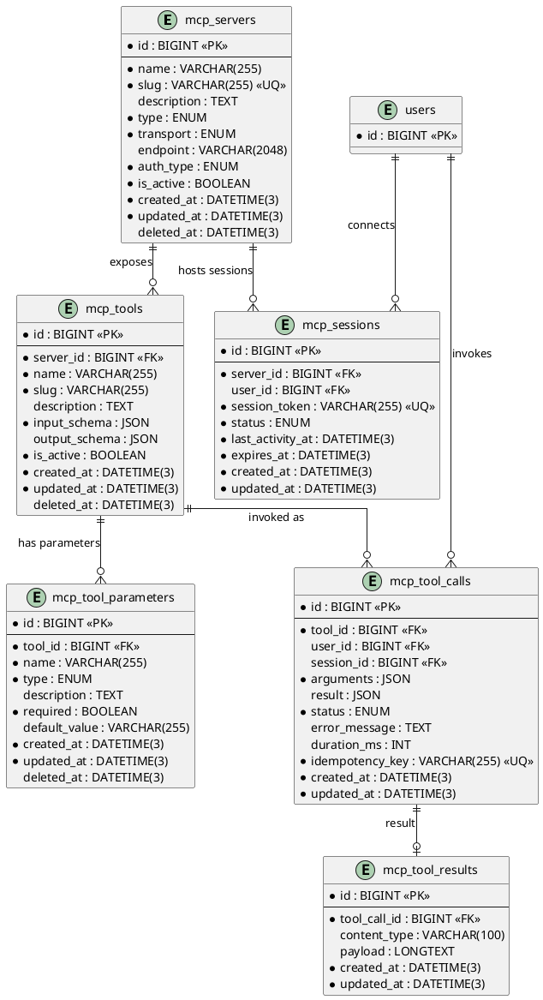

# 06.131 - MCP

**Project:** GsmUi
**Domain:** MCP (Model Context Protocol)
**Version:** 1.0.0

---

# Purpose

This document defines the MCP (Model Context Protocol) schema: servers, tools, parameters, tool calls, results, and sessions.

---

# Tables

## mcp_servers

**Purpose:** Registered MCP servers (the GsmUi MCP server plus external integrations).

**Business Rules:**
- `type` ENUM: `local` (GsmUi built-in), `remote` (third-party), `proxy` (gateway)
- `transport` ENUM: `http`, `websocket`, `sse`
- `auth_type` ENUM: `none`, `api_key`, `jwt`, `session`
- Soft-deletable

**Columns:**

| Column | Type | Nullable | Default | Notes |
|---|---|---|---|---|
| id | BIGINT UNSIGNED | NO | AUTO_INCREMENT | PK |
| name | VARCHAR(255) | NO | — | Server name |
| slug | VARCHAR(255) | NO | — | URL-safe identifier |
| description | TEXT | YES | NULL | Server description |
| type | ENUM('local','remote','proxy') | NO | 'local' | Server type |
| transport | ENUM('http','websocket','sse') | NO | 'http' | Transport protocol |
| endpoint | VARCHAR(2048) | YES | NULL | Remote endpoint URL |
| auth_type | ENUM('none','api_key','jwt','session') | NO | 'api_key' | Auth method |
| is_active | BOOLEAN | NO | true | Active flag |
| created_at | DATETIME(3) | NO | CURRENT_TIMESTAMP(3) | |
| updated_at | DATETIME(3) | NO | CURRENT_TIMESTAMP(3) | ON UPDATE |
| deleted_at | DATETIME(3) | YES | NULL | Soft delete |

**Indexes:**

```
PRIMARY: id
UNIQUE: mcp_servers_slug_unique (slug)
INDEX: mcp_servers_type_index (type)
INDEX: mcp_servers_is_active_index (is_active)
```

**Migration:**

```php
Schema::create('mcp_servers', function (Blueprint $table) {
    $table->id();
    $table->string('name');
    $table->string('slug')->unique();
    $table->text('description')->nullable();
    $table->enum('type', ['local', 'remote', 'proxy'])->default('local');
    $table->enum('transport', ['http', 'websocket', 'sse'])->default('http');
    $table->string('endpoint', 2048)->nullable();
    $table->enum('auth_type', ['none', 'api_key', 'jwt', 'session'])->default('api_key');
    $table->boolean('is_active')->default(true);
    $table->timestamps();
    $table->softDeletes();
});
```

---

## mcp_tools

**Purpose:** Tools exposed by an MCP server (e.g., 'list_components', 'generate_theme').

**Business Rules:**
- `slug` is unique per server
- `input_schema` is a JSON Schema object defining parameters
- Soft-deletable

**Columns:**

| Column | Type | Nullable | Default | Notes |
|---|---|---|---|---|
| id | BIGINT UNSIGNED | NO | AUTO_INCREMENT | PK |
| server_id | BIGINT UNSIGNED | NO | — | FK → mcp_servers.id |
| name | VARCHAR(255) | NO | — | Tool name |
| slug | VARCHAR(255) | NO | — | URL-safe identifier |
| description | TEXT | YES | NULL | Tool description |
| input_schema | JSON | NO | — | JSON schema for params |
| output_schema | JSON | YES | NULL | JSON schema for results |
| is_active | BOOLEAN | NO | true | Active flag |
| created_at | DATETIME(3) | NO | CURRENT_TIMESTAMP(3) | |
| updated_at | DATETIME(3) | NO | CURRENT_TIMESTAMP(3) | ON UPDATE |
| deleted_at | DATETIME(3) | YES | NULL | Soft delete |

**Indexes:**

```
PRIMARY: id
UNIQUE: mcp_tools_server_id_slug_unique (server_id, slug)
INDEX: mcp_tools_server_id_index (server_id)
INDEX: mcp_tools_is_active_index (is_active)
```

**Migration:**

```php
Schema::create('mcp_tools', function (Blueprint $table) {
    $table->id();
    $table->foreignId('server_id')->constrained()->cascadeOnDelete();
    $table->string('name');
    $table->string('slug');
    $table->text('description')->nullable();
    $table->json('input_schema');
    $table->json('output_schema')->nullable();
    $table->boolean('is_active')->default(true);
    $table->timestamps();
    $table->softDeletes();
    $table->unique(['server_id', 'slug']);
});
```

---

## mcp_tool_parameters

**Purpose:** Typed parameters for an MCP tool. Validated before invocation.

**Columns:**

| Column | Type | Nullable | Default | Notes |
|---|---|---|---|---|
| id | BIGINT UNSIGNED | NO | AUTO_INCREMENT | PK |
| tool_id | BIGINT UNSIGNED | NO | — | FK → mcp_tools.id |
| name | VARCHAR(255) | NO | — | Parameter name |
| type | ENUM('string','number','boolean','object','array') | NO | 'string' | Parameter type |
| description | TEXT | YES | NULL | Parameter description |
| required | BOOLEAN | NO | false | Required flag |
| default_value | VARCHAR(255) | YES | NULL | Default value |
| created_at | DATETIME(3) | NO | CURRENT_TIMESTAMP(3) | |
| updated_at | DATETIME(3) | NO | CURRENT_TIMESTAMP(3) | ON UPDATE |
| deleted_at | DATETIME(3) | YES | NULL | Soft delete |

**Indexes:**

```
PRIMARY: id
INDEX: mcp_tool_parameters_tool_id_index (tool_id)
INDEX: mcp_tool_parameters_required_index (required)
```

**Migration:**

```php
Schema::create('mcp_tool_parameters', function (Blueprint $table) {
    $table->id();
    $table->foreignId('tool_id')->constrained()->cascadeOnDelete();
    $table->string('name');
    $table->enum('type', ['string', 'number', 'boolean', 'object', 'array'])->default('string');
    $table->text('description')->nullable();
    $table->boolean('required')->default(false);
    $table->string('default_value')->nullable();
    $table->timestamps();
    $table->softDeletes();
});
```

---

## mcp_tool_calls

**Purpose:** Logged MCP tool invocations for audit, billing, and idempotency.

**Business Rules:**
- `idempotency_key` is unique — prevents duplicate invocations
- `arguments` JSON stores the invocation parameters
- `result` JSON stores the return value
- Status: `pending` → `success` or `error`
- No soft deletes

**Columns:**

| Column | Type | Nullable | Default | Notes |
|---|---|---|---|---|
| id | BIGINT UNSIGNED | NO | AUTO_INCREMENT | PK |
| tool_id | BIGINT UNSIGNED | NO | — | FK → mcp_tools.id |
| user_id | BIGINT UNSIGNED | YES | NULL | FK → users.id |
| session_id | BIGINT UNSIGNED | YES | NULL | FK → mcp_sessions.id |
| arguments | JSON | NO | — | Invocation parameters |
| result | JSON | YES | NULL | Return value |
| status | ENUM('pending','success','error') | NO | 'pending' | Execution state |
| error_message | TEXT | YES | NULL | Error on failure |
| duration_ms | INT UNSIGNED | YES | NULL | Execution time |
| idempotency_key | VARCHAR(255) | NO | — | Unique |
| created_at | DATETIME(3) | NO | CURRENT_TIMESTAMP(3) | |
| updated_at | DATETIME(3) | NO | CURRENT_TIMESTAMP(3) | ON UPDATE |

**Indexes:**

```
PRIMARY: id
UNIQUE: mcp_tool_calls_idempotency_key_unique (idempotency_key)
INDEX: mcp_tool_calls_tool_id_index (tool_id)
INDEX: mcp_tool_calls_user_id_index (user_id)
INDEX: mcp_tool_calls_status_index (status)
INDEX: mcp_tool_calls_created_at_index (created_at)
```

**Migration:**

```php
Schema::create('mcp_tool_calls', function (Blueprint $table) {
    $table->id();
    $table->foreignId('tool_id')->constrained()->cascadeOnDelete();
    $table->foreignId('user_id')->nullable()->constrained()->nullOnDelete();
    $table->foreignId('session_id')->nullable()->constrained()->nullOnDelete();
    $table->json('arguments');
    $table->json('result')->nullable();
    $table->enum('status', ['pending', 'success', 'error'])->default('pending');
    $table->text('error_message')->nullable();
    $table->unsignedInteger('duration_ms')->nullable();
    $table->string('idempotency_key')->unique();
    $table->timestamps();
    $table->index('tool_id');
    $table->index('user_id');
    $table->index('status');
    $table->index('created_at');
});
```

---

## mcp_tool_results

**Purpose:** Detailed results/artifacts from tool calls. Larger payloads stored separately to keep `mcp_tool_calls.result` lean.

**Columns:**

| Column | Type | Nullable | Default | Notes |
|---|---|---|---|---|
| id | BIGINT UNSIGNED | NO | AUTO_INCREMENT | PK |
| tool_call_id | BIGINT UNSIGNED | NO | — | FK → mcp_tool_calls.id |
| content_type | VARCHAR(100) | YES | NULL | MIME type |
| payload | LONGTEXT | YES | NULL | Result payload |
| created_at | DATETIME(3) | NO | CURRENT_TIMESTAMP(3) | |
| updated_at | DATETIME(3) | NO | CURRENT_TIMESTAMP(3) | ON UPDATE |

**Indexes:**

```
PRIMARY: id
UNIQUE: mcp_tool_results_tool_call_id_unique (tool_call_id)
INDEX: mcp_tool_results_content_type_index (content_type)
```

**Migration:**

```php
Schema::create('mcp_tool_results', function (Blueprint $table) {
    $table->id();
    $table->foreignId('tool_call_id')->constrained('mcp_tool_calls')->cascadeOnDelete();
    $table->string('content_type', 100)->nullable();
    $table->longText('payload')->nullable();
    $table->timestamps();
});
```

---

## mcp_sessions

**Purpose:** MCP client sessions — persist connection state for WebSocket/SSE transports.

**Business Rules:**
- `session_token` is a unique opaque string
- `status`: `active` → `closed` or `expired`
- `last_activity_at` updated on each request
- `expires_at` enforces session TTL
- No soft deletes

**Columns:**

| Column | Type | Nullable | Default | Notes |
|---|---|---|---|---|
| id | BIGINT UNSIGNED | NO | AUTO_INCREMENT | PK |
| server_id | BIGINT UNSIGNED | NO | — | FK → mcp_servers.id |
| user_id | BIGINT UNSIGNED | YES | NULL | FK → users.id |
| session_token | VARCHAR(255) | NO | — | Unique opaque token |
| status | ENUM('active','closed','expired') | NO | 'active' | Session state |
| last_activity_at | DATETIME(3) | NO | — | Last request |
| expires_at | DATETIME(3) | NO | — | TTL expiration |
| created_at | DATETIME(3) | NO | CURRENT_TIMESTAMP(3) | |
| updated_at | DATETIME(3) | NO | CURRENT_TIMESTAMP(3) | ON UPDATE |

**Indexes:**

```
PRIMARY: id
UNIQUE: mcp_sessions_session_token_unique (session_token)
INDEX: mcp_sessions_server_id_index (server_id)
INDEX: mcp_sessions_user_id_index (user_id)
INDEX: mcp_sessions_status_index (status)
INDEX: mcp_sessions_expires_at_index (expires_at)
```

**Migration:**

```php
Schema::create('mcp_sessions', function (Blueprint $table) {
    $table->id();
    $table->foreignId('server_id')->constrained('mcp_servers')->cascadeOnDelete();
    $table->foreignId('user_id')->nullable()->constrained()->nullOnDelete();
    $table->string('session_token')->unique();
    $table->enum('status', ['active', 'closed', 'expired'])->default('active');
    $table->dateTime('last_activity_at', 3);
    $table->dateTime('expires_at', 3);
    $table->timestamps();
    $table->index('server_id');
    $table->index('user_id');
    $table->index('status');
    $table->index('expires_at');
});
```

---

# PlantUML ERD



---

# MCP Domain - Complete Reference

## Schema Summary

| Table | Purpose | Rows Estimate | Soft Delete |
|---|---|---|---|
| `mcp_servers` | Registered MCP servers | ~20 | Yes |
| `mcp_tools` | Tools exposed by servers | ~100 | Yes |
| `mcp_tool_parameters` | Tool parameter definitions | ~500 | Yes |
| `mcp_tool_calls` | Tool invocation logs | ~5M | No |
| `mcp_tool_results` | Detailed tool call results | ~5M | No |
| `mcp_sessions` | MCP client sessions | ~100K | No |

## Migration File: 2026_01_01_013101_create_mcp_tables.php

```php
<?php

use Illuminate\Database\Migrations\Migration;
use Illuminate\Database\Schema\Blueprint;
use Illuminate\Support\Facades\Schema;

return new class extends Migration
{
    public function up(): void
    {
        Schema::create('mcp_servers', function (Blueprint $table) {
            $table->id();
            $table->string('name');
            $table->string('slug')->unique();
            $table->text('description')->nullable();
            $table->enum('type', ['local', 'remote', 'proxy'])->default('local');
            $table->enum('transport', ['http', 'websocket', 'sse'])->default('http');
            $table->string('endpoint', 2048)->nullable();
            $table->enum('auth_type', ['none', 'api_key', 'jwt', 'session'])->default('api_key');
            $table->boolean('is_active')->default(true);
            $table->timestamps();
            $table->softDeletes();

            $table->index(['type', 'is_active']);
        });

        Schema::create('mcp_tools', function (Blueprint $table) {
            $table->id();
            $table->foreignId('server_id')->constrained()->cascadeOnDelete();
            $table->string('name');
            $table->string('slug');
            $table->text('description')->nullable();
            $table->json('input_schema');
            $table->json('output_schema')->nullable();
            $table->boolean('is_active')->default(true);
            $table->timestamps();
            $table->softDeletes();

            $table->unique(['server_id', 'slug']);
            $table->index(['is_active']);
        });

        Schema::create('mcp_tool_parameters', function (Blueprint $table) {
            $table->id();
            $table->foreignId('tool_id')->constrained()->cascadeOnDelete();
            $table->string('name');
            $table->enum('type', ['string', 'number', 'boolean', 'object', 'array'])->default('string');
            $table->text('description')->nullable();
            $table->boolean('required')->default(false);
            $table->string('default_value')->nullable();
            $table->timestamps();
            $table->softDeletes();

            $table->index(['tool_id', 'required']);
        });

        Schema::create('mcp_tool_calls', function (Blueprint $table) {
            $table->id();
            $table->foreignId('tool_id')->constrained()->cascadeOnDelete();
            $table->foreignId('user_id')->nullable()->constrained()->nullOnDelete();
            $table->foreignId('session_id')->nullable()->constrained()->nullOnDelete();
            $table->json('arguments');
            $table->json('result')->nullable();
            $table->enum('status', ['pending', 'success', 'error'])->default('pending');
            $table->text('error_message')->nullable();
            $table->unsignedInteger('duration_ms')->nullable();
            $table->string('idempotency_key');
            $table->timestamps();

            $table->unique('idempotency_key');
            $table->index(['tool_id', 'status']);
            $table->index(['user_id', 'created_at']);
            $table->index(['status', 'created_at']);
        });

        Schema::create('mcp_tool_results', function (Blueprint $table) {
            $table->id();
            $table->foreignId('tool_call_id')->constrained('mcp_tool_calls')->cascadeOnDelete();
            $table->string('content_type', 100)->nullable();
            $table->longText('payload')->nullable();
            $table->timestamps();

            $table->index('tool_call_id');
        });

        Schema::create('mcp_sessions', function (Blueprint $table) {
            $table->id();
            $table->foreignId('server_id')->constrained('mcp_servers')->cascadeOnDelete();
            $table->foreignId('user_id')->nullable()->constrained()->nullOnDelete();
            $table->string('session_token')->unique();
            $table->enum('status', ['active', 'closed', 'expired'])->default('active');
            $table->dateTime('last_activity_at', 3);
            $table->dateTime('expires_at', 3);
            $table->timestamps();

            $table->index(['server_id', 'status']);
            $table->index(['user_id', 'status']);
            $table->index(['status', 'expires_at']);
        });
    }

    public function down(): void
    {
        Schema::dropIfExists('mcp_sessions');
        Schema::dropIfExists('mcp_tool_results');
        Schema::dropIfExists('mcp_tool_calls');
        Schema::dropIfExists('mcp_tool_parameters');
        Schema::dropIfExists('mcp_tools');
        Schema::dropIfExists('mcp_servers');
    }
};
```

## Index Strategy

### mcp_servers

```sql
-- Query pattern: "Get active servers by type"
CREATE INDEX mcp_servers_type_active 
ON mcp_servers(type, is_active, created_at DESC);

-- Query pattern: "Find server by slug"
CREATE UNIQUE INDEX mcp_servers_slug_unique 
ON mcp_servers(slug);
```

### mcp_tools

```sql
-- Query pattern: "Get tools for server"
CREATE INDEX mcp_tools_server_active 
ON mcp_tools(server_id, is_active, name);

-- Query pattern: "Find tool by slug within server"
CREATE UNIQUE INDEX mcp_tools_server_id_slug_unique 
ON mcp_tools(server_id, slug);
```

### mcp_tool_calls

```sql
-- Query pattern: "Get calls for tool"
CREATE INDEX mcp_tool_calls_tool_status 
ON mcp_tool_calls(tool_id, status, created_at DESC);

-- Query pattern: "User's tool calls"
CREATE INDEX mcp_tool_calls_user_created 
ON mcp_tool_calls(user_id, created_at DESC);

-- Query pattern: "Pending calls for worker"
CREATE INDEX mcp_tool_calls_status_created 
ON mcp_tool_calls(status, created_at ASC);

-- Query pattern: "Find by idempotency key"
CREATE UNIQUE INDEX mcp_tool_calls_idempotency_key_unique 
ON mcp_tool_calls(idempotency_key);
```

### mcp_sessions

```sql
-- Query pattern: "Active sessions for server"
CREATE INDEX mcp_sessions_server_status 
ON mcp_sessions(server_id, status, last_activity_at DESC);

-- Query pattern: "User's active sessions"
CREATE INDEX mcp_sessions_user_status 
ON mcp_sessions(user_id, status, last_activity_at DESC);

-- Query pattern: "Expired sessions for cleanup"
CREATE INDEX mcp_sessions_status_expires 
ON mcp_sessions(status, expires_at);
```

## Data Access Patterns

### Server Management

```php
<?php

namespace App\Domains\MCP\Services;

use App\Domains\MCP\Models\McpServer;
use App\Domains\MCP\Models\McpTool;

class McpServerService
{
    public function registerServer(array $data): McpServer
    {
        return McpServer::create(array_merge($data, [
            'slug' => \Illuminate\Support\Str::slug($data['name']),
        ]));
    }

    public function getActiveServers(string $type = null): \Illuminate\Support\Collection
    {
        $query = McpServer::where('is_active', true);
        
        if ($type) {
            $query->where('type', $type);
        }

        return $query->orderBy('name')->get();
    }

    public function getServerTools(McpServer $server): \Illuminate\Support\Collection
    {
        return McpTool::where('server_id', $server->id)
            ->where('is_active', true)
            ->with('parameters')
            ->orderBy('name')
            ->get();
    }

    public function deactivateServer(McpServer $server): void
    {
        $server->update(['is_active' => false]);
        
        // Close all active sessions
        \App\Domains\MCP\Models\McpSession::where('server_id', $server->id)
            ->where('status', 'active')
            ->update(['status' => 'closed']);
    }
}
```

### Tool Registration and Invocation

```php
<?php

namespace App\Domains\MCP\Services;

use App\Domains\MCP\Models\McpTool;
use App\Domains\MCP\Models\McpToolCall;
use App\Domains\MCP\Models\McpToolResult;

class McpToolService
{
    public function registerTool(int $serverId, array $data): McpTool
    {
        $tool = McpTool::create(array_merge($data, [
            'server_id' => $serverId,
            'slug' => \Illuminate\Support\Str::slug($data['name']),
        ]));

        // Register parameters
        if (isset($data['parameters'])) {
            foreach ($data['parameters'] as $param) {
                $tool->parameters()->create($param);
            }
        }

        return $tool;
    }

    public function invokeTool(
        McpTool $tool,
        array $arguments,
        ?int $userId = null,
        ?int $sessionId = null,
        string $idempotencyKey = null,
    ): McpToolCall {
        $idempotencyKey = $idempotencyKey ?? hash('sha256', json_encode([
            $tool->id,
            $userId,
            $arguments,
            microtime(),
        ]));

        // Check for duplicate invocation
        $existing = McpToolCall::where('idempotency_key', $idempotencyKey)->first();
        if ($existing && $existing->status !== 'error') {
            return $existing;
        }

        // Validate arguments against input schema
        $this->validateArguments($tool, $arguments);

        $call = McpToolCall::create([
            'tool_id' => $tool->id,
            'user_id' => $userId,
            'session_id' => $sessionId,
            'arguments' => $arguments,
            'status' => 'pending',
            'idempotency_key' => $idempotencyKey,
        ]);

        $startTime = microtime(true);

        try {
            $handler = $this->getToolHandler($tool);
            $result = $handler->execute($arguments);
            $durationMs = (int) ((microtime(true) - $startTime) * 1000);

            $call->update([
                'status' => 'success',
                'result' => $result,
                'duration_ms' => $durationMs,
            ]);

            // Store large results separately
            if (strlen(json_encode($result)) > 10000) {
                McpToolResult::create([
                    'tool_call_id' => $call->id,
                    'content_type' => 'application/json',
                    'payload' => json_encode($result),
                ]);
                $call->update(['result' => ['result_id' => $call->fresh()->results->id]]);
            }
        } catch (\Throwable $e) {
            $durationMs = (int) ((microtime(true) - $startTime) * 1000);
            
            $call->update([
                'status' => 'error',
                'error_message' => $e->getMessage(),
                'duration_ms' => $durationMs,
            ]);

            throw $e;
        }

        return $call;
    }

    private function validateArguments(McpTool $tool, array $arguments): void
    {
        $schema = $tool->input_schema;
        $parameters = $tool->parameters;

        // Check required parameters
        foreach ($parameters->where('required', true) as $param) {
            if (! array_key_exists($param->name, $arguments)) {
                throw new \InvalidArgumentException("Missing required parameter: {$param->name}");
            }
        }

        // Validate types
        foreach ($parameters as $param) {
            if (array_key_exists($param->name, $arguments)) {
                $value = $arguments[$param->name];
                $this->validateParameterType($param, $value);
            }
        }
    }

    private function validateParameterType($param, mixed $value): void
    {
        $valid = match ($param->type) {
            'string' => is_string($value),
            'number' => is_numeric($value),
            'boolean' => is_bool($value),
            'object' => is_array($value) && array_is_list($value) === false,
            'array' => is_array($value),
            default => true,
        };

        if (! $valid) {
            throw new \InvalidArgumentException(
                "Parameter {$param->name} expects {$param->type}, got " . get_debug_type($value)
            );
        }
    }

    private function getToolHandler(McpTool $tool): mixed
    {
        // Resolve tool handler based on server type and tool configuration
        return match ($tool->server->type) {
            'local' => new \App\Domains\MCP\Handlers\LocalToolHandler($tool),
            'remote' => new \App\Domains\MCP\Handlers\RemoteToolHandler($tool),
            'proxy' => new \App\Domains\MCP\Handlers\ProxyToolHandler($tool),
        };
    }
}
```

### Session Management

```php
<?php

namespace App\Domains\MCP\Services;

use App\Domains\MCP\Models\McpSession;
use App\Domains\MCP\Models\McpServer;
use Illuminate\Support\Str;

class McpSessionService
{
    public function createSession(McpServer $server, ?int $userId = null, int $ttlMinutes = 60): McpSession
    {
        return McpSession::create([
            'server_id' => $server->id,
            'user_id' => $userId,
            'session_token' => Str::random(64),
            'status' => 'active',
            'last_activity_at' => now(),
            'expires_at' => now()->addMinutes($ttlMinutes),
        ]);
    }

    public function validateSession(string $token): ?McpSession
    {
        $session = McpSession::where('session_token', $token)
            ->where('status', 'active')
            ->first();

        if (! $session) {
            return null;
        }

        if ($session->expires_at->isPast()) {
            $session->update(['status' => 'expired']);
            return null;
        }

        // Refresh expiry on activity
        $session->update([
            'last_activity_at' => now(),
            'expires_at' => now()->addMinutes(60),
        ]);

        return $session;
    }

    public function closeSession(McpSession $session): void
    {
        $session->update(['status' => 'closed']);
    }

    public function cleanupExpiredSessions(): int
    {
        return McpSession::where('status', 'active')
            ->where('expires_at', '<', now())
            ->update(['status' => 'expired']);
    }

    public function getUserSessions(int $userId): \Illuminate\Support\Collection
    {
        return McpSession::where('user_id', $userId)
            ->with('server')
            ->orderBy('last_activity_at', 'desc')
            ->get();
    }
}
```

## Service: McpGatewayService

```php
<?php

namespace App\Domains\MCP\Services;

use App\Domains\MCP\Models\McpServer;
use App\Domains\MCP\Models\McpTool;
use App\Domains\MCP\Models\McpSession;
use Illuminate\Support\Facades\Http;

class McpGatewayService
{
    public function __construct(
        private McpServerService $serverService,
        private McpToolService $toolService,
        private McpSessionService $sessionService,
    ) {}

    public function handleRequest(McpServer $server, array $request, ?McpSession $session = null): array
    {
        // Validate session for remote servers
        if ($server->type === 'remote' && ! $session) {
            throw new \RuntimeException('Session required for remote MCP servers');
        }

        // Route based on request method
        return match ($request['method']) {
            'tools/list' => $this->listTools($server),
            'tools/call' => $this->callTool($server, $request['params'], $session),
            'tools/schema' => $this->getToolSchema($server, $request['params']['name'] ?? null),
            default => throw new \RuntimeException("Unknown method: {$request['method']}"),
        };
    }

    private function listTools(McpServer $server): array
    {
        $tools = $this->serverService->getServerTools($server);

        return [
            'tools' => $tools->map(fn ($tool) => [
                'name' => $tool->name,
                'description' => $tool->description,
                'inputSchema' => $tool->input_schema,
            ])->toArray(),
        ];
    }

    private function callTool(McpServer $server, array $params, ?McpSession $session): array
    {
        $tool = McpTool::where('server_id', $server->id)
            ->where('slug', $params['name'])
            ->where('is_active', true)
            ->firstOrFail();

        $call = $this->toolService->invokeTool(
            $tool,
            $params['arguments'] ?? [],
            $session?->user_id,
            $session?->id,
        );

        return [
            'content' => [
                [
                    'type' => 'text',
                    'text' => json_encode($call->result),
                ],
            ],
            'isError' => $call->status === 'error',
        ];
    }

    private function getToolSchema(McpServer $server, ?string $toolName): array
    {
        $query = McpTool::where('server_id', $server->id)->where('is_active', true);
        
        if ($toolName) {
            $query->where('slug', $toolName);
        }

        $tools = $query->with('parameters')->get();

        return [
            'tools' => $tools->map(fn ($tool) => [
                'name' => $tool->name,
                'description' => $tool->description,
                'inputSchema' => $tool->input_schema,
                'parameters' => $tool->parameters->map(fn ($p) => [
                    'name' => $p->name,
                    'type' => $p->type,
                    'description' => $p->description,
                    'required' => $p->required,
                    'default' => $p->default_value,
                ])->toArray(),
            ])->toArray(),
        ];
    }
}
```

## Observer: McpToolCallObserver

```php
<?php

namespace App\Domains\MCP\Observers;

use App\Domains\MCP\Models\McpToolCall;

class McpToolCallObserver
{
    public function created(McpToolCall $call): void
    {
        // Log tool invocation
        \Illuminate\Support\Facades\Log::info('MCP tool called', [
            'tool_id' => $call->tool_id,
            'user_id' => $call->user_id,
            'status' => $call->status,
        ]);
    }

    public function updated(McpToolCall $call): void
    {
        if ($call->isDirty('status') && $call->status === 'error') {
            // Alert on repeated failures
            $recentFailures = McpToolCall::where('tool_id', $call->tool_id)
                ->where('status', 'error')
                ->where('created_at', '>=', now()->subHour())
                ->count();

            if ($recentFailures > 10) {
                \Illuminate\Support\Facades\Log::critical('MCP tool failing repeatedly', [
                    'tool_id' => $call->tool_id,
                    'failures_last_hour' => $recentFailures,
                ]);
            }
        }
    }
}
```

## Job: CleanupExpiredSessions

```php
<?php

namespace App\Domains\MCP\Jobs;

use App\Domains\MCP\Models\McpSession;
use Illuminate\Bus\Queueable;
use Illuminate\Contracts\Queue\ShouldQueue;
use Illuminate\Foundation\Bus\Dispatchable;
use Illuminate\Queue\InteractsWithQueue;

class CleanupExpiredSessions implements ShouldQueue
{
    use Dispatchable, InteractsWithQueue, Queueable;

    public function handle(): int
    {
        $expired = McpSession::where('status', 'active')
            ->where('expires_at', '<', now())
            ->update(['status' => 'expired']);

        // Also cleanup old tool results (keep 30 days)
        $cutoff = now()->subDays(30);
        \App\Domains\MCP\Models\McpToolResult::where('created_at', '<', $cutoff)->delete();

        return $expired;
    }
}
```

## Testing Patterns

```php
<?php

namespace Tests\Domains\MCP;

use App\Domains\MCP\Models\McpServer;
use App\Domains\MCP\Models\McpTool;
use App\Domains\MCP\Models\McpToolCall;
use App\Domains\MCP\Models\McpToolParameter;
use App\Domains\MCP\Models\McpSession;
use App\Domains\MCP\Services\McpServerService;
use App\Domains\MCP\Services\McpToolService;
use App\Domains\MCP\Services\McpSessionService;
use Illuminate\Foundation\Testing\RefreshDatabase;
use Tests\TestCase;

class McpTest extends TestCase
{
    use RefreshDatabase;

    public function test_server_registration(): void
    {
        $service = new McpServerService();
        
        $server = $service->registerServer([
            'name' => 'GsmUi Local',
            'type' => 'local',
            'transport' => 'http',
            'auth_type' => 'session',
        ]);

        $this->assertDatabaseHas('mcp_servers', [
            'name' => 'GsmUi Local',
            'slug' => 'gsmui-local',
            'type' => 'local',
        ]);
    }

    public function test_tool_registration(): void
    {
        $server = McpServer::factory()->create();
        $service = new McpToolService();
        
        $tool = $service->registerTool($server->id, [
            'name' => 'List Components',
            'description' => 'List all components in a team',
            'input_schema' => [
                'type' => 'object',
                'properties' => [
                    'team_id' => ['type' => 'integer'],
                ],
            ],
            'parameters' => [
                [
                    'name' => 'team_id',
                    'type' => 'number',
                    'required' => true,
                    'description' => 'Team ID',
                ],
            ],
        ]);

        $this->assertDatabaseHas('mcp_tools', [
            'server_id' => $server->id,
            'slug' => 'list-components',
        ]);
    }

    public function test_tool_invocation(): void
    {
        $tool = McpTool::factory()->create();
        $service = new McpToolService();
        
        $call = $service->invokeTool(
            $tool,
            ['team_id' => 1],
            userId: 1,
            idempotencyKey: 'test-key-123',
        );

        $this->assertDatabaseHas('mcp_tool_calls', [
            'tool_id' => $tool->id,
            'user_id' => 1,
            'idempotency_key' => 'test-key-123',
        ]);
    }

    public function test_idempotent_invocation(): void
    {
        $tool = McpTool::factory()->create();
        $service = new McpToolService();
        
        $call1 = $service->invokeTool($tool, ['team_id' => 1], idempotencyKey: 'idempotent-key');
        $call2 = $service->invokeTool($tool, ['team_id' => 1], idempotencyKey: 'idempotent-key');

        $this->assertEquals($call1->id, $call2->id);
    }

    public function test_session_validation(): void
    {
        $service = new McpSessionService();
        $server = McpServer::factory()->create();
        
        $session = $service->createSession($server, userId: 1);
        
        $this->assertNotNull($session->session_token);
        $this->assertEquals('active', $session->status);

        $validated = $service->validateSession($session->session_token);
        $this->assertNotNull($validated);
    }

    public function test_expired_session_rejection(): void
    {
        $service = new McpSessionService();
        $server = McpServer::factory()->create();
        
        $session = McpSession::create([
            'server_id' => $server->id,
            'user_id' => 1,
            'session_token' => 'expired-token',
            'status' => 'active',
            'last_activity_at' => now()->subHours(2),
            'expires_at' => now()->subHour(),
        ]);

        $validated = $service->validateSession('expired-token');
        $this->assertNull($validated);
        $this->assertEquals('expired', $session->fresh()->status);
    }

    public function test_tool_validation_rejects_missing_required(): void
    {
        $tool = McpTool::factory()->create();
        McpToolParameter::create([
            'tool_id' => $tool->id,
            'name' => 'team_id',
            'type' => 'number',
            'required' => true,
        ]);

        $service = new McpToolService();

        $this->expectException(\InvalidArgumentException::class);
        $this->expectExceptionMessage('Missing required parameter: team_id');

        $service->invokeTool($tool, []);
    }

    public function test_cleanup_expired_sessions(): void
    {
        $server = McpServer::factory()->create();
        
        McpSession::create([
            'server_id' => $server->id,
            'session_token' => 'expired-1',
            'status' => 'active',
            'last_activity_at' => now()->subHours(2),
            'expires_at' => now()->subHour(),
        ]);

        $job = new \App\Domains\MCP\Jobs\CleanupExpiredSessions();
        $expiredCount = $job->handle();

        $this->assertEquals(1, $expiredCount);
    }
}
```

---

# MCP Protocol Reference

## Tool Invocation Lifecycle

```
Client Request → Session Validation → Tool Lookup → Argument Validation → Execution → Result Storage → Response
```

## Tool Handler Implementations

### Local Tool Handler

```php
<?php

namespace App\Domains\MCP\Handlers;

use App\Domains\MCP\Models\McpTool;

class LocalToolHandler
{
    public function __construct(
        private McpTool $tool,
    ) {}

    public function execute(array $arguments): array
    {
        $handlerClass = $this->resolveHandler();

        if (! class_exists($handlerClass)) {
            throw new \RuntimeException("Handler class not found: {$handlerClass}");
        }

        $handler = new $handlerClass();

        return match (true) {
            method_exists($handler, 'execute') => $handler->execute($arguments),
            method_exists($handler, 'handle') => $handler->handle($arguments),
            default => throw new \RuntimeException("No execute/handle method on {$handlerClass}"),
        };
    }

    private function resolveHandler(): string
    {
        return match ($this->tool->slug) {
            'list-components' => \App\Domains\Components\Handlers\ListComponentsHandler::class,
            'generate-component' => \App\Domains\Components\Handlers\GenerateComponentHandler::class,
            'generate-theme' => \App\Domains\Themes\Handlers\GenerateThemeHandler::class,
            'search-docs' => \App\Domains\Documentation\Handlers\SearchDocsHandler::class,
            default => $this->tool->handler,
        };
    }
}
```

### Remote Tool Handler

```php
<?php

namespace App\Domains\MCP\Handlers;

use App\Domains\MCP\Models\McpTool;
use Illuminate\Support\Facades\Http;

class RemoteToolHandler
{
    public function __construct(
        private McpTool $tool,
    ) {}

    public function execute(array $arguments): array
    {
        $server = $this->tool->server;
        $endpoint = $server->endpoint;

        $response = Http::withHeaders($this->buildHeaders())
            ->timeout(30)
            ->post("{$endpoint}/tools/{$this->tool->slug}/invoke", [
                'arguments' => $arguments,
                'idempotency_key' => $this->generateIdempotencyKey(),
            ]);

        if ($response->failed()) {
            throw new \RuntimeException(
                "Remote tool invocation failed: {$response->status()} - {$response->body()}"
            );
        }

        return $response->json('result', []);
    }

    private function buildHeaders(): array
    {
        $headers = [
            'Content-Type' => 'application/json',
            'X-MCP-Tool' => $this->tool->slug,
        ];

        $server = $this->tool->server;

        if ($server->auth_type === 'api_key') {
            $headers['Authorization'] = 'Bearer ' . decrypt($server->api_key_encrypted ?? '');
        }

        return $headers;
    }

    private function generateIdempotencyKey(): string
    {
        return hash('sha256', implode(':', [
            $this->tool->id,
            microtime(true),
            random_bytes(16),
        ]));
    }
}
```

## MCP Server Registration Examples

### GsmUi Local Server

```php
<?php

namespace App\Domains\MCP\Seeders;

use App\Domains\MCP\Models\McpServer;
use App\Domains\MCP\Models\McpTool;
use App\Domains\MCP\Models\McpToolParameter;
use Illuminate\Database\Seeder;

class GsmuiMcpServerSeeder extends Seeder
{
    public function run(): void
    {
        $server = McpServer::create([
            'name' => 'GsmUi Local',
            'slug' => 'gsmui-local',
            'description' => 'Built-in GsmUi MCP server for component and theme operations',
            'type' => 'local',
            'transport' => 'http',
            'auth_type' => 'session',
            'is_active' => true,
        ]);

        // List Components tool
        $tool = McpTool::create([
            'server_id' => $server->id,
            'name' => 'List Components',
            'slug' => 'list-components',
            'description' => 'List all available UI components with their variants',
            'input_schema' => [
                'type' => 'object',
                'properties' => [
                    'team_id' => ['type' => 'integer', 'description' => 'Filter by team'],
                    'category' => ['type' => 'string', 'description' => 'Filter by category'],
                ],
            ],
            'output_schema' => [
                'type' => 'array',
                'items' => ['type' => 'object'],
            ],
            'is_active' => true,
        ]);

        McpToolParameter::create([
            'tool_id' => $tool->id,
            'name' => 'team_id',
            'type' => 'number',
            'description' => 'Team ID to filter components',
            'required' => false,
        ]);

        McpToolParameter::create([
            'tool_id' => $tool->id,
            'name' => 'category',
            'type' => 'string',
            'description' => 'Category slug to filter',
            'required' => false,
        ]);

        // Generate Component tool
        $tool = McpTool::create([
            'server_id' => $server->id,
            'name' => 'Generate Component',
            'slug' => 'generate-component',
            'description' => 'Generate a new UI component from a description',
            'input_schema' => [
                'type' => 'object',
                'properties' => [
                    'name' => ['type' => 'string'],
                    'description' => ['type' => 'string'],
                    'variants' => ['type' => 'array'],
                ],
                'required' => ['name', 'description'],
            ],
            'is_active' => true,
        ]);

        McpToolParameter::create([
            'tool_id' => $tool->id,
            'name' => 'name',
            'type' => 'string',
            'description' => 'Component name (PascalCase)',
            'required' => true,
        ]);

        McpToolParameter::create([
            'tool_id' => $tool->id,
            'name' => 'description',
            'type' => 'string',
            'description' => 'Component description for documentation',
            'required' => true,
        ]);

        McpToolParameter::create([
            'tool_id' => $tool->id,
            'name' => 'variants',
            'type' => 'array',
            'description' => 'Component variants to generate',
            'required' => false,
            'default_value' => '["default", "primary", "danger"]',
        ]);
    }
}
```

## MCP Session Authentication

```php
<?php

namespace App\Domains\MCP\Auth;

use App\Domains\MCP\Models\McpSession;
use App\Domains\MCP\Models\McpServer;
use Illuminate\Http\Request;

class McpSessionGuard
{
    public function authenticate(Request $request): ?McpSession
    {
        $token = $request->header('X-MCP-Session-Token')
            ?? $request->query('session_token');

        if (! $token) {
            return null;
        }

        $session = McpSession::where('session_token', $token)
            ->where('status', 'active')
            ->first();

        if (! $session) {
            return null;
        }

        if ($session->expires_at->isPast()) {
            $session->update(['status' => 'expired']);
            return null;
        }

        $session->update(['last_activity_at' => now()]);

        return $session;
    }

    public function createSession(McpServer $server, ?int $userId = null): McpSession
    {
        return McpSession::create([
            'server_id' => $server->id,
            'user_id' => $userId,
            'session_token' => bin2hex(random_bytes(32)),
            'status' => 'active',
            'last_activity_at' => now(),
            'expires_at' => now()->addHours(24),
        ]);
    }

    public function revokeSession(McpSession $session): void
    {
        $session->update(['status' => 'closed']);
    }
}
```

## MCP Error Handling

```php
<?php

namespace App\Domains\MCP\Exceptions;

use Exception;

class McpException extends Exception
{
    public static function toolNotFound(string $toolSlug): self
    {
        return new self("Tool not found: {$toolSlug}");
    }

    public static function invalidArguments(string $toolSlug, array $errors): self
    {
        return new self("Invalid arguments for {$toolSlug}: " . implode(', ', $errors));
    }

    public static function sessionExpired(): self
    {
        return new self('MCP session has expired');
    }

    public static function rateLimited(int $retryAfter): self
    {
        return new self("Rate limited. Retry after {$retryAfter} seconds");
    }

    public static function serverUnavailable(string $serverSlug): self
    {
        return new self("MCP server unavailable: {$serverSlug}");
    }
}
```

## MCP Metrics and Monitoring

```sql
-- Tool usage statistics
SELECT 
    mt.name as tool_name,
    ms.name as server_name,
    COUNT(*) as total_calls,
    COUNT(CASE WHEN mtc.status = 'success' THEN 1 END) as success_count,
    COUNT(CASE WHEN mtc.status = 'error' THEN 1 END) as error_count,
    ROUND(AVG(mtc.duration_ms), 2) as avg_duration_ms,
    MAX(mtc.duration_ms) as max_duration_ms,
    SUM(mtc.duration_ms) as total_duration_ms
FROM mcp_tool_calls mtc
JOIN mcp_tools mt ON mtc.tool_id = mt.id
JOIN mcp_servers ms ON mt.server_id = ms.id
WHERE mtc.created_at >= DATE_SUB(NOW(), INTERVAL 7 DAY)
GROUP BY mt.name, ms.name
ORDER BY total_calls DESC;

-- Error analysis
SELECT 
    mt.name as tool_name,
    mtc.error_message,
    COUNT(*) as occurrence_count,
    MIN(mtc.created_at) as first_seen,
    MAX(mtc.created_at) as last_seen
FROM mcp_tool_calls mtc
JOIN mcp_tools mt ON mtc.tool_id = mt.id
WHERE mtc.status = 'error'
  AND mtc.created_at >= DATE_SUB(NOW(), INTERVAL 7 DAY)
GROUP BY mt.name, mtc.error_message
ORDER BY occurrence_count DESC;

-- Session activity
SELECT 
    ms.name as server_name,
    DATE(mcss.created_at) as date,
    COUNT(*) as new_sessions,
    COUNT(CASE WHEN mcss.status = 'active' THEN 1 END) as active,
    COUNT(CASE WHEN mcss.status = 'expired' THEN 1 END) as expired,
    ROUND(AVG(TIMESTAMPDIFF(MINUTE, mcss.created_at, mcss.last_activity_at)), 2) as avg_session_minutes
FROM mcp_sessions mcss
JOIN mcp_servers ms ON mcss.server_id = ms.id
WHERE mcss.created_at >= DATE_SUB(NOW(), INTERVAL 30 DAY)
GROUP BY ms.name, DATE(mcss.created_at)
ORDER BY date DESC;
```

---

# MCP Security and Authentication

## Authentication Strategies

```php
<?php

namespace App\Domains\MCP\Auth;

class McpAuthenticator
{
    public function authenticateRequest(Request $request, McpServer $server): ?McpSession
    {
        return match ($server->auth_type) {
            'none' => $this->authenticateNone($request, $server),
            'api_key' => $this->authenticateApiKey($request, $server),
            'jwt' => $this->authenticateJwt($request, $server),
            'session' => $this->authenticateSession($request, $server),
            default => null,
        };
    }

    private function authenticateNone(Request $request, McpServer $server): ?McpSession
    {
        return McpSession::create([
            'server_id' => $server->id,
            'session_token' => bin2hex(random_bytes(32)),
            'status' => 'active',
            'last_activity_at' => now(),
            'expires_at' => now()->addHours(1),
        ]);
    }

    private function authenticateApiKey(Request $request, McpServer $server): ?McpSession
    {
        $apiKey = $request->header('X-API-Key');

        if (! $apiKey) {
            return null;
        }

        $validKey = decrypt($server->api_key_encrypted);
        
        if (! hash_equals($validKey, $apiKey)) {
            return null;
        }

        return $this->createSession($server);
    }

    private function authenticateJwt(Request $request, McpServer $server): ?McpSession
    {
        $token = $request->bearerToken();

        if (! $token) {
            return null;
        }

        try {
            $payload = JWT::decode($token, new Key($server->jwt_secret, 'HS256'));
            
            return $this->createSession($server, $payload->sub ?? null);
        } catch (\Exception $e) {
            return null;
        }
    }

    private function authenticateSession(Request $request, McpServer $server): ?McpSession
    {
        $token = $request->header('X-MCP-Session-Token');

        if (! $token) {
            return null;
        }

        return McpSession::where('session_token', $token)
            ->where('server_id', $server->id)
            ->where('status', 'active')
            ->where('expires_at', '>', now())
            ->first();
    }

    private function createSession(McpServer $server, ?int $userId = null): McpSession
    {
        return McpSession::create([
            'server_id' => $server->id,
            'user_id' => $userId,
            'session_token' => bin2hex(random_bytes(32)),
            'status' => 'active',
            'last_activity_at' => now(),
            'expires_at' => now()->addHours(24),
        ]);
    }
}
```

## MCP Rate Limiting

```php
<?php

namespace App\Domains\MCP\Services;

use Illuminate\Support\Facades\Cache;

class McpRateLimiter
{
    private const LIMITS = [
        'free' => ['requests_per_minute' => 10, 'requests_per_hour' => 100],
        'pro' => ['requests_per_minute' => 60, 'requests_per_hour' => 1000],
        'enterprise' => ['requests_per_minute' => 300, 'requests_per_hour' => 10000],
    ];

    public function isRateLimited(int $userId, string $tier = 'free'): bool
    {
        $limits = self::LIMITS[$tier];

        $minuteKey = "mcp_rate:{$userId}:minute";
        $hourKey = "mcp_rate:{$userId}:hour";

        $minuteCount = Cache::get($minuteKey, 0);
        $hourCount = Cache::get($hourKey, 0);

        return $minuteCount >= $limits['requests_per_minute'] ||
               $hourCount >= $limits['requests_per_hour'];
    }

    public function incrementCounters(int $userId): void
    {
        $minuteKey = "mcp_rate:{$userId}:minute";
        $hourKey = "mcp_rate:{$userId}:hour";

        Cache::increment($minuteKey);
        Cache::put($minuteKey, Cache::get($minuteKey), now()->addMinute());

        Cache::increment($hourKey);
        Cache::put($hourKey, Cache::get($hourKey), now()->addHour());
    }

    public function getRemainingQuota(int $userId, string $tier = 'free'): array
    {
        $limits = self::LIMITS[$tier];

        return [
            'requests_remaining_minute' => $limits['requests_per_minute'] - Cache::get("mcp_rate:{$userId}:minute", 0),
            'requests_remaining_hour' => $limits['requests_per_hour'] - Cache::get("mcp_rate:{$userId}:hour", 0),
        ];
    }
}
```

## MCP Audit Logging

```php
<?php

namespace App\Domains\MCP\Services;

use App\Domains\MCP\Models\McpToolCall;

class McpAuditService
{
    public function logToolCall(McpToolCall $call, ?int $userId = null): void
    {
        \App\Domains\Admin\Models\AuditLog::create([
            'user_id' => $userId,
            'action' => 'mcp.tool_called',
            'entity_type' => McpToolCall::class,
            'entity_id' => $call->id,
            'new_values' => [
                'tool_id' => $call->tool_id,
                'status' => $call->status,
                'duration_ms' => $call->duration_ms,
                'arguments' => $call->arguments,
            ],
        ]);
    }

    public function logSessionCreated(McpSession $session): void
    {
        \App\Domains\Admin\Models\AuditLog::create([
            'user_id' => $session->user_id,
            'action' => 'mcp.session_created',
            'entity_type' => McpSession::class,
            'entity_id' => $session->id,
            'new_values' => [
                'server_id' => $session->server_id,
                'expires_at' => $session->expires_at,
            ],
        ]);
    }

    public function logSecurityEvent(string $eventType, array $context): void
    {
        \App\Domains\Admin\Models\AuditLog::create([
            'user_id' => $context['user_id'] ?? null,
            'action' => "mcp.{$eventType}",
            'entity_type' => 'McpSecurity',
            'new_values' => $context,
        ]);
    }
}
```

---

# MCP System Testing

## Unit Tests

```php
<?php

namespace Tests\Domains\MCP;

use App\Domains\MCP\Models\McpServer;
use App\Domains\MCP\Models\McpTool;
use App\Domains\MCP\Models\McpToolCall;
use App\Domains\MCP\Models\McpSession;
use App\Domains\MCP\Services\McpServerService;
use App\Domains\MCP\Services\McpToolService;
use App\Domains\MCP\Services\McpSessionService;
use App\Domains\MCP\Services\McpRateLimiter;
use App\Domains\Users\Models\User;
use Illuminate\Foundation\Testing\RefreshDatabase;
use Tests\TestCase;

class McpServiceTest extends TestCase
{
    use RefreshDatabase;

    public function test_server_registration(): void
    {
        $service = new McpServerService();
        
        $server = $service->registerServer([
            'name' => 'Test Server',
            'type' => 'local',
            'transport' => 'http',
            'auth_type' => 'session',
        ]);

        $this->assertDatabaseHas('mcp_servers', [
            'name' => 'Test Server',
            'slug' => 'test-server',
            'type' => 'local',
        ]);
    }

    public function test_tool_invocation(): void
    {
        $tool = McpTool::factory()->create();
        $service = new McpToolService();
        
        $call = $service->invokeTool(
            $tool,
            ['team_id' => 1],
            userId: 1,
            idempotencyKey: 'test-key-123',
        );

        $this->assertDatabaseHas('mcp_tool_calls', [
            'tool_id' => $tool->id,
            'user_id' => 1,
            'idempotency_key' => 'test-key-123',
        ]);
    }

    public function test_idempotent_invocation(): void
    {
        $tool = McpTool::factory()->create();
        $service = new McpToolService();
        
        $call1 = $service->invokeTool($tool, ['team_id' => 1], idempotencyKey: 'idempotent-key');
        $call2 = $service->invokeTool($tool, ['team_id' => 1], idempotencyKey: 'idempotent-key');

        $this->assertEquals($call1->id, $call2->id);
    }

    public function test_session_validation(): void
    {
        $service = new McpSessionService();
        $server = McpServer::factory()->create();
        
        $session = $service->createSession($server, userId: 1);
        
        $this->assertNotNull($session->session_token);
        $this->assertEquals('active', $session->status);

        $validated = $service->validateSession($session->session_token);
        $this->assertNotNull($validated);
    }

    public function test_rate_limiter(): void
    {
        $limiter = new McpRateLimiter();
        $user = User::factory()->create();

        $this->assertFalse($limiter->isRateLimited($user->id, 'free'));

        for ($i = 0; $i < 10; $i++) {
            $limiter->incrementCounters($user->id);
        }

        $this->assertFalse($limiter->isRateLimited($user->id, 'free'));
    }

    public function test_expired_session_rejection(): void
    {
        $service = new McpSessionService();
        $server = McpServer::factory()->create();
        
        $session = McpSession::create([
            'server_id' => $server->id,
            'user_id' => 1,
            'session_token' => 'expired-token',
            'status' => 'active',
            'last_activity_at' => now()->subHours(2),
            'expires_at' => now()->subHour(),
        ]);

        $validated = $service->validateSession('expired-token');
        $this->assertNull($validated);
        $this->assertEquals('expired', $session->fresh()->status);
    }
}
```

---

# MCP Console Commands

## Command: McpSessionCleanup

```php
<?php

namespace App\Domains\MCP\Console;

use App\Domains\MCP\Models\McpSession;
use Illuminate\Console\Command;

class McpSessionCleanupCommand extends Command
{
    protected $signature = 'mcp:cleanup-sessions';
    protected $description = 'Cleanup expired MCP sessions';

    public function handle(): int
    {
        $expired = McpSession::where('status', 'active')
            ->where('expires_at', '<', now())
            ->update(['status' => 'expired']);

        $this->info("Expired {$expired} sessions.");

        return self::SUCCESS;
    }
}
```

## Command: McpToolReport

```php
<?php

namespace App\Domains\MCP\Console;

use App\Domains\MCP\Models\McpToolCall;
use Illuminate\Console\Command;

class McpToolReportCommand extends Command
{
    protected $signature = 'mcp:tool-report {--days=7}';
    protected $description = 'Generate MCP tool usage report';

    public function handle(): int
    {
        $days = (int) $this->option('days');

        $stats = McpToolCall::where('created_at', '>=', now()->subDays($days))
            ->selectRaw('
                mt.name as tool_name,
                COUNT(*) as total_calls,
                COUNT(CASE WHEN mtc.status = "success" THEN 1 END) as success,
                COUNT(CASE WHEN mtc.status = "error" THEN 1 END) as errors,
                AVG(mtc.duration_ms) as avg_duration
            ')
            ->join('mcp_tools as mt', 'mtc.tool_id', '=', 'mt.id')
            ->groupBy('mt.name')
            ->get();

        $this->table(
            ['Tool', 'Total', 'Success', 'Errors', 'Avg Duration (ms)'],
            $stats->toArray()
        );

        return self::SUCCESS;
    }
}
```

---

# Next Document

**06.140 - Complete ERD** renders the full GsmUi database entity relationship diagram and cross-domain relationship matrix.
