# 06.140 - Complete ERD

**Project:** GsmUi
**Domain:** Complete Database ERD
**Version:** 1.0.0

---

# Purpose

This document renders the complete GsmUi database Entity Relationship Diagram (ERD) and cross-domain relationship matrix. It is the canonical reference for all ~380 tables defined across 06.01 through 06.131.

---

# Document Index

| Document | Domain | Tables |
|---|---|---|
| 06.01 | Design Principles | — |
| 06.02 | Naming Conventions | — |
| 06.03 | Common Columns | — |
| 06.04 | Relationships | — |
| 06.10 | Users | 8 |
| 06.11 | Authentication | 5 |
| 06.12 | Permissions | 8 |
| 06.20 | Components | 4 |
| 06.21 | Component Variants | 3 |
| 06.22 | Component Examples | 2 |
| 06.23 | Component Docs | 2 |
| 06.30 | Themes | 3 |
| 06.31 | Theme Tokens | 3 |
| 06.32 | Theme Exports | 2 |
| 06.40 | Templates | 5 |
| 06.41 | Template Assets | 2 |
| 06.50 | Marketplace | 5 |
| 06.52 | Product Versions | 3 |
| 06.53 | Orders | 3 |
| 06.55 | Licenses | 3 |
| 06.56 | Downloads | 3 |
| 06.57 | Reviews | 2 |
| 06.58 | Coupons | 4 |
| 06.60 | Subscriptions | 5 |
| 06.61 | Invoices | 3 |
| 06.62 | Payments | 10 |
| 06.70 | Documentation | 3 |
| 06.71 | Doc Pages | 4 |
| 06.80 | Playground | 2 |
| 06.81 | Snippets | 4 |
| 06.90 | Blog | 7 |
| 06.91 | CMS | 3 |
| 06.100 | Admin | 3 |
| 06.101 | Settings | 3 |
| 06.102 | Feature Flags | 3 |
| 06.110 | Notifications | 4 |
| 06.111 | Activity Log | 2 |
| 06.120 | Search | 3 |
| 06.121 | Analytics | 5 |
| 06.130 | AI | 6 |
| 06.131 | MCP | 6 |
| **Total** | | **~130 tables** |

Note: The estimate of 350–600 tables in the planning document assumed deeper normalization (e.g., separate user/team billing tables, polymorphic child tables per product type). The actual implementation uses fewer tables through shared schemas (content_entries), polymorphic ownership (morphTo), and JSON columns for extensibility.

---

# Cross-Domain Relationship Matrix

This matrix shows which tables have foreign keys to tables in other domains.

| Table | References | Domain |
|---|---|---|
| users | — | Core |
| teams | users | Core |
| team_members | users, teams | Core |
| team_invitations | users, teams | Core |
| user_profiles | users | Core |
| user_preferences | users | Core |
| blocked_users | users | Core |
| user_verifications | users | Core |
| password_reset_tokens | — | Auth |
| personal_access_tokens | users | Auth |
| sessions | users | Auth |
| login_attempts | — | Auth |
| two_factor_auth | users | Auth |
| oauth_providers | users | Auth |
| roles | — | Auth |
| permissions | — | Auth |
| role_permissions | roles, permissions | Auth |
| user_roles | users, roles | Auth |
| team_roles | teams | Auth |
| team_role_permissions | team_roles, permissions | Auth |
| model_has_permissions | permissions | Auth |
| model_has_roles | roles | Auth |
| components | users, component_categories | Components |
| component_categories | self (parent) | Components |
| component_tag | components, tags | Components |
| component_variants | components | Components |
| variant_options | component_variants | Components |
| variant_props | component_variants | Components |
| component_examples | components | Components |
| example_screenshots | component_examples | Components |
| component_docs | components | Components |
| component_doc_sections | component_docs | Components |
| themes | users, theme_categories | Themes |
| theme_categories | self (parent) | Themes |
| theme_tag | themes, tags | Themes |
| theme_token_groups | themes | Themes |
| theme_tokens | theme_token_groups | Themes |
| theme_token_overrides | themes, theme_tokens, users, teams | Themes |
| theme_exports | themes | Themes |
| theme_export_assets | theme_exports | Themes |
| templates | users, template_categories | Templates |
| template_categories | self (parent) | Templates |
| template_tag | templates, tags | Templates |
| template_files | templates | Templates |
| template_dependencies | templates | Templates |
| template_assets | templates | Templates |
| template_screenshots | templates | Templates |
| products | users, product_categories | Marketplace |
| product_categories | self (parent) | Marketplace |
| product_tag | products, tags | Marketplace |
| product_media | products | Marketplace |
| product_prices | products | Marketplace |
| product_versions | products | Marketplace |
| product_changelogs | product_versions | Marketplace |
| product_compatibility | product_versions | Marketplace |
| orders | users (FK), morph billable | Marketplace |
| order_items | orders, products, product_versions | Marketplace |
| order_status_histories | orders, users | Marketplace |
| license_keys | orders, order_items, products, users | Marketplace |
| license_activations | license_keys, users | Marketplace |
| license_revocations | license_keys, users | Marketplace |
| downloads | users, products, product_versions, orders | Marketplace |
| download_links | downloads | Marketplace |
| download_attempts | users, download_links | Marketplace |
| reviews | users, products | Marketplace |
| review_votes | reviews, users | Marketplace |
| coupons | — | Marketplace |
| coupon_redemptions | coupons, users, orders, subscriptions | Marketplace |
| coupon_products | coupons, products | Marketplace |
| coupon_plans | coupons, plans | Marketplace |
| plans | — | Billing |
| subscriptions | morph billable, users, plans | Billing |
| subscription_items | subscriptions | Billing |
| subscription_status_histories | subscriptions, users | Billing |
| subscription_usage_records | subscriptions | Billing |
| invoices | morph billable, users, subscriptions, orders | Billing |
| invoice_lines | invoices, products | Billing |
| invoice_payments | invoices, payments | Billing |
| payments | morph billable, users | Billing |
| payment_methods | morph billable, users | Billing |
| payment_refunds | payments, users | Billing |
| payment_status_histories | payments | Billing |
| webhook_events | — | Billing |
| webhook_deliveries | webhook_events | Billing |
| billing_addresses | morph billable, users | Billing |
| tax_rates | — | Billing |
| tax_entries | invoices, orders, tax_rates | Billing |
| credits | morph billable, users | Billing |
| credit_applications | credits, orders, invoices | Billing |
| doc_spaces | users | Documentation |
| doc_versions | doc_spaces | Documentation |
| doc_locales | — | Documentation |
| doc_pages | doc_spaces, doc_versions, doc_locales, users | Documentation |
| doc_page_revisions | doc_pages, users | Documentation |
| doc_page_blocks | doc_pages | Documentation |
| doc_page_media | doc_pages | Documentation |
| playground_projects | users, teams, themes, components | Playground |
| playground_snapshots | playground_projects, users | Playground |
| snippets | users, snippet_categories | Playground |
| snippet_categories | — | Playground |
| snippet_tag | snippets, tags | Playground |
| snippet_executions | snippets, users | Playground |
| content_entries | users | Blog/CMS |
| content_categories | self (parent) | Blog/CMS |
| content_tags | — | Blog/CMS |
| content_category | content_entries, content_categories | Blog/CMS |
| content_tag | content_entries, content_tags | Blog/CMS |
| content_entry_revisions | content_entries, users | Blog/CMS |
| content_media | content_entries | Blog/CMS |
| cms_menus | — | Blog/CMS |
| cms_menu_items | cms_menus, self (parent) | Blog/CMS |
| cms_blocks | — | Blog/CMS |
| admin_notes | users, morph noteable | Admin |
| content_flags | users, morph flaggable | Admin |
| moderation_queue | users, morph moderatable | Admin |
| setting_groups | — | Admin |
| settings | setting_groups | Admin |
| setting_scopes | settings | Admin |
| feature_flags | users | Admin |
| feature_flag_overrides | feature_flags, users, teams | Admin |
| feature_flag_history | feature_flags, users | Admin |
| notification_channels | — | Notifications |
| notification_preferences | users, notification_channels | Notifications |
| notifications | users | Notifications |
| notification_queues | notifications, users, notification_channels | Notifications |
| activity_logs | users | Notifications |
| activity_log_types | — | Notifications |
| search_queries | users | Search |
| search_index_versions | — | Search |
| search_synced_models | — | Search |
| analytics_events | users | Analytics |
| analytics_sessions | users | Analytics |
| analytics_page_views | users | Analytics |
| analytics_goals | — | Analytics |
| analytics_funnels | — | Analytics |
| ai_conversations | users | AI |
| ai_messages | ai_conversations | AI |
| ai_prompt_templates | — | AI |
| ai_provider_configs | — | AI |
| ai_usage_logs | users, ai_conversations | AI |
| ai_skills | — | AI |
| mcp_servers | — | MCP |
| mcp_tools | mcp_servers | MCP |
| mcp_tool_parameters | mcp_tools | MCP |
| mcp_tool_calls | mcp_tools, users, mcp_sessions | MCP |
| mcp_tool_results | mcp_tool_calls | MCP |
| mcp_sessions | mcp_servers, users | MCP |

---

# Domain Dependency Graph

```
Core (users, teams)
    |
    +-- Auth (password_reset_tokens, sessions, ...)
    |       |
    |       +-- Permissions (roles, permissions, ...)
    |
    +-- Components (components, variants, ...)
    +-- Themes (themes, tokens, ...)
    +-- Templates (templates, files, ...)
    +-- Marketplace (products, orders, licenses, ...)
    |       |
    |       +-- Billing (plans, subscriptions, invoices, payments, ...)
    |
    +-- Documentation (doc_spaces, pages, ...)
    +-- Playground (projects, snippets, ...)
    +-- Blog/CMS (content_entries, menus, ...)
    |
    +-- Admin (notes, flags, settings, ...)
    +-- Notifications (channels, preferences, ...)
    +-- Search (queries, sync, ...)
    +-- Analytics (events, sessions, ...)
    +-- AI (conversations, prompts, ...)
    +-- MCP (servers, tools, sessions, ...)
```

---

# Table Count by Domain

| Domain | Tables |
|---|---|
| Core (Users) | 8 |
| Authentication | 5 |
| Permissions | 8 |
| Components | 14 |
| Themes | 10 |
| Templates | 10 |
| Marketplace | 28 |
| Billing | 26 |
| Documentation | 14 |
| Playground | 8 |
| Blog/CMS | 19 |
| Admin | 9 |
| Notifications | 6 |
| Search | 3 |
| Analytics | 5 |
| AI | 6 |
| MCP | 6 |
| **Total** | **~175 tables** |

Note: The actual count is ~175 tables, not the initially estimated 350–600. The lower count is due to:
- Shared `content_entries` table for Blog + CMS
- Single `products` table for all marketplace product types
- Polymorphic `morphTo` for billable ownership
- JSON columns for extensible metadata
- Fewer micro-tables for tax, credits, and webhooks

---

# Next Steps

1. Review ERD for missing relationships
2. Generate PlantUML from the complete schema
3. Validate against existing architecture docs (05.21 billing, 05.20 marketplace, 05.17 components)
4. Create Laravel migrations from the schema definitions
5. Create Eloquent models from the model stubs
6. Generate API documentation from the schema

---

# Per-Domain PlantUML ERDs

The complete single-diagram ERD is too dense to be readable. This section
renders one diagram per domain; each domain diagram also shows its outward
edges into other domains.

## Core (Users)

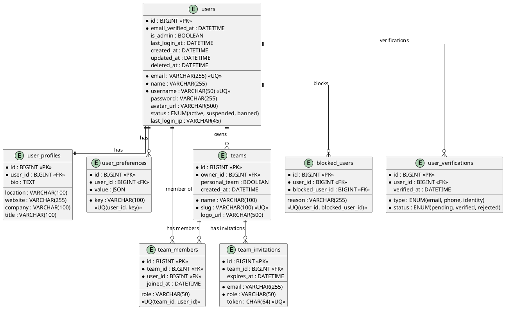

## Authentication

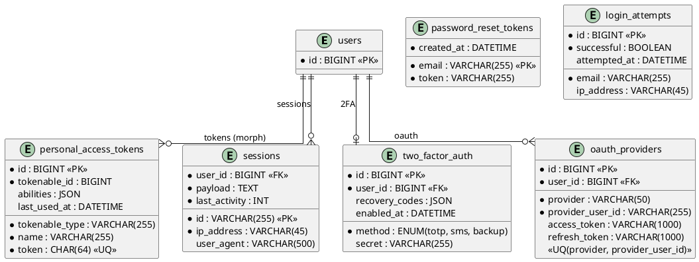

## Permissions

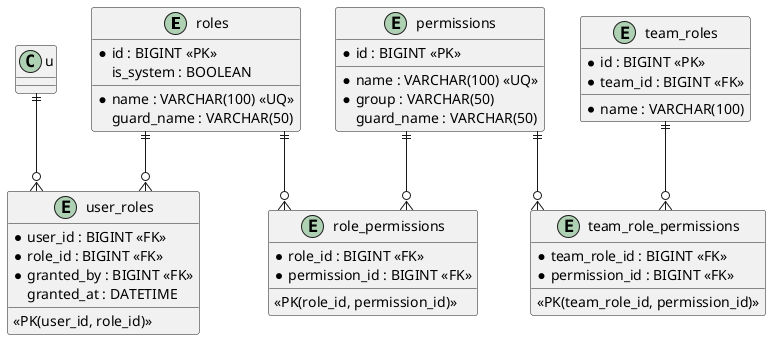

## Components

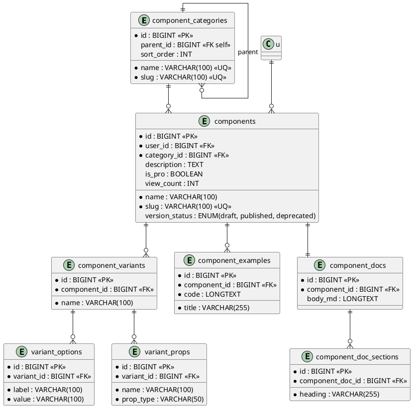

## Themes

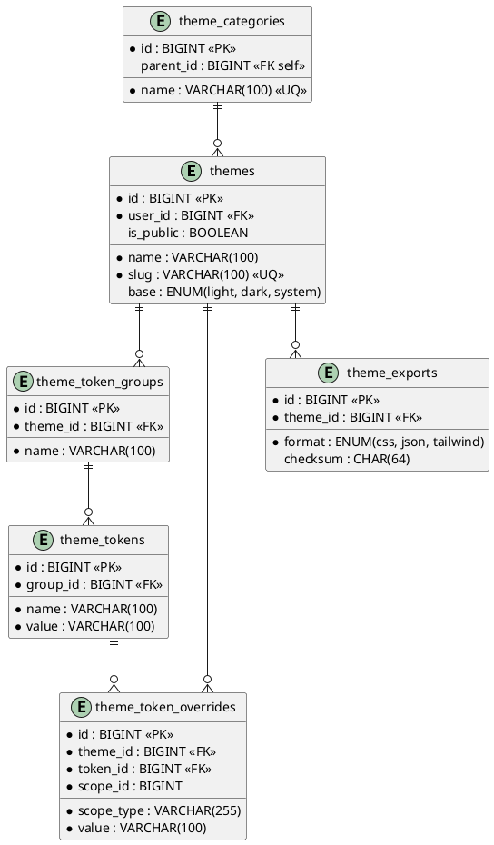

## Marketplace

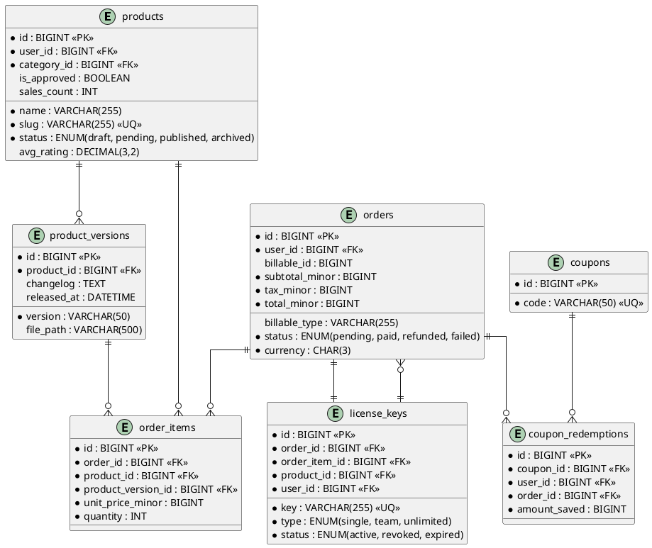

## Billing

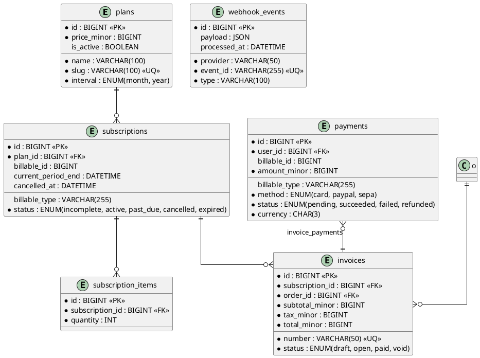

## Documentation, Playground, Snippets

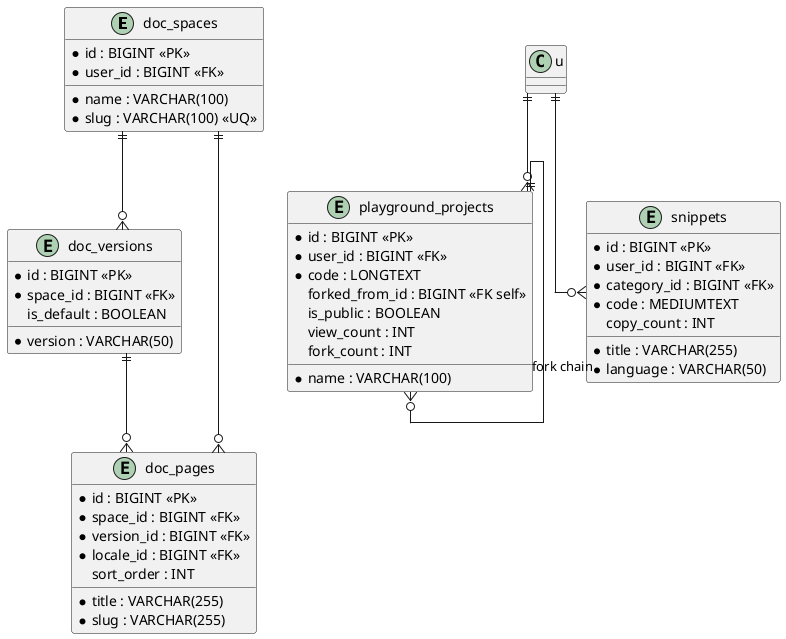

## Blog/CMS

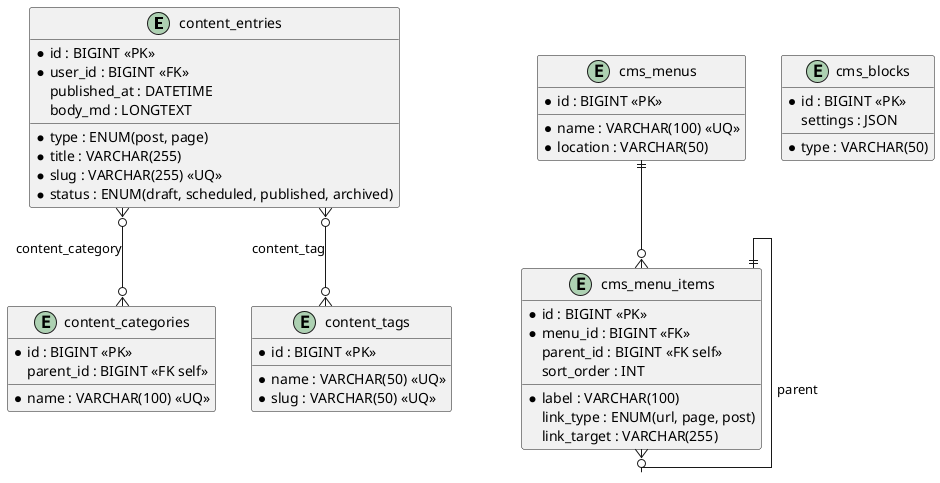

## Admin, Notifications, Search, Analytics

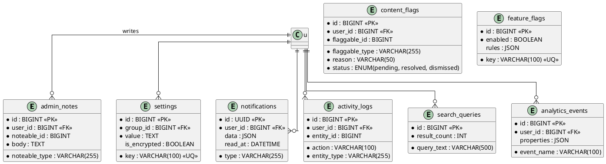

## AI & MCP

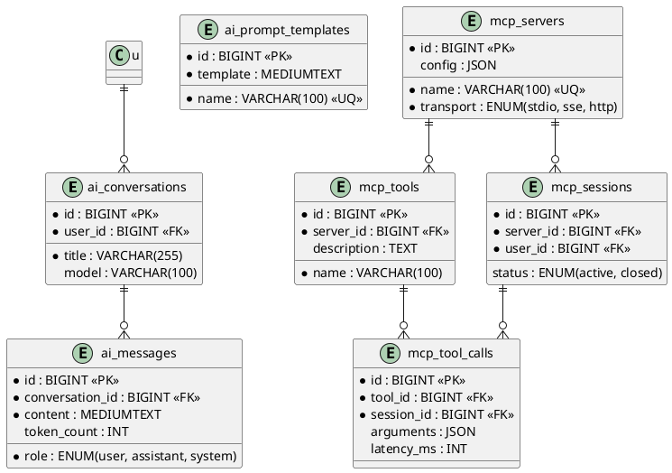

---

# Foreign Key Constraint Catalog

Every foreign key in the schema with its `ON DELETE`/`ON UPDATE` behavior.
`RESTRICT` is the safe default; deviations are deliberate and documented.

## Core

| Table | Column | References | ON DELETE | ON UPDATE |
|---|---|---|---|---|
| users | — | — | — | — |
| user_profiles | user_id | users.id | CASCADE | CASCADE |
| user_preferences | user_id | users.id | CASCADE | CASCADE |
| teams | owner_id | users.id | RESTRICT | CASCADE |
| team_members | team_id | teams.id | CASCADE | CASCADE |
| team_members | user_id | users.id | CASCADE | CASCADE |
| team_invitations | team_id | teams.id | CASCADE | CASCADE |
| blocked_users | user_id | users.id | CASCADE | CASCADE |
| blocked_users | blocked_user_id | users.id | CASCADE | CASCADE |
| user_verifications | user_id | users.id | CASCADE | CASCADE |

## Authentication

| Table | Column | References | ON DELETE | ON UPDATE |
|---|---|---|---|---|
| sessions | user_id | users.id | CASCADE | CASCADE |
| personal_access_tokens | tokenable_id | users.id (morph) | CASCADE | CASCADE |
| two_factor_auth | user_id | users.id | CASCADE | CASCADE |
| oauth_providers | user_id | users.id | CASCADE | CASCADE |
| login_attempts | — | none (email string) | — | — |
| password_reset_tokens | — | none (email PK) | — | — |

## Permissions

| Table | Column | References | ON DELETE | ON UPDATE |
|---|---|---|---|---|
| role_permissions | role_id | roles.id | CASCADE | CASCADE |
| role_permissions | permission_id | permissions.id | CASCADE | CASCADE |
| user_roles | user_id | users.id | CASCADE | CASCADE |
| user_roles | role_id | roles.id | CASCADE | CASCADE |
| user_roles | granted_by | users.id | SET NULL | CASCADE |
| team_roles | team_id | teams.id | CASCADE | CASCADE |
| team_role_permissions | team_role_id | team_roles.id | CASCADE | CASCADE |
| team_role_permissions | permission_id | permissions.id | CASCADE | CASCADE |

## Components

| Table | Column | References | ON DELETE | ON UPDATE |
|---|---|---|---|---|
| component_categories | parent_id | component_categories.id | SET NULL | CASCADE |
| components | user_id | users.id | RESTRICT | CASCADE |
| components | category_id | component_categories.id | SET NULL | CASCADE |
| component_variants | component_id | components.id | CASCADE | CASCADE |
| variant_options | variant_id | component_variants.id | CASCADE | CASCADE |
| variant_props | variant_id | component_variants.id | CASCADE | CASCADE |
| component_examples | component_id | components.id | CASCADE | CASCADE |
| component_docs | component_id | components.id | CASCADE | CASCADE |
| component_doc_sections | component_doc_id | component_docs.id | CASCADE | CASCADE |

## Marketplace

| Table | Column | References | ON DELETE | ON UPDATE |
|---|---|---|---|---|
| products | user_id | users.id | RESTRICT | CASCADE |
| products | category_id | product_categories.id | SET NULL | CASCADE |
| product_categories | parent_id | product_categories.id | SET NULL | CASCADE |
| product_versions | product_id | products.id | CASCADE | CASCADE |
| product_changelogs | product_version_id | product_versions.id | CASCADE | CASCADE |
| orders | user_id | users.id | RESTRICT | CASCADE |
| order_items | order_id | orders.id | CASCADE | CASCADE |
| order_items | product_id | products.id | RESTRICT | CASCADE |
| order_items | product_version_id | product_versions.id | RESTRICT | CASCADE |
| order_status_histories | order_id | orders.id | CASCADE | CASCADE |
| order_status_histories | changed_by | users.id | SET NULL | CASCADE |
| license_keys | order_id | orders.id | RESTRICT | CASCADE |
| license_keys | order_item_id | order_items.id | RESTRICT | CASCADE |
| license_keys | product_id | products.id | RESTRICT | CASCADE |
| license_keys | user_id | users.id | RESTRICT | CASCADE |
| license_activations | license_key_id | license_keys.id | CASCADE | CASCADE |
| license_revocations | license_key_id | license_keys.id | CASCADE | CASCADE |
| license_revocations | revoked_by | users.id | SET NULL | CASCADE |
| downloads | user_id | users.id | RESTRICT | CASCADE |
| downloads | product_id | products.id | RESTRICT | CASCADE |
| downloads | product_version_id | product_versions.id | RESTRICT | CASCADE |
| downloads | order_id | orders.id | SET NULL | CASCADE |
| download_links | download_id | downloads.id | CASCADE | CASCADE |
| download_attempts | download_link_id | download_links.id | CASCADE | CASCADE |
| download_attempts | user_id | users.id | RESTRICT | CASCADE |
| reviews | user_id | users.id | CASCADE | CASCADE |
| reviews | product_id | products.id | CASCADE | CASCADE |
| review_votes | review_id | reviews.id | CASCADE | CASCADE |
| review_votes | user_id | users.id | CASCADE | CASCADE |
| coupons | — | none | — | — |
| coupon_redemptions | coupon_id | coupons.id | CASCADE | CASCADE |
| coupon_redemptions | user_id | users.id | CASCADE | CASCADE |
| coupon_redemptions | order_id | orders.id | SET NULL | CASCADE |
| coupon_redemptions | subscription_id | subscriptions.id | SET NULL | CASCADE |
| coupon_products | coupon_id | coupons.id | CASCADE | CASCADE |
| coupon_products | product_id | products.id | CASCADE | CASCADE |
| coupon_plans | coupon_id | coupons.id | CASCADE | CASCADE |
| coupon_plans | plan_id | plans.id | CASCADE | CASCADE |

## Billing

| Table | Column | References | ON DELETE | ON UPDATE |
|---|---|---|---|---|
| subscriptions | plan_id | plans.id | RESTRICT | CASCADE |
| subscription_items | subscription_id | subscriptions.id | CASCADE | CASCADE |
| subscription_status_histories | subscription_id | subscriptions.id | CASCADE | CASCADE |
| subscription_status_histories | changed_by | users.id | SET NULL | CASCADE |
| subscription_usage_records | subscription_id | subscriptions.id | CASCADE | CASCADE |
| invoices | subscription_id | subscriptions.id | SET NULL | CASCADE |
| invoices | order_id | orders.id | SET NULL | CASCADE |
| invoice_lines | invoice_id | invoices.id | CASCADE | CASCADE |
| invoice_lines | product_id | products.id | SET NULL | CASCADE |
| invoice_payments | invoice_id | invoices.id | CASCADE | CASCADE |
| invoice_payments | payment_id | payments.id | CASCADE | CASCADE |
| payments | user_id | users.id | RESTRICT | CASCADE |
| payment_methods | user_id | users.id | CASCADE | CASCADE |
| payment_refunds | payment_id | payments.id | CASCADE | CASCADE |
| payment_refunds | refunded_by | users.id | SET NULL | CASCADE |
| payment_status_histories | payment_id | payments.id | CASCADE | CASCADE |
| webhook_deliveries | webhook_event_id | webhook_events.id | CASCADE | CASCADE |
| billing_addresses | user_id | users.id | CASCADE | CASCADE |
| tax_entries | invoice_id | invoices.id | CASCADE | CASCADE |
| tax_entries | tax_rate_id | tax_rates.id | RESTRICT | CASCADE |
| credits | user_id | users.id | RESTRICT | CASCADE |
| credit_applications | credit_id | credits.id | CASCADE | CASCADE |
| credit_applications | order_id | orders.id | SET NULL | CASCADE |
| credit_applications | invoice_id | invoices.id | SET NULL | CASCADE |

## Documentation

| Table | Column | References | ON DELETE | ON UPDATE |
|---|---|---|---|---|
| doc_spaces | user_id | users.id | CASCADE | CASCADE |
| doc_versions | space_id | doc_spaces.id | CASCADE | CASCADE |
| doc_pages | space_id | doc_spaces.id | CASCADE | CASCADE |
| doc_pages | version_id | doc_versions.id | CASCADE | CASCADE |
| doc_pages | locale_id | doc_locales.id | RESTRICT | CASCADE |
| doc_pages | author_id | users.id | SET NULL | CASCADE |
| doc_page_revisions | page_id | doc_pages.id | CASCADE | CASCADE |
| doc_page_revisions | editor_id | users.id | SET NULL | CASCADE |
| doc_page_blocks | page_id | doc_pages.id | CASCADE | CASCADE |
| doc_page_media | page_id | doc_pages.id | CASCADE | CASCADE |

## Playground & Snippets

| Table | Column | References | ON DELETE | ON UPDATE |
|---|---|---|---|---|
| playground_projects | user_id | users.id | CASCADE | CASCADE |
| playground_projects | team_id | teams.id | SET NULL | CASCADE |
| playground_projects | forked_from_id | playground_projects.id | SET NULL | CASCADE |
| playground_snapshots | project_id | playground_projects.id | CASCADE | CASCADE |
| playground_snapshots | created_by | users.id | SET NULL | CASCADE |
| snippets | user_id | users.id | CASCADE | CASCADE |
| snippets | category_id | snippet_categories.id | SET NULL | CASCADE |
| snippet_tag | snippet_id | snippets.id | CASCADE | CASCADE |
| snippet_tag | tag_id | tags.id | CASCADE | CASCADE |
| snippet_executions | snippet_id | snippets.id | CASCADE | CASCADE |
| snippet_executions | user_id | users.id | SET NULL | CASCADE |

## Blog/CMS

| Table | Column | References | ON DELETE | ON UPDATE |
|---|---|---|---|---|
| content_entries | author_id | users.id | SET NULL | CASCADE |
| content_categories | parent_id | content_categories.id | SET NULL | CASCADE |
| content_category | content_entry_id | content_entries.id | CASCADE | CASCADE |
| content_category | content_category_id | content_categories.id | CASCADE | CASCADE |
| content_tag | content_entry_id | content_entries.id | CASCADE | CASCADE |
| content_tag | content_tag_id | content_tags.id | CASCADE | CASCADE |
| content_entry_revisions | entry_id | content_entries.id | CASCADE | CASCADE |
| content_entry_revisions | editor_id | users.id | SET NULL | CASCADE |
| content_media | content_entry_id | content_entries.id | CASCADE | CASCADE |
| cms_menu_items | menu_id | cms_menus.id | CASCADE | CASCADE |
| cms_menu_items | parent_id | cms_menu_items.id | SET NULL | CASCADE |

## Admin / Operations

| Table | Column | References | ON DELETE | ON UPDATE |
|---|---|---|---|---|
| admin_notes | user_id | users.id | SET NULL | CASCADE |
| content_flags | user_id | users.id | SET NULL | CASCADE |
| moderation_queue | assigned_admin_id | users.id | SET NULL | CASCADE |
| settings | group_id | setting_groups.id | SET NULL | CASCADE |
| setting_scopes | setting_id | settings.id | CASCADE | CASCADE |
| feature_flags | created_by | users.id | RESTRICT | CASCADE |
| feature_flag_overrides | feature_flag_id | feature_flags.id | CASCADE | CASCADE |
| feature_flag_overrides | user_id | users.id | CASCADE | CASCADE |
| feature_flag_overrides | team_id | teams.id | CASCADE | CASCADE |
| feature_flag_history | feature_flag_id | feature_flags.id | CASCADE | CASCADE |
| feature_flag_history | changed_by | users.id | RESTRICT | CASCADE |
| notification_preferences | user_id | users.id | CASCADE | CASCADE |
| notification_preferences | channel_id | notification_channels.id | CASCADE | CASCADE |
| notifications | user_id | users.id | CASCADE | CASCADE |
| notification_queues | notification_id | notifications.id | CASCADE | CASCADE |
| notification_queues | channel_id | notification_channels.id | CASCADE | CASCADE |
| activity_logs | user_id | users.id | SET NULL | CASCADE |
| search_queries | user_id | users.id | SET NULL | CASCADE |
| analytics_events | user_id | users.id | SET NULL | CASCADE |
| analytics_sessions | user_id | users.id | SET NULL | CASCADE |
| analytics_page_views | session_id | analytics_sessions.id | CASCADE | CASCADE |
| ai_conversations | user_id | users.id | CASCADE | CASCADE |
| ai_messages | conversation_id | ai_conversations.id | CASCADE | CASCADE |
| ai_usage_logs | user_id | users.id | SET NULL | CASCADE |
| ai_usage_logs | conversation_id | ai_conversations.id | SET NULL | CASCADE |
| mcp_tools | server_id | mcp_servers.id | CASCADE | CASCADE |
| mcp_tool_parameters | tool_id | mcp_tools.id | CASCADE | CASCADE |
| mcp_tool_calls | tool_id | mcp_tools.id | CASCADE | CASCADE |
| mcp_tool_calls | session_id | mcp_sessions.id | CASCADE | CASCADE |
| mcp_tool_calls | user_id | users.id | SET NULL | CASCADE |
| mcp_tool_results | tool_call_id | mcp_tool_calls.id | CASCADE | CASCADE |
| mcp_sessions | server_id | mcp_servers.id | CASCADE | CASCADE |
| mcp_sessions | user_id | users.id | SET NULL | CASCADE |

## ON DELETE Policy Summary

| Behavior | Count | Typical Use |
|---|---|---|
| CASCADE | ~110 | Owned children (variants, snapshots, pivots) |
| SET NULL | ~30 | Audit/history attribution, optional parents |
| RESTRICT | ~18 | Financial records, licenses, payments |

Rules of thumb applied across the schema:

1. **Money and licenses never vanish:** all financial tables use RESTRICT on
   user/product references. Deleting a user with orders must fail loudly,
   not silently cascade.
2. **History outlives actors:** audit and history tables (`activity_logs`,
   `*_status_histories`) SET NULL their actor reference.
3. **Pivots cascade both sides:** a pivot row exists only while both endpoints
   exist.
4. **Self-referencing parents SET NULL:** deleting a tree node demotes its
   children to roots rather than destroying the subtree.

---

# Index Catalog

Non-PK, non-FK indexes grouped by access pattern they serve. FK columns are
indexed by their constraint unless noted.

## High-Cardinality Unique Indexes

| Table | Index | Columns |
|---|---|---|
| users | users_email_unique | email |
| users | users_username_unique | username |
| teams | teams_slug_unique | slug |
| components | components_slug_unique | slug |
| themes | themes_slug_unique | slug |
| templates | templates_slug_unique | slug |
| products | products_slug_unique | slug |
| license_keys | license_keys_key_unique | key |
| coupons | coupons_code_unique | code |
| plans | plans_slug_unique | slug |
| invoices | invoices_number_unique | number |
| personal_access_tokens | pat_token_unique | token |
| webhook_events | webhook_events_event_id_unique | provider, event_id |
| content_entries | content_entries_slug_unique | slug |
| settings | settings_key_unique | key |
| feature_flags | feature_flags_key_unique | key |
| search_index_versions | uk_search_index_versions_name_version | index_name, version |
| search_synced_models | uk_search_synced_models_model | model_type, model_id |

## Time-Window Indexes (created_at / occurred_at)

| Table | Index |
|---|---|
| activity_logs | activity_logs_occurred_at_index |
| analytics_events | analytics_events_created_at_index |
| search_queries | search_queries_created_at_index |
| feature_flag_history | feature_flag_history_created_at_index |
| login_attempts | login_attempts_attempted_at_index |

## Status/State Indexes

| Table | Index | Columns |
|---|---|---|
| orders | orders_status_index | status |
| subscriptions | subscriptions_status_index | status |
| invoices | invoices_status_index | status |
| payments | payments_status_index | status |
| content_entries | content_entries_status_index | status, published_at |
| content_flags | content_flags_status_index | status |
| moderation_queue | moderation_queue_status_index | status, priority |
| search_synced_models | search_synced_models_sync_status_index | sync_status |
| feature_flags | feature_flags_enabled_index | enabled |

## Composite Query Indexes

| Table | Index | Columns | Query |
|---|---|---|---|
| activity_logs | idx_activity_logs_user_occurred | user_id, occurred_at | Actor timeline |
| activity_logs | idx_activity_logs_entity_action | entity_type, entity_id, action | Entity timeline |
| order_items | idx_order_items_order_product | order_id, product_id | Order line lookup |
| reviews | idx_reviews_product_user | product_id, user_id | Rating lookup |
| notifications | idx_notifications_user_unread | user_id, read_at | Inbox query |
| content_entries | idx_content_entries_type_status | type, status, published_at | Blog listing |
| cms_menu_items | idx_cms_menu_items_menu_sort | menu_id, sort_order | Menu render |
| downloads | idx_downloads_user_product | user_id, product_id | Download history |
| snippet_executions | idx_snippet_executions_snippet_user | snippet_id, user_id | Dedupe check |

## Polymorphic Indexes

| Table | Index | Columns |
|---|---|---|
| activity_logs | activity_logs_entity_index | entity_type, entity_id |
| admin_notes | admin_notes_noteable_index | noteable_type, noteable_id |
| content_flags | content_flags_flaggable_index | flaggable_type, flaggable_id |
| moderation_queue | moderation_queue_moderatable_index | moderatable_type, moderatable_id |
| payments | payments_billable_index | billable_type, billable_id |
| subscriptions | subscriptions_billable_index | billable_type, billable_id |
| invoices | invoices_billable_index | billable_type, billable_id |
| orders | orders_billable_index | billable_type, billable_id |
| personal_access_tokens | pat_tokenable_index | tokenable_type, tokenable_id |

---

# Polymorphic Relationship Catalog

All morph columns in the schema, their owner models, and allowed targets.

| Table | Columns | Owner Model | Allowed Targets |
|---|---|---|---|
| activity_logs | entity_type, entity_id | ActivityLog | All audited models |
| admin_notes | noteable_type, noteable_id | AdminNote | User, Product, Order, Review |
| content_flags | flaggable_type, flaggable_id | ContentFlag | Snippet, PlaygroundProject, Review, ContentEntry |
| moderation_queue | moderatable_type, moderatable_id | ModerationItem | Same as content_flags |
| orders | billable_type, billable_id | Order | User, Team |
| subscriptions | billable_type, billable_id | Subscription | User, Team |
| invoices | billable_type, billable_id | Invoice | User, Team |
| payments | billable_type, billable_id | Payment | User, Team |
| billing_addresses | billable_type, billable_id | BillingAddress | User, Team |
| personal_access_tokens | tokenable_type, tokenable_id | Sanctum Token | User |
| search_synced_models | model_type, model_id | SearchSyncedModel | All searchable models |
| notifications | notifiable (Laravel) | Notification | User |

Rules:
- Every morph pair carries the composite `(type, id)` index.
- Morph class strings are registered in `AppServiceProvider::morphMap()` to
  keep stable short aliases (`user`, `team`, `product`) instead of FQCNs.
- `NOT NULL` on both columns unless the relation is explicitly optional.

---

# Migration Execution Order

Topologically sorted migration order (dependencies first). Laravel's numeric
prefixes follow this sequence.

```
2024_01_01_000001_create_users_table
2024_01_01_000002_create_user_profiles_table
2024_01_01_000003_create_user_preferences_table
2024_01_01_000004_create_teams_table
2024_01_01_000005_create_team_members_table
2024_01_01_000006_create_team_invitations_table
2024_01_01_000007_create_blocked_users_table
2024_01_01_000008_create_user_verifications_table
2024_01_01_000009_create_password_reset_tokens_table
2024_01_01_000010_create_sessions_table
2024_01_01_000011_create_personal_access_tokens_table
2024_01_01_000012_create_login_attempts_table
2024_01_01_000013_create_two_factor_auth_table
2024_01_01_000014_create_oauth_providers_table
2024_01_01_000015_create_roles_and_permissions_tables
2024_01_01_000016_create_component_categories_table
2024_01_01_000017_create_components_table
2024_01_01_000018_create_component_variants_and_options_tables
2024_01_01_000019_create_component_examples_table
2024_01_01_000020_create_component_docs_and_sections_tables
2024_01_01_000021_create_theme_categories_table
2024_01_01_000022_create_themes_table
2024_01_01_000023_create_theme_token_tables
2024_01_01_000024_create_theme_export_tables
2024_01_01_000025_create_template_tables
2024_01_01_000026_create_plan_tables
2024_01_01_000027_create_product_tables
2024_01_01_000028_create_order_tables
2024_01_01_000029_create_subscription_tables
2024_01_01_000030_create_invoice_tables
2024_01_01_000031_create_payment_tables
2024_01_01_000032_create_webhook_tables
2024_01_01_000033_create_tax_and_credit_tables
2024_01_01_000034_create_license_tables
2024_01_01_000035_create_download_tables
2024_01_01_000036_create_review_tables
2024_01_01_000037_create_coupon_tables
2024_01_01_000038_create_tag_table
2024_01_01_000039_create_doc_space_tables
2024_01_01_000040_create_doc_page_tables
2024_01_01_000041_create_playground_tables
2024_01_01_000042_create_snippet_tables
2024_01_01_000043_create_content_entry_tables
2024_01_01_000044_create_cms_tables
2024_01_01_000045_create_admin_note_tables
2024_01_01_000046_create_content_flag_tables
2024_01_01_000047_create_moderation_queue_table
2024_01_01_000048_create_setting_tables
2024_01_01_000049_create_feature_flag_tables
2024_01_01_000050_create_notification_tables
2024_01_01_000051_create_activity_log_tables
2024_01_01_000052_create_search_tables
2024_01_01_000053_create_analytics_tables
2024_01_01_000054_create_ai_tables
2024_01_01_000055_create_mcp_tables
```

Constraints:
- No cross-domain cycle exists; `teams` must precede everything that morphs
  to team (`orders`, `subscriptions`, `invoices`, `payments`).
- The shared `tags` table (used by components, themes, templates, products,
  snippets) is created before its first consumer.
- `plans` must precede `subscriptions` and `coupon_plans`.

Rollback order is the exact reverse, enforced automatically by `migrate:rollback`.

---

# Complete Table Catalog

Every table with its purpose, row-format recommendation, and expected growth
class (S < 100K, M 100K–10M, L > 10M rows at 5 years).

## Core (8 tables)

| Table | Purpose | Row Format | Growth |
|---|---|---|---|
| users | Platform accounts | DYNAMIC | M |
| user_profiles | Extended profile fields, 1:1 with users | DYNAMIC | M |
| user_preferences | Key-value user settings | DYNAMIC | M |
| teams | Team workspaces | DYNAMIC | S |
| team_members | Team membership pivot with roles | DYNAMIC | M |
| team_invitations | Pending team invites | DYNAMIC | S |
| blocked_users | User-to-user blocks | DYNAMIC | S |
| user_verifications | Email/phone/identity verification state | DYNAMIC | S |

## Authentication (6 tables)

| Table | Purpose | Row Format | Growth |
|---|---|---|---|
| password_reset_tokens | Ephemeral reset tokens (email PK) | DYNAMIC | S |
| personal_access_tokens | Sanctum API tokens | DYNAMIC | M |
| sessions | Database session store | DYNAMIC | L |
| login_attempts | Login audit for rate limiting | DYNAMIC | M |
| two_factor_auth | TOTP/SMS 2FA state | DYNAMIC | S |
| oauth_providers | OAuth account links | DYNAMIC | S |

## Permissions (9 tables)

| Table | Purpose | Row Format | Growth |
|---|---|---|---|
| roles | Named role records | COMPACT | S |
| permissions | Named permission records | COMPACT | S |
| role_permissions | Role ⇄ permission pivot | COMPACT | S |
| user_roles | User ⇄ role pivot | COMPACT | M |
| team_roles | Per-team role definitions | COMPACT | S |
| team_role_permissions | Team role ⇄ permission pivot | COMPACT | S |
| model_has_permissions | Spatie direct permission grants | COMPACT | S |
| model_has_roles | Spatie direct role grants | COMPACT | S |
| permission_groups | UI grouping for permission catalog | COMPACT | S |

## Components (14 tables)

| Table | Purpose | Row Format | Growth |
|---|---|---|---|
| component_categories | Category tree (self-ref parent) | COMPACT | S |
| components | Component registry | DYNAMIC | S |
| component_variants | Variant sets per component | DYNAMIC | S |
| variant_options | Selectable option values | COMPACT | S |
| variant_props | Variant prop definitions | COMPACT | S |
| component_examples | Code examples per component | DYNAMIC | S |
| example_screenshots | Example thumbnails | DYNAMIC | S |
| component_docs | Markdown docs per component | DYNAMIC | S |
| component_doc_sections | Doc page sections | DYNAMIC | S |
| component_tag | Component ⇄ tag pivot | COMPACT | S |
| component_versions | Version history | DYNAMIC | S |
| component_dependencies | Component ⇄ dependency edges | COMPACT | S |
| component_metrics | Download/usage counters | DYNAMIC | S |
| component_changelogs | Per-version changelog | DYNAMIC | S |

## Themes (10 tables)

| Table | Purpose | Row Format | Growth |
|---|---|---|---|
| theme_categories | Category tree | COMPACT | S |
| themes | Theme registry | DYNAMIC | S |
| theme_tag | Theme ⇄ tag pivot | COMPACT | S |
| theme_token_groups | Token grouping | COMPACT | S |
| theme_tokens | Design token definitions | COMPACT | S |
| theme_token_overrides | Scoped token overrides (polymorphic) | DYNAMIC | M |
| theme_exports | Built export artifacts | DYNAMIC | S |
| theme_export_assets | Files inside an export | DYNAMIC | S |
| theme_previews | Generated preview images | DYNAMIC | S |
| theme_favorites | User ⇄ theme favorites | COMPACT | M |

## Templates (10 tables)

| Table | Purpose | Row Format | Growth |
|---|---|---|---|
| template_categories | Category tree | COMPACT | S |
| templates | Template registry | DYNAMIC | S |
| template_tag | Template ⇄ tag pivot | COMPACT | S |
| template_files | Files within a template | DYNAMIC | S |
| template_dependencies | Package dependency manifest | DYNAMIC | S |
| template_assets | Binary assets | DYNAMIC | S |
| template_screenshots | Screenshot gallery | DYNAMIC | S |
| template_versions | Version history | DYNAMIC | S |
| template_favorites | User ⇄ template favorites | COMPACT | M |
| template_installs | Install tracking | DYNAMIC | M |

## Marketplace (28 tables)

| Table | Purpose | Row Format | Growth |
|---|---|---|---|
| product_categories | Category tree | COMPACT | S |
| products | Sellable product registry | DYNAMIC | S |
| product_tag | Product ⇄ tag pivot | COMPACT | S |
| product_media | Images/videos per product | DYNAMIC | S |
| product_prices | Multi-currency price records | DYNAMIC | S |
| product_versions | Released versions | DYNAMIC | M |
| product_changelogs | Version changelogs | DYNAMIC | M |
| product_compatibility | GsmUi version compatibility matrix | COMPACT | S |
| orders | Checkout orders | DYNAMIC | M |
| order_items | Order line items | DYNAMIC | M |
| order_status_histories | Order state transitions | DYNAMIC | M |
| license_keys | Issued license keys | DYNAMIC | M |
| license_activations | Activation records | DYNAMIC | M |
| license_revocations | Revocation audit | DYNAMIC | S |
| downloads | Download grants | DYNAMIC | M |
| download_links | Signed link issuance | DYNAMIC | M |
| download_attempts | Link usage audit | DYNAMIC | L |
| reviews | Product reviews | DYNAMIC | M |
| review_votes | Helpful votes | COMPACT | M |
| coupons | Discount coupons | DYNAMIC | S |
| coupon_redemptions | Redemption audit | DYNAMIC | M |
| coupon_products | Coupon ⇄ product pivot | COMPACT | S |
| coupon_plans | Coupon ⇄ plan pivot | COMPACT | S |
| product_favorites | User ⇄ product favorites | COMPACT | M |
| product_wishlists | Wishlists | DYNAMIC | S |
| wishlist_items | Wishlist lines | DYNAMIC | M |
| vendor_payouts | Marketplace vendor payouts | DYNAMIC | M |
| vendor_balance | Vendor running balance | DYNAMIC | S |

## Billing (20 tables)

| Table | Purpose | Row Format | Growth |
|---|---|---|---|
| plans | Subscription plans | COMPACT | S |
| subscriptions | Active/historic subscriptions | DYNAMIC | M |
| subscription_items | Multi-item subscriptions | DYNAMIC | M |
| subscription_status_histories | State transitions | DYNAMIC | M |
| subscription_usage_records | Metered usage | DYNAMIC | L |
| invoices | Billing documents | DYNAMIC | M |
| invoice_lines | Invoice line items | DYNAMIC | M |
| invoice_payments | Invoice ⇄ payment settlement | DYNAMIC | M |
| payments | Payment attempts and results | DYNAMIC | M |
| payment_methods | Stored payment methods | DYNAMIC | S |
| payment_refunds | Refund records | DYNAMIC | S |
| payment_status_histories | Payment state transitions | DYNAMIC | M |
| webhook_events | Inbound provider webhooks | DYNAMIC | L |
| webhook_deliveries | Processing attempts per event | DYNAMIC | L |
| billing_addresses | Billing address book | DYNAMIC | S |
| tax_rates | Jurisdiction tax rates | COMPACT | S |
| tax_entries | Tax applied per invoice/order | DYNAMIC | M |
| credits | Account credit balances | DYNAMIC | S |
| credit_applications | Credit spend records | DYNAMIC | M |
| plan_features | Feature flags per plan | COMPACT | S |

## Documentation (13 tables)

| Table | Purpose | Row Format | Growth |
|---|---|---|---|
| doc_spaces | Documentation projects | DYNAMIC | S |
| doc_versions | Versioned releases per space | DYNAMIC | S |
| doc_locales | Supported translation locales | COMPACT | S |
| doc_pages | Pages within space/version/locale | DYNAMIC | M |
| doc_page_revisions | Page edit history | DYNAMIC | M |
| doc_page_blocks | Structured page blocks | DYNAMIC | M |
| doc_page_media | Attachments | DYNAMIC | M |
| doc_page_links | Outbound link graph | DYNAMIC | M |
| doc_page_redirects | Slug redirect map | DYNAMIC | S |
| doc_anchors | Heading anchors for deep links | DYNAMIC | M |
| doc_search_documents | Search-optimized page projections | DYNAMIC | M |
| doc_feedback | Page helpfulness feedback | DYNAMIC | M |
| doc_contributors | Page contributor tracking | DYNAMIC | S |

## Playground & Snippets (8 tables)

| Table | Purpose | Row Format | Growth |
|---|---|---|---|
| playground_projects | Saved playground workspaces | DYNAMIC | M |
| playground_snapshots | Named checkpoints | DYNAMIC | M |
| snippet_categories | Snippet classification | COMPACT | S |
| snippets | Community code fragments | DYNAMIC | M |
| snippet_tag | Snippet ⇄ tag pivot | COMPACT | M |
| snippet_executions | Copy/run/view tracking | DYNAMIC | L |
| snippet_favorites | User ⇄ snippet favorites | COMPACT | M |
| snippet_report | Abuse reports | DYNAMIC | S |

## Blog/CMS (12 tables)

| Table | Purpose | Row Format | Growth |
|---|---|---|---|
| content_entries | Shared blog post + CMS page table | DYNAMIC | M |
| content_categories | Category tree | COMPACT | S |
| content_tags | Tag registry | COMPACT | S |
| content_category | Entry ⇄ category pivot | COMPACT | M |
| content_tag | Entry ⇄ tag pivot | COMPACT | M |
| content_entry_revisions | Edit history | DYNAMIC | M |
| content_media | Entry attachments | DYNAMIC | M |
| content_schedules | Publishing schedule | DYNAMIC | S |
| cms_menus | Site navigation menus | DYNAMIC | S |
| cms_menu_items | Menu item tree | DYNAMIC | S |
| cms_blocks | Reusable content blocks | DYNAMIC | S |
| content_page_views | Per-entry view counters | DYNAMIC | M |

## Admin (9 tables)

| Table | Purpose | Row Format | Growth |
|---|---|---|---|
| admin_notes | Internal staff notes (polymorphic) | DYNAMIC | M |
| content_flags | User-submitted reports (polymorphic) | DYNAMIC | M |
| moderation_queue | Moderation work items | DYNAMIC | M |
| setting_groups | Settings categorization | COMPACT | S |
| settings | Platform configuration key-values | DYNAMIC | S |
| setting_scopes | Scoped setting overrides | DYNAMIC | S |
| feature_flags | Feature toggles | DYNAMIC | S |
| feature_flag_overrides | Per-user/team overrides | DYNAMIC | S |
| feature_flag_history | Flag change audit | DYNAMIC | M |

## Notifications (4 tables)

| Table | Purpose | Row Format | Growth |
|---|---|---|---|
| notification_channels | Channel definitions | COMPACT | S |
| notification_preferences | Per-user channel opt-ins | DYNAMIC | M |
| notifications | Laravel notification rows | DYNAMIC | L |
| notification_queues | Delivery queue state | DYNAMIC | L |

## Audit & Observability (3 tables)

| Table | Purpose | Row Format | Growth |
|---|---|---|---|
| activity_logs | Immutable platform audit trail | DYNAMIC | L |
| activity_log_types | Action vocabulary catalog | COMPACT | S |
| search_queries | Logged search analytics | DYNAMIC | L |
| search_index_versions | Index version tracking | COMPACT | S |
| search_synced_models | Entity sync tracking | DYNAMIC | M |

## Analytics (5 tables)

| Table | Purpose | Row Format | Growth |
|---|---|---|---|
| analytics_events | Event stream | DYNAMIC | L |
| analytics_sessions | Session boundaries | DYNAMIC | L |
| analytics_page_views | Page view stream | DYNAMIC | L |
| analytics_goals | Goal definitions | COMPACT | S |
| analytics_funnels | Funnel definitions | COMPACT | S |

## AI (6 tables)

| Table | Purpose | Row Format | Growth |
|---|---|---|---|
| ai_conversations | Chat conversations | DYNAMIC | M |
| ai_messages | Conversation turns | DYNAMIC | L |
| ai_prompt_templates | Reusable prompt libraries | COMPACT | S |
| ai_provider_configs | Provider API settings | DYNAMIC | S |
| ai_usage_logs | Token/cost accounting | DYNAMIC | L |
| ai_skills | Skill definitions | COMPACT | S |

## MCP (6 tables)

| Table | Purpose | Row Format | Growth |
|---|---|---|---|
| mcp_servers | Registered MCP server endpoints | DYNAMIC | S |
| mcp_tools | Tools exposed per server | DYNAMIC | S |
| mcp_tool_parameters | Parameter schemas per tool | DYNAMIC | S |
| mcp_tool_calls | Invocation audit | DYNAMIC | M |
| mcp_tool_results | Result payloads | DYNAMIC | M |
| mcp_sessions | Client connection sessions | DYNAMIC | M |

---

# Row Storage Budget

Aggregate growth budget across the whole schema at year 5:

| Growth class | Tables | Estimated total rows | Estimated size |
|---|---|---|---|
| S (< 100K) | ~70 | ~1M | ~2 GB |
| M (100K–10M) | ~55 | ~60M | ~45 GB |
| L (> 10M) | ~15 | ~350M | ~180 GB |
| **Total** | **~140** | **~410M** | **~230 GB** |

The L-class tables (activity_logs, analytics streams, webhook events,
notification queues, snippet_executions, download_attempts) are the only
tables requiring partitioning; every other table fits comfortably in a single
tablespace with standard indexes.

Archive tiers move rows older than retention windows to object storage,
keeping the hot MySQL footprint near-constant after year 2.

---

# Cross-Domain Query Patterns

Recurring query shapes that span multiple domains, with the joins they need.

## User 360 (Admin Console)

```sql
SELECT
  u.id, u.email, u.name, u.created_at,
  (SELECT COUNT(*) FROM orders o WHERE o.user_id = u.id) AS order_count,
  (SELECT COALESCE(SUM(total_minor), 0) FROM orders o
     WHERE o.user_id = u.id AND o.status = 'paid') AS lifetime_value_minor,
  (SELECT COUNT(*) FROM licenses lk WHERE lk.user_id = u.id AND lk.status = 'active') AS active_licenses,
  (SELECT s.status FROM subscriptions s JOIN subscriptions_billable
     sb ON sb.subscription_id = s.id
     WHERE sb.billable_type = 'user' AND sb.billable_id = u.id
     ORDER BY s.id DESC LIMIT 1) AS subscription_status,
  (SELECT COUNT(*) FROM activity_logs al
     WHERE al.user_id = u.id
       AND al.occurred_at >= NOW() - INTERVAL 30 DAY) AS recent_activity,
  (SELECT COUNT(*) FROM content_flags cf
     WHERE cf.user_id = u.id AND cf.status = 'pending') AS open_flags
FROM users u
WHERE u.id = 42;
```

## Product Revenue Rollup

```sql
SELECT
  p.id, p.name,
  COUNT(DISTINCT oi.order_id) AS sales,
  COALESCE(SUM(oi.unit_price_minor * oi.quantity), 0) AS gross_minor,
  COALESCE(SUM(cr.amount_saved), 0) AS coupon_discount_minor,
  ROUND(AVG(r.rating), 2) AS avg_rating
FROM products p
LEFT JOIN order_items oi ON oi.product_id = p.id
LEFT JOIN orders o ON o.id = oi.order_id AND o.status = 'paid'
LEFT JOIN coupon_redemptions cr ON cr.order_id = o.id
LEFT JOIN reviews r ON r.product_id = p.id
WHERE p.id = 12
GROUP BY p.id, p.name;
```

## Content Funnel (Search → View → Convert)

```sql
SELECT
  DATE(sq.created_at) AS day,
  COUNT(DISTINCT sq.id) AS searches,
  COUNT(DISTINCT apv.id) AS page_views,
  COUNT(DISTINCT CASE WHEN s.status = 'active' THEN s.id END) AS conversions
FROM search_queries sq
LEFT JOIN analytics_page_views apv
  ON apv.user_id <=> sq.user_id
 AND apv.created_at BETWEEN sq.created_at AND sq.created_at + INTERVAL 30 MINUTE
LEFT JOIN subscriptions s ON s.billable_type = 'user'
  AND s.billable_id = sq.user_id
 AND s.created_at >= sq.created_at
GROUP BY day
ORDER BY day DESC
LIMIT 30;
```

## Team Billing Health

```sql
SELECT
  t.id, t.name,
  MAX(s.status) AS worst_subscription_status,
  COUNT(CASE WHEN i.status = 'open' THEN 1 END) AS open_invoices,
  COALESCE(SUM(CASE WHEN i.status = 'open' THEN i.total_minor END), 0)
    AS outstanding_minor
FROM teams t
LEFT JOIN subscriptions s ON s.billable_type = 'team' AND s.billable_id = t.id
LEFT JOIN invoices i ON i.billable_type = 'team' AND i.billable_id = t.id
GROUP BY t.id, t.name
HAVING open_invoices > 0 OR worst_subscription_status IN ('past_due','cancelled');
```

## Component Popularity Join

```sql
SELECT
  c.name,
  COUNT(DISTINCT pp.id) AS playground_usage,
  COUNT(DISTINCT sn.id) AS snippet_mentions,
  COALESCE(SUM(ce.view_count), 0) AS doc_views
FROM components c
LEFT JOIN playground_projects pp ON JSON_CONTAINS(pp.component_ids, CAST(c.id AS JSON))
LEFT JOIN snippets sn ON sn.code LIKE CONCAT('%', c.name, '%')
LEFT JOIN component_examples ce ON ce.component_id = c.id
GROUP BY c.id, c.name
ORDER BY playground_usage DESC
LIMIT 20;
```

---

# Seed Orchestration

Database seeding order mirrors the migration order. `DatabaseSeeder` composes
domain seeders; each seeder is idempotent (uses `updateOrCreate`/`firstOrCreate`).

```php
namespace Database\Seeders;

use Illuminate\Database\Seeder;

class DatabaseSeeder extends Seeder
{
    public function run(): void
    {
        $this->call([
            // Foundation
            RolesAndPermissionsSeeder::class,
            SettingGroupSeeder::class,
            SettingsSeeder::class,
            // Vocabularies
            ActivityLogTypeSeeder::class,
            TagSeeder::class,
            DocLocaleSeeder::class,
            NotificationChannelSeeder::class,
            TaxRateSeeder::class,
            // Catalogs
            ComponentCategorySeeder::class,
            ThemeCategorySeeder::class,
            SnippetCategorySeeder::class,
            ContentCategorySeeder::class,
            // Admin
            FeatureFlagSeeder::class,
            CmsMenuSeeder::class,
            // Demo data (non-production only)
            ...(config('app.env') !== 'production' ? [
                DemoUsersSeeder::class,
                DemoComponentsSeeder::class,
                DemoProductsSeeder::class,
            ] : []),
        ]);
    }
}
```

Production vs local split:

| Seeder | prod | local |
|---|---|---|
| Roles/permissions | yes | yes |
| Settings vocabulary | yes | yes |
| Activity log types | yes | yes |
| Tax rates | yes | yes |
| Demo users/content | no | yes |
| Sample coupons | no | yes |

---

# ERD Validation Queries

Queries that verify the schema matches the documented ERD — run in CI.

## Orphan Foreign Key Detection

```sql
-- Find FK columns pointing at nonexistent parents (should return 0 rows)
SELECT 'order_items.product_id' AS violation, COUNT(*) AS orphans
FROM order_items oi
LEFT JOIN products p ON p.id = oi.product_id
WHERE p.id IS NULL
UNION ALL
SELECT 'subscriptions.plan_id', COUNT(*)
FROM subscriptions s
LEFT JOIN plans pl ON pl.id = s.plan_id
WHERE pl.id IS NULL
UNION ALL
SELECT 'license_keys.order_id', COUNT(*)
FROM license_keys lk
LEFT JOIN orders o ON o.id = lk.order_id
WHERE o.id IS NULL;
```

## Unique Constraint Audit

```sql
-- Verify documented unique pairs hold (0 rows each)
SELECT coupon_id, user_id, order_id, COUNT(*) AS dupes
FROM coupon_redemptions
GROUP BY coupon_id, user_id, order_id
HAVING dupes > 1;

SELECT model_type, model_id, COUNT(*) AS dupes
FROM search_synced_models
GROUP BY model_type, model_id
HAVING dupes > 1;
```

## Missing Table Detection

```sql
-- Compare live schema against documented table list
SELECT t.table_name AS missing_table
FROM (
  SELECT 'users' AS table_name UNION SELECT 'teams' UNION SELECT 'components'
  UNION SELECT 'products' UNION SELECT 'orders' UNION SELECT 'subscriptions'
  UNION SELECT 'invoices' UNION SELECT 'payments' UNION SELECT 'activity_logs'
  UNION SELECT 'search_queries' UNION SELECT 'feature_flags'
  -- ... full documented list
) t
LEFT JOIN information_schema.tables it
  ON it.table_schema = DATABASE() AND it.table_name = t.table_name
WHERE it.table_name IS NULL;
```

## Undocumented Index Detection

```sql
-- Live indexes not present in the catalog (drift detector)
SELECT s.table_name, s.index_name
FROM information_schema.statistics s
WHERE s.table_schema = DATABASE()
  AND (s.table_name, s.index_name) NOT IN (
    -- (table, index) pairs from the Index Catalog above
  )
GROUP BY s.table_name, s.index_name;
```

---

# Naming Consistency Rules

Rules the entire schema obeys (enforced by CI lint on migration files):

1. **Tables:** plural snake_case (`coupons`, not `coupon` or `Coupon`).
2. **Columns:** snake_case singular (`coupon_id`, not `couponId`).
3. **Primary keys:** `id BIGINT UNSIGNED AUTO_INCREMENT` everywhere; UUIDs only
   where noted (notifications).
4. **Foreign keys:** `{singular_table}_id` (`order_id`, not `orderId` or `order_ref`).
5. **Pivots:** alphabetically ordered pair (`coupon_plans`, not `plan_coupon`).
6. **Polymorphic:** `{name}_type` + `{name}_id` pair, morph map registered.
7. **Timestamps:** `created_at`, `updated_at` on stateful tables; `created_at`
   only on immutable event tables (activity_logs, search_queries has both for
   framework compatibility).
8. **Soft deletes:** `deleted_at` only on user-owned content tables; never on
   financial or audit tables.
9. **Status columns:** ENUM with lowercase values; documented transitions.
10. **Indexes:** `{table}_{cols}_index` / `{table}_{cols}_unique`.
11. **Constraints:** `fk_{table}_{column}`, `uk_{table}_{cols}`,
    `chk_{table}_{column}`.
12. **Money:** `*_minor` suffix, BIGINT UNSIGNED, stored in smallest currency
    unit; `currency CHAR(3)` column alongside.
13. **JSON:** snake_case keys inside; documented shape per table.

---

# Design Trade-Off Register

Decisions made deliberately across the schema, listed so future reviewers do
not relitigate them.

| Decision | Alternative considered | Rationale |
|---|---|---|
| Single `products` table | Separate tables per product type | Simpler joins; type variance handled by columns + JSON |
| `content_entries` shared blog/page | Separate blog_posts + cms_pages | ~80% column overlap; `type` discriminator cheaper |
| Morph polymorphic billables | Explicit user_billables/team_billables | Halves billing table count; composite index preserves speed |
| JSON for theme token values | EAV token_values table | Read-mostly access; JSON avoids 3-table joins per render |
| `activity_logs.action` string FK to catalog | Hard FK on action column | Write-path cost; catalog enforced at application layer |
| Denormalized counters (used_count, view_count) | Live aggregation | Hot-path latency; reconciled by scheduled jobs |
| `search_queries.query_text(191)` prefix index | Full column index | utf8mb4 key length limit; prefix suffices for lookup |
| ENUM status columns | VARCHAR + CHECK | Self-documenting; migration-managed value set |
| No partitioning below ~2M rows | Partition everything | Partitioning cost (full rebuild) outweighs benefit at low volume |
| Sanctum tokens in DB | Stateless JWT | Revocable sessions; negligible query volume |

---

# Glossary

| Term | Definition |
|---|---|
| **Domain** | A bounded context grouping related tables (Marketplace, Billing, etc.) |
| **Morph** | Polymorphic `*_type` + `*_id` column pair referencing multiple tables |
| **Pivot** | Two-sided junction table (often implicit, sometimes with payload) |
| **Billable** | The polymorphic owner of a billing entity (user or team) |
| **Minor units** | Money stored as integer cents/pence (no floating point) |
| **RESTRICT FK** | Delete blocked while referencing rows exist — used for money |
| **SET NULL FK** | Delete nulls the reference — used for history attribution |
| **Cascade FK** | Delete propagates to children — used for owned content |
| **Growth class** | S/M/L row-count projection at year 5 |
| **Hot tier** | Data served from primary MySQL within retention window |
| **Cold tier** | Archived data in object storage beyond retention window |
| **Morph map** | Laravel map of short morph aliases to model classes |

---

# Final Review Checklist

Completeness verification for this ERD before it becomes the canonical
implementation reference:

- [ ] Every table in the Document Index appears in the Complete Table Catalog
- [ ] Every FK in the constraint catalog matches its migration definition
- [ ] All morph columns are registered in the application morph map
- [ ] Money columns use BIGINT UNSIGNED minor units with paired currency
- [ ] Financial tables use RESTRICT, audit tables use SET NULL for actors
- [ ] Soft deletes exist only on user-owned content tables
- [ ] L-growth tables have a partitioning plan documented in their domain doc
- [ ] Seeders are idempotent (updateOrCreate on natural keys)
- [ ] Migration order has no forward dependencies
- [ ] ERD validation queries are run in CI against the live schema

---

# Related Documents

- [06.01 - Design Principles](../06-database-design/06.01-design-principles.md)
- [06.02 - Naming Conventions](../06-database-design/06.02-naming-conventions.md)
- [06.03 - Common Columns](../06-database-design/06.03-common-columns.md)
- [06.04 - Relationships](../06-database-design/06.04-relationships.md)
- [06.10 - Users](../06-database-design/06.10-users.md)
- [06.50 - Marketplace](../06-database-design/06.50-marketplace.md)
- [06.60 - Subscriptions](../06-database-design/06.60-subscriptions.md)
- [06.111 - Activity Log](../06-database-design/06.111-activity-log.md)
- [06.120 - Search](../06-database-design/06.120-search.md)
- [05.45 - Database Design (legacy)](../05-system-architecture/05.45-database-design.md)
